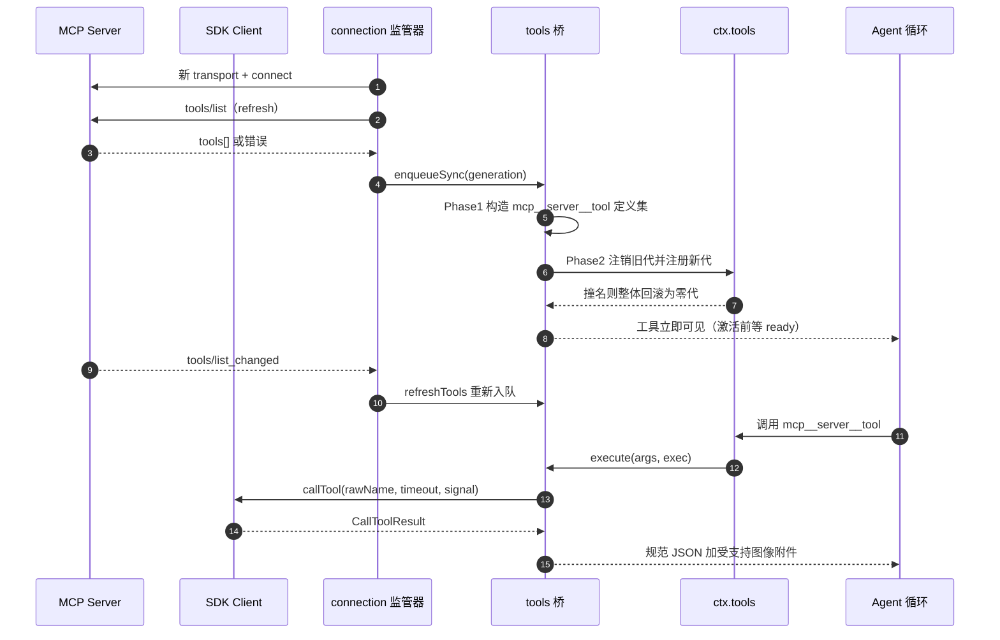
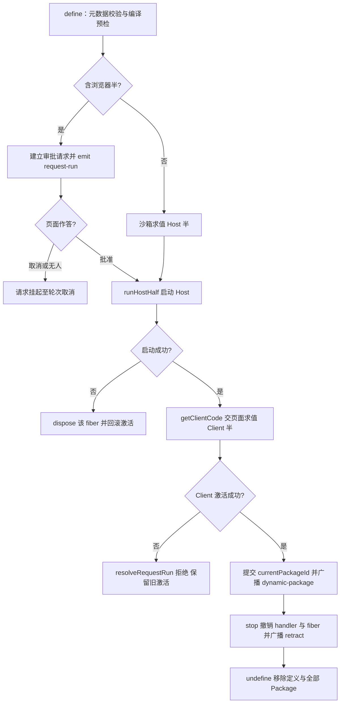

# 外部能力接入：四种外来物，四条不同的缝

> 关注面：dsh 如何让「不属于本进程」的指令、工具、代码与事件，变成 agent 可发现、可审计、可撤销的本地能力。这是「一切皆插件」哲学最容易被外部输入腐蚀的边界，因此每一类接入都在回答同一个问题：**外来物以什么粒度进入哪一层，以及撤销时能退回到哪里。**

## 四套接入接的不是同一层

一个 agent harness 对外来输入的吸收点只有四处，dsh 各配了一套机制，而且几乎不复用实现：

| 接入类型 | 进入的层 | 触发者 | 可见性形态 | 撤销的粒度 | 主要实现 |
|---|---|---|---|---|---|
| Skill | 上下文（会话消息 + 一个加载工具） | 模型按名调用 / 用户 `/name` | 目录摘要（`name` + `description`）先进提示词，正文按需 | 目录整体替换一条消息 | `packages/skill/*` |
| MCP | 工具（`ctx.tools` 注册表条目） | 模型直接调用 | 每个上游工具变成一条普通工具定义 | 一代工具全量注销 | `packages/mcp/*` |
| 动态扩展 | 代码（`node:vm` 里求值的 Cordis 插件，加浏览器半） | 用户/模型显式 `run`，可常驻 | 新注册的工具、slot、服务 | `fiber.dispose()` 回收全部 effect | `packages/extensions/*` |
| Webhook | 事件（外部投递 → 规则 → 新建会话） | 外部服务推 HTTP | 一条带 `source.kind: "webhook"` 的用户消息 | 规则注销时中止并排空在途调用 | `packages/experimental/webhook*` |

差别不是实现懒惰，而是**错误域互不相邻**：Skill 出错只污染上下文（重发一条目录即可修复）；MCP 出错影响一次工具调用（注销一代工具即可修复）；动态扩展出错可能污染整个进程（只能 dispose fiber 或重启）；Webhook 出错是外部世界的副作用（重复建会话、重复消耗 token，且没有撤销手段）。若强行合成一套「统一扩展点」，就要把四套生命周期约束取并集——结果是读一份 `SKILL.md` 也要走审批与版本锁；若取最宽松的并集，动态代码就会在无人点头的情况下进进程。

它们唯一共享的合同是 **Cordis 的 effect 与 scope**：Skill 提供方注册进 scope 层，MCP 工具注册进 `ctx.tools`，动态包的 Host 半是一条独立 fiber，Webhook 规则是一个带 abort signal 的 effect disposer。「可逆副作用」是唯一的公共抽象，其余各自决定。

## Skill：目录进上下文，正文留在磁盘

### 注册表分层，rank 只在单层内裁决

`ctx.skills` 的结构刻意与工具注册表同形：宿主行与仓库插件注册进全局层，由 agent preset 常驻组合挂载的插件注册进该 preset 的层；读取时把全局层与观察 scope 的链合并，**最近层的同名胜出，rank 顺序只在同一层内决定胜负**。这条规则有一个不显眼但重要的后果：preset 可以整体**遮蔽**某个全局 skill，而不必改动别处的优先级数字。

单层内的次序是 `rank → 提供方注册顺序 → 提供方内本地顺序`：

```
  return left.candidate.rank - right.candidate.rank
    || left.providerOrder - right.providerOrder
    || left.localOrder - right.localOrder
```
[packages/skill/skill/src/index.ts:808-810]()
<!-- anchor:   return left.candidate.rank - right.candidate.rank …     || left.localOrder - right.localOrder -->

本地文件提供方把「谁优先」编码成固定数字，项目级永远压过用户级：

```ts
const PROJECT_DSH_RANK = 100
const PROJECT_AGENTS_RANK = 200
const CUSTOM_RANK = 300
const USER_DSH_RANK = 400
const USER_AGENTS_RANK = 500
```
[packages/skill/skill-filesystem/src/index.ts:35-39]()
<!-- anchor: const PROJECT_DSH_RANK = 100 … const USER_AGENTS_RANK = 500 -->

| Rank | source | 根目录 | 设计意图 |
|---|---|---|---|
| 100 | `project-dsh` | `<projectRoot>/.dsh/skills` | dsh 自己的项目约定，最具体 |
| 200 | `project-agents` | `<projectRoot>/.agents/skills` | 跨工具共享的仓库约定 |
| 250 | `runtime` | `ctx.skills.register()` 贡献 | 运行时生成，例如随包诊断 |
| 300 | `custom` | `Config.customSkillDirs` | 部署方注入，例如 preset 随包技能目录 |
| 400 | `user-dsh` | `<dshHome>/skills`（跳过 `.system`） | 用户全局偏好 |
| 500 | `user-agents` | `<agentsHome>/skills` | 用户跨工具共享 |
| 600 | `bundled` | `Config.bundledSkillDir` | 随包/内置，最不具体 |

`runtime` 这一层不是目录，而是 `ctx.skills.register()` 的贡献，其 rank 常量就在注册表内部：

```
const RUNTIME_PROVIDER = 'runtime'
const RUNTIME_RANK = 250
```
[packages/skill/skill/src/index.ts:24-25]()
<!-- anchor: const RUNTIME_PROVIDER = 'runtime' … const RUNTIME_RANK = 250 -->

`projectRoot` 取「含 `.git` 的最近祖先」，找不到时退化为 cwd；当 `ctx.fs` 可用时探测走文件系统服务而不是宿主 `path`，因此远程或沙箱工作区不会悄悄越界到宿主目录。这决定了同一份 profile 在本地与远程执行时看到**不同的 skill 集合**——发现是按工作区做的，不是按进程做的。

### 快照里的 `complete` 位：把「确定的没有」和「暂时读不到」分开

`ctx.skills.snapshot()` 不只返回列表，还带一个 `complete`。只要任一个提供方拒绝、超时、或发现期间注册表发生并发变更，它就是 false，而且该结果**不进入缓存**。上层据此可以保留上一份可用视图，而不是把 skill 列表清空。重试只有一次：

```
      if (revision !== this.revision) {
        if (attempt < MAX_COLLECT_ATTEMPTS) {
```
[packages/skill/skill/src/index.ts:533-534]()
<!-- anchor:       if (revision !== this.revision) { …         if (attempt < MAX_COLLECT_ATTEMPTS) { -->

第二次仍不稳定就返回「不完整且不缓存」的结果，而不是继续重试把首 token 延迟越拖越长。缓存键把 scope 链本身纳入哈希，因为空会话重组会重新挂父而不触碰注册表；只有链参与键，下一次读才能看到新 preset。

「最近层胜出」优先于 rank 这一点值得多看一眼：它让「项目里放一份同名 skill 覆盖用户的全局版本」无需任何数字比较，也让一个 preset 能整体定义自己的技能面。反过来，如果层内 `rank` 恰好也相等，胜负由**提供方注册顺序**决定——这是一个进程级单调计数器，不是配置项，因此「两个 rank 相同的提供方谁赢」依赖加载顺序而非声明，属于文档里没有明说、调试时最容易踩的隐式规则。

### 会话目录：一条 XML 摘要消息，digest 变了就整条替换

模型看到的「可用技能列表」不是系统提示词的静态片段，而是**一条持久化的 user-role `<system-reminder>` 消息**，由 `tool-skill` 在 `agent/pre-step` 注入。它只含排序后的 `name` 与规范化、XML 转义后的 `description`（默认上限 500 字符），不含正文、路径、来源和提供方——这三项对路由没有帮助，只消耗 token。

每次模型步骤前，消费方重算目录条目的 sha256 digest，与「本插件发布过、仍对模型可见的最新目录消息」比较；不一致就追加一条**完整替换**的目录消息，删除全部 skill 时同样追加一条显式的空目录。三点值得注意：

- 比较对象是**条目列表的规范化 JSON**，不是渲染后的散文。框架标签（`<system-reminder>` 之类）是为模型写的，不该参与「要不要重发」的判断。
- 判定「可见」用 `agent.session.surface.nodes`：压缩若把历史目录消息藏起来，下一次完整快照会重新建立目录，而不是误以为「已经发过」。
- 目录消息是**会话历史**而非 World State。它可被压缩、可被回放，resume/fork 出来的会话里可能留着旧版本甚至别人写的记录——所以读取条目时逐字段校验，读不懂就当「不是我的目录」，绝不在 step 监听器里抛错（抛错会毁掉该会话之后每一轮）。

为什么整条替换而非增量？增量要求模型正确维护「哪些名字仍有效」的状态，而模型对长对话中段的编辑极不可靠；整条替换让最新一条永远是唯一事实，代价是每次目录变化多一份完整摘要——而摘要本来就只有 name 与截断后的 description。

### `skill({ name })` 的双重校验与被解耦的正文

`skill` 工具先按 kebab-case 校验名称，在不加调用策略过滤的目录里查摘要，用 `isModelInvocable` 拦一次；然后用调用 agent 的 cwd **重新读完整定义**，读回来再拦一次。注册表本身不缓存正文，所以「改 SKILL.md 正文」只影响下一次工具调用，不产生目录消息、也不改写历史工具结果——正文与身份（name/description）被有意解耦。

同一条思路也解释了 frontmatter 的演化：调用控制被归一化成两个正向布尔 `modelInvocable` / `userInvocable`，而历史写法 `disableModelInvocation`、`modelInvocable`、`userInvocable` 会被**显式拒绝**并提示改用 `disable-model-invocation` / `user-invocable`。理由是旧字段否定式与肯定式混用、且从未成为契约，静默接受会让同一文件在不同版本里含义漂移。四种策略组合都是合法配置：仅模型可见、仅用户可见、两者皆可、两者皆否（只允许受信的 `ctx.skills.get()` 调用方取用）。

用户侧是另一条通道：`<input>/<name>` 只在 `source.kind === 'user'` 的消息里被识别，外部文本无法伪造这个手势；识别到后把渲染好的 `<skill_content>` 以 `instructions` 形式追加到本轮**最后**（离回答最近），并带上 `skill-invocation` 来源，让 transcript 不必重新解析文本即可呈现。这也是 `disable-model-invocation` 技能唯一的入口。

> 与本篇其他通道的呼应：Skill 注入的是一条 `source.kind: 'skill-catalog'` 的持久用户消息，Webhook 注入的是一条 `source.kind: 'webhook'` 的持久用户消息——两者都靠「来源即类型」让下游不必解析文本，这正是「Model-visible means logged」在外部能力上的具体落地。

## MCP：把远程工具降级成本地工具定义

### 映射：三元只剩一元可用

MCP 提供三类能力（tools / resources / prompts），dsh 只为前两类建了通道，且形态完全不同：

- **tools**：每个上游工具变成一条 `ctx.tools` 定义，名字 `mcp__<serverName>__<rawName>`，`description` 与 `inputSchema` 原样搬运，`outputSchema` 先过 dsh 的 JSON Schema 支持度检查，不支持就退回 `JsonValue`。
- **resources**：不由每个服务器单独暴露，而是**三条共享工具**（`list_mcp_resources`、`list_mcp_resource_templates`、`read_mcp_resource`），第一个参数是必须显式给出的服务器名；游标原样透传。
- **prompts**：不支持。

这个适配器的依赖面只有一个服务——客户端**不发布共享的 `ctx.mcp` 服务**，因此「一个服务器」在一份组合里就是「一个插件实例」，多个服务器彼此独立、可单独启停、可单独 HMR。资源服务与系统提示词都是经 `ctx.inject` 可选挂接的；缺了它们工具桥照样工作。这是「能力缝」在本模块的具体形态：MCP 不要求宿主先装好一整套子系统。

```
export const inject = ['tools']
```
[packages/mcp/mcp-client/src/index.ts:34]()
<!-- anchor: export const inject = ['tools'] -->

### 名字预算：64 字符加 12 位 sha256

DeepSeek 的函数名契约是「≤64 字符、只允许 `[A-Za-z0-9_-]`」，而 MCP 工具名常含 `.`、`/` 或超长。规范化必须是确定性的且不塌缩：

```
  const joined = `mcp__${serverName}__${rawName}`
  const normalized = joined.replace(INVALID_NAME_CHARS, '_')
  if (normalized === joined && normalized.length <= MAX_PUBLIC_NAME_LENGTH) return normalized
  const hash = createHash('sha256').update(`${serverName}\0${rawName}`).digest('hex').slice(0, HASH_LENGTH)
  return `${normalized.slice(0, MAX_PUBLIC_NAME_LENGTH - HASH_LENGTH - 1)}_${hash}`
```
[packages/mcp/mcp-client/src/tools.ts:82-86]()
<!-- anchor:   const joined = `mcp__${serverName}__${rawName}` …   return `${normalized.slice(0, MAX_PUBLIC_NAME_LENGTH - HASH_LENGTH - 1)}_${hash}` -->

关键设计：哈希输入是 `(serverName, rawName)` 的 NUL 分隔对，**而不是规范化后的字符串**。这样两个不同的 MCP 身份不会因为字符替换或截断塌缩成同一个公开名。代价是公开名不可逆——所以实现里写死一条纪律：公开名永不反解回 raw name，线上 `tools/call` 永远发原始的 `tool.name`（由闭包捕获）。`serverName` 本身被限制在 1–32 字符，给前缀与工具名留出预算，这个上限在配置 schema 里就是硬约束：

```
const SERVER_NAME_PATTERN = /^[A-Za-z0-9_-]{1,32}$/
```
[packages/mcp/mcp-client/src/index.ts:40]()
<!-- anchor: const SERVER_NAME_PATTERN = /^[A-Za-z0-9_-]{1,32}$/ -->

### 两阶段代际切换：先构建，后换表，失败回到零

第一阶段只做网络读取与定义构造，任何失败（网络错误、上游重复列出同名工具）在这一阶段就拒绝，旧代原样保留。第二阶段才注销旧代、注册新代：

```
  // Phase 2: swap generations.
  for (const dispose of previous.values()) dispose()
```
[packages/mcp/mcp-client/src/tools.ts:145-146]()
<!-- anchor:   // Phase 2: swap generations. …   for (const dispose of previous.values()) dispose() -->

若注册中途撞名（说明有外部注册占用了本服务器的 `mcp__<serverName>__` 命名空间），已注册的部分全部回滚并记录错误，结果是**空代**而不是半代。首次同步可选 `registrationFailure: 'throw'`，让冲突沿 `failOnStartupError` 传播成插件激活失败；其余场景一律 `contain`。

所有同步串行化在一条 `syncChain` 上，两代的「先注销、再注册」绝不交错——否则同一代会被注销两次、另一代泄漏。链的尾部在失败后仍存活，由入队方负责报告错误。



时序里最容易忽略的是**代际**：每次重连都新建 `Client` 与 transport，因为 MCP SDK 把一个 Protocol 绑死在一个 transport 上。`isCurrent(generation)` 是所有候选检查的总闸——旧代的 `onclose`、迟到的 listChanged、迟到的发现结果都会被静默丢弃，不会去动当前代的注册表。

### 丢了什么，怎么补偿

| 上游信息 | 映射后还剩什么 | 补偿手段 | 判断 |
|---|---|---|---|
| `inputSchema` | 原样作为工具参数 schema | 交给工具执行管线做参数校验 | 保真；非法 schema 由注册表拒绝 |
| `outputSchema` | 只在 dsh 的 Schema 子集内保留 | 不支持就降级为 `JsonValue`，原始 JSON 仍完整 | 有意降级：宁可类型提示变弱，也不让工具注册失败 |
| 认证 | 无协议级认证 | stdio：清洗后的父环境 + 显式 `env`；HTTP：静态 `headers` | 只有静态凭据，无 OAuth 流程 |
| 流式 / 进度通知 | 模型看不到中间进度 | 无 | 缺口：长任务只能等最终结果或超时 |
| 分页 | tools 由 SDK 聚合；resources 由游标透传 | 调用方传 `cursor` | 由 SDK 与服务器拥有，dsh 不猜 |
| `isError` | 转化为抛错，让管线记 `isError` 结果 | `structuredContent` 与 `content` 仍完整保留 | 语义对齐 |
| audio / embedded resource | 文本诊断占位 | 原始 JSON 对程序化调用方（PTC）仍可得 | 模型侧有损，程序侧无损 |
| 图像 | 校验 MIME 与规范 base64，经附件存储持久化 | 当前路由不支持图像时逐张降级为文本诊断 | 「拒绝要解释，而不是静默丢弃」 |

错误与超时治理分三层：上游 `isError` 变成工具级失败；每次调用有 `toolCallTimeoutMs`（默认 60s）；连接层重启走有界指数退避（默认 500ms 起、上限 30s、最多 10 次），且「一次故障一个预算」——连接稳定存活超过 `maxDelayMs` 才清零计数，于是「连上就崩」的服务器最终耗尽预算并注销工具，而不是永远重启。若某代关闭无法确认（5 秒之外仍未收到进程关闭事件），监管器**放弃重连**，宁可失败关闭也不叠一个可能与之并存的子进程。

### 为什么不做 prompts 与 subscriptions

`docs/subsystems/mcp.zh.md`「限制」一节明确列出不支持 prompt 模板、elicitation（人工输入征询）、task-based execution 与 resource subscriptions。前三者的共同点是「需要向人类或长生命周期任务要一个中间答案」，而 dsh 里承担这件事的已经是 `user-questions` 与审批瀑布——再接一条 MCP 旁路只会产生第二套人类交互语义。subscription 则是**推送**：dsh 的会话是 append-only 日志，外部推送若直接触发动作会绕过「Model-visible means logged」；资源一律按需拉取，因此这里选择不实现，而不是实现一半。

## ACP：宿主接 agent，方向与 MCP 相反

MCP 是 **agent 接能力**（dsh 作为客户端连出去），ACP 是 **宿主接 agent**（编辑器或自动化宿主把 dsh 当 agent 进程连进来）。实现自述为「automation-only」：只承载配置、MCP 挂载、提示内容、已提交的语义更新、取消和一次性权限决策，**展示与人类交互留给 dsh 自己的 UI 模块**。

侧别很清楚：dsh 实现 ACP 的 *agent* 侧，宿主是 *client* 侧；传输是 JSON-RPC over stdio 的 NDJSON，stdout 完全归协议所有。启动器只做两件事——解析命令行、把 stdin EOF 绑定到有界关停；ACP 桥行显式 `inject: [acpAppStartup]`，等启动器发布就绪服务后才去占 stdio，因此 `--help` 不会启动任何传输。

这个桥所需的宿主服务只有四项：

```
export const inject = ['agents', 'llm', 'sessionPersistence', 'sessions']
```
[packages/acp/acp/src/index.ts:62]()
<!-- anchor: export const inject = ['agents', 'llm', 'sessionPersistence', 'sessions'] -->

注意它没有注入审批服务——权限请求走的是事件瀑布而非服务调用，这正是下一节那段 `ctx.on('approval/request')` 能存在的原因：ACP 不需要「拿到审批服务」，只需要「在瀑布上占一个位置」。

### 会话生命周期：先构建，后发布

`session/new`、`session/resume`、`session/list`、`session/close`、`session/prompt`、`session/cancel` 对应 dsh 的 Agent 生命周期，但每个 session 都是构建完成后才进映射表：

- `new`：`ctx.agents.create()` 的 `setup` 里先安装模型控制、再挂载请求带来的 MCP 服务器；成功后才登记，并 `ctx.sessions.flush()` 物化一个持久会话。任一步失败都关闭记录，绝不留半成品。
- `resume`：先用 `persistence.stat()` 检查可恢复性（拒绝 subagent 会话与有父会话的记录），再用 `realpath` 比较 cwd。恢复时模型选择优先取**最后记录在 session header 里的路由**，部署配置只作 fallback——否则重连的编辑器会悄悄把用户选的模型换回默认。
- `list`：opaque 的 keyset 游标（base64url 的 `[createdAt, sessionId]`），且要求游标是**规范形式**——非规范的等价编码被拒绝，避免同一位置出现多把可互换的键。

### 权限请求：宿主问、dsh 答，但不改沙箱

工具调用的进展方向是 dsh→宿主（`session/update` 的 `tool_call` / `tool_call_content`），而**权限请求是反向的**：dsh 通过 `conn.request(methods.client.session.requestPermission, …)` 主动调用宿主。它把这项能力接进自己的审批瀑布，而不是绕过：

```
  ctx.on('approval/request', (request, next) => {
    const record = ownedRecord(request.agent)
    if (record === undefined || request.callId === undefined) return next()
```
[packages/acp/acp/src/index.ts:159-161]()
<!-- anchor:   ctx.on('approval/request', (request, next) => { …     if (record === undefined || request.callId === undefined) return next() -->

三个细节决定沙箱模型不被破坏：

1. **只提供一次性选项**。发给宿主的 `options` 固定是 `allow-once` 与 `reject-once`；回来时 `optionId === 'allow-once'` 才映射为 `allowed-once`，其余一律 `rejected`，`cancelled` 原样保留。dsh 绝不从「未知的客户端响应」推断持久授权。
2. **先排空更新，再提问**。发请求前 `await record.drainUpdates()`，保证宿主在看到权限询问前已收到这条调用的 `tool_call` 更新——否则弹窗会问「在问哪个调用」。
3. **不认领就委托**。请求不属于本桥管理的 agent、或没有 `callId`，直接 `next()` 交回下游；审批服务的其他答主（终端 UI、策略预设）照常工作。ACP 只是瀑布上的一个普通监听者。

于是「宿主侧完成审批后 agent 侧如何得知」的答案很朴素：**agent 侧根本不知道审批发生过**。它只看到 `approval.request()` 的 promise 得到了 `'allowed-once'`，然后工具照常执行；`'rejected'` 时工具管线按既有路径失败。审批结果只以闭集值（`allowed-once` / `rejected` / `cancelled` / `unavailable`）跨过 seam，沙箱模式与会话权限预设都不会因为宿主点了一次「允许」而被改写——这与 `plugin_manager` 工具描述里反复强调的「批准不改变会话权限模式」是同一条原则。

`session/update` 只从**已提交的会话事件**派生（`session/event` → `assistantUpdates` / `toolCallUpdate` / `toolResultUpdate`），并在每条记录的 `outputTail` 上串行发送以保证顺序；发送失败只记日志不抛错，因为传输坏掉不该改变会话状态。

### 取消与错误语义

取消有两个来源：宿主发 `session/cancel` 通知，或 JSON-RPC 请求自身 signal 中止；两者收敛到 `cancelPrompt()`。停止原因由纯函数映射，其中有一条反直觉的分支：

```
    // `cancelled` is reserved for explicit client cancellation (`session/cancel`)
    // and disposal, both settled out of band; a turn aborted by a hook or
    // another owner is ordinary quiescence and reports `end_turn`.
```
[packages/acp/acp/src/codec.ts:20-22]()
<!-- anchor:     // `cancelled` is reserved for explicit client cancellation (`session/cancel`) …     // another owner is ordinary quiescence and reports `end_turn`. -->

即「被 hook 或别的 owner 中止」对宿主表现为正常结束：宿主发起的取消已经通过 `cancelled` 表达过，再让内部中止也报 `cancelled`，宿主会误以为是自己的操作生效了。错误侧只透出协议安全的细节：参数错误 → `invalidParams`，内部错误 → `internalError`，并把 cause 链拼进 message——生产消费方只会 `String(error)` 打印 message。

### 失败教训比设计更值钱

postmortem 0001 记录了一次「178 个单测全绿、100% 行覆盖，却在真实 Zed 里第一个请求就崩」的事故：文件末尾多了一行 `export default apply`，而 Cordis Loader 的 `unwrapExports` 优先取 `.default`，模块命名空间被丢弃，`inject` 随之消失，`apply` 于是在没有任何注入服务的 fiber 里运行。修掉之后暴露第二个 bug：`session/load` 通过一个**来自兄弟 fiber 的 traceable shadow** 读取未声明在 `static inject` 里的 `sessionPersistence`，而 Cordis 的服务查找只沿祖先链走，最终在根 fiber 抛错。

两条教训已被制度化：命名空间插件**不得**同时导出 default；机会性读取未声明服务必须用 `ctx.get(name)` 而非 `ctx.<name>`。第三条更狠：手搭 `ctx.plugin({ name, inject, apply })` 的测试永远覆盖不到 `unwrapExports`，所以至少一个测试必须走真实 Loader 与真实子进程——而且因为它不调模型，它该留在 CI，不放在 key gate 后面。

## 动态扩展：把可执行代码放进进程，用三样东西换安全

### 包是不可变结构，插件是它的容器

`DynamicCordisRunnerService` 的核心两句是：**注册表与沙箱是同一个服务**（一个定义的整个生命周期只有一个 owner），**版本是不可变的包**（`define` 之后 Package 永不变化，`currentPackageId` / `nextPackageId` 分别指向运行中与目标版本，`run` 与 `update` 只是「目标是否等于当前」的编码）。`define` 只做三件事：元数据校验、两半代码的**编译预检**（不执行）、铸造 ID 并登记到发起会话名下。

### 审批门槛有两个入口，不是一个

容易误解的一点：动态扩展有**两条激活路径**，审批要求不同。

- 程序侧 `run()`（没有任何模型工具会创建动态定义）：含浏览器半（`clientCode` 存在）的包，若该 Package 未获批准，就建立审批请求、`emit cordis/request-run` 并挂起；纯 Host 包在沙箱里求值并立即提交。
- 内置 Creator 流程（模型可见的 `plugin_manager` 工具）：走的是**持久化 bundle 安装**，完全另一套。它的每个动作（包括只读的 `list_plugins`）都要求会话当前是 `danger-full-access`，否则就要为**本次调用**单独审批：

```
        requestedMode: 'danger-full-access', effectiveMode: policy.mode, subject: 'plugin management operation',
        justification: `plugin_manager ${JSON.stringify(args)}. Profile changes persist across sessions; installed Host code runs outside the workspace sandbox.`,
```
[packages/boot/plugin-manager/src/tools.ts:106-107]()
<!-- anchor:         requestedMode: 'danger-full-access', effectiveMode: policy.mode, subject: 'plugin management operation', …         justification: `plugin_manager ${JSON.stringify(args)}. Profile changes persist across sessions; installed Host code runs outside the workspace sandbox.`, -->

`approveEscalation` 的语义值得单说：它检查的是「本次调用的生效模式能否**严格加宽**」，`allowed-once` 只把加宽交给发起询问的那一次调用，不改会话模式；`rejected` 抛出可执行文案（"stop and explain instead of working around it"），`unavailable` 则明确「没有审批通道」。这就是「creator mode 需要 danger-full-access 或单次审批」的确切机制——两种满足方式，同一条闸。

`approveFutureVersions` 提供的是**插件级**放行：批准一次覆盖同一插件的后续 Package，避免每迭代一版就弹一次窗。这份便利换来明确的残留风险（见后文）。

### 沙箱不是安全边界，代码里已经这么写了

Host 半在 `node:vm` 的全新 realm 里求值：没有 `require`、`process`、`Buffer`、Node 定时器；`fetch`、`require`、`setTimeout` 一族被换成**指向 Cordis 替代品的陷阱**（`ctx.fs` / `ctx.web` / `ctx.bash` / `ctx.timeout`），模型拿到的是「该怎么做」的可读错误而不是「不可用」。它还打了双 realm `instanceof` 补丁，让 VM 值与宿主值互认，减少无谓的跨 realm 类型挫败。

但模块头注释把边界说得很清楚：这只让包「可检查、可撤销」，**不是隔离**：

```
 * `ctx.bash`, and Cordis timers. This keeps cooperative packages inspectable and disposable but
 * is not containment: host-realm helper functions remain an escape route.
```
[packages/extensions/cordis-host-runner/src/sandbox.ts:6-7]()
<!-- anchor:  * `ctx.bash`, and Cordis timers. This keeps cooperative packages inspectable and disposable but …  * is not containment: host-realm helper functions remain an escape route. -->

`vmTimeoutMs` 也只约束同步求值，async 函数体会逃出该上限。因此信任立场被显式写成「像对待 bash 访问那样对待动态包」——这句话不是免责声明，而是对部署者的准确指导：动态扩展的安全等级等同于你已经允许 agent 执行任意命令。



流程里最关键的一条边是 `H -- 否 --> I`：Host 半启动失败时先 `fiber.dispose()` 再抛错，**绝不留一条失败却仍在挂载的 fiber**。另一条是 `L`：页面拒绝一个已被注册表越过的 revision 时，结论被丢弃（`accepted: false`），请求保持可作答，直到另一页面作答或调用方取消——宁可让请求多等，也不接受陈旧的成功。

### 版本化与回滚

回滚不是「恢复到上一个版本运行」，而是**两个指针**：`stop` 释放运行中的 effect 并保留全部 Package 版本，`currentPackageId` 不变，`nextPackageId` 指向最后尝试的版本；之后再 `run` 一个旧 Package 即回到旧版本——前提是旧包注册的东西已随 `stop` 全部撤销。这也解释了启动失败时的教学式错误文案：要替换早先动态包注册的东西，先 `stop` 那个包再运行新版本，因为「已注册」冲突正是新版本想占用旧版本仍持有的名字。

`inspect*` 系列一律返回**无源码**元数据；源码只经 `getClientCode(pluginRunId)` 发给**精确匹配当前激活 run** 的页面，`invoke` 同样校验 `pluginRunId`，过期调用被拒绝。这是「代际」概念在动态扩展上的对应物。

### 插件市场：索引只描述，安装另走审批

市场这层刻意做得很薄。`pluginMarket` 只读用户配置的索引 URL：先断言 URL 是已配置的规范形式（Settings 与 profile 可写任意 http(s) 串，所以每次使用都校验而不靠 schema），拒绝重定向，限制总字节数（默认 128 MiB）并在超限时立即中止，再把缓冲区交给 Worker Thread 做严格 UTF-8 解码、解析与 format-1 校验。列表里每个版本的「安装状态」与「兼容性」在每次调用时现算，兼容性复用安装时同一个 `evaluatePluginCompatibility`（`engines.dsh` + profile 版本豁免 + 运行时版本），因此市场显示的「可安装」与真正安装时的拒绝条件一致，不会出现「市场说行、安装报错」。

索引格式本身是「发现优先、安装后置」的体现：`repository` 字段明确标注只用于展示、永不作为安装来源；每个版本单独声明 `source`（npm 或 git + 40 位 commit）。`plugin_market` 工具因此**不需要审批**（只读用户配置的源），而它返回的每个版本都携带可直接传给 `plugin_manager install_bundle` 的 `spec` / `registry`——审批压力留在唯一会产生副作用的那个工具上。至于「索引没有签名」，上游写进已知限制：索引内容是市场的声明，实际装什么由安装后读到的 manifest 决定；信任锚是 manifest 加审批，而非索引。

## Webhook：无状态的 fire-and-forget

### 只有两条缝：可信规则与一个动作

Webhook 运行时把复杂度压到极低：`register(rule)` 与 `dispatch(delivery)`。投递进来先被**快照、校验、深冻结**（必须是无损 JSON；`deliveryId` 只作溯源、不去重），再分发给所有 `kind` 匹配的规则，且 `dispatch` 在**任何回调结算前返回**。规则是可信程序化代码，返回 `null` 或一个 `WebhookSessionRequest`；后者由运行时校验、解析或创建 Workspace、创建 Agent、挂载 agent preset、持久附加 Session、设置权限预设与标题，最后 `followup()` 一条 `source.kind: "webhook"` 的普通用户消息。

这里没有队列、没有重试、没有去重、没有执行状态、没有崩溃重放、没有完成结果。重复投递可能创建重复会话——这是**显式取舍**：一旦引入完成状态，就必须回答「崩溃后谁负责重放」，那会把一个几百行的运行时变成带持久化协调协议的子系统。dsh 把它留给外部（GitHub 自己的重投）和规则作者（幂等键）。

### GitHub 适配器：验签在前，202 在后

适配器在注入的 WebServer 上注册精确路由，拒绝一切宽松：方法必须 POST（否则 405 + `Allow`）、`content-type` 必须是 `application/json` 且至多一个 UTF-8 charset 参数（否则 415）、body 有字节上限、`x-hub-signature-256` / `x-github-delivery` / `x-github-event` 必须是恰好一个非空值（读 `headersDistinct`，多个同名头直接 400）。验签用 Octokit 的 `Webhooks.verify`，密钥从凭据服务按引用解析（不可用时 503 而非 500）。验签通过才 `JSON.parse` 并再做一次无损 JSON 快照；`dispatch` 抛错（运行时正在关闭）映射为 503 而不是假装接受。全部通过后立即 `202`，从不等待规则结算。

**顺序就是安全的核心**：先验签，再解析，最后分发——即使解析器或适配器有漏洞，未签名的请求也进不了解析路径。指南把它挂在**第二个隔离的 WebServer** 上，暴露 webhook 入口不会顺带暴露浏览器 API。

## 几个必须给判断的问题

### 四种接入为什么不能合成一套

因为它们的错误域互不相邻（见开篇表格）。一套统一扩展点必须提供四者中最严格的约束——持久化、审批、版本锁——这对「读一份 SKILL.md」是荒谬的负担；取最宽松的一套，动态代码就会无审批进进程。dsh 的选择是共享「effect 可撤销」这一个合同，其余各自决定，代价是读者要在四个模块里分别确认「重名会怎样」「失败会怎样」「撤销会怎样」。

### 动态扩展的代价换够安全了吗

它换来四样东西：**审批**（加宽要人点头，一次授一次）、**版本锁**（immutable Package 加运行代际，页面只能拿当前 run 的源码）、**清理合同**（Host 半全部注册都是 fiber effect，`stop` 就是一次 awaited dispose）、**源码分发收窄**（`getClientCode` 只发给精确 run，`inspect*` 不带源码）。

但代价是**部分兑换**的，有三个具体缺口：

1. **沙箱自认不是安全边界**。`node:vm` 挡的是误用而非恶意；一个宿主 realm 辅助函数就足以逃逸。真正的边界是审批与用户信任，不是虚拟机。
2. **`approveFutureVersions` 放宽了逐版审批**。批准一次即让同一插件的后续版本进进程，等于把「审代码」换成「审发布者」，后续版本的安全责任完全交给作者。
3. **挂起无超时**。带浏览器半的请求在无人值守部署（headless、ACP）里会一直等，直到发起轮次被取消——这是功能边界，却很容易被使用者误判为卡死。

结论：对「模型自己写、跑在本机的 UI 小插件」，这套代价合适；若把动态扩展当作分发第三方代码的通道（而非市场安装 + `plugin_manager` 审批），则不建议——那条路径上 dsh 给的是 manifest 校验与版本兼容检查，不是沙箱。

### MCP 丢了什么，补偿够不够

真正丢的只有两样：**流式进度**与**认证协商**。schema 保真用「支持就保留、不支持降级为 JsonValue」处理（损失的是类型提示强度而非数据）；分页交给 SDK 与服务器游标；二进制与音频对模型有损、对程序化调用方无损——这条「两套投影」其实是这个模块最漂亮的补偿：模型看到描述性占位符，代码仍可读原始数据。60 秒默认超时加有界退避是合理兜底，但长任务型 MCP 工具在这套桥里注定体验不好，因为没有任何进度回传——这一点没有补偿，只是被「task-based execution 明确不支持」所承认。

## 亮点与问题

**值得学的地方**

- **「不完整」不等于「空」**：Skill 的 `complete` 位与 MCP 的「整代或零代」是同一种思路的两种形态——宁可保留旧视图，也不让一次网络抖动清空已注册能力。
- **审批是瀑布上的普通监听者**：ACP 与 `plugin_manager` 都通过同一条 `approval/request` 表达，闭集结果值跨 seam 传播；新增一个审批者不需要改动调用方。
- **名字空间先预留、再连接**：MCP 的 `serverName` 在插件加载时用 effect 预留（按注册 scope 隔离），重名在连接前就失败，且失败的是新实例而非旧实例。
- **测试必须走真实入口**：postmortem 把「100% 行覆盖不等于功能可用」写成文档规则与无 key 的 e2e 门禁，这比修 bug 本身更有价值。
- **索引不带凭据、不带安装源**：市场格式里 `repository` 与 `source` 分离，展示与安装被硬性解耦。

**仍然别扭的地方**

- **「scope 分层」被各写一遍**：Skill 与 MCP 资源都用 `ScopedLayers` + `NamedEntries`，MCP 客户端自己维护一张 `WeakMap` 的 `activeServerNames`，Webhook 干脆不分层。
- **MCP 资源工具是全局三条，不按服务器注册**：工具目录稳定，代价是模型必须先知道服务器名（靠一段系统提示词导出），而服务器名与工具名前缀 `mcp__<server>__` 是两套标识，容易混。
- **ACP 的 `session/update` 是已提交事件的投影**，没有任何「正在生成中」的碎块流——宿主的打字机效果只能以助手消息为粒度呈现。这是自动化优先的自觉取舍，但与主流编辑器体验有落差。
- **Webhook 没有幂等**：`deliveryId` 被记录却从不用于去重，容易让人误以为已有保护。

## 与其他部分的连接

Skill 的目录消息要进会话历史，MCP 的工具定义要进工具注册表，动态扩展注册的东西要进 scope——这三件事的落点都在**工具执行管线**与 scope 分层上；审批与提问的语义细节见 `user-questions` 与 `user-approval`，而 `plugin_manager` 背后 profile 补丁的合并与热更新属于组合与启动那一篇。建议下一步读**工具执行管线**：它是这四个接入唯一的共同下游，也是权限、超时、结果记录真正发生的地方。
