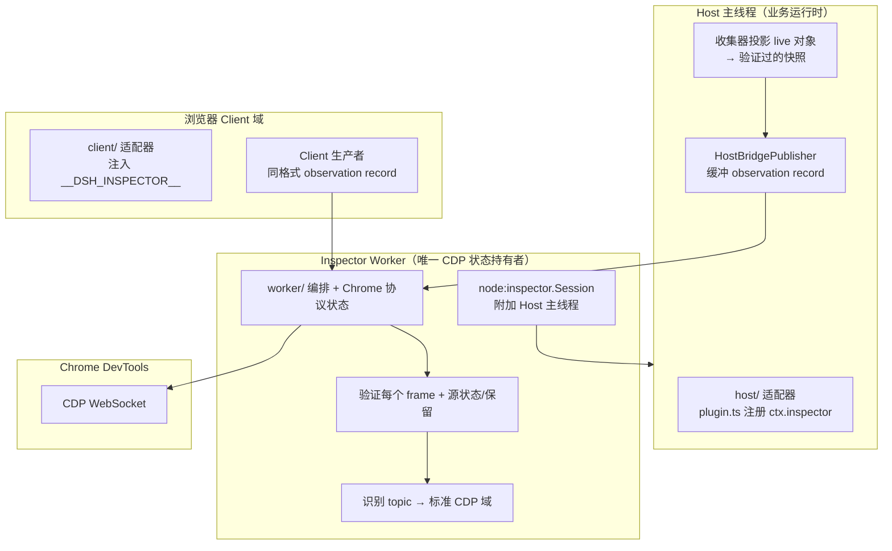
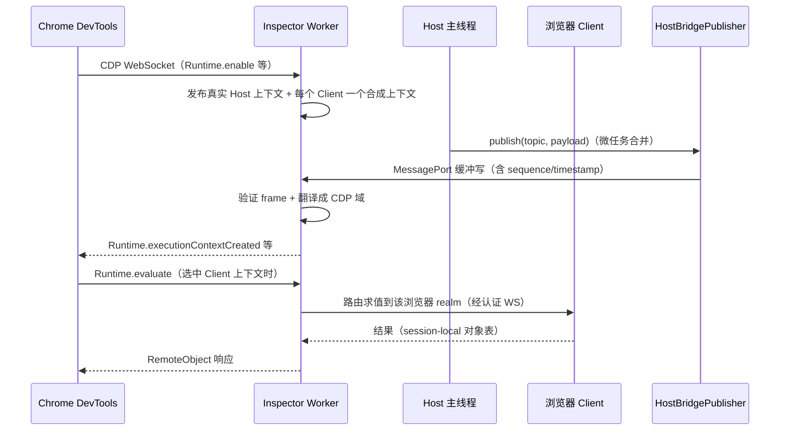

# Inspector：跨 Host/浏览器两域的 Chrome DevTools 检视器

> 子文档之一，聚焦 dsh 0.1.2-alpha 新增的 experimental `inspector` 能力面（`packages/experimental/inspector`，private 维护工具）。整体哲学见 [README](README.md)；本文与 [remote-controllers.md](remote-controllers.md) 共享「跨进程/跨域可观测」的主题。按 ai-agent ⊗ framework 类规格产出。

根因与一句定位：**dsh 的 web 形态是一个「Node Host 主线程 + 浏览器 Worker/Client 多域」的分布式运行时，普通调试器只看得到其中一端**——主线程断点停住时浏览器端照跑，浏览器端出问题时 host 的 console/network 一无所知。Inspector 用 Chrome DevTools 协议（CDP）把两端的 Console/Sources/Network/Elements 统一进一个调试面，但坚持一个安全底线：**所有 CDP 状态放在一个 Worker 里，Worker 永不接触 live Cordis 对象**。

## 概览：是什么 / 痛点 / 适用场景

- **是什么**：一个 experimental 的 DevTools 检视器，可检视一个运行中的 dsh Host 及其浏览器 Clients：暴露 Host 与 Client 的 Console 上下文、Host 的 Sources 与调试、捕获的 Host fetch、共享的 Cordis 树。全部 CDP 状态保持在一个 Worker 中[[packages/experimental/inspector/README.md:12-14]()]()
<!-- anchor: Use this experimental inspector to inspect one running dsh Host and its browser Clients in … The package is private and excluded from releases. -->
- **痛点**：dsh 是"跨域"运行时（Host 线程 + 浏览器域），单域调试器无法给出全局视图；且业务运行时是插件树，肉眼/日志难看清"当前挂了多少插件、什么组合"。
- **适用场景**：维护者调试 web 形态（Host 与浏览器 Client 的协调问题、插件树组合问题）、开发新插件时观察 host 行为；它是 developer-only 工具，**模型请求零改动**。
- **核心能力清单**：

| 能力 | 说明 |
|------|------|
| 跨域 Console | Host 与每个 Client 的执行上下文、求值、属性访问、函数调用、promise await、对象释放 |
| Host 调试 | Sources、断点、恢复（经私有 `node:inspector.Session` 从 Worker 附加到 Host 主线程） |
| 网络捕获 | Host fetch 全量捕获（含请求/响应体，受限于配置上限） |
| Cordis 树检视 | Host/Client 共享的 Cordis 插件树快照（Elements/树查询） |
| 非阻塞发布 | `HostBridgePublisher` 微任务合并 MessagePort 写入，不阻塞业务线程 |
| 安全模型 | 只绑 `127.0.0.1`；Client 摄入要求随机 WebSocket subprotocol token |

- **技术栈**：TypeScript + `node:inspector`/`node:worker_threads` + CDP（Runtime/Console/Sources/Network/Debugger/Profiler/HeapProfiler 域）+ MessagePort/WebSocket。

## 架构：三个执行环境 + Worker 隔离原则

设计要点：**Worker 是唯一的 CDP 状态持有者**——Host/Client 生产者只发内部 observation record（含 source generation、sequence、source-clock 时间戳、topic、JSON payload），Worker 验证每个进程/网络 frame、拥有源状态与保留、把认识的 topic 翻译成标准 CDP 域[[packages/experimental/inspector/README.md:37-37]()]()
<!-- anchor: Host and Client producers send internal observation records rather than CDP messages. -->

运行时布局（谁连谁）：Host 插件启动 Worker 并连一个专用 `MessagePort`；Client 插件读注入的 `globalThis.__DSH_INSPECTOR__` 引导、另开一条**认证的** WebSocket 直连 Worker；Chrome DevTools 连 Worker 的 CDP WebSocket；每个 DevTools 连接一个私有 `node:inspector.Session` 从 Worker 附加到 Host 主线程——于是 Host 主线程 JS 被暂停时，Host 的 Console 求值/Sources/断点/恢复依然可用[[packages/experimental/inspector/README.md:33-33]()]()
<!-- anchor: The Host plugin starts the Worker and connects a dedicated `MessagePort`. -->

## 核心链路：一次 DevTools 到 Host/Client 的检视

选定一个 Client 上下文后，求值、属性访问、函数调用、promise await、对象释放都被路由到那个浏览器 realm；Client Console 参数共用同一张 session-local 对象表。`Debugger.enable` 发布构建出的 `lib/client.js` 目录，`Debugger.getScriptSource` 按有界内容块读取——但 Client 脚本的断点/单步/调用帧仍不支持，target-wide 暂停/恢复只控制 Host 调试器[[packages/experimental/inspector/README.md:39-39]()]()
<!-- anchor: Client sources declare typed Runtime, Console, and read-only Sources capabilities. -->

## 深挖一：为什么"Worker 隔离 + 快照投影"而不是直接暴露 live 对象

最值得借鉴的是它的**对象流动纪律**：Worker 不访问 live Cordis 对象，共享的 Host/Client 收集器在传输前把它们**投影成验证过的快照**（`shared/cordis` 的 reader/model/snapshot 层 + `shared/json` 的严格 JSON 值）。这意味着：

- 调试器的工作不改变业务运行时——求值结果、树快照都是从"投影副本"来，不会因 `Runtime.evaluate` 触到内部对象而破坏状态；
- Host 主线程暂停时（被 `node:inspector.Session` 暂停），Worker 依旧能消费已发布的快照流，两端互不阻塞；
- `HostBridgePublisher` 是非阻塞发布：缓冲 + 微任务合并的 MessagePort 写入，`publish` 返回不等待 Worker[[packages/experimental/inspector/src/host/bridge/publisher.ts:1-5]()]()
<!-- anchor: /** Buffered Host observation publication over a dedicated Worker MessagePort. */ … import type { InspectorJsonValue } from '../../shared/json.ts' -->。

这呼应了 dsh 全局的「投影而非引用」纪律——就像 session 日志投影派生视图一样，检视器看到的永远是"某一刻的验证快照"，而不是会漂移的 live 引用。代价（README 明说）：Client 求值用的是页面 JavaScript，页面 CSP 可能拦截动态求值；fetch 拦截只覆盖 `globalThis.fetch`（激活前保留的引用不被观测）；body 克隆有开销。

## 深挖二：安全模型——调试器是任意代码执行，所以只信回环

`Runtime.evaluate` 在 Host 与连上的 Client realm 都授予任意代码执行，Host Debugger 操作还提供额外控制，且全量 fetch 捕获**包含 secrets**。因此安全模型是收敛的：CDP 目标只接受 `127.0.0.1` 绑定地址；Client 摄入额外要求一个由 Host 注入的随机 WebSocket subprotocol token、默认拒绝非回环 origin；CDP socket 本身无 token——**回环绑定就是它唯一的访问控制**[[packages/experimental/inspector/README.md:121-123]()]()
<!-- anchor: ## Security … The CDP target grants arbitrary code execution in both Host and connected Client realms through `Runtime.evaluate`; -->

这个取舍直白且诚实：一个"能看 secrets、能执行任意代码"的调试器，任何网络暴露都是灾难，所以它不试图做细粒度授权，而是把攻击面锁死在本地回环。这也解释了为什么它是 `private: true`——绝不随发行版进入生产环境。

## 全局关联

Inspector 是「可观测性」这条主线在调试期的延伸：dsh 已经用 session 日志保证「模型看到的一切可回放」，用 telemetry 保证「运行信号可观测」，而 Inspector 解决的是**「代码正在干什么」的实时视图**——并且是用与产品相同的「投影快照」哲学而非侵入式 hook 实现的。它和 [remote-controllers.md](remote-controllers.md) 都说明同一件事：dsh 不把跨域/跨进程交互做成特权层，而是做成可挂载、可卸载、有清晰信任边界的普通能力。

## 不足 / 风险

- **Client 活动调试不支持**：Console 事件/求值/RemoteObject/只读 Sources 可用，Client 脚本 debugger 请求返回显式 unsupported；target-wide 暂停只控制 Host。
- **Client Sources 只暴露 Inspector bundle**：其他页面脚本不入目录。
- **无自动 Worker 重启**：Worker 意外退出即实例失败，生命周期恢复留给后续。
- **抓包有内存/I/O 成本**：请求/响应流 tee 到配置上限，超大 chunk 或慢消费者会堆积缓冲。
- **experimental + private**：接口随 pre-release 演进，不保证稳定；生产部署不应依赖。
