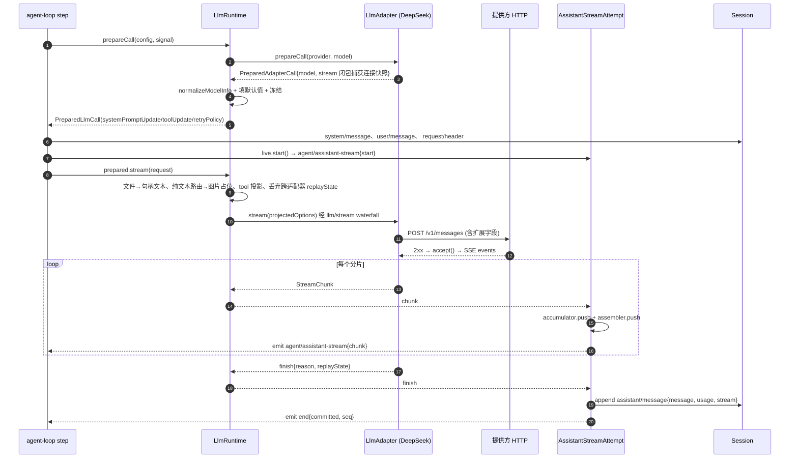
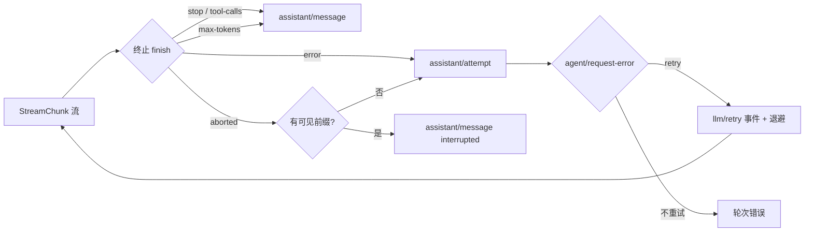

# LLM 适配与流式：把「一次模型调用」拆成四件互不越界的事

> 关注面：`packages/llm/*`。它是 harness 与外部模型之间的唯一缝：上游是 loop 的「已记录请求」，下游是各家提供方的 wire 协议，中间夹着一套 harness 自己发明的词汇与一份必须可回放的流证据。

## 这一层去掉会怎样

dsh 的一切智能都发生在别处——`agent-loop` 决定何时发请求、系统提示词插件渲染提示词、工具层执行副作用、`session` 记录事实。LLM 层只做一件看起来很简单的事：把一条**完全组装好的 `GenerateOptions`** 变成一串**原始 `StreamChunk`**。

但正是这条窄缝决定了整个项目的三个硬约束：

1. **可重建**：请求必须是会话日志的纯函数。于是 LLM 层的输入在到达 `llm/stream` 时是深度冻结的——监听器与适配器只能读，不能改写。
2. **可回放**：失败、取消、重试也必须留下证据，而且证据不能让 token 数量级的事件基数污染日志。
3. **可换家**：DeepSeek 的 `thinking`/`signature`、Anthropic 的 `tool_use`，以及各家 OpenAI 兼容网关各自的思考回放约定，必须被压平成同一套块与分片，否则 loop 和 UI 要为每家写一份分支。

如果抽掉这一层，最直接的后果不是「不能调模型」，而是**四个模块各自长出一份序列化器**：loop 需要知道当前提供方是否支持历史内系统提示词，compaction 需要知道图片怎么计价，token-meter 需要知道缓存命中怎么记账，Session 回放需要知道思考块能不能被重发。dsh 的答案是：把这些知识**全部挂到「已解析的精确路由」上**，由适配器声明，由 LLM 层统一执行。

## 词汇：一套为「跨家翻译」而设计的类型

`ContentBlockMap` 是可声明合并的块表，七种核心块：`text`、`reasoning`、`image`、`file`、`tool-call`、`tool-addition`、`tool-removal` [packages/llm/llm/src/types.ts:133-133]()
<!-- anchor: * Merge-extensible content blocks keyed by `type`. New core blocks must land -->

刻意缺席的两样东西值得注意：

- **工具结果不是内容块**，而是一等的 `ToolResultMessage`（带 `toolCallId`、`content`、可选 `isError`）。因为工具结果在协议里几乎总是独立的 role（Anthropic 的 `user.tool_result`、OpenAI 的 `tool`），把它塞进 assistant 内容会被每个适配器再拆出来。
- **`file` 块永远到不了适配器**。`GenerateOptions` 里的持久 `FileBlock` 在 `LlmRuntime.adapterStream` 里被无条件替换成确定性句柄文本；模型要读原文件就用工具读已保存的副本。这条规则换来的是一条极简的不变式：**没有任何提供方会收到文件字节**，所以不存在「文件多模态」的协议碎片。

`Message` 的来源是另一个可合并联合（`user` / `model` / `tool` / `system-prompt`），模型消息的来源额外携带 `provider`、`model` 与一段**适配器私有的 `replayState`** [packages/llm/llm/src/message.ts:9-9]()
<!-- anchor: /** Provider/model identity and adapter-private replay data for an assistant mes -->

这就是整个设计的第一块基石：**内容是可移植的，元数据是私有的**。块表回答「模型说了什么」，`replayState` 回答「这家提供方的协议还需要什么才能续上」，两者存储在一起、裁剪同步，但只有真正拥有历史路由的那个适配器实例能读到后者。

流式协议 `StreamChunk` 是一个**封闭**的可辨识联合（`block-start`、`text-delta`、`reasoning-delta`、`tool-call-delta`、`block-end`、`usage`、`finish`），`assertNever` 兜底，新增成员会在所有消费方编译失败。契约有四条硬规定：`usage` 在 `finish` 之前、`finish` 之后无分片、工具参数全程保持原始 JSON 字符串、失败要么抛出要么以 `finish { kind: 'error' | 'aborted' }` 结束。

`BlockAssembler` 把这串分片折回块。它是**唯一**的组装实现，loop、测试、`assembleAssistantStream` 全部复用。它的两份输出值得单独看：`blocks()` 在 `max-tokens` 截断时**丢弃全部工具调用**（被截断的调用不能安全执行），`interruptedBlocks()` 则在取消时只保留非空白的文本与推理块——因为中断发生在分派之前，保留任何工具调用都要求一个**编造**的结果 [packages/llm/llm/src/assembler.ts:169-178]()
<!-- anchor: interruptedBlocks(): ContentBlock[] { … (block?.type === 'text' || block?.type === 'reasoning') && block.text.trim() !== -->

## 一条传输，几个包：凭据从不属于协议库

`packages/llm/` 下不是「DeepSeek 适配器」，而是一组职责被切得很碎的包：

| 包 | 拿到的东西 | 明确不做的 |
|---|---|---|
| `llm` | `ctx.llm` 注册表 + 全部词汇 + `LlmAdapter` 抽象 | 任何提供方协议代码、任何重试、任何配置 |
| `llm-deepseek` | Messages 传输、序列化、SSE 翻译、Files 客户端、上传索引 | 凭据解析、模型发现、路由注册 |
| `llm-deepseek-api-key` | `resolveAuth`（`x-api-key`）+ `/models` 列表 + 注册 `deepseek-official` | 协议细节 |
| `llm-deepseek-account` | `x-dsh-auth-token` 账号授权 + 账号模型列表 + 注册 `deepseek-account` | 与 API key 互不回退 |
| `llm-pi-ai` | 基于 `@earendil-works/pi-ai` 的多提供方实现（孪生体） | DeepSeek 请求扩展 |
| `deepseek-llm-api-extensions` | `ctx.deepseekLlmApiExtensions` 顶层字段注册表 | 字段语义 |
| `llm-retry` | 在 `agent/request-error` 上执行提供方策略 | 它自己没有任何配置 |

`llm-deepseek` 的构造依赖里根本没有「读配置」的能力，只有宿主注入的回调：`options`、`connect`、`resolveAuth`、`admit`、`discoverModels`、`resolveUserId` [packages/llm/llm-deepseek/src/host.ts:18-29]()
<!-- anchor: export function registerDeepSeekProvider<C extends DeepSeekConnectionOptions>( … resolveUserId: () => userId ??= getOrCreateAnonymousUserId(), -->

于是同一条 Messages 传输被三个产物复用：`deepseek-official`（API key）、`deepseek-account`（账号 token）、以及外部网关。API key 插件在自己的作用域内解析 `credentials` seam，绝不让密钥进入协议库的可见状态。

**为什么值得付这个拆分成本？** 因为凭据的生命周期和协议的生命周期完全不同：凭据要跨重启、可轮换、可失效、可被登出撤销；协议库应当是纯函数。[凭据边界](.agents/notes/implemented/architecture/2026-07-30-credential-boundaries-and-atomic-registration.zh.md) 记录过一次惨痛的合并代价——当端点事实与凭据事实分别解析时，**被拒绝的那一代设置仍然能把自己的凭据选择配上上一代的端点**；pi-ai 拿到 `undefined` 密钥时还会落到自己的环境发现上，用另一个租户的密钥认证并把账单悄悄记到别人头上。合并成一个包，这类「半代快照」缺陷没有结构性防线；拆开之后，`resolveAuth(connection)` 的签名本身就要求「从同一个快照取」，写错会露在类型上。

与之配套的是**原子路由替换**：`registerAdapter` 返回的句柄可调用（释放），并带 `replace(providers)`。候选集合先整体校验，再在一个同步区段内换掉，因此不存在「先 dispose 再注册」的空窗。这也是「一切皆插件」在这里的具体投影：热插拔配置不能把系统置于半配置状态。

## `prepareCall`：把「解析」和「提交」钉在同一代

这是整个 LLM 层最容易被低估的设计。朴素做法是两步：先 `resolveModel()` 拿能力集，再 `stream()` 发请求。两步之间会发生什么？

- HMR 或设置写入可能换掉适配器实例（动态适配器每次都重新读 volatile Config）；
- 一次请求头事件必须记录**生效**的配置，而生效值可能由适配器默认值填充；
- 系统提示词的归一化决定（追加新 `system` 节点，还是重写第 0 号节点）必须依据**即将服务这次调用的那个代次**的能力。

`prepareCall` 用一个一次性句柄把这些缝全部焊死：

```ts
signal?.throwIfAborted()
const adapterCall = await registration.adapter.prepareCall(provider, model, signal)
signal?.throwIfAborted()
const modelInfo = this.normalizeModelInfo(registration, model, adapterCall.model)
```

[packages/llm/llm/src/index.ts:956-966]()
<!-- anchor: async prepareCall( … const modelInfo = this.normalizeModelInfo(registration, model, adapterCall.model -->

注意顺序：**先取消检查，再解析，再取消检查，再校验元数据**。中途任何一次 abort 都会让准备阶段拒绝，于是 loop 不会提交系统提示词与已接纳的用户批次——这两件事只在准备成功之后才落盘。返回的 `PreparedLlmCall` 携带 `config`（已填默认值、已冻结）、`retryPolicy`、`context`、`inputModalities`、`systemPromptUpdate`、`toolUpdate`、`adapterDefaults`，以及一个只能调用一次的 `stream()`。

适配器侧同样分两段。DeepSeek 的 `prepareCall` 把**连接快照**捕获进闭包，`stream` 复用同一份快照 [packages/llm/llm-deepseek/src/adapter.ts:50-53]()
<!-- anchor: override async prepareCall(provider: string, model: string, signal?: AbortSignal … return { model: modelInfo(connection, provider, model), stream: options => this. -->

这一行 `stream: options => this.generate(options, connection)` 就是「一代设置一次请求」的全部实现。对比之下，直接 `ctx.llm.stream()` 会在 `adapterStream` 里重新调用一次适配器的 `prepareCall`——设置变化因此对直接调用方可见，而对已准备调用的持有者不可见。这不是不一致，而是**两种调用者对原子性的需求不同**：loop 要把能力与分发写进同一份请求头，标题/压缩这类辅助调用可以接受「下一次请求读新配置」。

`adapterDefaults` 这个字段更微妙：它记录哪些值**不是调用方提出的，而是适配器代次填的**。loop 在处理下一步时，会先把这些字段从请求头提案里删掉，让准备过程重新填入当前路由的默认值 [packages/core/agent-loop/src/agent.ts:63-63]()
<!-- anchor: /** Remove adapter-derived values before plugins propose the next request config -->

没有这个标记，一次「适配器默认 `maxTokens=256k`」就会被固化进历史，之后换成 64k 的模型仍然发 256k，且日志看不出这是默认值还是用户设置。

## 能力集：路由声明自己听得懂什么

每个精确模型都能声明两个「对话中途变更」的能力，它们直接决定**缓存前缀能否存活**：

| 字段 | 值 | 语义 | 发送端后果 |
|---|---|---|---|
| `systemPromptUpdate` | 缺省 | 只读开头的 system 消息 | 提示词变了就重写 surface 第 0 号节点，`startsSeries` |
| | `'in-history'` | 任意位置最新的 `system` 消息即完整有效提示词 | 追加新的 `system` 节点，已缓存历史保持热态 |
| `toolUpdate` | 缺省 | 每次请求声明完整工具列表 | 剥掉所有 developer 消息与 `deferLoading` |
| | `'addition-only'` | 后续 developer 消息里的 `tool-addition` 激活已声明的延迟工具 | 省略已移除的定义与移除块 |
| | `'in-history'` | 还能读 `tool-removal` | 保留历史定义，移除块禁用工具 |

Tool 投影的实现在 `projectToolUpdates`，它对三类「信息不足」的情形**主动退让**：没有 `toolUpdate`、没有 `toolHistory`、或请求前缀里缺了某条被引用的更新消息——三种情况都退回「当前完整声明 + 不发 developer 消息」。这很关键，因为它保证了压缩摘要器这类只带前缀的辅助调用不会拼出一个语义破碎的工具集 [packages/llm/llm/src/content.ts:424-446]()
<!-- anchor: export function projectToolUpdates( … return { messages: withoutDeveloperMessages(messages), tools } -->

`in-history` 与 `addition-only` 的差别浓缩在一行：`in-history` 返回全量声明（移除靠块禁用），`addition-only` 必须从声明里删掉已失效的工具（因为没有移除块可以表达）[packages/llm/llm/src/content.ts:396-396]()
<!-- anchor: switch (mode) { -->

## DeepSeek 专有扩展：模型输入之外的一切

官方路由的 DeepSeek 适配器读写的是 **Anthropic Messages 协议**（`/v1/messages`），而不是 Chat Completions。这是一个后期收敛：早期有两套实现（Chat + Messages），后来只留 Messages，因为只有它同时具备原生思考签名、Files 引用与历史内更新 [只保留 Messages 的决定](.agents/notes/archived/simplification/2026-09-19-deepseek-messages-only.zh.md)。

**思考与签名。** 历史中的 `reasoning` 块被序列化成 `thinking` 块，签名从 `replayState` 里按块序号取回；流侧 `thinking_delta` 进正文、`signature_delta` 累加进回放元数据 [packages/llm/llm-deepseek/src/serialize.ts:31-31]()
<!-- anchor: case 'reasoning': return { -->

回放元数据被设计成**最小投影**：`{ response: { kind: 'deepseek-messages', version: 1, model }, blocks: [{ type, signature? }] }`，不含正文、时间、用量。校验失败（未知 kind/version、模型不匹配、块数或块类型不匹配、签名挂在非思考块上）时**降级而非失败**：只丢签名，正文与工具历史照发，并记录一次 warn。这条「持久内容权威、私有元数据可丢」的原则，让一次格式升级不会让旧会话彻底不可用。

**工具变更块。** 投影后的 developer 消息被翻译成 system 角色的 `tool_addition` / `tool_removal` 块，延迟声明携带 `defer_loading`；只要请求里出现这两类块，就附上 `mid-conversation-tool-changes-*` beta 标头。注意一个跨协议的**位置差异**在适配器内部被吸收了：loop 在用户输入**之前**接纳系统更新，而 Messages 要求更新出现在对应用户/工具结果轮次**之后**、下一个 assistant 之前——`flushSystemUpdates` 在遇到 assistant 消息时才把暂存的 system 快照推出去 [packages/llm/llm-deepseek/src/serialize.ts:83-88]()
<!-- anchor: // Harness admits system updates before user input. Messages places the same … messages.push(...systemUpdates.splice(0)) -->

**Files API 与缓存布局。** 保留图片优先走 `/v1/files` 上传、以 `file_id` 引用；上传索引的命名空间是 `sha256(baseURL + '\0' + 认证头)`，因此**不同的 key、不同的端点天然隔离**，而索引里从不落原始凭据 [packages/llm/llm-deepseek/src/upload-index.ts:45-51]()
<!-- anchor: export function deepSeekFileScope(baseURL: string, credentials: string): DeepSee … return DeepSeekFileScope(digest) -->

缓存友好的布局约束则贯穿三层：提示词用 `in-history` 追加而不重写；工具用 `defer_loading` 延迟而不是改列表；图片描述文本必须确定（尺寸按请求投影计算），否则「同样的历史、不同的描述符」会从该图起让前缀失效。适配器 README 自己承认了这条约束的脆弱边界：**执行世界路径变化、上传刷新换 `file_id`、Files→base64 回退**都会打断前缀复用。

**请求扩展事务。** 官方请求可以携带一组非模型可见的顶层字段（`dsh_session_log`、`dsh_plugin_packages`）。生命周期被切成「prepare → HTTP → accept」三段：字段在基础正文序列化之后合并，冲突直接 `REQUEST_EXTENSION` 失败；2xx 之后才执行 `accept()`，所以传输失败或提供方拒绝都不会被误记为「已交付」；合并后无法序列化则**退回基础正文**并跳过接受，让贡献方在后续请求里补发 [packages/llm/llm-deepseek/src/request-extensions.ts:21-47]()
<!-- anchor: export async function prepareRequestExtensions( … return { payload: base, accept: () => Promise.resolve() } -->

## 一次请求的完整时序



时序里最容易被忽略的两处：

- **`request/header` 与 `system/message` 早于分发**。请求头记录的是「已解析的调用配置 + 权威工具顺序」，配合 surface 折叠出的消息列表，才让一次请求可以从日志逐字节重建。所以任何在分发之后才决定的配置都是不可接受的。
- **持久先于实时**。`settle()` 先 `append` 拿到 `seq`，再发出带 `committed` 的 `end` 帧。实时 UI 永远落后于日志一步——这是「Model-visible means logged」在流式路径上的直接翻译。

## 三条失败路径：重试、断流、取消

失败处理被切成三个层次，每层只回答一个问题。

| 路径 | 触发 | 谁判定 | 持久化 | 后续 |
|---|---|---|---|---|
| **断流 / 提供方错误** | 传输中断、`STREAM_CLOSED`、`MALFORMED_RESPONSE`、空完成、空闲超时 | 适配器抛 `LlmError` → `LlmRuntime` 归一化成终止 `finish{error}` | `assistant/attempt{stream}` | `agent/request-error` waterfall |
| **带内失败** | 适配器自己 `yield finish{kind:'error'}` | 同上，直接到 loop | 同上 | 同上 |
| **重试** | 上一步的 `finish{error}` 命中策略 | `llm-retry` 监听 `agent/request-error` | 先 `llm/retry` 再 `llm/retry-started` | loop 在**同一打开的轮次**内重跑该 step |
| **取消** | 会话级 `turn` signal 中止 | loop 捕获（不是失败） | 有可见前缀 → `assistant/message{interrupted:true}`；否则 `assistant/attempt` | `turn/end{aborted}` |



三条路径的边界非常清楚，这是[终止失败决策](.agents/notes/implemented/architecture/2026-07-29-terminal-llm-stream-failures.zh.md) 用一份 note 换来的：**`LlmRuntime` 只捕获最终适配器的选择、同步分发、iterator 构造与 `next()` 失败**，把它们转成不可变的 `LlmFailure` 与一个终止 `finish`；来自 `llm/stream` 中间件、嵌套调用、适配器清理、分片消费方、日志写入、signal 检查与组装本身的错误**仍然抛出**，因为它们不是「提供方运行失败」而是编程或生命周期缺陷 [packages/llm/llm/src/index.ts:1125-1145]()
<!-- anchor: let completed = false … yield item.value -->

这个划分之所以必要：此前实现用「以流为键的 sidecar」标记异常，判定一次失败究竟是提供方还是自身 bug，要依赖「哪个语句抛的」和「这个 iterable 是谁包的」。而中间件可以中途短路整条流——那时根本没有适配器事件可供归因。

**取消的语义值得单独说。** 取消不是失败：已送达到客户端的前缀必须进入模型历史。`interruptedBlocks()` 只保留非空白的文本与推理块，工具调用一个不留（否则要编造一个结果）；空前缀则退化为 `assistant/attempt`，因为「用户取消了但什么都没产生」不该造出一条空的 assistant 消息。这条决策的反例被明确记录：追加 `[interrupted by user]` 之类的模型可见提示需要新的来源类型、投影规则、UI 与本地化，而 `turn/end{aborted}` 已经保留了后续决策所需的事实。

**超时被刻意解耦**：流读取有一个只在 iterator `next()` 未完成时启动的空闲 watchdog（默认 5 分钟，到期映射为 `TIMEOUT`，更早的调用方中止保留为 `ABORTED`）；Files 操作则有自己每张图片的截止时间（默认 60 秒，`DEEPSEEK_FILES_API_TIMEOUT`）。理由很直接：上传受带宽与文件大小支配，流式受模型推理速度支配，用一个数控制两者必然一边太松一边太紧。而且 Files 失败是可恢复的——它会触发整份请求改用内联 base64 重建，属于「同一次尝试内的表示切换」，不该被计入流空闲预算。

**重试的持久先行**同样有明确动机：任何定时器启动之前，重试已写入 `llm/retry` 事件，所以崩溃或取消不会留下不可见的待处理重试。默认 normal 策略对 `EMPTY_RESPONSE`、`RATE_LIMIT`、`SERVER`、`TIMEOUT`、`TRANSPORT` 重试 5 次，退避 500ms→10s、抖动 10% [packages/llm/llm/src/retry-policy.ts:14-14]()
<!-- anchor: const DEFAULT_MAX_RETRIES = 5 -->

## 把整条流塞进 `assistant/message`：可回放 vs 日志膨胀

Session format v2 之后没有顶层 `assistant/chunk` 事件，每个模型 attempt 只提交一条 settlement，里面内嵌 `stream: AssistantStreamRecord[]`。

压缩手段不是「抽样」也不是「合并到最后一个值」，而是**把连续同块 delta 打成一个 run**：`{ type: 'text-chunks', time0, index, dt: number[], texts: string[] }`。每个原始 delta 仍是数组的一个成员，`dt` 保存相邻时间戳的精确差值，`expandAssistantStream()` 能逐字节重建原始序列。收益是消除了逐 chunk 的事件信封；代价是**没有**减少 token 数级别的信息量。

[内嵌 Assistant stream 的决策](.agents/notes/implemented/architecture/2026-09-01-v2-embedded-assistant-streams.zh.md) 的取舍清单里，最有说服力的不是被采纳的方案，而是被拒绝的那些：只存组装后的成功消息会丢掉失败输出、token 边界、时间与确定性回放；反过来把 chunk 保留为顶层事件只会「让序号密度、遥测量、wire 信封、Client entry 与消费方 dispatch 继续与 token 数成正比」。

内嵌带来的真实代价也被记录得很坦白：

- **没有 write-ahead**。v1 的 chunk 可能在 attempt 结束前由带缓冲的 writer 刷盘；v2 在 settlement 之前没有持久证据，硬中断整条在途流都会丢。作者明确写下「`agent/assistant-stream` 不是 write-ahead log」，并认为为此再加一个持久性 owner 不划算。
- **结算后读取要靠记录级读取器**。`expandAssistantStream()` 是持久边界的**校验**路径，但不被记忆化——保留的展开在事件生命周期内约花费紧凑流的十倍内存；因此统计、token 记账、Host 折叠走 `assistantStreamChunks` / `joinAssistantStreamText` / `assembleAssistantStream` 这类提前退出的扫描，单次结算 O(records) 而非 O(members)。
- **UI 不展开**。Chat 与 Trajectory 直接读持久 message；只有需要精确证据的消费方（如按附件 id 找图片）才扫描 chunk 记录。

一个容易被混淆的补充：同一步里的 token 记账**没有独立事件**，它是 `assistant/message` 的兄弟字段（`usage?`）。因此「模型输出与它的记账同行」；而流里那条 `usage` chunk 是适配器协议的产物，经 `AssistantStreamAccumulator` 以 raw record 保留在 `stream` 中，与事件字段各司其职。

## 三个设计决策的代价

**其一，孪生适配器。** 从第一天起，同一份 `StreamChunk` 契约由两个结构完全不同的实现承担：直连 `fetch` 的 DeepSeek 适配器，和基于 `@earendil-works/pi-ai` 的库适配器。动机是一句很锋利的话：**若词汇只为一个适配器定义，「唯一实现碰巧做了什么」就会成为事实上的规范**。历史上真正被这条规则抓到的缺陷——`stream()` 抛异常 vs 带内 `finish{error}` 两条合法错误路径——正是库适配器暴露出来的，单一 fetch 实现会把它永久隐藏。代价是双份适配器与需要真密钥的 e2e 矩阵；作者把保留一个 mock 适配器的选项明确标记为「证明力有限」，因为 mock 不碰真实 wire 怪癖。

**其二，DeepSeek 只保留 Messages。** 双协议的代价是重复的序列化器、流处理、Files 协议、配置分支与夹具，而 Chat Completions 对这条官方路由**不增加任何必需能力**。收敛之后，`deepseek-official` 就要求端点兼容 Messages。这是一个明确的能力换复杂度的交易：用户被绑在一种协议上，换来的是单条传输上三个产物（API key / 账号 / 网关）的复用。

**其三，`replayState` 的最小化。** 存完整原生响应会重复已记录内容、让截断对齐复杂化；把思考压平成文本则会改变下一次模型输入。`ReplayEnvelope` 选了中间路线：不透明响应半区 + 与发射块顺序对齐的逐块条目，装配丢弃块时同步丢弃同位置条目——所以「存储的元数据永远描述存储的内容」，max-token 截断丢掉工具调用时签名也一起消失，不会出现「内容少了、元数据多一条」的错位。

## 亮点与问题

**亮点。** 「能力挂在精确路由上」是这一层最值得学的模式。`systemPromptUpdate`、`toolUpdate`、`context.contextWindow`、`reasoning.efforts`、`imageRequestPricing` 全部经由 `resolveModel()` 一次查询返回，loop、compaction、token-meter 读的是同一份结果。对比常见的「按模型名前缀猜能力」或「配置里开个开关」，前者无法表达「同名模型在不同网关上能力不同」，后者允许把不支持的能力配给不支持的端点。dsh 选了第三条：**能力是适配器的声明，配置只能替换目录**。

第二个亮点是失败边界的**单值化**：所有适配器运行失败最终都变成一种可序列化的 `LlmFailure`，消费方按 `code` 路由，绝不解析文本。`CONTEXT_WINDOW_EXCEEDED` 只有一个规范 code（无论它以抛出的 HTTP 错误还是带内 finish 到达），`EMPTY_RESPONSE` 是**可重试错误而不是成功**——一个「什么都没说但正常结束」的响应被明确判为故障。

**问题。** 其一，`LlmFailure` 归一化的宽容读法有代价：它会读取外来 error 的 `failure` 自有属性并信任其中事实，只要能通过内部校验；第三方 SDK 的 `code` 则一律归为 `UNKNOWN`。这让「SDK 自定义错误码」永远无法进入可路由的 code 集合，只能退化成一个笼统的重试判定。其二，`StreamChunk` 的契约（`usage` 先于 `finish`、`finish` 后无分片）**由适配器自觉遵守**，`BlockAssembler` 并不校验顺序——它只忽略已关闭块的迟到 delta。当一个坏的适配器在 `finish` 之后继续吐分片时，组装器不会拒绝。其三，`interruptedBlocks()` 丢弃工具调用的规则，让「用户在看到工具调用已发出后取消」这一场景下的模型历史与用户所见不完全一致；note 里承认这是有意选择（编造结果更糟），但这是一个持续的 UX 缺口。

## 与其他部分的连接

这一层定义了「一次模型调用」的边界与证据格式，而**谁来做这些调用、何时调用、调用前接纳什么**是 agent loop 的职责——接下来读 `agent-loop` 的请求组装与 `session` 的 surface 折叠，看 `prepareCall` 产出的能力集如何决定系统提示词落成「替换第 0 号节点」还是「追加新节点」；如果你想看凭据、设置分代与原子注册的完整细节，则转到数据模型/配置那篇。
