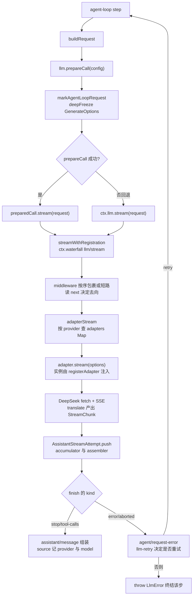
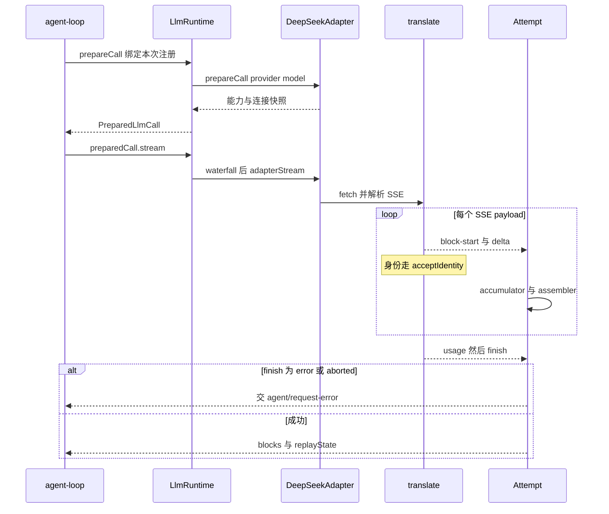

# LLM 能力层：消息/流式词汇与适配器 seam

> 子文档之一，聚焦 `ctx.llm`。覆盖 `packages/llm/*`（llm、llm-deepseek、llm-pi-ai、llm-retry、token-meter）。整体哲学见 [README](README.md)；本文位居「契约/词汇」能力面，上承 [architecture.md](architecture.md)（运行时装配）、下接 [agent-loop-runtime.md](agent-loop-runtime.md)（消费 `llm/stream`）。
>
> **本版增量更新（0.1.2-rc.1 → 0.1.5-rc.2 / 2026-09-11）**：依 `dsh-v0.1.2-rc.1..HEAD` 区间内 `(llm)` 作用域的上游提交，与 `verify-references.mjs --diff` 预检清单（STALE/UNRESOLVED 逐条复核）比对更新。本次本关注面的实质变更集中在四类：**(1) 模型目录与默认路由**——Chat Completions 组合默认切到 `deepseek-flash`（V41 Flash），V4 系列作为可选条目并存；**(2) 模型发现**——按协议列目录、已装 catalog 优先、只对未知端点发网络请求，并把 Anthropic 的 `/v1` 归一化限定在列目录这一处；**(3) 流保真**——流式工具调用身份收敛为「只接受非空」的 `acceptIdentity`，内嵌 Assistant 流改由记录级读取器消费；**(4) 痕迹与出站面**——配置诊断移入 provider 目录、pi-ai 升到 0.85.1 并区分「请求模型/响应模型」、适配器请求路径由 egress 测试钉住。既有 `##` 章节标题与 rc.7/rc.8 演进说明原样保留，本轮新增内容一律用 `###`。各版本逐条变更一览见 [CHANGELOG.md](CHANGELOG.md)。

核心主张：模型调用是 agent 里唯一一台「会变」的外接机器——新 provider、新模型系列、新 thinking 模式、新重试语义几乎每天在变。若把 DeepSeek 的 HTTP 细节、SSE 解析、thinking 字段焊进内核，内核就会成为「DeepSeek 专用」。因此 LLM 必须作为一个 seam 存在：**内核只定词汇和注册契约，模型生产实现由插件供给，消费方只依赖抽象**。

## 角色 / 根因：为什么 LLM 是"可交换 seam"而非硬编码 DeepSeek API

DeepSeek Harness 的核心主张是"一切皆插件、无特权内核"。这个主张最先落到 LLM 上：模型调用是 agent 里唯一一台"会变"的外接机器——有新的 provider、新的模型系列、新的 thinking 模式、新的计费与重试语义，且几乎每天在变。若把 DeepSeek 的 HTTP 细节、SSE 解析、thinking 字段焊进内核，内核就会成为"DeepSeek 专用"而失去插件骨架的意义；任何新 provider 都要改内核。因此 LLM 必须作为一个 seam 存在：**内核只定词汇（Message/ContentBlock/StreamChunk）和注册契约，模型生产实现由插件供给，消费方（agent loop）只依赖抽象**。

- 抽象 `llm` 服务：`LlmRuntime` 被声明为 Cordis `Context` 上的 `ctx.llm`，是一个"适配器注册表 + 可瀑布拦截的流式调用 API"，`LlmAdapter` 是给 provider 后端的抽象基类。内核不绑定任何具体厂商，只持有这两个抽象符号。

  `[packages/llm/llm/src/index.ts:333-333]()` 类声明 `export class LlmRuntime extends TypertRemoteService`
  <!-- anchor: export class LlmRuntime extends TypertRemoteService { -->
  `[packages/llm/llm/src/index.ts:55-56]()` 挂到 `Context.llm`
  <!-- anchor: interface Context { … llm: LlmRuntime -->

- **必给证据**——唯一必需方法是 `LlmAdapter.stream()`（同区间内 `abstract stream` 带完整契约注释），其余全部是带默认实现的"可选能力描述"（`providerInfo`/`providerRetryPolicy`/`listModels`/`resolveModel`）。这让最小适配器只有 1 个方法要写，是"零摩擦接入"的根因。

  `[packages/llm/llm/src/index.ts:277-281]()` 唯一必需方法
  <!-- anchor: * Stream one model call as raw chunks. The only required method. … abstract stream(options: GenerateOptions): AsyncIterable<StreamChunk> -->

- LLM 也是"Capability Seam 三件套"的一个实例：**Definition**（`packages/llm/llm`，定义 Message/stream 词汇与 `LlmAdapter`）+ **Provider**（`llm-deepseek`/`llm-pi-ai` 插件实现）+ **Consumer**（`packages/core/agent-loop/agent.ts`，消费 `llm/stream`，用 `AssistantStreamAttempt` 内部的 `BlockAssembler` 组装）。每一个都是插件位，可替换而不动另两类。

- 具体厂商如何变成"一个插件"：`llm-deepseek` 就是一个声明了 `name`+`inject` 的插件，在 `apply()` 里把 `DeepSeekAdapter` 注册到 `ctx.llm` 上（`registerAdapter(['deepseek-official'], adapter)`）。注册是 effect-based（随 plugin 生命周期 dispose），符合"一切皆插件"的 HMR/卸载语义。

  `[packages/llm/llm-deepseek/src/index.ts:84-85]()` 插件名与依赖
  <!-- anchor: export const name = 'llm-deepseek' … export const inject = ['llm'] -->
  `[packages/llm/llm-deepseek/src/index.ts:492-492]()` 注册 provider 路由
  <!-- anchor: const registration = ctx.llm.registerAdapter([PROVIDER], adapter) -->
  `[packages/llm/llm-deepseek/src/index.ts:90-90]()` `PROVIDER` 常量
  <!-- anchor: const PROVIDER = 'deepseek-official' -->

---

## 设计思路：词汇抽象 + Adapter seam（Definition/Provider/Consumer）

### 消息与内容词汇：一份共享的 provider-neutral 表示

与"Provider 只在自己的 wire 格式里自由"相反，harness 强约束一份**内核词汇**：一条 `Message` 是"id + role + 若干 typed `content` block + 来源 `source`"四元组。所有 provider、session log、模型请求共享同一种表示（`message.ts:128-138`），provider 只在 adapter 内部翻译成自己的 wire 格式（见 `serialize.ts`）。这带来两件事：（1）session log 里的历史即模型请求的输入，可重建，符合"重建性 Agent Note"；（2）切换 provider 不需要改写会话历史，因为历史是 provider-neutral 的。

- `Message` 的一份不可变表示，跨 delivery/durable history/model request 共享。

  `[packages/llm/llm/src/message.ts:130-137]()` 消息结构
  <!-- anchor: /** One immutable message representation shared by delivery, durable history, an … readonly content: ContentBlock[] -->

- `ContentBlockMap` + `ContentBlock` 是 **merge-extensible** 的联合：`text`/`reasoning`/`image`/`file`/`tool-call`/`tool-result` 六类基础块，插件可增删条目；新增块须同步 adapter/UI/compaction 支持（type 注释）。`switch on type + assertNever` 保证新增变体会在编译期强制所有消费方处理（closed union），这是 dsh 对整个词汇层的统一手法。

  `[packages/llm/llm/src/types.ts:109-118]()` map + 派生联合
  <!-- anchor: * Merge-extensible content blocks keyed by `type`. New core blocks must land … 'tool-result': ToolResultBlock -->

> **演进说明（rc.7）**：五类基础块中的 `image` 不再是孤立的"词汇枚举"——rc.7 为它补上了持久化支撑：`image` 块携带 `attachment` 引用（`ImageAttachmentRef`），字节落盘在 durable attachment 服务而非内联 base64。判定"一段内容是否含图"由统一的递归 `contentHasImage` 承担（它会走进嵌套的 `tool-result`），LLM adapter 借此在组装前决定是否拒绝不支持图的模型。整块能力面拆到 [attachments.md](attachments.md) 讲透。
>
> **演进说明（rc.8）**：DeepSeek 官方 adapter 从纯文本升级为**按模型多模态**——每个 catalog model 可声明 `inputModalities`（含 `'image'`），adapter 在请求含图时经 `resolveAttachments()` 把 durable ref 解析成有序 data-URL 段（`serializeRequestWithImages`），并且同样受 `maxRequestImageBytes` 载荷上限约束（[packages/llm/llm-deepseek/src/serialize.ts:403-418]()、[packages/llm/llm-deepseek/src/adapter.ts:581-585]()）。
<!-- anchor: export async function serializeRequestWithImages( … maxBytes: images.maxRequestImageBytes, -->
<!-- anchor: body = await serializeRequestWithImages(requestOptions, { … maxRequestImageBytes: connection.maxInlineRequestImageBytes, -->
> 模型未声明图像模态或附件服务缺席时仍以 `UNSUPPORTED_CONTENT` 拒绝（[packages/llm/llm-deepseek/src/serialize.ts:112-112]()）。至此多模态由 pi-ai 一家扩到 DeepSeek 系。
<!-- anchor: throw new LlmError('The DeepSeek chat-completions adapter does not support image -->

> **演进说明（0.1.5-alpha.1）**：基础块从 rc.1 的五类扩到六类——新增 `file` 块，它携带持久化的 `FileAttachmentRef`，模型侧只看到由名称/字节数/只读路径构成的确定性 handle 文本（[packages/llm/llm/src/types.ts:84-87]()）。
<!-- anchor: export interface FileBlock { … attachment: FileAttachmentRef -->
> 判定"一段内容是否含文件/含图"由两个独立递归谓词承担（[packages/llm/llm/src/content.ts:126-138]()）：派发前先无条件把 `file` 块投影成确定性 handle 文本（"文件从不原生派发"），再按模型声明的模态决定是否把图降级为文本（[packages/llm/llm/src/index.ts:1043-1051]()）；`file` 的持久化支撑拆到 [attachments.md](attachments.md)。
<!-- anchor: export function contentHasImage(content: readonly ContentBlock[]): boolean { … export function contentHasFile(content: readonly ContentBlock[]): boolean { -->
<!-- anchor: // Files are never dispatched natively: every route receives handle text. … projectedMessages = projectImagesForTextModel(projectedMessages) -->

- 不可变性是"重建性"的载体：`createMessage` 给每条新消息打上 `MessageId(crypto.randomUUID())` 后 `deepFreeze(structuredClone(...))` 冻结；`LlmRuntime.prepareCall` 也 `deepFreeze(structuredClone(config))`。冻结使会话日志与请求输入成为一个纯函数关系（日志即请求，请求即日志），中间无可变状态漂移。

  `[packages/llm/llm/src/message.ts:181-182]()` 冻结 + 建号
  <!-- anchor: export function freezeMessage<T extends Message>(message: T): T { … return deepFreeze(structuredClone(message)) -->

- 三件套中的**装配件**：`BlockAssembler` 把原始 `StreamChunk` 增量折叠回 `ContentBlock[]` + `usage` + `finish` + `replayState`，是唯一 canonical 组装算法。消费侧在 0.1.5 起不再是 loop 里裸持一个 assembler，而是由 `AssistantStreamAttempt` 同时持有"紧凑流累加器 + assembler"：loop 逐 chunk `live.push(chunk)`，push 内部先 `accumulator.push`（压成可持久化的紧凑记录）再 `assembler.push`（在线组装），流结束后 loop 从 attempt 读 `blocks()`/`finish`/`replayState`/`usage`。这仍是"日志存原始 chunk、消费时用同一算法组装"，只是原始 chunk 的载体从逐条事件换成了内嵌紧凑流。

  `[packages/llm/llm/src/assembler.ts:38-41]()` 装配器状态
  <!-- anchor: export class BlockAssembler { … private _usage: TokenUsage | undefined -->
  `[packages/core/agent-loop/src/assistant-stream.ts:60-62]()` 一次 push 同时喂累加器与装配器
  <!-- anchor: push(chunk: StreamChunk): void { … this.assembler.push(timed.chunk) -->
  `[packages/core/agent-loop/src/agent.ts:394-396]()` loop 边消费边入流
  <!-- anchor: for await (const chunk of stream) { … live.push(chunk) -->
  `[packages/core/agent-loop/src/agent.ts:466-471]()` 组装经 source 回原始 provider
  <!-- anchor: const message = createAssistantMessage({ … ...live.replayState !== undefined ? { replayState: live.replayState } : {}, -->

> **演进说明（0.1.5-alpha.1）**：此前 agent loop 把每个 chunk 各写一条 durable `assistant/chunk` 事件；session 格式 v2 起，一次尝试的紧凑流（打包的 `text-chunks`/`reasoning-chunks`/`tool-call-chunks` run 加带时间戳的原始 `chunk`）**内嵌**进 `assistant/message` 与 `assistant/attempt` 的 `stream` 成员，`assistant/chunk` 退化为只被迁移链读取的旧事件类型（[packages/session/session-format-v1-to-v2/src/migration.ts:150-151]()、[packages/session/session-format-v1-to-v2/src/dispositions.ts:19-20]()）。
<!-- anchor: if (event.type === 'assistant/chunk') { … transformChunk(state, event, context) -->
<!-- anchor: 'assistant/attempt': defineReleasedPayloadDisposition(['turn', 'step', 'stream'] … 'assistant/message': defineReleasedPayloadDisposition( -->
> 格式演进的完整链条见 [session-format-migration.md](session-format-migration.md)。

### Adapter seam：Definition / Provider / Consumer 三件套各司其职

**Definition（`dsh-llm`）**：`LlmRuntime` 内部持有三个注册表——`adapters`（provider route → adapter registration）、`directory`（configurable provider）、`discoveries`（settingsNs → 端点探测函数）——它们共同构成"provider 拓扑"。

- `LlmRuntime` 的三个表：route 注册、可配置目录、模型探测。

  `[packages/llm/llm/src/index.ts:334-336]()` 注册表三件
  <!-- anchor: private adapters = new Map<string, AdapterRegistration>() … private discoveries = new Map< -->

- 注册 `registerAdapter` 返回一个 **handle**（disposer + 原子 `replace`）。disposer 随 fiber/plugin 卸载；`replace` 支持"同一 adapter 实例切换路由集"且不产生空窗口——这对 user-configurable 路由（pi-ai 的动态 provider 列表）是必要的，因为 route 集是运行时可变的。

  `[packages/llm/llm/src/index.ts:380-413]()` registerAdapter + handle
  <!-- anchor: * Register an adapter for the given provider routes. Throws `LlmError` with code … this.commitRoutes(owned, this.prepareRoutes(next, adapter, owned)) -->
  `[packages/llm/llm/src/index.ts:454-461]()` 单同步段交换并广播
  <!-- anchor: private commitRoutes(owned: Set<string>, registrations: readonly AdapterRegistra … this.emitAdaptersUpdated() -->

- 每一条 route 在注册时**捕获一份不可变 retry policy**（`providerRetryPolicy()` 或默认），并随配置快照 stored。这是"路由注册即上下文快照"：在途失败的 recovery 策略不会因后续路由变更而漂移（agent.ts 用 `preparedCall.retryPolicy` 携带）。

  `[packages/llm/llm/src/index.ts:436-437]()` 按路由捕获策略
  <!-- anchor: const retryPolicy = adapter.providerRetryPolicy(provider) … ?? resolveRetryPolicy(undefined, `llm: provider "${provider}" retryPolicy`) -->

- 顶层事件：`'llm/adapters-updated'`（emit，payload-free，注册拓扑变化通知，观察者失败被隔离不能否决提交）与 `'llm/stream'`（waterfall，围绕每次流式调用的拦截点，retry/replay/routing 都挂这里）。

  `[packages/llm/llm/src/types.ts:12-23]()` adapters-updated 事件
  <!-- anchor: declare module '@deepseek-ai/cordis' { … 'llm/adapters-updated'(): void -->
  `[packages/llm/llm/src/index.ts:70-72]()` llm/stream waterfall 事件
  <!-- anchor: * @mode waterfall … 'llm/stream'(this: LlmRuntime, options: GenerateOptions, next: () => AsyncIterab -->

**Provider（`llm-deepseek` / `llm-pi-ai`）**：实现方把 provider 专有细节锁在包内。DeepSeek 是"direct fetch + SSE"实现，模块分职责：`serialize.ts`（Message→wire）、`sse.ts`（字节→data payload）、`translate.ts`（wire→StreamChunk）、`adapter.ts`（组装 + 传输边界）——呼应 cookbook 要求的"wire types / serialization / parsing / translation / adapter 分离"。这是"seam 的内侧"，内核不知晓任何 wire 拼写。

> **演进说明（rc.8）**：`serializeAssistant` 的 CoT passback 规则收紧——此前只在 tool-call turn 回传 `reasoning_content` 以省 token（官方规则说 plain turn 忽略它），rc.8 改为**任何含 reasoning 的 turn 都回传**：官方网关可能把会话转码给其他 vendor，token 精确的思考签名只在这段 `reasoning_content` 里、纯文本消息无处承载（[packages/llm/llm-deepseek/src/serialize.ts:228-233]()）。
<!-- anchor: // CoT passback on every reasoning-carrying turn. The official rule … ...reasoning.length > 0 ? { reasoning_content: reasoning } : {}, -->
> 这是"省 token"与"上游思考签名可哈希回放"之间的一次取舍，倾向了后者。

**Consumer（`agent-loop`）**：唯一消费抽象。`buildRequest` 用 `prepareCall`（绑定一次 adapter registration 贯穿能力解析/日志/dispatch，防 HMR 混用），`stream()` 走 waterfall；必要时回退 `ctx.llm.stream`（middleware 可接管未注册路由）。`loadContext`/`assemble` 之后把组装消息连同 provider/model source 与 replayState 写回 session log。

- consumer 的 `prepareCall` 绑定 + 可选回退，见 `agent.ts:363`（准备）与 `agent.ts:390`（`preparedCall?.stream(request) ?? this.loopCtx.llm.stream(request)`）。

### 模型目录：一份 advisory 列表，加一处组合层默认

模型目录在 0.1.5-rc.1 被显式拆成**两个互不耦合的概念**，理解这一点才能读懂"默认走哪个模型"：

- **目录（catalog）是 advisory 的**——`DEFAULT_MODELS` 是 `llm-deepseek` 的默认条目集，只影响 `listModels`/发现消费者展示什么；**它不参与请求校验，也挡不住路由**：未列出的 model id 依然原样透传到 wire（以 text-only 处理）。条目自带 `inputModalities`/`imagePixelBudget`/`imageMaxBytes`（视觉条目）与 `systemPromptUpdate: 'in-history'`（V41 Flash 条目声明该端点任何位置的最新 `system` 消息即完整系统提示词）。
- **默认路由是组合层的选择**——"新 Agent 默认用哪个模型"不写死在 adapter，而由 `agent-default-model` 这个独立服务持有；`dsh-base` 组合把它配成 `deepseek-official` + `deepseek-flash`，用户层设置可覆盖。

这解释了本次"默认切 V41 Flash"为何只改一处组合配置就能生效，也解释了为什么 V4 条目要**并存而非删除**：它们是用户仍可显式选择的 route id，删掉会让既有设置与已存会话的 `model` 失去对应目录项。

- 默认目录：`deepseek-flash`（V41 Flash，text+image，声明 `in-history`）、`deepseek-v4-flash`、`deepseek-v4-pro`、`deepseek-v4-flash-vision-exp` 四条并存。

  `[packages/llm/llm-deepseek/src/index.ts:92-118]()` `DEFAULT_MODELS` 默认目录
  <!-- anchor: const DEFAULT_MODELS: DeepSeekCatalogModel[] = [ … inputModalities: ['text', 'image'], -->
  `[packages/llm/llm-deepseek/src/index.ts:195-202]()` `models` 字段的默认值即该目录
  <!-- anchor: streamIdleTimeoutMs: z.number().min(Number.MIN_VALUE).max(MAX_TIMER_DELAY_MS).de … filesApiTimeoutMs: z.number().min(Number.MIN_VALUE).max(MAX_TIMER_DELAY_MS).defa -->

- 组合层默认模型（"默认走哪个模型"的实际答案）：`dsh-base` 把 `agent-default-model` 钉在 `deepseek-official/deepseek-flash`；消费方在创建 Agent 时读一次，用户设置可覆盖。

  `[packages/bundle/base/cordis.patch.yml:75-79]()` 组合默认模型
  <!-- anchor: - id: agent-default-model … model: deepseek-flash -->
  `[packages/core/agent-default-model/src/index.ts:90-91]()` 默认选择的唯一读取口
  <!-- anchor: currentSelection(): ModelSelection { … return selection(this.source()) -->

> **演进说明（0.1.5-rc.1）**：`dsh-base` 的默认从 `deepseek-v4-flash` 切到 `deepseek-flash`。**这次切换是"交互式产品默认"，不是全局默认**——自动化入口 `bundle/acp-app` 仍钉 `deepseek-v4-flash`，SDK 客户端与 subagent-dsh-sdk 的默认也仍是 `deepseek-v4-flash`；同时本轮把被短暂移除的 `deepseek-v4-flash-vision-exp` 视觉条目恢复回目录。因此"默认模型"在 dsh 里有三个层次：adapter 目录默认（advisory）、组合层 Agent 默认（真正决定请求）、消费者自有默认（ACP/SDK），三者可以不同。

### 模型发现：已装 catalog 直接回答，只对未知端点发网络请求

"这个 provider 能服务哪些模型"是配置界面上的一个动作（"fetch available models"），由 `registerModelDiscovery(settingsNs, discover)` 按 **settings 命名空间**注册（而不是按 route——正在被添加的 provider 还没有 route 可命名），`discoverModels` 负责去重与边界校验。0.1.5-rc.1 的三条修订把它的语义收窄成"**先问 catalog，再问网络；网络只按协议问**"：

- **catalog 优先**：请求带 `provider` 且已装 pi-ai catalog 能答，就直接从 catalog 返回（含端点不会披露的 context window 与输出上限），**完全不发网络请求**；只有 catalog 不描述的路由（网关、自托管）才走网络。
- **按协议列目录**：只有 `anthropic-messages`/`openai-completions`/`openai-responses` 三种协议有本构建能读的列目录接口，其余显式拒绝让界面回落手工录入，而不是猜响应字段。OpenAI 系用 `GET {baseURL}/models` + bearer；Anthropic 用 `GET /v1/models?limit=1000` + `x-api-key`/`anthropic-version`。
- **`/v1` 归一化只作用于列目录**：Anthropic SDK 的资源方法自己会补 `/v1`，而网关文档两种拼写都会发布，所以列目录时把结尾 `/v1` 视为同一 API root；模型推理请求收到的仍是配置里那个 `baseURL`（由 pi-ai 自己处理）。这是本轮把 `/v1` 处理"限定到 model discovery"的含义——URL 规则不泄漏到推理路径。
- **解析容错**：接受标准 `data` 数组与网关增强的 `models` map（数组优先）；map 的 key 是端点接受的 id，嵌套 `id` 只在 key 为空时兜底；缺失展示名回落为 id，让 Web 表单拿到一行完整可编辑的记录。

- 模型发现注册与去重：
  `[packages/llm/llm/src/index.ts:555-569]()` 按命名空间注册探测
  <!-- anchor: registerModelDiscovery( … this.discoveries.set(settingsNs, discover) -->
  `[packages/llm/llm/src/index.ts:587-616]()` 探测入口的去重与边界拒绝
  <!-- anchor: async discoverModels( … return models -->
- pi-ai 侧 catalog 优先与协议白名单：
  `[packages/llm/llm-pi-ai/src/discovery.ts:275-282]()` catalog 命中即免网络
  <!-- anchor: if (request.provider !== undefined) { … maxTokens: model.maxTokens, -->
  `[packages/llm/llm-pi-ai/src/discovery.ts:39-42]()` 可列目录的协议集合
  <!-- anchor: const LISTABLE_PROTOCOLS: ReadonlySet<string> = new Set([ … 'openai-responses', -->
- `/v1` 只在这一处归一化：
  `[packages/llm/llm-pi-ai/src/discovery.ts:117-121]()` 列目录 URL 构造
  <!-- anchor: function listingUrl(baseURL: string, api: string): string { … return `${root}/v1/models?limit=${String(ANTHROPIC_MODEL_LIMIT)}` -->
- 两种响应格式与名称回落：
  `[packages/llm/llm-pi-ai/src/discovery.ts:181-206]()` 列目录解析
  <!-- anchor: function readListing(body: unknown): LlmDiscoveredModel[] { … const name = label(entry?.name, entry?.display_name, entry?.displayName) ?? id -->
- catalog 的权威来源仍是 pi-ai 自己的注册表：
  `[packages/llm/llm-pi-ai/src/catalog.ts:191-203]()` catalog provider/model 查询
  <!-- anchor: export function catalogProviderIds(): readonly string[] { … return new Map(models.map(model => [model.id, model])) -->
- 请求/回复契约：
  `[packages/llm/llm/src/types.ts:249-265]()` 探测请求是"草稿"而非已存 route
  <!-- anchor: export interface LlmModelDiscoveryRequest { … apiKey?: string -->
  `[packages/llm/llm/src/types.ts:289-297]()` 除 id 外全部可选
  <!-- anchor: export interface LlmDiscoveredModel { … maxTokens?: number -->

为什么 catalog 优先值得单独讲：列目录接口通常只披露 id，而 pi-ai 注册表带 capacity；同时它把"配置界面打开一次"从一次网络往返降为本地查询，且端点不可达时仍能列出已知模型。代价是 discovery 与 catalog 的答案可能不一致——dsh 的选择是让 catalog 当权威（"provider 自己的注册表是更好的答案"），并把网络路径保留给 catalog 之外的路由。

### 如何新增一行新 provider（cookbook 逆向）

`docs/cookbook/adding-an-llm-adapter.md` 给出了"实现一个 `LlmAdapter.stream()` + `registerAdapter`"的最小契约。核心要点：register 是 effect-based、同一 provider 重复注册抛 `DUPLICATE_ADAPTER`、多路由 all-or-nothing；`options.provider` 选 adapter、`options.model` 是 provider 内模型 id（动态 catalog 无需重启）；错误只有两条 sanctioned path（THROW 或 `finish {kind:'error'|'aborted'}`）；`stop`/能力缺口必须显式 `UNSUPPORTED` 而非静默丢弃。

- cookbook 的 shape 与协议义务。

  `[docs/cookbook/adding-an-llm-adapter.md:23-23]()` 注册是 effect-based、重复抛错、多路由全有全无
  <!-- anchor: Registration is effect-based (HMR-safe); one adapter per provider route — duplic -->
  `[docs/cookbook/adding-an-llm-adapter.md:30-30]()` 两条错误路径
  <!-- anchor: - Errors have exactly two sanctioned paths: THROW from `stream()` (transport and -->
  `[docs/cookbook/adding-an-llm-adapter.md:32-32]()` 不能 honor 的字段显式拒绝
  <!-- anchor: - A `GenerateOptions` field your provider cannot honor (e.g. a `stop` list on a  -->

---

## 核心流程：一次流式模型调用（标注适配器如何被选中/注册）

适配器选择逻辑：内核按 `options.provider` 在 `adapters` Map 里查注册（`adapterStream` 的 `registration(options.provider)`），而该注册是"注册时"由某插件（deepseek/pi-ai）写进 Map 的。middleware 可借 `llm/stream` waterfall 在真正 lookup 之前短路/改写 request。完整 flow 如下。



路由注册的源码证据（"注册如何进入 Map 并被选中"）：

- 注册写入：`registerAdapter` → `commitRoutes` 把 `registration.provider.id -> registration` 设入 `this.adapters`。

  `[packages/llm/llm/src/index.ts:457-458]()` 写 Map 并广播
  <!-- anchor: for (const registration of registrations) { … this.adapters.set(registration.provider.id, registration) -->

- 选中读取：`adapterStream` 用 `options.provider` 从 Map 取注册（prepared 时用已绑注册，否则现场查）。

  `[packages/llm/llm/src/index.ts:1017-1017]()` adapter 选择
  <!-- anchor: const registration = prepared?.registration ?? this.registration(options.provide -->
  `[packages/llm/llm/src/index.ts:964-965]()` 查不到抛 NO_ADAPTER
  <!-- anchor: private registration(provider: string): AdapterRegistration { … const registration = this.adapters.get(provider) -->

- waterfall 装配：`streamWithRegistration` 把 adapterStream 作为 `next()` 传给 `llm/stream` waterfall——middleware（retry/replay/routing）在适配器被选中前生效。

  `[packages/llm/llm/src/index.ts:1114-1118]()` waterfall 包裹
  <!-- anchor: return this.ctx.waterfall( … () => this.adapterStream(options, prepared), -->

- consumer 侧把 waterfall 返回的 stream 遍历：逐 chunk 入流 + 喂 assembler；失败 `finish` 触发 `agent/request-error` 可重试。

  `[packages/llm/llm/src/index.ts:1011-1013]()` adapter 边界
  <!-- anchor: private async * adapterStream( … prepared?: PreparedDispatch, -->
  `[packages/llm/llm/src/index.ts:1123-1124]()` 抛错归一化为终态 chunk
  <!-- anchor: /** Convert one adapter throw into the stream protocol's terminal outcome. */ … function adapterFailureChunk(error: unknown, signal?: AbortSignal): StreamChunk  -->

### 一次调用的时序：prepareCall → stream → 工具调用块

上面那张图回答"哪条路径"，这张图回答"谁在什么时刻冻结了什么"，并把 0.1.5-rc.1 的两个保真点标在同一根时间轴上：内嵌流的双写（累加器 + 装配器）与流式工具调用身份的收敛。



时序图的落点：`prepareCall` 的两阶段（能力解析 + 连接快照闭包）在 `LlmRuntime.prepareCall` 与 DeepSeek 的 override 中各占一半：

  `[packages/llm/llm/src/index.ts:916-918]()` 运行时绑定注册后转发给 adapter
  <!-- anchor: async prepareCall(config: LlmCallConfig, signal?: AbortSignal): Promise<Prepared … const adapterCall = await registration.adapter.prepareCall(config.provider, conf -->
  `[packages/llm/llm-deepseek/src/adapter.ts:440-443]()` adapter 侧冻结连接快照
  <!-- anchor: override prepareCall(provider: string, model: string, _signal?: AbortSignal): Pr … model: this.modelInfoFor(connection, provider, model), -->

`translate` 的逐 delta 分派与 `acceptIdentity` 收敛见下节决策五；双写 push 见 `AssistantStreamAttempt.push`。

### 内嵌 Assistant 流：从"逐成员展开"改为"记录级读取"

session 格式 v2 把紧凑流内嵌进 `assistant/message`/`assistant/attempt` 之后，凡是需要流里"某个事实"的消费方，早期做法都是先 `expandAssistantStream()` 展开成逐成员 `TimedStreamChunk[]` 再 `find`/倒序扫。展开会物化整条数组（每个成员约两个对象），而调用者往往只要一个事实，于是每次 Session 打开都要付 O(members) 的分配与时间。

0.1.5 的做法是把"问记录"的能力下沉到 `dsh-llm`：一族**记录级读取器**在一次扫描内提前退出地回答问题——首 token 时间、是否有可见内容/可见文本、某类型的最后一个原始 chunk、某类型的全部原始 chunk、拼接文本，以及 run 感知的 `assembleAssistantStream`（每个 run 只喂一个拼接后的 delta 给 `BlockAssembler`，因为组装只做拼接，结果与逐成员完全一致）。`RawStreamChunkType` 在类型层排除三种 delta，使"按原始 chunk 查"不可能静默跳过打包成员。

- 紧凑记录与读取器的类型边界：

  `[packages/llm/llm/src/assistant-stream.ts:19-44]()` 紧凑记录联合
  <!-- anchor: /** Lossless compact records embedded in durable Assistant attempt events. */ … | { readonly type: 'chunk'; readonly time: number; readonly chunk: StreamChunk } -->
  `[packages/llm/llm/src/assistant-stream.ts:202-210]()` 严格的展开路径仍在
  <!-- anchor: export function expandAssistantStream(stream: readonly AssistantStreamRecord[]): … const members = record.type === 'tool-call-chunks' ? record.args : record.texts -->
  `[packages/llm/llm/src/assistant-stream.ts:373-379]()` 逆向扫描最后一个 usage
  <!-- anchor: export function lastAssistantStreamChunk<T extends RawStreamChunkType>( … if (record.type === 'chunk' && record.chunk.type === type) return record.chunk a -->
  `[packages/llm/llm/src/assistant-stream.ts:425-435]()` run 感知组装
  <!-- anchor: export function assembleAssistantStream( … assembler.push({ type: 'text-delta', index: record.index, text: record.texts.joi -->

- 剩余消费方各自换成一次折叠：Session Stats 取首 token 时间（每次打开 Session 的 projection 阶段）、token meter 取最后一条 usage 并组装 provider 内容、子代理输出折叠拼接纯文本、Session Controller 扫 `block-end` 找图片。

  `[packages/session/session-stats/src/projection.ts:141-148]()` 首 token 时间
  <!-- anchor: const first = assistantStreamFirstTokenTime(event.data.stream) ?? null … const firstToken = open.firstTokenTime ?? assistantStreamFirstTokenTime(event.da -->
  `[packages/llm/token-meter/src/usage-projection.ts:85-85]()` usage 折叠
  <!-- anchor: return lastAssistantStreamChunk(event.data.stream, 'usage')?.usage -->
  `[packages/subagent/subagent/src/assistant-output.ts:38-38]()` 输出折叠
  <!-- anchor: this.pushText(joinAssistantStreamText(event.data.stream)) -->
  `[packages/api/session-controller/src/commands.ts:634-634]()` 镜像查找
  <!-- anchor: for (const chunk of assistantStreamChunks(event.data.stream, 'block-end')) { -->

**权衡**：`expandAssistantStream` 有意**不做记忆化**——把每条流展开一次只需几十毫秒，但把展开结果留在内存里约等于紧凑流的十倍，且要留到事件生命周期结束，等于把这次要消除的瞬时分配变成永久分配。因此保留展开路径只给两类调用者：需要每个成员的，和在持久边界（Session 恢复校验、v1→v2 迁移校验与发布 Worker 重放、重连基线）必须逐 chunk 证明内容一致的。

---

## 设计决策

### 决策一：索引相关的块级流式词汇（`StreamChunk` 的 block-start/delta/block-end + usage + finish）

**Why**：一次响应可能交织多个"块"——同时出现的 text、前置于文本的 thinking reasoning、多个并行 tool call。若只传 `delta`（token 片段），消费方无从知道哪个片段属于哪个逻辑单元、何时结束一个单元；若直接传 `block`（整块），又丢掉了流式首 token 延迟。所以协议拆成"`block-start`(index,type) → N 个 `*`-delta(index) → `block-end`(index, 完整 ContentBlock)"，用 `index` 关联同一块的所有 delta 与闭合。`block-end` 直接携带已组装好的 `ContentBlock`，消费方不必自己拼，但 `BlockAssembler` 也容忍"delta-only"协议（无 start/end）。

**权衡/关键不变式**：
- `index` 按首见顺序分配、同一块复用（translate 用 `nextIndex` 递增，tool-call 用 wire `call.index` 映射到块的 index）。
- **closed union + 位置不变式**：`order/push` 后 `assertNever`；usage 必须在 finish 前且只出现一次、finish 后不能再有 chunk、除非 error/aborted 否则 finish 时不能还有 open block——这些由 invariant 插件在 `llm/stream` 外面（prepend）逐 chunk 校验。它把协议文法变成运行时可验证的强约束，而不是只靠类型。
- 好处：任一 provider 的"流式差异"（提前 flush 的 usage-only、[DONE] 前的空 reasoning 首帧）都在 adapter 内磨平，内核词汇保持稳定。

  `[packages/llm/llm/src/types.ts:383-390]()` StreamChunk 联合
  <!-- anchor: * Raw streaming protocol emitted by adapters. … export type StreamChunk = -->
  `[packages/llm/llm-deepseek/src/translate.ts:152-174]()` 首见分配 index 并产出 delta
  <!-- anchor: for (const choice of chunk.choices ?? []) { … yield { type: 'text-delta', index: textBlock.index, text: content } -->
  `[packages/llm/llm/src/invariant.ts:36-83]()` 逐 chunk 校验文法
  <!-- anchor: async function* validateStream( … if (!finished) fail('LLM stream ended without a terminal finish chunk') -->
  `[packages/llm/llm/src/types.ts:109-118]()` 合并扩展块联合
  <!-- anchor: * Merge-extensible content blocks keyed by `type`. New core blocks must land … 'tool-result': ToolResultBlock -->

### 决策二：多 provider 分派——"路由注册表 + provider 内模型自由"，而非每厂商一服务

**Why**：与其为每厂商开一个 `ctx.xxx` 服务（DeepSeekService、AcmeService…），不如一份"provider route → adapter 实例"的注册表，`GenerateOptions.provider` 每次调用选择一路。这样 consumer（agent-loop）只面对一个 `ctx.llm`，provider 间的切换/路由/routing middleware 天然收敛到一个点；新增厂商 = 新增一条 route，不新增服务。

**权衡/关键不变式**：
- **一个 adapter 实例可持多条 route**：deepseek 只持 `deepseek-official` 一条；pi-ai 在配置变更时用 `handle.replace(routes)` 原子重写整个 route 集（路由集是 user-configurable 的）。这要求注册表有"同实例原子换路由"能力，设计上通过 `prepareRoutes`（先全量校验，失败不动旧态）+ `commitRoutes`（单同步段交换 + 广播）达成。
- **重复 route 全有全无**：`prepareRoutes` 里发现与既有注册冲突抛 `DUPLICATE_ADAPTER`，整组不落盘。
- **pi-ai 的多 provider**：用"一个瞬时快照"统一持有 profiles + 由 profiles 构建的 `Models` 集合；一次操作在任何 `await` 前捕获整个快照，配置变更只产生新快照，在途流始终用旧快照——这就是 `prepareCall` 冻结能一路保持到底的原因所在：切换发生在下一步，绝不发生在在途响应中间。
- **listModels/resolveModel 是 advisory**：路由仍按键查 adapter，adapter 可接受 catalog 外的 model id（catalog 不进请求校验、不挡路由）。

  `[packages/llm/llm/src/index.ts:423-429]()` 全量校验 + 全有全无
  <!-- anchor: private prepareRoutes(providers: string[], adapter: LlmAdapter, owned: ReadonlyS … throw new LlmError(`an adapter for provider "${provider}" is already registered` -->
  `[packages/llm/llm-pi-ai/src/index.ts:279-291]()` 动态路由集原子替换（或不注册）
  <!-- anchor: const routes = [...profiles().keys()] … registeredFacts = facts -->
  `[packages/llm/llm-pi-ai/src/adapter.ts:232-240]()` 按 profiles 身份 memoize 快照
  <!-- anchor: private current(): PiAiSnapshot { … return this.snapshot -->
  `[packages/llm/llm/src/types.ts:195-196]()` provider 元信息
  <!-- anchor: /** Display metadata for one registered provider route. */ … export interface LlmProviderInfo { -->

### 决策三：错误/超时/重试——提供方中立的错误归一化 + 传输级看门狗 + 事件扩展点上的重试

**Why**：每个 provider 的错误词汇（HTTP status、SDK exception、SSE 内联错误）各不相同，而 loop 只有一套恢复语义。因此设计"**每个失败最终都是同一份可序列化 `LlmFailure`**"，并让"失败是否该重试"从"发生了什么"里解耦出来——策略层单独决定。错误通路只有两条 sanctioned path（THROW 或 `finish {kind:'error'|'aborted'}`），`adapterStream` 把任一条统一折叠为终态 `finish`（`adapterFailureChunk`），consumer 据此驱动恢复。

**关键不变式**：
- **归一化**：`normalizeLlmFailure` 拒绝陌生 SDK 的 code（只有 Harness 自己的 `HarnessError.code` 被信任），验证 status/retryAfter/requestId 后剥离出不可变 `LlmFailure`。错误码是跨 provider 的共享分类（`AUTH`/`RATE_LIMIT`/`NO_ADAPTER`/`EMPTY_RESPONSE`/`CONTEXT_WINDOW_EXCEEDED` 等），routing 按 code 不按文案。
- **传输级看门狗**：DeepSeek 与 pi-ai 都在 `idleWatchdog` 上只对"iterator `next()` 尚未返回"的期间武装，用一个 stable signal 覆盖整个请求，自身到期映射为 `TIMEOUT`，更早的 caller abort 仍为 `ABORTED`。这避免了"挂死的 TCP 流让整个调用永远悬空"。
- **重试放在事件扩展点上，不在内核**：`llm-retry` 插件监听 `agent/request-error`，读 `preparedCall.retryPolicy`（注册时捕获的不可变策略），normal 模式按 `retryableCodes` 过滤 + 有界退避（指数 + 抖动 + `providerRetryAfterMs`），always 模式无界；每次调度前先落 `llm/retry` 事件入 session log（durable before cancellable wait），取消与 lifespan 信号都可中断。重试在代理层面开启"新的 durable 编号轮次"，而不是吞掉失败。
- **空响应是错误而非成功**：provider 给出"正常完成但零内容"时，DeepSeek/pi-ai 都映射为 `EMPTY_RESPONSE` 错误（见 llm-streaming.md 契约），`llm-retry` 默认重试它——因为空消息会静默终结回合且无可行动内容。
- **agent-loop 的代理级恢复**：`finish.kind==='error'|'aborted'` → 发 `agent/request-error` waterfall；无 retry 则 `throw new LlmError(finish.failure...)` 终结该步且不提交 assistant 消息/工具副作用。

  `[packages/llm/llm/src/adapter-failure.ts:16-26]()` 归一化为 LlmFailure
  <!-- anchor: export function normalizeLlmFailure(value: unknown): LlmFailure { … code: harnessErrorCode(error), -->
  `[packages/llm/llm/src/error.ts:13-20]()` HarnessError 提供稳定 code
  <!-- anchor: export class HarnessError extends Error { … this.name = new.target.name -->
  `[packages/llm/llm-deepseek/src/adapter.ts:485-485]()` 每次改流的 idle 看门狗
  <!-- anchor: using watchdog = idleWatchdog(upstream, connection.streamIdleTimeoutMs, STREAM_I -->
  `[packages/llm/llm-retry/src/index.ts:194-195]()` agent/request-error 上的重试调度
  <!-- anchor: async function recover( … { agent, turn, step, provider, failure, retryPolicy: policy, signal }: Parameter -->
  `[packages/llm/llm-retry/src/index.ts:188-191]()` 先落 durable 事件再等
  <!-- anchor: agent.session.append('llm/retry', eventData) … return { kind: 'retry' } -->
  `[packages/core/agent-loop/src/agent.ts:443-448]()` consumer 驱动恢复
  <!-- anchor: if (finish.kind === 'error' || finish.kind === 'aborted') { … const action = await this.dispatch.waterfall( -->

### 决策四（rc.2）：`prepareCall` 两阶段调用与 Files/stream 超时解耦

**Why**：rc.2 把 adapter 的职责从"单一 `stream`"细化为**两阶段**——`prepareCall(provider, model)` 产出"一份冻结的模型能力信息 + 一个锁定连接快照的 stream 函数"。这样做的好处是幂等可重放：模型信息、API key、端点、超时全部在该次解析时冻结并随 `PreparedAdapterCall` 携带，独立调用方（重试、replay、后台续流）可在不重新绑定配置换代的前提下重复使用。

LLM 层为此增加 `PreparedAdapterCall` 契约（`{ model, stream }`），`LlmRuntime.prepareCall` 把 adapter 的 override 包进既有注册绑定流程（[packages/llm/llm/src/index.ts:187-189]()），DeepSeek 侧的实现把"连接快照"闭包进 stream（[packages/llm/llm-deepseek/src/adapter.ts:440-443]()）：
<!-- anchor: export interface PreparedAdapterCall { … readonly model: LlmResolvedModelInfo -->
<!-- anchor: override prepareCall(provider: string, model: string, _signal?: AbortSignal): Pr … model: this.modelInfoFor(connection, provider, model), -->

```ts
return Promise.resolve({
  model: this.modelInfoFor(connection, provider, model),
  stream: options => this.streamWithConnection(options, connection),
})
```

- **超时解耦**：`streamIdleTimeoutMs`（默认 300s，武装"iterator 未返回"的空窗，映射 `TIMEOUT`）与 `filesApiTimeoutMs`（默认 60s，武装一次文件解析的 `deadline`）是两个独立配置；文件解析在 `deadline` 内未完成会以 `FILES_API_TIMEOUT_CODE` 触发，不再被 stream 空闲超时误伤。一处连接快照、两个看门狗，各自对"挂死"的成因负责。

  `[packages/llm/llm-deepseek/src/index.ts:195-202]()` 两个独立超时配置
  <!-- anchor: streamIdleTimeoutMs: z.number().min(Number.MIN_VALUE).max(MAX_TIMER_DELAY_MS).de … filesApiTimeoutMs: z.number().min(Number.MIN_VALUE).max(MAX_TIMER_DELAY_MS).defa -->
  `[packages/llm/llm-deepseek/src/adapter.ts:596-596]()` 文件解析自己的 deadline
  <!-- anchor: using filesDeadline = deadline(signal, connection.filesApiTimeoutMs, FILES_API_T -->

- **file-id 首选、base64 兜底**：请求含图时优先 `representation: 'file'`（DeepSeek Files API 上传复用），`ensureUploaded` 解析出 file id；仅当 `FileResolutionFailure`（Files 解析失败/预算超限/文件失效）才 `representation = 'base64'` 重试。上传走带过期与并发去重的 `DeepSeekFileStore.ensureUploaded`，并对 `dsh-` 前缀自有文件按 `reclaimOldestOwned` 回收以应对配额（见 [attachments.md](attachments.md) 的 Files 接线）。

  `[packages/llm/llm-deepseek/src/adapter.ts:573-599]()` file 表示优先，失败才回退
  <!-- anchor: let representation: 'file' | 'base64' = 'file' … resolved = await this.files.ensureUploaded( -->
  `[packages/llm/llm-deepseek/src/adapter.ts:607-623]()` 降级为内联 base64
  <!-- anchor: throw new FileResolutionFailure(error) … representation = 'base64' -->

这一演进把「连接快照」与「请求管线」进一步冻结成可重复的制品，是上文 `prepareCall` 冻结语义的合理化延伸——不再只是"绑定某次注册"，而是"绑定一份可独立重放的调用请求"。

### 决策五（0.1.5-rc.1）：流式工具调用身份"只增不减"——把修复收敛到 `acceptIdentity`

**Why**：OpenAI 兼容网关在续传 delta 里会把工具调用的 `id`/`name` 重复发送为空串，有些填 `null`。此前的写法"每个带该字段的 delta 都直接赋值"，会让续传把首帧建立的身份**擦掉**：组装出的块带着空名字进入循环，工具注册表以 `unknown tool ""` 拒绝；空 `callId` 还会被原样写进 `tool/result`，而会话读取端拒绝空 `callId`——记录过这种调用的会话可写但不可读。

修复被刻意收窄为**一处纯收敛**：`acceptIdentity(current, incoming)` 只接受非空字符串，`undefined`/`null`/`''`/任何非字符串一律视为"无更新"，保留已建立的值；同时把 `WireToolCallDelta` 的 `id`/`function.name`/`function.arguments` 放宽到允许 `null`，让网关实际发送的值进入类型系统，使这个运行时守卫是承重的而非臆测的。

- 只接受非空，赋值集合只减不增：

  `[packages/llm/llm-deepseek/src/translate.ts:85-86]()` 身份接受规则
  <!-- anchor: function acceptIdentity(current: string | undefined, incoming: unknown): string  … return typeof incoming === 'string' && incoming.length > 0 ? incoming : current -->
  `[packages/llm/llm-deepseek/src/translate.ts:177-185]()` 每个 tool-call delta 都过这一关
  <!-- anchor: for (const call of delta?.tool_calls ?? []) { … block.name = acceptIdentity(block.name, call.function?.name) -->

> **演进说明（0.1.5-rc.1）**：这一改进在同窗口内先是"伴随一次拒绝"落地的——当时若 `[DONE]` 时仍缺 `id`/`name`，翻译器会以新增的 `MALFORMED_TOOL_CALL` 错误 finish 拒绝整个响应，并把该 code 加进默认可重试集。随后上游**主动回退**了拒绝路径（`fix(llm): narrow the fix to identity acceptance`），理由值得记下：拒绝需要一个新 code、一次默认重试集变更，还需要一个"不得覆盖提供方已给出终止原因"的 `[DONE]` 闸门——它会把一次安全的 `max-tokens` 截断变成最多五次重试；而它所防的"完全不发送身份"的线上格式是假想的，没有任何报告描述过。最终只保留 `acceptIdentity` 与放宽的 wire 类型：**保留的改动不可能比改动前更差，因为触发赋值的输入集合只是收窄了**。因此今天若某 provider 真的从不发送身份，仍会组装出空身份（`closeBlock` 用空串兜底），这条路径与"已写入空 `callId` 的会话恢复"同属已知未覆盖范围。

### 决策六（0.1.5-rc.1）：配置诊断随 provider 目录走，注册表只留路由事实

**Why**：pi-ai 的 settings 段可能因为"目录里没有这个模型"而不可用。此时若整条 route 注册失败，用户连修它的界面都进不去（Models 页面读的是可配置目录）。dsh 的选择是让**注册与可修复性解耦**：route 照常注册以便被检视与修复，诊断信息则挂到 `LlmConfigurableProvider.error` 上，由配置界面消费；`LlmProviderInfo`（注册表里的路由元信息）因此删掉了 `configurationError`——它只描述路由身份，不再承载诊断。

- 诊断字段随目录条目（而非注册表条目）行走：

  `[packages/llm/llm/src/types.ts:239-240]()` 目录条目的诊断字段
  <!-- anchor: /** Configuration diagnostic for repair; unaffected models may remain serviceable … error?: string -->
  `[packages/llm/llm-pi-ai/src/index.ts:126-140]()` pi-ai 把 catalog 错误带进目录
  <!-- anchor: const declare = (provider: string, displayName: string, error?: string): void => … for (const [provider, profile] of profiles) declare(provider, profile.displayNam -->
  `[packages/llm/llm-pi-ai/src/adapter.ts:265-269]()` 注册表元信息回归"id + 名字"
  <!-- anchor: override providerInfo(provider: string): LlmProviderInfo { … return { id: provider, name: this.current().profiles.get(provider)?.displayName  -->

**权衡**：诊断与注册事实分离后，`llm/adapters-updated` 的 payload 更纯粹（注册拓扑），但界面侧要同时读两个来源（`listProviders` 拿路由、`listConfigurableProviders` 拿诊断）。换来的是"坏配置不会把修复入口一起锁死"——对一个把配置界面当自服务主入口的产品，这个取舍是合理的；pi-ai 侧还据此让 **catalog 非法的 settings 保持可修复**（诊断可读、可改写），只有真正影响某条 model 的能力解析时该次请求才以 `INVALID_CONFIG` 失败。

### 决策七（0.1.5-rc.1）：pi-ai 0.85.1 与 Anthropic 回放的"双模型身份"

**Why**：pi-ai 升到 0.85.1 后，适配器要显式分类并只持久化后续请求需要的兼容字段。其中最棘手的是 **Anthropic 的别名与回退**：Anthropic 会把别名解析或 fallback 后的模型报在 `message.model`，而请求时用的是别名。pi-ai 的跨模型 thinking 签名规则依赖"重建出的 native model 与响应模型一致"，否则会把签名判为不可用而把 reasoning 降级成纯文本——仓库测试把这三对"请求别名 → 响应模型"钉了出来，并断言只有用返回模型重建时 reasoning 才保留原样、用别名重建时会退化为纯文本：

  `[packages/llm/llm-pi-ai/tests/convert.spec.ts:676-679]()` 别名与 fallback 的三组对照
  <!-- anchor: ['claude-haiku-4-5', 'claude-haiku-4-5-20251001'], … ])('replays Anthropic request %s with native response model %s', async (requeste -->
  `[packages/llm/llm-pi-ai/tests/convert.spec.ts:711-713]()` 用返回模型重建才不降级
  <!-- anchor: expect(transformMessages(context.messages, returned)[0]).toMatchObject({ content … content: requestedModel === returnedModel ? native.content : [{ type: 'text', te -->

因此回放信封（replay v2）被拆成两个身份：`model` 保存**请求身份**（与 durable assistant source 对齐），`responseModel` 保存**提供方报告的模型**；Anthropic 在重建时用 `responseModel` 作为 native model，Completions 系则保留原有语义（`responseModel` 只是信息性）。这既不改变回放版本、也不改变已发布的 Session 格式，provider-neutral 的 LLM API 也保持不变。

- 产出侧：请求模型与响应模型分开存：

  `[packages/llm/llm-pi-ai/src/replay.ts:77-86]()` 回放投影
  <!-- anchor: export function toPiReplayState(message: AssistantMessage, requestedModel = mess … ...responseModel === undefined ? {} : { responseModel }, -->
  `[packages/llm/llm-pi-ai/src/stream.ts:142-146]()` 请求身份从 adapter 一路带到 finish
  <!-- anchor: export async function* toStreamChunks( … requestedModel?: string, -->
- 重建侧：只有 Anthropic 把 `responseModel` 当 native model：

  `[packages/llm/llm-pi-ai/src/replay.ts:224-226]()` 按协议决定重建模型
  <!-- anchor: // Anthropic reports aliases and fallbacks as model, unlike Completions' informa … ? state.response.responseModel ?? state.response.model : state.response.model, -->

与本文决策四的关系：`prepareCall` 冻结的是"这一次请求的能力与连接"，而回放信封冻结的是"那一次响应如何在历史里被重建"。两者共同保证"独立调用方可以幂等重放一次模型调用"——前者管去路，后者管回路。升级带来的兼容字段分类（`thinkingTokenBudgetField`/`vllmPriority`/`supportsMaxOutputTokens` 等 opt-in 网关控制，`supportsMidConvoEffort`/`allowedFallbackModels` 仍由 catalog 拥有）也遵循同一原则：**只持久化后续请求真正需要的，正确性依赖确切传输/定价的留在 catalog**。

### 决策八（0.1.5-rc.1）：全部出站走代理，并用 egress 真流量测试钉住

**Why**：推理路径此前是从代码读出来论证"请求打到了配置的端点"，DeepSeek 侧还有一次产品冒烟。这种"读代码证明"漏掉了 SDK 自建 transport 的情形。0.1.5 引入出站代理后，适配器的请求路径必须证明它真的经过进程级 dispatcher：`packages/util/http-proxy` 在 launcher 首插件加载前解析并安装进程级策略，普通 `fetch`（含 pi-ai provider 栈与 MCP HTTP transport）自动被路由，而自建 transport 的 SDK 不会。

于是两个 shipping adapter 各带一个 `egress.spec.ts`：起一个"假代理"（对 `REQ` 与 `CONNECT` 都记录后回 502），把适配器指向一个**无法解析的端点**，断言代理确实看到了这次请求。DeepSeek 侧驱动完整 chat 请求路径；pi-ai 侧覆盖 provider stream 与 model discovery 两条路径（此前只测过 discovery）。这使"出站是否被代理"成为可被程序证伪的事实，而不是读码结论——它也正是发现 OTLP（走 `node:http`）与 E2B（自建 undici dispatcher）两个漏网点的同一手法。

- 进程级安装入口：

  `[packages/util/http-proxy/src/install.ts:296-302]()` 解析环境并安装全局 dispatcher
  <!-- anchor: export async function installProxyFromEnvironment( … return await installGlobalProxy(policy) -->
- 两个适配器的 egress 证据（同一"假代理 + 不可解析端点"骨架）：

  `[packages/llm/llm-deepseek/tests/egress.spec.ts:11-13]()` DeepSeek 请求路径
  <!-- anchor: proxy = createServer((request, response) => { … response.writeHead(502); response.end('fake-proxy') -->
  `[packages/llm/llm-pi-ai/tests/egress.spec.ts:11-13]()` pi-ai stream 与 discovery
  <!-- anchor: proxy = createServer((request, response) => { … response.writeHead(502); response.end('fake-proxy') -->

出站代理的完整策略（读取哪些环境变量、哪些地址绕过、失败如何降级）见 [networking-proxy.md](networking-proxy.md)。对本文的意义是：**LLM 这条链路第一次有了"出站行为"的可执行证据**，而不只是"代码看起来会这么发"。

## 全局关联：LLM seam 是「可交换」哲学的始发站

LLM 是最早、也最彻底贯彻「无特权内核 + Capability Seam 三件套」的能力面：Definition（词汇与 `LlmAdapter`）、Provider（llm-deepseek/llm-pi-ai 插件）、Consumer（agent-loop）清晰分离，新增厂商 = 在 `ctx.llm` 注册一条 provider route（`llm-deepseek` 以 `registerAdapter(['deepseek-official'])` 落地，[packages/llm/llm-deepseek/src/index.ts:90-90](),492），不新增服务。
<!-- anchor: const PROVIDER = 'deepseek-official' -->
索引相关的块级流式词汇（block-start/delta/block-end + usage + finish）把各 provider 的流式差异在 adapter 内磨平，内核词汇保持稳定；错误归一化为统一 `LlmFailure`、重试挂在 `agent/request-error` 事件扩展点上而非内核。这份「内核只定词汇、实现由插件供给」的坚持，与 [architecture.md](architecture.md)（插件树装配）、[agent-loop-runtime.md](agent-loop-runtime.md)（`llm/stream` 消费）一脉相承，是理解 dsh 一切「可交换后端」的起点。

0.1.5-rc.1 的四类变更正好各自印证这条主线：**默认模型**被放到组合层而不是焊进 adapter（可交换的是"选哪个模型"）；**模型发现**把网络路径留给 catalog 之外的路由、并要求按协议提问（可交换的是"描述 provider 的方式"）；**工具调用身份**的修复最终收敛为一行纯函数而不是新增一个失败码与重试路径（可交换的前提是协议语义不被个别网关的畸形输入改写）；**配置诊断**随目录走而不是污染注册表（可交换的边界是"路由事实"与"修复线索"分离）。而 egress 测试把"出站行为"从读码结论升级为可执行证据——与 `verify-references.mjs` 对本文每个 `文件:行号` 做程序重定位，是同一套「让程序验证，不让模型自证」的纪律。
