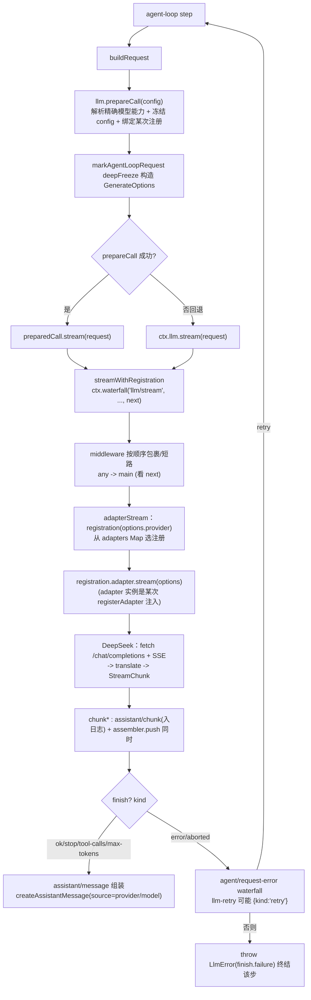

# LLM 能力层：消息/流式词汇与适配器 seam

> 子文档之一，聚焦 `ctx.llm`。覆盖 `packages/llm/*`（llm、llm-deepseek、llm-pi-ai、llm-retry、token-meter）。整体哲学见 [README](README.md)；本文位居「契约/词汇」能力面，上承 [architecture.md](architecture.md)（运行时装配）、下接 [agent-loop-runtime.md](agent-loop-runtime.md)（消费 `llm/stream`）。

核心主张：模型调用是 agent 里唯一一台「会变」的外接机器——新 provider、新模型系列、新 thinking 模式、新重试语义几乎每天在变。若把 DeepSeek 的 HTTP 细节、SSE 解析、thinking 字段焊进内核，内核就会成为「DeepSeek 专用」。因此 LLM 必须作为一个 seam 存在：**内核只定词汇和注册契约，模型生产实现由插件供给，消费方只依赖抽象**。

## 角色 / 根因：为什么 LLM 是"可交换 seam"而非硬编码 DeepSeek API

DeepSeek Harness 的核心主张是"一切皆插件、无特权内核"。这个主张最先落到 LLM 上：模型调用是 agent 里唯一一台"会变"的外接机器——有新的 provider、新的模型系列、新的 thinking 模式、新的计费与重试语义，且几乎每天在变。若把 DeepSeek 的 HTTP 细节、SSE 解析、thinking 字段焊进内核，内核就会成为"DeepSeek 专用"而失去插件骨架的意义；任何新 provider 都要改内核。因此 LLM 必须作为一个 seam 存在：**内核只定词汇（Message/ContentBlock/StreamChunk）和注册契约，模型生产实现由插件供给，消费方（agent loop）只依赖抽象**。

- 抽象 `llm` 服务：`LlmRuntime` 被声明为 Cordis `Context` 上的 `ctx.llm`，是一个"适配器注册表 + 可瀑布拦截的流式调用 API"，`LlmAdapter` 是给 provider 后端的抽象基类。内核不绑定任何具体厂商，只持有这两个抽象符号。

  `[packages/llm/llm/src/index.ts:284-284]()` 类声明 `export class LlmRuntime extends Service`
  <!-- anchor: 调用
  export class LlmRuntime extends Service -->
  `[packages/llm/llm/src/index.ts:46-49]()` 挂到 `Context.llm`
  <!-- anchor: 调用
  interface Context {
    llm: LlmRuntime
  -->

- **必给证据**——唯一必需方法是 `LlmAdapter.stream()`（第 214-244 行区间内，`abstract stream` 在 index.ts:232），其余全部是带默认实现的"可选能力描述"（`providerInfo`/`providerRetryPolicy`/`listModels`/`resolveModel`）。这让最小适配器只有 1 个方法要写，是"零摩擦接入"的根因。

  `[packages/llm/llm/src/index.ts:227-232]()` 唯一必需方法
  <!-- anchor: 调用
   * Stream one model call as raw chunks. The only required method.
   abstract stream(options: GenerateOptions): AsyncIterable<StreamChunk>

- LLM 也是"Capability Seam 三件套"的一个实例：**Definition**（`packages/llm/llm`，定义 Message/stream 词汇与 `LlmAdapter`）+ **Provider**（`llm-deepseek`/`llm-pi-ai` 插件实现）+ **Consumer**（`packages/core/agent-loop/agent.ts`，消费 `llm/stream`，用 `BlockAssembler` 组装）。每一个都是插件位，可替换而不动另两类。

- 具体厂商如何变成"一个插件"：`llm-deepseek` 就是一个声明了 `name`+`inject` 的插件，在 `apply()` 里把 `DeepSeekAdapter` 注册到 `ctx.llm` 上（`registerAdapter(['deepseek-official'], adapter)`）。注册是 effect-based（随 plugin 生命周期 dispose），符合"一切皆插件"的 HMR/卸载语义。

  `[packages/llm/llm-deepseek/src/index.ts:41-47]()` 插件名与依赖
  <!-- anchor: 调用
  export const name = 'llm-deepseek'
  export const inject = ['llm']
  -->
  `[packages/llm/llm-deepseek/src/index.ts:256-256]()` 注册 provider 路由
  <!-- anchor: 调用
  const registration = ctx.llm.registerAdapter([PROVIDER], adapter)
[UNVERIFIED]: `PROVIDER = 'deepseek-official'` 常量定义于 index.ts:47。

---

## 设计思路：词汇抽象 + Adapter seam（Definition/Provider/Consumer）

### 消息与内容词汇：一份共享的 provider-neutral 表示

与"Provider 只在自己的 wire 格式里自由"相反，harness 强约束一份**内核词汇**：一条 `Message` 是"id + role + 若干 typed `content` block + 来源 `source`"四元组。所有 provider、session log、模型请求共享同一种表示（`message.ts:128-138`），provider 只在 adapter 内部翻译成自己的 wire 格式（见 `serialize.ts`）。这带来两件事：（1）session log 里的历史即模型请求的输入，可重建，符合"重建性 Agent Note"；（2）切换 provider 不需要改写会话历史，因为历史是 provider-neutral 的。

- `Message` 的一份不可变表示，跨 delivery/durable history/model request 共享。

  `[packages/llm/llm/src/message.ts:128-138]()` 消息结构
  <!-- anchor: 调用
  /** One immutable message representation shared by delivery, durable history, and model requests. */
  export interface Message {
  -->

- `ContentBlockMap` + `ContentBlock` 是 **merge-extensible** 的联合：`text`/`reasoning`/`image`/`tool-call`/`tool-result` 五类基础块，插件可增删条目；新增块须同步 adapter/UI/compaction 支持（type 注释）。`switch on type + assertNever` 保证新增变体会在编译期强制所有消费方处理（closed union），这是 dsh 对整个词汇层的统一手法。

  `[packages/llm/llm/src/types.ts:96-110]()` map + 派生联合
  <!-- anchor: 调用
   * Merge-extensible content blocks keyed by `type`. New core blocks must land
  export interface ContentBlockMap {
  -->

> **演进说明（rc.7）**：五类基础块中的 `image` 不再是孤立的"词汇枚举"——rc.7 为它补上了持久化支撑：`image` 块携带 `attachment` 引用（`ImageAttachmentRef`），字节落盘在 durable attachment 服务而非内联 base64。判定"一段内容是否含图"由统一的递归 `contentHasImage` 承担（它会走进嵌套的 `tool-result`），LLM adapter 借此在组装前决定是否拒绝不支持图的模型。整块能力面拆到 [attachments.md](attachments.md) 讲透。

- 不可变性是"重建性"的载体：`createMessage` 给每条新消息打上 `MessageId(crypto.randomUUID())` 后 `deepFreeze(structuredClone(...))` 冻结；`LlmRuntime.prepareCall` 也 `deepFreeze(structuredClone(config))`。冻结使会话日志与请求输入成为一个纯函数关系（日志即请求，请求即日志），中间无可变状态漂移。

  `[packages/llm/llm/src/message.ts:169-185]()` 冻结 + 建号
  <!-- anchor: 调用
  export function freezeMessage<T extends Message>(message: T): T {
      return deepFreeze(structuredClone(message))
  -->

- 三件套中的**装配件**：`BlockAssembler` 把原始 `StreamChunk` 增量折叠回 `ContentBlock[]` + `usage` + `finish` + `replayState`，是唯一 canonical 组装算法。agent-loop 边消费边把 raw chunk 写入 session log（`assistant/chunk`），同时喂给同一个 assembler（`agent.ts:347-351`）；流结束后从 assembler 读取组装结果（`assembler.blocks()`/`finish`/`replayState`/`usage`）。这实现了"日志存原始 chunk，消费时再用同一算法组装"——保证 replay 与在线组装逐字节一致。

  `[packages/llm/llm/src/assembler.ts:36-41]()` 装配器状态
  <!-- anchor:
  export class BlockAssembler {
    private partials = new Map<number, PartialBlock>()
  -->
  `[packages/core/agent-loop/src/agent.ts:343-351]()` loop 边入日志边装配
  <!-- anchor:
  const assembler = new BlockAssembler()
  const chunkSeqs: number[] = []
  -->
  `[packages/core/agent-loop/src/agent.ts:373-380]()` 组装经 source 回原始 provider
  <!-- anchor:
  const message = createAssistantMessage({
    content: assembler.blocks(),
  -->

### Adapter seam：Definition / Provider / Consumer 三件套各司其职

**Definition（`dsh-llm`）**：`LlmRuntime` 内部持有三个注册表——`adapters`（provider route → adapter registration）、`directory`（configurable provider）、`discoveries`（settingsNs → 端点探测函数）——它们共同构成"provider 拓扑"。

- `LlmRuntime` 的三个表：route 注册、可配置目录、模型探测。

  `[packages/llm/llm/src/index.ts:285-290]()` 注册表三件
  <!-- anchor:
  private adapters = new Map<string, AdapterRegistration>()
  private directory = new Map<string, LlmConfigurableProvider>()
  -->

- 注册 `registerAdapter` 返回一个 **handle**（disposer + 原子 `replace`）。disposer 随 fiber/plugin 卸载；`replace` 支持"同一 adapter 实例切换路由集"且不产生空窗口——这对 user-configurable 路由（pi-ai 的动态 provider 列表）是必要的，因为 route 集是运行时可变的。

  `[packages/llm/llm/src/index.ts:330-367]()` registerAdapter + handle
  <!-- anchor:
   * Register an adapter for the given provider routes. Throws `LlmError` with code
   * `DUPLICATE_ADAPTER` if any provider already has an adapter (all-or-nothing).
  -->
  `[packages/llm/llm/src/index.ts:405-413]()` 单同步段交换并广播
  <!-- anchor:
  private commitRoutes(owned: Set<string>, registrations: readonly AdapterRegistration[]): void {
    for (const provider of owned) this.adapters.delete(provider)
  -->

- 每一条 route 在注册时**捕获一份不可变 retry policy**（`providerRetryPolicy()` 或默认），并随配置快照 stored。这是"路由注册即上下文快照"：在途失败的 recovery 策略不会因后续路由变更而漂移（agent.ts 用 `preparedCall.retryPolicy` 携带）。

  `[packages/llm/llm/src/index.ts:386-393]()` 按路由捕获策略
  <!-- anchor:
  const retryPolicy = adapter.providerRetryPolicy(provider)
        ?? resolveRetryPolicy(undefined, `llm: provider "${provider}" retryPolicy`)
  -->

- 顶层事件：`'llm/adapters-updated'`（emit，payload-free，注册拓扑变化通知，观察者失败被隔离不能否决提交）与 `'llm/stream'`（waterfall，围绕每次流式调用的拦截点，retry/replay/routing 都挂这里）。

  `[packages/llm/llm/src/types.ts:12-24]()` adapters-updated 事件
  <!-- anchor:
  declare module '@deepseek-ai/cordis' {
    interface Events {
  -->
  `[packages/llm/llm/src/index.ts:62-63]()` llm/stream waterfall 事件
  <!-- anchor:
   * @mode waterfall
   */
    'llm/stream'(this: LlmRuntime, options: GenerateOptions, next: () => AsyncIterable<StreamChunk>): AsyncIterable<StreamChunk>
  -->

**Provider（`llm-deepseek` / `llm-pi-ai`）**：实现方把 provider 专有细节锁在包内。DeepSeek 是"direct fetch + SSE"实现，模块分职责：`serialize.ts`（h→wire）、`sse.ts`（字节→data payload）、`translate.ts`（wire→StreamChunk）、`adapter.ts`（组装 + 传输边界）——呼应 cookbook 要求的"wire types / serialization / parsing / translation / adapter 分离"。这是"seam 的内侧"，内核不知晓任何 wire 拼写。

**Consumer（`agent-loop`）**：唯一消费抽象。`buildRequest` 用 `prepareCall`（绑定一次 adapter registration 贯穿能力解析/日志/dispatch，防 HMR 混用），`stream()` 走 waterfall；必要时回退 `ctx.llm.stream`（middleware 可接管未注册路由）。`loadContext`/`assemble` 之后把组装消息连同 provider/model source 与 replayState 写回 session log。

- consumer 的 `prepareCall` 绑定 + 可选回退，见前述 `agent.ts:449,345`。

### 如何新增一行新 provider（cookbook 逆向）

`docs/cookbook/adding-an-llm-adapter.md` 给出了"实现一个 `LlmAdapter.stream()` + `registerAdapter`"的最小契约。核心要点：register 是 effect-based、同一 provider 重复注册抛 `DUPLICATE_ADAPTER`、多路由 all-or-nothing；`options.provider` 选 adapter、`options.model` 是 provider 内模型 id（动态 catalog 无需重启）；错误只有两条 sanctioned path（THROW 或 `finish {kind:'error'|'aborted'}`）；`stop`/能力缺口必须显式 `UNSUPPORTED` 而非静默丢弃。

- cookbook 的 shape 与协议义务。

  `[docs/cookbook/adding-an-llm-adapter.md:23-23]()` 注册是 effect-based、重复抛错、多路由全有全无
  <!-- anchor:
  Registration is effect-based (HMR-safe); one adapter per provider route — duplicates throw, and multi-route registration is all-or-nothing. `options.provider` selects the adapter and `options.model` is the provider model id, so a dynamic catalog adapter can serve new models without lifecycle reconfiguration.
  -->
  `[docs/cookbook/adding-an-llm-adapter.md:30-30]()` 两条错误路径
  <!-- anchor:
  - Errors have exactly two sanctioned paths: THROW from `stream()` (transport and protocol failures — use `LlmError` with a stable code), or end the stream with `finish {kind: 'error' | 'aborted'}` (provider in-band failures). Consumers handle both; pick per failure class and document it.
  -->
  `[docs/cookbook/adding-an-llm-adapter.md:32-32]()` 不能 honor 的字段显式拒绝
  <!-- anchor:
  - A `GenerateOptions` field your provider cannot honor (e.g. a `stop` list on a provider without stop sequences): throw `LlmError(..., 'UNSUPPORTED')` rather than silently dropping it.
  -->

---

## 核心流程：一次流式模型调用（标注适配器如何被选中/注册）

适配器选择逻辑：内核按 `options.provider` 在 `adapters` Map 里查注册（`adapterStream` 的 `registration(options.provider)`），而该注册是"注册时"由某插件（deepseek/pi-ai）写进 Map 的。middleware 可借 `llm/stream` waterfall 在真正 lookup 之前短路/改写 request。完整 flow 如下。

路由注册的源码证据（"注册如何进入 Map 并被选中"）：

- 注册写入：`registerAdapter` → `commitRoutes` 把 `registration.provider.id -> registration` 设入 `this.adapters`。

  `[packages/llm/llm/src/index.ts:408-416]()` 写 Map 并广播
  <!-- anchor:
  for (const registration of registrations) {
    this.adapters.set(registration.provider.id, registration)
  -->

- 选中读取：`adapterStream` 用 `options.provider` 从 Map 取注册（prepared 时用已绑注册，否则现场查）。

  `[packages/llm/llm/src/index.ts:849-849]()` adapter 选择
  <!-- anchor:
  const registration = prepared?.registration ?? this.registration(options.provider)
  -->
  `[packages/llm/llm/src/index.ts:816-820]()` 查不到抛 NO_ADAPTER
  <!-- anchor:
  private registration(provider: string): AdapterRegistration {
    const registration = this.adapters.get(provider)
  -->

- waterfall 装配：`streamWithRegistration` 把 adapterStream 作为 `next()` 传给 `llm/stream` waterfall——middleware（retry/replay/routing）在适配器被选中前生效。

  `[packages/llm/llm/src/index.ts:921-931]()` waterfall 包裹
  <!-- anchor:
  return this.ctx.waterfall(
    this,
    'llm/stream',
  -->

- consumer 侧把 waterfall 返回的 stream 遍历：逐 chunk 入 session log + 喂 assembler；失败 `finish` 触发 `agent/request-error` 可重试。

  `[packages/llm/llm/src/index.ts:843-871]()` adapter 边界转为 finish chunk
  <!-- anchor:
  private async * adapterStream(
    options: GenerateOptions,
    prepared?: { registration: AdapterRegistration; config: LlmCallConfig },
  -->
  `[packages/llm/llm/src/index.ts:930-931]()` 抛错归一化为终态 chunk
  <!-- anchor: /** Convert one adapter throw into the stream protocol's terminal outcome. */ … function adapterFailureChunk(error: unknown, signal?: AbortSignal): StreamChunk { -->

---

## 设计决策

### 决策一：索引相关的块级流式词汇（`StreamChunk` 的 block-start/delta/block-end + usage + finish）

**Why**：一次响应可能交织多个"块"——同时出现的 text、前置于文本的 thinking reasoning、多个并行 tool call。若只传 `delta`（token 片段），消费方无从知道哪个片段属于哪个逻辑单元、何时结束一个单元；若直接传 `block`（整块），又丢掉了流式首 token 延迟。所以协议拆成"`block-start`(index,type) → N 个 `*`-delta(index) → `block-end`(index, 完整 ContentBlock)"，用 `index` 关联同一块的所有 delta 与闭合。`block-end` 直接携带已组装好的 `ContentBlock`，消费方不必自己拼，但 `BlockAssembler` 也容忍"delta-only"协议（无 start/end）。

**权衡/关键不变式**：
- `index` 按首见顺序分配、同一块复用（translate 用 `nextIndex` 递增，tool-call 用 wire `call.index` 映射到块的 index）。
- **closed union + 位置不变式**：`order/push` 后 `assertNever`；usage 必须在 finish 前且只出现一次、finish 后不能再有 chunk、除非 error/aborted 否则 finish 时不能还有 open block——这些由 invariant 插件在 `llm/stream` 外面（prepend）逐 chunk 校验。它把协议文法变成运行时可验证的强约束，而不是只靠类型。
- 好处：任一 provider 的"流式差异"（提前 flush 的 usage-only、[DONE] 前的空 reasoning 首帧）都在 adapter 内磨平，内核词汇保持稳定。

  `[packages/llm/llm/src/types.ts:283-303]()` StreamChunk 联合
  <!-- anchor:
   * Raw streaming protocol emitted by adapters.
   * Block indexes correlate interleaved deltas, and `block-end` carries the
  -->
  `[packages/llm/llm-deepseek/src/translate.ts:127-149]()` 首见分配 index 并产出 delta
  <!-- anchor:
  for (const choice of chunk.choices ?? []) {
    const delta = choice.delta
  -->
  `[packages/llm/llm/src/invariant.ts:36-84]()` 逐 chunk 校验文法
  <!-- anchor:
  async function* validateStream(
    source: AsyncIterable<StreamChunk>,
    fail: InvariantFailure,
  -->
  `[packages/llm/llm/src/types.ts:96-107]()` 合并扩展块联合
  <!-- anchor:
  * Merge-extensible content blocks keyed by `type`. New core blocks must land
  export interface ContentBlockMap {
  -->

### 决策二：多 provider 分派——"路由注册表 + provider 内模型自由"，而非每厂商一服务

**Why**：与其为每厂商开一个 `ctx.xxx` 服务（DeepSeekService、AcmeService…），不如一份"provider route → adapter 实例"的注册表，`GenerateOptions.provider` 每次调用选择一路。这样 consumer（agent-loop）只面对一个 `ctx.llm`，provider 间的切换/路由/routing middleware 天然收敛到一个点；新增厂商 = 新增一条 route，不新增服务。

**权衡/关键不变式**：
- **一个 adapter 实例可持多条 route**：deepseek 只持 `deepseek-official` 一条；pi-ai 在配置变更时用 `handle.replace(routes)` 原子重写整个 route 集（路由集是 user-configurable 的）。这要求注册表有"同实例原子换路由"能力，设计上通过 `prepareRoutes`（先全量校验，失败不动旧态）+ `commitRoutes`（单同步段交换 + 广播）达成。
- **重复 route 全有全无**：`prepareRoutes` 里发现与既有注册冲突抛 `DUPLICATE_ADAPTER`，整组不落盘。
- **pi-ai 的多 provider**：用"一个瞬时快照"统一持有 profiles + 由 profiles 构建的 `Models` 集合；一次操作在任何 `await` 前捕获整个快照，配置变更只产生新快照，在途流始终用旧快照——这就是 `prepareCall` 冻结能一路保持到底的原因所在：切换发生在下一步，绝不发生在在途响应中间。
- **listModels/resolveModel 是 advisory**：路由仍按键查 adapter，adapter 可接受 catalog 外的 model id（catalog 不进请求校验、不挡路由）。

  `[packages/llm/llm/src/index.ts:374-396]()` 全量校验 + 全有全无
  <!-- anchor:
  private prepareRoutes(providers: string[], adapter: LlmAdapter, owned: ReadonlySet<string>): AdapterRegistration[] {
    const unique = new Set<string>()
  -->
  `[packages/llm/llm-pi-ai/src/index.ts:262-272]()` 动态路由集原子替换（或不注册）
  <!-- anchor:
  const routes = [...profiles().keys()]
    if (registration === undefined) {
  -->
  `[packages/llm/llm-pi-ai/src/adapter.ts:199-206]()` 按 profiles 身份 memoize 快照
  <!-- anchor:
  private current(): PiAiSnapshot {
    const profiles = this.config.profiles()
    if (this.snapshot?.profiles === profiles) return this.snapshot
  -->
  `[packages/llm/llm/src/types.ts:143-148]()` provider 元信息
  <!-- anchor:
  /** Display metadata for one registered provider route. */
  export interface LlmProviderInfo {
  -->

### 决策三：错误/超时/重试——提供方中立的错误归一化 + 传输级看门狗 + 事件扩展点上的重试

**Why**：每个 provider 的错误词汇（HTTP status、SDK exception、SSE 内联错误）各不相同，而 loop 只有一套恢复语义。因此设计"**每个失败最终都是同一份可序列化 `LlmFailure`**"，并让"失败是否该重试"从"发生了什么"里解耦出来——策略层单独决定。错误通路只有两条 sanctioned path（THROW 或 `finish {kind:'error'|'aborted'}`），`adapterStream` 把任一条统一折叠为终态 `finish`（`adapterFailureChunk`），consumer 据此驱动恢复。

**关键不变式**：
- **归一化**：`normalizeLlmFailure` 拒绝陌生 SDK 的 code（只有 Harness 自己的 `HarnessError.code` 被信任），验证 status/retryAfter/requestId 后剥离出不可变 `LlmFailure`。错误码是跨 provider 的共享分类（`AUTH`/`RATE_LIMIT`/`NO_ADAPTER`/`EMPTY_RESPONSE`/`CONTEXT_WINDOW_EXCEEDED` 等），routing 按 code 不按文案。
- **传输级看门狗**：DeepSeek 与 pi-ai 都在 `idleWatchdog` 上只对"iterator `next()` 尚未返回"的期间武装（`MAX_TIMEOUT`），用一个 stable signal 覆盖整个请求，自身到期映射为 `TIMEOUT`，更早的 caller abort 仍为 `ABORTED`。这避免了"挂死的 TCP 流让整个调用永远悬空"。
- **重试放在事件扩展点上，不在内核**：`llm-retry` 插件监听 `agent/request-error`，读 `preparedCall.retryPolicy`（注册时捕获的不可变策略），normal 模式按 `retryableCodes` 过滤 + 有界退避（指数 + 抖动 + `providerRetryAfterMs`），always 模式无界；每次调度前先落 `llm/retry` 事件入 session log（durable before cancellable wait），取消与 lifespan 信号都可中断。重试在代理层面开启"新的 durable 编号轮次"，而不是吞掉失败。
- **空响应是错误而非成功**：provider 给出"正常完成但零内容"时，DeepSeek/pi-ai 都映射为 `EMPTY_RESPONSE` 错误（见 llm-streaming.md 契约），`llm-retry` 默认重试它——因为空消息会静默终结回合且无可行动内容。
- **agent-loop 的代理级恢复**：`finish.kind==='error'|'aborted'` → 发 `agent/request-error` waterfall；无 retry 则 `throw new LlmError(finish.failure...)` 终结该步且不提交 assistant 消息/工具副作用。

  `[packages/llm/llm/src/adapter-failure.ts:16-28]()` 归一化为 LlmFailure
  <!-- anchor:
  export function normalizeLlmFailure(value: unknown): LlmFailure {
    const error = value instanceof Error
  -->
  `[packages/llm/llm/src/error.ts:13-22]()` HarnessError 提供稳定 code
  <!-- anchor:
  export class HarnessError extends Error {
    /** Stable machine-routable failure class (e.g. `RATE_LIMIT`); route on this, never by parsing `message`. */
  -->
  `[packages/llm/llm-deepseek/src/adapter.ts:227-227]()` 每次改流的 idle 看门狗
  <!-- anchor:
  using watchdog = idleWatchdog(upstream, connection.streamIdleTimeoutMs, STREAM_IDLE_TIMEOUT_CODE)
  -->
  `[packages/llm/llm-retry/src/index.ts:156-208]()` agent/request-error 上的重试调度
  <!-- anchor:
  async function recover(
    { agent, turn, step, provider, failure, retryPolicy: policy, signal }: Parameters<Events['agent/request-error']>[0],
  -->
  `[packages/llm/llm-retry/src/index.ts:150-153]()` 先落 durable 事件再等
  <!-- anchor:
      agent.session.append('llm/retry', eventData)
    if (!await cancellableDelay(delayMs, fusedSignal)) return
  -->
  `[packages/core/agent-loop/src/agent.ts:354-371]()` consumer 驱动恢复
  <!-- anchor:
  if (finish.kind === 'error' || finish.kind === 'aborted') {
    const action = await this.dispatch.waterfall(
  -->

## 全局关联：LLM seam 是「可交换」哲学的始发站

LLM 是最早、也最彻底贯彻「无特权内核 + Capability Seam 三件套」的能力面：Definition（词汇与 `LlmAdapter`）、Provider（llm-deepseek/llm-pi-ai 插件）、Consumer（agent-loop）清晰分离，新增厂商 = 在 `ctx.llm` 注册一条 provider route（`llm-deepseek` 以 `registerAdapter(['deepseek-official'])` 落地，`[packages/llm/llm-deepseek/src/index.ts:47-47](),256`），不新增服务。索引相关的块级流式词汇（block-start/delta/block-end + usage + finish）把各 provider 的流式差异在 adapter 内磨平，内核词汇保持稳定；错误归一化为统一 `LlmFailure`、重试挂在 `agent/request-error` 事件扩展点上而非内核。这份「内核只定词汇、实现由插件供给」的坚持，与 [architecture.md](architecture.md)（插件树装配）、[agent-loop-runtime.md](agent-loop-runtime.md)（`llm/stream` 消费）一脉相承，是理解 dsh 一切「可交换后端」的起点。
