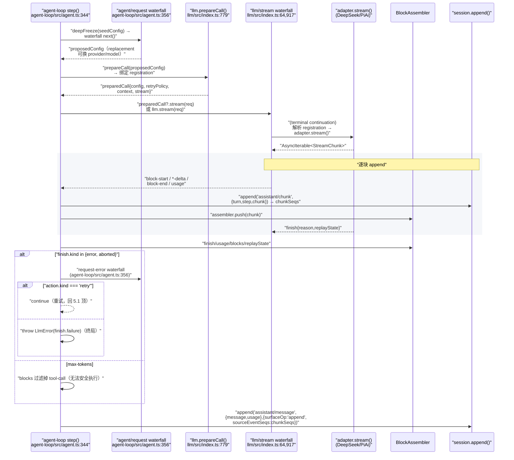
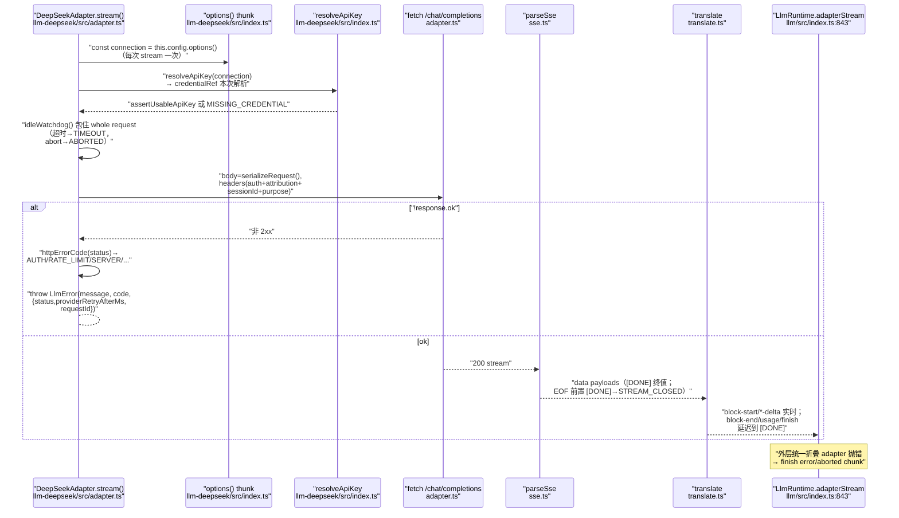

# LLM 适配层与流式协议（LLM Adapter & Streaming）

> 对应关注面：`packages/llm/`（llm / llm-deepseek / llm-pi-ai / llm-retry / token-meter）与 `packages/credentials/`——把「任意 LLM provider」变成「接口后可热插拔接缝」的核心模块。
> 源码根 `deepseek-harness/`。

## 在项目中的角色（去掉它会怎样）

`ctx.llm`（`LlmRuntime`）同时是：
- **词汇中心**：`Message`/`ContentBlock`/`StreamChunk`/`FinishReason`/`TokenUsage` 这套 provider-neutral 语言，被 agent-loop、session、compaction、token-meter、tools 共享。
- **adapter 注册处**：`registerAdapter` 绑定 provider 路由到实现，`registerConfigurableProviders`/`registerModelDiscovery` 供配置面展示休眠 provider。
- **瀑布拦截点**：`llm/stream` waterfall 让重试、回放、路由、语法校验都能包裹每次模型调用而不用改 loop。
- **错误归一化边界**：把 provider 的 throw / in-band 错误折叠成统一 `LlmFailure`，供 `agent/request-error` 恢复。

没有它，agent-loop 会硬编码一个 SDK——`step()` 里的 `stream`（[packages/core/agent-loop/src/agent.ts:345-345]()）就得换手写 OpenAI/DeepSeek/pi-ai 分支，落盘、错误恢复、token 计量全部按 provider 分叉——把「语义恒量」焊死进「物理差异」，正是本仓库刻意避免的。
<!-- snippet:       const stream = preparedCall?.stream(request) ?? this.loopCtx.llm.stream(request) -->

## 解决什么问题、根因

根因注释在类型文件头：Canonical provider-neutral message and streaming vocabulary for the loop, session log, and plugins. Adapters alone translate provider wire messages; mapped interfaces make the content, source, and finish unions extensible（[packages/llm/llm/src/types.ts:1-5]()）。
<!-- snippet: /**
 * Canonical provider-neutral message and streaming vocabulary for the loop,
 * session log, and plugins. Adapters alone translate provider wire messages;
 * mapped interfaces make the content, source, and finish unions extensible.
 */ -->

具体问题：
1. loop 不能依赖任何 provider 线协议；否则每换一个模型供应商就得改 driver。
2. 流式协议既要表达 interleaved 输入（多 tool-call + text + reasoning 交错），又要表达退化完成（空响应、max-tokens 截断、中途断流）。
3. 错误必须先归一化再上抛：401/429/500、断流、JSON 畸形、超时若以 provider 原文传恢复层，重试策略与用户诊断都无法跨 provider 移植。
4. 每个 provider 的「空完成」与「max-tokens 截断的未执行 tool-call」必须语义一致，否则 loop 无法安全决定要不要重跑。
5. credential 与配置要能在不重启下轮换：配置只携带 secret 引用，providers 拥有值，每次操作解析。

## 设计思路（seam + Map 扩展）

### 抽象只画最小面，provider 通过 adapter 注入

`LlmAdapter` 完整类是 [packages/llm/llm/src/index.ts:180-183]()（指纹区，完整类见 180-233），其中**只有一个抽象方法** `stream`（[packages/llm/llm/src/index.ts:232-232]()），其余 `providerInfo`/`providerRetryPolicy`/`listModels`/`resolveModel` 都有带默认值的实现。
<!-- snippet: export abstract class LlmAdapter {
  /**
   * Describe one provider route owned by this adapter.
   * @param provider - a route passed to `registerAdapter()` for this instance. -->
<!-- snippet:   abstract stream(options: GenerateOptions): AsyncIterable<StreamChunk> -->

新 provider 最小成本 = 实现 `stream()` + 提供 metadata。`registerAdapter(providers, adapter)` 一个实例可托管多条路由；重复路由 fail atomically（`DUPLICATE_ADAPTER`，[packages/llm/llm/src/index.ts:380-380]()，完整 `prepareRoutes` 见 374-396）。
<!-- snippet:       throw new LlmError(`an adapter for provider "${provider}" is already registered`, 'DUPLICATE_ADAPTER') -->

**放弃的替代方案「仅 DeepSeek 专用」**：本仓库用两个生产 adapter 证明它是通用 seam——`llm-deepseek`（手写 fetch+SSE）与 `llm-pi-ai`（复用 `@earendil-works/pi-ai` 库）。wire 差异全部压缩在各自 adapter 内；loop、session、token-meter 只看到同一个 `StreamChunk`。

### Map → derived-union + declaration merging 扩展

三种被反复消费的联合（content、source、finish）不是写死的字面量，而是从 `Map` 接口派生（[packages/llm/llm/src/types.ts:99-105]()，ContentBlockType/ContentBlock 见同文件 107-110）：
<!-- snippet: export interface ContentBlockMap {
  'text': TextBlock
  'reasoning': ReasoningBlock
  'image': ImageBlock
  'tool-call': ToolCallBlock
  'tool-result': ToolResultBlock
} -->

`FinishReasonMap` 同理（[packages/llm/llm/src/types.ts:116-119]()，FinishReason union 见 124-125）；`MessageSourceMap` 同理。外部插件通过 `declare module` 给这些 Map 追加键即「零改核心」加一种 content block / source / finish reason。消费端按 `never.ts` 约定：merge-extensible 的 union 要显式 fall-through。
<!-- snippet: export interface FinishReasonMap {
  'stop': { kind: 'stop' }
  'tool-calls': { kind: 'tool-calls' }
  'max-tokens': { kind: 'max-tokens' } -->

### StreamChunk：一个大 discriminated union（流式协议）

`StreamChunk` 是一个大 union（[packages/llm/llm/src/types.ts:291-297]()，StreamChunk 完整体见 291-303）：块用 `index` 关联交错 delta，`block-end` 携带完整 `ContentBlock`（消费者无需自拼），`finish` 携带 `replayState`。`assertNever` 保证新增 variant 在未处理处编译失败。
<!-- snippet: export type StreamChunk =
  | { type: 'block-start'; index: number; blockType: ContentBlockType }
  | { type: 'text-delta'; index: number; text: string }
  | { type: 'reasoning-delta'; index: number; text: string }
  | { type: 'tool-call-delta'; index: number; id: CallId; name?: string; argumentsDelta: string }
  | { type: 'block-end'; index: number; block: ContentBlock }
  | { type: 'usage'; usage: TokenUsage } -->

## 关键数据结构（精简）

### Message 与 MessageSource（属主 + 可回放状态）

`Message`（[packages/llm/llm/src/message.ts:22-24]() 的 `ModelMessageSource`；完整 `Message` 见 129-138）携带 `id`/`role`/`content`/`source`。`ModelMessageSource extends AssistantProvenance`（`kind: 'model'`）；`AssistantProvenance` 带 `provider`+`model`，还带 `replayState?: unknown` —— adapter 私有、lossless-JSON、用于重放成功响应。
<!-- snippet: export interface ModelMessageSource extends AssistantProvenance {
  kind: 'model'
} -->

### LlmFailure（可序列化的 provider 边界事实）

`LlmFailure`（[packages/llm/llm/src/types.ts:40-43]()，LlmFailure 完整体见 40-51）携带 `message`/`code`/`status?`/`providerRetryAfterMs?`/`requestId?`，code 是稳定 provider-neutral 机器路由码（`AUTH`/`RATE_LIMIT`/`SERVER`/`TIMEOUT`/`TRANSPORT`/`CONTEXT_WINDOW_EXCEEDED`/`EMPTY_RESPONSE`…，见 `error.ts:24-48` 规范常量与 `isContextWindowExceededError`/`isQuotaExceededError` 分类器）。
<!-- snippet: export interface LlmFailure {
  readonly message: string
  /** Stable provider-neutral machine-routing code. */
  readonly code: string -->

### RetryPolicy（normal / always 二分）

`RetryPolicyConfig = NormalRetryPolicyConfig | AlwaysRetryPolicyConfig`，`ResolvedRetryPolicy` 同理（[packages/llm/llm/src/retry-policy.ts:57-57]() 与 79）。`normal` 带有限 `maxRetries`+`retryableCodes`+backoff；`always` 只带 backoff、无限重。默认 retryable codes 固定为 `['EMPTY_RESPONSE','RATE_LIMIT','SERVER','TIMEOUT','TRANSPORT']`（[packages/llm/llm/src/retry-policy.ts:14-24]()）。
<!-- snippet: export type RetryPolicyConfig = NormalRetryPolicyConfig | AlwaysRetryPolicyConfig -->

### TokenUsage（disjoint，cache 分离）

`TokenUsage`（[packages/llm/llm/src/types.ts:135-139]()，TokenUsage 完整体见 135-141）：`inputTokens` 不含 cache，billed input = 三者之和；`reasoningTokens` 已含在 `outputTokens`，总量不得再加。两种 adapter 都执行此契约。
<!-- snippet: export interface TokenUsage {
  inputTokens: number
  outputTokens: number
  cacheReadTokens?: number
  cacheWriteTokens?: number -->

## 核心流程（Mermaid）

### (1) agent/request → llm/stream 瀑布 → StreamChunk 逐块 assistant/chunk 时序

**为何 `preparedCall?.stream ?? llm.stream` 二选一**：`prepareCall` 在异步 exact-model 解析前就捕获 registration（[packages/llm/llm/src/index.ts:779-779]()，prepareCall 完整体见 779-814），one-shot `PreparedLlmCall.stream()` 保证「capability 解析用的 adapter == 最终 dispatch 的 adapter」（HMR 不会把 A 的能力结果配给 B 的 dispatch），含 `INVALID_PREPARED_CALL` 二次 dispatch / config 变更防护（[packages/llm/llm/src/index.ts:779-814]()）。
<!-- snippet:   async prepareCall(config: LlmCallConfig, signal?: AbortSignal): Promise<PreparedLlmCall> { -->

loop 优先走它（[packages/core/agent-loop/src/agent.ts:345-345]()）；`llm/stream` 瀑布 = `ctx.waterfall(this, 'llm/stream', options, () => this.adapterStream(options, prepared))`（[packages/llm/llm/src/index.ts:917-920]()，streamWithRegistration 完整体见 917-927），其中 `adapterStream` 把「adapter 选取、dispatch、迭代」失败统一折叠成终局 finish chunk。事件声明在 [packages/llm/llm/src/index.ts:64-64]()：loop 请求带 `markAgentLoopRequest` 身份且 deep-frozen，listener 只能读不能改写。
<!-- snippet:       const stream = preparedCall?.stream(request) ?? this.loopCtx.llm.stream(request) -->
<!-- snippet:   private streamWithRegistration(
    options: GenerateOptions,
    prepared?: { registration: AdapterRegistration; config: LlmCallConfig },
  ): AsyncIterable<StreamChunk> { -->
<!-- snippet:     'llm/stream'(this: LlmRuntime, options: GenerateOptions, next: () => AsyncIterable<StreamChunk>): AsyncIterable<StreamChunk> -->

**关键消费者 `llm-invariant`**：以 `prepend:true, global:true` 包裹每个 provider stream，校验语法（未 open 就 delta、重复 block-start、usage 多于一次、非 error 有 open block 结束、缺终局 finish）（[packages/llm/llm/src/invariant.ts:87-88]()，install 完整体见 87-103）。若请求自带 `signal`/`maxTokens` 等则其配置需精简。
<!-- snippet: const install: InvariantInstaller = (ctx, fail) => {
  ctx.on('llm/stream', (_options, next) => validateStream(next(), fail), { global: true, prepend: true }) -->

### (2) llm-deepseek：直接 fetch + SSE 的 adapter（流式 + 错误归一化）

- **每请求解析一次连接 facts + credential**（[packages/llm/llm-deepseek/src/adapter.ts:215-217]()）：`connection` 与 `apiKey` 在**同一个快照**解析冻结，杜绝「这一代 URL 配上一代 key」；`idleWatchdog` 只在 iterator `next()` outstanding 时武装。
  <!-- snippet:     // One resolution per stream call: connection facts and the credential
    // freeze here and hold for this whole request, so an in-flight stream
    // never observes a configuration change and the next call re-resolves. -->
- **错误归一化的两层**：HTTP 层在 `request()`（`adapter.ts:321-339`）：`retry-after` → `providerRetryAfterMs`，`x-request-id` → `requestId`，`httpErrorCode` 映射稳定 code；传输层在 `stream()`（`adapter.ts:246-258`）：idle→`TIMEOUT`、abort→`ABORTED`、`LlmError` 透传、未知包成 `TRANSPORT`。
- **流式翻译**（[packages/llm/llm-deepseek/src/translate.ts:86-118]()）：reasoning 先于 text，空串首 chunk 不开 block；`[DONE]` 统一 flush `block-end`→`usage`→`finish`。退化完成：`stop`/缺 finish 且无 block → `EMPTY_RESPONSE` error finish。usage 做 disjoint 减法。

### (3) llm-pi-ai：库支撑的多 provider adapter（第二注册范式）

不同只在 wire 侧——用 `@earendil-works/pi-ai` 的 `Models` 应对多 provider。核心差异是 **immutable snapshot**（[packages/llm/llm-pi-ai/src/adapter.ts:199-203]()，current snapshot 完整体见 199-206）：
<!-- snippet:   private current(): PiAiSnapshot {
    const profiles = this.config.profiles()
    if (this.snapshot?.profiles === profiles) return this.snapshot
    const models: MutableModels = createModels()
    for (const profile of profiles.values()) models.setProvider(profile.piProvider) -->

因为 `Models.streamSimple()` 懒——provider 在流首次消费时才解析，若注入时直接改 collection，会让「某配置下开始的请求在另一配置下结束」。每个操作捕获整个 snapshot（含 credential）再 await，配置变更只影响下个请求。

错误归一化在 `stream.ts` 的 `toStreamChunks`/`mapStopReason`：pi-ai 用**终局 error 事件**而非 throw，映射成 error/aborted finish chunk（[packages/llm/llm-pi-ai/src/stream.ts:196-200]()`case 'error'` 分支）——即「in-band」这条 sanctioned 错误路径。`maxRetries:0` 显式禁掉库内重试：「一次 adapter 调用 = 一次 provider attempt」。
<!-- snippet:       case 'error':
        // In-stream error delivery (pi-ai's style) → error finish chunk
        // (the harness's other sanctioned error path besides throwing).
        yield { type: 'usage', usage: mapUsage(event.error.usage) }
        yield { type: 'finish', reason: mapStopReason(event.error, contextWindow) } -->

### (4) llm-retry：重试策略执行（agent/request-error 消费者）

`llm-retry` 自己是 `agent/request-error` 的 waterfall listener（[packages/llm/llm-retry/src/index.ts:210-219]()）：
1. **过滤**：无 policy → `next()`；`normal` 且 code 不在 `retryableCodes` → `next()`。
2. **幂等**：从 session 日志找同一 `turn/step/provider/policyKey` 的前次 `llm/retry`，以 `previousRetry`+1 决定 `retry`，`RetryId` 跨尝试复用——「重试可止」的依据：`maxRetries` 到即 terminal。
3. **退避**：`localDelay` = bounded exponential + symmetric jitter；provider 给 `providerRetryAfterMs` 用之（`normal` 下超过 `maxDelayMs` → 不重试走 `next()`）。
4. **持久化 + 可取消延时**：先 `append('llm/retry',...)`（durable）再 `cancellableDelay`——「每个 retry 在可取消等待前已 durable」，等待中 abort 则不返回 retry。

`agent/request-error` 签名（[packages/core/agent/src/runtime-types.ts:260-261]()）：payload 带 `failure`、`retryPolicy`、`signal`；listener 返回 `{kind:'retry'}` 或委托，默认 terminal。

### (5) 错误归一化在 agent-loop 的接入点

`agent-loop` 消费终局 finish，把 `failure`+`retryPolicy` 塞进 `agent/request-error` 瀑布（[packages/core/agent-loop/src/agent.ts:356-356]()，request-error 瀑布见 354-370）；否则对 error/aborted 外的 `finish` 组装 assistant message 并落盘（[packages/core/agent-loop/src/agent.ts:382-382]()，assistant/message 落盘见 382-389）。
<!-- snippet:           'agent/request-error', { -->
<!-- snippet:         'assistant/message', -->

## 与其他模块协同

- **agent-loop（消费）**：见 5.1。
- **session（落盘所有 chunk）**：每个 chunk `append('assistant/chunk',{turn,step,chunk})`，`assistant/message` 带 `surfaceOp:'append'`+`sourceEventSeqs:chunkSeqs`（[packages/core/agent-loop/src/agent.ts:347-350]()）——使流可重放。
- **token-meter（回放重估）**：消费 `assistant/chunk`，用 `new BlockAssembler()` 重放 cited chunk seqs 估算 provider 输出并与 `usage` 锚定（[packages/llm/token-meter/src/index.ts:277-309]()）——证明 StreamChunk 协议+BlockAssembler 是「一次产出、多方复用」。
- **compaction（复用 llm 重生成）**：`summarizer.ts` 直接 `ctx.llm.stream(options)` 跑压缩调用，带 `purpose:'compaction'`（[packages/compaction/compaction-basic/src/summarizer.ts:161-164]()）；deepseek 据此加 `thinking disabled` 与 compact header。
- **credentials / settings（每次操作解析）**：见措辞「每次操作解析」。
- **scope（agent-scoped routing）**：`agent/request`、`agent/request-error` 是 `Scoped<Agent>` 瀑布。

## 关键设计决策（Why）

### Why StreamChunk 是「大 union」而非小接口？

一个流同时携带 text+reasoning+多个 tool-call，chunk 天然多形态——`index` 关联交错 delta。小接口（delta/text/tool_call 各一对象）会把交错关系推给消费者。union+`index`+`block-end`（自带完整 block）让消费者不重写组装，统一用 `BlockAssembler`。`assertNever` exhaustiveness：新增 variant 让所有未处理 `switch` 编不过。文档明说 closed union。
- trade-off：union 较冗长，且**不可 declaration merging 扩展**（新增 chunk 类型=改核心），但换语法级穷尽——与 content/source/finish 的 merge-extensible 定位刻意相反（chunk 协议应封闭）。

### Why llm/stream 是 waterfall（谁拦截、谁委托）？

拦截点唯一：`ctx.waterfall(this,'llm/stream',options,()=>this.adapterStream(...))`（[packages/llm/llm/src/index.ts:917-920]()，streamWithRegistration 完整体见 917-927）。listener 可 `next()` 委托真实 adapter，或 yield 自产 chunk 短路（重试/回放/路由）。安全：`adapterStream` 把「adapter 选取、dispatch、迭代」失败统一 `yield adapterFailureChunk(...)` 变终局 finish（[packages/llm/llm/src/index.ts:843-846]()）；middleware/consumer 自身失败保持 throw——错误归属清晰。短路由 waterfall 提供：retry、replay、语法校验（invariant prepend）。
<!-- snippet:   private streamWithRegistration(
    options: GenerateOptions,
    prepared?: { registration: AdapterRegistration; config: LlmCallConfig },
  ): AsyncIterable<StreamChunk> { -->
<!-- snippet:   private async * adapterStream(
  options: GenerateOptions, -->

### 重试策略如何设计（解析、退避、幂等）？

- 解析：provider 注册时把 `resolveRetryPolicy` 结果捕获进 `AdapterRegistration`（[packages/llm/llm/src/index.ts:387-387]()，捕获逻辑见 387-392）；默认 normal+retryable codes（[packages/llm/llm/src/retry-policy.ts:18-24]() 的 `DEFAULT_RETRYABLE_CODES`）。`providerRetryPolicy` 读当前（[packages/llm/llm/src/index.ts:566-568]()）——改 policy 需 `replace`。
  <!-- snippet:       const retryPolicy = adapter.providerRetryPolicy(provider) -->
  <!-- snippet: const DEFAULT_RETRYABLE_CODES = Object.freeze([
  EMPTY_RESPONSE_CODE,
  'RATE_LIMIT',
  'SERVER',
  'TIMEOUT',
  'TRANSPORT',
]) -->
  <!-- snippet:   providerRetryPolicy(provider: string): ResolvedRetryPolicy { -->
- 退避：bounded exponential（指数上限 1024）`Math.min(initial*2^retry, maxDelay)`，乘 `1±jitterRatio` 对称抖动（[packages/llm/llm-retry/src/index.ts:58-63]()）；provider `retry-after` 优先。
- 幂等：不靠请求幂等（LLM 调用不可全局幂等），靠**会话内重试计数 durable**——同一 `turn/step/provider/policyKey` 的 `llm/retry` 事件决定是否还有额度，`RetryId` 贯穿整链。可见最大重试=`maxRetries`（或 always 无限直到 dispose/abort）。

### Credentials 每次操作解析 vs 长期持有的权衡？

每次操作解析（`llm-deepseek/src/index.ts:225-228`、`llm-pi-ai/src/adapter.ts:292`，seam 注释 `credentials/src/index.ts:73`）。
- **得**：旋转的 credential（CI 注入、Models 页写入）直达下一次 request，无需重启；配置面只看 reference 不碰值。
- **失**：每次 stream 多一次（通常内存级）`resolve(ref)`；若长期持有则失实时轮换并引入「脏值」管理。dsh 明确选前者，并让端点和 key 出自同一快照，杜绝 URL/secret 跨代错配。`credentials-local` 分层 `env > 可信文件 > 项目 .env > 用户 .env`（[packages/credentials/credentials-local/src/index.ts:2-22]()），继承环境只读胜出、Models 页写 0600 文件热发布。

### 错误归一化（LlmFailure）对 request-error 恢复的意义？

保证恢复层 provider-neutral：code 是稳定机器路由码，重试策略按码白名单匹配，不解析 provider 文案；归一化发生在最终 adapter 边界（`adapterStream` 的 `adapterFailureChunk`，[packages/llm/llm/src/index.ts:868-868]()），连「未注册 provider/参数畸形/被 abort」也折叠成统一 finish；loop 把 `failure`+`retryPolicy`（serving registration 不可变故）+`signal` 交给 `agent/request-error`——恢复逻辑跨 provider 移植。`normalizeLlmFailure`（[packages/llm/llm/src/adapter-failure.ts:16-28]()）只信任 Harness 自有 code，跨包拷贝的 `failure` 需校验一致才采纳，第三方 SDK code 一律 `UNKNOWN`。

### Map → union + declaration merging 让外部加模型类型零改核心？

是。`ContentBlockMap`/`MessageSourceMap`/`FinishReasonMap` 是全局接口，外部 `declare module` 追加键即扩展 union。两组 switch 约定不同：core chunk（封闭）必须 `assertNever`；merge-extensible union（content/source/finish）处理已知后显式 fall-through——这是全 repo 的 switch 约定在 LLM 层的体现。

## 亮点与问题

### 亮点

- **接缝被两个生产 adapter 证明**：dsh-llm 不绑定 provider；llm-deepseek（手写 fetch+SSE）与 llm-pi-ai（库支撑、多 provider）落在同一 `LlmAdapter` 契约。
- **两条 sanctioned 错误路径**（throw 与 in-band finish 并存），配 `normalizeLlmFailure` 兜底，恢复层永远拿 `LlmFailure` 而非裸异常。
- **退化完成的显式语义**：空完成=可重试 `EMPTY_RESPONSE`（[packages/llm/llm/src/error.ts:39-39]()）、截断掉未执行 tool-call（[packages/llm/llm/src/assembler.ts:136-138]()）——避免 loop 静默空转。
- **运行时轮换与一致性并重**：连接 facts/credential 每操作解析（热更新）但一次请求内快照冻结（一致性）；adapter 可 `replace`。
- **BlockAssembler 单点复用**：agent-loop 落盘 chunk 同时推给 assembler；token-meter 用同一 assembler 从日志重放估算——「一次流、多方消费」。

### 问题 / 值得质疑处

- **StreamChunk 不可外部扩展**：新增 delta（音频/文件）要改核心而非 merging。属刻意取舍（协议应封闭），但新 modality 落地成本高（adapter+UI+compaction+回放都要动）。是否与「内容块可扩展」目标形成长期张力待观察。
- **`emitAdaptersUpdated` 的 INVARIANT 后置 rethrow**（[packages/llm/llm/src/index.ts:297-297]()，emitAdaptersUpdated 完整体见 297-322）：从 emit listener 收集 invariant 失败最终同步抛给 `commitRoutes` 调用方——若由 settings 回调触发，可能把配置变更异常地传到配置层。
  <!-- snippet:   private emitAdaptersUpdated(): void { -->
- **pi-ai 错误分类靠正则文本匹配**（[packages/llm/llm-pi-ai/src/stream.ts:39-62]()），源码注释自承 upstream pi-ai 把 cause 摊平所致——段「次优但被迫」的 text 匹配是接缝已知折衷。upstream 修复后是否预留 code/cause 分支待观察。
- **TokenUsage.cacheWriteTokens 仅 pi-ai 报**，deepseek 只报 cacheRead（`translate.ts:53-62` 无 cacheWrite 映射），两 provider 覆盖不对称——统计消费需容忍可选字段。

## 已知的文档-实现漂移

- **`preparedCall?.stream ?? llm.stream` 是 loop 的取流主路径**：草稿 Mermaid 早期把 `llm/stream` 瀑布标在 `index.ts:917`，实际 `stream()` 方法起于 911（`adapterStream` 在 843、瀑布在 917-927）；agent.ts 的 `stream` 行是 345（`for await` 循环自 347）。正文以 345/917-927 为准。
- **agent/request-error 瀑布在 agent.ts 的 356**（不是草稿 438）：438 是 `agent/request` 的 seedConfig deepFreeze 区；`agent/request-error` 消费 finish 的失败分支在 354-370。
- **`index.ts:232` 是 `LlmAdapter.abstract stream` 单行**，完整 `LlmAdapter` 类是 180-233（草稿对「一个抽象方法」的描述与实现一致，但把「complete class 180-233」写成外部说明，本文以 232 作定位行、180-233 作文本补充）。
