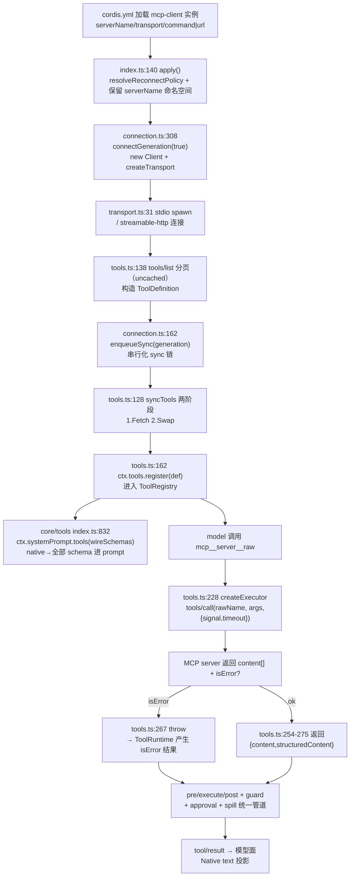

# MCP 接入：外部工具通道（能力边界）

> 对应关注面：`packages/mcp/mcp-client` 单包——把外部 **MCP**（Model Context Protocol）服务器的工具桥接进 dsh 统一工具管道 `ctx.tools`。能力亲和度：**单包、只桥接 tools；Resources/Prompts 均未接入**。MCP 是本项目的**辅助外部工具源**，主流外部接入面是 ACP（Agent Client Protocol）与插件体系，README 中 MCP 也非头号卖点——评级按真实实力，不夸大。

## 在项目中的角色（去掉它会怎样）

`@deepseek-ai/dsh-mcp-client` 是一个 Cordis 插件，每个实例对接**一个** MCP server，把该 server 的 `tools/list` 结果注册进 `ctx.tools`，使模型以原生工具形式调用它们（[packages/mcp/mcp-client/src/index.ts:140-141]()）。
<!-- snippet: export async function apply(ctx: Context, config: Config): Promise<void> {
  const reconnect = resolveReconnectPolicy(config.reconnect, `mcp-client(${config.serverName}): reconnect`) -->

- 去掉它 → dsh **不损失任何自有能力**：所有内置工具（fs、bash、search、todo 等）都来自各自插件，不经 MCP。损失的是"接入 MCP 生态里的第三方 server（GitHub、filesystem、web/工具 API 等）"这一条可选通路。
- 它位于工具接入的**边界层**：介于"外部进程（MCP server）"与"内部 ToolRegistry"之间，是一个标准的 adapter/bridge。官方 README 首段即定位它是 bridge（[packages/mcp/mcp-client/README.md:5-5]()）。
  <!-- snippet: MCP client bridge plugin: connects to external [Model Context Protocol](https://modelcontextprotocol.io/) servers and registers their tools on `ctx.tools`, making them available to the model as native tools under server-qualified names (`mcp__<serverName>__<rawName>`). -->
- 公开模型面签名：`mcp__<serverName>__<rawName>`，与 Claude Code / Codex 一致的 server-qualified 命名。

对比定位（见下文"与 ACP 的对比"）：**ACP 是反向** —— 让 dsh 充当"服务端"被外部程序化 client 驱动；**MCP 是正向** —— 让 dsh 充当"客户端"去调用外部能力 server。二者方向相反、协议不同。MCP 只是**一条可选工具通道**，不承载会话/权限主链路。

## 解决什么问题、根因

**问题**：dsh 的核心抽象是"统一工具管道 `ctx.tools`"（pre/execute/post + guard + approval + spill）。外部工具源要进入这个管道，必须有一套统一注册与执行契约；而 MCP 生态提供大量现成 tools server。需要一个 bridge：把 MCP 的三元协议（tools/resources/prompts）中**对模型有意义的 tools** 翻译成 dsh 的 `ToolDefinition`。

**根因**（为什么值得做 / 为什么只做 tools）：
- MCP 是"外部能力的一个传输通道"，天然要映射进 dsh 的统一工具管道 —— 这是本项目设计哲学的推论。
- 但 dsh 的核心卖点是**插件化 + 统一 guarded execution**，而非"海量 MCP 集成"。因此 MCP 在这里是**可选工具源之一**，不是架构主梁。
- **只桥接 tools** 是刻意的取舍：MCP 的 resources/prompts 在 dsh 中"没有消费者"——dsh 上下文由 session/compaction 管理，资源不落地为模型可见物；prompt 由 system-prompt 组装，不采纳外部 prompt server。README Known Limitations 明确承认 deferred（[packages/mcp/mcp-client/README.md:111-111]()）。
  <!-- snippet: - **Tools are the only bridged MCP capability** — Resources and Prompts have no harness consumer and are deferred. -->

## 设计思路

### transport 处理（stdio / streamable-http）

`transport.ts` 是个薄工厂，直接复用 `@modelcontextprotocol/sdk` 的 `StdioClientTransport` 与 `StreamableHTTPClientTransport`，不自己实现协议解析（[packages/mcp/mcp-client/src/transport.ts:31-39]()，createTransport 完整体见同文件 31-50）。
<!-- snippet: export function createTransport(config: Config): Transport {
  switch (config.transport) {
    case 'stdio':
      return new StdioClientTransport({
        command: config.command,
        args: config.args,
        env: buildChildEnv(config.env),
        cwd: config.cwd,
      }) -->

- **stdio** → spawn 子进程，env 用 `@deepseek-ai/dsh-subprocess` 的 `scrubbedParentEnv()` 打底（清洗凭据形与 `DSH_*` 后 merge 显式 env），共享 harness 统一的子进程 env 清洗定义（[packages/mcp/mcp-client/src/transport.ts:21-23]()）。
  <!-- snippet: function buildChildEnv(extra: Record<string, string>): Record<string, string> {
  return { ...scrubbedParentEnv(), ...extra }
} -->
- **streamable-http** → 按 URL + 额外 headers 连接（[packages/mcp/mcp-client/src/transport.ts:40-48]()，streamable-http 分支见 46-50）。注意 README 及 config 只暴露了 **stdio 与 streamable-http** 两种，**没有独立的 legacy SSE transport**（streamable-http 内含 SSE 流）。
  <!-- snippet:     case 'streamable-http':
      // The MCP SDK's StreamableHTTPClientTransport has optional callback
      // properties typed without `| undefined` (exactOptionalPropertyTypes
      // mismatch with the Transport interface); the SDK constructed the
      // object, so the cast records only that widening.
      return new StreamableHTTPClientTransport(
        new URL(config.url),
        { requestInit: { headers: config.headers } },
      ) as Transport -->

### 与 ctx.tools 的映射（关键接入点）

核心思路：**每个 MCP 工具变成一个 `ToolDefinition`，通过 `ctx.tools.register()` 注册**；注册进 registry 后，由 dsh-tools 自己挂到 system-prompt 的 tools provider，无需 mcp-client 手动拼 prompt。

- 命名契约：`publicToolName(serverName, rawName)`（[packages/mcp/mcp-client/src/tools.ts:96-99]()）—— 纯函数 `(serverName, rawName)`，干净时 `mcp__<serverName>__<rawName>`；损坏字符替换 / 超 64 字符截断时追加 12-hex SHA-256 hash，保证不同 `(serverName,rawName)` 不塌缩为同名（`MAX_PUBLIC_NAME_LENGTH = 64`，`INVALID_NAME_CHARS` regex，见同文件 45-48）。raw name 只在线路上（`tools/call`）发送，public name 永不被反解析。
  <!-- snippet: export function publicToolName(serverName: string, rawName: string): string {
  const joined = `mcp__${serverName}__${rawName}`
  const normalized = joined.replace(INVALID_NAME_CHARS, '_')
  if (normalized === joined && normalized.length <= MAX_PUBLIC_NAME_LENGTH) return normalized -->
- 变量作用：`activeServerNames` 用 `WeakMap<Context, Set<string>>` 按 `ctx.root` 隔离 —— 单进程多 app（测试）互不干扰，重复 `serverName` 在 load 时即抛错。

ToolDefinition 的构造（[packages/mcp/mcp-client/src/tools.ts:146-152]()）：`name` 用 publicName，`parameters` 直接收用 server 的 `inputSchema`，`output` 是桥自造的声明（content 数组 + structuredContent?），`execute` 由 `createExecutor` 闭包承载（发 `tools/call`，带 `exec.signal` 与 timeout）。
<!-- snippet:       definitions.set(publicName, {
        name: publicName,
        description: tool.description ?? '',
        parameters: tool.inputSchema,
        output: createOutput(tool.name, supportedOutputSchema(tool.outputSchema)),
        execute: createExecutor(client, tool.name, tool.execution?.taskSupport === 'required', opts),
      }) -->

### 放弃的替代方案 / 刻意不做

- **不实现自有 MCP 协议/手写 JSON-RPC** —— 复用 SDK，保持体积与正确性；代价是"启动超时"沿用了 SDK 的 60s 默认（README Known Limitations：`Startup timeout is inherited from the MCP SDK`，[packages/mcp/mcp-client/README.md:112-112]()）。
  <!-- snippet: - **Startup timeout is inherited from the MCP SDK** — DSH does not yet expose a connection/discovery timeout. Each initialize or paginated `tools/list` request uses the SDK's 60-second default -->
- **不桥接 resources/prompts** —— dsh 无消费者（见第二节）。
- **不暴露 tool 名反解** —— public 名只是 key，从不解析回 raw name，规避了"名字里含 `__`"的歧义。
- **不做 server 任务的 task-based execution**：当 MCP tool 广告 `execution.taskSupport === 'required'`，executor 直接 throw "not supported"（[packages/mcp/mcp-client/src/tools.ts:235-237]()）。这是能力边界的诚实声明。
  <!-- snippet:     if (taskRequired) {
      throw new Error(`Tool "${rawName}" requires task-based execution, which this bridge does not support`)
    } -->
- **不重建 native 多媒体渲染** —— image/audio/resource 块在模型面退化为占位符（README Known Limitations）。
  <!-- snippet: - **Native non-text rendering is lossy** — image, audio, and resource payloads become placeholders in model context even though the execution-local canonical value preserves their JSON blocks. -->

## 关键数据结构（精简）

### MCP client 侧

| 类型 | 位置 | 作用 |
|---|---|---|
| `Config = StdioConfig \| StreamableHttpConfig` | [packages/mcp/mcp-client/src/index.ts:98-98]() | 按 transport 区分的插件配置 |
| `ResolvedReconnectPolicy` | [packages/mcp/mcp-client/src/connection.ts:53-53]() | 冻结的重连策略（enabled/initialDelayMs/maxDelayMs/maxAttempts） |
| `ConnectionHandle`（`ready`/`dispose`） | [packages/mcp/mcp-client/src/connection.ts:99-99]() | 监督连接的生命周期句柄 |
| `McpResult` | [packages/mcp/mcp-client/src/tools.ts:36-38]() | 规范 MCP 结果 `{ content, structuredContent? }`，绕过 SDK 默认 output validator |

关键机制：
- 用 `client.request(..., RawCallToolResultSchema)`（[packages/mcp/mcp-client/src/tools.ts:54-54]()）**绕过 SDK 输出预校验** —— 因为 bridge 可能不认 server 的 outputSchema，需在桥层自己决定是否采纳；`listToolsUncached`/`callToolUncached`（同文件 57/65）同理避免污染 SDK 分页缓存。
  <!-- snippet: const RawCallToolResultSchema = z.record(z.string(), z.unknown()) -->
- `ToolDisposers = Map<publicName, () => void>`：一个 sync 世代持有的 disposer 集合，换世代时先全部 dispose 再注册新世代。

### 信任边界判断

`McpContentBlock`（[packages/mcp/mcp-client/src/tools.ts:182-184]()）刻意比 SDK 的 `ContentBlock` 宽松：来自外部进程的数据不可信，SDK 声明 required 的字段运行时可能缺失，`extractText` 全部防御性兜底。
<!-- snippet: interface McpContentBlock {
  readonly mimeType?: string
} -->

## 核心流程（Mermaid）

一个 MCP 工具从「列出」到「结果回注 ctx.tools 管道」的完整链路：

关键协同文件：
- 工具进 prompt：`ctx.systemPrompt.tools(ctx => this.wireSchemas(ctx.scope))`（[packages/core/tools/src/index.ts:832-832]()）
  <!-- snippet:    ctx.systemPrompt.tools(context => this.wireSchemas(context.scope)) -->
- 工具 schema 白名单（只 name/description/parameters 发模型）：见 `schemas()` 与 `schemaOf`（[packages/core/tools/src/index.ts:251-252]()、`schemaOf` 在 1255，[packages/core/tools/src/index.ts:1254-1258]()）。
  <!-- snippet:    * is NEVER sent to the model — `schemas()` whitelists only name/description/
   * parameters. Declaring it asserts this tool forwards `exec.signal` to a -->
  <!-- snippet:   private schemaOf(definition: ToolDefinition, detachParameters: boolean): ToolSchema {
    const { name, description, parameters } = definition -->
- system prompt 组装 tools：`tools: orderTools(collected, this.toolOrder, knownNames)`（[packages/core/system-prompt/src/index.ts:495-529]()）。

## 与其他模块协同

| 协同模块 | 关系 |
|---|---|
| `core/tools` (`ctx.tools`) | **主接入点**。`register()` 后即成为 model-facing tool；guard/approval/spill 全部自动覆盖注入，MCP 工具与内置工具**共享同一份 guarded pipeline**，无需 MCP 特判（这是最重要的协同结论）。 |
| `core/system-prompt` | dsh-tools 通过 `systemPrompt.tools` provider 把注册工具注入 prompt。MCP 工具由此进入 system prompt 的 tool definitions。`toolOrder`/`knownNames` 对 MCP 工具一视同仁。 |
| `subprocess` | transport 复用 `scrubbedParentEnv()`（env 清洗定义共享），不共享 spawn 路径（SDK 自己 spawn）。 |
| `acp` | **方向相反**的另一个外部协议。真正承载"外部 agent 协议"的是 ACP（dsh 作为 server 被驱动）；MCP 是"外部工具通道"（dsh 作为 client 去取工具），二者无直接调用。 |

## 关键设计决策（含诚实能力边界）

### Why 选/不选某些 transport

- 选 **stdio**：spawn 本地进程 server，env 带凭据清洗；覆盖本地 MCP 工具。
- 选 **streamable-http**：HTTP+SSE，覆盖远程 server；headers 可带 auth。
- **不选 legacy SSE 专用 transport**：streamable-http 已含 SSE 流，config 层面不再单独暴露，避免碎片化。
- **不实现自有协议**：复用 SDK。能力的代价如实标注为 README 的 "Startup timeout is inherited from the MCP SDK"（[packages/mcp/mcp-client/README.md:112-112]()）。

### MCP 工具与内置工具在一次调用中如何共享管道与策略

**完全共享，无 MCP 特判。** 因为 MCP 桥产物就是普通 `ToolDefinition`：注册后进入 `visible` view、受 agent scope 遮蔽；调用经 `tools/pre-execute` → monotonic guards → `ctx.approval` → `tools/execute`（timeout 包装）→ 工具 body（即桥的 executor）→ `tools/post-execute` → `finalizeContent` → `tools/result`；spill 大结果统一作用（桥的 `output.render` 生成单段 text）；approval 同样触发。→ 结论：**模型在一次调用中可以混合调用内置工具与 MCP 工具，策略、权限、超时、spill 全部一致**。这是把"外部工具源抽象为 ToolDefinition"这一设计的直接红利。

### 错误与时序治理（重点：半开/重连/超时）

`connection.ts` 是一个**连接监督器（supervisor）**，治理点密集：

- **世代（generation）模型**：每次连接尝试用全新 `Client`（SDK 的 Protocol 一生绑定一个 transport），`isCurrent()` 守卫保证只有当前世代的 onclose/notification 生效，旧世代无效化。
- **串行化 sync**：`syncChain`（[packages/mcp/mcp-client/src/connection.ts:161-161]()）把初始 synchronize、`tools/list_changed` 通知、重连 sync 全部排队，杜绝两个 sync 交错 swap（否则会 double-dispose/泄漏一个世代）。
  <!-- snippet:   let syncChain: Promise<void> = Promise.resolve() -->
- **两阶段 sync 保安全**：
  - Fetch 构建（[packages/mcp/mcp-client/src/tools.ts:128-130]()，完整 128-155）：分页拉取 `tools/list`，构造 definitions；任何失败不碰注册表，上一世代保持。
    <!-- snippet: export async function syncTools(
  client: Client,
  opts: ToolBridgeOptions -->
  - Swap 阶段（[packages/mcp/mcp-client/src/tools.ts:157-158]()）：先 dispose 上一世代，再注册新世代。
    <!-- snippet:   // Phase 2: swap generations.
  for (const dispose of previous.values()) dispose() -->
  - 注册冲突（外部 squatting 命名空间）回滚整世代——绝不留下半套工具（[packages/mcp/mcp-client/src/tools.ts:164-167]()）。
    <!-- snippet:   } catch (error) {
    // A conflict on an `mcp__<serverName>__`-qualified name means a foreign
    // registration occupies this server's namespace. Roll back so the model
    // sees either the full generation or none of it — never a partial set. -->
- **有界指数退避 + 预算重置**：`initialDelayMs` 倍增到 `maxDelayMs`；连接存活超过 `maxDelayMs`（稳定窗口）重置失败计数 —— 偶发崩溃的 server 可无限恢复，而 crash-loop 的 server（即使偶尔连上）最终耗光 `maxAttempts` 上限停摆，不会永久重启。耗尽后 unregister 工具（[packages/mcp/mcp-client/src/connection.ts:206-210]()）。
  <!-- snippet:   if (failedAttempts > policy.maxAttempts) {
    syncChain = syncChain.then(() => {
      for (const dispose of disposers.values()) dispose()
      disposers = new Map()
    }) -->
- **半开/失效治理**：崩溃 stdio 子进程 → onclose 触发 supervisor 重启；Streamable HTTP 失败是**按次重试**（经 SDK transport 的 SSE 流恢复），不会让 supervisor 重生成 —— README 如实说明这种不对称（[packages/mcp/mcp-client/README.md:113-113]()）；断连后保留上一良世代注册，期间调用照发但失败直到恢复；关闭等待有 `GENERATION_CLOSE_TIMEOUT_MS=5s` 兜底（[packages/mcp/mcp-client/src/connection.ts:50-50]()），超时则 fail-closed。
  <!-- snippet: - **Reconnect triggers on transport close** — a crashed stdio child fires it; Streamable HTTP failures surface per request and through the SDK transport's own SSE-stream recovery -->
- **每工具超时**：`callTool` 带 `timeout`（默认 60s），且转发 `exec.signal` 支持中止；`exec.signal` 同时把 registry 的取消传递到 MCP 调用。

### 诚实能力边界（不强吹）

1. **只桥接 tools**；Resources/Prompts 无桥 → MCP 三元协议只覆盖 1/3，且**不是本项目强项**。
2. **启动/发现超时沿 SDK 默认 60s**，dsh 未暴露连接超时（[packages/mcp/mcp-client/README.md:112-112]()）→ 无响应 server 会拖慢激活与 teardown。
3. **HTTP 断连不 supervisor 重建**，依赖 SDK 流恢复 → 远程 server 不可达时是逐次失败，非进程级重生成（[packages/mcp/mcp-client/README.md:113-113]()）。
4. **原生非 text 多媒体投影有损**（image/audio/resource → 占位符）。
5. **outputSchema 子集外的不强制**：`structuredContent` 在识别不了 server 广告 schema 时退化为 `JsonValue`（[packages/mcp/mcp-client/src/tools.ts:188-192]() 仅 try 采纳）。
   <!-- snippet: /** Keep a supported advertised schema; unsupported MCP vocabulary falls back to JsonValue. */
function supportedOutputSchema(candidate: unknown): JsonSchemaNode | undefined {
  if (candidate === undefined) return undefined
  try {
    assertSupportedJsonSchema(candidate) -->
6. **不支持 server 的 task-based execution**（`taskSupport==='required'` 直接拒，[packages/mcp/mcp-client/src/tools.ts:235-237]()）。

## 亮点与问题

### 亮点

- **统一管道红利**：外部工具桥接为普通 `ToolDefinition`，自动获得 guard/approval/spill/scope-shadow，与内置工具零特判共享策略 —— 设计优雅，是"工具抽象"价值的直接证据。
- **严肃的时序工程**：世代无效化、sync 串行化、两阶段 sync、预算重置的指数退避、5s 关闭兜底、`isCurrent` 幂等 —— 对"外部进程半开/崩溃/重连"的处理在同类 harness 里属于**第一梯队**。
- **确定性命名 + 冲突防护**：`(serverName,rawName)` 纯函数命名、hash 防塌缩、跨 server 命名空间共存、重复 serverName load 即失败、外部 squatting 回滚整世代。
- **诚实边界声明**：README Known Limitations 直白列出能力缺口，不夸大 MCP 集成度。
- **信任边界防御**：外部内容块字段宽松读取、`extractText` 全兜底，行为纵深（网络边界数据不被 SDK 类型假设带崩）。

### 问题 / 局限

- **覆盖面窄**：仅 tools、无 resources/prompts —— 作为"外部能力层"它是不完整的。
- **依赖第三方 SDK 行为**：启动超时、HTTP 会话恢复均交给 SDK，dsh 控制力有限（无自有连接超时、无 HTTP 进程级重建）。
- **多媒体模型面信息损失**：image/audio 只留占位，模型看不到二进制内容（可辨为取舍而非 bug）。
- **task-based tool 不可用**：MCP 生态中需要 task 执行能力的工具在此桥无法用。
- **schema 信任链**：`parameters` 直接收用 server inputSchema 进 registry，未在桥层预 sanitize，若 server 的 schema 超出 dsh `assertSupportedJsonSchema` 子集，注册时可能被 registry 拒绝 —— 这是"外部不可信 schema 进内部受管 schema 门"的边界，MCP 桥把参数 schema 校验委托给 registry 兜底（而非桥层先行 sanitize）。
- **潜在进程泄漏风险已被规避**：关闭超时 fail-closed 防重叠子进程，处理得当。

## 与 ACP 的对比（一句话定位）

`packages/acp/acp` 是 **dsh 作为 server** 的自动化协议（外部程序化 client → dsh，native stdio JSON-RPC，驱动 agent 会话与一次权限决策）。MCP 是 **dsh 作为 client** 的外部工具通道。**ACP 更接近"外部 agent 协议"主力**（dsh 被外部驱动），MCP 只是"外部工具源之一"（dsh 主动去取工具）。

## 已知的文档-实现漂移

- 草稿 Mermaid 早期标注的 `connection.ts:278 enqueueSync` 实际是 **connection.ts:162**（`enqueueSync` 定义在 162，`syncChain` 在 161）；已在正文与图内统一为 162。
- 草稿 README 第 114 行引用的"媒体占位符"实为 **README.md:115**；114 是 reconnect；已在正文改为实际行号。
