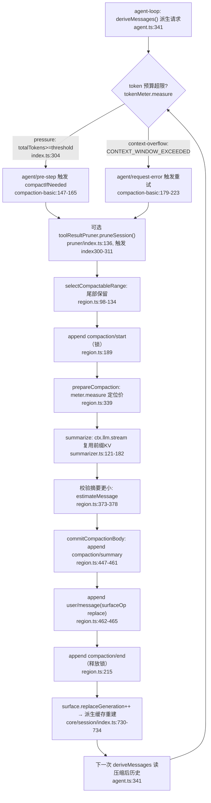

# 上下文管理与自动压缩（memory / compaction）

> 子文档之一，聚焦超长对话如何驾驭 token 预算。覆盖 `packages/compaction/*`（compaction 三件套 + command-compact + tool-result-pruner）、`packages/context/*`（请求上下文插件）、`packages/llm/token-meter`（token 预算），以及与 agent-loop / session / system-prompt 的协同。整体哲学见 [README](README.md)；本文上承 [skill-mcp.md](skill-mcp.md)（外部能力注入）、衔接 [data-model.md](data-model.md)（压缩结果落日志）。

模块定位：**compaction 是一个可选 capability seam，而不是 agent-loop 主干的组成部分**——它的词汇定义在自己包（`ctx.compaction`、`compaction/*` 事件），主干只保留「派生的历史来自 surface」这条单一事实源，压缩只是改写这条 surface 的若干插件之一。

## 项目中的角色

去掉本模块后，超长对话在 token 预算上会立刻失去控制：会话日志无限增长，每次 `deriveMessages` 派生的请求把全部历史原样喂给模型，最终要么撞上 provider 的 context window 被硬拒绝，要么把用户的任务语境淹没在早期无关对话里。

这里最核心的定位是：**compaction 是一个可选 capability seam，而不是 agent-loop 主干的组成部分**。它的词汇（`ctx.compaction`、`compaction/*` 事件）定义在自己的包 `dsh-compaction` 里，而不是 core 里；主干只保留"派生的历史来自 surface"这条单一事实源，压缩只是改写这条 surface 的若干插件之一。

- `dsh-compaction`（Service Definition，`ctx.compaction` 抽象类）：定义动词、结果与 `compaction/*` 日志事件 `[packages/compaction/compaction/src/index.ts:96-96]()`。
- `dsh-compaction-basic`（本地 Provider）：实现触发策略（pressure / context-overflow）、保留策略、摘要与落盘事务 `[packages/compaction/compaction-basic/src/index.ts:103-103]()`。
- `dsh-command-compact`（人工 Consumer）：把 `/compact` 命令映射到 seam `[packages/compaction/command-compact/src/index.ts:66-66]()`。
- `dsh-compaction-tool-result-pruner`（可选模型无关预裁剪）：缩小工具结果节点，本身独立可组合 `[packages/compaction/compaction-tool-result-pruner/src/index.ts:44-44]()`。
- `context/*` 请求上下文插件（time-context 时钟、agent-instructions 指令、session-reference 跨会话快照）：在 `agent/pre-step` 以追加 `user/message` 的形式贡献上下文，是"分层记忆/curated context"的另一面。
- `dsh-token-meter`（token 预算）：`ctx.tokenMeter` 单例，负责压力测量与 surface 计价，compaction 依赖它做保留选择与收敛校验 `[packages/llm/token-meter/src/index.ts:74-74]()`。

一句话：compaction 是"驾驭 token 预算的可交换 seam"，context/* 是"在预算内持续注入新鲜上下文的插件族"，token-meter 是二者共同的计价与压力来源。

---

## 根因：为什么需要可替换的压缩/上下文策略，而非硬编码截断

- **压什么、按什么比例、用什么模型写摘要，本质是策略**，不同产品/模型/任务可以完全不同。把策略硬编码进主干等于剥夺了产品的选择权——这正是"无特权内核、一切皆插件"的整体定位。compaction 之成为 seam，与 bash、system-prompt 一样，是 Service Definition / Provider / Consumer 三件套。
- **截断会破坏语义完整性**。无脑砍尾巴会切断未完的 assistant tool-call/result 配对，砍信息头会丢失用户尚未完成的任务意图。所以压缩必须能分辨哪些 range 是"安全的切割点"，而"安全"依赖每个 surface 节点的 tool-call 配对状态，无法用固定行号表达——于是有了 `toolPairingBalancedBefore/After`。
- **压缩结果必须是日志可回放的**，不能是内存态的一次性替换。因为整件事围绕"Session 事件日志是唯一事实源 / Model-visible means logged": 压缩删掉的历史节点仍然必须留在日志里（只是被 shadow），新摘要成为新的 surface 节点，任何一行回放都能重建出与派生时完全一致的请求。
- **token 计价不能靠拍脑袋的固定值**。provider 真的返回过 usage 时，应以其为锚；没有可用 usage 时才退回启发式估算。这要求 token-meter 是独立、可复用的单例，而非 compaction 内部私有函数，这样所有消费者（compaction、状态显示、session-query）拿到的都是同一个计价口径。

---

## 设计思路

### compaction 作为 capability seam

- 三件套镜像 bash：`CompactionEngine extends Service`（`ctx.compaction`）`[packages/compaction/compaction/src/index.ts:96-96]()`，`compactIfNeeded / compactNow / compactRegion` 三个抽象动词 `[packages/compaction/compaction/src/index.ts:113-113](),139,164`。
- 但接口**必须**依赖 `dsh-session` 与 `dsh-llm`：它的动词作用在 `Session` 上，落盘摘要用到 `ContentBlock` 词汇。这与 bash 不同，正是接口天然被会话/LLM 词汇耦合的结果 `[packages/compaction/compaction/src/index.ts:1-8]()`。
- Provider 唯一的定制钩子是 summarize（`dsh-compaction-basic` 可被子类替换摘要后端），而重放与落盘策略固定，保证所有计价都用单例 token meter `[packages/compaction/compaction-basic/src/index.ts:95-102]()`。
- Consumer 是 `/compact` 命令，把 `ManualCompactionErrorCode` 分类成人类可读结果 `[packages/compaction/command-compact/src/index.ts:23-55](),66`。

### 压缩仍守 "Model-visible means logged"

- 关键约束：只有 message-producing 事件才进入模型视角（`SurfaceEventType` 不扩展），`compaction/*` 全部是 **log-only**，不进 surface `[packages/compaction/compaction/src/types.ts:16-90]()`。
- 压缩产出本身是**会话日志里可回放的事件序列**：旧的 shadowed 节点仍在日志中，新的摘要 ride 在一个独立的 `user/message` 事件上，这个事件带 `surfaceOp: { op: 'replace', start, end }`，把被替换区间从 surface 上摘除 `[packages/compaction/compaction-basic/src/region.ts:462-465]()`。
- 因此"压缩后历史"完全可由 `session.deriveMessages()` 折叠 surface 重建——replace 使 `replaceGeneration` 增长、派生缓存重建，被 shadow 的节点不再出现在派生消息里 `[packages/core/session/src/index.ts:726-747]()`。

### 分层记忆 / 上下文保留策略

- 就近保留（retention）：压缩头、保留最近尾。`selectCompactableRange` 从尾部累计 token 直到达到 `retainTokens`，得到"保留尾"的起始位置，其前的头部区间即待压缩区间 `[packages/compaction/compaction-basic/src/region.ts:98-134]()`。
- 保留尾预算两种形式：按比例 `retainRatio`（窗口的 0.16）或绝对 `retainTokens`，互斥；默认保留 0.16、阈值 0.8、摘要 cap 8192 `[packages/compaction/compaction-basic/src/config.ts:23-23](),74,91,144-147`。
- 模型无关的"分层"：context/* 插件在 pre-step 把新鲜的时钟/指令/跨会话快照作为普通 `user/message` 注入，等价于"curated 最近上下文"，与压缩的"episodic 历史摘要"互补。
- 会话参考（session-reference)把被引用会话投影成受信任快照，且**识别压缩检查点**（`isCompactCheckpointSource`）与源文本保留——跨会话记忆也感知 compaction `[packages/context/session-reference/src/projection.ts:3-3](),41-45`。

### Token 预算与停止

- token-meter 的 measure 返回 detached 快照：`baseline`（usage 锚/启发式）、`surfaceDeltaTokens`（锚点后 surface 增减）、`totalTokens`（请求+响应压力）、`nodes`（每个 surface 节点的启发式价格）`[packages/llm/token-meter/src/index.ts:116-147]()`。
- usage 锚只有当 provider 最新成功调用的 canonical 请求信封与 `request/header` 吻合、且其总量不低于对应启发式锚时才复用；否则整段重新启发式计价 `[packages/llm/token-meter/src/index.ts:121-137]()`。
- 触发：`pressure`（step 边界，`totalTokens >= thresholdTokens`）与 `context-overflow`（provider 报错 `CONTEXT_WINDOW_EXCEEDED`，可无视阈值强制压一次）`[packages/compaction/compaction-basic/src/index.ts:258-332]()`。
- 停止：`compactIfNeeded` 循环压实直到 `totalTokens < thresholdTokens`，超出 `compactionRetries` 仍压不下去则抛错——即"单发 oversized 单元没法靠 surface 压缩修复" `[packages/compaction/compaction-basic/src/index.ts:314-331]()`。

---

## 关键数据结构

一句定位 + 行号：

- `CompactionResult`：成功压缩的返回值——事务内四个事件 seq、安全摘要块、被 shadow 的区间与 seq 列表（surface-position 跨度，非数值区间）、估算 token 数 `[packages/compaction/compaction/src/types.ts:93-118]()`。
  - `shadowedRange` 是 surface 位置跨度而非 seq 数值区间，因为一次 replace 后新高 seq 摘要可能落在更老区间位置，`start` 可大于 `end` `[packages/compaction/compaction/src/types.ts:107-113]()`。
- `compaction/start | summary | end` 三个声明合并的会话事件：记录锁、摘要输入、模型调用事实，全部 log-only 不进 surface `[packages/compaction/compaction/src/types.ts:16-90]()`。
- `CompactionTrigger`：自动策略向后端说明"为何跑"，`pressure` 或 `context-overflow`；实现可对确认的溢出处理得更激进 `[packages/compaction/compaction/src/index.ts:25-25]()`。
- `ManualCompactionErrorCode`：手动压缩的预期失败类（busy/cancelled/changed/summary/commit/persistence）`[packages/compaction/compaction/src/index.ts:28-34]()`。
- `CompactionCheckpointSource` + `compactCheckpointSource()` + `isCompactCheckpointSource()`：后端替换 user message 的统一来源标记（`plugin: 'compact'` + compactionId），让消费者不依赖具体后端即可识别检查点；置于 cordis-free 的 `./checkpoint` 叶子避免进入 host Context merge `[packages/compaction/compaction/src/checkpoint.ts:19-51]()`。
- `ResolvedCompactSpec`：将路由策略按目标模型 context window 缩放成具体预算 `thresholdTokens / retainTokens` `[packages/compaction/compaction-basic/src/types.ts:71-76]()`，由 `resolveCompactSpec` 计算并约束 `retain < threshold` `[packages/compaction/compaction-basic/src/config.ts:133-167]()`。
- `TokenMeasurement` / `TokenSurfaceNode`：token-meter 的一次测量快照与单个 surface 节点的价格 `[docs/subsystems/token-meter.md:11-41]()`（类型源 `packages/llm/token-meter/src/types.ts`）。
- `SummaryResult` / `SummarizationInput`：摘要结果（含 rawOutput + `llmStreamCall` 标记）与可重放前缀（system/tools/浅层 messages）`[packages/compaction/compaction-basic/src/summarizer.ts:78-108]()`。
- `SurfaceFoldReplacement` / `SessionSurface`：surface 折叠时的 replace 记录与只读当前 surface（含 `replaceGeneration`）`[packages/core/session/src/surface.ts:116-142]()`。

---

## 核心流程

触发压缩（token 超预算 / 会话 checkpoint）→ 请求 compaction provider → 保留策略选区间 → 生成压缩摘要事件 → 回写会话日志 → 后续 deriveMessages 读压缩后历史。

### 步骤解读（对应上面主流程）

1. **触发**。自动压力：`agent/pre-step` 前置监听，在请求派生前跑 `compactIfNeeded(agent, 'pressure')` `[packages/compaction/compaction-basic/src/index.ts:147-165]()`。溢出恢复：`agent/request-error` 捕获 `CONTEXT_WINDOW_EXCEEDED`，跑 `compactIfNeeded(agent, 'context-overflow')`，若 surface replaceGeneration 前进则返回 `{ kind: 'retry' }` 让 agent-loop 重试 `[packages/compaction/compaction-basic/src/index.ts:179-223]()`；agent-loop 在 finish.error/aborted 时走 `agent/request-error` 瀑布并在 retry 时 continue `[packages/core/agent-loop/src/agent.ts:354-371]()`。
2. **可选模型无关预裁剪**。`pruneSession` 对每个超预算 tool-result 节点做确定性 head/middle/tail 裁剪，替换前同步追加 `compaction/prune` shadow-price 事件 `[packages/compaction/compaction-tool-result-pruner/src/index.ts:136-184]()`；在压力路径中压缩前先落 pass、再 remeasure `[packages/compaction/compaction-basic/src/index.ts:306-312]()`。
3. **保留策略选区间**。`selectCompactableRange` 从尾向前累计、找出满足 `retainTokens` 的保留尾起点的安全（tool-pairing balanced）切割位 `[packages/compaction/compaction-basic/src/region.ts:98-134]()`。
4. **事务开锁**。`compactSurfaceRegion` 先 append `compaction/start`（当前轮编号或手动 `null` owner），这是可回放的锁 `[packages/compaction/compaction-basic/src/region.ts:189-189]()`；同时校验 `compaction/start` 无未匹配（含 `session/end-seed` 判定陈旧锁）`[packages/compaction/compaction-basic/src/region.ts:286-298]()`。
5. **定价与摘要调用**。`prepareCompaction` 用 `tokenMeter.measure` 取节点价格与 shadowedTokenCount，构造 `SummarizationInput`（复用 system/tools + 浅层 messages 保证 KV 前缀缓存）`[packages/compaction/compaction-basic/src/region.ts:339-357](),498-514`；`summarizeWithLlm` 用 `ctx.llm.stream` 调摘要，指令作为最后一个 user message 保持前缀一致 `[packages/compaction/compaction-basic/src/summarizer.ts:121-182]()`。
6. **收敛校验**。`estimateMessage` 估摘要帧 token，若不小于 shadowed 则拒绝（摘要必须真的变小）`[packages/compaction/compaction-basic/src/region.ts:373-378]()`；稳定性校验（whole-surface 或 selected-span）在异步摘要后复核避免 changed 竞态 `[packages/compaction/compaction-basic/src/region.ts:387-424]()`。
7. **回写会话日志**。同步 append `compaction/summary`（记录 provider/model/maxTokens/usage/rawOutput），随后 append `user/message` 带 `surfaceOp: { op: 'replace', start, end }` 完成 surface 替换，最后 append `compaction/end` 释放锁 `[packages/compaction/compaction-basic/src/region.ts:427-478](),215`。
8. **后续派生**。surface 的 `replaceGeneration` 递增，`deriveMessages` 缓存重建并派生出压缩后历史 `[packages/core/session/src/index.ts:730-734]()`；每次请求在 `step()` 里调用 `this.session.deriveMessages()` 作为边界消息 `[packages/core/agent-loop/src/agent.ts:339-342]()`。

---

## 与其他模块协同

- **agent-loop（turn 边界判断）**：压力压缩插在 `agent/pre-step`（agent 请求派生前），溢出恢复插在 `agent/request-error`（step 报错后判定 retry）`[packages/core/agent-loop/src/agent.ts:225-243](),354-371`；manual compaction 经 `runMaintenance` 只在 agent idle 时运行，并用 AbortSignal.any 合并 agent 级与命令级取消 `[packages/core/agent-loop/src/agent.ts:142-162]()`、`[packages/compaction/compaction-basic/src/index.ts:368-420]()`。（跨模块：runMaintenance 的 idle 判定与 wake replay 细节是否与本模块决策直接相关）
- **session（落压缩事件 + surface 折叠）**：compaction 消费 `Session.append`（含 `session/end-seed` 判定陈旧锁、`turn/start|end` 判定 open turn）`[packages/compaction/compaction-basic/src/region.ts:517-550]()`；surface 折叠与 `end-seed` 写点 `[packages/core/session/src/index.ts:539-547]()`；`deriveMessages` 折叠 surface 重建历史 `[packages/core/session/src/index.ts:726-747]()`。（跨模块：surface 折叠的 `sourceEventSeqs` 校验规则细节（surface.ts:210+）与压缩反序列化一致）
- **session-persistence（checkpoint flush）**：manual compaction 完成后调用 `ctx.sessions.flush(agent.session)` 做持久化 checkpoint，失败映射为 `persistence` 错误 `[packages/compaction/compaction-basic/src/index.ts:395-398]()`。（跨模块：flush 是否保证在"后续 waking prompt 派生"前完成，涉及 agent-loop maintenance 的 activityDone 语义）
- **system-prompt**：摘要调用复用对话头 system/tools 使 KV 前缀可复用 `[packages/compaction/compaction-basic/src/region.ts:498-514]()`；agent-loop 在 pre-step 先 `systemPrompt.assemble` 再跑压缩，压缩改写的是之后的派生 `[packages/core/agent-loop/src/agent.ts:230-230]()`。（跨模块：system-prompt 的 assemble 是否把运行时 sections（含指令类 context）打包进请求前缀、与 token-meter 的 `estimateHeader` 一致）
- **token-meter（token 预算）**：compaction 用 `metric.measure` 取 totalTokens/surface 节点价格做阈值与保留选择 `[packages/compaction/compaction-basic/src/index.ts:263-332]()`；用 `estimateMessage` 做摘要收敛校验 `[packages/compaction/compaction-basic/src/region.ts:373-373]()`；pruner 用 `estimateMessage` 写 shadow-price `[packages/compaction/compaction-tool-result-pruner/src/index.ts:165-165]()`。同一单例同时服务会话状态显示投影 `[packages/llm/token-meter/src/index.ts:85-91]()`。（跨模块：token-meter 的 surface-delta/usage 锚定在压缩 replace 后如何精确计入 projection）
- **context/* 请求上下文插件**：均以 `agent/pre-step` 前/后置监听追加 `user/message`——time-context 按刷新间隔注入时钟 `[packages/context/time-context/src/index.ts:170-208]()`；agent-instructions 折叠 workspace 指令（AGENTS.md）进请求 `[packages/context/agent-instructions/src/index.ts:322-348]()`；session-reference 投影跨会话快照并感知压缩检查点 `[packages/context/session-reference/src/index.ts:169-217](), projection.ts:41-45`。（跨模块：这些 pre-step 注入是如何被 token-meter 计入 `estimateHeader`/surface，与压缩保留尾的策略是否可能相互影响）

---

## 关键设计决策

1. **为什么 compaction 可插拔**：策略（何时压、压多少、用什么模型写摘要）本质是产品选择，主干只保留"派生历史来自 surface"这条单一事实源。`CompactionEngine` 是 `ctx.compaction` 的抽象 seam，任何后端（tokenizer 版、模板版、别的 LLM 路由）只要实现 `compactIfNeeded/compactNow/compactRegion` 即可替换 `[packages/compaction/compaction/src/index.ts:96-96]()`。后端的唯一可变点是 summarize 钩子，重放与落盘固定，保证计价口径统一 `[packages/compaction/compaction-basic/src/index.ts:95-102]()`。代价：接口必须有更强的契约（session/llm 词汇 + 事务协议），不如 bash 干净，但这正是能力耦合会话/LLM 的本质。

2. **为什么压缩后仍可回放、可审计**：这是对"Session 事件日志是唯一事实源 / Model-visible means logged"的忠实遵守。`compaction/start|summary|end` 全部 log-only 不进 surface `[packages/compaction/compaction/src/types.ts:16-90]()`；旧 nodes 保留在日志里仅被 shadow；新摘要 ride 在带 `surfaceOp.replace` 的 `user/message` 上 `[packages/compaction/compaction-basic/src/region.ts:462-465]()`；`deriveMessages` 按 surface 折叠即可精确重现"压缩后历史"，而完整日志仍可回放全部原始事件（telemetry/审计/复现重建请求），`compaction/summary` 记录的 provider/model/maxTokens/usage 与 rawOutput 让一次性摘要调用可从 log+code 重建 `[packages/compaction/compaction/src/types.ts:40-65]()`。权衡：为可回放保留的全部 shadowed 事件持续占用磁盘，换取无信息丢失与可审计性。

3. **分层记忆/保留策略与权衡**：就近压缩头、保留最近尾，tail 预算默认窗口 0.16、可替换为绝对 token `[packages/compaction/compaction-basic/src/config.ts:14-14](),23,144-147`；切割必须落在 tool-pairing balanced 边界 `[packages/compaction/compaction-basic/src/region.ts:122-126]()`。与 context/* 的"持续注入新鲜上下文"协同构成分层记忆。权衡：retainRatio 越大越保真但更少压缩收益，越小越省 token 但摘要重建上下文可能丢失——这是产品可调参数。

4. **Token 预算与上下文耗尽的停止行为**：token-meter 以 provider usage 为锚、退回启发式差价，当 provider 无可用锚时整段启发式计价 `[packages/llm/token-meter/src/index.ts:121-137]()`。触点：压力超阈值即压、溢出恢复可无视阈值强制压一次 `[packages/compaction/compaction-basic/src/index.ts:283-291](),304-312`；摘要必须真变小否则失败 `[packages/compaction/compaction-basic/src/region.ts:373-378]()`。如果压到 `compactionRetries` 后仍高于阈值就抛错（单发 oversized 单元无法修复）`[packages/compaction/compaction-basic/src/index.ts:314-331]()`。取舍：usage 锚能反映真实 provider 计价（更准），但锚失效时整体回落启发式（偏保守/偏估）——这是 token-meter 独立单例且带 detached snapshot 的原因。

## 全局关联：压缩是「可交换策略 + 可回放事件」的双重体现

compaction 用「为何压缩是产品选择」解释了它为何必须是 seam——scheme（何时压、按什么比例、用什么模型写摘要）本质是产品策略，主干只保留「派生历史来自 surface」这条单一事实源；provider 唯一可定制点是 summarize 钩子，重放与落盘固定，保证所有计价用同一个 token-meter 单例。而「压缩结果仍是可回放事件」则是对 `Model-visible means logged` 的忠实遵守：旧节点保留在日志（仅 shadow）、新摘要 ride 在带 `surfaceOp.replace` 的 `user/message` 上，`deriveMessages` 按 surface 折叠即可精确重现压缩后历史，完整日志仍可回放全部原始事件。这与 [session.md](session.md)（事件日志唯一事实源）、[system-prompt.md](system-prompt.md)（KV 前缀复用）和 [agent-loop-runtime.md](agent-loop-runtime.md)（turn 边界触发）在「可交换 + 可审计」两条主线上交汇，是 dsh「无特权内核」在长会话场景的收口。
