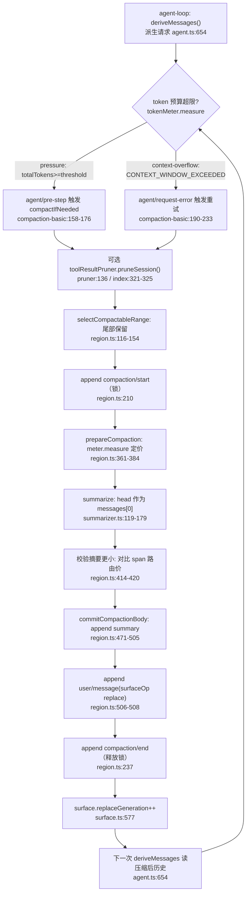
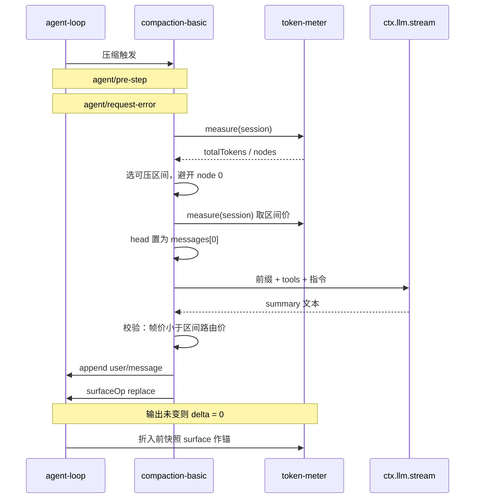

# 上下文管理与自动压缩（memory / compaction）

> 子文档之一，聚焦超长对话如何驾驭 token 预算。覆盖 `packages/compaction/*`（compaction 三件套 + command-compact + tool-result-pruner）、`packages/context/*`（请求上下文插件）、`packages/llm/token-meter`（token 预算），以及与 agent-loop / session / system-prompt 的协同。整体哲学见 [README](README.md)；本文上承 [skill-mcp.md](skill-mcp.md)（外部能力注入）、衔接 [data-model.md](data-model.md)（压缩结果落日志）。

模块定位：**compaction 是一个可选 capability seam，而不是 agent-loop 主干的组成部分**——它的词汇定义在自己包（`ctx.compaction`、`compaction/*` 事件），主干只保留「派生的历史来自 surface」这条单一事实源，压缩只是改写这条 surface 的若干插件之一。

> **演进说明（0.1.5）：** Session format V3 把渲染后的 system prompt 变成 **surface 节点 0**（详见 [session-format-migration.md](session-format-migration.md)、[system-prompt.md](system-prompt.md)）。本关注面因此有三处实质变化，都在下面就地展开、不改变既有章节结构：① 摘要调用改为**把派生的 system head 作为普通消息重放**，不再另传 `system` 字符串；② token-meter 的**用量锚点**从 `step/start` 快照改为 `assistant/message` 落盘前的当前 surface，且 header 只剩工具一项可计价（系统提示词已是 surface 节点）；③ `contextBreakdown` 投影从 O(1) 影子价标量改为**位置化条目**并把 state version 升到 4（0.1.7-rc.2 又因图片省略计价升到 5，见「投影缓存」一节）。

## 项目中的角色

去掉本模块后，超长对话在 token 预算上会立刻失去控制：会话日志无限增长，每次 `deriveMessages` 派生的请求把全部历史原样喂给模型，最终要么撞上 provider 的 context window 被硬拒绝，要么把用户的任务语境淹没在早期无关对话里。

这里最核心的定位是：**compaction 是一个可选 capability seam，而不是 agent-loop 主干的组成部分**。它的词汇（`ctx.compaction`、`compaction/*` 事件）定义在自己的包 `dsh-compaction` 里，而不是 core 里；主干只保留"派生的历史来自 surface"这条单一事实源，压缩只是改写这条 surface 的若干插件之一。

- `dsh-compaction`（Service Definition，`ctx.compaction` 抽象类）：定义动词、结果与 `compaction/*` 日志事件 `[packages/compaction/compaction/src/index.ts:119-119]()`。
<!-- anchor: export abstract class CompactionEngine extends Service { -->
- `dsh-compaction-basic`（本地 Provider）：实现触发策略（pressure / context-overflow）、保留策略、摘要与落盘事务 `[packages/compaction/compaction-basic/src/index.ts:113-114]()`。
<!-- anchor: export class BasicCompactionEngine extends CompactionEngine { … static inject = ['llm', 'tokenMeter', 'sessions'] -->
- `dsh-command-compact`（人工 Consumer）：把 `/compact` 命令映射到 seam `[packages/compaction/command-compact/src/index.ts:66-66]()`。
<!-- anchor: const result = await ctx.compaction.compactNow(invocation.agent, invocation.sign -->
- `dsh-compaction-tool-result-pruner`（可选模型无关预裁剪）：缩小工具结果节点，本身独立可组合 `[packages/compaction/compaction-tool-result-pruner/src/index.ts:44-44]()`。
<!-- anchor: export class ToolResultPruner extends Service { -->
- `context/*` 请求上下文插件（time-context 时钟、agent-instructions 指令、session-reference 跨会话快照）：在 `agent/pre-step` 以追加 `user/message` 的形式贡献上下文，是"分层记忆/curated context"的另一面。
- `dsh-token-meter`（token 预算）：`ctx.tokenMeter` 单例，负责压力测量与 surface 计价，compaction 依赖它做保留选择与收敛校验 `[packages/llm/token-meter/src/index.ts:101-106]()`。
<!-- anchor: export class TokenMeter extends Service { … static inject = ['sessionProjections'] -->

一句话：compaction 是"驾驭 token 预算的可交换 seam"，context/* 是"在预算内持续注入新鲜上下文的插件族"，token-meter 是二者共同的计价与压力来源。

---

## 根因：为什么需要可替换的压缩/上下文策略，而非硬编码截断

- **压什么、按什么比例、用什么模型写摘要，本质是策略**，不同产品/模型/任务可以完全不同。把策略硬编码进主干等于剥夺了产品的选择权——这正是"无特权内核、一切皆插件"的整体定位。compaction 之成为 seam，与 bash、system-prompt 一样，是 Service Definition / Provider / Consumer 三件套。
- **截断会破坏语义完整性**。无脑砍尾巴会切断未完的 assistant tool-call/result 配对，砍信息头会丢失用户尚未完成的任务意图。所以压缩必须能分辨哪些 range 是"安全的切割点"，而"安全"依赖每个 surface 节点的 tool-call 配对状态，无法用固定行号表达——于是有了 `toolPairingBalancedBefore/After`。
- **压缩结果必须是日志可回放的**，不能是内存态的一次性替换。因为整件事围绕"Session 事件日志是唯一事实源 / Model-visible means logged": 压缩删掉的历史节点仍然必须留在日志里（只是被 shadow），新摘要成为新的 surface 节点，任何一行回放都能重建出与派生时完全一致的请求。
- **token 计价不能靠拍脑袋的固定值**。provider 真的返回过 usage 时，应以其为锚；没有可用 usage 时才退回启发式估算。这要求 token-meter 是独立、可复用的单例，而非 compaction 内部私有函数，这样所有消费者（compaction、状态显示、session-query）拿到的都是同一个计价口径。

---

## 设计思路

### compaction 作为 capability seam

- 三件套镜像 bash：`CompactionEngine extends Service`（`ctx.compaction`）`[packages/compaction/compaction/src/index.ts:119-119]()`，`compactIfNeeded / compactNow / compactRegion` 三个抽象动词 `[packages/compaction/compaction/src/index.ts:136-187]()`。
<!-- anchor: export abstract class CompactionEngine extends Service { -->
<!-- anchor: abstract compactIfNeeded( … abstract compactRegion( -->
- 但接口**必须**依赖 `dsh-session` 与 `dsh-llm`：它的动词作用在 `Session` 上，落盘摘要用到 `ContentBlock` 词汇。这与 bash 不同，正是接口天然被会话/LLM 词汇耦合的结果 `[packages/compaction/compaction/src/index.ts:1-8]()`。
<!-- anchor: * Compaction Service Definition (`ctx.compaction`): providers decide when to … * @module @deepseek-ai/dsh-compaction -->
- Provider 唯一的定制钩子是 summarize（`dsh-compaction-basic` 可被子类替换摘要后端），而重放与落盘策略固定，保证所有计价都用单例 token meter `[packages/compaction/compaction-basic/src/index.ts:106-111]()`。
<!-- anchor: * Dependency-light compaction backend using `ctx.tokenMeter` for pressure, … * token meter. -->
- Consumer 是 `/compact` 命令，把 `ManualCompactionErrorCode` 分类成人类可读结果 `[packages/compaction/command-compact/src/index.ts:23-55]()`、`[packages/compaction/command-compact/src/index.ts:66-66]()`。
<!-- anchor: function expectedFailure(error: ManualCompactionError): CommandResult { … default: return assertNever(error.code) -->
<!-- anchor: const result = await ctx.compaction.compactNow(invocation.agent, invocation.sign -->

### 压缩仍守 "Model-visible means logged"

- 关键约束：只有 message-producing 事件才进入模型视角（`SurfaceEventType` 不扩展），`compaction/*` 全部是 **log-only**，不进 surface `[packages/compaction/compaction/src/types.ts:16-90]()`。
<!-- anchor: declare module '@deepseek-ai/dsh-session/types' { … shadowedTokenCount: number -->
- 压缩产出本身是**会话日志里可回放的事件序列**：旧的 shadowed 节点仍在日志中，新的摘要 ride 在一个独立的 `user/message` 事件上，这个事件带 `surfaceOp: { op: 'replace', start, end }`，把被替换区间从 surface 上摘除 `[packages/compaction/compaction-basic/src/region.ts:506-508]()`。
<!-- anchor: session.append('user/message', checkpointMessage, { … sourceEventSeqs: [startEvent.seq, summaryEvent.seq, ...shadowedSeqs], -->
- 因此"压缩后历史"完全可由 `session.deriveMessages()` 折叠 surface 重建——replace 使 `replaceGeneration` 增长、派生缓存重建，被 shadow 的节点不再出现在派生消息里 `[packages/core/session/src/index.ts:864-867]()`。
<!-- anchor: if (generation !== this.derivedGeneration) { … this.derivedGeneration = generation -->

### 摘要调用：把派生 system head 作为消息重放（0.1.5）

> **演进说明（0.1.5）：** 0.1.2 及以前，摘要调用把 surface 节点 0 的 `system/message` **拍平成字符串**，经 `SummarizationInput.system?: string` 与 `GenerateOptions.system` 两条通道传给适配器，适配器再把它重建回请求的 system 字段。V3 之后这条路多余了：会话本来就已经把受保护的系统头**派生成一条普通 `Message`**，于是 0.1.5 删掉 `system` 字段，改为把它作为 `messages` 的首项直接重放。

- 摘要输入只剩两项（工具 schema + 消息序列），系统提示词不再有独立通道 `[packages/compaction/compaction-basic/src/summarizer.ts:78-106]()`。
<!-- anchor: export interface SummarizationInput { … llmStreamCall?: never -->
- 组装点把派生头节点消息前置在这条序列之前：`system === null ? regionMessages : [system, ...regionMessages]`，其中 `system` 由 `session.deriveEventMessage(systemHead)` 得到 `[packages/compaction/compaction-basic/src/region.ts:544-561]()`、`[packages/compaction/compaction-basic/src/region.ts:551-552]()`。
<!-- anchor: function buildSummarizationInput( … messages: system === null ? regionMessages : [system, ...regionMessages], -->
<!-- anchor: const head = systemHead(session, session.surface.nodes[0]!) … const system = head === undefined ? null : session.deriveEventMessage(head) -->
- 摘要器随后把这些消息原样交给 `ctx.llm.stream`，`GenerateOptions` 上不再有 `system` 字段 `[packages/compaction/compaction-basic/src/summarizer.ts:119-179]()`。
<!-- anchor: export async function summarizeWithLlm( … ...(assembler.usage === undefined ? {} : { usage: assembler.usage }), -->
- 与之对账的是循环侧：每次**同一步尝试**（含压缩后的重试）都用被接受的渲染提示词重新投影 system 节点 `[packages/core/agent-loop/src/agent.ts:388-400]()`；一旦请求序列被 surface 替换打断（压缩即如此），非空提示词会被折回当前头、后续活跃 system 节点置空，压缩重试因此不会把更旧的存活提示词复活 `[packages/core/agent-loop/src/runtime-context.ts:94-95]()`。
<!-- anchor: const renderedPrompt = renderPrompt(assembly) … this.session.append('system/message', { turn, step, message }, intent) -->
<!-- anchor: const latest = nodes.findLast(node => node.text !== '') ?? head … if (!input.inHistory || input.startsSeries || rendered.length === 0) { -->

**Why：** 摘要调用复用对话自己的 KV 前缀缓存，前提是"请求前缀与上一轮真实请求**逐字节相同**"。旧方案要经过 `Message → 纯文本 → string 字段 → 适配器再拼回 system 消息` 四次形态转换，任何一次（例如多模态 block 或换行规整）引入差异，缓存就整段失效；而两个适配器本来都接受"历史里的首条 system 消息"，所以把已经派生好的那条消息原样前置，是**结构性保证前缀相等**、而不是靠两条转换路径互相迁就。代价是空内容系统头需要显式处理：空头的 `system/message` 派生为 `null`，于是不贡献消息，但它的 **surface 节点仍然受保护**——`selectCompactableRange` 只在节点 0 是 `system/message` 时把区间起点推到 1，所以空头也不会被压进摘要 `[packages/compaction/compaction-basic/src/region.ts:130-130]()`。这一点与 V3 的「system prompt = surface node zero」是同一决策的两面（见 [session-format-migration.md](session-format-migration.md)、[system-prompt.md](system-prompt.md)）。
<!-- anchor: const firstIdx = systemHead(session, surfaceNodes[0]!) === undefined ? 0 : 1 -->

### 分层记忆 / 上下文保留策略

- 就近保留（retention）：压缩头、保留最近尾。`selectCompactableRange` 从尾部累计 token 直到达到 `retainTokens`，得到"保留尾"的起始位置，其前的头部区间即待压缩区间 `[packages/compaction/compaction-basic/src/region.ts:116-154]()`。
<!-- anchor: export function selectCompactableRange( … return { start: first, end: cutoff } -->
- 保留尾预算两种形式：按比例 `retainRatio`（窗口的 0.16）或绝对 `retainTokens`，互斥；默认保留 0.16、阈值 0.8 `[packages/compaction/compaction-basic/src/config.ts:20-23]()`；摘要生成 cap（`maxTokens`）不再固定 8192，默认等于 `headroomTokens`（默认 65536），只有显式配置才覆盖 `[packages/compaction/compaction-basic/src/config.ts:75-79]()`，比例真正折算成 `thresholdTokens / retainTokens` 的预算在 `resolveCompactSpec` 里（见下条）。
<!-- anchor: const DEFAULT_THRESHOLD_RATIO = 0.8 … const DEFAULT_RETAIN_RATIO = 0.16 -->
<!-- anchor: const headroomTokens = config.headroomTokens ?? 65_536 … const retention = resolveRetention(config, { retainRatio: DEFAULT_RETAIN_RATIO -->
- 模型无关的"分层"：context/* 插件在 pre-step 把新鲜的时钟/指令/跨会话快照作为普通 `user/message` 注入，等价于"curated 最近上下文"，与压缩的"episodic 历史摘要"互补。
- 会话参考（session-reference)把被引用会话投影成受信任快照，且**识别压缩检查点**（`isCompactCheckpointSource`）与源文本保留——跨会话记忆也感知 compaction `[packages/context/session-reference/src/projection.ts:42-47]()`。
<!-- anchor: case 'user/message': { … if (text !== '') conversation.push({ role: 'user', text, checkpoint, originalTex -->

### 投影缓存：位置化计价与版本失效（0.1.5）

> **演进说明（0.1.5）：** 0.1.2 的 `contextBreakdown` 是一个**标量**折叠：system 记"最后一个 `system/message` 的价格"，message 记其余，靠 `compaction/summary` / `compaction/prune` 的影子价 claim 做 O(1) 扣减。V3 允许在同一会话里存在**多条存活的 system 节点**（in-history 追加、清空、再恢复），标量扣减会把新旧提示词的价格混在一个桶里；当压缩移除了最新的 system 节点时，从 message 桶里减去它的价格甚至会让已发布的计数变成负数。

- 现在的 `contextBreakdown` 保留**紧凑的位置化条目** `{ seq, heuristicTokens, system }`（每个存活 surface 位置一条），并复用与 `measure()`同一套 plan/commit 折叠 `[packages/llm/token-meter/src/breakdown-projection.ts:48-54]()`、`[packages/llm/token-meter/src/breakdown-projection.ts:56-75]()`。
<!-- anchor: export const contextBreakdownProjectionDefinition = { … breakdown: { systemTokens: 0, toolsTokens: 0, messageTokens: 0 }, -->
<!-- anchor: apply: (state, event) => { … return { nodes, breakdown } -->
- 分类规则是"**surface 顺序中最后一个非空存活 system 节点**计入 `systemTokens`，其余可见节点（含被取代的提示词）一律计入 `messageTokens`"；它不是按事件 seq、也不是按 provenance 引用判定 `[packages/llm/token-meter/src/breakdown-projection.ts:70-71]()`。
<!-- anchor: const systemTokens = nodes.findLast(node => node.system && node.heuristicTokens  … const messageTokens = state.breakdown.systemTokens + state.breakdown.messageToke -->
- 代价显式写进了投影定义：状态与转换成本从 O(1) 变成 **O(当前保留 surface)**，被替换条目与消息正文丢弃。这是"有界检查点"原则的一处**有意例外**——`contextPressure` 仍走标量影子价协议，只有 `contextBreakdown` 需要位置信息 `[packages/llm/token-meter/src/breakdown-projection.ts:41-47]()`。
<!-- anchor: * Context composition with the last nonempty surviving system in surface … * Tools are priced from the latest request header. No route pricing applies. -->

**缓存失效怎么落地：** 这个投影曾以 state version 2 发布，位置化改造先升到 3（拒绝旧的标量检查点），随后发现"基于 header 的旧缓存语义已不同"再升到 4；0.1.7-rc.2 又因 `image/offload` 重新计价节点（固定启发式改为排除 `offloaded` 元数据）升到 5，使按旧口径计价的检查点失效。版本号只影响**投影缓存行**，与 Session format 是两套独立的东西——一个决定日志格式、一个只决定派生缓存能否复用（升到 5 同样与日志格式无关）`[packages/llm/token-meter/src/breakdown-projection.ts:50-50]()`。
<!-- anchor: stateVersion: 5, -->

- 反序列化路径按 version 逐行判定：只有 `row.ver === stateVersion` 的行才被采信，`restoreFloor` 对不匹配的行直接把读取下界压回 seq 0 `[packages/session/session-projection/src/index.ts:425-435]()`。
<!-- anchor: restoreFloor(checkpoint: ProjectionCheckpoint): SessionLogOffset | undefined { … return floor === undefined ? undefined : SessionLogOffset(Math.max(floor - 1, 0) -->
- `restore` 于是从 `init` 重新折叠整段日志（并要求调用方从 seq 0 重读），随后写回新版本的行 `[packages/session/session-projection/src/index.ts:510-518]()`。
<!-- anchor: const usable = row !== undefined … + 'its checkpoint row is missing, version-mismatched, or beyond the supplied log -->

**Why 版本号而不是迁移：** 投影缓存是**派生数据**，可以从日志完整重算，因此不需要（也不应该）为它写一套跨版本迁移：把版本号一改，旧行自动作废、按当前定义重折一遍即可，代价是一次全量重读。这条"派生缓存不享受日志持久化的兼容豁免"的界线，正是它敢在一个发布周期里连升两级的原因。

### Token 预算与停止

- token-meter 的 measure 返回 detached 快照：`baseline`（usage 锚/启发式）、`surfaceDeltaTokens`（锚点后 surface 增减）、`totalTokens`（请求+响应压力）、`surfaceTokens`（当前 surface 的路由计价总和）、`nodes`（每个 surface 节点同时给出路由价 `tokens` 与固定启发式 `heuristicTokens`）`[packages/llm/token-meter/src/index.ts:145-190]()`。
<!-- anchor: measure(session: Session, requestHeader?: EpochHeader): TokenMeasurement { … nodes: surface.nodes, -->
- usage 锚只有当 provider 最新成功调用的 canonical 请求信封与 `request/header` 吻合、且其总量不低于对应启发式锚时才复用；否则整段重新启发式计价 `[packages/llm/token-meter/src/index.ts:157-180]()`。
<!-- anchor: if (anchor !== undefined && optionalHeaderEquals(anchor.header, header)) { … surfaceDeltaTokens = 0 -->
- **锚点取在 `assistant/message` 折入之前**：折叠器在落盘这一刻快照当前 surface（含 step 开始之后才被 admit 的 system/user 消息、以及同一步重试中被替换掉的提示词），而不是取 `step/start` 时的快照 `[packages/llm/token-meter/src/index.ts:300-318]()`。
<!-- anchor: // assistant/message is surface-mandatory at every append/seed boundary. … usage: undefined, -->
- 锚点里的 provider 输出**单独计价**，来自 assistant 消息自带的嵌入流（不是引用 seq 的再装配），因此监听器改写持久化内容不会污染这个锚 `[packages/llm/token-meter/src/index.ts:334-338]()`。
<!-- anchor: private _estimateProviderAssistant( … return providerContent.length === 0 ? 0 : estimateContent(providerContent) + ROL -->
- header 只剩工具一项可计价：`estimateHeader = system + tools` 被拆掉，系统提示词改由 `estimateSystemMessage` 按普通 system-role 消息计价 `[packages/llm/token-meter/src/estimate.ts:99-101]()`、`[packages/llm/token-meter/src/estimate.ts:73-79]()`。
<!-- anchor: export function estimateToolsTokens(header: EpochHeader | undefined): number { … return Math.ceil(JSON.stringify(header.tools).length / CHARS_PER_TOKEN) + BLOCK_ -->
<!-- anchor: export function estimateSystemMessage(message: Message): number { … return Math.ceil(characters / CHARS_PER_TOKEN) + ROLE_OVERHEAD -->
- 触发：`pressure`（step 边界，`totalTokens >= thresholdTokens`）与 `context-overflow`（provider 报错 `CONTEXT_WINDOW_EXCEEDED`，可无视阈值强制压一次）`[packages/compaction/compaction-basic/src/index.ts:269-345]()`。
<!-- anchor: override async compactIfNeeded( … + `(${measurement.totalTokens} estimated tokens >= threshold ${spec.thresholdTok -->
- 停止：`compactIfNeeded` 循环压实直到 `totalTokens < thresholdTokens`，超出 `compactionRetries` 仍压不下去则抛错——即"单发 oversized 单元没法靠 surface 压缩修复" `[packages/compaction/compaction-basic/src/index.ts:329-345]()`。
<!-- anchor: let result: CompactionResult | null = null … + `(${measurement.totalTokens} estimated tokens >= threshold ${spec.thresholdTok -->

**Why 锚点要后移：** 循环的顺序是 `step/start → 组装 system prompt → admit 用户消息 → 派生请求 → 调用`。若在 `step/start` 处快照，那些属于**本次调用**的输入就不在锚里，下一次 measure 会把它们当成"锚点之后新增"重复加成正 delta；同一步重试替换提示词时，又会按新旧提示词之差做一次错误增减。把锚点移到调用真正完成的那一刻之后，系统拿到的不变量非常干净：**成功且输出未变时 surface delta 恰好为 0**，此后任何 append/replace 才是真实的 signed delta。删除 `stepStart.nodes` 而不是加补丁，是因为事务化的 surface 折叠本身已经包含了成功请求的全部输入。

---

## 关键数据结构

一句定位 + 行号：

- `CompactionResult`：成功压缩的返回值——事务内四个事件 seq、安全摘要块、被 shadow 的区间与 seq 列表（surface-position 跨度，非数值区间）、估算 token 数 `[packages/compaction/compaction/src/types.ts:93-118]()`。
<!-- anchor: /** Result of a successful compaction operation. */ … /** Estimated token count of the shadowed content. */ -->
  - `shadowedRange` 是 surface 位置跨度而非 seq 数值区间，因为一次 replace 后新高 seq 摘要可能落在更老区间位置，`start` 可大于 `end` `[packages/compaction/compaction/src/types.ts:107-113]()`。
<!-- anchor: * The surface-boundary pair that was shadowed: the seqs of the first … * authoritative set of shadowed nodes, in surface order. -->
- `compaction/start | summary | end` 三个声明合并的会话事件：记录锁、摘要输入、模型调用事实，全部 log-only 不进 surface `[packages/compaction/compaction/src/types.ts:16-90]()`。
<!-- anchor: declare module '@deepseek-ai/dsh-session/types' { … shadowedTokenCount: number -->
- `CompactionTrigger`：自动策略向后端说明"为何跑"，`pressure` 或 `context-overflow`；实现可对确认的溢出处理得更激进 `[packages/compaction/compaction/src/index.ts:32-32]()`。
<!-- anchor: export type CompactionTrigger = 'pressure' | 'context-overflow' -->
- `ManualCompactionErrorCode`：手动压缩的预期失败类（busy/cancelled/changed/summary/commit/persistence）`[packages/compaction/compaction/src/index.ts:35-41]()`。
<!-- anchor: export type ManualCompactionErrorCode = … | 'persistence' -->
- `CompactionCheckpointSource` + `compactCheckpointSource()` + `isCompactCheckpointSource()`：后端替换 user message 的统一来源标记（`plugin: 'compact'` + compactionId），让消费者不依赖具体后端即可识别检查点；置于 cordis-free 的 `./checkpoint` 叶子避免进入 host Context merge `[packages/compaction/compaction/src/checkpoint.ts:19-50]()`。
<!-- anchor: const COMPACT_CHECKPOINT_MARKER = Object.freeze({ kind: 'compact-checkpoint' … return source.kind === 'compact-checkpoint' -->
  > **演进说明(0.1.7-rc.2)**：上面的 `kind: 'plugin'` + `plugin: 'compact'` 来源形状已下线，改为 producer-owned 的 `kind: 'compact-checkpoint'` + compactionId；谓词同时从"匹配 plugin 字段"收窄为类型守卫，消费方识别逻辑不变 `[packages/compaction/compaction/src/checkpoint.ts:19-25]()`。
  <!-- anchor: const COMPACT_CHECKPOINT_MARKER = Object.freeze({ kind: 'compact-checkpoint' … readonly sourceCommandId?: CommandId -->
- `ResolvedCompactSpec`：将路由策略按目标模型 context window 缩放成具体预算 `thresholdTokens / retainTokens`（先扣掉该路由预留的输出 token 与 `headroomTokens`）`[packages/compaction/compaction-basic/src/types.ts:74-79]()`，由 `resolveCompactSpec` 计算并约束 `retain < threshold` `[packages/compaction/compaction-basic/src/config.ts:153-215]()`。
<!-- anchor: /** One routed model's concrete pressure and retention budget. */ … readonly retainTokens: number -->
<!-- anchor: export function resolveCompactSpec( … maxOverflowRetries: policy.maxOverflowRetries, -->
- `TokenMeasurement` / `TokenSurfaceNode`：token-meter 的一次测量快照与单个 surface 节点的价格 `[docs/subsystems/token-meter.md:11-41]()`（类型源 `packages/llm/token-meter/src/types.ts`）。
<!-- anchor: ```ts type-equiv … * price when the routed adapter declares one, and the fixed heuristic -->
- `SummaryResult` / `SummarizationInput`：摘要结果（含 rawOutput + `llmStreamCall` 标记）与可重放前缀——**0.1.5 起前缀只剩 tools 与 messages，system head 是 `messages[0]` 而非独立字段** `[packages/compaction/compaction-basic/src/summarizer.ts:78-106]()`。
<!-- anchor: export interface SummarizationInput { … llmStreamCall?: never -->
- `SurfaceFoldReplacement` / `SessionSurface`：surface 折叠时的 replace 记录与只读当前 surface（含 `replaceGeneration`）`[packages/core/session/src/surface.ts:229-255]()`。
<!-- anchor: export interface SurfaceFoldReplacement { … readonly replaceGeneration: number -->

---

## 核心流程

触发压缩（token 超预算 / 会话 checkpoint）→ 请求 compaction provider → 保留策略选区间 → 生成压缩摘要事件 → 回写会话日志 → 后续 deriveMessages 读压缩后历史。



### 步骤解读（对应上面主流程）

1. **触发**。
   - 自动压力：`agent/pre-step` 监听，在请求派生前跑 `compactIfNeeded(agent, 'pressure')` `[packages/compaction/compaction-basic/src/index.ts:158-176]()`。
<!-- anchor: ctx.on('agent/pre-step', async ( … return next() -->
   - 溢出恢复：`agent/request-error` 捕获 `CONTEXT_WINDOW_EXCEEDED`，跑 `compactIfNeeded(agent, 'context-overflow')`（每 agent 记 `maxOverflowRetries` 次预算，idle 或成功响应后重置），若 surface replaceGeneration 前进则返回 `{ kind: 'retry' }` 让 agent-loop 重试 `[packages/compaction/compaction-basic/src/index.ts:190-233]()`；agent-loop 在 finish.error/aborted 时走 `agent/request-error` 瀑布并在 retry 时 continue `[packages/core/agent-loop/src/agent.ts:471-493]()`。
<!-- anchor: ctx.on('agent/request-error', async ( … return { kind: 'retry' } -->
<!-- anchor: const finish = live.finish … continue -->
2. **可选模型无关预裁剪**。`pruneSession` 对每个超预算 tool-result 节点做确定性 head/middle/tail 裁剪，替换前同步追加 `compaction/prune` shadow-price 事件 `[packages/compaction/compaction-tool-result-pruner/src/index.ts:136-181]()`；在压力路径中压缩前先落 pass、再 remeasure `[packages/compaction/compaction-basic/src/index.ts:321-325]()`。
<!-- anchor: pruneSession(session: Session): PruneResult { … return { pruned, charsRemoved } -->
<!-- anchor: // Once pressure qualifies, land the model-free pass before choosing a … measurement = meter.measure(agent.session) -->
3. **保留策略选区间**。`selectCompactableRange` 从尾向前累计、找出满足 `retainTokens` 的保留尾起点的安全（tool-pairing balanced）切割位，并跳过受保护的 system 头节点 `[packages/compaction/compaction-basic/src/region.ts:116-154]()`。
<!-- anchor: export function selectCompactableRange( … return { start: first, end: cutoff } -->
4. **事务开锁**。`compactSurfaceRegion` 先 append `compaction/start`（当前轮编号或手动 `null` owner），这是可回放的锁 `[packages/compaction/compaction-basic/src/region.ts:210-210]()`；同时校验 `compaction/start` 无未匹配（含 `session/end-seed` 判定陈旧锁）`[packages/compaction/compaction-basic/src/region.ts:308-315]()`。
<!-- anchor: const startEvent = session.append('compaction/start', lifecycle) -->
<!-- anchor: function assertCompactionInactive( … && latestEndSeedSeq > unmatchedCompactionStart.seq)) return -->
5. **定价与摘要调用**。
   - `prepareCompaction` 用 `tokenMeter.measure` 取节点价格与 shadowedTokenCount `[packages/compaction/compaction-basic/src/region.ts:361-384]()`，并构造 `SummarizationInput`（复用 tools + 派生 system head + 浅层 messages 保证 KV 前缀缓存）`[packages/compaction/compaction-basic/src/region.ts:544-561]()`。
<!-- anchor: function prepareCompaction( … input: buildSummarizationInput(session, selection.shadowedSeqs), -->
<!-- anchor: function buildSummarizationInput( … messages: system === null ? regionMessages : [system, ...regionMessages], -->
   - `summarizeWithLlm` 用 `ctx.llm.stream` 调摘要，指令作为最后一个 user message 保持前缀一致 `[packages/compaction/compaction-basic/src/summarizer.ts:119-179]()`。
<!-- anchor: export async function summarizeWithLlm( … ...(assembler.usage === undefined ? {} : { usage: assembler.usage }), -->
6. **收敛校验**。`estimateMessage` 估摘要帧（文本-only 帧的启发式价即其路由价）对 span 的**路由价**做比较，若不小于则拒绝（摘要必须真的更小）`[packages/compaction/compaction-basic/src/region.ts:414-420]()`；稳定性校验（whole-surface 或 selected-span）在异步摘要后复核避免 changed 竞态 `[packages/compaction/compaction-basic/src/region.ts:431-466]()`。
<!-- anchor: // The checkpoint is text-only, so its fixed-heuristic price IS its route … `summary is not smaller than the shadowed content (${framedSummaryTokenCount} es -->
<!-- anchor: function assertWholeSurfaceUnchanged( … throw new SurfaceChangedError('compaction: the selected span was rewritten durin -->
7. **回写会话日志**。同步 append `compaction/summary`（记录 provider/model/maxTokens/usage/rawOutput），随后 append `user/message` 带 `surfaceOp: { op: 'replace', start, end }` 完成 surface 替换 `[packages/compaction/compaction-basic/src/region.ts:471-520]()`，最后 append `compaction/end` 释放锁 `[packages/compaction/compaction-basic/src/region.ts:237-237]()`。
<!-- anchor: function commitCompactionBody( … shadowedTokenCount, -->
<!-- anchor: const endEvent = session.append('compaction/end', lifecycle) -->
8. **后续派生**。surface 的 `replaceGeneration` 递增，`deriveMessages` 缓存重建并派生出压缩后历史 `[packages/core/session/src/index.ts:860-880]()`；每次请求在派生边界调用 `session.deriveMessages()` 并深冻结结果 `[packages/core/agent-loop/src/agent.ts:654-660]()`。
<!-- anchor: deriveMessages(): Message[] { … return [...this.derived] -->
<!-- anchor: const boundaryMessages = session.deriveMessages() … Object.freeze(boundaryMessages) -->

### 从触发到计价锚点：一次压缩的完整回路

上面是压缩**内部**的事件顺序；把视角拉到 agent-loop 与 token-meter，一次"压缩 → 摘要 → head 重放 → 下一次计价"的回路是这样闭合的：



回路的要点是**前后两半各有一个"锚"**：前半段用 `measure()` 的 surface 价选出可压区间并证明摘要真的更小；后半段用 `assistant/message` 折入前的 surface 快照做 provider usage 锚。V3 把 system prompt 变成 surface 节点，正好让这两个锚都能"看见"提示词——它既参与区间选择（node 0 永不被选），也参与用量计价（作为普通节点进入锚快照），还在摘要请求里作为 `messages[0]` 保证前缀缓存命中。

---

## 与其他模块协同

- **agent-loop（turn 边界判断）**：压力压缩插在 `agent/pre-step`（agent 请求派生前），溢出恢复插在 `agent/request-error`（step 报错后判定 retry）`[packages/core/agent-loop/src/agent.ts:267-285]()`、`[packages/core/agent-loop/src/agent.ts:471-493]()`。
<!-- anchor: private async preStep(target: InboxTarget, position: { turn: number; step: numbe … return { ...decision, assembly } -->
<!-- anchor: const finish = live.finish … continue -->
  - manual compaction 经 `runMaintenance` 只在 agent idle 时运行 `[packages/core/agent-loop/src/agent.ts:183-201]()`，并用 AbortSignal.any 合并 agent 级与命令级取消 `[packages/compaction/compaction-basic/src/index.ts:383-432]()`。
<!-- anchor: runMaintenance<T>(job: (signal: AbortSignal) => Promise<T>): Promise<T> { … done.resolve() -->
<!-- anchor: override compactNow( … { cause: error }, -->
  - （跨模块：runMaintenance 的 idle 判定与 wake replay 细节是否与本模块决策直接相关）
- **session（落压缩事件 + surface 折叠）**：compaction 消费 `Session.append`（含 `session/end-seed` 判定陈旧锁、`turn/start|end` 判定 open turn）`[packages/compaction/compaction-basic/src/region.ts:566-599]()`。
<!-- anchor: function inspectCompactionEntryState(session: Session): CompactionEntryState { … return { openTurn, unmatchedCompactionStart, latestEndSeedSeq } -->
  - surface 折叠与 `end-seed` 写点（区分继承 seed 的 `inherited` 标记）`[packages/core/session/src/index.ts:618-621]()`；`deriveMessages` 折叠 surface 重建历史 `[packages/core/session/src/index.ts:860-880]()`。
<!-- anchor: if (seed !== undefined && mode === 'snapshot' && this.header.isSeeded … this.append('session/end-seed', {}) -->
<!-- anchor: deriveMessages(): Message[] { … return [...this.derived] -->
  - （跨模块：surface 折叠的 `sourceEventSeqs` 校验规则细节（surface.ts:210+）与压缩反序列化一致）
- **session-persistence（checkpoint flush）**：manual compaction 完成后调用 `ctx.sessions.flush(agent.session)` 做持久化 checkpoint，失败映射为 `persistence` 错误 `[packages/compaction/compaction-basic/src/index.ts:409-411]()`。（跨模块：flush 是否保证在"后续 waking prompt 派生"前完成，涉及 agent-loop maintenance 的 activityDone 语义）
<!-- anchor: ...sourceCommandId === undefined ? {} : { sourceCommandId }, … await this.ctx.sessions.flush(agent.session) -->
- **system-prompt**：摘要调用复用对话头 **system（`messages[0]`）与 tools** 使 KV 前缀可复用 `[packages/compaction/compaction-basic/src/region.ts:544-561]()`；agent-loop 在 pre-step 先 `systemPrompt.assemble` 再跑压缩，压缩改写的是之后的派生 `[packages/core/agent-loop/src/agent.ts:272-272]()`。（跨模块：system-prompt 的 assemble 是否把运行时 sections（含指令类 context）打包进请求前缀、与 token-meter 的 header 工具计价一致）
<!-- anchor: function buildSummarizationInput( … messages: system === null ? regionMessages : [system, ...regionMessages], -->
<!-- anchor: const assembly = await this.loopCtx.systemPrompt.assemble(assembleContextFor(thi -->
- **token-meter（token 预算）**：compaction 用 `metric.measure` 取 totalTokens/surface 节点价格做阈值与保留选择 `[packages/compaction/compaction-basic/src/index.ts:269-345]()`。
<!-- anchor: override async compactIfNeeded( … + `(${measurement.totalTokens} estimated tokens >= threshold ${spec.thresholdTok -->
  - 用 `estimateMessage` 做摘要收敛校验 `[packages/compaction/compaction-basic/src/region.ts:417-417]()`；pruner 用 `estimateMessage` 写 shadow-price `[packages/compaction/compaction-tool-result-pruner/src/index.ts:163-163]()`。
<!-- anchor: const framedSummaryTokenCount = dependencies.meter.estimateMessage(checkpointMes -->
<!-- anchor: shadowedTokenCount: this.ctx.tokenMeter.estimateMessage(original), -->
  - 同一单例同时服务会话状态显示投影 `[packages/llm/token-meter/src/index.ts:114-116]()`。
<!-- anchor: ctx.sessionProjections.register(tokenUsageProjectionDefinition) … ctx.sessionProjections.register(contextBreakdownProjectionDefinition) -->
  - （跨模块：token-meter 的 surface-delta/usage 锚定在压缩 replace 后如何精确计入 projection）
- **context/* 请求上下文插件**：均以 `agent/pre-step` 前/后置监听追加 `user/message`——time-context 按刷新间隔注入时钟 `[packages/context/time-context/src/index.ts:175-213]()`。
<!-- anchor: lastTurnInjectionTime: event.time, … browser, -->
  - agent-instructions 折叠 workspace 指令（AGENTS.md）进请求 `[packages/context/agent-instructions/src/index.ts:324-350]()`。
<!-- anchor: // An empty first entry owns a no-step turn; keep context pending instead … if (exec.parent !== undefined) { -->
  - session-reference 投影跨会话快照并感知压缩检查点 `[packages/context/session-reference/src/index.ts:135-142]()`，识别逻辑在 `[packages/context/session-reference/src/projection.ts:42-47]()`。
<!-- anchor: ctx.on('agent/pre-step', async ({ agent, signal }, next): Promise<PreStepDecisio … }, { prepend: true }) -->
<!-- anchor: case 'user/message': { … if (text !== '') conversation.push({ role: 'user', text, checkpoint, originalTex -->
  - （跨模块：这些 pre-step 注入是如何被 token-meter 计入 header/工具与 surface，与压缩保留尾的策略是否可能相互影响；0.1.5 起它们都变成**锚点之前**的 surface 节点，被同一份快照计价）

---

## 关键设计决策

1. **为什么 compaction 可插拔**：策略（何时压、压多少、用什么模型写摘要）本质是产品选择，主干只保留"派生历史来自 surface"这条单一事实源。`CompactionEngine` 是 `ctx.compaction` 的抽象 seam，任何后端（tokenizer 版、模板版、别的 LLM 路由）只要实现 `compactIfNeeded/compactNow/compactRegion` 即可替换 `[packages/compaction/compaction/src/index.ts:119-119]()`。后端的唯一可变点是 summarize 钩子，重放与落盘固定，保证计价口径统一 `[packages/compaction/compaction-basic/src/index.ts:106-111]()`。代价：接口必须有更强的契约（session/llm 词汇 + 事务协议），不如 bash 干净，但这正是能力耦合会话/LLM 的本质。
<!-- anchor: export abstract class CompactionEngine extends Service { -->
<!-- anchor: * Dependency-light compaction backend using `ctx.tokenMeter` for pressure, … * token meter. -->

2. **为什么压缩后仍可回放、可审计**：这是对"Session 事件日志是唯一事实源 / Model-visible means logged"的忠实遵守。
   - `compaction/start|summary|end` 全部 log-only 不进 surface `[packages/compaction/compaction/src/types.ts:16-90]()`；旧 nodes 保留在日志里仅被 shadow；新摘要 ride 在带 `surfaceOp.replace` 的 `user/message` 上 `[packages/compaction/compaction-basic/src/region.ts:506-508]()`。
<!-- anchor: declare module '@deepseek-ai/dsh-session/types' { … shadowedTokenCount: number -->
<!-- anchor: session.append('user/message', checkpointMessage, { … sourceEventSeqs: [startEvent.seq, summaryEvent.seq, ...shadowedSeqs], -->
   - `deriveMessages` 按 surface 折叠即可精确重现"压缩后历史"，而完整日志仍可回放全部原始事件（telemetry/审计/复现重建请求），`compaction/summary` 记录的 provider/model/maxTokens/usage 与 rawOutput 让一次性摘要调用可从 log+code 重建 `[packages/compaction/compaction/src/types.ts:40-65]()`。
<!-- anchor: shadowedTokenCount: number … llmStreamCall?: never -->
   - 权衡：为可回放保留的全部 shadowed 事件持续占用磁盘，换取无信息丢失与可审计性。

3. **分层记忆/保留策略与权衡**：就近压缩头、保留最近尾，tail 预算默认窗口 0.16、可替换为绝对 token `[packages/compaction/compaction-basic/src/config.ts:20-26]()`；切割必须落在 tool-pairing balanced 边界 `[packages/compaction/compaction-basic/src/region.ts:142-146]()`。与 context/* 的"持续注入新鲜上下文"协同构成分层记忆。权衡：retainRatio 越大越保真但更少压缩收益，越小越省 token 但摘要重建上下文可能丢失——这是产品可调参数。
<!-- anchor: const DEFAULT_THRESHOLD_RATIO = 0.8 … const POLICY_CONFIG_KEYS = [ -->
<!-- anchor: while (keepFromIdx > firstIdx) { … keepFromIdx -= 1 -->

4. **Token 预算与上下文耗尽的停止行为**：
   - token-meter 以 provider usage 为锚、退回启发式差价，当 provider 无可用锚时整段启发式计价 `[packages/llm/token-meter/src/index.ts:157-180]()`。
<!-- anchor: if (anchor !== undefined && optionalHeaderEquals(anchor.header, header)) { … surfaceDeltaTokens = 0 -->
   - 触点：压力超阈值即压（先解出该路由的 `spec`，再按需 prune + remeasure）`[packages/compaction/compaction-basic/src/index.ts:314-327]()`；溢出恢复可无视阈值强制压一次 `[packages/compaction/compaction-basic/src/index.ts:294-301]()`。
<!-- anchor: const spec = resolveCompactSpec( … if (measurement.totalTokens < spec.thresholdTokens) return null -->
<!-- anchor: if (trigger === 'context-overflow') { … return this.compactRegion(range.start, range.end, agent, signal) -->
   - 摘要必须真变小否则失败 `[packages/compaction/compaction-basic/src/region.ts:414-420]()`。
<!-- anchor: // The checkpoint is text-only, so its fixed-heuristic price IS its route … `summary is not smaller than the shadowed content (${framedSummaryTokenCount} es -->
   - 如果压到 `compactionRetries` 后仍高于阈值就抛错（单发 oversized 单元无法修复）`[packages/compaction/compaction-basic/src/index.ts:329-345]()`。
<!-- anchor: let result: CompactionResult | null = null … + `(${measurement.totalTokens} estimated tokens >= threshold ${spec.thresholdTok -->
   - 取舍：usage 锚能反映真实 provider 计价（更准），但锚失效时整体回落启发式（偏保守/偏估）——这是 token-meter 独立单例且带 detached snapshot 的原因。

5. **为什么摘要请求要把 system head 当消息而不是当字段（0.1.5）**：KV 前缀缓存命中要求前缀逐字节一致。把已经派生好的 `system/message` 直接前置为 `messages[0]`，缓存命中就由**结构**保证，而不再依赖"拍平成 string 再由适配器拼回消息"这条双向往返不出偏差 `[packages/compaction/compaction-basic/src/region.ts:551-552]()`、`[packages/compaction/compaction-basic/src/summarizer.ts:78-106]()`。反事实：若坚持独立 `system` 字段，会话端一旦出现非纯文本系统头（或适配器对 system 字段做任何规整），摘要调用就会静默丢掉前缀缓存——而缓存未命中不会报错，只会让每次压缩都按全量前缀重新计费。代价是空头语义要显式表达（派生为 `null` 不贡献消息，但节点仍受保护），换来的是"摘要请求 = 对话前缀"这一可验证恒等式。
<!-- anchor: const head = systemHead(session, session.surface.nodes[0]!) … const system = head === undefined ? null : session.deriveEventMessage(head) -->
<!-- anchor: export interface SummarizationInput { … llmStreamCall?: never -->
   - 同一决策的另一面是 token-meter：header 不再携带系统提示词，`estimateHeader` 被拆掉、只留 `estimateToolsTokens`，提示词改按普通 system-role 消息计价 `[packages/llm/token-meter/src/estimate.ts:73-79]()`。
<!-- anchor: export function estimateSystemMessage(message: Message): number { … return Math.ceil(characters / CHARS_PER_TOKEN) + ROLE_OVERHEAD -->

6. **为什么投影缓存用「位置化 + 版本作废」而不是「标量 + 迁移」（0.1.5）**：V3 允许多条 system 节点同时存活，标量桶无法回答"哪一条被移除了"，扣减会把计数做成负数。
   - 位置化条目保留 `{seq, heuristicTokens, system}` 后用 `findLast` 按 **surface 顺序**取最后一个非空 system，才与"模型实际看到的有效提示词"同义 `[packages/llm/token-meter/src/breakdown-projection.ts:56-75]()`、`[packages/llm/token-meter/src/breakdown-projection.ts:70-71]()`。
<!-- anchor: apply: (state, event) => { … return { nodes, breakdown } -->
<!-- anchor: const systemTokens = nodes.findLast(node => node.system && node.heuristicTokens  … const messageTokens = state.breakdown.systemTokens + state.breakdown.messageToke -->
   - 权衡很清楚：状态从 O(1) 退到 O(当前保留 surface)，换来每次替换后计数都与固定启发式总量精确吻合（不依赖影子价 claim 是否在册）；而由于投影缓存是**可重算的派生数据**，版本号一升即可作废旧行、由日志重折重建，无需写迁移——`contextPressure` 因此继续保留 O(1) 标量实现，只有需要位置信息的 `contextBreakdown` 承担这份成本 `[packages/session/session-projection/src/index.ts:425-435]()`。
<!-- anchor: restoreFloor(checkpoint: ProjectionCheckpoint): SessionLogOffset | undefined { … return floor === undefined ? undefined : SessionLogOffset(Math.max(floor - 1, 0) -->

## 全局关联：压缩是「可交换策略 + 可回放事件」的双重体现

compaction 用「为何压缩是产品选择」解释了它为何必须是 seam——scheme（何时压、按什么比例、用什么模型写摘要）本质是产品策略，主干只保留「派生历史来自 surface」这条单一事实源；provider 唯一可定制点是 summarize 钩子，重放与落盘固定，保证所有计价用同一个 token-meter 单例。而「压缩结果仍是可回放事件」则是对 `Model-visible means logged` 的忠实遵守：旧节点保留在日志（仅 shadow）、新摘要 ride 在带 `surfaceOp.replace` 的 `user/message` 上，`deriveMessages` 按 surface 折叠即可精确重现压缩后历史，完整日志仍可回放全部原始事件。0.1.5 把 system prompt 收进 surface 之后，这条主线又向前推了一步：**提示词不再是 header 的一部分，而是 surface 的一个受保护节点**，于是压缩只需重放 surface（head 当消息）、计价只需折叠 surface（锚点取调用前的快照）、投影只需按 surface 顺序分类——三处都在同一张 surface 上收敛。这与 [session.md](session.md)（事件日志唯一事实源）、[system-prompt.md](system-prompt.md)（KV 前缀复用）、[session-format-migration.md](session-format-migration.md)（V3 把 prompt 变成 surface node zero）和 [agent-loop-runtime.md](agent-loop-runtime.md)（turn 边界触发）在「可交换 + 可审计」两条主线上交汇，是 dsh「无特权内核」在长会话场景的收口。
