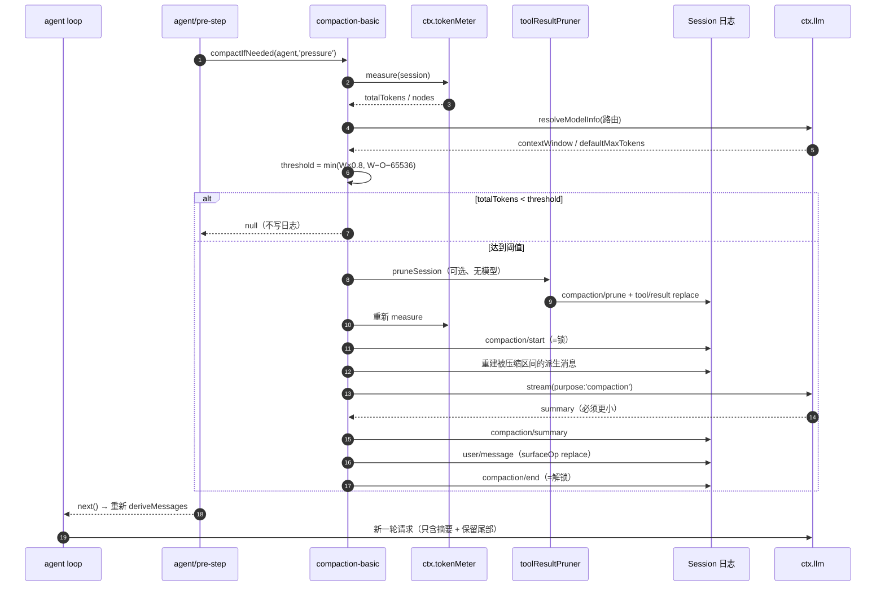
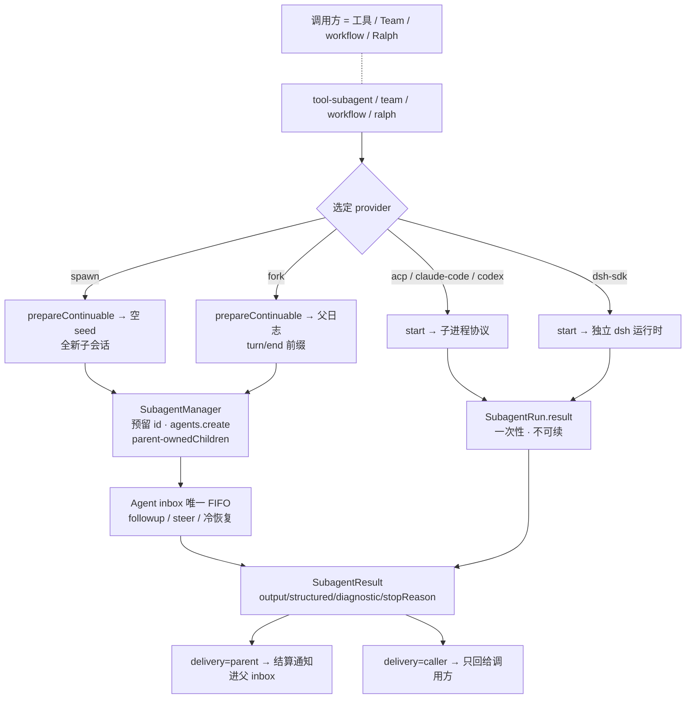

# 记忆与压缩 · 多智能体 · 长时任务

> 关注面说明：这三件事在 dsh 里共用一条底层约束——**模型能看到的东西必须能从日志重建，而一个轮次之外的工作必须有明确的生命周期所有者**。压缩改的是模型看到的投影，subagent / teammate 是把一个轮次交给另一个 agent，jobs / workflow / goal / schedule 是把工作搬出主循环。

## 一条主线：把"外存"当第一等公民

一个只有主循环的 agent 会在三个地方撞墙：上下文窗口（token 预算）、并行度（一个轮次只能做一件事）、时间（进程活不过一次长任务）。常见做法是给主循环加三个补丁：一个摘要函数、一个 `spawn` 函数、一个 `cron`。dsh 的路线相反——三者都是**可选能力 seam**，各自有 Service Definition、Service Provider 与面向模型的 Consumer，主循环里没有任何一句 `if (contextTooBig)` / `if (needParallel)`。

这条路线不是审美偏好，而是被"Model-visible means logged"逼出来的：既然每个模型请求都必须能从日志重建，那么"改变模型看到的历史"这件事本身就必须是一次可回放的日志写入，而不是内存里的一次 splice；既然恢复、fork、transcript 都从持久 settlement 派生，那么"在轮次之外继续干活"的东西就必须有自己的持久记录，否则崩溃后无从判断它是活着还是死了。

后文所有机制都可以还原成同一句话：**压缩把历史"搬到别的位置"但保留可寻址性；subagent 把工作"搬到另一个会话"但保留血缘；长时任务把执行"搬出轮次"但保留所有权。**

## 压缩：不是删历史，而是改投影

### 机制底座：surface 折叠

dsh 的 `Session` 是 append-only 事件日志，模型历史由 `deriveMessages()` 从日志**投影**出来，投影的对象是一个叫 surface 的有序视图：只有五类"会产生消息"的事件能进入 surface（`system/message`、`developer/message`、`user/message`、`assistant/message`、`tool/result`），而每个 surface 事件必须携带一个 `surfaceOp` 标记——要么 `'append'` 追加到尾部，要么 `{ op: 'replace', startSeq, endSeq }` 原地替换一段既有节点：

```ts
export type SurfaceOp =
  | 'append'
  | { op: 'replace'; startSeq: SessionSeq; endSeq: SessionSeq }
```

见 [packages/core/session/src/types.ts:463-465]()
<!-- anchor: export type SurfaceOp = … | { op: 'replace'; startSeq: SessionSeq; endSeq: SessionSeq } -->

替换是真正意义上的"覆盖"：折叠时 `nodes.splice(startIdx, endIdx - startIdx + 1, plan.seq)`，被替换的节点从 surface 上消失，新节点占据它的**位置**（而不是它的 seq）。因此 surface 上可见的 seq 会变成非单调的——替换节点的 seq 比它后面的节点更大。这一点在类型注释里被反复强调，因为它是后面所有"位置跨度 vs 数值区间"歧义的源头（[packages/core/session/src/surface.ts:569-572]()
<!-- anchor: } else if (plan?.kind === 'replace') { … state.contentGeneration += 1 -->



### 触发阈值：两个上限取小

压力阈值不是"窗口的 80%"这么简单。`resolveCompactSpec` 先扣掉**这次请求为输出预留的 token**（`O`，取生效信封的 `maxTokens`，否则取适配器按请求默认值），再扣掉固定的压缩余量 `headroomTokens`（默认 65536），然后与窗口比例取较小值：

```ts
const thresholdTokens = Math.floor(Math.min(
  contextWindow * policy.thresholdRatio,
  pressureBudgetTokens,
))
```

见 [packages/compaction/compaction-basic/src/config.ts:191-191]()
<!-- anchor: const thresholdTokens = Math.floor(Math.min( -->

保留尾部（`retainTokens`）按 `(W − O) × 0.16` 独立缩放，并且加载期就拒绝 `retainRatio >= thresholdRatio` 的配置——因为任何模型容量都无法让这种策略自洽（[packages/compaction/compaction-basic/src/config.ts:235-235]()
<!-- anchor: if (retention.retainRatio !== undefined && retention.retainRatio >= thresholdRat -->

这两个上限分别防两件事：比例项限制"历史自然增长"，绝对项限制"一次大输出之后还剩多少空间给下一次压缩与生成"。设计笔记把这个取舍讲得很直白——**比例无法约束任意单次工具结果的增长**（[.agents/notes/implemented/architecture/2026-07-20-routed-model-context-and-compaction-policy.zh.md:29-29]()
<!-- anchor: 对于主动压力检查，compaction-basic 读取最新持久路由，解析适配器容量 `W`、请求输出预留 `O` 和精确目标策略。触发阈值为 `floor(m -->

所以必须有一个与模型容量无关的下限。值得注意的是**容量事实归 LLM 适配器所有**（`resolveModelInfo` 的 `context.contextWindow`），策略归可选插件所有——这是为了不建"第二套模型注册表"：适配器知道哪些模型 id 存在，压缩插件不知道。

### 压缩事务：锁在日志里，失败也要留痕

压缩本身是日志中的一次显式事务，三个仅日志事件把它括起来，且**都不进入 surface**（只有产生消息的事件才上 surface）：

| 事件 | 何时写 | 关键载荷 | 可被谁看见 |
|---|---|---|---|
| `compaction/start` | 摘要前同步写，充当锁 | `compactionId`、`turn`（数字=当前轮，`null`=独立手动） | 任何日志读者（含 UI、SDK） |
| `compaction/summary` | 摘要成功之后 | `summary`、`rawOutput`+`llmStreamCall`、`shadowedRange`、`shadowedSeqs`、`shadowedTokenCount`、`provider`/`model`/`maxTokens`/`usage` | 同上 |
| `compaction/end` | 成功或失败都写 | 同一 `turn`，失败时带 `error` | 同上 |
| `compaction/prune` | 无模型剪枝置换之前 | 被剪枝节点的 `shadowedSeqs` 与启发式价格 | 同上 |

锁的语义值得单独说：`compaction/start` 与 `compaction/end` 不配对，就意味着"有人在压缩中被崩溃带走了"。因此打开一个会话时，`inspectCompactionEntryState` 反向扫描日志，找到未配对的 start 就拒绝新的压缩（`busy`），除非其后已经出现新的 `session/end-seed`——那种 start 属于上一个生命周期，是陈旧证据（[packages/compaction/compaction-basic/src/region.ts:308-308]()
<!-- anchor: function assertCompactionInactive( -->

**顺序是有讲究的**：先写 start 再摘要，先写 end 再返回。中间崩溃只会留下一个可检测的未闭合锁，而不会留下一个声称自己成功的半成品（[packages/compaction/compaction-basic/src/region.ts:210-210]()
<!-- anchor: const startEvent = session.append('compaction/start', lifecycle) -->

这是"故障关闭"（fail-closed）的第一个落点：宁可让人看到"上次压缩没做完"，也不要让人看到一个看似正常、实际丢了半段历史的会话。

### 摘要本身也被溯源

摘要是一次真实的模型调用，它也要能被回放：

- `purpose: 'compaction'` 与 `sessionId` 一起进 `GenerateOptions`，让遥测/计费能把这次调用与普通轮次区分开；
- 结果里带 `llmStreamCall: true` 时，**必须**同时给出完整 `rawOutput`——这个标记的契约是"恰好一次通过本上下文的 `ctx.llm.stream()` 调用"，因此日志 + 代码就能重建这次一次性请求（[packages/compaction/compaction/src/types.ts:36-62]()
<!-- anchor: sourceCommandId?: CommandId … /** Optional complete output from an unmarked template, remote, or other summari -->

- `provider` / `model` / `maxTokens` / `usage` 一并入库，于是"这段摘要是哪个模型写的、花了多少 token"有持久答案。

`SummaryResult` 用了一个判别联合来区分"走本进程 LLM seam 的调用"和"模板/远程摘要器"：前者必须标 `llmStreamCall: true` 且带 `rawOutput`，后者不能标。没有标记的 `rawOutput` 因此**不能**被判定为走了哪条路径——类型层面就把"看起来像"和"确实是"分开了。

### 压缩后模型看到的形态：一条合成 user 消息

被压缩区间在 surface 上被替换成一个**普通 `user/message`**，内容由定界符包裹：

```text
This is an automatically generated checkpoint condensing an earlier span ...
<compacted-summary>
  ## Primary Request and Intent      ← 原样保留的七段 Markdown 之一
  ## Pending Jobs / ## Next Step     ← 空段必须写 (none)，不许省略
</compacted-summary>
```

见 [packages/compaction/compaction-basic/src/summarizer.ts:70-71]()
<!-- anchor: const CHECKPOINT_PREAMBLE = … 'This is an automatically generated checkpoint condensing an earlier span of the -->

以及 [packages/compaction/compaction-basic/src/summarizer.ts:188-188]()
<!-- anchor: export function frameSummary(summary: readonly ContentBlock[]): ContentBlock[] { -->

三个细节值得抄：

1. **它的 source 是 `{ kind: 'compact-checkpoint', compactionId }`**，与 `compaction/start` 的 id 对齐。因此 UI/SDK 不需要读摘要内容就能认出"这是一条压缩检查点"，也不依赖任何具体后端。
   见 [packages/compaction/compaction/src/checkpoint.ts:19-23]()
<!-- anchor: const COMPACT_CHECKPOINT_MARKER = Object.freeze({ kind: 'compact-checkpoint' } a … readonly compactionId: CompactionId -->

2. **摘要调用复用对话自己的前缀**：system 头 + 被压缩区间自己的派生消息原样重放，压缩指令作为**最后一条 user 消息**追加。这样这次辅助调用是"上一次请求的真前缀"，能吃到 provider 的 KV 缓存，而不是用一个全新的摘要 system prompt 把缓存全打掉。代价是压缩指令必须写成"对上面这段对话做总结"的形式，而不能自由设计摘要器的人设。
3. **摘要指令本身带有"再次压缩"的语义**：如果对话里已经有一个 `<compacted-summary>`，要求模型"保留仍然成立的事实、丢弃过时的、把新信息合并进同一份摘要"，而不是照抄。这条让多次压缩不会变成摘要的摘要的摘要（层层失真），而是对同一份结构化检查点做增量维护。

摘要格式是固定的七段 Markdown（Primary Request and Intent / Key Technical Concepts / Files and Code / Errors and Fixes / Pending Jobs / Current Work / Next Step / Critical Context），空段必须写 `(none)` 而不是省略。这是把"摘要质量"从自由散文变成可 diff 的模板——牺牲了表达力，换来了跨模型、跨压缩轮次的一致性。

### 收缩证明与失败降级

dsh 不信任摘要"应该"更小，而是**测量**：把框架化之后的检查点消息用 token meter 估价，与被遮蔽区间的**路由价格**比较，不小于就抛错（[packages/compaction/compaction-basic/src/region.ts:417-417]()
<!-- anchor: const framedSummaryTokenCount = dependencies.meter.estimateMessage(checkpointMes -->

这一条把大量失败模式挡在提交之前：

| 失败 | 检测点 | 结果 |
|---|---|---|
| 摘要被 `max-tokens` 截断 | `finishError` 判 `finish.kind === 'max-tokens'` | 抛 `MAX_TOKENS`，视为失败尝试 |
| 摘要里出现图片 | `summaryText` 判 `contentHasImage` | 抛 `UNSUPPORTED_CONTENT` |
| 摘要为空文本 | `summarizeWithLlm` 检查 | 抛错 |
| 摘要不比原文小 | `framedSummaryTokenCount >= shadowedRouteTokenCount` | 抛错，不写替换 |
| 摘要期间 surface 变了 | `assertWholeSurfaceUnchanged` / `assertSelectedSpanStable` | `SurfaceChangedError`（手动路径报 `changed`） |
| 摘要请求本身溢出 | `compaction/summary-error` waterfall | 允许监听器做一次持久缩小（如图片省略）后重试 |

自动路径的失败处理是**保留原样、继续轮次**：`agent/pre-step` 监听器捕获异常后 `ctx.logger.warn(...)`，然后 `return next()`（[packages/compaction/compaction-basic/src/index.ts:158-158]()
<!-- anchor: ctx.on('agent/pre-step', async ( -->

这是有意的：在轮次边界上抛错会把一次"上下文偏大"变成"任务中断"，代价远大于收益。

真正无法压缩时（比如单个保留单元本身就超过预算，或者路由没声明 `contextWindow`），系统的行为是**不压缩、让它照原样去请求**，然后由 provider 的规范化溢出错误兜底：`agent/request-error` 看到 `CONTEXT_WINDOW_EXCEEDED_CODE`，才走 `context-overflow` 触发器，并且**绕开压力阈值与保留尾部**，直接做一次"最大且平衡"的缩减（[packages/compaction/compaction-basic/src/index.ts:190-190]()
<!-- anchor: ctx.on('agent/request-error', async ( -->

这里最细的一处设计是重试判据不是"压缩返回了结果"，而是 **`replaceGeneration` 是否前进**：

```ts
if (signal.aborted
  || agent.session.surface.replaceGeneration <= generation) return next()
```

见 [packages/compaction/compaction-basic/src/index.ts:229-233]()
<!-- anchor: if (signal.aborted … return { kind: 'retry' } -->

原因写在同文件的注释里：无模型的剪枝可能已经落地、而后续摘要失败——这份持久缩减足以证明"重试会有不同结果"，不该因为第二阶段抛错就把它一起丢掉。反过来，如果什么都没改进，就保留原始的 provider 错误，绝不重试成死循环。`maxOverflowRetries` 默认 1，成功助手消息或 agent 回到 idle 时重置计数。

### surface 层的硬性护栏

压缩不能为所欲为，`surface` 折叠在写入时校验三条边界：

- **工具配对**：替换区间的两端必须是"平衡边界"，即不能在 assistant tool-call 与它的 tool-result 之间切开（`toolPairingBalancedBefore/After`，[packages/compaction/compaction/src/tool-pairing.ts]()）。区域边界保持配对但**不保持整个轮次**，所以一个超大轮次里较早关闭的步骤可以被单独压缩。
- **工具结果只能改 content**：`tool/result` 的替换事件必须在除 `content` 之外与原件深相等。
  见 [packages/core/session/src/surface.ts:455-455]()
<!-- anchor: /** Restrict a tool-result replacement to one current result's content. */ -->
- **system 头受保护**：surface 位置 0 如果是 `system/message`，只能被"覆盖且仅覆盖该节点"的另一个 `system/message` 替换。
  见 [packages/core/session/src/surface.ts:493-493]()
<!-- anchor: function assertSystemHeadRewrite( -->
  也就是说压缩区间永远从第一个非 system 节点开始，系统提示词不出现在摘要里。

而 `surfaceOp.replace` 还要求 `sourceEventSeqs` **完整包含所有被遮蔽节点的 seq**——这是溯源链的强制项：任何替换节点都能反向指回它遮住了什么。

## 谁能读回原文：可恢复性的真实分级

"压缩后原文还在不在"在 dsh 里没有单一答案，取决于哪一层动的手：

| 手段 | 模型看到什么 | 原文在哪 | 谁能读回 | 可逆性 |
|---|---|---|---|---|
| 摘要压缩 | 一条 `<compacted-summary>` user 消息 | 日志里原事件仍在（append-only），但已不在 surface | 任何**读日志**的人：transcript（走 `isAppendSurfaceEvent` 过滤）、SDK、遥测、fork 种子；**模型自己看不到** | 数据可恢复，投影不可逆 |
| 工具结果剪枝 | 首 4096 + `[... pruned ...]` + 尾 1024 码点 | 同上，原 `tool/result` 事件被替换节点遮蔽 | 读日志的人 | 同上，且 `PrunedEntry` 记录了 `originalSeq` / `replacementSeq` 与码点差 |
| spill 外溢 | 首尾预览 + 一行定位符与检索提示 | **运行期产物文件**（私有目录、`0700`/`0600`、会话哈希子目录） | **模型**：用 `read` / `grep` 打开定位符；也可被外部进程读 | 对模型可逆（这才是它的目的） |
| 图片省略 | 占位文本 | 附件存储 + spill 文本里的可读路径 | 模型用 `read_image` | 对模型可逆 |

这张表最容易被误读的一点是：**日志里的原文并没有被删除**。压缩置换的是 surface 投影，`isAppendSurfaceEvent` 明确把"替换副本"标记为"仅模型可见"：

> The model-visible surface deliberately shadows replaced ranges, so it is the wrong source for a human transcript — a landed replacement would erase conversation the user already saw.

见 [packages/core/session/src/surface.ts:82-82]()
<!-- anchor: * The model-visible surface deliberately shadows replaced ranges, so it is the -->

transcript 读取因此走 `isAppendSurfaceEvent(event)` 过滤（[packages/api/session-controller/src/history.ts:412-415]()
<!-- anchor: if (!MESSAGE_TYPES.has(event.type) || !isAppendSurfaceEvent(event)) continue … let groupStart = event.seq -->

用户看到的会话历史不会因为压缩而缩水；模型看到的会。**同一个会话，两种投影**——这是"压缩 = 改投影"最直接的证据。

### spill 与压缩的分工：一个是"外存 + 地址"，一个是"改写历史"

两者常被混为一谈，但职责边界很清楚：

| | spill-policy | compaction |
|---|---|---|
| 何时 | `tools/post-execute`，结果刚产生 | 轮次边界（`agent/pre-step`）或溢出恢复 |
| 动什么 | 只动**本次工具结果**的内容，按 `maxInlineTokens` 保留首尾 | 动 surface 的一段位置跨度，可跨多个轮次 |
| 原文去哪 | 写进 spill 文件，返回**模型可用的定位符** | 留在日志，模型不可见 |
| 失败语义 | 尽力而为：存储失败保留原结果，成功调用不会因此变成 `isError` | 失败关闭：不写置换，保留原历史 |
| 归属 | `SpillOwner.sessionId` 命名空间 | `CompactionId` 事务 + surface 置换 |

"尽力而为"这一行有代码依据：
见 [packages/spill/spill-policy/src/index.ts:127-127]()
<!-- anchor: } catch (error: unknown) { -->

一句话概括：**spill 让模型的上下文"可以小，但随时能长回来"；压缩让模型的上下文"确实变小，且不再长回来"。** 前者的可逆性是显式承诺（定位符 + 检索提示 + 文件存活期），后者的"可逆"只是日志层面的副作用，没有任何一级 API 承诺"把摘要还原成原文"。

两者还在流水线上串联：spill 是 post-execute 的**前置**（prepend）策略、先于保留层结算；剪枝（`ctx.toolResultPruner`）是压缩的**前置**步骤，在压力达标后先做一次无模型的确定性修剪、重新计量，仍未达标才画摘要区间。顺序刻意如此——最便宜的缩减先做，最贵的（一次模型调用）最后做。

有意思的是 spill 的策略里有一条"`read` 的结果永不外溢"（`exec.name === 'read'` 直接原样通过，[packages/spill/spill-policy/src/index.ts:135-135]()
<!-- anchor: if (decision.kind !== 'accept' || Object.hasOwn(decision, 'value') || exec.name  -->

否则模型读 spill 文件 → 结果过大又被 spill → 再读 → …。这条循环不是理论风险，一个"通用工具结果策略"必须显式斩断它。

## 记忆的分层：dsh 有哪几层，没有哪几层

这是最容易写歪的一节，先给结论表格，再说理由。

| 记忆类型 | dsh 里是否存在 | 落在哪 | 模型怎么看到 |
|---|---|---|---|
| curated（长期事实/偏好入库） | **没有**专用的记忆库或"记住这件事"工具 | 只有 `AGENTS.md` 兼容的工作区指令文件（`packages/context/agent-instructions`） | 作为带 source 的 `user/message` 注入 |
| episodic（会话历史） | 有，且是唯一事实源 | Session 事件日志 + surface 投影 | `deriveMessages()` |
| prospective（待办/目标） | 有，但**不是同一种东西**：todo / goal / plan 三者生命周期完全不同 | `todo/write`（仅日志）、`goal/change`（仅日志）、`plan/mode`（仅日志） | 分别通过工具结果、续轮提示、`plan:policy` 提示段落 |
| 定时/唤醒 | 有，但**在日志之外** | 宿主 storage 的 `schedule` domain | 到期时作为一条 follow-up 消息投递 |

### 没有 curated memory

dsh 没有"用户偏好/项目事实"的专用存储，也没有 `remember` / `recall` 这类工具。最接近的是 `dsh-agent-instructions`：它按项目根标记（默认 `.git`）向上、向用户全局目录收集 `AGENTS.md` / `CLAUDE.md` 与 `.local.md` 覆盖层，渲染成一段 `<system-reminder>` 文本，在第一次请求之前作为基线注入；之后的 `read`/`write`/`edit` 触碰新目录时，**新出现、被修改、被删除**的指令文件会作为增量注入 inbox。

这张设计的关键判断写在它自己的 README 里：持久内容 = 普通带 source 的 `user/message`，因此**与其他历史一样可回放、可压缩、可恢复**（[packages/context/agent-instructions/README.zh.md:88-88]()
<!-- anchor: 该插件建立在一个原则上：工作区指令是持久的对话内容，按 agent 与会话分别归属。基线消息与刷新消息都是普通的带来源 `user/message` 事件，因此 -->

这带来一个**应当被明确指出的后果**：项目指令是"历史的一部分"，所以它会被摘要进检查点，也会随摘要的措辞失真；它不是"永远在上下文里的常驻事实"。想让某条事实永不失真，dsh 的选择是让它留在更靠前/更常被重读的位置（例如 system 提示词段落，或者干脆写进每次都要读的文件），而不是给模型一个"记忆库"。

### todo / goal / plan：三种"待办"，三种生命周期

三者都是日志记录（`todo/write`、`goal/change`、`plan/mode`），但交互方式截然不同：

- **todo** 是"整表替换"的快照，模型每写一次就覆盖上一次；没有 id、没有优先级、没有依赖。
  它只对"当前这一批工作"有意义。
  见 [docs/subsystems/todo.zh.md:13-17]()
<!-- anchor: * One entry in an agent's todo list — the unit of the `todo/write` … * `status`. No id, priority, or `activeForm` — the list is replaced wholesale -->
- **goal** 是每会话至多一个的**比较并设置**对象：`GoalRef{id, revision}` + 四相 `active/paused/blocked/complete` + 进程本地激活位。每次变更写一条携带完整快照的 `goal/change`，严格回放拒绝不连续 revision 与非法相变。
- **plan** 是逐 agent 的软性指引开关，只贡献一段提示词段落（order 50 的 `plan:policy`），并且明确要求部署**另配**沙箱与审批策略——计划模式本身不强制任何限制。

这三者的共同点很值得注意：**它们都不增加模型输入通道**。goal 的设计笔记明确否决了"把每次 goal 变更投影成 `<goal_state>` 消息"，理由是"变更可以在不打开步骤的情况下有效且持久，取消或策略拒绝也不能擦除它"——把领域提交点绑到队列放置上，会让回放被迫理解准入语义（[.agents/notes/implemented/architecture/2026-07-31-goal-owned-durable-events.zh.md:25-25]()
<!-- anchor: - **继续以 Round 为 0 的 goal 消息作为持久记录。** 不予采纳，因为这会把领域提交与队列变更绑定，并要求 goal 折叠理解领取和准入对账， -->

### episodic 与 prospective 的边界

一个实用的判断句：**dsh 里"记住某件事"和"因此去做某件事"是两个不同的事件**。`goal/change` 只回答"目标怎么了"，`goal_round` 那条 `user/message` 才回答"所以下一轮要干什么"，并且它由独立的 `goal-round-driver` 通过公开 inbox 生命周期排队。取舍是清晰的：领域状态不需要知道队列，队列不需要能回滚领域。

## subagent：一个接口，七种信任等级

### 启动时能力 vs 运行时能力

`SubagentProvider` 只有两个可选方法，而**方法是否存在**本身就是一种能力声明：

- `start(request)` → 返回 `SubagentRun`（外部执行：一个 id、一个 `result` promise、一个 `dispose()`），提供方拥有进程/协议句柄；
- `prepareContinuable(request)` → 返回 `ContinuableCreateSpec`（只是数据：可选的 `seed`），**方法存在即选择本地 activation 执行**。

后者是这套设计里最克制的一处：一个可继续子代理的生命周期（身份预留、`ctx.agents.create()`、提示词投递、冷恢复、所有权、拆卸）全部由 `SubagentManager` 拥有，提供方对它的贡献只有"孩子要不要带父会话前缀"这一件事。设计笔记把替代方案逐条否掉了——"让提供方通过 Agent handle 创建/恢复/投递，会让提供方保留所有权，却没有已发布行为需要它"（[.agents/notes/implemented/feature/2026-07-28-continuable-subagent-conversations.zh.md:158-158]()
<!-- anchor: **让提供方通过 Agent handle 创建、恢复 child 或投递消息。** 初始提供方只持有 `prepareContinuable()` 及其分离式 -->

启动期能力是四位的静态声明，`startActivation` 在调用提供方之前逐位校验，缺一个就 `UNSUPPORTED_CAPABILITY`：



| provider | 执行位置 | `agentOptions` | `agentPreset` | `outputSchema` | `depthLimit` | 继承父上下文 | 可续 | 可冷恢复 |
|---|---|---|---|---|---|---|---|---|
| `spawn` | 同进程 | ✔ | ✔ | ✔ | ✔ | ✘ | ✔ | ✔ |
| `fork` | 同进程 | ✔ | ✘（继承父组装） | ✔ | ✔ | ✔ | ✔ | ✔ |
| `dsh-sdk` | 子 dsh 运行时 | ✔ | ✘ | ✘ | ✘ | ✘ | ✘ | ✘ |
| `acp` / `claude-code` / `codex` | 子进程协议 | ✘ | ✘ | ✘ | ✘ | ✘ | ✘ | ✘ |

表格里的 `agentPreset` 一列藏着一个细节：即使提供方声明支持，只要 `inheritsParentContext` 为真也会被拒绝——独立选择 preset 与"继承父上下文"在语义上互斥（[packages/subagent/subagent/src/index.ts:632-632]()
<!-- anchor: if (request.agentPreset !== undefined && (!provider.capabilities.agentPreset ||  -->

### 信任边界：共享什么，不共享什么

这是本关注面最值得主 agent 复核的部分，因为"subagent 会不会越权"在一堆框架里是含糊的。dsh 的答案是显式的：

**共享**：同一个进程、同一个 Cordis 上下文树（in-process 路径）、**同一个工作目录**（`Team` 甚至强制所有 member 用 Lead 的 cwd）、同一份宿主文件系统、同一套 `ctx.fs` 提供方与同一套沙箱后端。

**不共享**：

- **审批策略**：子会话在委派边界被钉成 `approvalPolicy: 'never'`。注释说得明白——"a delegated child acts only within the sandbox scope fixed at delegation, so its asks are rejected deterministically"（[packages/subagent/subagent/src/child-agent.ts:230-234]()
<!-- anchor: * `'never'` whenever the approval capability is composed, `undefined` … readonly approvalPolicy: 'never' | undefined -->
  子 agent **不能向人提问求批准**，它只能在委派那一刻定下来的沙箱范围里干活。
- **沙箱覆盖**：只继承父会话的**显式** sandbox override，**不继承部署默认值与一次性授权**。捕获是同步的、在第一个 `await` 之前完成，因此父 agent 之后的权限切换属于父的未来，不会追溯影响这个孩子。
  见 [packages/subagent/subagent/src/manager.ts:402-404]()
<!-- anchor: // Capture before the first await: a later parent switch belongs to the … const delegatedPolicies = captureDelegatedPolicyOverrides(parent) -->
- **会话历史**：`spawn` 全新、`fork` 只拿"最后一个 `turn/end` 之前"的完成轮前缀（当前工具调用所在轮次不完整，无法作为合法子会话种子），外部 provider 一无所获。
- **工具可见性**：preset / toolFilter 决定，子代理的工具目录可以比父更窄。
- **进程外 provider 的凭据与权限语义**：由各产品自己拥有。`subprocess` seam 给子进程的是**凭据擦洗过的环境**，插件 `env` 只能在其上追加；Claude Code 与 Codex 的 `permissionMode` 是 **Profile 级**配置，故意不在工具体 schema 与 `SubagentStartRequest` 里——"the model or a single delegation cannot change it"。

这最后一条是这套信任模型的核心判断：**权限不能由 task 内容选择**。一个模型能自己决定自己权限的委派系统，等于没有权限系统。深层递归也不是权限边界，设计笔记明确承认深度策略"有意不解决安全隔离或父到子的非升权问题"（[.agents/notes/implemented/feature/2026-07-12-subagent-persona-tool-filter-and-depth.zh.md:98-98]()
<!-- anchor: 代价是部署方必须理解活跃的 allow/deny 行为以及可见性与授权的区别。当前深度策略禁止再创建子 agent 后，模型仍可能调用可见的委派工具并收到错误。 -->
  真正的隔离必须来自进程外 provider 或沙箱后端，而不是"孩子不许再派孩子"。

### 结果回注父会话

`delivery` 只有两个值，语义差异很关键：

- `'parent'`：结算后由管理器**注入父会话**（一条 `subagent-settled` 来源的消息）。`tool-subagent` 走这条。
  见 [packages/subagent/tool-subagent/src/index.ts:330-330]()
<!-- anchor: const started = await runtimeCtx.subagents.startActivation({ -->
- `'caller'`：只把结果交回调用方，不向父注入消息。`workflow-ptc` 走这条，因为工作流脚本自己会消费子结果。
  见 [packages/workflow/workflow-ptc/src/host.ts:203-207]()
<!-- anchor: const run = await this.subagents.startActivation({ … signal: this.controller.signal, -->

`SubagentResult` 的字段划分也值得注意：`output` 是**最后一条非空 assistant 消息**（不是执行轨迹），`structured` 是按请求 schema 校验过的值，`diagnostic` 是"提供方撰写的失败说明"——必须不含工具输入、文件内容、环境值、凭据、原始协议载荷，且被截到 4096 字节。把"基础设施失败"和"模型输出"分成两个字段，是为了不把进程错误伪装成模型说的话；同理，`subagent-settled` 的 source kind 故意与 `agent-message` 不同：

> an Agent message is content the sender chose, while this message is the manager stating what became of the child, and a transcript that merged them would credit the child with words it never wrote.

见 [packages/subagent/subagent/src/continuation-messages.ts:32-32]()
<!-- anchor: readonly form: 'notice' -->

### 可继续子代理：一个 inbox、一个驻留周期

可继续子代理的状态机很值得对照：`running` →（agent 完全停稳但 inbox 非空或仍持有 child）→ `waiting` →（唤醒投递）→ `running`；只有"完全停稳 + inbox 空 + 无存活 child"才 `settled`，然后 dispose `AgentHandle`。**没有 queued 状态**，因为排队由 Agent inbox 自己负责。设计笔记为此否掉了"每个 next-turn 建一次 activation"和"为继续消息维护独立队列"两个方案，理由都是同一条：第二条 FIFO 会让顺序出现两个权威（[.agents/notes/implemented/feature/2026-07-28-continuable-subagent-conversations.zh.md:166-166]()
<!-- anchor: **为继续执行消息维护单独队列。** 第二个 FIFO 会让它和 Agent 已接受消息之间顺序不明确。单个 Agent inbox 为每个已接受轮次提供唯一且 -->

代价也写在同一篇里：**已经进入 inbox 但还没落盘的消息，崩溃就没了**。会话与描述符可以恢复，inbox 与所有权图不能。这是一个诚实的取舍——要做到"已接受即保证"，就得持久化 inbox 协议。

## Agent Teams：把 subagent 变成有名字、有台账的同事

### 隐式 Lead

任何普通运行时 Root 都是一个隐式 Team 的 Lead，`TeamId` 就是 Root 的 `SessionId`，**没有创建事件**——Lead 那一行由身份直接存在，持久状态从第一条 member / message / task 事件开始。普通 Session fork 是**新的** Root，继承来的 Team 记录因 ancestor id 不匹配而被排除。

### 与 subagent 的三处结构差别

| 维度 | subagent | Agent Teams |
|---|---|---|
| 寻址 | 直接 parent ↔ 直接 child | 同 Team 内按**不可变名字**寻址任意 peer |
| 状态 | 每个 child 一个 Session | Lead 的 Session 里一个 `agentTeam` 投影（roster + 任务板） |
| 任务 | 无 | 共享 DAG：`blockedBy`、`revision` CAS、`writeScopes` |
| 权限 | 只有 direct parent 能投递 | 任意 member 可发 peer 消息；只有 Lead 能 spawn / interrupt / 分配任务 |
| 稳定性 | 已发布 | **实验性** |

peer 消息走的是同一套 inbox（Steer），只是授权从"直接 parent"放宽到"同 Team 活跃成员"。任务板是带 `revision` 的比较并设置：每次变更携带 `expectedRevision`，`blockedBy` 必须指向未删除任务且构成无环图，删除只留 tombstone。

### 为什么标 experimental

不是功能不完整，而是**并发语义没法在默认产品里承诺**：

1. **共享 checkout 没有锁。** 所有 member 用 Lead 的 cwd，`writeScopes` 只是"规范性提示性路径前缀"，**不是锁**：它只产生重叠警告，绝不阻止 claim 或授予写权限。`read`/`write`/`edit` 的 stale-version 校验能拦住部分冲突，但 Bash、formatter、codegen 与外部写入者完全绕过它。
2. **进程内状态无法跨 harness 进程协调。** roster 持久、任务持久，但"谁现在活着"是进程内的；两个进程同时打开同一存储需要持久 lease 与邮箱协议。
3. **失败会永久占名。** provisioning 失败也永久保留名字与成员槽位，恢复时靠"未终结的 provisioning 记录 vs 独立 child Session"对账。

还有一个组织性原因：Team 包整体位于 `packages/experimental/`，而仓库规则禁止发布包在 `dependencies` 里引用实验包，并检查传递安装、运行时导入与随附组合（[packages/experimental/AGENTS.md:7-7]()
<!-- anchor: - Release packages and apps outside this group must not name experimental packag -->

所以 Team 必须是**显式启用的 profile**，默认工具目录与简单任务行为丝毫不变。

## 长时任务：四种载体，四条理由

### 为什么必须离开主循环

主循环的时间单位是"轮次"：它打开、领取输入、请求、执行工具、关闭。任何"比一个轮次活得久"的东西放进去都会破坏两个不变量——（a）轮次关闭意味着不再欠工作；（b）模型可见即已记录。于是 dsh 把长时工作拆成四个载体，每个解决一个不同的问题：

| 载体 | 谁拥有生命周期 | 状态存在哪 | 崩溃后 | 与 agent loop 的接触面 |
|---|---|---|---|---|
| **jobs** | `JobRegistry`（按 owner Session 授权） | **运行期注册表** + 有主 job 的两条日志事件（`job/registered`/`job/settled`） | 进程死则 job 死；日志留下不完整区间（**不虚构**结束时间） | 完成通知作为下一次读取/等待返回；`job_*` 工具 |
| **workflow** | `WorkflowRun` 持有者（工具调用方） | 引擎内存 + 父 Session 的 `tool-workflow/run-*` 记录 | 尾部缺少 member end / run end 即"中断证据"，不是损坏 | 子 agent 通过 subagent seam 启动；默认后台化成 job |
| **goal** | `GoalService`（服务）+ `goal-round-driver`（调度） | **只**在会话日志（`goal/change`） | goal 状态完整恢复，但**续轮被 disarm**，需显式 resume | 通过 `Agent.followup()` 排队一条 `goal_round` 消息 |
| **schedule** | **宿主**（storage domain + 一个扫描器） | `schedule` storage domain，绑定原 `sessionId` | 到期任务在启动时只补发**最新一次**发生点 | 投递生成一条 follow-up，经 Session controller 恢复会话 |

### jobs：把"输出"与"生命周期"从轮次里剥出来

jobs 的核心抽象只有两件事：一个**有界输出环**，和一个**唯一的投影** `JobView`。模型用有状态游标 `read()` 消耗它，任意观察者用绝对字节偏移 `readAt()` 读取它，两者互不干扰；`output` 类事件只带 id 与新 total，从不推负载——注册表不推字节。这套"两个游标、一份存储"的设计是为了避免上一版的三套词汇（模型侧 `JobSnapshot`、会话控制流 `SessionJob`、观测线 `JobWireChunk`）与三组监听器（[.agents/notes/implemented/architecture/2026-09-03-jobs-seam-consolidation.zh.md]()）。

限流与保留都是显式数字：每个 owner 并发上限 10（`running` + `stopping`），运行期每 job 保留 262144 字节，结算后裁到 16384 字节，拉取源轮询 150ms（见下）
<!-- anchor: maxConcurrentJobsPerOwner?: number … pumpPollMs?: number -->

这些默认值本身就是在回答"后台任务应该多便宜"。

`JobOutcome.result` 是为"结果是值不是流"的生产者准备的（workflow 的渲染结果、subagent 的报告），由结算后**第一次**模型读取一次性交付——这样它不需要挤进字节环，也不会重复计费上下文。

### workflow：模型写脚本，宿主管边界

workflow 的形态很特别：模型交一段 JS 脚本 + 一个 meta 块，引擎在受限运行时里执行，脚本通过 `agent()` / `parallel()` / `pipeline()` / `phase()` / `log()` 操作子代理。几个边界判断：

- **只有一种引擎**（`ctx.workflowEngine`），没有命名注册表——替换引擎就是替换插件，而不是并存。
- **策略不可被脚本观察**：`subagentProvider` 与 `maxTotalAgents` 由调用方给，脚本看不到也换不掉。
- **fatal 与 null 的纪律**：拼错的选项、超上限、seam 启动失败一律抛 `fatal: true`，组合器**重新抛出**而不是把该项变成 `null`；只有子运行失败与阶段内普通错误才允许 `null`。这是"错误不能消融成看起来正常的空结果"。
- **代价是拒绝了一整类便利**：脚本不能并发到任意规模（默认总 agent 上限 1000，`limit.maxTotalAgents` 超引擎天花板直接拒绝），没有整体经过时间截止，取消即中止受管进程。

### goal：同会话的自动续轮

goal 是四种里唯一"复用同一个会话"的：`goal-round-driver` 在每个 idle 时刻询问 goal 是否可驱动，可驱动就渲染一条 `<goal_round>` 提示（含目标原文、第几轮 / 上限），用 `createUserMessage({ source: { kind: 'goal', round } })` 通过 `agent.followup()` 排队。它先 `await Promise.race([subagents.waitForChildren(agent), ...])`——"子代理还在跑的时候开新一轮只会干等"；到达轮次上限时不是静默停止，而是把 goal 变成 `blocked` 并写明 `round-limit`（[packages/goal/goal-round-driver/src/index.ts:178-178]()
<!-- anchor: if (subagents !== undefined) { -->

提示词里那句"Treat the current workspace, tool results, and durable session state as authoritative; inspect them instead of assuming earlier narration is still current"是给压缩写的补丁：摘要里的叙述可能过时，工作区不会。

安全阀是 **disarm**：任何会话开始边界之后，一个 `active` 的 goal 都**不会**自动继续，必须有人（或某条显式 resume）重新武装。这条规则把"无限自我推进"变成了"显式授权的续轮"。

### schedule：Host 拥有的时间

schedule 与前三者最根本的区别：它**不存在于会话日志里**。任务是宿主 storage domain 的记录，绑定原始 `sessionId`，与 agent 是否加载无关；只有历史 Session 里遗留的 v1 `schedule/change` 事件仍可解码，但**不投递**、不迁移。

投递语义刻意保守：错过的发生点**不累积**，只补最新一次；同一 Session 的到期重复任务共用一条消息；投递不等待目标 agent 空闲；失败就保留任务并报错，**没有通用重试循环**。AGENTS.md 还明确接受了一个已知窗口：

> These writes are not atomic: a crash between them may duplicate delivery. Do not describe enqueue as model completion...

见 [packages/schedule/AGENTS.md:8-8]()
<!-- anchor: - Enqueue with producer kind `schedule`, await Session persistence, then retire  -->

也就是说 schedule 选择了 **at-least-once**，并禁止在它上面再叠一个执行状态机。这是四种载体里唯一明确接受重复的，因为它面对的是"时间"这种不可回滚的外部输入。

### 四者能否合并

能合的是**观测**，不能合的是**所有权**。逐对看：

- jobs 与 workflow **已经合了一半**：后台 workflow 就是 `kind: 'workflow'` 的 job，`JobSpec.run` 里直接调用 `ctx.workflowEngine.start()`，并用 `run.result` 映射出 `JobOutcome`。
  见 [packages/workflow/tool-workflow/src/index.ts:276-276]()
<!-- anchor: const jobId = jobs.start({ -->
  合并成立，因为 workflow 的运行期确实需要一个输出环和一次结算。
- jobs 与 goal **不该合**：goal 的产物是一条**排进 inbox 的用户消息**（要经过准入、可能被取消、可能被编辑），job 的产物是环里的字节。把 goal 变成 job，会让 goal 状态依赖队列放置——正是它明确否决的方案。
- jobs 与 schedule **不该合**：job 的 owner 是活着的 Session，owner 的 Agent 被 dispose 会取消 job；schedule 的语义恰恰是"Session 没在跑也要到点叫醒它"。合了，就会得到一个"宿主重启即失约"的定时器。
- goal 与 schedule **不该合**：goal 的时间尺度是"轮次"，schedule 的时间尺度是"墙上时钟"。

反过来推演合并的代价：如果只有一个"长任务"抽象，它必须同时满足四套约束——崩溃后可续（schedule）、与轮次内上下文共享（goal）、有界输出环（jobs）、进程隔离与上限（workflow）。任何一套约束都会污染另外三套的失败语义。

## 关键设计决策的权衡

### 判断一：压缩是"删掉历史"还是"改变投影"

**dsh 明确选择了改变投影**，并且是三层叠加的投影：日志层（append-only，原文永在）→ surface 层（`surfaceOp.replace` 有原地替换语义）→ 消息层（`deriveMessages()` 只遍历 surface 节点）。

| | 改投影（dsh） | 删/重写历史（常见做法） |
|---|---|---|
| 原文可审计 | 是（transcript、SDK、遥测走 append 过滤） | 否，或依赖另行备份 |
| 回放成本 | 每次回放都要重算折叠，且要能容忍非单调 seq | 低，读到什么就是什么 |
| 不变量强度 | 需要一整套写入期校验（配对、system 头、sourceEventSeqs 完整性） | 几乎不需要 |
| 失败模式 | 未闭合锁、`SurfaceChangedError`、替换与计价的相邻契约 | 半删状态的会话语焉不详 |
| 摘要的"正确性" | 可测量（必须比原文小） | 无法验证 |

代价也很实在：`shadowedRange` 是**位置跨度**而不是数值区间（"after a prior replace lands a fresh high-seq summary node at an older range's position, `start` can be GREATER than `end`"），这类反直觉约定会传染给每一个新插件作者；`compaction/summary` 与其后那条 `user/message` 的**相邻性是契约**（前者的 `shadowedTokenCount` 就是后者的影子价格），一个不小心的并发写入就能破坏它。

但收益是"压缩本身可被审计"：你能回答"哪一段被谁、用哪个模型、压成了什么、压缩前后各多少 token、被压缩的每一个 seq 是哪些"——这些问题在"删历史"的方案里从结构上无解。

### 判断二：记忆是子系统还是日志派生物

**在 dsh 里，记忆几乎完全是日志派生物**——除了 schedule（宿主拥有）和 spill 文件（运行期产物）。

| 关注面 | 形态 | 判据 |
|---|---|---|
| episodic / todo / goal / plan / 工作区指令 / 压缩结果 | 日志事件 + 投影 | 重启与 fork 后自动回来，无需迁移 |
| roster / 任务板（Team） | Lead Session 的投影 | 同上，靠 `TeamId` 过滤 ancestor 记录 |
| subagent 目录（谁是谁的儿子） | 父 Session 的 projection | 不读 child 日志、不扫语料库即可枚举 |
| schedule | **宿主 storage** | 必须独立于 Session 加载状态 |
| spill 文件 | **文件系统** | 需要模型用 `read` 打开 |
| job 运行期状态 | **内存** | 只为活的执行服务 |

这个选择的收益是**没有第二套一致性边界**：goal 的替代方案"存入独立数据库"被明确否决，理由就是"有序会话日志已经提供持久化、回放与 fork 继承，无需引入第二个原子性边界"。

代价有三条，都值得主 agent 注意：

1. **派生物 = 可被压缩物。** 项目指令、todo、goal 记录只要进了历史，就会随摘要一起被改写。想让某事实常在，只能放在"每次请求都重建"的位置（system 段落）。
2. **记忆的可见性需要显式通道。** goal 状态不在系统提示里，模型只能在调用工具或收到续轮提示时看到它；一旦上下文被压缩掉上一次的 `goal_get` 结果，模型对目标的记忆就只剩摘要里的那两行。
3. **运行期状态没有简历。** jobs / subagent inbox / Team roster 的"谁活着"都是进程内的；崩溃后能恢复的只有"曾经存在过"。

### 判断三：多 agent 的信任边界能否概括成一句

可以：**共享世界，不共享权威。** 子代理共享进程（in-process）、文件系统、cwd 与沙箱后端，因此它的副作用是真实的、和别人互相可见的；但它不共享审批通道（钉死 `never`）、不共享凭据（子进程环境被擦洗，只有 Profile 显式追加的条目）、不共享权限决策权（permissionMode 在部署侧、不在 schema 里），也（默认）不共享对话历史。

这条边界的实现方式是"在委派边界同步快照，并把快照写进子会话日志"：`sandbox/mode`、`approval/policy`、`permission/preset` 三条事件带 `source: 'delegation'`，追加在 fork 种子之后（所以新策略胜过种子里继承的旧状态），并且子代理之后的自身切换仍然胜过它们。于是"这个孩子当时被授予了什么"可以从它自己的日志单独重建——这又是"Model-visible means logged"的一次复用。

## 亮点与问题

**值得学的四处：**

1. **用 surface 折叠把"上下文"和"日志"解耦**，让压缩、剪枝、图片省略三种完全不同的缩减手段共享同一个原语（`surfaceOp.replace` + `shadowedSeqs` + 计价事件紧邻契约）。
2. **锁写在日志里**，失败留痕（`compaction/end` 带 `error`），未闭合锁可检测，且用 `session/end-seed` 区分"上一辈子的锁"——比内存 mutex 多花了几个事件，换来崩溃可诊断。
3. **收缩证明而不是收缩期望**：摘要必须被测量为更小才允许提交；overflow 重试的判据是 `replaceGeneration` 前进而不是"函数返回了"。
4. **spill 给模型地址、压缩不给**——两类缩减的可逆性差异被明确写进 seam 契约（`SpillLocator` + `retrievalHint` vs 摘要节点无任何检索句柄）。

**可以质疑的四处：**

1. **压缩摘要的保真度没有回归门禁。** `MAX_TOKENS`、图片、空文本、不比原文小都会被拦，但"摘要是否保住了 Pending Jobs 与 Next Step"只能靠模板与提示词约束，没有可测的断言——模板里的 `(none)` 规则也只在 prompt 里。
2. **固定密度估算（4 字符/token + 每块 4 token 开销）** 对中文与代码的偏差方向相反，阈值与保留尾部都建在这个估算上；它的合理性依赖 provider usage 锚点在"规范信封匹配"时才被复用（沿用上次锚点，否则全量重估）。
3. **工具结果剪枝绕过了 spill 的"地址"思路**：它只替换成 `[... pruned ...]` 标记，原文只能从日志读，模型读不回来。对一条 500KB 的 `web_fetch`，如果 spill 没开、只开了剪枝，模型就再也拿不到中间那 490KB。
4. **`shadowedRange` 的位置语义是长期债务。** 类型注释里用了整整一段解释 `start` 可能大于 `end`；每个新消费者都得重新学一遍。若引入一种"位置游标"品牌类型（区别于 `SessionSeq`），这类错误就能在编译期被挡住。

## 与其他部分的连接

本文的每一处机制都踩在同一块地基上：**Session 事件日志 + surface 投影 + 投影 seam**。如果还没读那份地基，建议先看《会话事件溯源与持久化》理解 `SessionEvent`、世代与迁移；随后若要继续往上看，`agent loop` 的 `agent/pre-step` / `agent/request-error` waterfall 与 `agent.inject()` 是本文所有"在轮次边界介入"的入口，而 `sandbox` / `approval` / `credentials` 三篇则解释了本文"信任边界"一节里被引用的那些钉死值究竟由谁执行。
