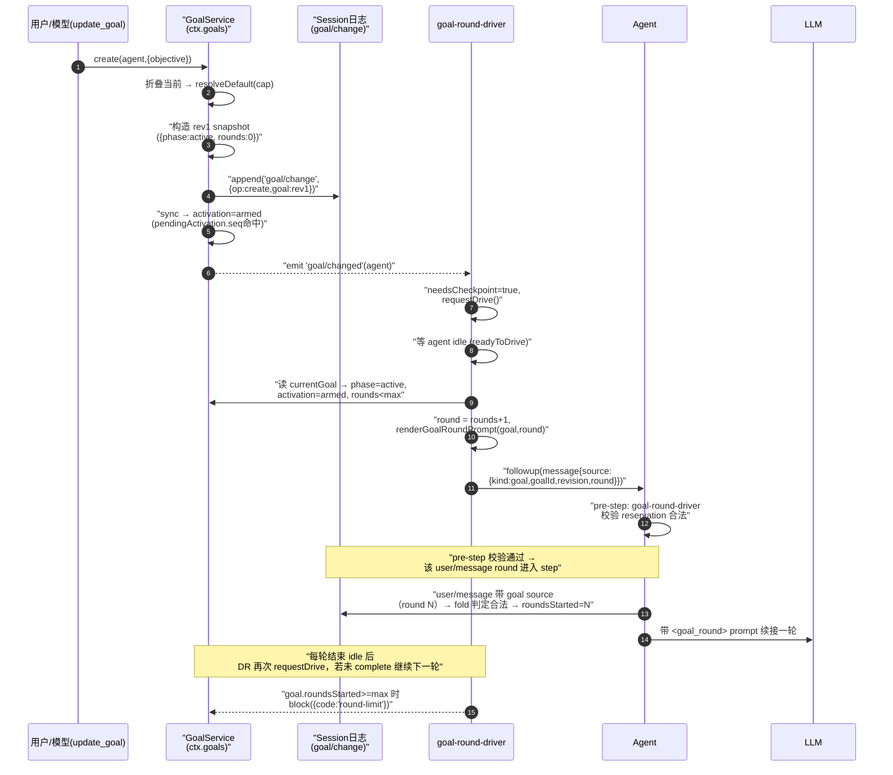
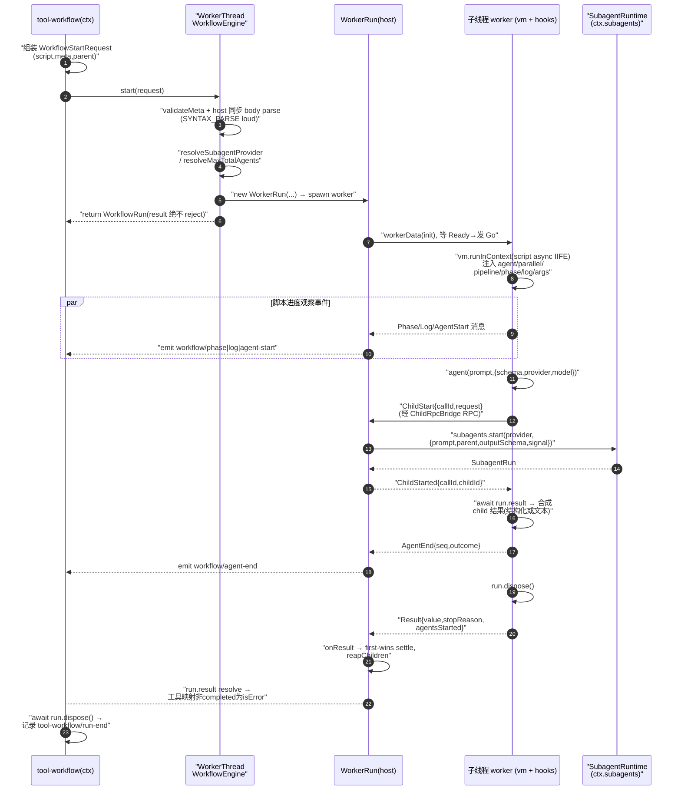

# 规划 / 目标 / 调度 / 工作流 编排（Planning & Orchestration）

> 对应关注面：plan-mode、goal、schedule、workflow（含 tool-workflow / tool-ralph）、jobs、todo——在 agent-loop 之外、以可插拔 seam 形态给极简监督循环补上"编排意识"的六个包（`packages/plan`、`packages/goal`、`packages/schedule`、`packages/workflow`、`packages/jobs`、`packages/todo`）。

## 在项目中的角色（去掉它会怎样）

dsh 的 agent-loop 是一条**极简的监督循环**：`Agent` 受理 `user/message` → turn → pre-step（请求组装）→ LLM → 工具调用 → turn/end。它本身**不知道自己从哪来、往哪去、该不该继续**。下面这一层六个包，全是**在 loop 之外、以可插拔 seam 形态**给它补上"编排意识"的消费者/驱动器：

| 包 | 角色 | 去掉后的后果 |
|---|---|---|
| `plan/plan-mode` | 会话级"规划态"软引导（`ctx.planMode`） | 没有 plan-then-execute 的协作协议；模型无法输出待审计划并等审批切换模式 |
| `goal/*` | 同会话长目标域（`ctx.goals`）+ 自动续接驱动 | 长任务无法跨多个自主 round 收敛；所有 work 退化为单 turn 一问一答 |
| `schedule/schedule` | 会话本地定时提醒（one-shot / fixed-rate） | 无法"稍后提醒你"，agent 只能在收到消息时才动 |
| `workflow/*` | 脚本编排引擎（`ctx.workflowEngine`） | agent 无法一次性 fan-out 大规模并行子代理；只能逐 turn 委托 |
| `jobs/*` | 后台任务注册表（`ctx.jobs`） | background bash / subagent 委托没有统一生命周期、收集、取消、通知 |
| `todo/tool-todo` | 持久待办投影（`todo_write`） | 模型无法向用户/客户端展示"正在进行哪些步骤"的持久状态 |

**关键定位**：这六者**全部是可选项**。它们不进入 core，也不在循环必经路径上——workflow 的类型/操作放在独立包而非 core 即是证据（像 subagent 一样，它是 optional capability，不是 agent loop 的一部分）。所以"去掉它们"的语义是"失去了这些编排能力"，而 loop 本身运行不受影响，这与命令执行、沙箱、权限审批等**硬性限制**是本质区别：plan-mode 是**软引导**，限制由 sandbox/approval 独立强制。

## 解决什么问题、根因

**根因（贯穿六者的单一设计哲学）**：dsh 的这些"编排能力"都**从 `SessionEvent` 日志派生 / 折叠而来，而不是独立的运行状态库**。

为什么？因为 agent 的**唯一持久真相是那段 session 日志**。`Session` 是 turn-enclosed 的日志：每条消息、每个工具调用、每段 turn 边界都编码为可重放的 session event。如果 goal/plan/schedule 各自维护一个"独立状态库"，就会出现两个真相源：

- resume / fork / compaction 都要各自跟日志对齐 —— 极易撕裂；
- UI 无法从日志统一恢复（客户端只消费日志）；
- 崩溃后再启动无法重建。

于是 dsh 的做法是**倒过来**：状态就是日志，日志就是状态。所有编排状态都编码成持久 session event（`goal/change`、`plan/mode`、`schedule/change`、`todo/write`），而"当前值"永远是这些事件的一个**纯函数折叠（fold）**。运行时需要多少就现算多少。**续接激活（activation）则刻意不持久化** —— 它是 process-local 的决定（"这个进程此刻是否被授权自动开下一轮"），所以放在内存里、session-start 时 reset 到 disarmed，与持久 phase 分离。

这个"日志折叠 + 局部激活"的二元设计是理解整个 goal/schedule/plan 域的钥匙。

## 设计思路（方案/替代方案）

**选择：事件溯源折叠，而非命令式状态。** 三套方案对比：

| 方案 | 做法 | 取舍 |
|---|---|---|
| **A. 独立状态库**（Redis/内存表/ORM） | goal/plan/schedule 各存一份现行状态 | 快速、直观，但引入第二真相源；resume/fork/compaction 难以对齐；跨端恢复困难。**被弃用** |
| **B. 全量持久前投影（session-projection-cache）** | 把 fold 结果按 `(sessionId,key,ver,seq,val)` 落库，`turn/end` + 会话冷缩时 checkpoint | 大量读零日志 I/O（快），但**不是状态源** —— 所有写端仍从日志 fold 出当前值，cache 只是投影的加速。goal/plan/todo 都注册了 projection unit，schedule 没有 |
| **C. 日志即状态（dsh 实际选用）** | 状态全在 session event；当前值 = fold；激进场景每读现折 | 单一真相源、天然可重放、UI/模型/客户端从同一日志恢复；代价是读路径要折叠（用 B 的 cache 缓解） |

**补充设计点**：
- **turn 边界即状态提交点**（plan-mode）：因为所有 session event 都是 turn-enclosed，一个"用户选择"在旧 turn 结尾发起、往往要等下一个被接受的 in-turn pre-step 才真正 append。这条"pending → pre-step append"路径是 plan/goal 共用的**会话级变更插入 loop 的最轻量钩子**。
- **续接永远在 quiescence 之后**（goal/schedule）：自动续接（goal round / schedule reminder）绝不在当前 turn 运行中插入，而是等 `agent.status === 'idle'` 后 `followup()` 排队成"下一普通 turn"。这样 loop 的 turn 结构完全不被破坏。
- **每个上下文一个引擎，无 provider registry**（workflow）：与 bash 同型——second engine replaces first through plugin configuration rather than running beside it。避免多引擎路由复杂度。

## 关键数据结构（精简）

### goal —— 折叠态 + 局部激活

`goal/change` 事件要么带**完整后置快照**（[packages/goal/goal/src/domain.ts:24-28]() 的 `GoalSnapshotChangeMeta`，完整字段见同一 interface 24-32），要么是 clear tombstone —— 全值替换而非 delta。这个"whole-value replace"是被 session-projection 规则盖章的刻意选择：state-carrying log event carries the complete post-change state, never a bare delta —— 让每次转移便宜、每个值自描述、last-wins。
<!-- snippet: export interface GoalSnapshotChangeMeta {
  readonly kind: 'goal/change'
  readonly version: 1
  readonly operation: Exclude<GoalOperation, 'clear'>
  readonly goal: GoalSnapshot -->

续接信息（round）不是单独字段，而是**刻进 `user/message` 的 source**：`GoalMessageSource = { kind:'goal', goalId, revision, round }`。fold 时看到带 goal source 的 user/message 就检查它是否合法推进 round（必须等于 `roundsStarted+1`，超 maxGoalRounds 抛错）——见 `applyGoalEvent`（[packages/goal/goal/src/fold.ts:321-331]()，applyGoalEvent 完整体见 313-332（文件仅 349 行））。
<!-- snippet:   if (event.type === 'user/message') {
    const source = goalSource(event.data.source)
    if (source === undefined) return
    const current = state.goal
    if (current === undefined || current.phase !== 'active' || source.goalId !== current.id
      || source.revision !== current.revision || source.round !== state.roundsStarted + 1
      || source.round > current.maxGoalRounds) {
      throw new Error(`goal round at session event ${event.seq} is not the next admitted round of the active goal`)
    }
    state.roundsStarted = source.round
  } -->

激活态（activation: `armed`/`disarmed`）在 `GoalView` 里，但**不在日志里** —— `GoalService.commit` 用 `cache.pendingActivation` 在 append 边界写激活意图，而 `sync` 从日志递增观察时**若该 seq 匹配 pending 激活则记录、否则回落 disarmed**（[packages/goal/goal/src/index.ts:437-444]()，sync 完整体见 437-447）。
<!-- snippet:   private sync(session: Session, cache: GoalCache): void {
    for (const event of session.events.slice(cache.observedSeq)) {
      applyGoalEvent(cache.state, event)
      if (event.type === 'goal/change') {
        cache.activation = cache.pendingActivation?.seq === event.seq
          ? cache.pendingActivation.activation
          : 'disarmed'
      } -->

这行是"持久 phase 与 process-local activation 分家"的画龙点睛：**每一条 durable mutation 都天然把 activation 打回 disarmed**，除非它恰好是本进程刚提交的那条（seq 匹配 pendingActivation）—— 所以重启后任何 goal 都是 disarmed，必须人/工具显式 resume 才 rearm。

### workflow —— 脚本声明

调用者给的是**脚本体 + meta 数据 + args 数据**，都是纯 JSON/文本（[packages/workflow/workflow/src/runtime-types.ts:19-25]()）：
<!-- snippet: export interface WorkflowStartRequest {
  script: string
  meta: WorkflowMeta
  args?: unknown
  subagentProvider?: string
  maxTotalAgents?: number
  parent: Agent -->

`WorkflowResult`：`value`（host-realm JSON，completed 才有意义）+ `stopReason`（closed union: completed/cancelled/error）+ `agentsStarted`。`WorkflowRun.result` **绝不 reject** —— 脚本失败 resolve 成 `stopReason:'error'`；取消后 engine 在 bounded grace 内 force-settle `cancelled` 并 terminate worker，所以 await result 永不被卡死。

### schedule —— 持久提醒记录

三形态：`after`（delay one-shot）、`at`（absolute one-shot）、`every`（fixed-rate）。全部存**规范化四位数年 RFC3339 UTC `scheduledAt`**，replay 不依赖环境时区。`every` 的关键：dispatch 事件带 `acceptedAt`（wall-clock 决策时刻），fold 用 `resolveEveryOccurrence` **直接跳到最新 due occurrence**，不枚举、不持久化错过的间隔。

### jobs —— producer contract + registry record

Producer 声明 `{ kind, label, outputLimitBytes?, owner?, run(): JobHooks }`；`JobHooks = { cancel, done: Promise<JobOutcome>, readOutput? }`。registry 持有 `TrackedTask`（含 owner/status/reported/waiters），**从不外发可变 state，只发 fresh snapshot**。`JobKind` 是 merge-extensible map（`bash`/`subagent` 内建，插件可声明合并）。

## 核心流程（Mermaid）

### 图① goal：从创建到续接激活的时序

驱动循环 `goal-round-driver` 的 drive（reserve + followup）、quiescence 判定与 pre-step 校验构成 goal 自动续接的骨架（[packages/goal/goal-round-driver/src/index.ts:138-140]()，drive 完整体见 138-205；quiescence 判定在 [packages/goal/goal-round-driver/src/index.ts:103-109]()）。
<!-- snippet:   async function drive(state: DriverState): Promise<void> {
    const { agent } = state
    if (!readyToDrive(state)) return -->
<!-- snippet:   private async readyToDrive(): Promise<boolean> { -->

### 图② workflow：脚本执行 + `agent()` fan-out 到 subagents 的时序

- worker 注入与脚本执行：`vm.runInContext` 跑脚本 async IIFE（[packages/workflow/workflow-worker-thread/src/runtime.ts:168-168]()，worker session 75-187）。
  <!-- snippet:      const scriptPromise = this.compiled.runInContext(this.context, { timeout: this.limits.syncTimeoutMs }) as Promise<unknown> -->
- host 侧 child 生命周期：`onChildStart` → 经 `ctx.subagents.start` fan-out → `onResult`（first-wins settle + reapChildren，[packages/workflow/workflow-worker-thread/src/host.ts:329-329]()，child 生命周期完整见 329-412）。
  <!-- snippet:   private onChildStart(callId: number, request: ChildStartRequest): void { -->
- fan-out 经子代理 seam 时捕获宿主句柄，保证引擎 HMR 卸载后仍可跑孩子（[packages/workflow/workflow-worker-thread/src/index.ts:171-172]()，引擎 HMR 句柄捕获完整见 164-188）。
  <!-- snippet:     const subagents = runCtx.subagents
    // runs children on a freshly resolved provider without re-resolving the seam -->

## 与其他模块协同

- **SessionEvent 日志是唯一的根基**：goal/plan/schedule/todo 全部以持久 server event 为状态源。goal 的 round attribution 甚至复用 `user/message` 的 source。
- **agent 续接**：goal-round-driver 通过 `Agent.followup()` 排队自动续接；pre-step 是会话级变更唯一可插入点（plan 的 pending 选择、goal 的 round 校验都在此）。
- **subagents fan-out**：workflow 引擎把 `agent()` 经 SubagentRuntime 变成子代理，`parent` 必填（每个 child 归属它）、cwd/lineage/depth 经 subagent seam。Ralph 要求 **fresh** provider（不继承父上下文）以实现每轮新 worker。
- **commands**：`/plan`、`/goal`、`exit_plan_mode` 等人类入口都走 commands/user-questions seam，不是硬编码在 loop。
- **session-projection**：goal/plan/todo/subagent 都注册 projection unit（`ctx.sessionProjections`），把 fold 结果广播给客户端；schedule 没有。
- **jobs**：与 spill/输出保留协作（`outputLimitBytes` + `TextRetainer`，超限截尾）；与 subagent 合作（`subagent/run-settlement` 也向 `ctx.jobs` 注册 background 委托）。

## 关键设计决策

### ① Why goal/plan 状态从日志折叠而非独立存储？

单一真相源 + 可重放 + 全端一致。若独立存储，resume/fork/compaction 都成第二真相点。dsh 用"fold 现算 + projection-cache 加速 + activation 局部化"三步化解性能与复杂度。**权衡**：激进 read 路径要折叠 O(n) 事件（用 projection cache 缓解），且 fold 必须做 strict 校验（如 `fold.ts` 全套 transition/int-stamp/seen-id 检查），把"只有合法流可折叠"做成 fail-loud 不变量。

### ② workflow 脚本引擎的价值（确定性自动化 vs LLM 自由发挥）

LLM 逐 turn 委托的缺点是：每次决策都要模型发出、上下文反复膨胀、无法保证公平 fan-out。workflow 让模型**一次写出一段确定性脚本**（`agent()`/`parallel()`/`pipeline()`/`phase()`/`log()`），把"调度确定性"交给引擎，模型只提供数据；脚本在 vm 里跑，同步段有超时、取消有 bounded grace、worker 可 terminate。**价值**：大规模多段并发由脚本一次编排，比 turn-by-turn 少了 N-1 次模型往返和上下文污染。**代价**：模型写的 JS 可能失控 -> 用 caps（maxConcurrent/maxTotal/maxItems）兜底；vm 不是安全边界 -> worker 线程只做隔离（`realm.ts` 明确声明"the vm is not a security boundary"，信任前提是"model-written workflows"）。

### ③ Ralph 为什么必须 fresh structured-output 路由？

Ralph 的语义是"每轮新 worker，不带父对话、不带前 child session，共享 workspace 作长期记忆，只有 bounded structured handoff 跨轮"。所以：
- **fresh**：`requireFreshProvider` 校验 provider `!inheritsParentContext`（否则轮次间会偷偷继承上下文，Ralph 的"新上下文"承诺破产）；
- **structured-output**：worker 报告必须是 validated schema（`reportSchema`），这样才能把非结构化自由文本压缩成有限 bytes 的 `maxHandoffChars` 交接。两者缺一不可，故 tool-ralph 既要求 `capabilities.outputSchema`，又拒绝 `inheritsParentContext`（[packages/workflow/tool-ralph/src/index.ts:225-231]()，requireFreshProvider 完整体见 219-233）。
  <!-- snippet:   if (!provider.capabilities.outputSchema) {
    throw new Error(`Ralph subagent provider "${name}" does not support structured output`)
  }
  if (provider.inheritsParentContext) {
    throw new Error(`Ralph subagent provider "${name}" inherits parent context; Ralph requires a fresh provider`)
  }
  return provider -->

### ④ jobs 与 subagent/spill 的关系

jobs 是**通用后台任务注册表**，bash（`tool-bash`）、pwsh（`tool-pwsh`）、terminal（`tool-terminal`）、subagent run-settlement 都是 producer，通过 `ctx.jobs.start({kind,label,run})` 注册。它不执行工作（producer 拥有执行资源），只拥有 identity/access/lifecycle（status/reported/waiters/settlement）。与 spill 的关联在于输出受限：`outputLimitBytes` 是对每个完整 model-facing 完成通知/输出的字节上限，`tool-jobs` 用 `TextRetainer`（tail/head 截断）实现 bounded 收集，超限贴 `[truncated]`。"后台"的语义是它独立于 turn 推进——completion 通过注入 next-step 或 wakeup 开 turn 送达。

### ⑤ schedule 如何跨重启持久化？

不发生独立存储。**它持久化作 `schedule/change` session events（create/delete/dispatch）**；跨重启恢复 = 每次 Session 打开时对日志 `foldScheduleEvents` 重建 active records + 用墙钟重算 timer（reopening one reconstructs timers and makes past targets overdue）。定时触发不是独立 scheduler 线程，而是 **live Session 本地**：只有 owner session live 时才运行（`ScheduleRuntime` 挂在 root agent 上），cold session 不做任何工作（无外部通知通道 / 无 cold scheduler = `deliveryMode:'session-local'`）。dispatch 是**同步排队 `followup()` 后才 append 持久 dispatch 事件**，故窄崩溃窗口内可重复——文档明确 best-effort at-least-once，而非 exactly-once。

### ⑥ 这些编排如何在不变更 agent-loop 前提下插入？

关键在**几个预留给消费者的钩子/边界**：
- `agent/pre-step`（请求组装前）：plan 的 pending 选择 append、goal 的 round reservation 校验都在此，**被接受后**才落库；
- `Agent.followup()` / `Agent.inject()`（inbox 排队）：goal round、schedule reminder 都经它进"下一普通 turn"，不打断当前 turn；
- `agent/status` idle 信号 + `Agent.runMaintenance()`：goal-driver / schedule 等 agent 完全 idle 后 claim maintenance phase 才干事；
- `agent/inbox/inserted|claimed|discarded`：观察竞争/领取/丢弃以协调调度；
- 所有持久变更都 append session event（turn-enclosed），loop 只把它当普通日志。

所以 loop 完全不变；这些能力全部是"消费者在 loop 提供的边界上挂进来自我驱动"。

## 亮点与问题

### 亮点

- **单一真相源贯穿所有编排能力**：goal/plan/schedule/todo 状态全在 session log，UI/模型/客户端从同一日志恢复；activation 与持久 phase 明确分家，避免把进程局部决定混入持久协议。
- **whole-value-replace 的事件设计**：goal/plan/schedule 的持久变更都是完整值或 tombstone（[packages/goal/goal/src/domain.ts:24-32]()），配合 projection cache 让 fold 便宜、自描述、last-wins。
- **bounded、first-wins、fail-close 的一贯纪律**：workflow `result` 永不 reject + bounded grace force-settle；jobs `settle` first-wins + teardown 标记 `reported`；goal fold 全套 strict 校验 fail-loud。取消/死亡/grace 三条终态路径都被显式归口。
- **注入任何替代引擎都干净**：workflow 是抽象 seam（`WorkflowEngine` 一个 impl / context），tool-workflow/tool-ralph 只依赖 seam 不依赖 worker-thread 实现 —— 可换引擎不改模型可见面。
- **并发与取消的优雅边界**：workflow 的 `agent()` 并发槽 FIFO、取消拒绝排队 waiter、脚本死锁由 host grace + terminate 兜底；jobs 的 wait 用 scoped deadline 区分"超时"与"调用方取消"。

### 问题 / 权衡

- **读取路径激进折叠带来的摊销成本**：goal/plan/schedule 每次读都要 fold 日志前缀（schedule 每轮 timer 派生都全量 fold）。projection-cache 缓解了冷读，但 live 读仍有 O(n)。对超长会话可能是热点。
- **"session-local"交付是硬约束**：schedule 必须 owner session live 才能触发，没有 cold scheduler / 外部通知通道。长时间离线会话的提醒只能等 reopen 变 overdue —— 文档明言这个边界，但它确实限制了"真实时钟提醒"的语义。
- **callback 风暴风险（报告者同步开 turn）**：job completion listener 可能同步开模型 turn，dsh 用 `reported` 标志 + 通知顺序（committed 后、其他观察者后）来防重复，逻辑较绕，是明显的补偿复杂性。
- **schedule 无 projection unit**：跨端（如 web 侧）要展示 overdue 状态就得重新 fold schedule 日志，缺少 goal/plan/todo 那样的零 I/O projection 加速。
- **KEEP 的边界事务**：schedule 的 dispatch 是"同步入队 followup 后才 append 持久 event"，若队列入队成功但进程在 append 前慌停，恢复后 reminder 会被重发。文档承认是 at-least-once 而非 exactly-once。

## 已知的文档-实现漂移

- **schedule 未注册 `sessionProjections` unit**：源码 `sessionProjections.register` 在 `packages/schedule/` 下为空。goal/plan/todo 都通过 `ctx.sessionProjections` 广播 fold 结果，schedule 只靠日志 + flush（把 timer 恢复交给 foldScheduleEvents）。若确属刻意（schedule 的提醒是会话本地、非跨端展示），则"无 projection"成立；但也可能是遗漏——本解读按源码现状如实标注，未替官方文档圆场。
- **`jobs/jobs` seam 头部与 `JobKindMap` 完整字段**：草稿仅从 docs/types.ts 与 `jobs-local` 的 `<kind>-N` 计数（`this.counters` per-kind）断言 JobId 生成，未逐字验 `jobs/src/index.ts` 与 `types.ts` 的完整 `JobKindMap`；正文以 docs + jobs-local 断言为准，如需 seam 级契约请复核 `packages/jobs/jobs/src`。
- **goal 续接可跨越的 fork 边界**：fork 时 fold 只取 seed 之后事件、不继承父 active reminders；goal 在 fork 后 activation 归 disarmed 由 `agent/session-start` reset 覆盖，本解读未读 fork 专用路径源码。
- **workflow recorder 的 `tool-workflow/invariant` 校验细节**：`tool-workflow/src/types.ts` 与 invariant 未逐字读，只读 index.ts 的 recorder 逻辑；协议完整性以 docs/workflow.md 叙述为准。
- **command-goal 与 command-plugins 注册/组合顺序**：`/goal` 需 `commands` 与 `goals` 同时注入，headless（无 commands）时是否静默退化未从 `commands` seam 源码确认。
