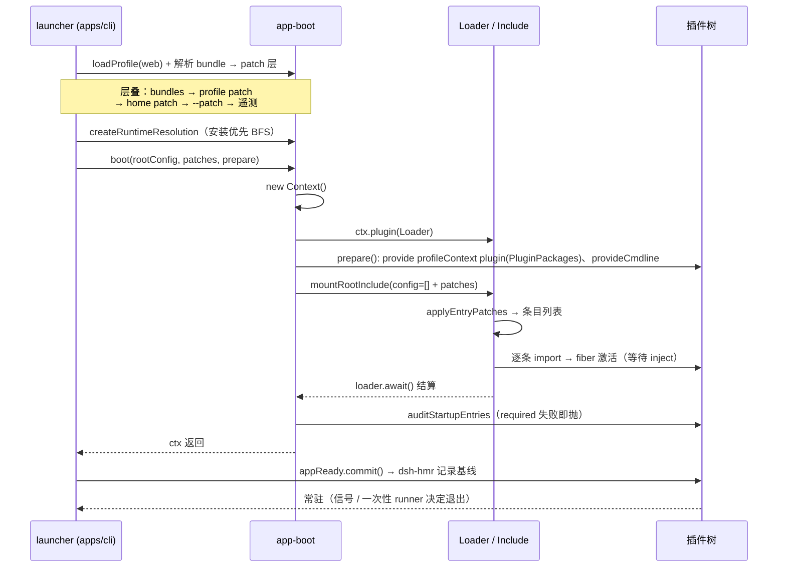

# 插件内核与组装：dsh 如何用"没有内核"的方式拼出一个应用

> 关注面所在：从 `dsh` 这条命令敲下，到插件树全部就绪之间的全部机制 —— Cordis 运行时语义、profile 层叠、启动序列、替换契约与包边界。这是"一切皆插件"这句话真正兑现的地方。

## 先看代价：一个没有特权内核的系统长什么样

dsh 的架构文档只有一句硬话："不存在需要打补丁的特权内核：扩展 dsh 的方式是把插件挂载到其他插件旁边，而各项注册都是副作用，会在其插件卸载时撤销" [docs/architecture.zh.md:11]()。
<!-- anchor-base64: 5LiN5a2Y5Zyo6ZyA6KaB5omT6KGl5LiB55qE54m55p2D5YaF5qC477ya5omp5bGVIGRzaCDnmoTmlrnlvI/mmK/miormj5Lku7bmjILovb3liLDlhbbku5bmj5Lku7bml4HovrnvvIzogIzlkITpobnms6jlhozpg73mmK/lia/kvZznlKjvvIzkvJrlnKjlhbbmj5Lku7bljbjovb3ml7bmkqTplIDjgII= -->
这句话的成本很具体，而且**立刻体现在组装层**：既然没有内核，就没有一个"主文件"可以写 `main()`。dsh 的 profile 根配置是一个字面意义上的空数组 —— 注释写着"The tree is composed as patches"，内容只有 `[]` [apps/cli/src/profile-boot.ts:80-80]()。
<!-- anchor-base64: LyoqIFRoZSBlbXB0eSByb290IGVudHJ5IGxpc3QgZXZlcnkgcHJvZmlsZSB0cmVlIHBhdGNoZXMgb3Zlci4gKi8= -->
于是"应用是什么"这件事被拆成三个问题，分别由三套机制回答：

| 问题 | 机制 | 谁回答 |
|---|---|---|
| 一个能力挂上去、撤下来，怎样才能不留痕迹？ | Cordis 的 fiber / effect | `vendor/cordis` |
| 同一个进程里两套"互不相干"的能力怎么共存？ | `isolate` realm | `vendor/loader` |
| "这个应用由哪些插件组成"怎么表达？ | profile + bundle + patch 层叠 | `packages/boot/app-boot` + `apps/cli` |

三个问题对应三种代价：**可逆副作用**换来安全的运行时替换，但要求作者对每一条注册都有交代；**空根 + 层叠 patch** 换来彻底的配置可替换，但把"最终配置是什么"变成了需要专门工具（`--dump-config`）才能回答的问题；**无内核**换来了"连主循环都能换"，代价是**替换契约没有一处被强制**，只能靠服务声明、隔离语义和 CI 脚本间接约束。

本文按这个顺序走：先内核语义（Cordis），再组装（profile/bundle/patch），再启动时序，最后是替换契约与包边界。最后回答三个设计问题：没有内核的代价账、插件如何替换主循环、层叠 patch 与 vite config merge 的本质差异。

## 内核：可逆副作用是唯一的原语

Cordis 的模型只有一句话：**插件是实现 Service 的对象，注册即是副作用，副作用挂在 fiber 上**。`Fiber` 是唯一的生命周期单元，状态机是 `PENDING → LOADING → ACTIVE → UNLOADING → DISPOSED`（失败时 `FAILED`）[vendor/cordis/src/fiber.ts:142-144]()。
<!-- anchor-base64: KiBgUEVORElOR2Ag4oCUIHdhaXRpbmcgZm9yIHJlcXVpcmVkIHNlcnZpY2VzOyBgTE9BRElOR2Ag4oCUIHRoZSBwbHVnaW4gY2FsbGJhY2s= … KiBjb25maWcgdGhyZXc7IGBVTkxPQURJTkdgIOKAlCBkaXNwb3NlcnMgYXJlIHJ1bm5pbmc7IGBESVNQT1NFRGAg4oCUIHRoZSBmaWJlcg== -->
真正值得读的是 `ctx.effect()` 的实现，因为它是"可逆"这个词的全部内容：

```ts
effect(execute: () => Effect, label = 'anonymous'): any {
  this.assertActive()
  if (this.state === FiberState.UNLOADING) {
    throw new CordisError('INACTIVE_EFFECT')
  }
  // ... 包装 disposer，先登记到 owner 列表，再执行 execute 本体
  removeWrapper = this._disposables.push(wrapper)
  try {
    task = this._execute(runner)
  } catch (reason) { /* 同步失败：回滚已收集的 cleanup */ }
```

[vendor/cordis/src/fiber.ts:418-419]() 关键在顺序：**先登记包装器，再跑 setup 本体**。这是本仓库对上游的三处改动之一（`vendor/README.md` 第 6 条），理由写得很直白——"an effect's owner-list wrapper is registered before its setup body runs, so an unload begun from inside setup awaits setup and every collected cleanup"。上游实现是反过来的：setup 先跑，跑完才登记 cleanup，结果就是"设定过程中被卸载"这一窗口里，cleanup 既没登记也不会被执行。
<!-- anchor-base64: ZWZmZWN0KGV4ZWN1dGU6ICgpID0+IEVmZmVjdCwgbGFiZWwgPSAnYW5vbnltb3VzJyk6IGFueSB7 … dGhpcy5hc3NlcnRBY3RpdmUoKQ== -->
三个细节决定了这个原语够不够用：

1. **effect 可以产出多个 disposer**（生成器 / 异步迭代器形式），它们按**注册逆序**释放；需要顺序保证的一组资源应放在同一个 effect 里，这条写进了 primer 的"实践规则"。
2. **effect 的标签参与诊断**。`ctx.on('event')`、`ctx.provide('name')`、`ctx.plugin()` 这些框架方法内部都走 `effect(..., label)`，`fiber.getEffects()` 返回带嵌套结构的 `EffectMeta` 树 [vendor/cordis/src/fiber.ts:568-574]()。这就是"一个插件到底注册了什么"这一问题的唯一准确答案来源，也是卸载顺序、泄漏排查的入口。
<!-- anchor-base64: Z2V0RWZmZWN0cygpIHs= … cHJpdmF0ZSBfZ2V0U3RhdGUoKSB7 -->
3. **卸载不会被单个回调卡死**。`_unload()` 对每个 disposer 单独 try/catch 并记日志，然后才切换状态；`internal/plugin` 注销通知也是 per-observer 隔离。

服务本身也是 effect。`ctx.provide()` 的实现就是"在一个 effect 里往 isolate store 写 impl，并返回一个删掉它的 disposer" [vendor/cordis/src/reflect.ts:277-278]()。这就是为什么 `Service` 子类可以随便写：构造函数里 `super(ctx, 'tools')` 之后什么都不用管，卸载由 fiber 负责。
<!-- anchor-base64: cHJvdmlkZShuYW1lOiBzdHJpbmcsIHZhbHVlPzogYW55LCBjaGVjaz86ICgpID0+IGJvb2xlYW4pIHs= … cmV0dXJuIHRoaXMuY3R4LmZpYmVyLmVmZmVjdCgoKSA9PiB7 -->
### `inject` / `provide` / `set` 的分工

这三者常被混为一谈，但在 Cordis 里职责完全不同：

| API | 语义 | 何时用 | 关键约束 |
|---|---|---|---|
| `ctx.provide(name, value)` | **发布**一个服务实现 | 提供方插件 | 同一 isolate 作用域内重复发布直接抛错；返回 disposer |
| `ctx.get(name)` | **读取**，不建立依赖 | 可选依赖、鉴别性探测 | 不触发等待，拿不到就是 `undefined` |
| `ctx.inject([...], cb)` | **声明依赖**，依赖就绪后才运行 `cb` | 消费方插件 | 依赖未满足时 fiber 停在 `PENDING`，不报错 |
| `ctx.set(name, v)` | **覆盖**已发布服务实例的值 | 仅提供者自用 | 未 provide 过则抛错；其它 fiber 不得改 |

`ctx.inject` 只是 `ctx.plugin({ inject, apply })` 的语法糖 [vendor/cordis/src/registry.ts:300-302]()。它的核心不是"提前检查依赖"，而是**把加载顺序从代码里挪到声明里**：`_refresh()` 把当前注入的服务实现 uid 拼成一个 epoch 字符串，epoch 一变就触发 `_reload()`/`_unload()`（`_setEpoch`）[vendor/cordis/src/fiber.ts:611-622]()。
<!-- anchor-base64: aW5qZWN0KGluamVjdDogSW5qZWN0LCBjYWxsYmFjazogUGx1Z2luLkZ1bmN0aW9uPHZvaWQ+KSB7 -->
<!-- anchor-base64: X3JlZnJlc2goKSB7 -->
同样是读取服务，`ctx.tools`（属性访问）与 `ctx.get('tools')` 差别很大：属性访问走 `internal/get` waterfall，未声明 inject 时直接抛 `cannot get property "..." without inject`；`ctx.get` 则是明确的可选读取 [vendor/cordis/src/reflect.ts:144-164]()。这条区分在 dsh 里被当作硬约定用：可选依赖必须写成 `ctx.get`，否则插件在提供方缺失时会直接失败而不是等待。
<!-- anchor-base64: Y29uc3QgZXJyb3IgPSBuZXcgRXJyb3IoYGNhbm5vdCBnZXQgcHJvcGVydHkgIiR7cHJvcH0iIHdpdGhvdXQgaW5qZWN0YCk= … aWYgKGZpYmVyLnBhcmVudFtzeW1ib2xzLmlzb2xhdGVdW3Byb3BdICE9PSBrZXkpIHRocm93IGVycm9y -->
### isolate：同进程多实例的唯一机制

`ctx.isolate(name, label)` 生成一个子上下文，其 `symbols.isolate` 映射被替换成新的 label；传同一个 `label` 的两次 isolate 会**共享**作用域 [vendor/cordis/src/context.ts:121-124]()。
<!-- anchor-base64: aXNvbGF0ZShuYW1lOiBzdHJpbmcsIGxhYmVsPzogc3ltYm9sKSB7 … cmV0dXJuIHRoaXMuZXh0ZW5kKHsgW3N5bWJvbHMuaXNvbGF0ZV06IHNoYWRvdyB9KQ== -->
在 Loader 层，这被固化成条目的 `isolate` 配置项，实现是 `realm` 对象：`isolate: { planMode: true }` 表示"这个条目自己独占一份 `planMode`"（`LocalRealm`，后缀 `#<entryId>`），而 `isolate: { compaction: 'shared-x' }` 表示"与所有 label 相同的条目共享"（`GlobalRealm`，后缀 `@shared-x`）[vendor/loader/src/config/isolate.ts:25-66]()。
<!-- anchor-base64: LyoqIFN5bWJvbCByZWFsbSB1c2VkIHRvIGlzb2xhdGUgc2VydmljZSBpbXBsZW1lbnRhdGlvbnMgYnkgZW50cnkgb3IgbGFiZWwuICov … cmV0dXJuICdAJyArIHRoaXMubGFiZWw= -->
这是 dsh 里唯一"两套同类能力共存于一进程"的原语。Web 的 agent preset 就是这么写的：每个 preset 用若干个 `cordis:group` 把「只属于一个 agent 的能力」圈起来，例如 planning 组声明 `isolate: { planMode: true }`、compaction 组声明 `isolate: { compaction: true, toolResultPruner: true }`，于是同一进程内的两个 preset 各自拥有独立的 `planMode` 与 compaction 后端 [packages/bundle/web-app/presets/cordis.patch.yml:43-50]()。
<!-- anchor-base64: bmFtZTogJ0BkZWVwc2Vlay1haS9kc2gtdG9vbC1nb2FsJw== … LSBpZDogcGxhbi1tb2Rl -->
代价也是明确的：**isolate 会把消费方一起拉进作用域**。dsh 为此专门写过一次事故复盘——`tokenMeter` 被放进 preset 的 `compaction` realm 后，它注册的 `sessionProjections` 单元是按进程共享的表，导致"某个 minimal 会话有没有上下文计量条，取决于**别的**会话是否曾挂载过 standard"。结论是把它拉回 host plane，并把判据总结成一句话：注册进进程级表的单元，空值与真值不可区分的，就不能按 composition 隔离 [.agents/notes/implemented/architecture/2026-08-10-host-plane-ownership-after-presets.md:13-13]()。
<!-- anchor-base64: YGRzaC10b2tlbi1tZXRlcmAgd2FzIGRpc2FibGVkIG9uIHRoZSBob3N0IGFuZCBtb3VudGVkIGluc2lkZSBlYWNoIHByZXNldCdzIGBjb20= -->
这条规则值得记住：**isolate 的作用域是服务表，不是数据表**。凡是"注册到进程级共享表"的东西，isolate 救不了它，只会让它更难排查。

## 组装：profile / bundle / patch 三层

### 三个角色

| 角色 | 是什么 | 声明在哪 | 例子 |
|---|---|---|---|
| **bundle**（组合包） | 一份 Cordis patch 文件（或有序文件列表） | 包 `package.json` 的 `dsh.bundle.patch` | `@deepseek-ai/dsh-base` |
| **profile** | 一个目录 `$DSH_HOME/profiles/<name>`：bundle 列表 + 依赖 + 自己的 patch | `package.json` 的 `dsh.profile.bundles` | `web`、`headless`、`sdk`、`sdk-minimal`、`acp` |
| **patch** | 按 `id` 定位某一行配置，替换它或插入新行 | YAML 数组 | 用户 `cordis.patch.yml`、`--patch` overlay |

三种声明在同一个 `package.json` 里各占一个键，所以一个包能说清自己扮演哪种角色；bundle 解析的双锚点是"安装目录优先，然后 profile 目录"，保证内置 bundle 永远来自与运行中 `dsh` 相同的安装 [packages/boot/app-boot/src/profile.ts:703-714]()。
<!-- anchor-base64: KiBSZXNvbHZlIG9uZSBidW5kbGUgcGFja2FnZSdzIGRpcmVjdG9yeTogaW5zdGFsbGF0aW9uIGFuY2hvciBmaXJzdCwgdGhlbiB0aGU= … ZXhwb3J0IGZ1bmN0aW9uIHJlc29sdmVCdW5kbGVEaXIo -->
层叠顺序固定且单一，源码只有四个展开点 [packages/boot/app-boot/src/profile-context.ts:74-85]()：
<!-- anchor-base64: ZXhwb3J0IGZ1bmN0aW9uIHJlYWRQcm9maWxlUGF0Y2hlcyhiaW5OYW1lOiBzdHJpbmcsIGNvbnRleHQ6IFByb2ZpbGVDb250ZXh0LCBpbmk= … fQ== -->
```
bundle 层（按 dsh.profile.bundles 顺序）
→ profile 自己的 cordis.patch.yml
→ $DSH_HOME/cordis.patch.yml（home 级，机器本地偏好）
→ --patch overlay（argv 顺序）
→ 遥测开关生成的补丁（最后追加）
```

模板列表也是数据，不是代码分支 [packages/boot/app-boot/src/profile.ts:178-193]()。
<!-- anchor-base64: LyoqIFRoZSBzaGlwcGVkIHByb2ZpbGUgdGVtcGxhdGVzIGF1dG8taW5pdGlhbGl6ZWQgb24gZmlyc3QgdXNlLCBieSBuYW1lLiAqLw== … YnVuZGxlczogWydAZGVlcHNlZWstYWkvZHNoLXNkay1taW5pbWFsJ10s -->
### patch 的语义：整行替换，不做深合并

这是整套机制里**最容易踩坑、也最被刻意保留**的一条。`applyEntryPatches` 的核心只有几行：

```ts
for (const [key, value] of Object.entries(overrides)) {
  if (key === 'id') continue
  target[key] = value
}
```

[vendor/include/src/index.ts:120-122]() 也就是说，patch 是"按 id 找到整行，然后把给定的键**整体赋过去**"。写 `config: { a: 1 }` 会覆盖掉目标行原来的整个 `config`，而不是合并。app-boot 的已知限制里把它写成一条独立条目："用户 patch 会替换匹配到的整个配置——按 id 定位的 patch 不做深度合并，因此 profile 覆盖必须重述需要保留的组合包字段" [packages/boot/app-boot/README.md:196-198]()。
<!-- anchor-base64: Zm9yIChjb25zdCBba2V5LCB2YWx1ZV0gb2YgT2JqZWN0LmVudHJpZXMob3ZlcnJpZGVzKSkgew== -->
<!-- anchor-base64: VGhlc2UgbGltaXRzIGRlc2NyaWJlIHdoZW4gdGhpcyBib290IGxpYnJhcnkgaXMgYSBwb29yIGZpdCBvciBuZWVkcyBzcGVjaWFsIGNhcg== -->
为什么不做深合并？因为深合并需要回答"数组是拼接还是替换""`null` 是删除还是置空""被合并进来的键来自哪一层"——每个答案都会让"最终这一行是什么"依赖读者的推理能力，而不是读文件。dsh 的选择是：**读者打开文件就能看到整行**，代价是写 patch 的人必须重述。

这条代价被工程化地压小了：`--dump-config` 会把每一层的效果做成快照并标注来源。实现方式是"对前 k 层各跑一次 `applyEntryPatches`，比较前后 JSON，标出每行被哪一层改过"，最后按连续来源分组输出注释 [packages/boot/app-boot/src/index.ts:689-697]()。也就是说，用户不需要自己心算重述，而是让工具告诉他是哪一层动了他想改的行。
<!-- anchor-base64: Y29uc3QgYmVmb3JlID0gcHJldmlvdXMubWFwKGVudHJ5ID0+IEpTT04uc3RyaW5naWZ5KGVudHJ5KSk= … cmV0dXJuIGdyb3VwZWREdW1wKGNvbXBvc2VkLCBlbnRyeU9yaWdpbnMp -->
另外一条容易被忽略的细节：patch 里 `insert` 进来的行会**立刻进入 id 索引**，所以同一份层叠里，后面的层可以 patch 前面层插入的行。这是本仓库相对上游 include 的修改（`vendor/README.md` 第 11 条）——上游只在循环前建一次索引，导致"bundle 插入的行在用户层不可寻址"，而这恰恰是 dsh 空根 + 多层叠组合的必需能力。

（该注释位于 `applyEntryPatches` 的 `insert` 分支内、紧接 `buildMap(insert)` 之前。）
<!-- anchor-base64: ICAgIC8vIEluZGV4IHdoYXQgdGhpcyBwYXRjaCBhZGRlZCBzbyBhIExBVEVSIHBhdGNoIGluIHRoZSBzYW1lIGxpc3QgY2Fu … ICAgIC8vIHRoaXMsIGluc2VydGVkIHJvd3Mgd2VyZSBzaWxlbnRseSB1bnBhdGNoYWJsZS4= -->

### 为什么"层叠 patch"能取代"配置分叉"

旧的 dsh 是"每个入口模式一套层栈"：`base.cordis.yml` + `web.cordis.yml` 随 `apps/cli` 交付，三个模式（`--config`、`web`、`-p`）各带一套，外加一个全局个人 overlay。想把一个树外插件装进已交付的表层，只能改仓库。改成 profile 之后，"多一个部署形态"变成了"多一个 npm 包 + 一行 bundle 名" [.agents/notes/implemented/architecture/2026-08-05-profile-plugin-bundles.md:5-31]()。
<!-- anchor-base64: RW5nbGlzaCB8IFvkuK3mloddKDIwMjYtMDgtMDUtcHJvZmlsZS1wbHVnaW4tYnVuZGxlcy56aC5tZCk= … LSBOZXcgY29tcG9zaXRpb24gc3VyZmFjZXMgKGEgVFVJLCBwcm92aWRlciBwYWNrcykgc2hpcCBhcyBvcmRpbmFyeSBucG0gcGFja2FnZXM= -->
真正取代"配置分叉"的不是"层数少"，而是**每一层都有一个人格化的所有者，且唯一**：

| 层 | 所有者 | 变化频率 | 谁不能改它 |
|---|---|---|---|
| `dsh-base` | 发行版 | 随版本 | 部署者（只能在其上 patch） |
| 模式 bundle | 发行版 | 随版本 | 部署者 |
| profile patch | 用户/部署 | 经常（会被插件管理器写） | 发行版 |
| home patch | 用户 | 偶尔 | 发行版 |
| `--patch` | 调用方 | 每次调用 | 所有人 |

"配置分叉"的病根是同一份语义散落在多处、且没有优先级的唯一裁决者；层叠 patch 的做法是**让优先级本身成为配置的一部分**（一个有序列表），并在文件层面强迫"覆盖=重述整行"，从而使每一层的差异可被人肉 diff。

### sdk-minimal：刻意的例外

`sdk-minimal` 只在自己的 `dsh.profile.bundles` 里列一个 bundle，且该 bundle 的 patch 是**一份完整的树**，开头就写明"Unlike the ordinary SDK profile, this bundle does not layer over dsh-base: this insert is the complete Cordis tree" [packages/bundle/sdk-minimal/cordis.patch.yml:1-2]()。
<!-- anchor-base64: IyBTdGFuZGFsb25lIG1pbmltYWwgU0RLIGFwcGxpY2F0aW9uLiBVbmxpa2UgdGhlIG9yZGluYXJ5IFNESyBwcm9maWxlLCB0aGlz … IyBidW5kbGUgZG9lcyBub3QgbGF5ZXIgb3ZlciBkc2gtYmFzZTogdGhpcyBpbnNlcnQgaXMgdGhlIGNvbXBsZXRlIENvcmRpcyB0cmVlLg== -->
为什么值得破例？因为 base 的职责是"完整产品基座"：它带着完整的文件工具集、skills、jobs、managed credentials、telemetry、Web 相关行。对 sdk-minimal 的目标用户（Python SDK 里跑一个能改文件、能跑持久 shell 的最小 coding agent），base 里的东西**大部分要再被逐行关掉**，而关掉的方式又是"整行替换"——那就等于在 base 之上重写一遍 base。与其写 20 行 `disabled: true` 声明"我不要 base 的什么"，不如写 35 行声明"我要什么"。README 把边界写得很清楚：它"supplies a complete Cordis tree and excludes `dsh-base`, Web, settings, managed credentials, telemetry, text file tools, workspace instructions, skills, jobs, and subagents"。

这个例外的**代价**是：sdk-minimal 拿不到 base 的任何后续演进（新增的公共行、bug fix 行），每一行都得自己跟。它同时也是对"层叠 patch"模型的一次反向验证：**当子集的补集大于子集本身时，从零构建比裁剪更便宜**。这和"继承 vs 组合"的经典结论一致，但 dsh 在这里给出了可量化的判据——行数比。

### HMR：只管配置层，不管模块语义

`dsh-hmr` 的边界非常清楚：它监视 profile manifest 与两份用户 patch 文件，重新读取有序 bundle 层，然后走一次完整的重组合（recompose）。它**不决定优先级**——app-boot 拥有 profile 解析与 patch 优先级，HMR 只读 launcher 给它的 `profileContext` 数据 [packages/boot/hmr/README.md:61-61]()。
<!-- anchor-base64: QXBwLWJvb3Qgb3ducyBwcm9maWxlIHBhcnNpbmcgYW5kIHBhdGNoIHByZWNlZGVuY2UuIEhNUiByZWFkcyB0aGUgbGF1bmNoZXLigJlzIGRhdA== -->
这条边界的收益是：**HMR 不需要知道任何插件的语义**。它做的事是——算新一代组合、发布新的 runtime resolution、停掉受影响的条目、让 Loader 用当前文件重新导入、再判一次激活。所有"配置变更"最终都落到同一条 Loader entry update 路径上，与启动时完全同构。

一个反直觉的实现选择：HMR 只监视 `patchFiles`（profile patch、home patch）和 manifest，**不监视每个 bundle 的 patch 文件**；manifest 通知也只在其有序 bundle 列表变化时才重载。理由是配置层的"真源"被收敛到这两三个文件 + 一个列表，bundle 文件的改动属于包升级，走另一条路（文件比较 + 模块替换）。

HMR 不自己 import 任何替换代码；它只负责 evict 模块缓存、停条目，真正的导入由 Loader 在"启动这一代条目"时完成，所以**被禁用/被移除/不兼容的行永远不会被执行** [packages/boot/hmr/README.md:61-61]()。这条设计让 HMR 的代码执行范围与一次启动完全一致：它不能执行任何"启动时不会执行"的东西。
<!-- anchor-base64: QXBwLWJvb3Qgb3ducyBwcm9maWxlIHBhcnNpbmcgYW5kIHBhdGNoIHByZWNlZGVuY2UuIEhNUiByZWFkcyB0aGUgbGF1bmNoZXLigJlzIGRhdA== -->

## 启动序列

下图是 `dsh --profile web` 从进程启动到就绪的完整链路。三条泳道分别是 launcher、app-boot 与 Cordis Loader：



几个节点值得单独说。

**runtime resolution 先于任何插件挂载**。launcher 在挂载 profile 条目前，按"安装优先 + 有序 bundle 逐根 BFS"算出一份不可变的 runtime resolution，并把它装进 Node 的 ESM 与 CommonJS 解析器（不创建 fallback 链接）。这样做的直接结果是：**同一个包名在整个进程内只有一个解析结果**，`ctx.plugin` 里再 import 什么都不会跑到另一份拷贝上。代价是它依赖 Node 内部解析器，属于"受支持的 Node 版本需要 native builtin access addon"这一条已知限制。

**`prepare` 阶段提供了三样东西，且都早于任何配置树条目**：`profileContext`（纯数据的 profile 事实）、`PluginPackages`（runtime resolution 的查询服务）、`cmdlineArgs`/`appExit`/`appReady`（调用期事实）[apps/cli/src/profile-boot.ts:323-337]()。这是一条明确的所有权线：**launcher 只拥有"进程事实"，配置树只拥有"插件"。** 应用 flag 不是 launcher 的业务，它通过 `ctx.cmdlineArgs` 交给树里任何一个注入方读取。
<!-- anchor-base64: Y29uc3QgY3R4ID0gYXdhaXQgYm9vdChOQU1FLCByb290Q29uZmlnLCByZWFkUHJvZmlsZVBhdGNoZXMoTkFNRSwgcHJvZmlsZUNvbnRleHQ= … cmVhZHk6IGFwcFJlYWR5LnNlcnZpY2Us -->
**就绪（readiness）是显式提交的**，不是"boot 返回了就算好了"。`runProfile` 在 `boot()` 返回后检查三件事——信号未触发、根 fiber 仍是 `ACTIVE`、`loader` 还在——全部满足才 `appReady.commit()`。HMR 则在 `onReady` 回调里记录模块基线文件时间戳。这个分离解决了一个真实问题：启动窗口内插入的提供方可能先发布、兄弟行还没挂完，此时"可热更"的判断不可靠。

**失败语义是两段式的**。`boot()` 用 `stage` 变量区分 `host preparation failed`（`prepare` 在配置树条目挂载前抛错）与 `plugin tree failed to load`，并沿 `cause` 链找到最深层的插件错误再抛 [packages/boot/app-boot/src/index.ts:1220-1231]()。更重要的是 `auditStartupEntries` 之后的裁决口径：**optional 条目失败只警告，required 条目失败则整个应用拆卸退出**；required 列表是硬编码的 8 个 id：`agent-loop`、`webserver`、`web-runtime`、`modules`、`connection`、`headless-runner`、`acp`、`sdk-jsonrpc-server` [packages/boot/app-boot/src/index.ts:1220-1231]()。
<!-- anchor-base64: bGV0IHN0YWdlID0gJ2hvc3QgcHJlcGFyYXRpb24gZmFpbGVkJw== … c3RhZ2UgPSAncGx1Z2luIHRyZWUgZmFpbGVkIHRvIGxvYWQn -->
这里的取舍很有意思：一个"一切皆插件"的系统，理论上没有"必需插件"这个概念。但一个**可用的产品**确实有——Web 没有 `connection` 就是一张空页面，headless 没有 `headless-runner` 就是什么都不做地挂在那里。dsh 的解法是把"必需"做成**审计策略而不是加载机制**：加载阶段对所有条目一视同仁（失败即警告、兄弟存活），结算后再用一个策略表裁决整棵树该不该活。这个分层让"宽松加载 + 严格验收"可以各自演化——HMR 后续重载时不会重跑 required 审计，也不会回滚整次更新，因为运行期的策略是"保留成功的兄弟"。

**required 的判定是 id 字符串匹配**，这是一处真实的耦合：任何重命名 row id 的改动都会静默失效这条保护。它被多份 e2e 测试（web 失败矩阵、best-effort 启动验收）守着，但本质上属于"约定的字符串"，不是类型安全的约束。

## 替换契约：谁在约束"替换主循环"

### 三个具体例子

**1. 主循环换掉，UI 不动。** `agent-loop` 是 `ctx.agentLoop` 的提供方，但它实现的是一个**注册**动作，而不是被直接调用：构造函数里 `ctx.effect(() => ctx.agents.setFactory(this))` [packages/core/agent-loop/src/index.ts:388-388]()。消费方（Web、headless、ACP、SDK）只认 `ctx.agents.create()` / `resume()`；`AgentRegistry.setFactory` 明确拒绝第二个工厂："an agent factory is already registered" [packages/core/agent/src/index.ts:360-368]()。
<!-- anchor-base64: Y3R4LmVmZmVjdCgoKSA9PiBjdHguYWdlbnRzLnNldEZhY3RvcnkodGhpcyksICdhZ2VudExvb3Auc2V0RmFjdG9yeSgpJyk= -->
<!-- anchor-base64: c2V0RmFjdG9yeShmYWN0b3J5OiBBZ2VudEZhY3RvcnkpOiAoKSA9PiB2b2lkIHs= -->
约束这个替换的契约有三层，而且**都不在运行时**：

- **接口层**：`AgentFactory` 定义在 `dsh-agent` 里而不是 `dsh-agent-loop` 里，注释写明"所以消费方（例如 ACP bridge）只需针对 `ctx.agents` 编程，不依赖具体的 `dsh-agent-loop` 包" [packages/core/agent/src/index.ts:167-190]()。
<!-- anchor-base64: KiB2aWEge0BsaW5rIEFnZW50UmVnaXN0cnkuc2V0RmFjdG9yeX0uIEtlcHQgb24gdGhlIGBkc2gtYWdlbnRgIGludGVyZmFjZSBzbw== … Y3JlYXRlQWdlbnQob3duZXJDdHg6IENvbnRleHQsIG9wdGlvbnM6IENyZWF0ZUFnZW50T3B0aW9ucyk6IFByb21pc2U8QWdlbnRIYW5kbGU= -->
- **注册层**：单一工厂槽位 + effect 提供可逆注册，保证卸载后槽位干净、不会有两套主循环并行接管。
- **包层**：`packages/README.md` 的依赖约定直接写成"Extension plugins depend on Service Definitions, never concrete providers. `dsh-agent-loop` is swappable"。

**2. 压缩后端按会话替换。** Web 的 preset 用 `isolate: { compaction: true }` 让每个 preset 拥有独立的 `compaction`，于是同一进程内 `minimal` 与 `standard` 会话用不同的压缩策略（见上文 preset patch）。这里约束替换的是**隔离语义**：换一个 provider 只是换一个 symbol 下的 impl，消费方 `ctx.compaction` 解析到本 realm 的那份。

**3. 模型、工具、fs 全线替换。** `ctx.llm`、`ctx.tools`、`ctx.fs` 都是"Service Definition + Provider + Consumer"三要素的 seam。seam 的正式定义在架构文档里 [docs/architecture.zh.md:136]()：一个 seam 是一项可替换能力，包含声明接口的 Service Definition、实现它的 Service Provider、使用它的 Consumer（通常是面向模型的工具）；"一个包可以合并承担多个角色，但单一角色本身不是 seam；添加一项能力意味着把三者一并设计"。
<!-- anchor-base64: 5LiA5LiqICoqc2VhbSoqIOaYr+S4gOmhueWPr+abv+aNouiDveWKm++8jOWMheWQq+S4ieenjeinkuiJsu+8muWjsOaYjuaOpeWPo+eahCAqKlNlcnZpY2UgRGVmaW5pdGlvbioq44CB5a6e546w5a6D55qEICoqU2VydmljZSBQcm92aWRlcg== -->
`docs/capability-seams.zh.md` 是把这张表机械化的产物：每一行给出 `ctx` 键、角色（`core` / `seam` / `service`）、所属包、实现、直接消费方、配套插件。它的生成方式是扫源码里的 `declare module '@deepseek-ai/cordis'` 服务声明与 `ctx.<key>` 读取，所以**新增一个 seam 而不去消费它，会立刻在图上表现为"只有 Definition 没有 Consumer"**。这是 dsh 在"没有类型级强制"的前提下，用生成式文档做契约检查的一个典型手法。

### 同执行世界级联迁移

架构文档用一句话概括了 seam 模型最有价值的推论：文件系统与进程提供方共享同一个执行世界，因此把它们指向远程沙箱，也就把 Bash、PTY 和 LSP 一并搬了过去，无需提供方专用 fork [docs/architecture.zh.md:138]()。
<!-- anchor-base64: c2VhbSDmraPmmK/mm7/mjaLkuIDkuKrmj5DkvpvmlrnlsLHog73mlLnlj5jmlbTkuKrkuqflk4HnmoTljp/lm6DjgILmlofku7bns7vnu5/kuI7ov5vnqIvmj5DkvpvmlrnlhbHkuqvlkIzkuIDkuKrmiafooYzkuJbnlYzvvIzlm6DmraTmiorlroPku6zmjIflkJHov5znqIvmspnnrrHvvIzkuZ/lsLHmioogQmFzaOOAgVBUWSDlkowgTFNQIOS4gOW5tuaQrA== -->
这个推论的实力要看它能不能被反向验证。dsh 的 `packages/ssh/*` 就是一个反证点：如果级联是自动的，那么 ssh 只需要换 `fs`、`subprocess`、`sandbox` 三个 provider。实际做法确实是这三个配对提供方——`fs-ssh`、`subprocess-ssh`、`sandbox-ssh`——**成组**出现在可选 bundle 里，而不是散落成一个"ssh 模式的 fork"。换句话说，级联迁移的"自动"部分来自**消费方只依赖 seam**，而"必须成组替换"这部分来自**三个 seam 共享同一个执行世界**这一事实被显式编码进了包组织（同一 group，同一可选项）。

代价也必须说清：级联是**隐式的**。换掉 `ctx.fs` 的提供方，`tool-bash`、`lsp`、`terminal` 的行为会一起变，而它们没有任何一行代码被改动——这既是它优雅的地方，也是它危险的地方。所以 dsh 对这种"远程执行世界"给了明确的准入要求：它是 optional bundle，需要显式选择与显式配置。

### 契约靠什么兜底：四个层次

把上面三个例子抽象一下，dsh 对"替换"的约束分布在四个层次，越往下越强：

| 层次 | 机制 | 强制力 | 失效模式 |
|---|---|---|---|
| 类型 | `declare module` 服务声明、`AgentFactory` 等接口 | 编译期，仅限同一 workspace | 树外插件不受约束 |
| 注册 | 单槽位 + `ctx.effect` 可逆、`ctx.inject` 依赖等待 | 运行时，立即抛错 | 语义错误（实现了接口但语义不对）无法捕获 |
| 组合 | `isolate` realm、required id 审计 | 运行时 | realm 泄漏到进程级表（见 tokenMeter 事故） |
| 包 | `packages/README.md` 约定 + CI 脚本 | 提交期 | 需要脚本覆盖到 |

一条额外的、不那么显眼但很实用的约束是属性访问与 `ctx.get` 的分工：属性访问意味着"我声明依赖了"，`ctx.get` 意味着"我允许它不在"。可选依赖必须写成后者，否则提供方缺失时插件会直接失败而不是等待。这把"可选 vs 必需"从文档约定变成了**代码里一个不可省略的选择**。

## 让插件树可观测：三种视图

一个 343 个包的 workspace，如果没有观测手段，调试成本会直接杀死这个架构。dsh 提供了三种不同粒度的视图：

| 视图 | 命令/服务 | 回答的问题 | 是否执行 `!!js` |
|---|---|---|---|
| 组合视图 | `dsh --profile web --dump-config` | 这一行是谁插的、被哪层改过 | 否 |
| 运行视图 | `ctx.pluginManager.listPlugins()` | 这一行现在是 `ACTIVE` / `PENDING` / `FAILED`，为什么不可操作 | 是（树已启动） |
| 类型视图 | `--dump-config-schema` | 这一行接受什么字段 | 是（会 import 每个模块读 schema） |

`--dump-config` 走的是 `renderConfigDump`，它与 boot 共享同一个 `applyEntryPatches`，这正是"dump 出来的就是会挂载的"这一保证的实现方式——`composeEntries` 的注释直说："the same single `applyEntryPatches` call the boot include makes, so flag derivation and config dumps see exactly what mounts" [packages/boot/app-boot/src/profile.ts:809-819]()。这一点不是额外的细心，而是对上一次真 bug（两个地方各自实现 patch 算法导致漂移）的制度性修复：`vendor/README.md` 第 11 条把 `applyPatches` 提取成导出的纯函数，理由原文是"config tooling must never reimplement (and drift from) the patch algorithm"。
<!-- anchor-base64: KiBDb21wb3NlIHBhdGNoIGxheWVycyBpbnRvIHRoZSBlZmZlY3RpdmUgZW50cnkgbGlzdCBvdmVyIGFuIGVtcHR5IHJvb3Qg4oCU … cmV0dXJuIGFwcGx5RW50cnlQYXRjaGVzKFtdLCBzdHJ1Y3R1cmVkQ2xvbmUobGF5ZXJzLmZsYXQoKSksIChtZXNzYWdlOiBzdHJpbmcsIC4= -->
`plugin-manager` 的运行视图有几个设计细节值得学：

- `PluginInfo` 是**联合类型**：要么有 `patchId`（可通过 profile patch 修改），要么有 `readOnlyReason`（`management-required` / `unaddressable`）[packages/boot/plugin-manager/src/types.ts:37-37]()。用类型而不是布尔标志表达"为什么不可改"，强迫调用方在编译期就想清楚这一行到底能不能动。
<!-- anchor-base64: LyoqIE9uZSBydW5uaW5nLXByb2ZpbGUgZW50cnkgYW5kIGl0cyBwZXJzaXN0ZW50IGNvbnRyb2wgYXZhaWxhYmlsaXR5LiAqLw== -->
- `ChangeResult` 把**持久结果与运行结果分开**：`changed` 表示磁盘改了没有，`application` 表示 `applied` / `restart-required` / `overridden` / `failed` / `cancelled` [packages/boot/plugin-manager/src/types.ts:131-137]()。没有 HMR 的 profile 里，"写成功但没生效"必须被如实报告，否则用户会以为插件坏了。
<!-- anchor-base64: ZXhwb3J0IGludGVyZmFjZSBDaGFuZ2VSZXN1bHQgew== … LyoqIExhc3QgYXR0ZW1wdGVkIHN0ZXA7IHN1Y2Nlc3NmdWwgaW5zdGFsbGF0aW9uIGNhbiBwcm9jZWVkIHRvIGVuYWJsZW1lbnQuICov -->
- 开关只写**差异**：toggle 只改 profile patch 里最后一个匹配 override 的 `disabled`，或者追加一个 override；如果 bundle 层与剩余 profile patch 已经给出目标状态，这个 override 会被删掉而不是写进去——"the profile patch records only departures from the bundles" [packages/boot/plugin-manager/README.md:40-40]()。
<!-- anchor-base64: QSBwbHVnaW4gdG9nZ2xlIHVwZGF0ZXMgb25seSBgZGlzYWJsZWRgIGluIHRoZSBsYXN0IG1hdGNoaW5nIG92ZXJyaWRl -->

### 入口收口：`verify-application-entrypoints`

"没有特权内核"有一个必须堵的漏洞：既然插件树可以任意组装，那任何人都可以写一个新 `bin.js` 直接 mount 半个树，绕过 profile 机制——这就是一次隐性的配置分叉。

`scripts/verify-application-entrypoints.ts` 用三张白名单把它堵上了：`package.json` 的 `bin` 只允许 `apps/cli`（公开产品启动器）与 webworker-packer（构建工具）；带 shebang 的源文件必须逐个归类（产品 / 构建 / 测试）；根 `package.json` 的每个 `demo:*` 脚本必须显式声明是走 `dsh` 还是 in-process，而 `start:web` / `dev:web` 按名字钉死必须引用 `apps/cli/src/bin.ts` 且不得直接启动包入口 [scripts/verify-application-entrypoints.ts:26-60]()。
<!-- anchor-base64: LyoqIFB1YmxpYyBwcm9kdWN0IGxhdW5jaGVyIHBsdXMgdGhlIGJ1aWxkLW9ubHkgV2ViV29ya2VyIHBhY2tlci4gKi8= … WydkZXY6d2ViJywgeyBraW5kOiAnZHNoLXdyYXBwZXInLCB3cmFwcGVyOiAnc2NyaXB0cy9kZXYtd2ViLnRzJyB9XSw= -->
这个脚本的价值不在"多了一个检查"，而在于它是一个**编译器无法表达的架构约束的落点**。"所有 Node 应用入口必须经过 dsh profile"这条规则，语法上是"必须/禁止"，工程上只能靠"逐个归类 + 新增即失败"来维持。它同时也是反例教学：如果项目里没有这条门禁，一年后会自然长出三个 `bin`，然后三个人各自维护三套层栈——这正是 2026-08-05 那份决策笔记里描述的旧世界。

## 包边界：343 个包靠什么不烂

### 组织约定

`packages/` 下每个包**恰好属于一个 family**，family 就是它的第一层目录名；family 有自己的 `README.md` 作为该族的权威包图，新增包必须并进已有 family 并在族 README 里登记 [packages/README.zh.md:12]()。这条规则看起来只是文档纪律，实际是**依赖方向的事实约束**：family 的名字直接对应能力域（`llm/`、`fs/`、`shell/`、`sandbox/`……），跨域边一眼可见。
<!-- anchor-base64: aGFybmVzcyDnlLEgYHBhY2thZ2VzL2Ag5LiL55qEIG5wbSDljIXnu4Too4XogIzmiJDvvIzmjInog73lipvns7vliJfliIbnu4Q= -->
一个反复出现的内部结构是**"Definition / Provider / Consumer 三包"**：`subprocess/` 是 "Service Definition + local process-tree provider"；`shell/` 是 "Bash capability family: executor seam, local impl, model-facing tools"；`ptc-runtime/` 是 "PTC execution capability family: Service Definition + sandboxed Node provider + PTC mode Consumer"。族 README 的这一句话本身就是 seam 图纸。

### 依赖方向的机械校验

依赖不是靠 review 守的，是靠生成 + 新鲜度门禁：

- `docs/module-graph.md` 由 `scripts/gen-module-graph.ts` 生成，**只画 peer 依赖**。为什么只画 peer？因为 peer 才是"要求共享实例"的语义——同一进程里两份 `ctx` 服务实例是灾难，两份纯工具函数副本只是浪费。这张图就是"哪些包之间**必须**共享一个实例"的地图。
- `scripts/verify-package-dependencies.ts` 从源码真实 import 反推每个包的 `dependencies`/`devDependencies`，修复并校验；它还维护了几张例外表（`package-dependency-policy.ts`），其中最严格的一张是 `SAFE_HOST_DEPENDENCY_EXPORTS`——"runtime exports whose values remain valid when npm installs another package copy"，注释里写着"New entries are forbidden by default. Automated agents must not add an exception; every addition requires explicit human review"。

这两件事合起来在回答一个对插件系统至关重要的问题：**哪些值必须以单实例形式跨包共享？**在 Cordis 里答案是"服务"——它们是 symbol 键下的 impl，天然单例；而在 symbol 之外流动的东西（品牌字符串、时间常量、Deque 类）一旦被复制就出问题。dsh 把这个边界显式列成白名单，等于承认"服务机制管不到一切"。

### 私有/公开与版本同步

- **实验包**用命名空间区分，而不是靠 `private: true`：`@deepseek-ai/dsh-experimental-*` 或保留旧名（`EXPERIMENTAL_PACKAGE_NAME_EXCEPTIONS`）。`isExperimentalPackageName()` / `hasExperimentalPackageReference()` 被 `check-workspace-constraints.ts` 用来阻止非实验包引用实验包。但 `PRIVATE_EXPERIMENTAL_PACKAGE_DIRECTORIES` 目前是**空数组**——即实验包默认也公开发布。这解释了一个容易误读的现象：实验状态（experimental status）与发布状态、安装状态是**三件独立的事**，README 里专门写了"Experimental status is independent of publication, installation, and optional delivery"。
- **非默认角色**（可选集成、SDK、构建、测试、web 分发、纯声明）必须在 `product-package-policy.ts` 里逐条登记 `reason`。这个表本质上就是"为什么它不在默认运行时里"的公开账本，`verify-product-use.ts` 用它做校验。
- **版本同步**：`scripts/release/families.ts` 把发布切成三个家族（`packages/`+`apps/`、`vendor/`、`native/`），每族有自己的版本基线与 tag；`scripts/release/bump.ts` 里 dsh 家族是 lockstep（所有可发布成员 + 私有包 manifest + workspace 根共用一个版本），vendored 家族每个包一条版本线但每次发布都推全族 [scripts/release/bump.ts:15-15]()。lockstep 的代价是"改一个包也升全家族"，收益是 peer 范围可以写成 `workspace:*`、且"运行时版本"这个概念在全仓只有一个值——`app-boot` 的兼容性预检正是拿这一个值去比每个插件的 `engines.dsh`。
<!-- anchor-base64: KiB0aGUgdGFnIGFmdGVyIHRoZSBjb21taXQgbWVyZ2VzLiBDSSBuZXZlciB3cml0ZXMgdG8gdGhlIHJlcG9zaXRvcnku -->

### 插件兼容性：把"版本不匹配"做成可运营的

`docs/subsystems/boot.zh.md` 里有一大段关于 `PluginInfo` / `BundleInfo` / `ChangeResult` 的字段说明，容易被当成 API 文档跳过，但其中一条是实现级的：插件声明的 DSH 版本要求与 `getDshRuntimeVersion()` 比较，声明了 `engines.dsh` 就只看它（忽略 peerDependencies），否则逐个校验 `@deepseek-ai/dsh*` peer 范围；**被拒绝的插件行会变成游离的 `disabled: true` 行**，被拒绝的 bundle 整体跳过并列入 `skippedBundles`。

这个设计的精妙处在于"拒绝发生在 import 之前"：`prepareProfilePatches` 在挂载根 Include 时以及每次重组合时执行，所以被拒绝的插件**永远不会导入其模块**。而豁免权被放进 profile 自己的 `compatibility.json`（精确 `包名@版本` → 精确运行时版本列表），而不是 `package.json`——写豁免不触及依赖清单、bundle 列表或 patch 文件。三份真源各自负责一件事：`package.json` 说"装了什么"，`cordis.patch.yml` 说"怎么组合"，`compatibility.json` 说"我知道它版本不对但我接受"。

## 三个设计问题的答案

### 没有特权内核，代价是什么？用什么机制付账？

代价有四笔，dsh 各有对应机制：

| 代价 | 具体表现 | 机制 |
|---|---|---|
| 配置爆炸 | 5 个随附 profile × 多层 patch；base 约 96 条插入行、web-app 约 91 条插入行 + 26 条按 id 覆盖行 | 双键 manifest（`dsh.profile`/`dsh.bundle`）+ 模板表数据化 + `--dump-config` 分层快照 |
| 启动时间 | 每行一次 import + fiber 激活；resolution 要先 BFS 全图 | 依赖驱动激活（无手写顺序）+ runtime resolution 一次算定 + 条目并行 `Promise.all` |
| 调试难度 | "这一行为什么没生效"有五种可能（没插、被 patch 覆盖、disabled 表达式为真、注入未满足、import 失败） | 三视图（dump / listPlugins / effect 树）+ `inactiveEntries` 把 PENDING 与 FAILED 分开报告并列出缺失服务 |
| 契约不强制 | 任何服务都能被第二个 provide 顶掉，语义对不对没人管 | 单槽位抛错 + seam 三要素文档生成 + 依赖策略脚本 + 入口白名单 |

值得单独强调的是"调试难度"这一笔的真实成本：`inactiveEntries` 对 `PENDING` 状态的处理是**把缺失的服务名逐个列出来**（`missing: Object.keys(fiber.inject).filter(...)`），而不是笼统报"未激活" [packages/boot/app-boot/src/index.ts:1072-1076]()。这个细节决定了"一个插件等着谁"这个问题有没有答案——在没有内核的系统里，这是最高频的调试问题。
<!-- anchor-base64: aWYgKHN0YXRlID09PSBGSUJFUl9QRU5ESU5HKSB7 … b3V0Y29tZTogeyBraW5kOiAncGVuZGluZycsIG1pc3NpbmcgfSw= -->
我的判断：**代价被付清了，但账期很长**。付账的核心机制不是任何一个脚本，而是"空根 + 单一 patch 算法 + 单一层叠顺序"这三件事的组合——它们把一个"组合爆炸"问题压缩成了"读三个文件"问题。反过来，代价的残余部分集中在两处：一是 row id 字符串耦合（required 审计、patch 寻址都靠它），二是跨包 peer 语义的正确性完全依赖 `SAFE_HOST_DEPENDENCY_EXPORTS` 这类手维护白名单。

### 一个插件如何"替换主循环"而系统仍然成立？

拆开看，一个"主循环"在 dsh 里其实由**四个可分离的位置**组成，替换可以发生在任意一层：

| 位置 | 机制 | 替换粒度 | 约束它的东西 |
|---|---|---|---|
| 循环实现 | `ctx.agents.setFactory()` 单槽位 | 整进程 | `AgentFactory` 接口 + 包依赖约定 |
| 轮次内的策略 | `agent/pre-step`、`agent/request`、`llm/stream`、`tools/*` waterfall | 每一步 | waterfall 的"必须调用 `next()`"约定 + 事件模式目录 |
| 单会话组合 | preset + `cordis:group` + `isolate` | 每 session | 隔离 realm + host/agent 平面归属判据 |
| 单次调用 | `ctx.plugin` 动态挂载（含 vm 沙箱内的 dynamic package） | 每请求 | runner 的沙箱与白名单 |

系统仍然成立的真正原因不是"接口定义得好"，而是**循环被打散到可被单点拦截的位置上，且每个位置的默认实现都可缺省**。举个具体的：`agent/turn-stopping` 是 serial 事件，一个监听器就能在轮次将要继续时叫停；`tools/execute` 有 deadline enforcer（`packages/guard/`）；压缩由 `ctx.compaction` 的 provider 决定。所以想"改主循环"，绝大多数需求根本用不到 `setFactory`——只需要在 waterfall 里挂一个监听器，而这在卸载时自动撤销。

反过来说，`setFactory` 这条路是**真的换心脏**：它要求新实现自己完成身份登记、会话打开、初始化回滚、`agent/created` 的串行发布、失败时成对回滚 `agent/disposed`/`session/disposed`——这些都在 `AgentFactory.createAgent` 的 JSDoc 里写死了 [packages/core/agent/src/index.ts:167-182]()。这份 JSDoc 就是"契约到底约束到哪"的唯一权威文本，而不是某个 interface 的方法签名。
<!-- anchor-base64: KiB2aWEge0BsaW5rIEFnZW50UmVnaXN0cnkuc2V0RmFjdG9yeX0uIEtlcHQgb24gdGhlIGBkc2gtYWdlbnRgIGludGVyZmFjZSBzbw== … KiBUaGUgcmVnaXN0cnkgcGFzc2VzIGEgY29udGV4dCBjYXJyeWluZyB0aGUgYGNyZWF0ZSgpYCBjYWxsZXIncyBmaWJlciBhbmQ= -->
谁在约束这个替换的契约？**没有单一的执行者**，而是四个半强制层叠加：类型（同一 workspace 内有效）、单槽位注册（防止两套并行）、seam 三要素的文档生成（人在 review 时能看到缺了哪一角）、包依赖方向脚本（禁止依赖具体 provider）。我认为这套组合的实际强制力大约是"review 级别"：它能阻止粗心，不能阻止故意的语义偏离。这是"无内核"架构绕不过去的边界条件。

### 层叠 patch vs 传统 config merge（如 vite config merge）

本质差异不在"合并算法"，而在**合并发生的时机与结果的可解释性**：

| 维度 | vite `mergeConfig` | dsh 层叠 patch |
|---|---|---|
| 合并对象 | 若干**完整配置对象** | 一份**条目列表** + 若干**寻址操作** |
| 合并单位 | 键路径（`server.proxy` 递归合并、数组按 index 合并） | 条目 `id`（整行替换，绝不深合并） |
| 结果形态 | 一个对象，合并后的值没有"出处" | 一份带层标签和来源注释的 YAML，可 dump 可加载 |
| 层的身份 | 调用顺序（`mergeConfig(a, b)`），无名字 | 有名字的层：bundle 包名 / profile patch / home patch / `--patch 文件` |
| 谁决定生效 | 最后一个 merge 的调用者（通常是构建脚本，程序化） | 一个有序列表（`dsh.profile.bundles`），是**配置数据**而非代码 |
| 失败语义 | merge 不会失败，错配只是值不对 | 找不到 id 会 warn，空 patch 文件会**导致启动失败** [packages/boot/app-boot/README.zh.md:61-61]() |
<!-- anchor-base64: LSAqKmBjb3JkaXMucGF0Y2gueW1sYCoq4oCU4oCU5L2g55qEIHR3ZWFrIOWxgu+8jOW6lOeUqOWcqOaJgOaciee7hOWQiOWMheWxguS5i+WQjg== -->
| 撤销 | 无（配置是静态的） | 每一行都是一个 Loader entry，可以单独重载/禁用/热替换 |

最要紧的一条是**"数组"与"寻址"的差别**。vite 的配置合并天然适合"一次性的构建输入"：它的消费者是打包器，值是死的。dsh 的条目列表则是**运行时可增减的插件实例表**：每一行背后是一个有生命周期的 fiber，patch 不只是改值，它能插入/禁用/重配一行，而落地的结果是一个可以单独启停的对象。这解释了为什么 dsh 拒绝深合并——对一张"活对象表"做深合并，语义会变成"把两个插件的 config 搅在一起"，而这个插件的 Config schema 根本没有"被外部拼接一半"的概念。

也可以反过来看代价：vite 的 merge 对使用者宽容（写一小段就能覆盖），dsh 的 patch 对使用者严格（必须重述整行）。dsh 用 `--dump-config` 和 plugin-manager 的"只记录差异"策略来补偿这份严格——**让机器负责重述，人负责表达意图**。

## 亮点与问题

**做得好的地方（相对同类项目）：**

- **可逆副作用被做成了唯一原语，而不是约定**。很多插件框架的"热卸载"其实是"尽量卸载"；Cordis 把 effect 的所有权、嵌套、逆序、异步、幂等、以及"setup 过程中被卸载"的竞态都处理了，并且给出了可诊断的 effect 树。这是本仓库最值得读的部分。
- **单一 patch 算法 + 单一层叠顺序**。dump 与 boot 共用一条路径，这个决定消灭了一整类"工具和运行时不一致"的 bug。
- **加载宽松 / 验收严格**的两段式失败模型。它让"一个可选插件坏了不影响产品"与"核心插件坏了绝不带病启动"同时成立。
- **三要素 seam 的文档化是生成式的**，所以漏掉 Consumer 会被图暴露，而不是只在 review 时靠记忆。

**问题与代价（不吹不黑）：**

- **整行替换 + 无自动合并的组合，把成本推给了使用者**。对一个想改一个字段的部署者，必须知道目标行的完整 config（通常要去读 bundle 的 YAML）。这是刻意的，但对小改动不友好；`patches` 的"删掉只剩 id+disabled 的 override"只能缓解不能解决。
- **row id 是字符串契约**。required 审计、patch 寻址、preset 引用全靠它；重命名是静默失效型改动。缺一个"id 必须出现在某处注册表"的门禁。
- **isolate 的作用域容易误用**。tokenMeter 事故已经证明"服务隔离 ≠ 状态隔离"，而这条判据目前只存在于一份 agent note 里，没有一个机械检查能发现"某个 realm 内的插件写入了进程级表"。
- **runtime resolution 依赖 Node 内部解析器**（`loader/src/internal.ts` 的 v1/v2 形态探测），这是整条启动链上最脆的一环，也出现过 Node 24.0–24.11 `resolveSync` 参数反转导致 `dsh web` 给出空客户端图的事故（`vendor/README.md` 第 19 条）。
- **层数已经开始带来理解成本**：`readProfilePatches` 里还有一层"遥测开关合成补丁"追加在最后，`loadProfileDirectory` 里还有 retired bundle 清理与 shipped tuple 归一化。这些是对真实兼容问题的修补，但每加一条，读者对"层叠顺序"的心智模型就要多维护一格。

一句话总结判断：dsh 用"空根 + 可逆副作用 + 有序 patch 层"把一个多形态产品的组装问题变成了**数据问题**，代价是它必须自建一整套观测与门禁来替代"读一个 main 函数就能懂"的便利。这套代价付得起，前提是那套门禁（`verify-application-entrypoints`、`verify-package-dependencies`、`verify-product-use`、seam 图生成）持续被执行——它们不是辅助脚本，是这个架构的承重墙。

## 与其他部分的连接

本文讲清了"一个能力如何被挂上、如何被换掉、一个应用如何被拼出来"；接下来自然会问：拼出来的这些插件，彼此之间到底用什么对话。建议接着读 **事件与流水线（event-producer-consumer / tool-execution-pipeline）**——那里会看到 `waterfall` 与 `serial` 的具体用法，以及在"没有内核"的前提下，一个工具调用从模型意图到执行结果被拦截了几次、每次由谁负责回滚；之后再读 **Session 与持久化**，理解为什么"可逆副作用"在持久层反而要刻意不可逆（append-only 日志）。
