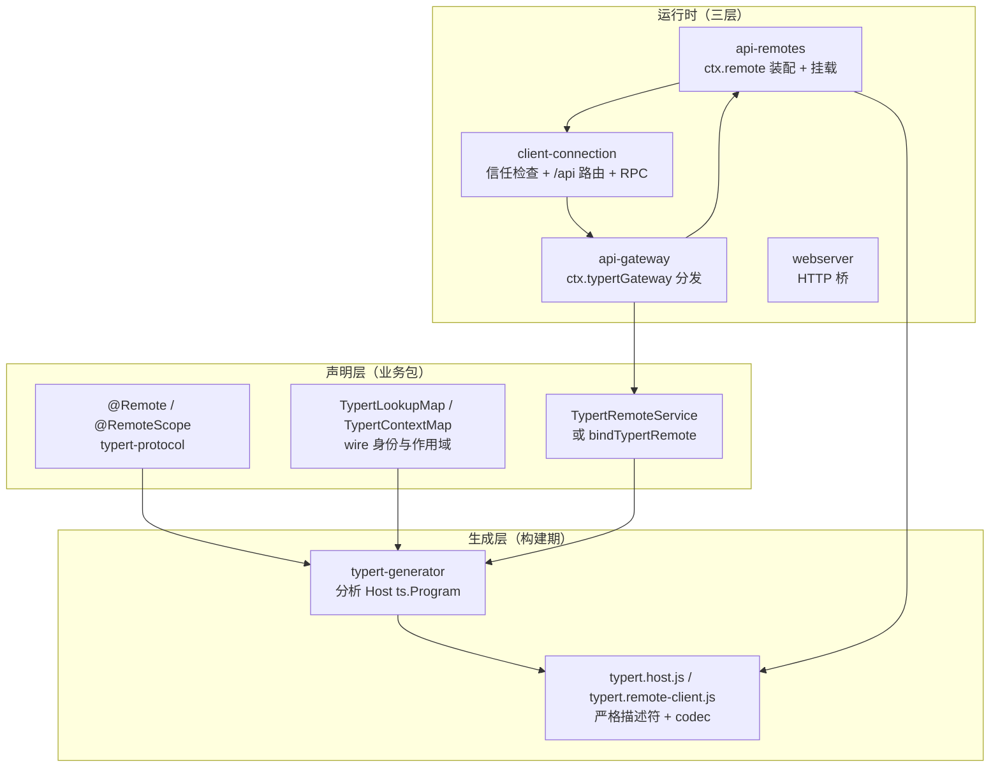
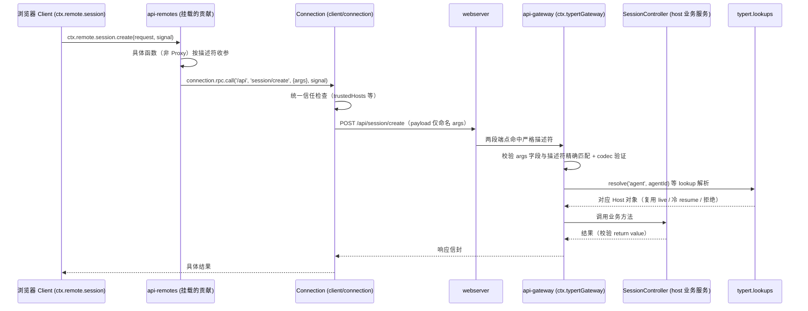

# Remote 控制器体系：把 host 能力暴露给浏览器的生成式契约

> 子文档之一，聚焦 dsh 0.1.2-alpha 用 Typert Remote 控制器取代旧 apiproxy RPC 的架构级变化。覆盖 `packages/typert/*`（协议/生成器/加载器/注册表）与 `packages/api/{gateway,remotes,session-controller,settings-controller,workspace-controller}`。整体哲学见 [README](README.md)；本文与 [deployment.md](deployment.md)（web-app 里 connection/api-remotes 的挂载）、[session.md](session.md)（session 控制器背后的会话语义）互为表里。按 ai-agent ⊗ framework 类规格产出。

根因与一句定位：**dsh 需要把「host 侧的复杂能力（Session 命令、工作区、设置、凭据）安全地暴露给浏览器客户端」，但手工维护的一套自定义 RPC 已经膨胀到不可维护**——旧的 `packages/host/apiproxy` 靠手写 RPC 模式与 schema 演进，每加一个能力都要写服务端方法、请求/响应 schema、客户端镜像。0.1.2-alpha 用**装饰器 + 代码生成**把「暴露哪个方法」变成业务源码里的一行声明，让 Host 与 Client 两端契约由编译器从同一份 `ts.Program` 推导，运行时统一走 Connection 的信任边界。

## 概览：是什么 / 痛点 / 适用场景

- **是什么**：一个「装饰器声明 → 严格生成 → 运行时分发」的三段式 API 层：业务服务用 `@Remote`/`@RemoteScope` 标注方法，`typert-generator` 在构建期严格分析类型图并生成 Host 与 Host-for-Client 双套契约，`api-gateway` 在运行时把 `ctx.remote.<namespace>` 的调用经 Connection 的 `/api` 路由分发回真实的 Cordis 服务。
- **痛点**：旧 apiproxy 的手工 RPC 栈（`rpc-map`、`rpc.schema`、`settings.schema`、`credentials.ts` 等）在 0.1.2-alpha 被大范围删除（`refactor(apiproxy)!: remove settings and credentials RPCs` / `remove directory-picker RPCs`，约 839 行移除）；浏览器与 host 的每次能力对齐都要跨两份手写代码。
- **适用场景**：任何需要「浏览器/外部客户端调用 host 侧业务服务」的 dsh 形态（web UI、Python/TS SDK、ACP）；它同时是 SDK profile 分发（见 [deployment.md](deployment.md)）的调用基础。
- **核心能力清单**：

| 能力 | 说明 |
|------|------|
| 声明式暴露 | `@Remote` 标方法、`@RemoteScope` 标按作用域解析；未标方法不进生成契约、不可经 `ctx.remote` 调用 |
| 复杂对象跨线 | `TypertLookupMap` 声明 Host 对象（如 Agent）与 wire 身份的关联，运行时 `ctx.typert.lookups` 解析 |
| 严格生成管线 | `typert-generator` 分析 Host `ts.Program`，产出 `typert.host.*` 与 `typert.remote-client.*` 双面产物 |
| 统一信任边界 | Connection 统一信任检查 → `/api/<namespace>/<method>` → Gateway 按描述符校验/解析/分发 |
| 控制器首落地 | `session`/`workspace`/`settings`/`credentials` 四个 Remote 控制器取代对应 apiproxy RPC |
| 事件转发白名单 | `API_REMOTE_FORWARDED_EVENTS` 显式声明可转发的 host 事件与模式 |
| SRC 开发回退 | 源码运行时无编译器插件也能用弱描述符分发（不做类型分析、无 Zod schema） |

- **技术栈**：TypeScript（标准装饰器）+ Cordis + schemastery（校验）+ Connection（`/api` 路由与 SSE/WebSocket 流）。

## 架构：三层职责与一条调用链

分层清晰：`remotes → gateway → connection → webserver`[[docs/api-gateway.md:162-162]()]()
<!-- anchor: The API layers are organized as `remotes → gateway → connection → webserver`. -->。**Connection 拥有传输/RPC id/响应信封/取消/信任检查；Gateway 只拥有 Remote 数据协议与业务分发**——换 Connection 载体不需要改 Remote 描述符或客户端编程接口[[docs/api-gateway.md:7-7]()]()
<!-- anchor: ## Programming model -->。

## 核心链路：一次 `ctx.remote.session.create` 的完整旅程

`SessionController` 是首个也是最重要的落地：它扩展 `TypertRemoteService`，把构造绑定到 `ctx.remote.session` 命名空间，暴露 `list`/`search`/`create`/`selectModel`/`modelCatalog` 等一组 Remote 方法[[packages/api/session-controller/src/index.ts:83-84]()]()
<!-- anchor: /** Host service backing the generated `ctx.remote.session` namespace. */ … export class SessionController extends TypertRemoteService { -->[[packages/api/session-controller/src/index.ts:213-214]()]()
<!-- anchor:   @Remote('list') …   async list(_request: SessionListRequest, signal: AbortSignal): Promise<SessionListValue> { -->。其 lookup 解析语义（reuse live Agent、自动 resume 冷会话、去重并发 resume、拒绝 subagent 路由归属身份）是 api-gateway.md 记录的"标准解析策略"——这也是 `session/not-found`/`session/agent-busy` 这些 `RemoteError` 能带着自己的错误码原样过线的根因（`gateway/internal` 只折叠未分类异常）。

## 深挖一：编程模型——三个声明原语

业务包怎么"变成"可远程调用，全部浓缩在三个声明原语里：

1. **`@Remote`**：标注一个 public 非泛型实例方法为直接 Remote 调用。方法参数必须 required 具名标识符（禁解构/默认值/rest/可选），Host 签名末尾的 `signal: AbortSignal` 记录进描述符而不进 `args`，客户端生成对应可选末参 `AbortSignal`[[packages/typert/protocol/src/index.ts:176-186]()]()
<!-- anchor: export function Remote<This extends object, Args extends unknown[], Result>( … export function Remote<This extends object, Args extends unknown[], Result>( -->。普通 JSON 可表示类型生成严格 schema；复杂对象（如 Agent）必须声明 `TypertLookupMap`。
2. **`@RemoteScope`**：按作用域解析——先经 `ctx.typert.contexts` 把 wire 身份解析到 scoped Context，再从该 Context 取服务调用；用于依赖组合上下文、不需要显式接收 Agent 的方法[[packages/typert/protocol/src/index.ts:228-234]()]()
<!-- anchor: export function RemoteScope( …     return remoteDecorator({ kind: 'context', context: key }, undefined, exportName) -->。
<!-- anchor: export function RemoteScope( …     return remoteDecorator({ kind: 'context', context: key }, undefined, exportName) -->。
3. **`TypertRemoteService` / `bindTypertRemote`**：服务类绑定 Cordis service key 与默认 Remote namespace；两者都留下可检视的 public binding，不依赖编译器往构造器注入符号[[docs/api-gateway.md:15-15]()]()
<!-- anchor: Services normally extend `TypertRemoteService` so the constructor explicitly binds -->。
<!-- anchor: Services normally extend `TypertRemoteService` so the constructor explicitly binds the … -->

生成的 Client 端是**普通对象上的具体函数**，不是 JavaScript Proxy：直接调用在 `ctx.remote.<namespace>`、作用域调用在 `agentCtx.remote.<namespace>`，每个 namespace 是 traceable 的 Cordis 子 Service[[docs/api-gateway.md:58-58]()]()
<!-- anchor: The Client uses concrete functions on ordinary objects, not a JavaScript Proxy. -->
<!-- anchor: The Client uses concrete functions on ordinary objects, not a JavaScript Proxy. Direct and … -->

## 深挖二：生成管线——为什么必须是"严格 + 双产物"

`typert-generator` 不是简单的模板生成器，它**严格分析** Remote 签名、类型图、lookups、Contexts 与源码位置（从 Host 的 `ts.Program` 出发），只给显式声明贡献入口的包生成产物[[docs/api-gateway.md:80-84]()]()
<!-- anchor: ## Component responsibilities … | Shared | `@deepseek-ai/dsh-typert-protocol` | Declares decorators, -->
<!-- anchor: ## Component responsibilities … | Shared | `@deepseek-ai/dsh-typert-protocol` | Declares decorators, Gateway bindings, merge-extensible -->

构建顺序是 load-bearing 的：root build 依次跑 `build:lib:host` → `build:lib:client` → `build:web`；Host lib 阶段先 tsc 再 tsdown（此间 Typert 生成器以 Host 聚合为唯一 `ts.Program` seed 运行），Client lib 阶段消费刚生成的 Remote Client 声明与运行时贡献、不再启动 Typert[[docs/api-gateway.md:97-99]()]()
<!-- anchor: The root build runs `build:lib:host`, `build:lib:client`, and `build:web` … Both tsdown passes receive the complete workspace and bundle only JavaScript emitted to -->
<!-- anchor: The root build runs `build:lib:host`, `build:lib:client`, and `build:web` in order. The Host lib … … Both tsdown passes receive the complete workspace and bundle only JavaScript emitted to -->

产物写到业务包自己的 `lib/`（不污染源码目录），四类文件：`typert.host.js`/`.d.ts`（Host 面）、`typert.remote-client.js`/`.d.ts`（可挂载贡献 + 声明合并 + 源码映射）。声明映射把 `ctx.remote.goals.create` 生成的属性映射回 Host 源码里的 `@Remote` 方法——**编辑器从客户端调用一跳直达真实实现**[[docs/api-gateway.md:115-115]()]()
<!-- anchor: Parameter names in Remote Client declarations come from wire fields, -->

严格性带来的失败模式很硬：missing provider / unknown identity / binding mismatch / missing or extra argument / schema failure 都在进/出业务代码**之前**失败。SRC fallback 是唯一例外——源码运行时（`node --import tsx/esm`）不执行编译器插件，改用标准装饰器初始化器记录的弱描述符，只解析简单参数名、无类型分析无 Zod schema，且**客户端绝不挂载缺 codec 的 SRC 描述符**（类型与 codec 永远来自最新生成的产物）[[docs/api-gateway.md:133-133]()]()
<!-- anchor-base64:V2hlbiB0aGUgSG9zdCBzdGFydHMgZnJvbSBzb3VyY2UgdGhyb3VnaCBgbm9kZSAtLWltcG9ydCB0c3gvZXNtYCwgaXQgZG9lcyBub3QgZXhlY3V0ZQ== -->

## 深挖三：统一信任边界与事件转发

「信任」不散落在各个业务方法里，而是 Connection 的一次性检查：Remote 调用走 Connection 的 `/api` 路由，Connection 在 HTTP 桥**之前**做统一信任检查，然后进共享 FetchHandler；Gateway 只认**两段端点 + 严格描述符或 SRC marker**，feature 自有的精确 Fetch 路由处理非 JSON 响应，其余 404[[docs/api-gateway.md:121-121]()]()
<!-- anchor: Remote calls use the Connection's `/api` route. The Client Remote calls -->
<!-- anchor: Remote calls use the Connection's `/api` route. The Client Remote calls `connection.rpc.call('/api', … -->

事件侧则是一张**显式白名单**：`API_REMOTE_FORWARDED_EVENTS` 声明哪些 host 事件可转发、用什么模式（`emit` 或 `waterfall`）——它同时是 host 转发循环与消费方 `ctx.remote.$on` 的合法键集，两种编译器面读同一份声明、杜绝两份漂移[[packages/api/remotes/src/remote-events.ts:13-18]()]()
<!-- anchor:  * Host events this application forwards without renaming. The explicit mode is …   { event: 'approval/request', mode: 'waterfall' }, -->。`approval/request` 以 waterfall 模式转发意味着**浏览器端插件可以参与 host 侧的审批瀑布**——这是把"策略挂到 seam 上"（[architecture.md](architecture.md) 支柱五）从 host 内扩展到浏览器域的实例。

## 深挖四：从 apiproxy RPC 到 Remote 控制器的演进

0.1.2-alpha 的破坏性变更之一是 `packages/host/apiproxy` 的 settings/credentials/directory-picker RPC 整体移除（`refactor(apiproxy)!` 两次，删除 `credentials.ts`/`credentials.schema.ts`/`rpc.ts`/`rpc-map.ts` 及 settings 大半实现，net −839 行）。取代者是 Remote 控制器，且把"投影/拒绝"语义也移了过来：

- `ctx.settingsController`：把 user-settings seam 投影到生成式 Remote namespace——**读取恒为 redacted 视图、每次 provider 拒绝都被分类**，这些策略住在控制器而非 seam Definition 上[[packages/api/settings-controller/src/index.ts:3-5]()]()
<!-- anchor:  * seams. Two namespaces: `settings`, the redacted reads and writes of …  * here as its own plugin. -->；
- `ctx.credentialsController`：批扇出、视图投影、拒绝映射同样住在控制器层[[docs/capability-seams.md:477-477]()]()
<!-- anchor: | `ctx.credentialsController` | `core` | [`api-settings-controller`]( -->；
- `ctx.workspaceController`：workspace 命令 + reconnect-safe 状态投递 + 目录选择（`pick`/`list`/`createDirectory` 等 Remote）[[packages/api/workspace-controller/src/index.ts:57-58]()]()
<!-- anchor:   @Remote('create') …   create(request: WorkspaceCreateRequest): Promise<WorkspaceCreateValue> { -->。

演进的价值不在于"少写代码"，而在于**把「暴露面」变成源码声明**：以后每加一个 host 能力，业务包只需要 `@Remote` 标注 + 声明 lookup，契约一致性交给编译器与生成器——这与 dsh「无特权内核、可替换组件」的架构是一致的：API 面不再是 apiproxy 那样的独立"内核侧 RPC 层"，而是挂在每个业务包自己身上的声明。

## 全局关联

Remote 控制器体系是「可交换后端」（[architecture.md](architecture.md) 支柱三）在**进程边界**上的延伸：session/workspace/settings/credentials 这些能力面本身是可交换 seam，Remote 控制器把它们投影成 wire 契约，而 lookup 解析策略（复用 live/冷 resume/拒绝）让"host 对象怎么来"对业务方法透明。它同时呼应「事件即扩展点」（支柱五）——`ctx.remote.$on` + 白名单转发让浏览器插件能以与 host 内插件相同的方式参与 waterfall 事件。一句话：**apiproxy 的移除不是砍功能，而是把 API 从"手写的旁路层"升级为"生成自业务声明的普通能力"。**

## 不足 / 风险

- **严格性的陡峭学习曲线**：Remote 方法有严格的参数形状约束（禁默认值/rest/可选），复杂对象必须建 `TypertLookupMap`，否则构建或首次调用才失败。
- **生成管线顺序敏感**：Host 阶段必须先于 Client 阶段，clean worktree 不能跳过 Host 阶段；CI 与本地 `pnpm run typecheck` 依赖同一顺序。
- **unary-only 边界**：流式/分页/增量投影不走 Remote，需要各自的数据协议——文档明令"不得伪装成 Remote 方法"[[docs/api-gateway.md:160-162]()]()
<!-- anchor: Remote handles only unary method calls with one request and one result. … The API layers are organized as `remotes → gateway → connection → webserver`. -->。
<!-- anchor: Remote handles only unary method calls with one request and one result. Session event streams, … … even when they reuse the Connection, they must not masquerade as Remote methods or enter invocation descriptors. -->。
- **控制器与 seam 语义的重复归属**：策略（redact/refusal 分类）住在控制器层而非 seam Definition，意味着同一语义有两处实现位，需警惕漂移。
