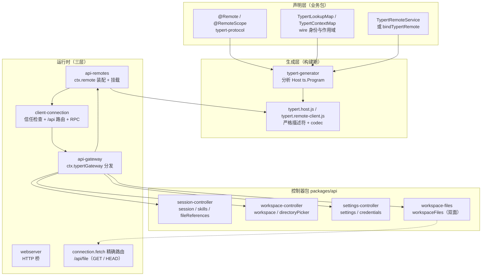
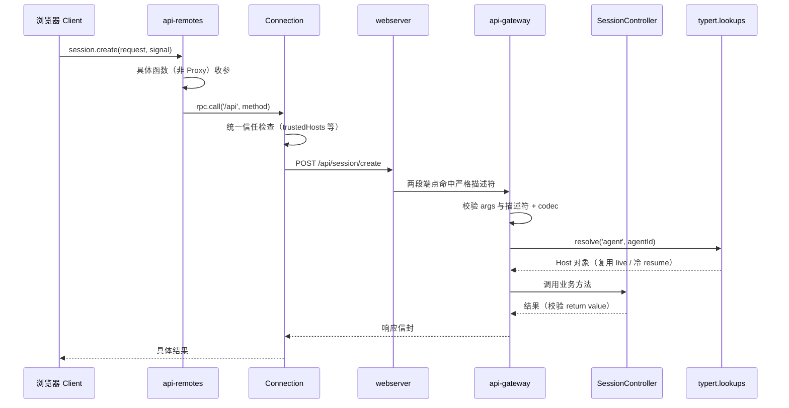
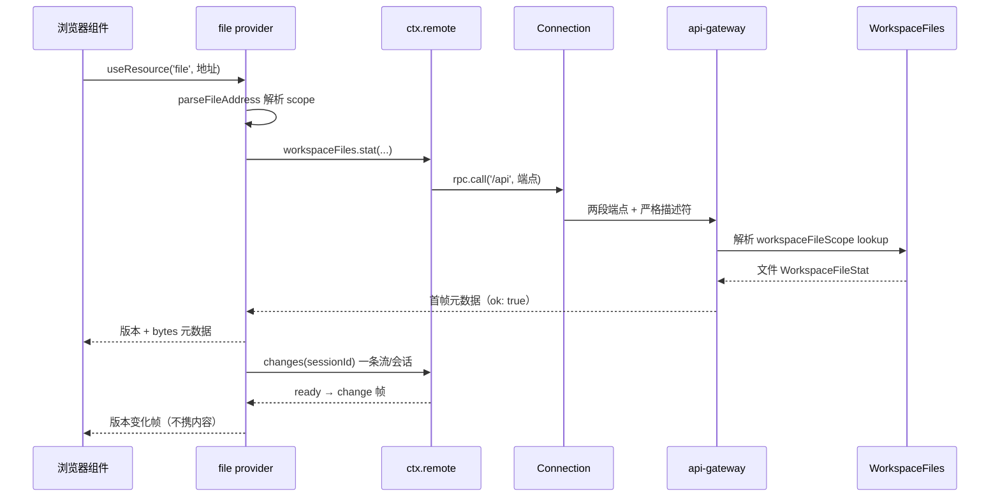
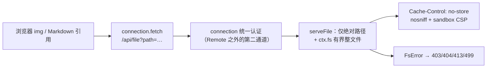

# Remote 控制器体系：把 host 能力暴露给浏览器的生成式契约

> 子文档之一，聚焦 dsh 0.1.2-alpha 用 Typert Remote 控制器取代旧 apiproxy RPC 的架构级变化。覆盖 `packages/typert/*`（协议/生成器/加载器/注册表）与 `packages/api/{gateway,remotes,session-controller,settings-controller,workspace-controller,workspace-files}`。整体哲学见 [README](README.md)；本文与 [deployment.md](deployment.md)（web-app 里 connection/api-remotes 的挂载）、[session.md](session.md)（session 控制器背后的会话语义）互为表里。按 ai-agent ⊗ framework 类规格产出。
>
> **本版增量更新（0.1.5-rc.2；基线 `dsh-v0.1.2-rc.1` → `HEAD`）**：控制器集合由四个扩到五个——新增 `packages/api/workspace-files`（`WorkspaceFiles` / `ctx.remote.workspaceFiles`），以**双面包**形式把工作区文件面暴露给 Client；session-controller 不再承载 workspace-file 实现，改为只承接文件引用补全、媒体路由与上传受理；`/api/file` 从"扩展名白名单 + 手写 Range 解析"重构为"经 `ctx.fs` 的有界整文件响应"；Typert 生成器修掉"跨包引用经**包内 forwarding 模块**解析失败"的问题。文件面的双契约细节见 [workspace-files.md](workspace-files.md)（双面文件 API + Host-resolved resources），浏览器侧消费见 [web-client.md](web-client.md)。

根因与一句定位：**dsh 需要把「host 侧的复杂能力（Session 命令、工作区、设置、凭据）安全地暴露给浏览器客户端」，但手工维护的一套自定义 RPC 已经膨胀到不可维护**——旧的 `packages/host/apiproxy` 靠手写 RPC 模式与 schema 演进，每加一个能力都要写服务端方法、请求/响应 schema、客户端镜像。0.1.2-alpha 用**装饰器 + 代码生成**把「暴露哪个方法」变成业务源码里的一行声明，让 Host 与 Client 两端契约由编译器从同一份 `ts.Program` 推导，运行时统一走 Connection 的信任边界。

## 概览：是什么 / 痛点 / 适用场景

- **是什么**：一个「装饰器声明 → 严格生成 → 运行时分发」的三段式 API 层：业务服务用 `@Remote`/`@RemoteScope` 标注方法，`typert-generator` 在构建期严格分析类型图并生成 Host 与 Host-for-Client 双套契约，`api-gateway` 在运行时把 `ctx.remote.<namespace>` 的调用经 Connection 的 `/api` 路由分发回真实的 Cordis 服务。
- **痛点**：旧 apiproxy 的手工 RPC 栈（`rpc-map`、`rpc.schema`、`settings.schema`、`credentials.ts` 等）在 0.1.2-alpha 被大范围删除（`refactor(apiproxy)!: remove settings and credentials RPCs` / `remove directory-picker RPCs`，约 839 行移除）；浏览器与 host 的每次能力对齐都要跨两份手写代码。
- **适用场景**：任何需要「浏览器/外部客户端调用 host 侧业务服务」的 dsh 形态（web UI、Python/TS SDK、ACP）；它同时是 SDK profile 分发（见 [deployment.md](deployment.md)）的调用基础。
- **核心能力清单**：

| 能力 | 说明 |
|------|------|
| 声明式暴露 | `@Remote` 标方法、`@RemoteScope` 标按作用域解析；未标方法不进生成契约、不可经 `ctx.remote` 调用 |
| 复杂对象跨线 | `TypertLookupMap` 声明 Host 对象（如 Agent）与 wire 身份的关联，运行时 `ctx.typert.lookups` 解析 |
| 严格生成管线 | `typert-generator` 分析 Host `ts.Program`，产出 `typert.host.*` 与 `typert.remote-client.*` 双面产物 |
| 统一信任边界 | Connection 统一信任检查 → `/api/<namespace>/<method>` → Gateway 按描述符校验/解析/分发 |
| 控制器首落地 | `session`/`workspace`/`settings`/`credentials` 四个 Remote 控制器取代对应 apiproxy RPC；0.1.5 起 `workspaceFiles` 成为第五个，且是首个**双面**（Host + Client 同包）控制器 |
| 事件转发白名单 | `API_REMOTE_FORWARDED_EVENTS` 显式声明可转发的 host 事件与模式 |
| SRC 开发回退 | 源码运行时无编译器插件也能用弱描述符分发（不做类型分析、无 Zod schema） |

> **演进说明（0.1.5-rc.2）**：`packages/api/` 现有 `gateway`、`remotes`、`session-controller`、`settings-controller`、`workspace-controller`、`workspace-files` 六个包；其中对外暴露 Remote 控制器的包由四个增至五个。新增的 `workspace-files` 同时也是 Client 资源 provider 的宿主（内链 [workspace-files.md](workspace-files.md)、[web-client.md](web-client.md)）。

- **技术栈**：TypeScript（标准装饰器）+ Cordis + schemastery（校验）+ Connection（`/api` 路由与 SSE/WebSocket 流）。

## 架构：三层职责与一条调用链

分层清晰：`remotes → gateway → connection → webserver`（[docs/api-gateway.md:162-162]()）
<!-- anchor: The API layers are organized as `remotes → gateway → connection → webserver`. -->。**Connection 拥有传输/RPC id/响应信封/取消/信任检查；Gateway 只拥有 Remote 数据协议与业务分发**——换 Connection 载体不需要改 Remote 描述符或客户端编程接口（[docs/api-gateway.md:7-7]()）
<!-- anchor: ## Programming model -->。

图里刻意拆出两条**并列的暴露通道**，这是 0.1.5 后读这张图的关键：四个控制器经 `R2`（Gateway）走 `<namespace>/<method>` 的严格描述符调用，而 `workspace-files` 除 Remote 面之外还向 `R5`（`connection.fetch` 的精确路由）注册 `/api/file`——两者共用同一条 Connection 与其信任检查，但前者受描述符约束、后者是 feature 自有的原生响应路由（详见「第二条暴露通道」一节）。

## 核心链路：一次 `ctx.remote.session.create` 的完整旅程

`SessionController` 是首个也是最重要的落地：它扩展 `TypertRemoteService`，把构造绑定到 `ctx.remote.session` 命名空间，暴露 `list`/`search`/`create`/`selectModel`/`modelCatalog` 等一组 Remote 方法（[packages/api/session-controller/src/index.ts:86-87]()）
<!-- anchor: /** Host service backing the generated `ctx.remote.session` namespace. */ … export class SessionController extends TypertRemoteService { -->（[packages/api/session-controller/src/index.ts:222-223]()）
<!-- anchor:   @Remote('list') …   async list(_request: SessionListRequest, signal: AbortSignal): Promise<SessionListValue> { -->。其 lookup 解析语义（reuse live Agent、自动 resume 冷会话、去重并发 resume、拒绝 subagent 路由归属身份）是 api-gateway.md 记录的"标准解析策略"——这也是 `session/not-found`/`session/agent-busy` 这些 `RemoteError` 能带着自己的错误码原样过线的根因（`gateway/internal` 只折叠未分类异常）。

### 第二条链路：`ctx.remote.workspaceFiles` 的文件元数据订阅

浏览器要"看着"一个文件，走的不是上面那条 unary 旅程，而是**元数据订阅**：地址（`dsh-resource://file/session/<id>/<path>`）由 Client 的资源模型解析，`stat` 取首帧，`changes` 拉一条每会话共享的观察流；内容（页/字节窗口）再另起 unary 调用按需拉取——**流只推"变了"，从不推内容**。

这条链路上有三处值得单独点出的设计：

- **地址是 Client 的唯一身份，Session 由地址携带。** `parseFileAddress` 把 `dsh-resource://file/…` 读成两种 scope——`session/<sessionId>/<path>`（携带授权身份）与 `absolute/<path>`（无可授权身份，直接以 `workspace-file/unknown-workspace` 失败，绝不借用"当前会话"或"当前 Tab 的会话"）（[packages/util/workspace-path/src/file-address.ts:27-39]()）
<!-- anchor:     readonly scope: 'session' … /** Absolute `/`-separated path: `/a/b` on POSIX, -->；Client 只负责把地址里的 path 原样转交，**不读也不传 cwd**（[packages/api/workspace-files/src/client/provider.ts:115-124]()）
<!-- anchor: function resolve(address: string): RemoteResult<HostFile> { …   return { ok: false, error: unknownWorkspace(address) } -->。
- **根由 Host 解析，不由 Client 猜测。** 每个方法的第一参数都是 `workspaceFileScope`；Gateway 用 wire 上的 Session 身份查 `workspaceFileScope` lookup——先看 live Session header，冷会话退到 `sessionPersistence.stat`，两者都没有才用 sandbox policy 的部署根，**全程不激活 Agent、不读事件体、不继承父会话根**（[packages/api/workspace-files/src/index.ts:201-216]()）
<!-- anchor:     ctx.inject(['sessions', 'typert'], (scope) => { …             workspaceRoot: header.cwd ?? scope.sandboxPolicy.workspaceRoot, -->。
- **一条 `changes` 流服务该会话的所有打开文件。** Client 侧 `ChangeFeed` 按会话复用一条被 Gateway supervisor 监管的重连流，订阅者按 `stat.absolutePath` 过滤；最后一个订阅者离开才销毁，插件卸载等待全部关闭（[packages/api/workspace-files/src/client/index.ts:16-34]()）
<!-- anchor: /** Required browser services: the resource model, the Remote carrier and its namespace. */ …   }, 'workspace-files: file resource provider') -->。Host 侧的 `changes` 本身是 `mode: 'stream'` 的 Remote 方法（[packages/api/workspace-files/src/index.ts:364-366]()）
<!-- anchor:   @Remote({ mode: 'stream' }) …     return this.feed.follow(workspaceFileScope.workspaceRoot, signal) -->，与 unary 方法共用同一套描述符/校验/lookup，只在投递方式上分叉。

## 深挖一：编程模型——三个声明原语

> **演进说明（0.1.5-rc.2）**：本节标题保留初版口径（"三个声明原语"）。0.1.5 复核时补上第四个——**投递模式** `@Remote({ mode: 'stream' })`；它不是新的声明入口，而是给 `@Remote` 加的一层投递修饰，故新增为 `###` 小节而不再改 `##` 标题。

业务包怎么"变成"可远程调用，全部浓缩在三个声明原语里：

1. **`@Remote`**：标注一个 public 非泛型实例方法为直接 Remote 调用。方法参数必须 required 具名标识符（禁解构/默认值/rest/可选），Host 签名末尾的 `signal: AbortSignal` 记录进描述符而不进 `args`，客户端生成对应可选末参 `AbortSignal`（[packages/typert/protocol/src/index.ts:174-184]()）
<!-- anchor: export function Remote<This extends object, Args extends unknown[], Result>( … export function Remote<This extends object, Args extends unknown[], Result>( -->。普通 JSON 可表示类型生成严格 schema；复杂对象（如 Agent）必须声明 `TypertLookupMap`。
2. **`@RemoteScope`**：按作用域解析——先经 `ctx.typert.contexts` 把 wire 身份解析到 scoped Context，再从该 Context 取服务调用；用于依赖组合上下文、不需要显式接收 Agent 的方法（[packages/typert/protocol/src/index.ts:226-232]()）
<!-- anchor: export function RemoteScope( …   return remoteDecorator({ kind: 'context', context: key }, undefined, exportName) -->。
3. **`TypertRemoteService` / `bindTypertRemote`**：服务类绑定 Cordis service key 与默认 Remote namespace；两者都留下可检视的 public binding，不依赖编译器往构造器注入符号（[docs/api-gateway.md:15-15]()）
<!-- anchor: Services normally extend `TypertRemoteService` so the constructor explicitly binds -->。

生成的 Client 端是**普通对象上的具体函数**，不是 JavaScript Proxy：直接调用在 `ctx.remote.<namespace>`、作用域调用在 `agentCtx.remote.<namespace>`，每个 namespace 是 traceable 的 Cordis 子 Service（[docs/api-gateway.md:58-58]()）
<!-- anchor: The Client uses concrete functions on ordinary objects, not a JavaScript Proxy. -->

### 第四个原语：`@Remote({ mode: 'stream' })`

三个原语解决"怎么声明"，`RemoteMethodOptions` 补上"以什么投递方式声明"：普通 `@Remote` 是 unary（一次请求一次结果），显式传 `{ mode: 'stream' }` 则在描述符里记下 `mode: 'stream'`，方法返回 `Iterable`/`AsyncIterable`，每个元素被独立校验后经**共享的逻辑流载体**投递（[packages/typert/protocol/src/index.ts:83-103]()）
<!-- anchor: /** Invocation mode recorded by a Remote method decorator. */ …   readonly mode: 'stream' -->。Gateway 对两者的入口做硬隔离：`invoke()` 遇到 stream 描述符直接报 `gateway/signature-invalid`，`stream()` 遇到 unary 描述符报同一错误码——**调用形态必须与声明形态一致，不允许"用 unary 端点拖一条流"**。这正是 `workspaceFiles.changes` 的做法（[packages/api/workspace-files/src/index.ts:364-366]()）
<!-- anchor:   @Remote({ mode: 'stream' }) …     return this.feed.follow(workspaceFileScope.workspaceRoot, signal) -->：它和同命名空间里的 `read`/`stat` 共享生成管线、lookup 解析与错误编码，只在投递层换载体。反过来看，`docs/api-gateway.md` 的 Boundaries 仍写着"Remote 只处理 unary 调用"——那是 0.1.5 之前的口径，代码已经先走一步（见「不足 / 风险」）。

## 深挖二：生成管线——为什么必须是"严格 + 双产物"

`typert-generator` 不是简单的模板生成器，它**严格分析** Remote 签名、类型图、lookups、Contexts 与源码位置（从 Host 的 `ts.Program` 出发），只给显式声明贡献入口的包生成产物[[docs/api-gateway.md:80-84]()]()
<!-- anchor: ## Component responsibilities … | Shared | `@deepseek-ai/dsh-typert-protocol` | Declares decorators, -->
<!-- anchor: ## Component responsibilities … | Shared | `@deepseek-ai/dsh-typert-protocol` | Declares decorators, Gateway bindings, merge-extensible -->

构建顺序是 load-bearing 的：root build 依次跑 `build:lib:host` → `build:lib:client` → `build:web`；Host lib 阶段先 tsc 再 tsdown（此间 Typert 生成器以 Host 聚合为唯一 `ts.Program` seed 运行），Client lib 阶段消费刚生成的 Remote Client 声明与运行时贡献、不再启动 Typert[[docs/api-gateway.md:97-99]()]()
<!-- anchor: The root build runs `build:lib:host`, `build:lib:client`, and `build:web` … Both tsdown passes receive the complete workspace and bundle only JavaScript emitted to -->
<!-- anchor: The root build runs `build:lib:host`, `build:lib:client`, and `build:web` in order. The Host lib … … Both tsdown passes receive the complete workspace and bundle only JavaScript emitted to -->

产物写到业务包自己的 `lib/`（不污染源码目录），四类文件：`typert.host.js`/`.d.ts`（Host 面）、`typert.remote-client.js`/`.d.ts`（可挂载贡献 + 声明合并 + 源码映射）。声明映射把 `ctx.remote.goals.create` 生成的属性映射回 Host 源码里的 `@Remote` 方法——**编辑器从客户端调用一跳直达真实实现**[[docs/api-gateway.md:115-115]()]()
<!-- anchor: Parameter names in Remote Client declarations come from wire fields, -->

严格性带来的失败模式很硬：missing provider / unknown identity / binding mismatch / missing or extra argument / schema failure 都在进/出业务代码**之前**失败。SRC fallback 是唯一例外——源码运行时（`node --import tsx/esm`）不执行编译器插件，改用标准装饰器初始化器记录的弱描述符，只解析简单参数名、无类型分析无 Zod schema，且**客户端绝不挂载缺 codec 的 SRC 描述符**（类型与 codec 永远来自最新生成的产物）[[docs/api-gateway.md:133-133]()]()
<!-- anchor-base64:V2hlbiB0aGUgSG9zdCBzdGFydHMgZnJvbSBzb3VyY2UgdGhyb3VnaCBgbm9kZSAtLWltcG9ydCB0c3gvZXNtYCwgaXQgZG9lcyBub3QgZXhlY3V0ZQ== -->

### 跨包引用的转发解析：一个"差一跳"的判定缺口

生成器的严格性有一半花在**判定一个类型引用是否合法地跨了包**：它先把类型引用解析回原始声明，再看引用它的文件是否通过公共子路径 import 了对方包（私有导出、相对路径跨包都要拒）。0.1.5 之前这里有个"差一跳"的缺口：若 A 包在自己某个模块里 `export { X } from '@b/pkg'`，再在别的模块里用**相对路径** import 这个转发模块，分析器只检查引用文件自己那条 import 语句，于是判定为"跨包却没有显式包导入"——而这个错误是 **batch 相关的**（取决于哪一批把 A 选为分析根），同一个仓库不同分批会给出不同结论，issue #3525 就报成了"时灵时不灵"。

修法是给解析加一条**包内转发走查**（[packages/typert/generator/src/analyzer.ts:877-909]()）
<!-- anchor:    * Follow the import that names `symbol` at `site` through modules of the …     return walk(site.getSourceFile(), moduleSpecifier, authoredExportName(site, moduleSpecifier)) -->：

- 相对 specifier 一律经 face 共享的 compiler host 与**模块解析缓存**解析，走查只在解析结果仍落在引用包内时继续（[packages/typert/generator/src/analyzer.ts:866-874]()）
<!-- anchor:   private resolveImport(specifier: string, fromFile: string): string | undefined { …     return resolved === undefined ? undefined : realPath(resolved.resolvedFileName) -->。复用缓存是有代价意识的：每个跨包相对引用按跳数各付一次模块解析，换来的是不再为同一 specifier 反复问编译器。
- 每个转发模块收集"携带该导出名"的 `export` 边：带 specifier 的具名 re-export、由本模块 `import` 支撑的 `export { local }`、以及导出同一 symbol 的 star re-export；**显式边先于 star 边**，对应 TypeScript 本身"显式导出遮蔽 star 导出"的语义（[packages/typert/generator/src/analyzer.ts:911-935]()）
<!-- anchor:   /** Export edges of `sourceFile` that carry `name`: explicit edges in source order, then star edges exporting `symbol`. */ …     return [...explicit, ...stars] -->。
- 去重键是 **(已解析模块, 请求的导出名) 对**而非模块路径——所以环形 star 会终止，而"同一模块里两条改名的不同路由"仍各自可达；走查到第一个包 specifier 即停，并把该身份与导出名交回原有的公共导出检查，**转发不豁免公共性**。

被明确拒绝的几个替代方案同样说明边界在哪：把"别名链最终落到别的包"当作隐式公共（等于放行 `../../other/src/file.ts`，摧毁生成式声明赖以命名的可导入子路径）；把转发模块本身当引用目标（生成器需要原始声明的包与子路径，包内模块没有公共身份）；以及"让分批与全量分析选同一批根"（根选择只决定引用**是否被访问**，不改变判定本身——对齐调用方只是把错误分类藏起来）。

## 深挖三：统一信任边界与事件转发

「信任」不散落在各个业务方法里，而是 Connection 的一次性检查：Remote 调用走 Connection 的 `/api` 路由，Connection 在 HTTP 桥**之前**做统一信任检查，然后进共享 FetchHandler；Gateway 只认**两段端点 + 严格描述符或 SRC marker**，feature 自有的精确 Fetch 路由处理非 JSON 响应，其余 404[[docs/api-gateway.md:121-121]()]()
<!-- anchor: Remote calls use the Connection's `/api` route. The Client Remote calls -->
<!-- anchor: Remote calls use the Connection's `/api` route. The Client Remote calls `connection.rpc.call('/api', … -->

事件侧则是一张**显式白名单**：`API_REMOTE_FORWARDED_EVENTS` 声明哪些 host 事件可转发、用什么模式（`emit` 或 `waterfall`）——它同时是 host 转发循环与消费方 `ctx.remote.$on` 的合法键集，两种编译器面读同一份声明、杜绝两份漂移[[packages/api/remotes/src/remote-events.ts:13-18]()]()
<!-- anchor:  * Host events this application forwards without renaming. The explicit mode is …   { event: 'approval/request', mode: 'waterfall' }, -->。`approval/request` 以 waterfall 模式转发意味着**浏览器端插件可以参与 host 侧的审批瀑布**——这是把"策略挂到 seam 上"（[architecture.md](architecture.md) 支柱五）从 host 内扩展到浏览器域的实例。

### 第二条暴露通道：feature 自有的精确 Fetch 路由

Remote 不是"host 能力到浏览器"的唯一出口。Connection 的信任检查发生在 HTTP 桥**之前**，因此它之下有两条并行的暴露面：Gateway 收 `/api/<namespace>/<method>` 两段端点（严格描述符或 SRC marker，非 JSON 响应一律 404），而任一 feature 可以用 `connection.fetch.register` 挂一条**精确路径**的原生响应路由。`/api/file` 就是这一类的现成样本——它 0.1.5 时还在"扩展名白名单 + 手写 Range 解析 + 按 MIME 分类"这条路上，随后被整体重构为"把读取权交回 `ctx.fs`、只做有界整文件响应"：

- **注册面只有一个 route 描述**：`path`/`methods`（GET、HEAD）/`requestBody: 'buffered'` 外加 `(request, fs, maxBytes) => Response` 的处理函数，控制器用 `ctx.effect` 持有它，卸载即注销（[packages/api/session-controller/src/media-references.ts:62-76]()）
<!-- anchor:  * File-display contribution. The connection service supplies authentication; …       fetch: request => serveFile(request, ctx.fs, maxBytes), -->。
- **准入只认"绝对路径"这一条业务规则**：空路径、含 NUL、非绝对路径一律 400；**路径与 MIME 都不再限制访问**——它既不做工作区/Session 归属检查，也不按 MIME 类别过滤，真正在管的只有 `ctx.fs` 的读权限与 `stat` 报出的文件类型（[packages/api/session-controller/src/media-references.ts:22-27]()）
<!-- anchor: async function serveFile(request: Request, fs: FileSystem, maxBytes: number): Promise<Response> { …   if (path.includes('\0') || !isAbsolute(path)) return fail(400, 'absolute path required') -->。这解释了为什么工作区**之外**的临时文件、远端 provider 里的文件也能显示——读权限由合成后的文件系统决定，而不是由路由白名单决定；代价是这条通道**没有任何会话/工作区级的边界**，安全完全落在"连接已认证 + 文件系统后端允许读"两点上。
- **有界 + 失败即 fail-closed**：GET 走 `fs.readBytes(target, signal, maxBytes)`（上限复用附件的 `imageLimits.maxImageBytes`，通常 20 MiB），超限 413；失败不落成 500 文本，而是把 `FsError.code` 映成 403/404/413/499，其余才 500（[packages/api/session-controller/src/media-references.ts:45-58]()）
<!-- anchor:     const bytes = await fs.readBytes(target, request.signal, maxBytes) …     return fail(statuses[error.code] ?? 500, error.code) -->。HEAD 只读 `stat`、从不打开流，这也顺带修掉了"HEAD 触发一次整文件读"的浪费。
- **跨源风险用响应头兜底**：`Cache-Control: private, no-store`、`X-Content-Type-Options: nosniff`、`Content-Security-Policy: sandbox; default-src 'none'`——因为 HTML/SVG 可能被直接打开在已认证的 API origin 上，CSP 的 sandbox 是"即便被直接打开也不执行"的最后一层。

为什么文件面要两条通道而不是统一成一条？一句话：**元数据与变更适合 Remote 的严格描述符，字节流不适合**——Remote 的 `read`/`readBytes` 要的是"结构化、可校验、可取消"的结果，而 `/api/file` 服务的是浏览器原生消费（``/`<video>` 的 URL 语义、`Content-Type`、HEAD 探测），把它硬塞进 unary 描述符只会同时牺牲两边的清晰度。代价是同一份文件内容存在**两套授权模型与两套上限**（见「不足 / 风险」）。文件面的完整语义（地址语法、页/窗口/整文件三档上限、变更流）见 [workspace-files.md](workspace-files.md)，浏览器如何消费见 [web-client.md](web-client.md)。

## 深挖四：从 apiproxy RPC 到 Remote 控制器的演进

0.1.2-alpha 的破坏性变更之一是 `packages/host/apiproxy` 的 settings/credentials/directory-picker RPC 整体移除（`refactor(apiproxy)!` 两次，删除 `credentials.ts`/`credentials.schema.ts`/`rpc.ts`/`rpc-map.ts` 及 settings 大半实现，net −839 行）。取代者是 Remote 控制器，且把"投影/拒绝"语义也移了过来：

- `ctx.settingsController`：把 user-settings seam 投影到生成式 Remote namespace——**读取恒为 redacted 视图、每次 provider 拒绝都被分类**，这些策略住在控制器而非 seam Definition 上[[packages/api/settings-controller/src/index.ts:3-5]()]()
<!-- anchor:  * seams. Two namespaces: `settings`, the redacted reads and writes of …  * here as its own plugin. -->；
- `ctx.credentialsController`：批扇出、视图投影、拒绝映射同样住在控制器层（[docs/capability-seams.md:487-487]()）
<!-- anchor: | `ctx.credentialsController` | `core` | [`api-settings-controller`]( -->；
- `ctx.workspaceController`：workspace 命令 + reconnect-safe 状态投递 + 目录选择（`pick`/`list`/`createDirectory` 等 Remote）[[packages/api/workspace-controller/src/index.ts:57-58]()]()
<!-- anchor:   @Remote('create') …   create(request: WorkspaceCreateRequest): Promise<WorkspaceCreateValue> { -->。

演进的价值不在于"少写代码"，而在于**把「暴露面」变成源码声明**：以后每加一个 host 能力，业务包只需要 `@Remote` 标注 + 声明 lookup，契约一致性交给编译器与生成器——这与 dsh「无特权内核、可替换组件」的架构是一致的：API 面不再是 apiproxy 那样的独立"内核侧 RPC 层"，而是挂在每个业务包自己身上的声明。0.1.5 的下一段演进则把这套声明范式用在了文件面上。

### 第五个控制器：`workspace-files` 的双面契约

0.1.5 新增的 `packages/api/workspace-files` 是本体系里第一个**不是从 apiproxy 迁移、而是直接按新范式长出来**的控制器：一个包同时出两面——Host 导出 `WorkspaceFiles` 服务（绑 `ctx.workspaceFiles`，Remote namespace 为 `workspaceFiles`），`./client` 导出真正的浏览器 `file` 资源 provider 插件，`dsh.client` 声明它是 web 平台插件，因此 web-app 只加一行 `workspace-files` 就同时装上 Host 与 Client 两面（[packages/api/workspace-files/src/index.ts:181-183]()）
<!-- anchor: /** Host Remote file reads and workspace directory observations over the composed filesystem. */ …   static inject = ['fs', 'sandboxPolicy', 'sessions', 'typert'] -->。这与 settings/workspace 控制器"Host 侧声明、Client 侧各自消费"的形态不同，动机是**文件能力的 wire 协议与它的 Client 模型本就要一起演进**：拆成两个包会立刻撞上 `remotes → workspace-files → resources → remotes` 这类项目引用环，而把 Client 的 `RemoteResult` 直接从 protocol 包取、把 Sidebar 参数声明留给预览包，环就消掉了。

双契约的生成方式和其它控制器一致、没有为双面开特例：包的 `package.json#exports` 把 `./typert`（Host 面描述符产物）、`./remote`（Client 面可挂载贡献 + 声明合并）、`./types`（两面对等读取的 wire 类型，只有类型没有 Host 运行时代码）分成三个入口，Host 面的 `@Remote` 声明经同一次生成管线产出 `typert.host.*` 与 `typert.remote-client.*`；`./client` 则是**手写的浏览器插件**（资源 provider），不是生成物——生成物负责"跨线说什么"，手写件负责"浏览器怎么消费"。Client 编译面因此只依赖 protocol、resources 与 util-workspace-path，不反向依赖 `api/remotes` 或 Sidebar UI（[packages/api/remotes/src/client/index.ts:153-156]()）
<!-- anchor:     for (const contribution of [ …       subagentsRemote, sessionRemote, workspaceRemote, workspaceFilesRemote, -->：Client 程序集把 `workspaceFilesRemote` 加进 `ctx.remote.$mount` 列表，是这条命名空间真正"到浏览器"的那一步；`declaration merging` 让业务包读到的是生成声明本身，而不是一份复述。

命名空间暴露七个方法，**全部以 `workspaceFileScope` 作第一参数**（`read`/`readBytes`/`readAll`/`readRelated`/`stat`/`list`/`changes`），Host 侧签名里的 scope 是必填具名标识符，正好满足 `@Remote` 的参数形状约束（[packages/api/workspace-files/src/index.ts:231-237]()）
<!-- anchor:   @Remote …     signal: AbortSignal, -->。它在两个维度上偏离了"典型控制器"：

- **输入有两套路径词汇，且各方法只用一套。** `read`/`readBytes`/`readAll`/`readRelated`/`stat`/`changes` 报 `absolutePath`（文件系统执行世界里的绝对路径，符号链接已解析），因为消费方是 Client 资源系统、其地址里携带的就是同一种路径；`list` 讲 workspace 路径，因为它的消费方是以工作区根为根的树（[packages/api/workspace-files/src/types.ts:5-12]()）
<!-- anchor:  * Two path vocabularies leave here, and each method uses exactly one: …  *   because its consumer is a tree rooted at the workspace root. -->。
- **"读"与"列目录/看变更"的边界不一致，且是刻意的。** 文件方法只做 `lstat` 预检 + 再 `stat` 复检（防"检查后被换掉/换类型"），随后完全信任合成文件系统的读权限——**允许读工作区之外**；只有 `list` 额外要求解析结果仍在工作区根内，`changes` 也按根过滤（[packages/api/workspace-files/src/index.ts:429-447]()）
<!-- anchor:   private async locateFile( …     return { target, info } -->、[packages/api/workspace-files/src/index.ts:416-422]()）
<!-- anchor:   private async confine(root: FsTarget, workspaceRoot: string, path: string, signal: AbortSignal): Promise<FsTarget> { …     return target -->。理由是两者的消费场景不同：预览一个 agent 在 `/tmp` 产出的文件是常态，而"工作区文件树"天然要有明确边界。

### session-controller 承接文件：从"文件端点宿主"退回生命周期控制器

0.1.5 把 workspace-file 实现整体搬去 `workspace-files` 后，session-controller 的文件相关系数不是消失，而是**换了角色**：它不再实现 workspace 文件读写，改为三件与"会话"强相关的事。这也修正了 0.1.2 的一条历史包袱——文件端点当初挂在 Session Controller 上，只是因为"wire 入口在那儿"。

- **上传受理**：注册 `fileUploads` 的 Agent resolver，把上传件绑定到某个会话的 Agent（[packages/api/session-controller/src/index.ts:125-129]()）
<!-- anchor:     ctx.effect(() => ctx.fileUploads.registerAgentResolver(async (sessionId) => { …     }), 'session-controller: file-upload Agent resolver') -->。这让"文件属于哪个会话"由会话解析策略统一回答，而不是让上传服务自己猜。
- **prompt 受理文件**：`prompt` 流程把内容里的 receipt 交给 `fileUploads.resolve(agent, receiptId)`，解析出的附件再经 `attachments.admitPromptContent` 受理并生成用户消息；随后 `bindPrompt(...)` 拿到一个**提交绑定**，成功提交才 `commit`——`using` 语义保证异常路径上自动回滚（[packages/api/session-controller/src/commands.ts:349-365]()）
<!-- anchor:         const admission = resolvePromptFileReceipts( …         binding.commit() -->。把文件纳入命令流是一条比"独立上传接口"更强的承诺：文件与 prompt 同生共死。
- **媒体路由**：`/api/file` 由 session-controller 的子插件 `SessionMediaReferences` 注册（见「第二条暴露通道」），因为它要复用会话侧的 `ctx.fs` 与附件上限，但**不再持有任何 workspace-file 实现**。

同区间还发生了两处清理：agent 与 session-controller 共同**删掉了 unread 的 `startedTime` 帧字段**——Host 累加器与 Client 协调器都只是把它抄进各自的 attempt map 再没人读，于是呈现帧只保留真正被消费的坐标（attempt/revision/turn/step/chunk index 与 v1 seq 溯源）；以及移除 session-controller 已不再需要的文件依赖（`chore(api): remove stale session controller file dependencies`，同步更新 `docs/module-graph.md`）。这两件都是"接口只留被读的字段/依赖"这一纪律的延续，与前面"暴露面即声明"是同一种克制。

## 全局关联

Remote 控制器体系是「可交换后端」（[architecture.md](architecture.md) 支柱三）在**进程边界**上的延伸：session/workspace/settings/credentials 这些能力面本身是可交换 seam，Remote 控制器把它们投影成 wire 契约，而 lookup 解析策略（复用 live/冷 resume/拒绝）让"host 对象怎么来"对业务方法透明。0.1.5 的 `workspace-files` 把这条延伸推得更彻底：它连"文件该怎么读"都交回合成文件系统决定（控制器只加文件类型检查与有界传输），并把 Host 与 Client 两面收进同一个包——**"一个能力面一个包"而不是"一个进程侧一个包"**，正是「无特权内核、可替换组件」在 API 层的自然推演。它同时呼应「事件即扩展点」（支柱五）——`ctx.remote.$on` + 白名单转发让浏览器插件能以与 host 内插件相同的方式参与 waterfall 事件，而 `@Remote({ mode: 'stream' })` 让"变更订阅"也回到同一套描述符/校验/取消语义里。一句话：**apiproxy 的移除不是砍功能，而是把 API 从"手写的旁路层"升级为"生成自业务声明的普通能力"。**

## 不足 / 风险

- **严格性的陡峭学习曲线**：Remote 方法有严格的参数形状约束（禁默认值/rest/可选），复杂对象必须建 `TypertLookupMap`，否则构建或首次调用才失败。
- **生成管线顺序敏感**：Host 阶段必须先于 Client 阶段，clean worktree 不能跳过 Host 阶段；CI 与本地 `pnpm run typecheck` 依赖同一顺序。
- **unary-only 边界**：流式/分页/增量投影不走 Remote，需要各自的数据协议——文档明令"不得伪装成 Remote 方法"[[docs/api-gateway.md:160-162]()]()
<!-- anchor: Remote handles only unary method calls with one request and one result. … The API layers are organized as `remotes → gateway → connection → webserver`. -->。
<!-- anchor: Remote handles only unary method calls with one request and one result. Session event streams, … … even when they reuse the Connection, they must not masquerade as Remote methods or enter invocation descriptors. -->。
- **控制器与 seam 语义的重复归属**：策略（redact/refusal 分类）住在控制器层而非 seam Definition，意味着同一语义有两处实现位，需警惕漂移。
- **"unary-only"这条边界文档已落后于代码**：`@Remote({ mode: 'stream' })` 把多结果流正式纳入了 Remote 描述符（`workspaceFiles.changes` 就是落地样本），而上引 `docs/api-gateway.md` 的 Boundaries 仍写着"Remote 只处理 unary 调用、流必须另立协议"。两者不是非此即彼——真正的分界是"**是否复用描述符/校验/取消语义**"（stream 模式复用，事件流与分页不复用）——但文档口径待追平，读者若只读那份 reference 会得出错误结论。
- **同一份文件内容存在两条暴露通道，授权与上限各不相同**：`remote.workspaceFiles.read/readBytes/readAll` 是 Session 作用域（`workspaceFileScope` lookup 解析根）且按页/窗口/整文件三档上限（默认 2 MiB / 2 MiB / 32 MiB）；`GET /api/file` 是连接级认证 + 绝对路径、无 Session 归属、上限复用附件的 `imageLimits.maxImageBytes`（通常 20 MiB）。两套模型服务不同消费场景是合理的，但"同一份内容、两种授权解释、两个数字上限"是安全审查与实现漂移的高风险面——顺带一提，文件方法**允许读工作区之外**，只有 `list`/`changes` 受工作区约束，这个不对称为何成立，见 [workspace-files.md](workspace-files.md) 的读取授权讨论。
