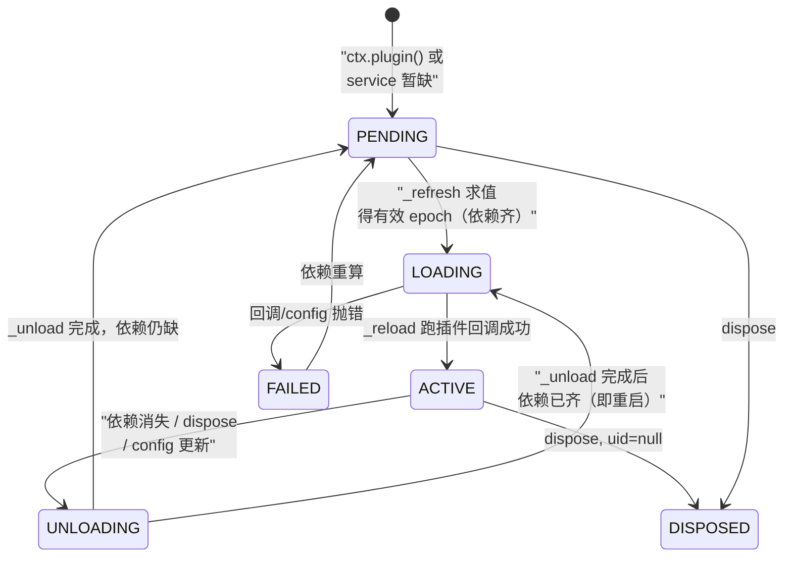
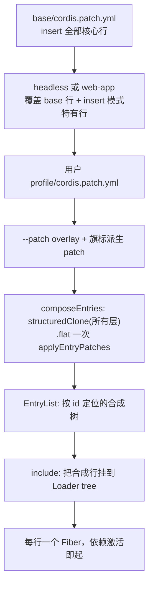

# Cordis 运行时与「万物皆插件」架构

> 对应关注面：Cordis 插件运行时、profile/bundle 分层组合、可逆注册副作用（Everything is a plugin）。分析范围：`vendor/cordis/`（核心框架）、`vendor/loader/`、`vendor/include/`（分层加载）、`packages/boot/`（引导与 profile 组合）、`packages/bundle/`（分层各层职责）。

## 根因：让 agent harness 的每个能力都成为可替换的插件，无特权核心

DeepSeek Harness（`dsh`）最根本的设计选择，写在 vendored 说明里——它把上游 Cordis 框架整体源码 vendored 进自家仓库，目的不是复用别人的轮子，而是：

> "the harness fully owns its framework layer (auditable, patchable, pinned)"

这句是理解一切的钥匙。`dsh` 不愿意让一个"外部、不可审计、npm 升级不可控"的框架躺在 `node_modules` 里决定 agent 的生死；它要对决定自身行为的每一行框架代码负责，可审计、可打补丁、可钉死版本。

由此带出贯穿整个关注的根因，一句话：

> **根因：dsh 要把"谁在跑、跑什么、怎么被卸载"都变成声明式的、可逆的、可替换的插件。模型适配器、工具注册表、会话日志、agent 循环本身都不是特权核心，而只是 loader 配置树里的若干行（rows）——替换无特权组件的能力，等同于替换一个页面里的一个区块。**

去掉它（把它换成手写的事件总线 + 直连调用）会怎样？后面的分析会反复看到：**dsh 的 Agent 循环（agent-loop）、会话持久化、工具注册表、权限沙箱、子代理都在 `base` 层的 patch 里各占一行**，全部靠 Cordis 的"注册即可逆副作用 + inject 声明依赖"来编排。拆掉 Cordis，等于拆掉了整个 harness 的组合骨架。

## 在项目中的角色：去掉它会怎样

角色即"dsh 应用 = 一个 Cordis 插件树"。三块分工：

| 层 | 包 | 角色 |
|---|---|---|
| 框架核心 | `vendor/cordis/` | Context / Event / Fiber / Service / Reflect 五大子系统（全部 vendored） |
| 声明式加载 | `vendor/loader/` + `vendor/include/` | 把"配置行（Entry）"变成"运行中的 Fiber"，支持热更新、滚动回滚 |
| 引导与组合 | `packages/boot/`（app-boot + cmdline） | 启动：环境快照 → 根 Context → Loader → Include → profile 分层 |
| 分层内容 | `packages/bundle/`（base / headless / web-app） | 三个 profile patch 层：共享核心、一次性任务模式、浏览器模式 |

**去掉它的连锁反应**（反事实推演）：

- **Agent 循环不是特权核心**。`base/cordis.patch.yml` 里 `agent-loop`、`agent-default-model`、`tool-subagent` 各是一行 `id`。没有 Cordis 的 inject 依赖解析，这些行之间就无法表达"先有 `llm` 服务、再起 `session`、再让 `agent` 依赖它们"的次序——`dsh` 就得退回手写启动清单，每加一个能力改一次引导代码。
- **可逆性消失**。会话日志、权限沙箱、API 网关这些行在进程退出 / 热重载时都要"自动撤销"。Cordis 的 fiber 卸载会倒序跑所有 effect 的 disposer。去掉它，每个插件都要自己裸记 `dispose`，漏一个就造成会话残留、端口不释放。
- **替换模型/工具 = 改引导代码**。现在 `dsh` 换模型适配器只需在 patch 层覆写 `llm-deepseek:id` 的 `config`；没有 Cordis 的"service 仓库 + id 定位替换"，这些就退化成改源码、重发布。

## 解决什么问题、根因

### 无特权核心是要解决"agent 系统的可变异质复杂度"

Agent harness 天生是**异质拼盘**：LLM 适配、工具协议、会话存储、权限策略、子代理编排、UI 传输……如果每个都作为硬编码单一实现，系统会变成——改模型连带头改启动，加一个工具要动总线，权限策略写死在循环里。

Cordis 的对症解药是三个正交的轴：

| 变异维度 | Cordis 机制 | dsh 落地 |
|---|---|---|
| 组件在哪（依赖） | `inject` 声明 → 服务仓库 `ctx.<key>` | `agent` 声明要 `llm`/`sessions` |
| 组件行为（策略） | 类型事件四种分发 | 权限 `approval`、`plan-mode`、`tool-*` 拦截 |
| 组件存续（作用域/生命周期） | 隔离 realm、isolate/intercept、可逆 effect | 主 host plane vs 每会话 agent preset realm |
| 组件组合（哪些在跑） | loader 配置 tree + patch 分层 | base → headless/web-app → 用户 patch → --patch overlay |

### 根因是"从配置即可替换一切 + 可逆副作用"

Cordis primer 用五句话概括了作者想让插件作者掌握的模型：plugin 即 Service 实现、context 是服务仓库、`inject` 声明依赖、类型事件四种分发、**注册物是可逆副作用**。

深挖为什么——**可逆副作用（reversible effects）是"从配置替换一切"能成立的前提**。你之所以敢从配置里换一个 `tool-fs`，是因为你相信旧的 `tool-fs` 的注册物（嗅探器、钩子、提供者）会在卸载时被 Cordis 自动撤销，不会污染新实现。如果没有这层撤销保证，任何热替换、任何 profile 切换都会留下一地残骸——替换的后果不可预测，于是"从配置替换一切"的承诺就崩了。

## 设计思路：方案、放弃的替代方案、核心模式

### 方案总览：一个"可逆副作用 + 依赖注入"的插件运行时

Cordis 核心只做三件事，三者以**效应（effect）统一**：

1. **服务仓库（ReflectService）**：`ctx.reflect.provide(name, impl)` 把实现放进按隔离标签索引的 store，`ctx.<name>` 读它。
2. **依赖解析（Fiber._refresh）**：每个插件（Fiber）声明 `inject`，当它声明的服务全部存在于激活 fiber 时才 LOADING→ACTIVE；服务一撤，它 UNLOADING→PENDING。
3. **可逆副作用（Fiber.effect）**：插件注册的所有东西（事件监听、服务、子插件、定时器）都通过 `effect()` 登记，卸载时按注册逆序执行 disposer。

### 核心模式：Effect 是"注册即事务"

`ctx.effect(fn)` 的 `fn` 立即执行并产生一个 disposer；Cordis 收集它。卸载时——无论是因为 fiber 被显式 dispose、依赖消失、还是配置热更新重启——都按**逆注册序**清空 `_disposables`。
[vendor/cordis/src/utils.ts:27-31]()
<!-- snippet:   clear() {
    const values = [...this.map.values()]
    this.map.clear()
    return values.reverse()
  } -->

`ctx.on()` 的监听器、`ctx.provide()` 的服务、`ctx.plugin()` 的子插件、`Service` 构造器——全部最终都落到 `fiber.effect()` 这一个入口，因此获得了统一的回滚语义。
[vendor/cordis/src/fiber.ts:676-678]()
<!-- snippet:     await Promise.all(this._disposables.clear().map(async (dispose) => {
      try {
        await composeError(async (info) => { -->

### 放弃的替代方案及其代价

- **方案 A：手写事件总线 + 直接 import 依赖。** 抛弃。`dsh` 需要的是"从配置选择实现"，直接 import 就把实现写死在源码里，替换 = 改代码 = 不可配置化。代价是失去"无特权核心"的卖点。
- **方案 B：标准 DI 容器（inversify / NestJS 式模块图）。** 隐约近似的方向，但 Cordis 选择更轻的符号化服务仓库 + 事件。代价：依赖解析是字符串/symbol 键而非强类型模块图，类型安全靠 TS 声明合并兜底；换来的是"任何插件都能自由地给 ctx 加键"的低摩擦。
- **方案 C：把 Cordis 当外部 npm 依赖。** 这是最重要的放弃项。vendor/README 给了三个理由：auditable / patchable / pinned。代价是每次上游同步都要人工重放那 18 条 Local modifications；换来的是 dsh 能对框架打自己的补丁（最重的一条：fiber.ts 的 reentrant disposal hardening），这是外部依赖做不到的自由。

### 核心模式：Loader 配置即运行树、patch 即整行替换

到 loader 一层，`dsh` 把"可逆副作用"往前再推一步：**配置树本身也是插件树**。于是：

- 一个配置文件（`cordis.yml` / profile patch）就是一棵 **EntryTree**（EntryGroup 嵌套）。
- Include 用 `applyEntryPatches` 把多个 patch 层按 id 定位、整行替换地合成一棵树。
- 每一行 Entry 对应一个 Fiber；`entry.update` 实现了"换实现 = 卸旧 fiber + 起新 fiber，失败则回滚旧 fiber"。

## 关键数据结构

### Cordis 核心三件套

**Context 是服务仓库，且本身是一个 Proxy**。构造器把自身包进 `new Proxy<this>(this, ReflectService.handler)`，普通属性读取经 proxy 走 `ReflectService.handler.get`；没经 `inject` 读到的服务会报 `cannot get property "..." without inject`。**Proxy 是"服务仓库"的实现手段**——`ctx.tools` 不是真属性而是 proxy 转发到 store。
[vendor/cordis/src/context.ts:74-74]()
<!-- snippet:     const self = new Proxy<this>(this, ReflectService.handler) -->
[vendor/cordis/src/reflect.ts:144-144]()
<!-- snippet:       const error = new Error(`cannot get property "${prop}" without inject`) -->

**Fiber 是插件运行实例（生命周期状态机）**。
[vendor/cordis/src/fiber.ts:147-154]()
<!-- snippet: export const enum FiberState {
  PENDING,
  LOADING,
  ACTIVE,
  FAILED,
  DISPOSED,
  UNLOADING,
} -->

**Effect 的形状**：同步/异步函数返回 disposer，或（异步）可迭代对象逐个 yield disposer。这是"一个 effect 注册多个副作用并共享回滚顺序"的关键。

**Plugin 的多重形态**：函数 / 类构造器 / `{apply}` 对象均支持，统一 `resolve()` 成可执行回调；元数据附带 `inject`（依赖）与 `provide`（提供什么服务）。

### Loader 数据模型

**EntryOptions —— 配置树里的一行**。
[vendor/loader/src/config/entry.ts:9-14]()
<!-- snippet: export interface EntryOptions {
  /** Stable id inside the containing entry tree. */
  id: string
  /** Module specifier imported by the entry tree. */
  name: string
  /** Config passed to the plugin. -->
  [vendor/loader/src/config/entry.ts:18-20]()
  <!-- snippet:   /** Prevents this entry and descendants from running. */
  disabled?: boolean | null
  /** Required services or service intercept config for this entry. -->
  inject?: Inject | null -->

**PatchOptions —— patch 层的一行**。
[vendor/include/src/index.ts:144-156]()
<!-- snippet: /** Runtime patch applied to entries loaded from an included config file. */
export interface PatchOptions {
  id?: string
  insert?: EntryOptions[]
  name?: string
  config?: any
  group?: boolean | null
  disabled?: boolean | null
  inject?: any
  intercept?: any
  isolate?: any
  [key: string]: any
} -->

## 核心流程（Mermaid）

### 事件四分发模式

四种分发决定了 dsh 里"策略/观察/拦截/编排"的表达方式。实现核心在事件服务（events.ts:183-256）。

| 模式 | 等待？ | 顺序 | 返回值 | dsh 用途举例 |
|---|---|---|---|---|
| `emit` | 否 | 注册序 | 无 | `internal/plugin`、`internal/status`、`loader/config-update` |
| `waterfall` | 否 | 注册序 | 有（`next` 委托） | `internal/update`（拦截/veto 重启） |
| `parallel` | 是 | 并行 | 无（有 rejected 则 AggregateError） | `exit`、`internal/listener` 通知 |
| `serial` | 是 | 注册序 | 有（首 bail 即停） | `internal/service` 依赖变更通知 |

`isBailed` 判定非 `null/false/undefined` 即停。

**waterfall 是 around-middleware**：每个 listener 收到 `(...args, next)`，`next()` 委托给链上下一个（最后是内置行为）；**不调用 `next()` 即否决**（短路）。
[vendor/cordis/src/events.ts:234-243]()
<!-- snippet:   waterfall(...args: any[]) {
    const cbs = this.dispatch('waterfall', args)
    const inner = args.pop()
    const next = () => {
      const cb = cbs.shift() ?? inner
      return cb(...args)
    }
    args.push(next)
    return next()
  } -->

### 插件启动生命周期（Fiber）

状态机流转。核心在 `_refresh`（依赖求值，fiber.ts:611-623）与 `_reload`/`_unload`（fiber.ts:646-696）。

**关键机制：Fiber 维护一个 `epoch` 字符串**，由它声明依赖的每个服务的提供者 fiber 的 uid 拼接而成。任何提供者纤维的 uid 变化（服务实现被换）都会触发 `_setEpoch` 从而重算；epoch 一变就 `_reload`（重启）或 `_unload`（卸载）。**这是"替换服务实现 = 自动重启依赖它的插件"的机制**。

### profile / bundle 分层组合

多个 patch 层 → 一棵合成 entry list → include 挂载。核心：`loadProfile` 解析 profile 目录得 `layers`，`composeEntries` 用 `applyEntryPatches` 把**所有层压扁成一个 list** 应用。

**`insert` 与 id 覆盖的语义**：每个 patch 或按 `id` 定位已有行整行替换 config，或以 `insert` 追加新行；同一 id **最后写入者胜**。`buildMap(insert)` 在 insert 后立即把新行也入 map，使同层**后面**的 patch 能配置/禁用**前面**刚 insert 的行；若不入 map（上游行为），insert 出的行在后续同一层里会"隐身"。这是 dsh 在 vendored include 上做的定制增强。

## 与其他模块协同

本关注面是**基底**。可确认的协同（基于源码）：

- **agent-loop 是配置行而非特权核心**。`base/cordis.patch.yml` 里 `agent-loop` 是 `@deepseek-ai/dsh-agent-loop` 一行；web-app 层通过 disable base 的宿主行 + insert `agent-presets` 改变它的启动行为。Cordis 提供的是它**如何在这一行里声明依赖、被替换、被卸载**的能力。
- **session 持久化是配置行**。`base/cordis.patch.yml` 的 `session-persistence-jsonl` config `root: !!js dshHomePath('sessions')`——这个 `!!js dshHomePath(...)` 是 loader 的 lazy config 解析（在依赖激活后、对该插件的 ctx 求值）。
- **模型适配器可替换**。`base/cordis.patch.yml` `llm-deepseek` 注释：No key or endpoint is inlined（依赖 settings/credentials 服务）；`llm-pi-ai` 是激活即休眠的孪生适配器。这就是"从配置替换模型适配器"的具象。
- **权限沙箱是组合**。`sandbox-policy` / `permission-presets` / `approval` 三个行互相以 `config` 引用 + `disabled` 表达，靠 Cordis 的 inject + patch 覆盖实现策略切换。

## 关键设计决策：权衡与替代方案代价

### 决策一：事件为什么要分四种分发（而非统一一个 dispatch）

**决策：** `emit` / `waterfall` / `parallel` / `serial` 四种，且是实现层真实分叉，不是装饰性糖。

**为什么：** agent 系统里"通知 vs 委托 vs 并发 vs 选优"语义差别巨大，揉成一个 dispatch 会把语义压扁。

**权衡：** 四个语义分支，每个都轻；代价是要作者为每个事件选对模式。**替代方案**（被弃）：统一 dispatch 返回 promise 数组——实现统一，但丢失 "waterfall 的 around 委托" 和 "serial 的首 bail 短路" 的结构化控制流。

### 决策二：为什么注册物做成可逆副作用（effect）

**决策：** 一切注册（监听、服务、子插件、定时器）统一走 `fiber.effect()`，卸载自动倒序回滚。

**为什么：** 这是"从配置替换一切"的地基。热更新时换 `tool-fs`，新的 `tool-fs` 必须建立在旧的一干二净之上。

**权衡：** 所有注册必须能返回 disposer，这把"不可逆注册"（如贯穿进程的模块级单例）挡在框架之外。**替代方案**（被弃）：注册即裸赋值 + 作者自理清理。

### 决策三：为什么 vendored 而非外部依赖（auditable / patchable / pinned）

**决策：** 把 Cordis 及附属包源码从 npm 放进 `vendor/`，改名 `@deepseek-ai/*`，并维护计 18 条的 Local modifications 日志。

**为什么：** harness 本身全是插件、全可替换，那么**决定"如何替换"的框架也不能是不可控的黑盒**。

**权衡：** 每次上游同步要人工重放改动，维护成本高；换来的是对框架的直接控制权。**替代方案**（被弃）：fork 一个 Cordis 再发布——等价于 vendored 但多一层发布管线且版本漂移更难钉。

### 决策四：profile/bundle 分层组合的取舍（patch 整行替换 vs 深合并）

**决策：** profile = 多层 patch 叠加，每层用 id 定位、**整行替换 config**；不做深合并。

**为什么：** 深合并会制造"底层 A 改了 X、上层 B 改了 Y、但 A 忘了说 X 归上层管"的神隐冲突；整行替换则逼 B 把整行 config 重述，任何字段要么此层说了、要么此层没动 = 用 A 的值，歧义消失。

**权衡：** 覆盖必须重述未改动字段，配置文件变啰嗦；换来的是可预测——每一行最终值由"最后一个提到它的层"决定，找得回来。**替代方案**（被弃）：层级深合并（JSONPatch/merge）。

## 亮点与问题

### 亮点

1. **一统的可逆副作用入口**。`ctx.on`/`provide`/`plugin`/`accessor`/`mixin` 全部收敛到 `fiber.effect()`，卸载回滚有单一实现、单一逆序语义。
2. **epoch 把"依赖集变化"压成可比较字符串**。提供者 fiber uid 拼串，一次 O(n) 求值即可判定"该插件是否要重启"。
3. **loader 配置树即插件树**，`entry.update` 的滚动替换内置回滚（load 失败/update 失败自动 restart 旧 fiber），把"改配置"变成事务。
4. **patch 即整行替换 + insert 即时入 map**，让多层组合可预测、且能配置同层后插的行。
5. **无特权核心兑现到行级**：模型/工具/会话/权限全是 base patch 的一行，从配置即可替换。

### 问题 / 风险

1. **依赖可靠性依赖字符串键与 TS merge**。服务仓库按字符串/symbol key 存取，类型安全靠 `declare module` 声明合并兜底——键拼错/声明漏写会静默变 `undefined`（"without inject" 对新手很不直观）。
2. **整行替换的啰嗦与维护**。web 层几乎逐行重述 base 的多行，多份 patch 文件相似内容有 drift 风险。
3. **vendored 同步成本高**。多条 local modifications 每次上游同步都要重放，且部分依赖框架 bug（e.g. loader 的 rejection 传播，app-boot 里有专门 workaround）。这是把框架"钉死"的必然代价。

## 已知的文档-实现漂移

- **草稿引用的 `docs/cordis-primer.md` 与 `docs/architecture.md` 是官方文档、非源码**：凡技术论断已尽量收敛到 vendor 源码；文档仅作概念入口。
- **`vendor/README.md` 的"18 条 Local modifications"是文档计数**：实际 Local modifications 以 `vendor/README.md:29-50` 列表为准，草稿把"最重的补丁"（fiber reentrant disposal hardening）转述为 `vendor/README.md:38`——本条依赖文档而非源码，标注为沿文档转述。
- **`fiber.ts` 的 `_disposables.clear()` 逆序卸载**：草稿原文把这一行为归属到 `fiber.ts:676` 附近的 `_unload`，与源码一致（见本文件第三节 snippet）。
EOF
echo done