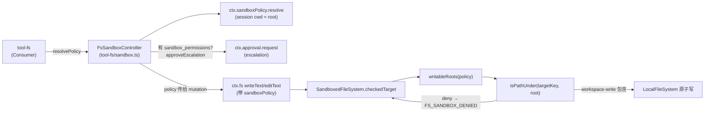
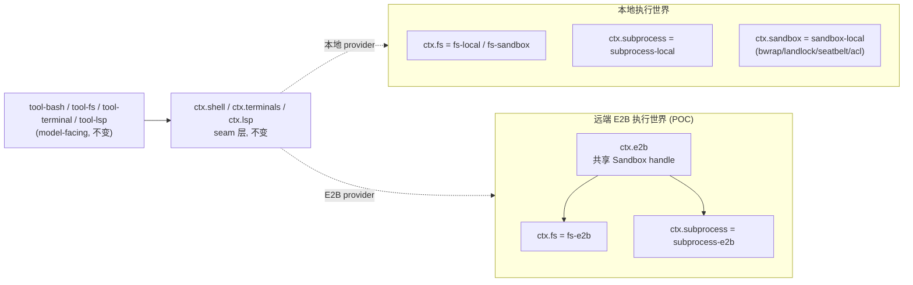

# 沙箱与 Capability Seam：可交换的执行后端 + 原生 Landlock

> 子文档之一，聚焦工具执行的环境、隔离与安全边界。覆盖 `sandbox` 六件套（`dsh-sandbox` / `sandbox-local` / `sandbox-policy` / `sandbox-windows-acl`）+ fs/subprocess/shell/terminal/lsp 六族 Capability Seam + 原生 `landlock-run`（C11）+ E2B POC。整体哲学见 [README](README.md)；本文上承 [tools.md](tools.md)（工具管道调用后端）、下启 [subagent.md](subagent.md)（多 agent 委派，依赖同类隔离）。

## 在项目中的角色

去掉了「沙箱 + Capability Seam」，agent 会退化成一个没有运行边界的对象：`ctx.sandbox` 不提供进程隔离、`ctx.fs` 不提供文件栅栏、`ctx.shell` 不包裹 runner，那么模型可就地任意读盘、执行、上网——「无特权内核」的把关闸门全部失守。分离出来看的核心职能有两层：

1. **隔离执行**：`ctx.sandbox` 是「同一执行世界下的进程限制 seam」——把**精确的子进程 argv** 包进一份宿主路径文件策略下（`[packages/sandbox/sandbox/src/index.ts:2-6]()`）。容器、微虚拟机、远端执行则整体替换外围的 capability seam，而**不是** `ctx.sandbox` 的某个 provider（`[docs/subsystems/sandbox.md:5-5]()`）。
2. **策略共享**：`ctx.sandboxPolicy` 是部署默认 file-effect 模式 + workspace root 的**唯一所有者**，供强制 fs、一次性 bash、terminal 三类后端读取同一份已解析策略（`[packages/sandbox/sandbox-policy/src/index.ts:11-16]()`），从而保证「write tool 写不了 /tmp 但 bash 能写」这类不对称不会在两个执行族之间出现。

```
<!-- anchor: /* -->
<!-- anchor:  * @module @deepseek-ai/dsh-sandbox -->
```
```
<!-- anchor: The process-sandbox seam of [dsh-sandbox] -->
<!-- anchor: bwrap) consume it. Containers, microVMs, and remote execution are sibling implementations of whole capability seams, not providers of ctx.sandbox. -->
```

## 解决什么问题 / 根因

核心张力：**隔离必须是一等抽象，却又必须可交换**。根因有三：

1. **file-effect 语义必须与 runner 解耦**。`SandboxMode` 只描述文件效果（`read-only`/`workspace-write`/`danger-full-access`），不绑定任何平台 runner；bwrap 的挂载、Landlock 的 grants、Seatbelt 的 SBPL、Windows ACL 的 SID，都是对同一词汇的不同方言（`[packages/sandbox/sandbox-local/src/index.ts:159-166]()` 的 `PLATFORM_CHAINS`）。写死在某个 provider 会让代码在 Linux/macOS/Windows 之间不可移植。
2. **策略必须 per-call 携带而非固定在 provider 上**。同一 provider 瞬间可被两个 consumer 以不同边界同时请求（bash 跑 `read-only`，受限 child agent 需要自己的 state 目录可写）；一次已批准的提权重试就是一次带更宽策略的新调用（`[packages/sandbox/sandbox/src/index.ts:62-68]()`）。于是「默认/解析」成为 consumer 边界的显式步骤，provider 只把策略当完全指定值。
3. **隔离必须 fail-closed**。任何「本机没有可用后端却仍跑命令」的静默放行都是禁止的；`confine` 必须在 wrap 时抛 `SANDBOX_UNAVAILABLE`（`[packages/sandbox/sandbox/src/index.ts:158-158]()`，`:175`）。这让"找不到沙箱"与"命令本身失败"能被结构化区分。

```
<!-- anchor: What one confined execution is allowed to touch — carried PER CALL, not -->
<!-- anchor:  * Defaulting/resolution is an explicit step at -->
```
```
<!-- anchor: Abstract process-sandbox service. confine must return enforcing argv -->
<!-- anchor:  * the fail-closed end. -->
```

## 设计思路

### Capability Seam 三件套（Definition / Provider / Consumer）

这是整个架构的搭积木模型，`docs/capability-seams.md` 用一张图 + 一张表把它标成 `seam` 角色：

- **Service Definition**（抽象，声明 `ctx.<key>`）：只声明与实现无关的接口与语义，如 `FileSystem`、`ShellExecutor`、`SubprocessRuntime`、`SandboxProvider`（`[packages/sandbox/sandbox/src/index.ts:158-158]()`）。
- **Service Provider**（实现，加载即注册，互斥）：`fs-local`/`fs-sandbox`/`fs-e2b` 都注册 `ctx.fs`（`[docs/capability-seams.md:448-448]()` 行 `ctx.fs` 行），`bash-local`/`bash-sandbox`/`pwsh-local` 都注册 `ctx.shell`（`:449`）。Cordis 对同一个 key 重复加载会 loud-fail。
- **Consumer**（消费方，通常是模型面向的工具）：「工具层拥有 agent、call id、工具名，却在 seam 内消费」——例如 `tool-bash`、`tool-fs`、`tool-terminal` 通过 `ctx.shell`/`ctx.fs`/`ctx.terminals` 触达能力。

**关键可交换性**：消费者不依赖具体 provider。`svc_shell --> pkg_tool_bash`、`svc_shell --> pkg_tool_pwsh`、`svc_shell --> pkg_hooks_claude_code` 等箭头显示：所有 shell 消费者都只连 `ctx.shell` 这一个 seam，而不连任何 concrete provider（`[docs/capability-seams.md:360-363]()`）。

### 「同执行世界」级联迁移：为什么六个族共享一个 world（根因答案）

这是回答「如何让由远端可交换的沙箱成为一等抽象」的核心机制，见「核心流程 C」的级联图。六个族（fs / subprocess / shell / terminal / lsp）共享一个「执行世界」（execution world）——**同一份宿主路径与进程命名空间、同一份 scrub、同一份生命周期**。

机制依据散落在各族的 Service Definition 注释中：
- fs 的 `processPath(target)` 返回"该 filesystem 执行世界里子进程能打开的绝对路径"，`fileUrl` 返回该平台的 `file:` URI（`[docs/subsystems/filesystem.md:15-15]()`）。
- subprocess 的 `resolveExecutable` 明确写：可执行路径属于"与本机 filesystem provider 共享的执行世界"（`[packages/subprocess/subprocess/src/index.ts:81-82]()`；`[docs/subsystems/subprocess.md:11-11]()` 明文）。
- LSP 的 `HostWorkspace.canonicalPath` 同样注明是 "filesystem/subprocess execution world" 里的规范路径（`[packages/lsp/lsp-stdio/src/host.ts:7-7]()`），且 `lsp-stdio` 同时注入 `['fs', 'lsp', 'subprocess']`（`[packages/lsp/lsp-stdio/src/index.ts:47-47]()`）。

当把执行世界指向远端 E2B 时，Bash/PTY/LSP **一并移动**，而 Bash/PTY/LSP 各自的 provider 不会出现"本地分叉"。

```
<!-- anchor: Executable paths belong to one execution world shared with the mounted -->
<!-- anchor:  *   filesystem provider. -->
```
```
<!-- anchor: One provider's spawn working directories, executable paths, ordinary processes, -->
<!-- anchor:  * and terminal sessions inhabit the same path and process namespace as the mounted filesystem provider. -->
```
```
<!-- anchor: A canonical workspace in the filesystem/subprocess execution world. -->
```
```
<!-- anchor: * @param fs - filesystem provider sharing the language server's execution world. -->
```

### Landlock 原生沙箱：进程级隔离怎么做

`landlock-run` 是一个 ~300 行 C11 的「自限制后 exec」启动器，直接打原始 Landlock UAPI（statically linked musl），不依赖 bwrap 所需的 user namespace / mount。

- **机制**：它在自己身上装一个 Landlock ruleset 然后 `exec` 被包裹的命令；ruleset 在 `execve` 后被子进程继承，于是命令及其每个后代都受限，而调用进程保持不受限（`[native/landlock-run/README.md:7-7]()`）。
- **为什么存在**：`bwrap` 用不上的场合（未安装、unprivileged user namespace 被禁用、LSM 阻止 mount）——Landlock 是独立 syscall 族，不依赖上述任何一项（`[native/landlock-run/packages/entry/src/main.c:5-8]()`）。
- **选型权衡（Landlock vs 容器/其他）**：它和容器/微虚拟机不是替代而是**分层互补**——容器/microVM 替换的是"整个 capability seam"，Landlock 所在的 `ctx.sandbox` 只做"同一主机 kernel/文件系统内"的子进程-argv 包裹（`[packages/sandbox/sandbox/src/index.ts:2-4]()`）。选 Landlock 而非在 Linux 链只留 bwrap，是因为在"无 bwrap 的受限主机"上它仍能提供进程级隔离，作为 bwrap 之后第二链的兜底（`[packages/sandbox/sandbox-local/src/index.ts:160-160]()` 的 `linux: ['bwrap', 'landlock']`）。
- **fail-closed**：ruleset 建不出来或内核不强制就 exit 125 且不 exec（`main.c:112`，`main.c:230-236`）。ABI 版本协商把 ruleset 缩到内核支持的范围，老 ABI 只报 `partial` 不拒绝（`main.c:230-238`）。

```
<!-- anchor: self-restrict-then-exec Landlock launcher. -->
<!-- anchor:  * Landlock is an independent syscall family and -->
```
```
<!-- anchor: struct landlock_ruleset_attr { -->
<!-- anchor:   uint64_t handled_access_fs; -->
```
```
<!-- anchor: static int restrict_self(const struct cli *cli, int *partial) { -->
<!-- anchor:   long abi = syscall(__NR_landlock_create_ruleset, NULL, 0, LANDLOCK_CREATE_RULESET_VERSION); -->
```
## 关键数据结构

### `ctx.sandbox` — 进程隔离 seam（Service Definition）

- `SandboxMode`：三种 file-effect 模式，**只治文件效果**；网络与进程可见性在词汇之外（`[packages/sandbox/sandbox/src/index.ts:29-29]()`）。
- `SandboxPolicy extends SandboxExecutionPolicy`：带 `mode: ConfinedSandboxMode`（去掉 `danger-full-access`），表示**一次受限执行**的允许集，per-call 携带（`:39-72`）。
- `ConfinedArgv`：`confine()` 的返回值——要 spawn 的包裹 argv + enforcement 事实 + denial 方言 + runner-failure 规则（`:95-116`）。
- `SandboxProvider.confine(argv, policy)` 抽象方法（`:175`），`SandboxUnavailableError`/`SANDBOX_UNAVAILABLE` 结构化错误（`:124`，`:131`）。

```
<!-- anchor: export type SandboxMode = 'read-only' | 'workspace-write' | 'danger-full-access' -->
```
```
<!-- anchor: export interface SandboxPolicy extends SandboxExecutionPolicy { -->
<!-- anchor:   mode: ConfinedSandboxMode -->
```
```
<!-- anchor: export interface ConfinedArgv { -->
<!-- anchor:   runnerFailureRules: readonly RunnerFailureRule[] -->
```
```
<!-- anchor:   abstract confine(argv: readonly string[], policy: SandboxPolicy): ConfinedArgv -->
```

### `ctx.sandboxPolicy` — 策略唯一所有者

- `resolve(request)`：approved 显式 mode 高于 session 最后 `sandbox/mode` 事件、再高于部署默认；session cwd 是 workspace 边界（`[packages/sandbox/sandbox-policy/src/index.ts:135-142]()`）。
- `defaultMode` / `workspaceRoot`：配置默认与 agentless 兜底（`:100-103`）。
- session-mode：override 是**会话 log 里的 `sandbox/mode` 事件**——"日志即状态"，重启靠 replay 重建；`effectiveSandboxMode` 折 fold 出上一个 switch（`[packages/sandbox/sandbox-policy/src/session-mode.ts:1-58]()`）。`setSandboxMode` 是唯一写路径。

```
<!-- anchor:   resolve(request: SandboxPolicyRequest = {}): SandboxExecutionPolicy { -->
<!-- anchor:       workspaceRoot: resolveWorkspaceRoot(session?.header.cwd ?? this.workspaceRoot), -->
```
```
<!-- anchor: export function effectiveSandboxMode(events: readonly SessionEvent[]): SandboxMode | undefined { -->
```
```
<!-- anchor: export function setSandboxMode(session: Session, mode: SandboxMode): void { -->
```

### `roots.ts` — 「workspace-write 可写根」的唯一语义家

- `canonicalPath`：真机 realpath（symlink 全解析），因为 `/tmp` 在 darwin 就是 `/private/tmp`，未解析的 grant 匹配不到任何东西（`[packages/sandbox/sandbox/src/roots.ts:30-41]()`）。
- `writableRoots`：`workspace-write` ⇒ `{workspaceRoot, '/tmp', os.tmpdir()}` 去重后 canonical（`:52-55`）。Seatbelt profile 与进程内 fs 栅栏**都从这里导 allow-list**，保证 `tool-fs` 与 bash 不漂移（`profiles.ts:8-10` 注释）。

```
<!-- anchor: export function writableRoots(policy: SandboxExecutionPolicy): string[] { -->
<!-- anchor:   return [...new Set([policy.workspaceRoot, '/tmp', tmpdir()].map(canonicalPath))] -->
```

### escalation 语义（提权）

- `WIDER_MODES`：严格更宽梯子，`read-only`→`workspace-write`→`danger-full-access`（`escalation.ts:28-31`）。
- `ESCALATION_TARGETS`：schema 能枚举的闭合目标（去 `read-only`，因为它是最底）——schema 是 registry-global，而 effective mode 是 per-call truth，所以严格更宽检查必须在执行时做（`:41`）。
- `approveEscalation`：fail-closed 有序序列——先验严格更宽（非更宽**不惊动人**）、缺 approval service / 缺 agent 都抛、再走 `ctx.approval.request`（`:157-188`）。
- 生态位：`EscalationApprover` 是**结构函数形状**而非 approval service 类型，tool 层自己闭包 `ctx.approval.request(...)` 传下来，所以本包不依赖 approval/agent 包（`:10-14`）。

```
<!-- anchor: export const WIDER_MODES: Record<string, readonly SandboxMode[]> = { -->
<!-- anchor:   'workspace-write': ['danger-full-access'], -->
```
```
<!-- anchor: export async function approveEscalation<A, C>(request: EscalationRequest, approval: EscalationApproval<A, C>): Promise<SandboxMode> { -->
<!-- anchor:   if (!(WIDER_MODES[effectiveMode] ?? []).includes(mode as SandboxMode)) { -->
```

### `sandbox-local` — provider 的 runner 链

- `PLATFORM_CHAINS`：按平台选链（Linux `['bwrap','landlock']`、darwin `['seatbelt']`、win32 `['windows-acl']`）（`[packages/sandbox/sandbox-local/src/index.ts:159-166]()`）。
- 探针仲裁：多候选才探（探针只是仲裁，不去复验唯一选择）；单候选不探，其执行期拒绝仍由 runner-failure 规则 fail-closed 兜底（`:499-510`）。
- `DENIAL_SIGNATURES`：每个 runner 的拒绝"方言"（bwrap `read-only file system`、Landlock `permission denied`、Seatbelt `operation not permitted`、windows-acl 三词条）（`:205-213`）。
- `RUNNER_FAILURE_RULES`：Landlock 的 exit-125 + `landlock-run:`、windows-acl 的 exit-127 + `windows-acl-run:`（`:231-240`）。

```
<!-- anchor: const PLATFORM_CHAINS: Record<string, readonly SelectedRunner['runner'][]> = { -->
<!-- anchor:   win32: ['windows-acl'], -->
```
```
<!-- anchor: const DENIAL_SIGNATURES = { -->
<!-- anchor:   runnerCommand: ['read-only file system', 'permission denied'], -->
```

### windows-acl — restricted-token runner

- `workspaceWriteSid`：**per-workspace 确定性 SID**（由规范 workspace 路径推出），故 workspace-root ACE 每 workspace 每机器只 materialize 一次，后续 provision 走 exact-ACE skip（`[packages/sandbox/sandbox-windows-acl/src/index.ts:13-18]()`）。
- `tempWriteSid`：每个 live session/workspace 对的**随机私有 temp 目录 + 独立 SID**，兄弟 session 共享 workspace 也不能互入 temp 树（`:18-20`）。
- 报告 `partial`：因为 WRITE_RESTRICTED 必须把 Everyone 留在 restricting list、且 NTFS hard link 能把已授权文件 alias 到外部路径（`:281`、`:186` 下注释）。

```
<!-- anchor: The write SID is the per-WORKSPACE identity -->
<!-- anchor:  * ({@link workspaceWriteSid}): deterministic from the canonical workspace -->
```
```
<!-- anchor:  * partial for its documented Everyone and hard-link boundaries. -->
```
```
<!-- anchor: export class AclSandbox { -->
```

## 核心流程（Mermaid）

### 流程 A：一个工具经 seam 调到沙箱后端（bash 链路）

`tool-bash`（Consumer）→ `ctx.shell`（seam）→ `SandboxBashExecutor`（Consumer of `ctx.sandbox`）→ `ctx.sandboxPolicy.resolve()` → `ctx.sandbox.confine()`（Provider）→ 选 runner → spawn。


参考锚点：`[packages/shell/bash-sandbox/src/index.ts:85-85](),88,177`（resolve 落 policy + run + confine）。

```
<!-- anchor: override resolve(request: ShellExecRequest): ShellExecSpec { -->
<!-- anchor:     return { ...super.resolve(request), sandboxPolicy: request.sandboxPolicy ?? this.ctx.sandboxPolicy.resolve() } -->
```
```
<!-- anchor:   private confine(command: string, policy: SandboxPolicy): ConfinedArgv { -->
<!-- anchor:     return this.ctx.sandbox.confine(['bash', '-c', command], policy) -->
```

### 流程 B：fs 写操作经 seam 到 policy 栅栏（`FS_SANDBOX_DENIED` 提权）

`tool-fs`（Consumer）→ resolve policy + 可选 escalation → `ctx.fs.writeText(..., policy)` → `SandboxedFileSystem.checkedTarget` 栅栏 → `LocalFileSystem`。


参考锚点：`[packages/fs/tool-fs/src/sandbox.ts:87-108]()`（resolvePolicy + approveEscalation）、`[packages/fs/fs-sandbox/src/index.ts:126-148]()`（checkedTarget）。

```
<!-- anchor:   async resolvePolicy(toolName: string, args: FsEscalationArgs, exec: ToolExecution): Promise<SandboxExecutionPolicy | undefined> { -->
<!-- anchor:     return { ...policy, mode: approvedMode } -->
```
```
<!-- anchor:   private async checkedTarget(target: FsTarget, sandboxPolicy?: SandboxExecutionPolicy): Promise<FsTarget> { -->
<!-- anchor:     return fresh -->
```

### 流程 C：本地 vs E2B provider 切换如何级联迁移六族

左边本地 world 用 `LocalSandboxProvider` + `LocalSubprocessRuntime` + `fs-local`；右边 E2B world 用共同 `ctx.e2b` handle + `fs-e2b` + `subprocess-e2b`，Bash/PTY/LSP 一并移动。


参考锚点：`[packages/e2b/e2b/src/index.ts:1-4]()`（同一 handle 供两个 provider）、`[packages/e2b/e2b/tests/composition.e2e.ts:125-125]()`（"FS, Bash, PTY, and LSP in one sandbox"）。

```
<!-- anchor: Shared ownership of one E2B sandbox. Capability adapters await the same SDK -->
<!-- anchor:  * handle, so filesystem and process operations inhabit one remote Linux world. -->
```
```
<!-- anchor:   it('runs FS, Bash, PTY, and LSP in one sandbox and deletes it', async () => { -->
```

## 与其他模块协同

- **tools 管道消费 Consumer**：`ctx.tools` 注册工具（bash/fs/terminal/pwsh），这些工具经 seam 触达能力；`svc_tools --> pkg_tool_bash` 等（`[docs/capability-seams.md:391-398]()`）。工具层正是 Capability Seam 的 Consumer 位置。
- **approval / guard 协同**：escalation 经 `EscalationApprover`（结构形状）指向 `ctx.approval`；`approval/request` 是 waterfall，缺 answerer fail-closed 到 `unavailable`（`[docs/subsystems/approval.md:28-28]()`；`[packages/sandbox/sandbox/src/escalation.ts:102-109]()`）。同时 `ctx.permissionPresets` 把 `workspace-write`/`danger-full-access` 两个预设打包 `sandbox-mode` + approval-policy 双旋钮（`[docs/capability-seams.md:454-454]()`）。
- **terminal 族同样吃沙箱策略**：`terminal-bash` 注入 `['terminals','sandboxPolicy','subprocess']`，spawn 时 `sandbox.confine(argv, policy)`（`[packages/terminal/terminal-bash/src/index.ts:25-25](),71-79`），并在 PTY 会话存活期间**禁止切换 sandbox mode**（`:43-52` fence）。
- **subagent：依赖同类隔离** （跨模块边界：另见相应子文档）：`sandbox/session-mode.ts:36` 注释记录了 `source: 'delegation'`——子代理委派时可把 override 播种进 child；即 child agent 需要 state 目录可写而 bash 跑 read-only，consumer 可在同一时刻对同一 provider 请求不同边界。子代理具体如何用 `sandbox/mode` override 播种、其 state 目录如何被 `workspace-write` 授权，需在主 agent 的 session/subagent 切片验证。
- **lsp / subprocess / shell** 同一世界：`lsp-stdio` 同时注入 `['fs','lsp','subprocess']`（`[packages/lsp/lsp-stdio/src/index.ts:47-47]()`），`HostWorkspace` 用 fs 的 world（`host.ts:7`），`subprocess.resolveExecutable` 解析 lsp server 进程的可执行（`host.ts`/`lsp-stdio/index.ts:146`）。
- **fs 的 policy 通过事件而非服务**（观察策略插件）：`fs/write-intent`、`fs/edit-intent` 是 waterfall，`fs/observed` 是 emit——`dsh-fs-observation-policy` 注册**无 service**，仅靠事件门（`[docs/subsystems/filesystem.md:5-7](),183-186`）；这正是"事件扩展点"哲学在 fs 族的体现。
## 关键设计决策

1. **「执行世界」共享，而非每能力独立沙箱**。六个族共路径/共命名空间/共 scrub/共生命周期（subprocess 明文字节 same execution world，`[packages/subprocess/subprocess/src/index.ts:81-82]()`；LSP world，`host.ts:7`）。权衡：如果把 fs/subprocess/terminal/lsp 各自做成独立沙箱，那么「一处策略解析」无法扩散到全部能力，且每个族都要重复 runner 选择/隔离边界；共享让 `sandboxPolicy` 一次 resolve、六族同时生效，且切远端 world 时整族级联移动。代价是"执行世界"必须被所有 provider 严格遵守，否则跨族路径互指会失效。

2. **Capability Seam 三件套的权衡**。Definition/Provider/Consumer 分离让"一个提供方交换 = 整体产品迁移"（`[docs/capability-seams.md:317-334]()`：`svc_sandbox --> pkg_bash_sandbox`、`svc_sandbox --> pkg_terminal_bash`）。换来的是间接层与一套注册/dispose 纪律；代价是消费者不可直接触具体实现，只能走 seam。它的逆面是：没有"能力注册表分叉"——同一 seam 只允许一个 provider，重复注册 loud-fail，从而杜绝多 provider 语义漂移。

3. **Landlock 选型 vs 容器/其他**。不是二选一：容器/microVM 是**同级 seam 的整体替换**，Landlock 是 `ctx.sandbox` 内的进程级兜底，二者分属不同层（`[packages/sandbox/sandbox/src/index.ts:2-4]()`）。Landlock 相对 Seatbelt 是 Linux-only；相对 bwrap 是"免 user namespace / 免 mount"（`main.c:5-8`）。取舍：C11 + musl 静态链接把审计面压到单文件 + 内核稳定 syscall 契约（`main.c:30-35`），换来的是手写 raw UAPI 的心智成本。

4. **E2B 为何作为 POC**。E2B 组合测试标题即"FS, Bash, PTY, LSP in one sandbox，然后删掉"（`[packages/e2b/e2b/tests/composition.e2e.ts:125-125]()`）——它验证"同一执行世界"假设成立（fs-e2b + subprocess-e2b 共享 `ctx.e2b` 一个 handle，`e2b/src/index.ts:1-4`）。之所以 POC 而非产品级，是因为它并不实现 `ctx.sandbox.confine`（E2B 的隔离由远端 VM 承担，属于"替换整个 seam"而非"某 provider"），也注记为 TODO（`e2b/src/index.ts:174-176` 的 rollback 态）。

5. **escalation 提权语义**。严格更宽在**执行时**对 per-call effective mode 检查而非 schema 约束（`escalation.ts:159-163`）；非更宽请求**不惊动用户**。`approveEscalation` 走 `ctx.approval.request`（结构闭包），把「批准」与「沙箱」解耦——bash 与 fs 共用同一提权词汇，拒绝/取消/不可用各自有确定错误文本（`:183-186`）。权衡：把"提权"从工具逻辑里抽出来放进共享模块，两端（`tool-bash`/`tool-fs`）的逐字错误不会漂移（`escalation.ts:4-8`）。

## 全局关联：隔离是可交换哲学最硬核的考验

沙箱是 dsh 最硬核考验「一切皆插件」的地方——因为它要同时实现对执行权的隔离、又保持后可交换。Capability Seam 三件套 + 「同一执行世界」共享 + `sandboxPolicy` 唯一所有者在策略面落点，使一次 `resolvePolicy` 六族同效、切远端 E2B 整族级联迁移而无 provider 分叉；Landlock 原生 C11 + musl 把进程级隔离的自定义面压到单文件。`platform.chains`（bwrap/landlock/seatbelt/windows-acl）证明隔离语义不是绑定某个 runner，而是对同一 `SandboxMode` 词汇的方言——这份「隔离可移植」的坚持，正是它能在 subagent（委派跨能力边界）与 tools（受控执行）两层同时成立的根本原因。
