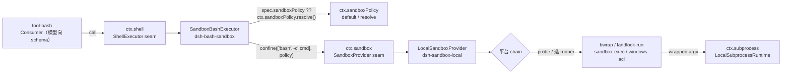
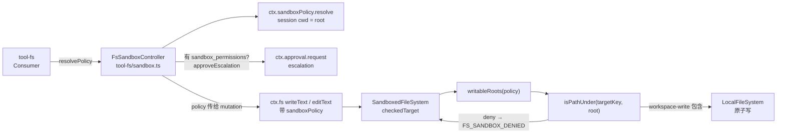
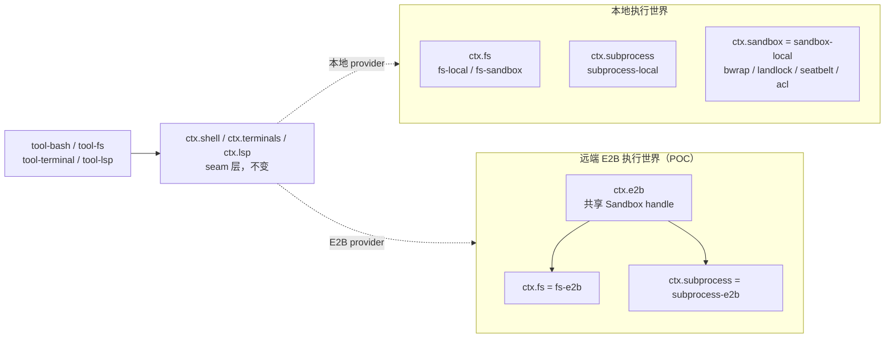
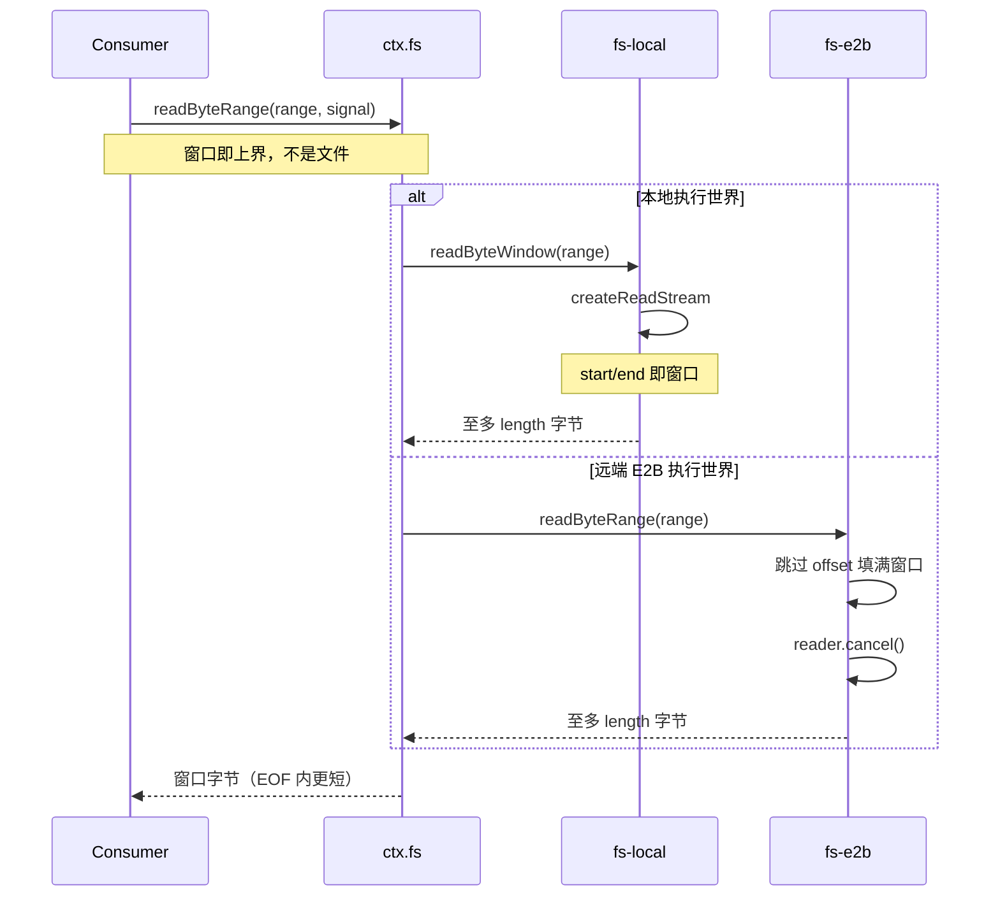

# 沙箱与 Capability Seam：可交换的执行后端 + 原生 Landlock

> 子文档之一，聚焦工具执行的环境、隔离与安全边界。覆盖 `sandbox` 四包（`dsh-sandbox` / `sandbox-local` / `sandbox-policy` / `sandbox-windows-acl`）+ 六族 Capability Seam（`ctx.sandbox` 与 fs / subprocess / shell / terminal / lsp 五族）+ 原生 `node-addon-system`（Landlock C11 启动器 + Node-API flock）+ E2B POC。整体哲学见 [README](README.md)；本文上承 [tools.md](tools.md)（工具管道调用后端）、下启 [subagent.md](subagent.md)（多 agent 委派，依赖同类隔离）；subprocess 的原生 containment 细节归 [subprocess.md](subprocess.md)、有界字节读取的消费侧归 [workspace-files.md](workspace-files.md)、原生包族的打包与发布归 [desktop-app.md](desktop-app.md)。

## 在项目中的角色

去掉了「沙箱 + Capability Seam」，agent 会退化成一个没有运行边界的对象：`ctx.sandbox` 不提供进程隔离、`ctx.fs` 不提供文件栅栏、`ctx.shell` 不包裹 runner，那么模型可就地任意读盘、执行、上网——「无特权内核」的把关闸门全部失守。分离出来看的核心职能有两层：

1. **隔离执行**：`ctx.sandbox` 是「同一执行世界下的进程限制 seam」——把**精确的子进程 argv** 包进一份宿主路径文件策略下（`[packages/sandbox/sandbox/src/index.ts:2-6]()`）。容器、微虚拟机、远端执行则整体替换外围的 capability seam，而**不是** `ctx.sandbox` 的某个 provider（`[docs/subsystems/sandbox.md:5-5]()`）。
<!-- anchor: * Service Definition for the same-world process-confinement capability seam: wrap ex … * @module @deepseek-ai/dsh-sandbox -->
<!-- anchor: The process-sandbox seam of [dsh-sandbox] -->
2. **策略共享**：`ctx.sandboxPolicy` 是部署默认 file-effect 模式 + workspace root 的**唯一所有者**，供强制 fs、一次性 bash、terminal 三类后端读取同一份已解析策略（`[packages/sandbox/sandbox-policy/src/index.ts:13-16]()`），从而保证「write tool 写不了 /tmp 但 bash 能写」这类不对称不会在两个执行族之间出现。
<!-- anchor: * Enforcing filesystem, one-shot bash, and terminal backends read the SAME … * tool owns its operation-specific denial and escalation guidance. -->

> **演进说明（0.1.5-alpha.1）**：包族盘点曾写作「`sandbox` 六件套」，实际 `packages/sandbox/` 自 0.1.2-rc.1 起就是四包（seam 定义、本机后端、策略解析、Windows ACL 后端），现按源码订正为「四包」；「六族 seam」本文明确为 `ctx.sandbox` 本体加 fs/subprocess/shell/terminal/lsp 五族（`[packages/sandbox/README.md:12-12]()`）。
<!-- anchor: The `sandbox/` group confines subprocess execution to a file-effect -->

## 解决什么问题 / 根因

核心张力：**隔离必须是一等抽象，却又必须可交换**。根因有三：

1. **file-effect 语义必须与 runner 解耦**。`SandboxMode` 只描述文件效果（`read-only`/`workspace-write`/`danger-full-access`），不绑定任何平台 runner；bwrap 的挂载、Landlock 的 grants、Seatbelt 的 SBPL、Windows ACL 的 SID，都是对同一词汇的不同方言（`[packages/sandbox/sandbox-local/src/index.ts:159-166]()` 的 `PLATFORM_CHAINS`）。写死在某个 provider 会让代码在 Linux/macOS/Windows 之间不可移植。
<!-- anchor: const PLATFORM_CHAINS: Record<string, readonly SelectedRunner['runner'][]> = { … win32: ['windows-acl'], -->
2. **策略必须 per-call 携带而非固定在 provider 上**。同一 provider 瞬间可被两个 consumer 以不同边界同时请求（bash 跑 `read-only`，受限 child agent 需要自己的 state 目录可写）；一次已批准的提权重试就是一次带更宽策略的新调用（`[packages/sandbox/sandbox/src/index.ts:62-68]()`）。于是「默认/解析」成为 consumer 边界的显式步骤，provider 只把策略当完全指定值。
<!-- anchor: * What one confined execution is allowed to touch — carried PER CALL, not … * the consumer boundary; the provider treats the policy as fully specified. -->
3. **隔离必须 fail-closed**。任何「本机没有可用后端却仍跑命令」的静默放行都是禁止的；`confine` 必须在 wrap 时抛 `SANDBOX_UNAVAILABLE`（`[packages/sandbox/sandbox/src/index.ts:158-158]()`，`[packages/sandbox/sandbox/src/index.ts:175-175]()`）。这让"找不到沙箱"与"命令本身失败"能被结构化区分。
<!-- anchor: export abstract class SandboxProvider extends Service { -->
<!-- anchor: abstract confine(argv: readonly string[], policy: SandboxPolicy): ConfinedArgv -->

## 设计思路

### Capability Seam 三件套（Definition / Provider / Consumer）

这是整个架构的搭积木模型，`docs/capability-seams.md` 用一张图 + 一张表把它标成 `seam` 角色：

- **Service Definition**（抽象，声明 `ctx.<key>`）：只声明与实现无关的接口与语义，如 `FileSystem`、`ShellExecutor`、`SubprocessRuntime`、`SandboxProvider`（`[packages/sandbox/sandbox/src/index.ts:158-158]()`）。
<!-- anchor: export abstract class SandboxProvider extends Service { -->
- **Service Provider**（实现，加载即注册，互斥）：`fs-local`/`fs-sandbox`/`fs-e2b` 都注册 `ctx.fs`（`[docs/capability-seams.md:533-533]()` 的 `ctx.fs` 行），`bash-local`/`bash-sandbox`/`pwsh-local` 都注册 `ctx.shell`（`[docs/capability-seams.md:525-525]()`）。Cordis 对同一个 key 重复加载会 loud-fail。
<!-- anchor: | `ctx.fs` | `seam` | [`fs`](../packages/fs/fs) -->
<!-- anchor: | `ctx.shell` | `seam` | [`shell`](../packages/shell/shell) -->
- **Consumer**（消费方，通常是模型面向的工具）：「工具层拥有 agent、call id、工具名，却在 seam 内消费」——例如 `tool-bash`、`tool-fs`、`tool-terminal` 通过 `ctx.shell`/`ctx.fs`/`ctx.terminals` 触达能力。

**关键可交换性**：消费者不依赖具体 provider。`svc_shell --> pkg_tool_bash`、`svc_shell --> pkg_tool_pwsh`、`svc_shell --> pkg_hooks_claude_code` 等箭头显示：所有 shell 消费者都只连 `ctx.shell` 这一个 seam，而不连任何 concrete provider（`[docs/capability-seams.md:421-424]()`）。
<!-- anchor-base64:c3ZjX3NoZWxsIC0tPiBwa2dfaG9va3NfY2xhdWRlX2NvZGUg4oCmIHN2Y19zaGVsbCAtLT4gcGtnX3Rvb2xfcHdzaA== -->

### 「同执行世界」级联迁移：为什么六个族共享一个 world（根因答案）

这是回答「如何让由远端可交换的沙箱成为一等抽象」的核心机制，见「流程 C」的级联图。六个族（`ctx.sandbox` 与 fs / subprocess / shell / terminal / lsp）共享一个「执行世界」（execution world）——**同一份宿主路径与进程命名空间、同一份 scrub、同一份生命周期**。

机制依据散落在各族的 Service Definition 注释中：
- fs 的 `processPath(target)` 返回"该 filesystem 执行世界里子进程能打开的绝对路径"，`fileUrl` 返回该平台的 `file:` URI（`[docs/subsystems/filesystem.md:15-15]()`）。
<!-- anchor: Consumers that share the filesystem's execution world obtain cross-capability -->
- subprocess 的 `resolveExecutable` 明确写：可执行路径属于"与本机 filesystem provider 共享的执行世界"（`[packages/subprocess/subprocess/src/index.ts:92-94]()`；`[docs/subsystems/subprocess.md:11-11]()` 明文）。
<!-- anchor: * Implementations must honor these semantics: … *   filesystem provider. -->
<!-- anchor: One provider's spawn working directories, executable paths, ordinary processes, -->
- LSP 的 `HostWorkspace.canonicalPath` 同样注明是 "filesystem/subprocess execution world" 里的规范路径（`[packages/lsp/lsp-stdio/src/host.ts:7-7]()`），且 `lsp-stdio` 同时注入 `['fs', 'lsp', 'subprocess']`（`[packages/lsp/lsp-stdio/src/index.ts:47-47]()`）。
<!-- anchor: /** A canonical workspace in the filesystem/subprocess execution world. */ -->
<!-- anchor: export const inject = ['fs', 'lsp', 'subprocess'] -->

当把执行世界指向远端 E2B 时，Bash/PTY/LSP **一并移动**，而 Bash/PTY/LSP 各自的 provider 不会出现"本地分叉"。

### Landlock 原生沙箱：进程级隔离怎么做

`landlock-run` 是一个 ~300 行 C11 的「自限制后 exec」启动器，直接打原始 Landlock UAPI（statically linked musl），不依赖 bwrap 所需的 user namespace / mount。

> **演进说明（0.1.5-alpha.1）**：旧路径 `native/landlock-run/`（npm 包 `@deepseek-ai/node-addon-landlock-run`）已随 `refactor(native): move Landlock workspace to native/system` 与 `refactor(native): rename package family to node-addon-system` 迁到 `native/system/`，Landlock 改由 capability 子路径 `/landlock-run` 暴露。本节引用均已按新路径重定位，旧路径 `native/landlock-run/README.md`、`native/landlock-run/packages/entry/src/main.c` 已不存在；重组动机见下节。

- **机制**：它在自己身上装一个 Landlock ruleset 然后 `exec` 被包裹的命令；ruleset 在 `execve` 后被子进程继承，于是命令及其每个后代都受限，而调用进程保持不受限（`[native/system/packages/entry/src/main.c:4-8]()`）。
<!-- anchor: * The Landlock rung of a consuming sandbox seam, for Linux hosts where … * needs none of those). The launcher installs a Landlock -->
- **为什么存在**：`bwrap` 用不上的场合（未安装、unprivileged user namespace 被禁用、LSM 阻止 mount）——Landlock 是独立 syscall 族，不依赖上述任何一项（`[native/system/packages/entry/src/main.c:23-28]()`）。
<!-- anchor: * Fail-closed: if the ruleset cannot be created or is NOT enforced by the … * package's probe). -->
- **选型权衡（Landlock vs 容器/其他）**：它和容器/微虚拟机不是替代而是**分层互补**——容器/microVM 替换的是"整个 capability seam"，Landlock 所在的 `ctx.sandbox` 只做"同一主机 kernel/文件系统内"的子进程-argv 包裹（`[packages/sandbox/sandbox/src/index.ts:2-4]()`）。选 Landlock 而非在 Linux 链只留 bwrap，是因为在"无 bwrap 的受限主机"上它仍能提供进程级隔离，作为 bwrap 之后第二链的兜底（`[packages/sandbox/sandbox-local/src/index.ts:160-160]()` 的 `linux: ['bwrap', 'landlock']`）。
<!-- anchor: * Service Definition for the same-world process-confinement capability seam: wrap ex … * surrounding capability seam instead; this service shares the host kernel -->
<!-- anchor: linux: ['bwrap', 'landlock'], -->
- **fail-closed**：ruleset 建不出来或内核不强制就 exit 125 且不 exec（`[native/system/packages/entry/src/main.c:112-112]()`、`[native/system/packages/entry/src/main.c:230-235]()`）。
<!-- anchor: #define EXIT_LAUNCHER_FAILURE 125 -->
<!-- anchor: static int restrict_self(const struct cli *cli, int *partial) { … return fail(NOT_ENFORCED_MESSAGE, NULL); -->
  ABI 版本协商把 ruleset 缩到内核支持的范围，老 ABI 只报 `partial` 不拒绝（`[native/system/packages/entry/src/main.c:237-238]()`）。
<!-- anchor: *partial = abi < MAX_ABI; … uint64_t handled = fs_mask_for_abi(abi < MAX_ABI ? abi : MAX_ABI); -->

### node-addon-system：原生能力包族的重组

0.1.5-alpha.1 把原生侧从"一个启动器一个包"改成"一个能力包族 + capability 子路径"，这是本文关注面上**唯一一次结构性变更**：

- **为什么改名**：包已不只承载 Landlock 启动器。同一个包族现在还提供 POSIX 写锁绑定——"用 `landlock-run` 可执行文件限制子进程，或用 `./flock` 入口取得 POSIX 写锁"，而"Landlock 策略与 Session 生命周期仍归调用方"（`[native/system/README.md:11-11]()`）。也就是说包族只升出**机制**（授予哪些路径、锁哪个描述符），不含"什么是 sandbox mode"这类策略判断，这与 `ctx.sandbox` 只把策略当完全指定值是同一条边界纪律。
<!-- anchor: Use the Linux `landlock-run` executable to confine -->
- **为什么用子路径而不是新包**：启动器的 CLI 契约（argv 语法、退出码、报告行）与 JS 侧的探针解析必须**同版本**演进；同一个包族内配对后，"探针解析相对二进制漂移在结构上不可能"（`[native/system/packages/entry/src/index.ts:7-10]()`）。`./landlock-run` 与 `./flock` 是仅有的两个导出子路径，**没有 root export**（`[native/system/packages/entry/package.json:12-20]()`）——消费方只能按能力点名，不能按包名兜底导入。
<!-- anchor: * the contract and the binaries version together in one package family, … * what a "sandbox mode" is, only which paths are granted read or write. -->
<!-- anchor: "./landlock-run": { … "./package.json": "./package.json" -->
- **懒加载与 fail-closed**：导入任一条目都不加载原生 addon；Landlock 缺二进制时探针报 `unusable`，flock 缺绑定时直接拒绝获取，"两条路径都不会编译，也不会静默授予不支持的行为"（`[native/system/README.md:27-27]()`）。
<!-- anchor: Importing either entry does not load an addon. A missing -->
  flock 本身是 Node-API v8 的异步绑定，`tryLockExclusive(fd)` 在异步 work 里跑 `LOCK_EX`/`LOCK_NB`，描述符所有权留在调用方（`[native/system/packages/entry/src/flock.ts:46-56]()`、`[native/system/docs/architecture.md:15-15]()`）。
<!-- anchor: export async function tryLockExclusive(fd: number): Promise<void> { … syscall: 'flock', -->
<!-- anchor: `system.node` uses stable Node-API v8. Its flock operation -->
- **消费方与打包边界**：`sandbox-local` 依赖的是入口包 `@deepseek-ai/node-addon-system`，从 `/landlock-run` 子路径取 `LAUNCHER_BIN`/`LAUNCHER_FAILURE_EXIT`/`launcherPath`/`probe`（`[packages/sandbox/sandbox-local/src/index.ts:33-33]()`、`[packages/sandbox/sandbox-local/package.json:38-38]()`）。
<!-- anchor: } from '@deepseek-ai/node-addon-system/landlock-run' -->
<!-- anchor: "@deepseek-ai/node-addon-system": "workspace:^", -->
  平台二进制放在 `-linux-x64` 一类的 optional 平台包里，装包即用、消费方安装**从不编译原生代码**（`[native/system/packages/entry/package.json:40-45]()`）；二进制路径解析刻意不依赖 cwd："可 spawn 的相对路径会把'由哪个二进制来隔离'的决定权交给 cwd"（`[native/system/packages/entry/src/index.ts:78-80]()`）。打包/预编译矩阵与发布流程见 [desktop-app.md](desktop-app.md)。
<!-- anchor: "optionalDependencies": { … "@deepseek-ai/node-addon-system-linux-x64": "workspace:*" -->
<!-- anchor: // absolute, inside this package's boundary (never cwd-relative: a … // confines), and nonexistent exactly when the package is absent. -->
- **flock 的消费者在别处**：浏览器 worker 用单进程替身顶上 flock 条目，JSONL 会话后端保留 inode 校验并把 Windows 换成既有 koffi 信号量，POSIX 才落到这个 POSIX 绑定上（`[native/system/docs/architecture.md:19-19]()`）——跨进程会话写租约的完整故事归会话侧子文档。
<!-- anchor: The JSONL backend retains its inode check, -->

**权衡**：把两个原生机制收进一个"system"包族，代价是审计面与版本面合流（一次发版同时 bump 启动器与锁绑定）；换来的是"契约与二进制永远同版本"，而这正是原先按机制拆包时最容易出的漂移。若再拆回一机制一包，probe 解析与二进制的配对就重新变成跨包约定。

### 有界字节区间读取：fs seam 上的一等能力

0.1.5-alpha.1 给 `FileSystem`（`ctx.fs`）加了第四个读原语 `readByteRange(target, range, signal)`——它不是 `readBytes` 的语法糖，而是**换了一个"上界"**：

- `readBytes(target, signal, maxBytes)` 的语义是"整文件读，但拒绝把超过 `maxBytes` 的内容缓冲进来"；`readByteRange` 的语义是"窗口就是上界"——后端至多在跳过前缀之外多传 `length` 字节，**永不缓冲整个文件**，所以"调用方对 `length` 的封顶就是对无界缓冲的防护"（`[packages/fs/fs/src/index.ts:215-227]()`）。
<!-- anchor: * Read one byte window of the regular file as raw bytes with no decoding or … abstract readByteRange(target: FsTarget, range: { offset: number -->
- **为什么必须可取消**：要"只传一个窗口"，远端后端只能流式跳过前缀再在窗口末尾截断——abort 因此是契约的一部分而不是可选项。本机实现把 `signal` 交给 `createReadStream` 的 `start`/`end` 窗口（`[packages/fs/fs-local/src/fsio.ts:439-449]()`），并把中断映射成稳定的 `FS_ABORTED`（`[packages/fs/fs-local/src/fsio.ts:458-460]()`）。
<!-- anchor: export async function readByteWindow( … ...signal ? { signal } : {}, -->
<!-- anchor: } catch (error: unknown) { … if (isAbortError(error)) throw new FsError('read aborted', 'FS_ABORTED') -->
  `fs-local` 的 override 只是把 `signal` 原样透传给窗口读取（`[packages/fs/fs-local/src/index.ts:160-161]()`）。
<!-- anchor: override async readByteRange(target: FsTarget, range: { offset: number … return readByteWindow({ displayPath: target.displayPath, targetKey: -->
- **E2B 侧为什么更贵**：SDK 只支持"从文件头开始流"，所以实现要流式跳到 `offset`、装满 `length` 后立刻 `reader.cancel()` 掐断远端流（`[packages/e2b/fs-e2b/src/index.ts:299-301]()`），并在 `finally` 里无论成败都取消未排空的流（`[packages/e2b/fs-e2b/src/index.ts:328-336]()`）——否则被抛弃的远端流会继续在沙箱里传输。
<!-- anchor: // The SDK streams only from the file's start: skip to `offset`, keep … // beyond the skipped prefix is ever transferred. -->
<!-- anchor: if (!drained) { … reader.releaseLock() -->
  整段实现见 `[packages/e2b/fs-e2b/src/index.ts:295-338]()`：这是"同一条 seam 语义，远端世界要为它多付一次取消成本"的典型——正确性优先，浪费由取消兜住。
<!-- anchor: override async readByteRange(target: FsTarget, range: { offset: number … return filled === range.length ? window : window.subarray(0, filled) -->
- **为什么 `fs-sandbox` 一分钱没花**：`SandboxedFileSystem extends LocalFileSystem`，只对两个 mutation 加 per-call 策略栅栏，"读一律放行：每种模式都允许读"（`[packages/fs/fs-sandbox/src/index.ts:3-8]()`、`[packages/fs/fs-sandbox/src/index.ts:55-55]()`）。新读能力因此**无需新栅栏、也不会造成 provider 分叉**——这正是"一个文件系统后端 + 一把只锁 mutation 的锁"的回报。
<!-- anchor: * `@deepseek-ai/dsh-fs` Service Definition. It extends `LocalFileSystem` so all … * on the two mutations. Reads pass through untouched: every mode permits -->
<!-- anchor: export class SandboxedFileSystem extends LocalFileSystem { -->
- **消费方**：`api-workspace-files` 的 `readBytes` 先由 `resolveWindow` 收敛 `offset`/`length`，再带上调用方 `signal` 走同一条 seam；`readAll` 复用同一原语、用 `length: limit + 1` 探测超限，于是"分页读"与"整文件读"共用一个后端原语（`[packages/api/workspace-files/src/index.ts:263-267]()`、`[packages/api/workspace-files/src/index.ts:284-284]()`）。消费侧细节见 [workspace-files.md](workspace-files.md)。
<!-- anchor: const { offset, length } = this.resolveWindow(range, path) … const data = await this.ctx.fs.readByteRange(target, { offset, length }, signal) -->
<!-- anchor: const data = await this.ctx.fs.readByteRange(target, { offset: 0, length: -->

同一周期还归一了**守卫式 mutation 的模型向诊断**：provider/policy 保留各自的操作性原因，而"给模型看的稳定文案"由 `tool-fs` 拥有（`FS_NOT_OBSERVED` 被替换成一条带路径的统一原因 + 读取补救，`FS_STALE_VERSION` 保留 provider 原因再追加补救）（`[packages/fs/tool-fs/src/error.ts:11-21]()`）。这与 range 读取是同一个边界纪律的两面：**seam 负责机制与稳定错误码，消费者负责面向模型的词汇**，二者不互相渗透。
<!-- anchor: * Render the stable model-facing diagnostic for a guarded-mutation failure. … export function remediateFsError(error: unknown, displayPath: string): unknown { -->

### subprocess 原生 containment：执行世界的最后一个缺口

range 读取证明"seam 上新增能力必须对每个后端都可实现且可取消"；subprocess 族本周期走的是同一条路线的另一面：把"一次 spawn 到底管住了哪些进程"从**平台固定语义**改成**provider 自述的 managed range**——`terminate()` 与 `waitForExit()` 是仅有的两个动词，观察范围由 provider 文档化（`[packages/subprocess/subprocess/src/index.ts:102-103]()`），而 target 身份保持 provider 私有（`[packages/subprocess/subprocess/src/index.ts:95-96]()`）。
<!-- anchor: * - {@link SubprocessHandle.terminate} (and the spec's abort signal) starts the … *   provider's documented procedure against its managed range. -->
<!-- anchor: * - {@link spawn} returns a live handle synchronously. Target identity remains … *   provider-private; `done` resolves with the spawned command's exit facts and -->
  由拥有者持有原生 containment、并把可观察性边界写进契约，是为了让"逃逸的后代"仍落在可观察范围内，而不是变成孤儿——provider 再也观察不到自己的 range 时 `waitForExit` 直接抛错（`[docs/subsystems/subprocess.md:168-168]()`）。细节（原生 runner、Windows 清理助手、健康探针、取消结算）归 [subprocess.md](subprocess.md)，本文只把它记作"执行世界一致性"在进程层的落点。
<!-- anchor: * @throws when the selected provider can no longer observe its managed range. -->

## 关键数据结构

### `ctx.sandbox` — 进程隔离 seam（Service Definition）

- `SandboxMode`：三种 file-effect 模式，**只治文件效果**；网络与进程可见性在词汇之外（`[packages/sandbox/sandbox/src/index.ts:29-29]()`）。
<!-- anchor: export type SandboxMode = 'read-only' | 'workspace-write' | 'danger-full-access' -->
- `SandboxPolicy extends SandboxExecutionPolicy`：把 mode 收窄成 `ConfinedSandboxMode`（去掉 `danger-full-access`），表示**一次受限执行**的允许集，per-call 携带（`[packages/sandbox/sandbox/src/index.ts:69-72]()`）。
<!-- anchor: export interface SandboxPolicy extends SandboxExecutionPolicy { … mode: ConfinedSandboxMode -->
- `ConfinedArgv`：`confine()` 的返回值——要 spawn 的包裹 argv + enforcement 事实 + denial 方言 + runner-failure 规则（`[packages/sandbox/sandbox/src/index.ts:95-115]()`）。
<!-- anchor: export interface ConfinedArgv { … runnerFailureRules: readonly RunnerFailureRule[] -->
- `SandboxProvider.confine(argv, policy)` 抽象方法（`[packages/sandbox/sandbox/src/index.ts:175-175]()`）。
<!-- anchor: abstract confine(argv: readonly string[], policy: SandboxPolicy): ConfinedArgv -->
  `SandboxUnavailableError` 结构化错误（`[packages/sandbox/sandbox/src/index.ts:131-131]()`）与 `SANDBOX_UNAVAILABLE` 错误码（`[packages/sandbox/sandbox/src/index.ts:124-124]()`）。
<!-- anchor: export class SandboxUnavailableError extends HarnessError { -->
<!-- anchor: export const SANDBOX_UNAVAILABLE = 'SANDBOX_UNAVAILABLE' -->

### `ctx.sandboxPolicy` — 策略唯一所有者

- `resolve(request)`：approved 显式 mode 高于 session 最后 `sandbox/mode` 事件、再高于部署默认；session cwd 是 workspace 边界（`[packages/sandbox/sandbox-policy/src/index.ts:163-170]()`）。
<!-- anchor: resolve(request: SandboxPolicyRequest = {}): SandboxExecutionPolicy { … ...session === undefined ? {} : { sessionId: session.id }, -->
- `defaultMode` / `workspaceRoot`：配置默认与 agentless 兜底（`[packages/sandbox/sandbox-policy/src/index.ts:121-123]()`）。
<!-- anchor: readonly defaultMode: SandboxMode … readonly workspaceRoot: string -->
- session-mode：override 是**会话 log 里的 `sandbox/mode` 事件**——"日志即状态"，重启靠 replay 重建；`effective = projection state ?? deployment default`（`[packages/sandbox/sandbox-policy/src/session-mode.ts:2-12]()`），`setSandboxMode` 是唯一写路径。
<!-- anchor: * Per-session sandbox-mode override: the session log as the store. A runtime … * capability call, weakest-precedence beneath an escalation grant. -->

### `ctx.fs` — 读侧新增的字节窗口原语

- `readByteRange(target, range, signal)`：抽象方法本身就在 seam 上，`signal` 是可选形参但契约上必须被后端兑现（`[packages/fs/fs/src/index.ts:215-227]()`，见上文「有界字节区间读取」）。
<!-- anchor: * Read one byte window of the regular file as raw bytes with no decoding or … abstract readByteRange(target: FsTarget, range: { offset: number -->

### `roots.ts` — 「workspace-write 可写根」的唯一语义家

- `canonicalPath`：真机 realpath（symlink 全解析），因为 `/tmp` 在 darwin 就是 `/private/tmp`，未解析的 grant 匹配不到任何东西（`[packages/sandbox/sandbox/src/roots.ts:30-41]()`）。
<!-- anchor: export function canonicalPath(path: string): string { … return path -->
- `writableRoots`：`workspace-write` ⇒ `{workspaceRoot, '/tmp', os.tmpdir()}` 去重后 canonical（`[packages/sandbox/sandbox/src/roots.ts:52-54]()`）。Seatbelt profile 与进程内 fs 栅栏**都从这里导 allow-list**，保证 `tool-fs` 与 bash 不漂移。
<!-- anchor: export function writableRoots(policy: SandboxExecutionPolicy): string[] { … return [...new Set([policy.workspaceRoot, '/tmp', tmpdir()].map(canonicalPath))] -->

### escalation 语义（提权）

- `WIDER_MODES`：严格更宽梯子，`read-only`→`workspace-write`→`danger-full-access`（`[packages/sandbox/sandbox/src/escalation.ts:28-31]()`）。
<!-- anchor: export const WIDER_MODES: Record<string, readonly SandboxMode[]> = { … 'workspace-write': ['danger-full-access'], -->
- `ESCALATION_TARGETS`：schema 能枚举的闭合目标（去 `read-only`，因为它是最底）——schema 是 registry-global，而 effective mode 是 per-call truth，所以严格更宽检查必须在执行时做（`[packages/sandbox/sandbox/src/escalation.ts:41-41]()`）。
<!-- anchor: export const ESCALATION_TARGETS: readonly SandboxMode[] = ['workspace-write', -->
- `approveEscalation`：fail-closed 有序序列——先验严格更宽（非更宽**不惊动人**）、缺 approval service / 缺 agent 都抛、再走 `ctx.approval.request`（`[packages/sandbox/sandbox/src/escalation.ts:157-188]()`）。
<!-- anchor: export async function approveEscalation<A, C>(request: EscalationRequest, appro … default: return assertNever(outcome, 'EscalationOutcome') -->
- 生态位：`EscalationApprover` 是**结构函数形状**而非 approval service 类型，tool 层自己闭包 `ctx.approval.request(...)` 传下来，所以本包不依赖 approval/agent 包（`[packages/sandbox/sandbox/src/escalation.ts:10-14]()`、`[packages/sandbox/sandbox/src/escalation.ts:102-109]()`）。
<!-- anchor: * The channel is a minimal STRUCTURAL function shape ({@link EscalationAsk}), … * agent packages. -->
<!-- anchor: export interface EscalationApprover<A = object, C = string> { … request(req: { agent: A; toolName: string; callId: C; reason: string; signal?: -->

### `sandbox-local` — provider 的 runner 链

- `PLATFORM_CHAINS`：按平台选链（Linux `['bwrap','landlock']`、darwin `['seatbelt']`、win32 `['windows-acl']`）（`[packages/sandbox/sandbox-local/src/index.ts:159-166]()`）。
<!-- anchor: const PLATFORM_CHAINS: Record<string, readonly SelectedRunner['runner'][]> = { … win32: ['windows-acl'], -->
- 探针仲裁：多候选才探（探针只是仲裁，不去复验唯一选择）；单候选不探，其执行期拒绝仍由 runner-failure 规则 fail-closed 兜底（`[packages/sandbox/sandbox-local/src/index.ts:499-510]()`）。
<!-- anchor: private chainVerdict(): SelectedRunner | 'unavailable' { … return 'unavailable' -->
- `DENIAL_SIGNATURES`：每个 runner 的拒绝"方言"（bwrap `read-only file system`、Landlock `permission denied`、Seatbelt `operation not permitted`、windows-acl 三词条）（`[packages/sandbox/sandbox-local/src/index.ts:205-213]()`）。
<!-- anchor: const DENIAL_SIGNATURES = { … runnerCommand: ['read-only file system', 'permission denied'], -->
- `RUNNER_FAILURE_RULES`：Landlock 的 exit-125 + `landlock-run:`、windows-acl 的 exit-127 + `windows-acl-run:`（`[packages/sandbox/sandbox-local/src/index.ts:231-240]()`）。
<!-- anchor: const RUNNER_FAILURE_RULES = { … 'windows-acl': [{ allowedExitCodes: [WINDOWS_ACL_RUNNER_FAILURE_EXIT], fatalSign -->

### windows-acl — restricted-token runner

- `workspaceWriteSid`：**per-workspace 确定性 SID**（由规范 workspace 路径推出），故 workspace-root ACE 每 workspace 每机器只 materialize 一次，后续 provision 走 exact-ACE skip（`[packages/sandbox/sandbox-windows-acl/src/index.ts:13-18]()`）。
<!-- anchor: * for the complete boundary). The write SID is the per-WORKSPACE identity … * per session for. Each private temp directory instead receives its own SID, -->
- `tempWriteSid`：每个 live session/workspace 对的**随机私有 temp 目录 + 独立 SID**，兄弟 session 共享 workspace 也不能互入 temp 树（`[packages/sandbox/sandbox-windows-acl/src/index.ts:18-20]()`）。
<!-- anchor: * per session for. Each private temp directory instead receives its own SID, … * trees. Unlike the POC, every API failure throws with the API -->
- `AclSandbox` 是本后端的公开入口类（`[packages/sandbox/sandbox-windows-acl/src/index.ts:157-157]()`）。
<!-- anchor: export class AclSandbox { -->
- 报告 `partial`：因为 WRITE_RESTRICTED 必须把 Everyone 留在 restricting list（去掉它早期 DLL 初始化与 CNG 会崩），Everyone 自身的环境授权就成了文档化的边界；NTFS hard link 又能把已授权文件 alias 到外部路径（`[packages/sandbox/sandbox-windows-acl/src/token.ts:176-176]()`、`[packages/sandbox/sandbox-windows-acl/src/runner.ts:19-19]()`）。
<!-- anchor: * Everyone's own ambient grants remain the documented partial boundary. -->
<!-- anchor: *    except for the documented Everyone and hard-link boundaries. -->

## 核心流程（Mermaid）

### 流程 A：一个工具经 seam 调到沙箱后端（bash 链路）

`tool-bash`（Consumer）→ `ctx.shell`（seam）→ `SandboxBashExecutor`（Consumer of `ctx.sandbox`）→ `ctx.sandboxPolicy.resolve()` → `ctx.sandbox.confine()`（Provider）→ 选 runner → spawn。

参考锚点：`[packages/shell/bash-sandbox/src/index.ts:85-86]()`（resolve 落 policy）、`[packages/shell/bash-sandbox/src/index.ts:179-180]()`（confine 落 runner）。
<!-- anchor: override resolve(request: ShellExecRequest): ShellExecSpec { … return { ...super.resolve(request), sandboxPolicy: request.sandboxPolicy ??  -->
<!-- anchor: private confine(command: string, policy: SandboxPolicy): ConfinedArgv { … return this.ctx.sandbox.confine(['bash', '-c', command], policy) -->

### 流程 B：fs 写操作经 seam 到 policy 栅栏（`FS_SANDBOX_DENIED` 提权）

`tool-fs`（Consumer）→ resolve policy + 可选 escalation → `ctx.fs.writeText(..., policy)` → `SandboxedFileSystem.checkedTarget` 栅栏 → `LocalFileSystem`。

参考锚点：`[packages/fs/tool-fs/src/sandbox.ts:87-108]()`（resolvePolicy + approveEscalation）、`[packages/fs/fs-sandbox/src/index.ts:122-144]()`（checkedTarget）。
<!-- anchor: async resolvePolicy(toolName: string, args: FsEscalationArgs, exec: … return { ...policy, mode: approvedMode } -->
<!-- anchor: private async checkedTarget(target: FsTarget, sandboxPolicy?: SandboxExecutionPo … return fresh -->

### 流程 C：本地 vs E2B provider 切换如何级联迁移六族

左边本地 world 用 `LocalSandboxProvider` + `LocalSubprocessRuntime` + `fs-local`；右边 E2B world 用共同 `ctx.e2b` handle + `fs-e2b` + `subprocess-e2b`，Bash/PTY/LSP 一并移动。

参考锚点：`[packages/e2b/e2b/src/index.ts:2-4]()`（同一 handle 供两个 provider）、`[packages/e2b/e2b/tests/composition.e2e.ts:127-127]()`（"FS, Bash, PTY, and LSP in one sandbox"）。
<!-- anchor: * Shared ownership of one E2B sandbox. Capability adapters await the same SDK … * @module @deepseek-ai/dsh-e2b -->
<!-- anchor: it('runs FS, Bash, PTY, and LSP in one sandbox and deletes it', async () => { -->

级联现在多了两条**同步迁移**的细节。其一，`readByteRange` 是 `ctx.fs` seam 上的一等能力，所以 E2B world 必须自己实现"跳过前缀 + 截断 + 取消流"，切 world 时分页文件读取随整族一起换实现（`[packages/e2b/fs-e2b/src/index.ts:295-338]()`）。
<!-- anchor: override async readByteRange(target: FsTarget, range: { offset: number … return filled === range.length ? window : window.subarray(0, filled) -->
其二，**网络路由也是"世界"的一部分**：E2B SDK 自建 undici dispatcher，全局 dispatcher 到不了它，于是运行时用 `proxyRouteFor(new URL(e2bApiUrl()))` 按 SDK **真正会调用的 URL** 决定是否给它 proxy（`[packages/e2b/e2b/src/index.ts:154-166]()`、`[packages/e2b/e2b/src/api-url.ts:21-25]()`）——判定若对着别的 URL 做，就会选错 scheme 的代理、忽略点名真实 host 的 bypass 条目，甚至把控制面流量和 API key 交给代理。
<!-- anchor: // The SDK builds its own undici dispatcher, so the global one never reaches … ...route.proxied ? { proxy: route.proxy } : {}, -->
<!-- anchor: export function e2bApiUrl(env: NodeJS.ProcessEnv = process.env): string { … return `https://api.${env.E2B_DOMAIN ?? E2B_DEFAULT_DOMAIN}` -->

### 流程 D：有界字节窗口在 seam 上的流转（本地 vs E2B）

同一个 `readByteRange` 调用在两个执行世界里各自落到本机流窗口与远端流截断；`signal` 一路透传，是两端共同的取消契约。

## 与其他模块协同

- **tools 管道消费 Consumer**：`ctx.tools` 注册工具（bash/fs/terminal/pwsh），这些工具经 seam 触达能力；`svc_tools --> pkg_tool_bash` 等（`[docs/capability-seams.md:450-459]()`）。工具层正是 Capability Seam 的 Consumer 位置。
<!-- anchor-base64:c3ZjX3Rvb2xzIC0tPiBwa2dfYWdlbnRfbG9vcCDigKYgc3ZjX3Rvb2xzIC0tPiBwa2dfdG9vbF93ZWI= -->
- **approval / guard 协同**：escalation 经 `EscalationApprover`（结构形状）指向 `ctx.approval`；`approval/request` 是 waterfall，缺 answerer fail-closed 到 `unavailable`（`[docs/subsystems/approval.md:28-28]()`；`[packages/sandbox/sandbox/src/escalation.ts:102-109]()`）。
<!-- anchor: type ApprovalOutcome = 'allowed-once' | 'rejected' | 'cancelled' | 'unavailable' -->
<!-- anchor: export interface EscalationApprover<A = object, C = string> { … request(req: { agent: A; toolName: string; callId: C; reason: string; signal?: -->
  同时 `ctx.permissionPresets` 把 `workspace-write`/`danger-full-access` 两个预设打包 `sandbox-mode` + approval-policy 双旋钮（`[docs/capability-seams.md:531-531]()`）。
<!-- anchor: | `ctx.permissionPresets` | `core` | [`permission-presets`] -->
- **terminal 族同样吃沙箱策略**：`terminal-bash` 注入 `['terminals','sandboxPolicy','sessionProjections','subprocess']`（`[packages/terminal/terminal-bash/src/index.ts:27-27]()`），spawn 时 `sandbox.confine(argv, { ...policy, mode: policy.mode })`（`[packages/terminal/terminal-bash/src/index.ts:108-108]()`）。
<!-- anchor: export const inject = ['terminals', 'sandboxPolicy', 'sessionProjections', 'subpro -->
<!-- anchor: return sandbox.confine(argv, { ...policy, mode: policy.mode }).argv -->
  它还在 PTY 会话存活期间**禁止切换 sandbox mode**（`[packages/terminal/terminal-bash/src/index.ts:51-61]()` fence：模式变更事件在有 owner activity 时直接抛错）。
<!-- anchor: owner.ctx.on('internal/dispatch', (_mode, eventName, args) => { … }, { global: true }) -->
- **subagent：依赖同类隔离**（跨模块边界：另见 [subagent.md](subagent.md)）：session-mode 注释记录了 `source: 'delegation'`——子代理委派时可把 override 播种进 child（`[packages/sandbox/sandbox-policy/src/session-mode.ts:33-36]()`）；即 child agent 需要 state 目录可写而 bash 跑 read-only，consumer 可在同一时刻对同一 provider 请求不同边界。
<!-- anchor: 'sandbox/mode': { … source?: 'delegation' -->
- **lsp / subprocess / shell** 同一世界：`lsp-stdio` 同时注入 `['fs','lsp','subprocess']`（`[packages/lsp/lsp-stdio/src/index.ts:47-47]()`），`HostWorkspace` 用 fs 的 world（`[packages/lsp/lsp-stdio/src/host.ts:7-7]()`）。
<!-- anchor: export const inject = ['fs', 'lsp', 'subprocess'] -->
<!-- anchor: /** A canonical workspace in the filesystem/subprocess execution world. */ -->
  它还调用 `subprocess.resolveExecutable` 解析 lsp server 进程的可执行（`[packages/lsp/lsp-stdio/src/index.ts:146-146]()`）。
<!-- anchor: const executable = await ctx.subprocess.resolveExecutable( -->
- **subprocess 的原生 containment** 是同一哲学在进程层的落点，本文只给定位，机制细节见 [subprocess.md](subprocess.md)（`[packages/subprocess/subprocess/src/index.ts:92-94]()` 的 execution-world 语义声明）。
<!-- anchor: * Implementations must honor these semantics: … *   filesystem provider. -->
- **fs 的 policy 通过事件而非服务**（观察策略插件）：`fs/write-intent`、`fs/edit-intent` 是 waterfall，`fs/observed` 是 emit——`dsh-fs-observation-policy` 注册**无 service**，仅靠事件门（`[docs/subsystems/filesystem.md:5-7]()`、`[docs/subsystems/filesystem.md:183-185]()`）；这正是"事件扩展点"哲学在 fs 族的体现。
<!-- anchor: The optional filesystem capability has four parts: [dsh-fs](../../packages/fs/fs) … `dsh-fs-observation-policy` is optional. Without it, the `FileSystem` -->
<!-- anchor: `dsh-fs` owns three events the tool dispatches and the policy plugin … `fs/write-intent` and `fs/edit-intent` are **single-slot decision waterf -->

## 关键设计决策

1. **「执行世界」共享，而非每能力独立沙箱**。六个族共路径/共命名空间/共 scrub/共生命周期（subprocess 明文字节 same execution world，`[packages/subprocess/subprocess/src/index.ts:92-94]()`；LSP world，`[packages/lsp/lsp-stdio/src/host.ts:7-7]()`）。权衡：如果把 fs/subprocess/terminal/lsp 各自做成独立沙箱，那么「一处策略解析」无法扩散到全部能力，且每个族都要重复 runner 选择/隔离边界；共享让 `sandboxPolicy` 一次 resolve、六族同时生效，且切远端 world 时整族级联移动。代价是"执行世界"必须被所有 provider 严格遵守，否则跨族路径互指会失效。
<!-- anchor: * Implementations must honor these semantics: … *   filesystem provider. -->
<!-- anchor: /** A canonical workspace in the filesystem/subprocess execution world. */ -->

2. **Capability Seam 三件套的权衡**。Definition/Provider/Consumer 分离让"一个提供方交换 = 整体产品迁移"（`[docs/capability-seams.md:389-393]()`：`svc_sandbox --> pkg_bash_sandbox`、`svc_sandbox --> pkg_terminal_bash`）。换来的是间接层与一套注册/dispose 纪律；代价是消费者不可直接触具体实现，只能走 seam。它的逆面是：没有"能力注册表分叉"——同一 seam 只允许一个 provider，重复注册 loud-fail，从而杜绝多 provider 语义漂移。
<!-- anchor-base64:c3ZjX3NhbmRib3ggLS0+IHBrZ19iYXNoX3NhbmRib3gg4oCmIHN2Y19zYW5kYm94UG9saWN5IC0tPiBwa2dfdGVybWluYWxfYmFzaA== -->

3. **Landlock 选型 vs 容器/其他**。不是二选一：容器/microVM 是**同级 seam 的整体替换**，Landlock 是 `ctx.sandbox` 内的进程级兜底，二者分属不同层（`[packages/sandbox/sandbox/src/index.ts:2-4]()`）。Landlock 相对 Seatbelt 是 Linux-only；相对 bwrap 是"免 user namespace / 免 mount"（`[native/system/packages/entry/src/main.c:4-8]()`）。取舍：C11 + musl 静态链接把审计面压到单文件 + 内核稳定 syscall 契约，换来的是手写 raw UAPI 的心智成本。
<!-- anchor: * Service Definition for the same-world process-confinement capability seam: wrap ex … * surrounding capability seam instead; this service shares the host kernel -->
<!-- anchor: * The Landlock rung of a consuming sandbox seam, for Linux hosts where … * needs none of those). The launcher installs a Landlock -->

4. **原生能力包族：一个包 + capability 子路径，而不是一机制一包**。Landlock 启动器与 flock 绑定同版本发布，CLI 契约与 JS 探针解析因此无法漂移（`[native/system/packages/entry/src/index.ts:7-10]()`），代价是审计面与版本面合流；子路径导出且无 root export，逼消费方按能力点名（`[native/system/packages/entry/package.json:12-20]()`）。
<!-- anchor: * the contract and the binaries version together in one package family, … * what a "sandbox mode" is, only which paths are granted read or write. -->
<!-- anchor: "./landlock-run": { … "./package.json": "./package.json" -->

5. **E2B 为何作为 POC**。E2B 组合测试标题即"FS, Bash, PTY, LSP in one sandbox，然后删掉"（`[packages/e2b/e2b/tests/composition.e2e.ts:127-127]()`）——它验证"同一执行世界"假设成立（fs-e2b + subprocess-e2b 共享 `ctx.e2b` 一个 handle，`[packages/e2b/e2b/src/index.ts:2-4]()`）。
<!-- anchor: it('runs FS, Bash, PTY, and LSP in one sandbox and deletes it', async () => { -->
<!-- anchor: * Shared ownership of one E2B sandbox. Capability adapters await the same SDK … * @module @deepseek-ai/dsh-e2b -->
   之所以 POC 而非产品级，是因为它并不实现 `ctx.sandbox.confine`（E2B 的隔离由远端 VM 承担，属于"替换整个 seam"而非"某 provider"），也注记为 TODO（`[packages/e2b/e2b/src/index.ts:181-183]()` 的 rollback 态）。0.1.5-alpha.1 起它还额外承担"远端世界也要按 harness 的网络路由决定 proxy"这一条：世界切换不只是路径与进程，还包括出网路径（`[packages/e2b/e2b/src/index.ts:154-166]()`）。
<!-- anchor: await sandbox.kill() … // TODO(e2b-setup-rollback): Add retry state only if a real double failure -->
<!-- anchor: // The SDK builds its own undici dispatcher, so the global one never reaches … ...route.proxied ? { proxy: route.proxy } : {}, -->

6. **escalation 提权语义**。严格更宽在**执行时**对 per-call effective mode 检查而非 schema 约束（`[packages/sandbox/sandbox/src/escalation.ts:159-163]()`）；非更宽请求**不惊动用户**。
<!-- anchor: // Strict widening is an EXECUTION check against the call's effective mode — … if (!(WIDER_MODES[effectiveMode] ?? []).includes(mode as SandboxMode)) { -->
   `approveEscalation` 走 `ctx.approval.request`（结构闭包），把「批准」与「沙箱」解耦——bash 与 fs 共用同一提权词汇，拒绝/取消/不可用各自有确定错误文本（`[packages/sandbox/sandbox/src/escalation.ts:183-186]()`）。权衡：把"提权"从工具逻辑里抽出来放进共享模块，两端（`tool-bash`/`tool-fs`）的逐字错误不会漂移（`[packages/sandbox/sandbox/src/escalation.ts:4-8]()`）。
<!-- anchor: case 'allowed-once': return mode as SandboxMode … case 'unavailable': throw new Error(`sandbox escalation to "${mode}" requires a -->
<!-- anchor: * strictly-wider ladder, the argument-pairing validation, the model-facing … * families' approval ordering and verbatim error texts from drifting apart. -->

7. **bwrap 加 PID 命名空间隔离（rc.1）**。bwrap profile 新增 `--unshare-pid --proc /proc --die-with-parent`（`[packages/sandbox/sandbox-local/src/profiles.ts:17-17]()`）：把沙箱进程放进**独立 PID 命名空间**，修复"process 根逃逸"（沙箱内进程可见主机的 process 树根）。这是一次安全加固而非新能力——在不破坏既有 `SandboxMode` 词汇与 `--ro-bind`/`--dev` 语义的前提下，把可见进程范围进一步收窄；`--die-with-parent` 保证父进程退出时沙箱进程树随之消亡，避免孤儿进程残留在共享主机 PID 空间。取舍：PID ns 让沙箱内 `ps` 只见自己的进程树（与调试/工具预期一致），但对需要观察主机进程的少数工具是约束。
<!-- anchor-base64:Y29uc3QgYXJncyA9IFsnLS1yby1iaW5kJywgJy8nLCAnLycsICctLWRldicsICcvZGV2JywgJy0tdW5zaGFyZS1waWQnLCAnLS1wcm9jJyw= -->

8. **读能力下沉 seam：窗口是一等语义，取消是契约的一部分（0.1.5-alpha.1）**。把 `readByteRange` 放进抽象 `FileSystem` 而非留在某个 provider 里，是为了让"分页/随机访问"不再靠反复整文件读来拼（`[packages/fs/fs/src/index.ts:215-227]()`）。`signal` 是可调参数但必须被每个后端兑现——本机交给 `createReadStream` 的窗口并映射 `FS_ABORTED`（`[packages/fs/fs-local/src/fsio.ts:439-449]()`）。
<!-- anchor: * Read one byte window of the regular file as raw bytes with no decoding or … abstract readByteRange(target: FsTarget, range: { offset: number -->
<!-- anchor: export async function readByteWindow( … ...signal ? { signal } : {}, -->
   远端则必须在 `finally` 里显式取消被抛弃的流（`[packages/e2b/fs-e2b/src/index.ts:328-336]()`）。权衡：抽象 seam 每加一个原语，所有后端都要按同一语义实现（E2B 因此付出了"流式跳过 + 主动取消"的复杂度）；换来的是消费方（`api-workspace-files` 的分页与整文件读）只认一条 seam，切执行世界时无需分叉。
<!-- anchor: if (!drained) { … reader.releaseLock() -->

## 全局关联：隔离是可交换哲学最硬核的考验

沙箱是 dsh 最硬核考验「一切皆插件」的地方——因为它要同时实现对执行权的隔离、又保持后可交换。Capability Seam 三件套 + 「同一执行世界」共享 + `sandboxPolicy` 唯一所有者在策略面落点，使一次 `resolvePolicy` 六族同效、切远端 E2B 整族级联迁移而无 provider 分叉；原生侧则把同一纪律推进到 npm 包：`@deepseek-ai/node-addon-system` 只经 capability 子路径暴露机制（`/landlock-run`、`/flock`），策略与生命周期留给调用方（`[native/system/docs/architecture.md:9-9]()`），Landlock C11 + musl 把进程级隔离的自定义面压到单文件。而 0.1.5-alpha.1 把有界字节读取提升为 `ctx.fs` 的一等能力并强制可取消，说明这条哲学不是"新能力随手加在某个后端"，而是**新能力先落 seam、再让每个世界各自兑现**——`PLATFORM_CHAINS`（bwrap/landlock/seatbelt/windows-acl）与 E2B 的流截断正是同一语义在不同世界的方言。这份「隔离与读取都可移植」的坚持，是它能在 subagent（委派跨能力边界）与 tools（受控执行）两层同时成立的根本原因。
<!-- anchor: The `./landlock-run` entry owns Landlock path resolution, -->
