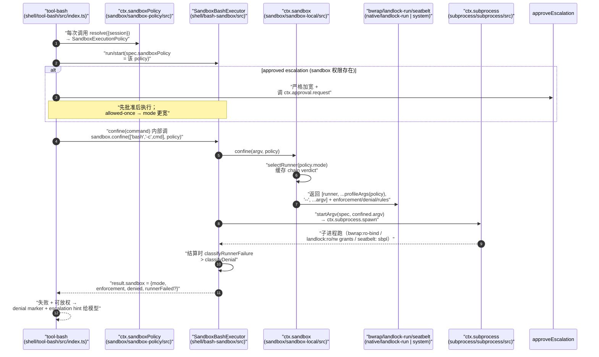
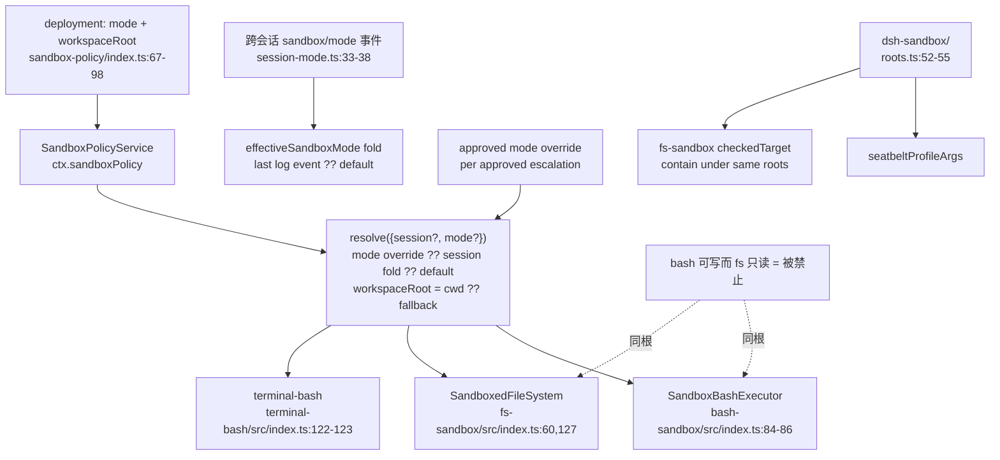

# 沙箱与进程安全边界（Sandbox & native landlock）

> 对应关注面：`ctx.sandbox` 能力 seam、`sandbox-policy` 单一策略家、`sandbox-local` 平台 runner 链、`native/landlock-run` 原生 Landlock launcher、`sandbox-windows-acl`、以及 enforcing 消费者（bash-sandbox / fs-sandbox / terminal-bash）与 approval / permission-presets 的协同。
>
> 相对路径根：`deepseek-harness/`

## 在项目中的角色（去掉它会怎样）

`ctx.sandbox` 是本 harness **同世界（same-world）进程隔离**的唯一能力 seam：它把"即将 spawn 的确切 argv"换成"被一个文件策略包裹的 argv"，但**自己从不 spawn**。spawn 永远归 `ctx.subprocess`。去掉这条 seam，所有 enforcing 后端（bwrap / Landlock / Seatbelt / windows-acl）就无处挂载，`bash`、`write`/`edit`、持久 PTY 三个能力族会退回无隔离执行——多 agent、模型可控路径的执行就会在主机的原始权限下乱跑，等于把"代码可写环境"直接暴露成"进程可改环境"。

配套有两块不可省的组织化资产：

- **`ctx.sandboxPolicy`**（`packages/sandbox/sandbox-policy`）：文件模式的**唯一家**。bash 与 fs 共用同一根，杜绝"bash 可写而 fs 只读"的分裂。
- **`packages/sandbox/sandbox-escalation` 词表（`escalation.ts`）**：严格放宽阶梯、模型侧 denial/hint marker、以及 `approveEscalation` 的 fail-closed 编排，是 bash/fs 两族"被拒 → 请求放权"共享的唯一实现，防两族措辞漂移。

去掉它们的代价不仅是功能缺失，更是**安全不变量被拆散**：escalation 的"严格加宽 + 先审批后执行"一旦由每个工具各自实现，就容易出现一个窄一个宽的漏洞。

## 解决什么问题、根因

**根因**：`ctx.sandbox` 是 seam——消费者把"即将 spawn 的确切 argv"交给它，后端按每次调用的策略包裹它并上报 enforcement；沙箱不自己 spawn（spawn 归 `ctx.subprocess`），只做 argv 包裹。

sandbox 模块解决四层问题：

1. **主机内核共享下的进程隔离**：在 bwrap/Landlock/Seatbelt/restricted-token 等"共享同一个内核与文件系统"的宿主上，把模型驱动的子进程摁进一个白名单文件策略。它与容器/microVM/远端执行是**兄弟实现**，前者替换整条能力 seam，后者只在 seam 内换 provider。
2. **多平台 runner 异构的屏蔽**：Linux 有 bwrap 与 Landlock 两个候选人、macOS 只有 Seatbelt、Windows 只有 restricted-token——消费者不关心选谁、怎么 probe、报什么 enforcement，只拿到一个 `ConfinedArgv`。
3. **"规则与门控"与"机制"的分离**：Landlock launcher 是独立的 **C11 静态二进制**（`native/landlock-run`，纯 `main.c`），它只做"enforce granted paths"这一个机制，不含任何策略。
4. **放权与门控的秩序**：被政策拒绝的调用，必须经 `ctx.approval` 审批瀑布一次性地放大到严格更宽的模式，**先批准后执行**，绝不静默放行。

一句话锚点：**沙箱只负责"怎么做受限"（机制），审批与 policy 负责"能否做、放宽到哪"（门控）；两者通过"严格加宽 + fail-closed"缝合。**

## 设计思路

### wrap-don't-spawn：seam 的分工铁律

`SandboxProvider.confine(argv, policy): ConfinedArgv` 是纯 argv 变换函数（[packages/sandbox/sandbox/src/index.ts:175-175]()）：输入是调用方即将 spawn 的确切 argv，输出是"runner + profile + `--` + 原 argv"，并附 enforcement、denial 方言、runner-failure 规则三个事实。spawn 的时点与主体（`ctx.subprocess`）完全不变。
<!-- snippet: abstract confine(argv: readonly string[], policy: SandboxPolicy): ConfinedArgv -->

- **为什么 by-design 不 spawn**：spawn 是另一个 seam（`ctx.subprocess`）的职责。沙箱若自己 fork/exec，就无法复用进程生命周期管理、超时、输出缓冲、PTY 等既有基建；把"包裹"与"拉起"解耦，使同一套 argv 既能用于前台（`run`）、后台（`start`）又能用于 PTY（`terminal-bash`）——它们只共享"包裹出的 argv"。
- **per-call 策略而非固定于 provider**：生产者把 `danger-full-access` 也带进来（`SandboxExecutionPolicy.mode` 全含），消费者可先解析策略、"窄模式才调 confine"，一次解析选边（[packages/sandbox/sandbox/src/index.ts:39-41]()）。
  <!-- snippet: export interface SandboxExecutionPolicy {
  /** The desired confinement degree for this call. */
  readonly workspaceRoot: string -->
- **安静降级是被明确禁止的**：`confine` 要么返回 enforcing argv，要么在 wrap 或 runner 执行期 fail closed；静默无隔离透传是非法的。runner chain 走完仍无可用后端即在执行期拒绝（[packages/sandbox/sandbox-local/src/index.ts:501-504]()）。
  <!-- snippet:     const [first, ...rest] = chain
    if (first === undefined) return 'unavailable'
    // A sole candidate needs no arbitration; its execution-time refusal still fails closed.
    if (rest.length === 0) return { runner: first, enforcement: STATIC_ENFORCEMENT[first] } -->

### extend 复用：enforcing 家族不重写实现，只叠加栅栏

- `SandboxBashExecutor extends LocalBashExecutor`（[packages/shell/bash-sandbox/src/index.ts:44-45]()）——继承本地进程机制（resolve/run/start/startArgv/subprocess 路径），只新增"wrap argv + 上报 sandbox 事实"。
  <!-- snippet: export class SandboxBashExecutor extends LocalBashExecutor {
  static override inject = ['subprocess', 'sandbox', 'sandboxPolicy'] -->
- `SandboxedFileSystem extends LocalFileSystem`（[packages/fs/fs-sandbox/src/index.ts:59-60]()）——继承全部文本存储机制（resolve/stat/read/atomic write/edit 关键区），只对 `writeText`/`editText` 两个 mutation 加**进程内围栏**（canonicalize → contain）。
  <!-- snippet: export class SandboxedFileSystem extends LocalFileSystem {
  static inject = ['sandboxPolicy'] -->
- `terminal-bash` 的 `BashTerminalBackend` 内部 `confine()` 包一层 argv（见 terminal-bash）。

这三处都**不 independently 写执行机制**，复用天然统一了超时、cwd、信号、输出等行为——这正是"只动 seam、不动工具"的语义（换后端只换 provider，换 enforcing 只叠加栅栏）。

### 平台 runner：probe 裁决链 vs 唯一候选

`LocalSandboxProvider` 把每平台的后端编码成一条**优先链**（[packages/sandbox/sandbox-local/src/index.ts:159-163]()）：
<!-- snippet: const PLATFORM_CHAINS: Record<string, readonly SelectedRunner['runner'][]> = {
  linux: ['bwrap', 'landlock'],
  darwin: ['seatbelt'],
  win32: ['windows-acl'],
} -->

- **链上唯一候选不 probe**（darwin / win32 直接按静态 enforcement 选定），**多候选才按序 probe**（Linux bwrap ← landlock，probe 通过才用）。唯一候选的拒绝仍走执行期 fail-closed（[packages/sandbox/sandbox-local/src/index.ts:501-504]()）。
- **probe 是"功能性"的**：不是查 `--version`，而是真的去建一个最大 ruleset 并 enforce（Landlock）或真的跑一次 `read-only` profile（bwrap/Seatbelt）。版本检查会漏掉"有 syscall 但内核拒绝 enforce"的情况；真正 restrict 才是唯一诚实信号。
- enforcement 是**逐 runner 的诚实标注**：Landlock 旧 ABI 记 `partial`，windows-acl 因 Everyone 保留位 + NTFS hard-link 记 `partial`（[packages/sandbox/sandbox-local/src/index.ts:177-187]()）。
  <!-- snippet: const STATIC_ENFORCEMENT: Record<SelectedRunner['runner'], SandboxEnforcement> = {
  bwrap: 'full',
  landlock: 'full',
  seatbelt: 'full',
  // WRITE_RESTRICTED needs Everyone in both restricting lists for process
  // initialization. An external object that grants Everyone write access
  // therefore remains writable, and NTFS hard links can alias a granted
  // workspace file to a path outside it. The backend enforces the remaining
  // ACL-addressable surface but must not advertise the absolute promise.
  'windows-acl': 'partial',
} -->

### 放弃的替代方案（反事实）

- **不用容器/namespace 做默认**：Landlock 是独立 syscall 族，不依赖 mount、userns，故在"bwrap 不可用 / userns 被禁 / LSM 拒 mount"时仍可用（[native/landlock-run/packages/entry/src/main.c:1-8]()，self-restrict-then-exec、ruleset 跨 `execve` 继承）。选择 OS 原生而不是再造容器隔离，是为了在共享内核上获得"内核级、无需 root、无 userns 依赖"的进程边界，把迁移面缩到最小。**代价**：仅 Linux。
  <!-- snippet: /*
 * landlock-run: self-restrict-then-exec Landlock launcher.
 *
 * The Landlock rung of a consuming sandbox seam, for Linux hosts where
 * `bwrap` is
 * unusable (not installed, unprivileged user namespaces disabled, or an LSM
 * profile that denies mount — Landlock is an independent syscall family and
 * needs none of those). -->
- **不要让 fs 用内核沙箱**：fs 的 mutation 是模型可控路径、属于可信代码内操作，用进程内 canonicalize-then-contain 围栏就够（[packages/fs/fs-sandbox/src/index.ts:10-14]()）。刻意不套 bash 那种子进程级内核隔离——威胁模型不同（容器/微 VM 的隔离留给 `ctx.shell`）。
  <!-- snippet:  * The fence is a policy check in TRUSTED code over a MODEL-CONTROLLED path,
  * NOT a kernel boundary — the operations are the seam's own (open, rename),
  * and only the target path is untrusted, so canonicalize-then-contain is the
  * complete answer to this surface. Kernel-grade isolation of untrusted CODE
  * stays `ctx.shell`'s job -->

## 关键数据结构（精简）

| 类型 | 位置 | 语义 |
|---|---|---|
| `SandboxMode` | [packages/sandbox/sandbox/src/index.ts:29-29]() | `'read-only' \| 'workspace-write' \| 'danger-full-access'`，只管文件效果 |
| `ConfinedSandboxMode` | [packages/sandbox/sandbox/src/index.ts:32-32]() | `Exclude<SandboxMode,'danger-full-access'>`——能交给 provider 的模式 |
| `SandboxExecutionPolicy` | [packages/sandbox/sandbox/src/index.ts:39-52]() | per-call 完整策略：`mode + workspaceRoot + sessionId?`——即使 `danger` 也带上，供一次解析后选边 |
| `SandboxPolicy` | [packages/sandbox/sandbox/src/index.ts:69-72]() | confined 模式下的 per-call 策略（交 provider）；**provider 视其为 fully-specified，不做默认化** |
| `SandboxEnforcement` | [packages/sandbox/sandbox/src/index.ts:59-59]() | `'full' \| 'partial'`——promise 的诚实度 |
| `ConfinedArgv` | [packages/sandbox/sandbox/src/index.ts:95-116]() | confine 返回值：`argv`(包裹后) + `enforcement` + `denialSignatures` + `runnerFailureRules` |
| `RunnerFailureRule` | [packages/sandbox/sandbox/src/index.ts:81-88]() | 结构化 runner 失败证据（exit-code 门 + stderr fatal 签名） |

`confine` 签名（seam 唯一接口，[packages/sandbox/sandbox/src/index.ts:175-175]()）：
<!-- snippet: abstract confine(argv: readonly string[], policy: SandboxPolicy): ConfinedArgv -->

## 核心流程（Mermaid）

### 一次 bash 调用经 sandbox wrap 的时序

要点拆解：
- **策略解析在一次边界做一次**：`resolve()` 由 tool 层对每次执行调用，把 session 的不可变 cwd 变成 `workspaceRoot`。
- **escalation 在 wrap 之前**：`approveEscalation` 在 `confine` 调用前判定严格加宽并走 `ctx.approval`，杜绝"先跑了再补票"。
- **runner 语义从 provider 带回 consumer**：spawn 用包裹后的 argv，但 denial/runner-failure 分类器（`denialSignatures`/`runnerFailureRules`）由 `ConfinedArgv` 带回，`helpers.ts` 的 `classifyRunnerFailure`/`classifyDenial` 据此结算。runner 失败优先于 denial，因为"命令没跑"不是"被政策挡住"。

### sandbox-policy 单一根被 bash 与 fs 共读

要点：
- **一个服务持有 mode + workspaceRoot**。`resolve()` 优先级：显式 approved mode > session 最近 `sandbox/mode` 事件 fold > 部署默认；root 来自 session 不可变 cwd，无 session 时回落部署配置。
- **单根的防分裂价值**：seatbelt profile 与 fs 进程内围栏都从**同一个** `writableRoots()` 派生（`packages/sandbox/sandbox/src/roots.ts:53-55`），`writableRoots` 又是唯一推导点（workspaceRoot + `/tmp` + `os.tmpdir()`，canonical 去重）。根子写死"bash 可写而 fs 只读"这类不对称就结构化地不发生。
  <!-- snippet:   if (policy.mode !== 'workspace-write') return []
  return [...new Set([policy.workspaceRoot, '/tmp', tmpdir()].map(canonicalPath))] -->
- **session 覆盖 = session 日志事件**：`setSandboxMode` 只 append 一条 `sandbox/mode`，无外部态存储；restart 靠 replay fold、两个 session 互不可见。

## 与其他模块协同

- **`ctx.subprocess`（spawn seam）**：沙箱不 spawn，把包裹后的 argv 交给 `ctx.subprocess.spawn`；`terminal-bash` 经 `ctx.subprocess.spawnTerminal` 走同一包裹。
- **`ctx.shell` / `ctx.fs`**：enforcing 实现 `extends` 本地实现并**注册成同一个 `ctx` 条目**（`SandboxBashExecutor` 以 `ctx.shell` 注册、`SandboxedFileSystem` 以 `ctx.fs` 注册）——加载的一瞬间就是整条 seam 的 swap，面向模型的工具层不变。
- **approval（`ctx.approval`）**：`escalation.ts` 只声明一个**结构性** `EscalationApprover` 形状，由 tool 层闭包 `ctx.approval.request(...)` 注入，dsh-sandbox 不依赖 approval/agent 包（[packages/sandbox/sandbox/src/escalation.ts:10-14]()）。`approval/request` waterfall、fail-closed `unavailable`、一次决策只给一次 `allowed-once`。
  <!-- snippet:  * The channel is a minimal STRUCTURAL function shape ({@link EscalationAsk}),
  * not the approval service type: the tool layer — which owns the agent, the
  * call id, and the tool name — closes over `ctx.approval.request(...)` and
  * hands the closure down, so this package never depends on the approval or
  * agent packages. -->
- **permission-presets（`packages/interaction/permission-presets`）**：把 sandbox-mode 与 approval-policy **两个正交旋钮捆成一个预设**。一次 switch 经 `permission/preset` 事件 + 两个 setter 同时写两个 knob。默认表：`workspace-write`（mode=workspace-write + approval=ask）、`danger-full-access`（mode=danger-full-access + approval=never）。

## 关键设计决策

**Why 沙箱不 spawn 只 wrap？**
因为 spawn 是独立的子进程 seam（`ctx.subprocess`）。沙箱把自己的形态限定为"argv 变换函数"，于是同一份包裹结果能复用既有进程生命周期、超时、输出、信号、PTY 基建，也才能让前台/后台/PTY 三种消费姿势共用。这让 seam 极薄（一个抽象方法），副作用最小。

**Why OS 原生 Landlock 而非容器（bwrap/namespace）？**
Landlock 是独立 syscall 族，不需要 mount、root、userns（[native/landlock-run/packages/entry/src/main.c:1-8]()，self-restrict 后 `exec`，ruleset 跨 `execve` 继承）。在 host 内核共享的前提下，这是一个"内核级、无特权、无 userns 依赖、卸载最小"的边界。bwrap 仍在 Linux 链首位（更接近 mode 词表的 mount profile），Landlock 作为不可用时的次选；OS 原生机制用 `--probe` 做 functional 裁决。**取舍代价**：Landlock 仅 Linux。

**sandbox-policy 单根避免策略分裂的价值？**
把 mode + workspaceRoot 收敛到一个服务、一个 fold、一个 `writableRoots()` 推导（[packages/sandbox/sandbox/src/roots.ts:53-55]()），bash 与 fs 必然读到同一根。分裂（bash 可写而 fs 只读）会让模型行为混乱且难审计；单根把它从"约定"升级为"结构上不可能"。escalation 词表同理，防两族措辞漂移。

**Why enforcing 家族 extends 本地实现而非独立写？**
机制（resolve/stat/atomic write/edit 关键区/process spawn/ptys）是大量既沉淀的正确代码。extend 复用保证：超时、输出、信号、关键区一致，enforcing 只叠加"栅栏 + 上报"。这是"只动 seam、不动工具"的具体技术形态——加载 enforcing 包即整条 seam swap。

**approval 与 sandbox 的职责边界？**
- sandbox 控制**"怎么做受限"**：模式、root、runner、denial 方言、runner-failure 分类。
- approval 控制**"能否做"**：一次性决策、只能给 `allowed-once`；无回答者 fail-closed 到 `unavailable`。
- 交界在 escalation 词表：**批准只授予"严格更宽的模式"，且是一次性、先批准后执行**。模型可要求放权（`sandbox_permissions` + `justification` 必成对），但放不放、放到哪由 approval 决定。

**permission-presets 如何捆绑多旋钮？**
一次预设 switch 不是一个值，而是**原子地写两个 knob**：`sandbox/mode`（经 `setSandboxMode`）与 `approval/policy`（经 `setApprovalPolicy`/`setPolicy`），再记录 `permission/preset` 意图事件。因为两个 knob 各自可独立被改，还有 `current()`/`derive()` 把"当前旋钮状态"映射回预设名（匹配不中就报 `custom`），保证 UI 显示的是真实状态而非过期标签。

## 亮点与问题

### 亮点

1. **denial 与 runner-failure 双分类器正交**：`ConfinedArgv` 带回两套独立信号（`denialSignatures`/`runnerFailureRules`），消费者先判 runner 失败（命令没跑）再判 denial（政策挡住），避免把基建故障误报成任务失败，也不把背靠背 union 的 stderr 方言混用（[packages/sandbox/sandbox/src/index.ts:95-97]()，ConfinedArgv 完整字段见同文件 95-116）。
   <!-- snippet: export interface ConfinedArgv {
  /** The wrapped argv (runner, profile, separator, then the caller's argv). */
  argv: string[] -->
2. **functional probe 而非版本探测**：Landlock 的 `--probe` 真去建最大 ruleset 并 enforce，`--version` 会漏掉"有 syscall 但拒 enforce"的内核；bwrap/Seatbelt 同理。这是"诚实 enforcement"的落地。
3. **fail-closed 遍布每层**：unconfined 透传被禁止；runner 未 enforce 即退出且不 exec；windows-acl 拒绝任何未受限 spawn；旧 ABI 标 `partial` 而非假装 `full`。
4. **进程内围栏单根同源**：fs 与 Seatbelt 共用 `writableRoots()`，分裂结构上不可能；containment 还处理 Windows 8.3/大小写别名。
5. **跨平台把差异收在 provider**：消费者只见 bwrap/landlock/seatbelt/windows-acl 归一后的 `ConfinedArgv` + enforcement；加新后端不动消费者。

### 问题 / 局限

- **Landlock 跨平台局限**：仅 Linux，且在共享根文件系统上不隔离网络/进程可见性（只做文件效果）。
- **Landlock 是 allow-list + 内核级，但旧 ABI 是 `partial`**：对要求绝对完整边界的调用方是软肋，必须显式区分 `full`/`partial`。
- **windows-acl 是 documented `partial`**：Everyone 必须在 restricting 列表（进程初始化需要），NTFS hard-link 可把 workspace 文件别名到外部，故不能承诺绝对（见上文 `STATIC_ENFORCEMENT` 注释）。
- **fs 进程内围栏存在残余 TOCTOU**：祖先 symlink 在 containment 复查与 syscall 之间被换——仅靠"委托前 re-canonicalize"收窄并显式接受（[packages/fs/fs-sandbox/src/index.ts:17-18]()）。这是威胁模型的诚实标注，但非零洞。
  <!-- snippet:  * syscall) is narrowed by re-canonicalizing immediately before delegating and
  * is accepted for this threat model. -->
- **terminal-bash 对 mode 切换加了硬栅栏**：有持久 PTY 打开时禁止切 `sandbox/mode`（抛出错误），这是安全的严格但也是运维上的不便。
- **`danger-full-access` 直接绕过**：这是本设计诚实的安全阀，但把"完全信任 switch"的负担完全交给部署与审批政策。

## 已知的文档-实现漂移

- **`native/landlock-run` 是 C11（`packages/entry/src/main.c`）不是 Rust**：任务描述中的"Rust/native landlock runner"与实际形态不符。`packages/entry/src/index.ts` 只是其 JS 入口封装（定位 launcherPath、构造 grant args、跑 `--probe`、上报 enforcement 三态）。本解读以 `main.c` 的 self-restrict-then-exec 语义为准。
- **approval seam 不在 `packages/approval/approval`**：实际在 `packages/interaction/user-approval`，`ctx.approval` 由此注册；`escalation.ts` 只做结构性依赖，不 import approval/agent 包。
- **`writableRoots` 归属**：草稿早期把 `writableRoots` 标为 `dsh-sandbox/roots.ts`，实际文件是 `packages/sandbox/sandbox/src/roots.ts`，导出 `writableRoots` 于 52-55（正文已用真实相对路径）。
