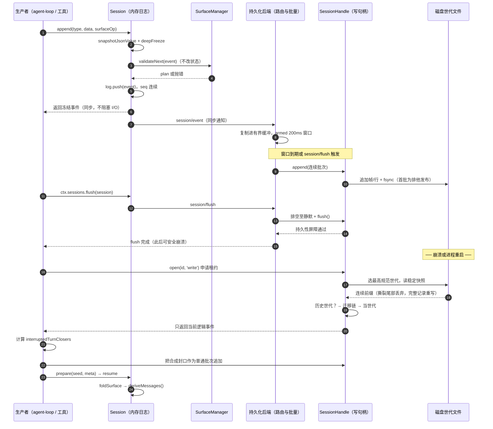
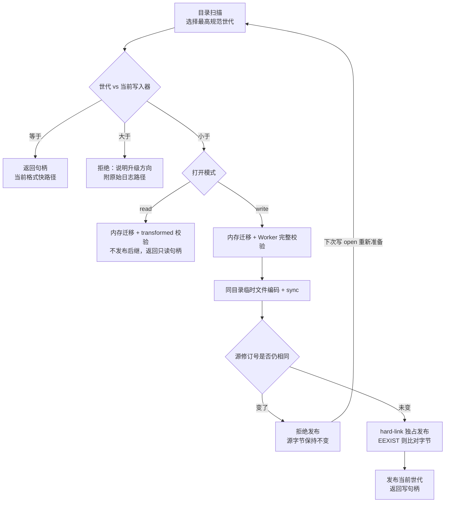

# 会话事件溯源与持久化：dsh 的日志、世代与迁移链

> 关注面说明：本模块是 dsh 的"唯一事实源"——一份仅追加的类型化 `SessionEvent` 日志，以及把这份日志变成可恢复、可迁移、可增量消费的持久化层。模型历史、fork、UI 增量、遥测、标题全部从它派生。

## 先看结论：日志不是审计副产品，它就是状态

多数 agent 框架里，"会话"是一个可变的消息数组，日志是可选的旁路（打点、trace、上报）。dsh 反过来：`Session` 是一份 append-only 的 `SessionEvent` 日志，其余一切都是投影。项目决策笔记把这条写进了"曾考虑的替代方案"里，并且是唯一的替代方案：

> **可变消息数组 + 事件仅作通知发出**：更简单，但状态与日志可能分歧；采用事件溯源后，日志本身即是状态，分歧在结构上不可能发生。
>
> — [.agents/notes/implemented/architecture/2026-06-11-event-sourced-sessions.zh.md:21](https://github.com/deepseek-ai/deepseek-harness/blob/dsh-v0.2.1-rc.3/.agents/notes/implemented/architecture/2026-06-11-event-sourced-sessions.zh.md#L21)
<!-- anchor-base64:Kirlj6/lj5jmtojmga/mlbDnu4QgKyDkuovku7bku4XkvZzpgJrnn6Xlj5Hlh7oqKu+8muabtOeugOWNle+8jOS9hueKtuaAgeS4juaXpeW/l+WPr+iDveWIhuatp++8m+mHh+eUqOS6i+S7tua6r+a6kOWQju+8jOaXpeW/l+acrOi6q+WNs+aYr+eKtuaAge+8jOWIhuatp+WcqOe7k+aehOS4iuS4jeWPr+iDveWPkeeUn+OAgg== -->

这句话是全篇的枢纽。"更简单"是真实代价：事件溯源要多付出投影开销、写放大、格式演化负担（本文后半部分几乎全在讲这个负担）。dsh 愿意付，是因为它要的不是"能看历史"，而是"历史和状态不可能不一致"。

去掉这条约束会发生什么，逐项推演比"便于调试"这种说法更有说服力：

| 能力 | 若日志是可选的旁路 | 在 dsh 里的实际形态 |
|---|---|---|
| 恢复 / resume | 需要另存一份快照，且快照与内存状态可能漂移；崩溃点之后的状态无从判断 | 日志即状态，恢复 = 读日志建 `Session`；崩溃只在尾部留下一个未封口的 turn |
| fork | 深拷贝运行时对象图，插件私有状态如何拷贝没有答案 | 切日志前缀 + 补合成封口事件，子会话天然自带全部上下文 |
| UI 增量 | 需要单独的增量协议与 id 体系，前后端各自维护 | 消费 `session/event` 推送流，seq 就是游标 |
| 遥测 / 统计 | 打点可能与真实请求不符（漏打、重打） | 从已提交事件折叠，与模型实际看到的内容同源 |
| 格式演化 | 直接改内存结构，"历史"变成无法解释的残留 | 不可变世代 + 相邻迁移链，历史字节永不改写 |

注意最后一行的差别：一旦日志是唯一事实源，"改变数据格式"就从一次代码重构升级为一次**数据兼容性承诺**。这也是为什么这个模块 90% 的复杂度不在写入路径上，而在格式世代、迁移与拒绝逻辑上。

## 日志的形状：一个信封、一份词表、四类角色

一条事件的最小结构极其克制——`type` / `seq` / `time` / `data`，外加一个可选的 `ignorable` 标记：

```ts
ignorable?: true
} & (K extends SurfaceEventType ? SurfaceIntent<K> : {
  surfaceOp?: never
  sourceEventSeqs?: never
})
```

[packages/core/session/src/types.ts:512-515](https://github.com/deepseek-ai/deepseek-harness/blob/dsh-v0.2.1-rc.3/packages/core/session/src/types.ts#L512-L515)
<!-- anchor-base64:aWdub3JhYmxlPzogdHJ1ZQ== … c291cmNlRXZlbnRTZXFzPzogbmV2ZXI= -->

这段条件类型做了一件编译器层面的事：`surfaceOp` 与 `sourceEventSeqs` **只**存在于五个产生消息的类型上，其他类型声明为 `never`。于是"给一个仅日志事件加 surface 标记"在 `Session.append()` 调用点就编译不过——不需要运行时检查、不需要 code review 记忆。类型系统被用来固化一条领域不变量，而不是描述数据结构。

### 词表不是固定的，它随挂载的插件生长

`SessionEventMap` 是 merge-extensible 的：插件通过 declaration merging 往里加变体。当前构建认识的成员被生成成一份静态清单，共 63 条：

`turn/start`、`turn/end`、`step/start`、`step/end`、`user/message`、`developer/message`、`system/message`、`assistant/message`、`assistant/attempt`、`tool/call`、`tool/result`、`request/header`、`request/context`、`session/end-seed`，加上 `compaction/*`（seam 添加）、`approval/*`、`hook/*`、`team/*`、`subagent/*`、`todo/write`、`goal/change`、`plan/mode`、`sandbox/mode` 等插件贡献项。

按角色可以分成四类，这个分类贯穿全文：

| 角色 | 代表事件 | 是否产生模型消息 | 是否可携带 `surfaceOp` |
|---|---|---|---|
| surface 事件（模型可见） | `system/message`、`developer/message`、`user/message`、`assistant/message`、`tool/result` | 是 | 必须携带 |
| 生命周期括线（执行结构） | `turn/start`、`turn/end`、`step/start`、`step/end` | 否 | 禁止 |
| 模型尝试证据 | `assistant/message` 的内嵌 `stream`、`assistant/attempt` | 否（`stream` 是回放证据） | — |
| 仅日志记录 | `request/header`、`request/context`、`session/end-seed`、`compaction/*`、`todo/write`、`hook/*` | 否 | 禁止 |

关键点：**模型可见性由类型集合决定，而不是由写出方的意图决定**。`compaction/*` 不在这个集合里——压缩从不是"改写日志"，而是往 surface 上做一次 `replace`，旧事件原地保留。这解释了为什么压缩后日志会变长而非变短：它隐藏进了投影，没有隐藏进存储。

### `replace`：唯一允许"看不见历史"的机制

`SurfaceOp` 只有两个变体：`'append'` 与 `{ op: 'replace', startSeq, endSeq }`。替换的真实语义藏在一段 JSDoc 里，值得逐字读：

> 两个端点都早于替换事件，并按当前 surface 顺序而非数值序号顺序标识闭区间。

[packages/core/session/src/types.ts:456-461](https://github.com/deepseek-ai/deepseek-harness/blob/dsh-v0.2.1-rc.3/packages/core/session/src/types.ts#L456-L461)
<!-- anchor-base64:KiAtIGB7IG9wOiAncmVwbGFjZScsIHN0YXJ0U2VxLCBlbmRTZXEgfWA6IHJlcGxhY2VzIHN1cmZhY2Ugbm9kZXMgZnJvbSBgc3RhcnRTZXFg … KiAgIG1heSB1c2UgaXQu -->

"按当前 surface 顺序而非数值序号顺序"这一句是被迫的：替换会改变 surface 的形状，第二次替换的端点可能比第一次的端点数值更小却位置更靠后。合法但数值递减的替换端点是明确被测试覆盖的场景。这也是 surface 折叠必须维护一个有序 `nodes` 数组、而不能只按 seq 排序的原因。

`assertSystemHeadRewrite` 给 node 0 单独上了锁——系统提示所在的头节点只能被另一个 `system/message` 精确覆盖：

```ts
if (event.type !== 'system/message' || shadowedSeqs.length !== 1) {
  throw new Error('surface replace: node 0 holds the system prompt and may be rewritten only by a system/message over exactly that node')
}
```

[packages/core/session/src/surface.ts:504-505](https://github.com/deepseek-ai/deepseek-harness/blob/dsh-v0.2.1-rc.3/packages/core/session/src/surface.ts#L504-L505)
<!-- anchor-base64:aWYgKGV2ZW50LnR5cGUgIT09ICdzeXN0ZW0vbWVzc2FnZScgfHwgc2hhZG93ZWRTZXFzLmxlbmd0aCAhPT0gMSkgew== … dGhyb3cgbmV3IEVycm9yKCdzdXJmYWNlIHJlcGxhY2U6IG5vZGUgMCBob2xkcyB0aGUgc3lzdGVtIHByb21wdCBhbmQgbWF5IGJlIHJld3JpdHRlbiBvbmx5IGJ5IGEgc3lzdGVtL21lc3NhZ2Ugb3ZlciBleGFjdGx5IHRoYXQgbm9kZScp -->

理由是压缩：压缩可以合法地吞掉中间的大量历史节点，但如果它顺带把系统提示也替换成了摘要文本，模型此后就在一个"自己的系统提示被摘要过"的世界里运行，且没有任何日志能表达原本的指令。所以压缩范围允许覆盖后来的 system 节点，但 node 0 例外。

## 从日志到模型历史：`deriveMessages()` 的三层折叠

投影过程不是一个函数，而是三层叠加，每层解决不同的问题。

### 第一层：surface 折叠决定"哪些节点可见、以什么顺序"

`foldSurface()` 把整份日志重放成 `SurfaceFoldResult`——当前 surface 的 seq 序列 + 替换历史 + 插件投影后的消息表。`SurfaceManager` 是这个 fold 的增量版本，同一条 `planSurfaceEvent` 逻辑同时服务完整重放与实时追加，所以冷读与热读不可能得出不同结果。

一个细节值得注意：`validateNext()` 先对候选事件做完整校验、**但不改状态**，直到日志真的接纳它才 `applySurfacePlan`。

```ts
validateNext(event: SessionEvent): void {
  this._assertProjections()
  ...
  this._pendingPlan = {
    event,
    expectedSeq,
    plan: planSurfaceEvent(this._state, event, expectedSeq, this.log, this.baseSeq, this.projections),
  }
}
```

设计意图写在 `commit()` 的顺序里：先 `surfaceManager.validateNext(event)`，再 `log.push(event)`，再通知 `session/event`。校验失败时日志一个字节都没变——"被拒绝的 append 不改变日志、派生状态或事件流"是包级承诺，而这里保证了它不靠回滚、靠顺序。

### 第二层：逐节点纯函数 `deriveEventMessage()`

每个 surface 节点投影成一条消息，或投影成 `null`（什么也不产生）。整个函数就是一个 switch，而且**故意不穷尽**：

```ts
// Intentionally non-exhaustive: only message-producing events derive
// history; turn/step boundaries, failed attempts, and errors are trace/replay
// data.
switch (event.type) {
```

[packages/core/session/src/surface.ts:126-129](https://github.com/deepseek-ai/deepseek-harness/blob/dsh-v0.2.1-rc.3/packages/core/session/src/surface.ts#L126-L129)
<!-- anchor-base64:Ly8gSW50ZW50aW9uYWxseSBub24tZXhoYXVzdGl2ZTogb25seSBtZXNzYWdlLXByb2R1Y2luZyBldmVudHMgZGVyaXZl … c3dpdGNoIChldmVudC50eXBlKSB7 -->

注释里的 "Intentionally non-exhaustive" 是有代价的选择。通常这里会写 `assertNever(event)` 来保证"新增事件类型时编译报错"，但 union 是可被插件扩展的，写 `assertNever` 会让每个新增仅日志事件都变成一次编译错误，而正确答案恰恰是"它不产生消息"。放弃编译期的完备性检查，换取插件可以自由增加词表——默认分支返回 `null` 是领域规则，不是遗漏。

空内容也有规则：`system/message`、`developer/message`、`assistant/message` 内容为空时返回 `null`，但**仍占据 surface 位置**。这解决一个具体问题：因 max-tokens 截断、没有输出任何内容的步骤，需要一条 `assistant/message` 来承载 `usage` 与 stream 证据，但如果它进入 provider transcript，就会凭空多出一个空 assistant 轮次。

### 第三层：缓存与失效由 `contentGeneration` 驱动

`deriveMessages()` 是增量的：只投影 `nodes.slice(this.derivedNodes)`，遇到 `contentGeneration` 变化就整体重建。

```ts
if (generation !== this.derivedGeneration) {
  this.derived = []
  this.derivedNodes = 0
  this.derivedGeneration = generation
}
```

[packages/core/session/src/index.ts:988-991](https://github.com/deepseek-ai/deepseek-harness/blob/dsh-v0.2.1-rc.3/packages/core/session/src/index.ts#L988-L991)
<!-- anchor-base64:aWYgKGdlbmVyYXRpb24gIT09IHRoaXMuZGVyaXZlZEdlbmVyYXRpb24pIHs= … dGhpcy5kZXJpdmVkR2VuZXJhdGlvbiA9IGdlbmVyYXRpb24= -->

两种代际被刻意分开：`replaceGeneration` 只统计**位置替换**，`contentGeneration` 统计替换 **加上插件拥有的消息改写**。`deriveMessages()` 用后者（内容变了就必须重建）；前者服务于不同的判断——压缩需要知道"surface 形状（节点集合）是否真的变过"，因为一次内容级改写不会减少任何节点、因此无法缓解 context overflow。`compaction-basic` 正是在溢出恢复里比较替换前后的 `replaceGeneration`，只有它前进才允许重试请求：

[packages/compaction/compaction-basic/src/index.ts:229-230](https://github.com/deepseek-ai/deepseek-harness/blob/dsh-v0.2.1-rc.3/packages/compaction/compaction-basic/src/index.ts#L229-L230)
<!-- anchor-base64:aWYgKHNpZ25hbC5hYm9ydGVk … fHwgYWdlbnQuc2Vzc2lvbi5zdXJmYWNlLnJlcGxhY2VHZW5lcmF0aW9uIDw9IGdlbmVyYXRpb24pIHJldHVybiBuZXh0KCk= -->

### 为什么这条规则是硬约束而不是最佳实践

> **模型可见即已记录。** 每个模型请求都必须能从日志重建。新增模型可见输入需要会话事件。

[docs/architecture.zh.md:128](https://github.com/deepseek-ai/deepseek-harness/blob/dsh-v0.2.1-rc.3/docs/architecture.zh.md#L128)
<!-- anchor-base64:KirmqKHlnovlj6/op4HljbPlt7LorrDlvZXjgIIqKiDmr4/kuKrmqKHlnovor7fmsYLpg73lv4Xpobvog73ku47ml6Xlv5fph43lu7rjgILmlrDlop7mqKHlnovlj6/op4HovpPlhaXpnIDopoHkvJror53kuovku7bjgILkv67mlLnnjrDmnInmtojmga/lhoXlrrnnmoTmj5Lku7bms6jlhoxb57qv5raI5oGv5oqV5b2xXShzdWJzeXN0ZW1zL3Nlc3Npb24= -->

把它当软约定会立刻出现一种失效：某个插件想给模型加一段上下文，直接在组装请求时拼进去。于是模型看到了 X，日志里没有 X，下次 resume 时 X 消失、模型行为突变，且**没有任何证据链能定位到 X 来自哪个插件、什么时候加进去的**。事件溯源在这里不是可观测性增强，而是"会话连续性"的实现前提——没有它，resume 只能保证"看起来像原来"，不能保证"就是原来"。

同一个逻辑反过来约束了插件的扩展方式：想改已记录消息的内容，不能改写事件，必须注册一个纯的消息投影（`ProjectionDefinition` 式的 `SessionMessageProjection`），由 fold 在读侧应用。若该定义缺失，读取直接抛错而不是降级：

```ts
if (MESSAGE_PROJECTION_EVENT_TYPES.has(event.type)) {
  throw new Error(`session event "${event.type}" requires a message projection; load its owning plugin or supply its projection definition`)
}
```

[packages/core/session/src/surface.ts:529-530](https://github.com/deepseek-ai/deepseek-harness/blob/dsh-v0.2.1-rc.3/packages/core/session/src/surface.ts#L529-L530)
<!-- anchor-base64:aWYgKE1FU1NBR0VfUFJPSkVDVElPTl9FVkVOVF9UWVBFUy5oYXMoZXZlbnQudHlwZSkpIHs= … dGhyb3cgbmV3IEVycm9yKGBzZXNzaW9uIGV2ZW50ICIke2V2ZW50LnR5cGV9IiByZXF1aXJlcyBhIG1lc3NhZ2UgcHJvamVjdGlvbjsgbG9hZCBpdHMgb3duaW5nIHBsdWdpbiBvciBzdXBwbHkgaXRzIHByb2plY3Rpb24gZGVmaW5pdGlvbmAp -->

当前词表里只有 `image/offload` 一条走这条路（图片被卸载到外部存储，消息内容替换为引用）。但机制是为将来所有"内容级改写"准备的：**日志负责记录事实，投影负责解释事实，解释规则本身也要跟着日志一起走**。

## 一次写入到可恢复读取的完整链路

把上述机制接上持久化，得到下面这条链路。它同时说明了 dsh 的一个非直觉设计：写入是同步的，但**落盘不是**。



几个必须点出的分界：

- **`append` 是同步的，`flush` 是唯一的持久性屏障。** 这条划分让热路径（模型流式输出、工具结果回写）永不等 I/O；而 `handle.append` 在解析时的承诺只是"已被接受、已排序、对同一后端实例可见"，不承诺进程崩溃后还在。[packages/core/session/src/types.ts:291-295](https://github.com/deepseek-ai/deepseek-harness/blob/dsh-v0.2.1-rc.3/packages/core/session/src/types.ts#L291-L295)
<!-- anchor-base64:KiBDbG9zZXMgdHVybiBgdHVybmAgd2l0aCB0aGUge0BsaW5rIFR1cm5FbmRSZWFzb259IHRoYXQgZW5kZWQgaXQuIEEgdHVybg== … KiBgd2hlbklkbGUoKWAgZmx1c2ggdGhlbXNlbHZlcy4gU3VjY2VzcyBjb21taXRzIHRoZSB0dXJuOyByZWplY3Rpb24gaXM= -->
- **批量窗口是固定 200ms，且首事件开窗后不重置。** 常量在 provider 里：[packages/session/session-persistence-jsonl/src/storage.ts:35-36](https://github.com/deepseek-ai/deepseek-harness/blob/dsh-v0.2.1-rc.3/packages/session/session-persistence-jsonl/src/storage.ts#L35-L36)
<!-- anchor-base64:LyoqIE1heGltdW0gaW50ZW50aW9uYWwgd2FpdCBiZWZvcmUgYSByb3V0ZWQgbGl2ZSBzZXNzaW9uIGJhdGNoIHN0YXJ0cyB3cml0aW5nLiA= … ZXhwb3J0IGNvbnN0IExJVkVfV1JJVEVfQkFUQ0hfTUFYX0RFTEFZX01TID0gMjAw -->
  "不重置"是对吞吐与延迟的取舍：持续高频事件下，重置式 debounce 会让写入无限推迟直至静默——对一个可能连续输出几分钟的 agent 来说等于永不落盘。
- **谁决定何时 flush 是另一个插件。** `session-checkpoint-policy` 在三个语义边界强制 flush：构造模型请求前、顶层工具执行前、`agent/pre-step` 前。序列里画的是逻辑屏障，实际时机由策略插件掌握——这是一个典型的能力 seam 切分：`dsh-session` 提供 `ctx.sessions.flush()` 入口，策略决定节拍，后端提供持久性。

## 格式世代：为什么是 `session.vN.jsonl` 而不是"升级一下"

日志一旦成为事实源，磁盘上的字节就变成了契约。dsh 对它采取的态度近乎数据库：**已发布的世代不可变，只写当前版，拒绝未来版。**

### 命名即世代

世代编号直接编进文件名，v0 是历史特例（无后缀）：

```ts
return generation === 0 ? 'session.jsonl' : `session.v${generation}.jsonl`
```

[packages/session/session-format/src/filename.ts:14-17](https://github.com/deepseek-ai/deepseek-harness/blob/dsh-v0.2.1-rc.3/packages/session/session-format/src/filename.ts#L14-L17)
<!-- anchor-base64:ZXhwb3J0IGZ1bmN0aW9uIHNlc3Npb25Gb3JtYXRMb2dGaWxlbmFtZSh2ZXJzaW9uOiBudW1iZXIpOiBzdHJpbmcgew== … fQ== -->

解析侧同样严格：正则 `^session(?:\.v([1-9][0-9]*))?\.jsonl$` 明确不接受临时文件、大写、前导零、`.v0` 与带压缩后缀的名字。把世代放进文件名而不是放进 header，换来一个廉价的保险：`stat`/`list` 只看目录项就能判定这是哪个世代，连 header 帧都不用解压。代价是"改名"成为一次物理发布操作，而不是一次字段写入——这正是后面独占发布流程存在的原因。

运行时的选择规则只有一条，"数值最高"：

```ts
const latest = generations.sort((left, right) => right.version - left.version)[0]
```

[packages/session/session-persistence-jsonl/src/index.ts:1560](https://github.com/deepseek-ai/deepseek-harness/blob/dsh-v0.2.1-rc.3/packages/session/session-persistence-jsonl/src/index.ts#L1560)
<!-- anchor-base64:Y29uc3QgbGF0ZXN0ID0gZ2VuZXJhdGlvbnMuc29ydCgobGVmdCwgcmlnaHQpID0+IHJpZ2h0LnZlcnNpb24gLSBsZWZ0LnZlcnNpb24pWzBd -->

排序在这里是承重的：即使目录里同时躺着 v0…v4，老世代只是被"保留"，永远不会被自动选作 fallback。对于读，最高的未来世代仍会导致拒绝；对于写，只写当前世代。因此**低世代文件的保留不构成降级兼容承诺**——它只是给运维看一眼原始数据的材料。

### 三方权威：常量、生成物、记录

格式版本这种"必须恰好一个真源"的字段，最容易长出第二个。dsh 的处理是把权威拆成三个明确不同的东西，并让一致性由机器检查：

| 权威 | 载体 | 谁维护 | 被什么检查 |
|---|---|---|---|
| 写入器版本 | `SESSION_FORMAT_VERSION = 4` | 人手改，唯一一处 | 目录生成器推导 codec 顺序并校验相邻迁移是否到达该版本 |
| 世代 catalog | `session-format-catalog/src/generated.ts` | `gen-session-format-catalog.ts` 生成 | `verify-persistence-catalog` 保证新鲜 |
| 已发布事实 | `docs/session-format-status.zh.md` 的 `latestReleasedVersion` / `evidenceTag` | 发布操作者 | `doc-standard.spec.ts` 校验结构、双语一致、`latestReleasedVersion ≤ 写入器版本` |

有意思的是第三个权威被刻意做成**不能自动化**的：

> 这个无密钥检查不会查询 GitHub，也不能证明记录是最新的；核实发布事实仍属于发布更新的一部分。

[docs/session-format-status.zh.md:56](https://github.com/deepseek-ai/deepseek-harness/blob/dsh-v0.2.1-rc.3/docs/session-format-status.zh.md#L56)
<!-- anchor-base64:W+aWh+aho+agh+WHhua1i+ivlV0oLi4vc2NyaXB0cy9kb2Mtc3RhbmRhcmQuc3BlYy50cynmo4Dmn6XorrDlvZXnu5PmnoTjgIHlj4zor63kuIDoh7TmgKfjgIHor4Hmja7moIfnrb7lj4rlhpnlhaXlmajot6/lvoTkuIDoh7TmgKfvvIzku6Xlj4rmlofmoaPkuK3nmoTlt7Llj5HluIPniYjmnKzkuI3pq5jkuo7lt6XkvZzljLrlhpnlhaXlmajjgILov5k= -->

这是有意放弃"由 CI 证明已发布"。理由是：让文档门禁依赖网络与凭据，会把本地检查耦合到 GitHub 可用性上，而"是否已发布"本身是发布时刻的事实，本地无法可靠重建。于是分工是"机器保证内部一致，人保证事实新鲜"——一条罕见的、诚实的自动化边界声明。

当前三方是一致的：写入器常量 4、定稿基线 4、发布记录 `latestReleasedVersion: 4` 且 `evidenceTag: dsh-v0.2.0-rc.2`。本基线（`dsh-v0.2.1-rc.3`）携带的仍是格式 4，即"已发布格式"而非"开发中的新格式"——这也解释了为什么本基线没有 v5：格式只在**必需**时升版本（见下节）。

### 升版本的门槛：判别信息不够用了才升

版本机制决策里对"何时升版本"给了一个拒绝"结构性差异即升版本"的判据：

> **既有判别信息无法阻止不安全解释时升版本。** 仅解析成功不能证明兼容：静默跳过重建所需内容属于错误读取。

[.agents/notes/implemented/architecture/2026-08-10-session-log-version-mechanism.zh.md:17](https://github.com/deepseek-ai/deepseek-harness/blob/dsh-v0.2.1-rc.3/.agents/notes/implemented/architecture/2026-08-10-session-log-version-mechanism.zh.md#L17)
<!-- anchor-base64:Kirml6LmnInliKTliKvkv6Hmga/ml6Dms5XpmLvmraLkuI3lronlhajop6Pph4rml7bljYfniYjmnKzjgIIqKiDku4Xop6PmnpDmiJDlip/kuI3og73or4HmmI7lhbzlrrnvvJrpnZnpu5jot7Pov4fph43lu7rmiYDpnIDlhoXlrrnlsZ7kuo7plJnor6/or7vlj5bjgILlkIzniYjmnKzlj5jmm7TopoHmsYLml6for7vlj5blmajlronlhajlpITnkIbvvIw= -->

判据的落地形态是**方向敏感的拒绝**加**逐事件 `ignorable` 标记**：

- 版本相等 → 正常读。
- 比读取器新 → 拒绝，且消息必须说明方向（"由更新的 harness 写入，请升级"）并给出原始日志绝对路径。用 `SessionFormatUnsupportedError` 而非 `SessionPersistenceCorruptionError`，因为数据没坏。
- 比读取器旧 → 在内存里跑完整相邻链，得到当前逻辑结果；写 open 才把当前世代排他发布出去。

`ignorable` 的默认值是整个兼容设计的支点：**默认必需**。忘写标记的后果是"过度拒绝"（体验问题），默认可忽略的后果是"静默恢复出残缺会话"（安全事故）。两者不对称，所以默认值必须偏向拒绝。这也解释了为什么第一方 writer 从不自己设置 `ignorable`——它只服务于仓库外插件与实验性 plugin record。

## 相邻迁移链：N→N+1 的代价与控法

dsh 没有"一次性大版本升级"，只有一串 N→N+1 的迁移边，每条边一个独立包：

```
session-format-v0-to-v1 → session-format-v1-to-v2 → session-format-v2-to-v3 → session-format-v3-to-v4
```

`session-format-catalog` 把它们静态装配成唯一一条无缺口的链，并在模块初始化时校验：

```ts
currentVersion: 4,
codecs: [ releasedV0…, releasedV1…, releasedV2…, releasedV3…, releasedV4… ],
migrations: [ sessionFormatV0ToV1, sessionFormatV1ToV2, sessionFormatV2ToV3, sessionFormatV3ToV4 ],
```

[packages/session/session-format-catalog/src/generated.ts:17-31](https://github.com/deepseek-ai/deepseek-harness/blob/dsh-v0.2.1-rc.3/packages/session/session-format-catalog/src/generated.ts#L17-L31)
<!-- anchor-base64:Y3VycmVudFZlcnNpb246IDQs … XSw= -->

### 代价清单

选相邻链而不是一次性升级，要付的账很具体：

1. **迁移包数量随版本数增长。** 每次升版本新增一个包 + 一份 spec + 一份测试，且旧包永不删除、永不修改（已发布语义冻结）。
2. **测试矩阵是链式的，不是星形的。** 不能只测每条边的输入输出，还要测多跳组合：前代的 assistant 流折叠会改变源坐标，因此 V3 插入系统事件的位置在"v0 直接到 v3"和"先到 v2 再到 v3"下必须一致。决策笔记明确说覆盖率百分比不能证明这些跨阶段关系，必须做组合断言。
3. **每条边都要重新论证"保留什么、拒绝什么"。** V2→V3 的 README 被指定为该边转换/保留/拒绝规则的单一规范真源；V3→V4 单列了"原生 V4 准入"章节，避免把"仅当前版本支持的能力"误当历史转换。
4. **中间版本不得落盘。** 迁移只在内存 stage 里产生中间状态，磁盘上只有"精确源世代"与"最终当前世代"两种文件。

### 项目怎么控住它

| 手段 | 机制 | 控住的具体风险 |
|---|---|---|
| 静态 catalog | 生成物固定 codec/edge 顺序，模块初始化拒绝缺口；插件不能增删边 | 历史可读性依赖部署组合 |
| 生成式校验 | `collectSessionFormatMigrations` 在生成期逐版本要求"恰好一条" `vN→vN+1` 边，并要求清单恰好终止于当前版本 | 忘记补一条边导致"某个版本的历史不可读" |
| 不可变 source | 迁移不改写源文件；已提交世代字节不变 | 迁移 bug 破坏用户数据 |
| 独占发布 | hard-link 创建 + 目录 sync；`EEXIST` 时校验已存在目标字节是否等于 staged | 两个进程同时发布出不同内容 |
| 语料清单 | 有意不支持的历史转换按源路径 + 世代 + 精确拒绝原因登记，清单内必须抛类型化拒绝，清单外必须能还原 | 用统一 catch 掩盖真实回归 |
| 单一 restore API | production / Worker / fixture / replay 共用 `createRestore()`，仅策略不同（`recoverable`+`transformed` vs `strict`+`current`） | "能打开的路径"和"校验严格的路径"漂移 |

生成期校验的具体形状值得一记：它不是"检查链能连通"，而是对每个版本 `v` 断言 `declarations.filter(item => item.from === v).length === 1`，并在最后拒绝任何 `from >= currentVersion` 的边与总数不等于 `currentVersion` 的清单：

[scripts/gen-session-format-catalog.ts:126-135](https://github.com/deepseek-ai/deepseek-harness/blob/dsh-v0.2.1-rc.3/scripts/gen-session-format-catalog.ts#L126-L135)

表中最后一行值得展开。历史上 whole-artifact 迁移在一份 116 MB 真实日志上耗尽 16 GB 进程、超过 72.8s 仍未返回 handle，原因是每条边都做全量 snapshot/deep-freeze、每个 zstd frame 单独 `await`、914 万个 v0 逻辑事件先展开再折叠。重写为有状态 Stage 流水线后：

| 路径 | Decode | 峰值 RSS | 调度 |
|---|---:|---:|---|
| 迁移前的高性能 reader（v0） | 1.553s | 916 MB | 一个 decoder，外层 yield 2–3 次 |
| Whole-artifact migration | 7.527s | 7,219 MB | 317,540 次异步 decoder 调用 |
| 流式 Stage 路径 | 1.467s | 908 MB | 一个 decoder，外层 yield 2 次 |

[.agents/notes/implemented/architecture/2026-08-31-released-session-format-migrations.zh.md:186-189](https://github.com/deepseek-ai/deepseek-harness/blob/dsh-v0.2.1-rc.3/.agents/notes/implemented/architecture/2026-08-31-released-session-format-migrations.zh.md#L186-L189)
<!-- anchor-base64:fCDmlbDmja7ot6/lvoQgfCBEZWNvZGUg6ICX5pe2IHwg5bOw5YC8IFJTUyB8IOiwg+W6piB8 … fCBXaG9sZS1hcnRpZmFjdCBtaWdyYXRpb24gfCA3LjUyN3MgfCA3LDIxOU1CIHwgMzE3LDU0MCDmrKEgYXN5bmMgZGVjb2RlciDosIPnlKggfA== -->

这次改造留下的设计结论比数字更有价值：**迁移天然有状态，把它建模成一次性纯函数会让状态藏进闭包**。v0→v1 要跟踪 message 与 retry 身份，v1→v2 要暂存未结算的 assistant attempt 与它阻塞的后续事件、维护 old→new seq 映射。dsh 的答案是让静态声明只描述"边"，每次恢复创建独占的 stage 实例，状态显式归属。

## 迁移时的补封口：为什么"补一条 `turn/end`"属于格式边

迁移不只是改名和搬字段。至少有两处边会**凭空插入事件**，而插入事件会改变事件计数、密集 seq、局部引用与继承截点。

### v1→v2：为历史 restart 插入 `interrupted`

有些已发布的 v1 日志存在一种重启形态：一个 open turn 没有任何 open step，紧跟着一个非空 `next-turn` inbox splice，然后直接开始编号连续的下一轮。这在 v1 的语义下"合法但没封口"，在 v2 的生命周期校验下不合法（v2 起，新 `turn/start` 不关闭前一轮就是拒绝）。迁移边的做法是在下一轮之前插入一个合成封口：

```ts
return {
  type: 'turn/end',
  seq: event.seq,
  time: event.time,
  data: { turn: state.openTurn, reason: { kind: 'interrupted' } },
}
```

[packages/session/session-format-v1-to-v2/src/migration.ts:404-409](https://github.com/deepseek-ai/deepseek-harness/blob/dsh-v0.2.1-rc.3/packages/session/session-format-v1-to-v2/src/migration.ts#L404-L409)
<!-- anchor-base64:cmV0dXJuIHs= … fQ== -->

触发条件被收得极窄（`openTurn !== null && openStep === null && 轮次号连续 && previous 是 target:'next-turn' 的非空 splice`），不满足就**不补**、按原样迁移——这里没有"尽力猜"的分支。这一点很关键：如果迁移边对任何"看起来像重启"的日志都补封口，它就在**凭空创造历史**，模型看到的 turn 结构会多出一个从未发生过的 `interrupted` 结束原因。反过来说，证据不足时补封口的代价比不补更高：不补只是让这条边少修一种罕见形态，补错则是把伪造的事实永久钉进日志。

同一逻辑在 v3→v4 边重复一次（v3 也可能由直接写入产生这种形态）。重复而不复用，是因为每条边都必须独立证明自己的转换与拒绝；把修复放进共享代码会让"这条边到底接受了什么"变得不可审计。

### v0→v1、v1→v2：确定性补值

另外几类补值是纯确定性的，目的是让同一份字节在每台机器上产生同一结果：

- 缺失的 `llm/retry.retryId` 按 turn/step/provider/policy chain 确定性补值；
- 省略 id 的旧 compaction group 补同一个 `compactionId`；
- 已移除的 `steering/message`、`compact/*` 事件名映射到新名。

统一原则：**迁移边只做具名且保持语义的转换，拒绝矛盾。** 不解释归其他所有者所有的 opaque payload；不理解字段就不能声称"保留了它的含义"。

## 世代选择 + 迁移 + 封口：状态机与回边

把"选世代"、"迁移发布"、"崩溃封口"三件事放在一张图里，会看到两条容易混淆的路径：**只读准备**不发布，**写 open** 才发布。回边只有一条——源在准备与发布之间变了。



回边只有 `J → A` 一条，且在 `publishPreparedMigration` 里被显式编码：写完临时文件、Worker 校验通过后，**再次 stat 源文件**并与准备时记下的身份比对：

```ts
const beforePublish = await internals.fs.stat(sourcePath)
if (identity(beforePublish) !== identity(sourceIdentity)) {
  throw new JsonlGenerationSourceChangedError(sourcePath)
}
```

[packages/session/session-persistence-jsonl/src/generation.ts:907-910](https://github.com/deepseek-ai/deepseek-harness/blob/dsh-v0.2.1-rc.3/packages/session/session-persistence-jsonl/src/generation.ts#L907-L910)
<!-- anchor-base64:Y29uc3QgYmVmb3JlUHVibGlzaCA9IGF3YWl0IGludGVybmFscy5mcy5zdGF0KHNvdXJjZVBhdGgp … fQ== -->

这个回边的处理策略是刻意不对称的：**只读 open 自动重试一次，写 open 直接拒绝**。读没有任何副作用，重来一次成本可接受；写一旦发布就不可回滚，宁可报错让人重来，也不能把一份基于过期证据的世代钉在磁盘上。

第三个框（崩溃封口）不在迁移里，而在读写两侧各有一套：

| 场景 | 撕裂尾部 | 开放轮次 | 写回？ |
|---|---|---|---|
| 写 open（agent-loop resume） | 截断到最后一个完整记录，完整记录由写路径持久重写后再 append | 追加合成 `tool/result` 错误 + 缺失 `step/end` + `turn/end{interrupted}` | 是，作为普通批次 |
| 只读 open（session-query） | 不返回撕裂尾部 | 仅在内存中配平同样的闭合事件 | 否，不回写 |

为什么持久化层自己不修？因为"一个 turn 可能极大"——崩溃前那几百个事件已经是真实的、值得保留的工作，截断它们等于丢掉用户等待了几分钟的结果。同时，修必须在写所有权之下做，否则修复会和活跃轮次竞速。把"物理上有效的日志"与"语义上封口的日志"分成两层职责，是这里最重要的判断。

## 持久化 seam 与写所有权

### 五个方法，没有并行事件类型

`SessionPersistence` 抽象服务只有五个方法：`create`、`open`、`flush`、`stat`、`list`。**没有平行的持久化事件类型**——持久化直接消费内存里的 `SessionEvent`。这条拒绝了一个很自然的诱惑：为存储定义一套"DTO"或"row 类型"。那样做的好处是解耦，代价是两套类型之间的转换层会成为第三个需要版本化的东西。

同样被移除的是导出：早期 seam 里有 `export()`，现在 `SessionPersistence` 的抽象方法里已经没有它，WebUI 的 ZIP 下载改由 `packages/session-query/session-log-export` 从读句柄序列化逻辑日志（header 行 + 事件），因此"每个后端的导出完全一致"，仅 JSONL 可用的 501 路径也随之消失。

[.agents/notes/implemented/architecture/2026-08-27-handle-based-session-persistence.zh.md:13](https://github.com/deepseek-ai/deepseek-harness/blob/dsh-v0.2.1-rc.3/.agents/notes/implemented/architecture/2026-08-27-handle-based-session-persistence.zh.md#L13)
<!-- anchor-base64:Kiror6Ugc2VhbSDmmK/kupTkuKrov5Tlm57miJbkvpvnu5npgJDkvJror53lj6Xmn4TnmoTmnI3liqHmlrnms5XjgIIqKmBjcmVhdGUoaGVhZGVyKWAg5a2Y5YKo5LiA5Liq5paw5Lya6K+d5bm26L+U5Zue5YW25oyB5pyJ55qE5YaZ5Y+l5p+E77ybYG9wZW4oaWQsICdyZWFkJyB8ICd3cml0ZScpYCDmiZPlvIDkuIDkuKrlt7LmnInkvJror53vvJtgc3Q= -->

所有日志读写都经 `SessionHandle`，**没有按 id 寻址的 append/load**：

> 不采纳：按 id 寻址的写路径绕过所有权；每次写入都流经持有句柄，使未来的租约检查恰好只有一扇门。

[.agents/notes/implemented/architecture/2026-08-27-handle-based-session-persistence.zh.md:29](https://github.com/deepseek-ai/deepseek-harness/blob/dsh-v0.2.1-rc.3/.agents/notes/implemented/architecture/2026-08-27-handle-based-session-persistence.zh.md#L29)
<!-- anchor-base64:KirlnKjlj6Xmn4Tml4Hmj5DkvpvmnI3liqHnuqcgYGFwcGVuZChpZCwgZXZlbnRzKWDjgIIqKuS4jemHh+e6s++8muaMiSBpZCDlr7vlnYDnmoTlhpnot6/lvoTnu5Xov4fmiYDmnInmnYPvvJvmr4/mrKHlhpnlhaXpg73mtYHnu4/mjIHmnInlj6Xmn4TvvIzkvb/mnKrmnaXnmoTnp5/nuqbmo4Dmn6XmgbDlpb3lj6rmnInkuIDmiYfpl6jjgII= -->

这是一个典型的"为将来的机制预留单一入口"决策：跨进程租约是在句柄形态定下之后叠加的，之所以能干净地叠上去，正是因为写入只有一扇门。

### 两层所有权：进程内 claim + 内核租约

| 层 | 手段 | 拒绝错误 | 覆盖范围 |
|---|---|---|---|
| 进程内 | provider 内部 claim 表 | `SessionAlreadyOwnedError` / `SessionAlreadyExistsError` | 同一后端实例内的并发 |
| 跨进程 | POSIX 非阻塞 `flock(2)`（`session.lock`）；Windows 命名内核信号量 | 同上 | 其他实例与其他进程 |
| 句柄形态 | 单一 `SessionHandle` 类型 + 运行时拒绝 | `SessionReadOnlyError` | 在读句柄上修改 |

租约设计里有一句话把整个取舍说明白了：

> A live but wedged holder keeps the lock until its process exits: there is deliberately no expiry that could expropriate a stalled writer whose resumed appends would tear the log.

[packages/session/session-persistence-jsonl/src/lease.ts:10-13](https://github.com/deepseek-ai/deepseek-harness/blob/dsh-v0.2.1-rc.3/packages/session/session-persistence-jsonl/src/lease.ts#L10-L13)
<!-- anchor-base64:KiBkZWF0aCwgc28gYSBjcmFzaGVkIGhvbGRlciBuZXZlciBibG9ja3MgYSBzdWNjZXNzb3IuIEEgbGl2ZSBidXQgd2VkZ2Vk … KiB0ZWFyIHRoZSBsb2cu -->

"故意不设过期"是反直觉的：一般分布式锁必须有 TTL，否则宕机就永久阻塞。但这里的失效模式对称性不同——**进程死掉，内核自动释放锁**（POSIX 关 fd、Windows 关 handle），所以宕机不会阻塞后继者；而**进程活着但卡住**，如果让锁过期，另一个 writer 接管后卡住的 writer 恢复执行、继续 append，就会把日志写花。所以在"可能永久阻塞"与"可能写坏唯一事实源"之间，选了前者。这是个正确的排序：可用性问题可以靠人工 kill 进程解决，数据损坏不能。

另一个细节是 POSIX 的 inode 校验：`flock` 锁的是 inode 而非路径，所以拿到锁之后必须确认锁住的 inode 仍是锁路径上的文件（`current.ino === held.ino && current.dev === held.dev`），否则重试（最多 3 次）。因为"unlink 再 create 的锁文件是一个全新 inode，锁在孤儿 inode 上什么也不证明"。

### 写入路径的批处理与失败语义

后端一次性安装会话监听器，按 id 路由到对应写句柄的有界缓冲。失败语义是这里最容易被误读的部分：

- `append` 解析 ≠ 已落盘。只承诺"已接受、已排序、本实例可见"。
- `flush` 解析 = 持久性屏障。同时它也是**错误观察点**：后台写失败会保留事件、暂停自动路径、记日志；下一次显式 flush 重试并向调用方抛错。
- `close()` 自身会排空，且不可取消——因为根 fiber 的 disposer 是并发运行的，不能指望"某一个 disposer 先跑完"。

这就是为什么"何时 flush"必须由策略插件决定，而不能交给后端自说自话：后端只知道"有没有新事件"，不知道"这次工具调用即将产生不可逆的外部副作用"。

## 投影 seam：为什么它是必需的而不是可选优化

`ctx.sessionProjections` 是另一条 seam：域插件注册纯折叠单元，框架驱动，客户端拿成品值。它的契约短得可以背下来：

```ts
apply: (state, event) => event.type === 'todo/upsert'
  ? { items: event.data.items }
  : state,
```

[packages/session/session-projection/README.md:44-46](https://github.com/deepseek-ai/deepseek-harness/blob/dsh-v0.2.1-rc.3/packages/session/session-projection/README.md#L44-L46)
<!-- anchor-base64:YXBwbHk6IChzdGF0ZSwgZXZlbnQpID0+IGV2ZW50LnR5cGUgPT09ICd0b2RvL3Vwc2VydCc= … OiBzdGF0ZSw= -->

三条硬规则支撑整个 seam：

1. **未关心的事件必须返回同一个引用**（`Object.is` 不变 → 下游零工作）。这不是微优化：注册表在热路径上对每个已提交事件调每个单元，引用比较是唯一廉价的短路方式。
2. **必须同步。** 异步单元会撕裂载体的"一致性切点"——`snapshot()` 的 `asOfSeq` 依赖所有值在同一 tick 内折叠到同一水位。
3. **状态必须是纯 JSON。** 这是持久化缓存的前提（`stateVersion` 一变更，旧行就被丢弃而非前向应用）。

`stateOf(session, key)` 与 `snapshot(session)` 的分离也不是风格问题：

> 否决：每次读取都使用 `snapshot()`。这只保留一个方法，但会计算无关 wire view，并鼓励消费方让 host 逻辑依赖批量传输数据。

[.agents/notes/implemented/architecture/2026-08-19-session-projection-mandatory-seam.zh.md:27](https://github.com/deepseek-ai/deepseek-harness/blob/dsh-v0.2.1-rc.3/.agents/notes/implemented/architecture/2026-08-19-session-projection-mandatory-seam.zh.md#L27)
<!-- anchor-base64:LSAqKuavj+asoeivu+WPlumDveS9v+eUqCBgc25hcHNob3QoKWDjgIIqKiDov5nlj6rkv53nlZnkuIDkuKrmlrnms5XvvIzkvYbkvJrorqHnrpfml6DlhbMgd2lyZSB2aWV377yM5bm26byT5Yqx5raI6LS55pa56K6pIGhvc3Qg6YC76L6R5L6d6LWW5om56YeP5Lyg6L6T5pWw5o2u44CC5pS555So57G75Z6L5YyW5Y2VIGtleSDnirbmgIHor7vlj5bjgII= -->

但真正让它是"必需 seam"的是缺失语义：**不允许用默认值兜底**。缺少投影注册表或必需 key 时，host 读取方必须显式失败，而不是退化成"没有这个状态"。理由是把错误配置变成静默的行为差异（subagent 目录字段、host 行为）是最难排查的一类 bug——一个合法空值与一个缺失状态在类型上不可区分。

`turnBoundary` 是一个好例子，它由 agent-loop 自己注册：

```ts
export const turnBoundaryProjectionDefinition = {
  key: 'turnBoundary',
  stateVersion: 2,
```

[packages/core/agent-loop/src/index.ts:57-59](https://github.com/deepseek-ai/deepseek-harness/blob/dsh-v0.2.1-rc.3/packages/core/agent-loop/src/index.ts#L57-L59)
<!-- anchor-base64:ZXhwb3J0IGNvbnN0IHR1cm5Cb3VuZGFyeVByb2plY3Rpb25EZWZpbml0aW9uID0gew== … c3RhdGVWZXJzaW9uOiAyLA== -->

从 `turn/start`/`turn/end`/`step/start`/`step/end` 四个事件折出 `openTurnStartSeq`、`lastStepStartSeq`、`lastStepBoundary`、`lastTurn`。`stateVersion: 2` 本身就是证据：这个折叠的语义变过一次，而 `stateVersion` 的作用就是让持久化缓存里的旧行被丢弃，而不是被前向应用成垃圾。下游消费者不止 UI——`hooks-claude-code`、`hooks-codex`、`tool-session-query`、`claude-code-mods` 都在 `stateOf(session, 'turnBoundary')`，缺少时会明确抛"本部署没有组合该投影"。

为什么说它不是可选优化：**"当前 turn 边界"这件事在日志里不是一个字段**，它是折叠结果。每个需要它的消费者各写一遍扫描逻辑，就会各有一份边界定义，然后在一处边界语义变更时只改其中一份。投影 seam 把"折叠逻辑"变成一个有版本、有 schema、有单一所有者的东西。

投影与持久化的交叉点也值得注意：projection-cache 用 `formatVersion` 参与生命周期身份匹配：

> 每个带版本的记录必须匹配 live 单元 schema 与生命周期身份（`formatVersion`、`createdAt`、`cwd`、`isSeeded`）

[packages/session/session-projection-cache/README.md:65](https://github.com/deepseek-ai/deepseek-harness/blob/dsh-v0.2.1-rc.3/packages/session/session-projection-cache/README.md#L65)
<!-- anchor-base64:VGhlIGxvZyBsZWFkcyBhbmQgdGhlIGNhY2hlIGZvbGxvd3M6IGEgbGl2ZSBjaGVja3BvaW50IGZsdXNoZXMgdGhlIHNlc3Npb24ncyBidWZmZXJlZCBldmVudHMgZHVyYWJseSBiZWZvcmUgdGhlIGNhY2hlIHJvdyBsYW5kcywgc28gYSBjcmFzaCBjYW4gbGVhdmUgdGhlIGNhY2hlIGJlaGluZCB0aGUgbG9nIGJ1dCBuZXZlciBhaGVhZCBvZiBpdC4gUmU= -->

这条绑定的存在理由很直接：**改变事件基数的迁移会让缓存的 seq 水位失去意义**。如果一份 v3 的缓存行能匹配到一份 v4 的日志上，缓存就绕过了迁移对事件数量的改变。唯一的例外是标题——它在相邻边之间文本不变，所以允许作为列表提示跨一代。

## 内存态与磁盘态：品牌化的"位置"类型与 fork 的日志语义

### 品牌类型把"存在的事件"与"日志边界"分开

```ts
export type SessionSeq = BrandedNumber<'SessionSeq'>
export type SessionLogOffset = BrandedNumber<'SessionLogOffset'>
```

[packages/core/session/src/types.ts:32-48](https://github.com/deepseek-ai/deepseek-harness/blob/dsh-v0.2.1-rc.3/packages/core/session/src/types.ts#L32-L48)
<!-- anchor-base64:LyoqIFNlcXVlbmNlIG51bWJlciBvZiBvbmUgZXhpc3RpbmcgZXZlbnQgaW4gYSBTZXNzaW9uIGxvZy4gKi8= … ZXhwb3J0IHR5cGUgU2Vzc2lvbkxvZ09mZnNldCA9IEJyYW5kZWROdW1iZXI8J1Nlc3Npb25Mb2dPZmZzZXQnPg== -->

两个品牌类型运行时都是普通 number（durable JSON 与 wire 上仍是普通数字），只在编译期区分：`SessionSeq` 指"一个存在的事件"，`SessionLogOffset` 指"间隙、前缀长度或读边界"，**可以等于事件总数**。在此之上还有两个语义特例：`SessionSeqCursor = SessionSeq | -1`（空日志的水位）与 `OptionalSessionSeq = SessionSeq | null`（"不存在"是数据本身）。

这四者的区别看起来是学究式的，但都是为了堵一类具体 bug：把"日志长度"当成"最后一个事件的位置"来用。空日志的 `length` 是 0，而最后一个事件的位置是 -1；两者混用会让"从头读"与"读最后一个"在空日志上产生不同语义。品牌类型让这种混用在编译期就暴露。

### fork = 前缀 + 标记 + 合成封口

fork 的实现短到可以整段读完：

```ts
export function buildForkSeed(events: readonly SessionEvent[], boundary: SessionSeqType): SessionEvent[] {
  const prefix = events.slice(0, boundary + 1)
  prefix.push({
    type: 'session/end-seed', seq: SessionSeq(boundary + 1),
    ...
    data: { inherited: true },
  })
  return prefix.concat(openTurnClosers(prefix, { kind: 'forked' }))
}
```

[packages/core/session/src/fork.ts:21-29](https://github.com/deepseek-ai/deepseek-harness/blob/dsh-v0.2.1-rc.3/packages/core/session/src/fork.ts#L21-L29)
<!-- anchor-base64:ZXhwb3J0IGZ1bmN0aW9uIGJ1aWxkRm9ya1NlZWQoZXZlbnRzOiByZWFkb25seSBTZXNzaW9uRXZlbnRbXSwgYm91bmRhcnk6IFNlc3Npb25TZXFUeXBlKTogU2Vzc2lvbkV2ZW50W10gew== … cmV0dXJuIHByZWZpeC5jb25jYXQob3BlblR1cm5DbG9zZXJzKHByZWZpeCwgeyBraW5kOiAnZm9ya2VkJyB9KSk= -->

这里有两个非常细微的设计：

**为什么需要 `session/end-seed` 标记？** 因为种子历史与实时工作在字节层面完全相同。一个未配对的 `compaction/start`，无论写入方是"压缩中途崩溃"还是"此刻正在压缩"，读起来一模一样。标记让插件能把分界点之前的所有开括号视为"已死生命周期"。而这只是标记，不是活性信号——并发的另一个会话可能在同一段历史上持有开放括号，其边界在别处。

**为什么封口是 `forked` 而不是 `interrupted`？** 因为语义不同：`interrupted` 表示"崩溃了"，`forked` 表示"父会话还在继续，只是子会话从这里分家"。这直接影响恢复文案：fork 生成的 `TOOL_OUTCOME_UNKNOWN` 结果告诉模型"父会话可能在此之后启动了甚至完成了这个调用"，因此重试只对只读或幂等操作安全。如果复用 `interrupted` 的文案，模型会得到错误的行动建议。

还有一个一致性细节：`buildForkSeed` 只对**开放 step** 补缺失的 tool result，已经关闭的 step/turn 保持原样——包括历史上本来就缺 result 的那些。原因是修历史等于伪造历史。

### 内存 store 与日志的边界

内存侧的 `Session` 与持久化侧的 `SessionHandle` 是两种不同层次的"同一份日志"视图：

| 维度 | 内存 `Session` | 持久化 `SessionHandle` |
|---|---|---|
| 内容 | 已接纳的 `SessionEvent`，seq 连续，全程冻结 | 经过验证的连续前缀切片，绝不返回撕裂尾部 |
| 版本 | 只有当前逻辑格式（`version: 4`） | provider 内部可能是历史世代，句柄只暴露当前逻辑值 |
| 所有权 | 归 store 内的落点，`append` 同步 | `read`/`write` 两态，write 需要 claim + 租约 |
| 新鲜度 | 立即可见 | `append` 后本实例可见；`flush` 后才保证崩溃存活 |
| 恢复 | `prepare(RestoredSessionOptions)` 直接接管冻结值，不复制不重冻结 | 迁移 + 校验 + （写 open 时）发布 |

`eventState` 这个字段是两者衔接的关键：`'shared-frozen'` 表示事件图已深度冻结、可被多个读者别名共享（包括空切片也保留该状态），`'detached'` 表示独占。恢复流程据此决定"能不能零拷贝接管"。这是一个把 GC 与分配成本显式化的设计——代价是每个生产者都必须正确标记自己产出的状态。

## 会话查询：日志之上的有界读取

`session-query` 不另建索引即不需要的就不建；它的定位是"逻辑会话语料库的查询词汇"，live 优先、持久化兜底。与日志的关系可概括为三点：

- **分类复用同一份投影**：`SessionEventRecord.surface` 的 `'current' | 'shadowed' | 'log-only'` 三态由 `foldSurface()` 的同一状态转换得出，不另写一套判断。
- **读取是有界的**：`SessionEventReadRequest` 只取目标 seq 加前后 N 个邻居，返回 `SessionEventWindow`。这不是分页糖——一个 116 MB 的会话不该为了看一条事件而全量解码。
- **关系追踪区分两种"关联"**：`replacedBy` / `replacementChain` 是位置替换链，`sourceEventSeqs` / `derivedEventSeqs` 是来源引用。两者语义不同（前者"你被谁盖住了"，后者"你的内容被谁引用了"），混为一谈会让"这条消息为什么不在上下文里"这个问题无法回答。

冷读时它自己维护按 `stat().revision` 为键的缓存，并且只在内存中配平未封口轮次——**只读观察方不回写任何内容**。这条边界很硬：读操作不改变存储，即使它"知道"正确的封口应该是什么。

## 抽象泄漏点：谁真的知道逻辑格式

这是本文最需要给出判断的一节。dsh 的层间契约声称"消费者只了解当前逻辑格式"，但实际上泄漏是分层的，且**大部分是有意为之**。

### 按层次看

| 消费者 | 它知道什么 | 是否泄漏 | 判断依据 |
|---|---|---|---|
| `deriveMessages()` / surface 折叠 | 当前 `SessionEventMap` 全部成员与 surface 语义 | 否（它就是定义） | 只接受 `SESSION_FORMAT_VERSION` 事件 |
| agent-loop / 工具 / 各类域插件 | 只有它们自己 append 的事件类型 | 否 | 通过 `Session.append` 带类型 |
| `SessionPersistence` seam | 当前逻辑记录；`formatStatus` 有 `current` / `migration-required` | 轻度：`formatStatus` 是物理概念 | 为 UI 提供"需要迁移"提示，不得不暴露 |
| JSONL provider | 世代命名、压缩帧、撕裂尾部、发布原语 | 是（本层职责） | 它就是物理格式的所有者 |
| `session-format-catalog` | 全部 codec 与边的顺序 | 是（本层职责） | 静态装配 |
| projection-cache | `formatVersion` 参与身份匹配 | 是，但有约束 | 防止缓存绕过改变基数的迁移 |
| `session-query` | `formatStatus`、revision | 轻度 | 冷读缓存需要变更令牌 |
| 迁移边的 spec/测试 | 精确历史版本号 | 是，且必须 | "一般行为用'当前格式'表述，固定迁移的输入输出保留明确版本号" |

### 三类真实的泄漏

**泄漏一：迁移边的规范与测试必须冻结在具体版本号上。** 文档明确区分了两种表述风格：一般行为说"当前格式"和"下一条相邻版本"，而"固定迁移的输入与输出、协议 schema、历史证据及针对特定版本的测试保留明确版本号"。这不是懒，而是必要——一份"通用"的迁移测试无法证明"v2 的那批字节被正确解释"。

**泄漏二：投影缓存的 `formatVersion` 绑定。** 这是"派生缓存必须知道源格式世代"的最小暴露。设计上做了收窄：只有标题允许跨代（因为文本在相邻边不变），其他行必须精确匹配。

**泄漏三：`stat`/`list` 的 header 转换。** 只读元数据路径会转换受支持的历史 header，但**不读正文、不发布世代**。这条边界的存在意义是让"列会话"保持廉价——如果列表需要迁移，打开一个会话列表就等于做 N 次迁移。

### 有意**不**泄漏的地方

反过来看更能说明设计意图：`SessionHandle` 只暴露当前逻辑记录，provider 必须在返回句柄前完成历史转换。这意味着**"有历史格式"这件事被关在 provider 内部**——上层代码没有任何一个分支写着"如果这是 v2 那么……"。这条承诺的代价是 provider 必须自己承担迁移的复杂度（Stage 流水线、Worker 校验、独占发布），但换来的是一整类"上层某处忘了处理旧格式"的 bug 不可能发生。

## 值得学习与值得质疑

### 亮点

**把"默认值方向"当成安全决策。** `ignorable` 默认必需、投影缺失时抛错而非兜底、租约无过期、迁移拒绝矛盾而不尽力恢复——四个不同层次的机制共享同一个思路：在两个不对称的错误之间，选那个"可被人发现"的。过度拒绝会有人来报 bug，静默损坏不会。

**失败语义写在类型与方法契约里，不写在文档里。** `append` 解析不承诺持久、`flush` 才是屏障；`read` 绝不返回撕裂尾部；`close` 幂等且不可取消。这些不是实现细节，是消费方必须知道的契约，且被共享契约测试（`runPersistenceContract`）钉住。

**迁移链的状态归属显式化。** 从"一次性纯函数"到"每次恢复独占的有状态 Stage"，这个改造同时解决了内存爆炸与"运行结构与静态声明分离"两个问题——而且把 production / Worker / fixture 收敛到同一个 `createRestore()` 入口，仅策略不同。这是少见地把"性能重构"和"可验证性重构"一次做完的案例。

**崩溃修复的位置选择。** "保留被中断的轮次、只在写所有权下补封口"直接来自对失败代价的排序：丢掉几分钟工作 vs 日志里多一个 `interrupted` 结束原因，前者更贵。

### 需要质疑的地方

**复杂度总量确实很高。** 仅持久化相关就有 8 个包（persistence、persistence-jsonl、format、format-catalog、四个 format-vN-to-vM），加上 9000+ 行的持久化目录文档、三方权威记录、Worker 校验、独占发布、跨平台租约。对一个"本地 agent harness"而言，这个体量接近一个小型数据库。判断是否值得，取决于它是否真的有多版本的存量用户——文档承认"保留的低 generation 不是自动 fallback"，也就是说这些历史文件在正常使用中只增不减、永不读取。**代价是持续的维护税，收益是少数用户的旧日志能打开。**

**`stat`/`list` 在历史格式上的成本是 O(根目录会话数)。** 决策笔记给出的测量：1000 个无关会话时历史 `stat` 中位数 84 ms、冷读 238 ms，而当前格式热读 0.41 ms。这是两个数量级的差距，且"只读打开不发布后继"意味着冷进程每次都要重复这份工作。当前会话池里只要有一个历史格式的会话，列表就会慢下来。

**`list()` 无分页无过滤。** 包 README 自己承认 "fine for local stores, unindexed at scale"。这不是 bug，但意味着所有"会话管理"类功能的上限被这个契约锁住了。

**投影单元的热路径成本是"每事件 × 每单元"。** `Object.is` 短路是对的，但注册表本身没有"哪些单元关心哪些事件类型"的索引。当域插件数量增长（当前词表已 63 个事件类型、多个投影单元），每个 append 都要遍历所有单元调用 `apply`。目前的规模下这没问题，但这是一个会在插件生态繁荣时暴露的线性因子。

**`intentionally non-exhaustive` 的 switch 放弃了编译期保护。** 新增一个"本应产生消息"的事件类型时，编译器不会提醒你更新 `deriveEventMessage()`——它会静默地投影为 `null`，即"模型看不到"。这正是本文最强调的那类静默失败。当前的缓解手段只有两步：`MESSAGE_PROJECTION_EVENT_TYPES` 提供一个"这个类型必须有投影定义"的登记点，以及迁移/原生准入的校验与测试覆盖。而"这个类型应该产生消息"这件事本身仍不在任何机器检查范围内——登记点只覆盖"内容改写"，不覆盖"新消息类型被默认分支吞掉"。

## 与其他部分的连接

本文讲的是"日志如何成为唯一事实源并保持可恢复"。接下来最值得读的是 **agent loop 如何生产这些事件**——`turn/start` 到 `turn/end` 之间的写入顺序、`session/flush` 检查点与工具副作用之间的次序保证、以及 `interruptedTurnClosers` 在 resume 时的具体构造；理解了生产侧的顺序约定，才能理解为什么本模块的 `seq` 连续性校验、`surfaceOp` 引用规则与崩溃封口必须设计成现在这样。相邻的还有**compaction 子系统**：它是 `replace` 语义唯一的重量级消费者，也是"日志只增不减"这一选择压力的直接来源。
