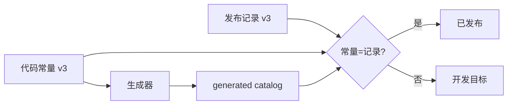
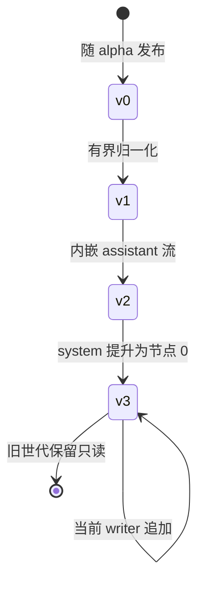
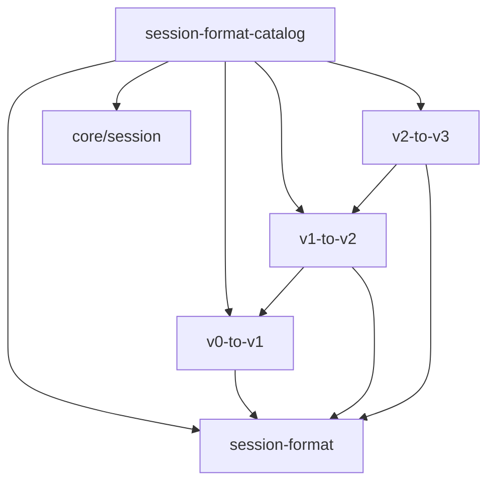
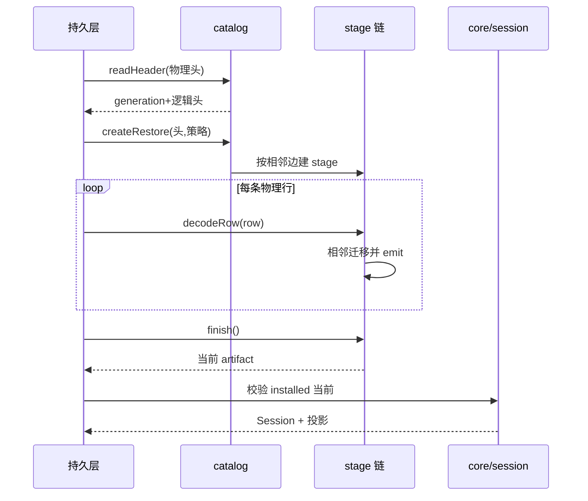
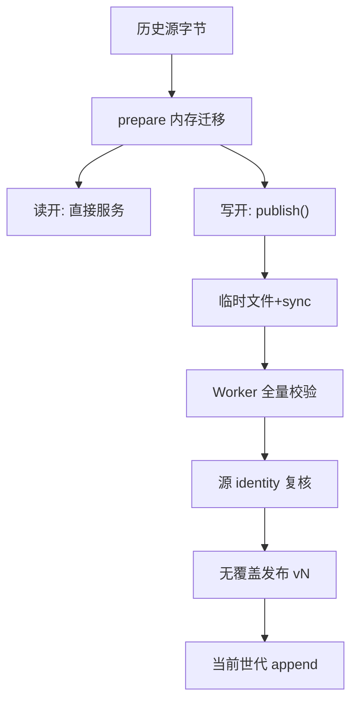

# 会话格式版本与迁移：已发布世代的不可变链式升级

> 子文档之一，聚焦 dsh 会话日志的**格式版本权威链与相邻迁移管线**。覆盖 `packages/core/session`（唯一 writer 版本常量）、`packages/session/session-format`（stage/stream 抽象）、`session-format-catalog`（构建期装配）、`session-format-v0-to-v1` / `-v1-to-v2` / `-v2-to-v3`（三代相邻边）。整体哲学见 [README](README.md)。
>
> **边界（与相邻子文档的分工）**：[data-model.md](data-model.md) 讲持久化的**地面布局**（JSONL 帧与压缩、storage 双布局、投影缓存），[session.md](session.md) 讲**事件溯源语义**（不可变日志、`deriveMessages`、fork/resume）。本文只讲「**格式版本与迁移**」：日志的 `version` 字段由谁定义、旧版本字节如何被读成当前世代、以及为什么这套机制必须是「不可变世代 + 相邻链」而不是一次性重写。
>
> **本版增量背景**：本次增量基线是 `dsh-v0.1.2-rc.1`（彼时 `SESSION_FORMAT_VERSION = 0`，KB 的 [data-model.md](data-model.md) 记录的"不迁移、只拒绝"即那一阶段），到 `HEAD`（`dsh-v0.1.5-rc.2`，`SESSION_FORMAT_VERSION = 3`）共 1490 个提交。格式版本这一根线在此窗口内从 0 走到 3，并长出了整套迁移管线——本文即这条线的 SSOT。

根因一句话：**当会话日志随 alpha 发布，磁盘上的字节就成了用户资产；此时"改格式"不再是一次可以随手重写的前端重构，而必须变成"已发布世代不可变 + 相邻版本转换链"的长期承诺。**

---

## 根因：为什么"已发布格式的不可变世代 + 相邻迁移链"

### v0 时代的正确答案，到发布的那一刻就失效了

在 `dsh-v0.1.2-rc.1` 及更早，`SESSION_FORMAT_VERSION = 0`，读侧的策略是**方向无关的一刀切拒绝**：版本不等就报错。这在 pre-release 阶段是合理且成本最低的——没有兼容承诺，升级时重写磁盘即可。[data-model.md](data-model.md) 记录的正是这套「schema 不迁移、只拒绝」哲学。

但格式 v0 随 alpha 发布了，前提随之改变。上游的设计笔记把这一点说得非常直接：结构性的 writer 变更再也不能把既存 JSONL 当作"可丢弃的 pre-release 状态"。[.agents/notes/implemented/architecture/2026-08-31-released-session-format-migrations.md:9-18]()
<!-- anchor: Session format v0 shipped in an alpha release, so a structural writer change can … - Per-frame `await` calls did not provide useful bounded scheduling. The pre-mig -->

于是第一版实现选择"把旧日志转成新日志"。它确实能转，但被一个真实的 116 MB 会话打爆：整文迁移 API 让一个 16 GB 的 Node 进程在返回句柄之前就 OOM。失败清单本身就是对"为什么必须重做数据模型"的逐条论证——317,540 个 zstd 帧各自一次异步解码、同一时刻并存明文/字符串/行数组/展开事件/目标事件/编码结果、每个编解码与迁移边都做一次深拷贝深冻结、9,143,111 个 v0 逻辑事件与折叠后的 72,784 个当前事件必须同时驻留。[.agents/notes/implemented/architecture/2026-08-31-released-session-format-migrations.md:13-17]()
<!-- anchor: - Zstandard input was split into 317,540 frames and each frame used a separate a … - Encoding built the complete JSONL and compressed output in memory. The success -->

**Why / 权衡**：这里有一个容易被低估的因果链——"格式必须可迁移"与"迁移必须流式"不是两个独立决策，而是同一个决策的两面。因为旧世代不可变，读侧必须能在**不物化整份中间产物**的前提下把任意历史世代读成当前世代；任何"先把整份 artifact 读进来、再逐边转换"的 API 形状都会在真实体量下失败。上游的结论因此不是"优化解码器"，而是**换掉迁移的数据模型本身**（下节展开）。

### 上游的答案：不可变世代 + 冻结 codec + 相邻 N→N+1 + 不跳版

四条规则构成完整答案：

1. **单一单调整数，无 major/minor**。某个版本步是否"可自动升级"是那一步自身的属性（由它的 upgrader 是否存在表达），不该由一个两级编号提前许诺。[.agents/notes/implemented/architecture/2026-08-10-session-log-version-mechanism.md:13-13]()
<!-- anchor: **One monotonic integer, no major/minor split.** Whether a version step is auto- -->
2. **由 writer 决定 bump，不由 reader 决定**。当旧 runtime 无法再"完全语义正确地"处理新日志时才必须 bump；"能解析不报错"不是标准——静默跳过影响重建的内容就是错误读取。只有结构性变化够格：header 形态、事件信封、核心事件语义、surface 机制。[.agents/notes/implemented/architecture/2026-08-10-session-log-version-mechanism.md:15-15]()
<!-- anchor: **The writer decides bumps, not the reader.** A bump is required exactly when an -->
3. **按方向读**。相等：正常读；比 reader 新：拒绝并指出"由更新的 harness 写入——请升级"，同时给出原始日志路径；比 reader 旧：先在内存里跑完整的相邻链，源路径/字节/inode 保持不变。[.agents/notes/implemented/architecture/2026-08-10-session-log-version-mechanism.md:17-17]()
<!-- anchor: **Read rules by direction.** Equal version: read normally. Newer than the reader -->
4. **普通事件新增不 bump**，由每条事件信封上的 `ignorable` 标记覆盖词汇增长；默认是"必需"（缺失标记宁可过度拒绝，也不能静默续上一个被掏空的会话）。[.agents/notes/implemented/architecture/2026-08-10-session-log-version-mechanism.md:19-19]()
<!-- anchor: **A per-event `ignorable` marker covers vocabulary growth, so ordinary event add -->

"不可变世代"在磁盘上的落地形态是**文件名即世代**：v0 保留原始 `session.jsonl`，之后每个正世代写 `session.vN.jsonl`。[packages/session/session-format/src/filename.ts:14-16]()
<!-- anchor: export function sessionFormatLogFilename(version: number): string { … return generation === 0 ? 'session.jsonl' : `session.v${generation}.jsonl` -->

迁移**从不移动、替换或删除已提交的世代**，只写最终的当前目标；中间版本只作为 stage 状态存在（见「迁移管线」）。

---

## 权威链：谁拥有当前格式版本号

dsh 刻意把"当前格式是什么"这件事拆成**两个互不覆盖的事实**，再用一致性检查把它们绑起来，而不是维护一个可变的 `released` 布尔值。

### 代码常量：唯一手工维护的 writer 版本

`SESSION_FORMAT_VERSION` 是代码里**唯一**手工维护的当前 writer 数字，并自带一段把规则写死的注释：版本是单一单调整数；bump 由 writer 决定；只有结构变化够格；普通事件新增不 bump。[packages/core/session/src/types.ts:73-88]()
<!-- anchor: * The version is a single monotonic integer with no major/minor split. Whether … export const SESSION_FORMAT_VERSION = 3 -->

这个常量同时也是 `SessionHeader.version` 的类型来源：历史物理 header 必须先被翻译，才能进入 `SessionHeader` 接口。[packages/core/session/src/types.ts:67-71]()
<!-- anchor: * Current logical Session format version, stamped into every newly written … * this final generation before constructing a Session. -->

失败模式被刻意做窄：写侧只写当前版本，`encodeCurrentHeader` 在编码前就断言 header 版本等于当前版本，否则直接报错。[packages/session/session-format/src/catalog.ts:114-116]()
<!-- anchor: if (inspectSessionFormatVersion(header) !== chain.currentVersion) { … throw new SessionFormatError(`encodeCurrent requires Session format v${chain.cur -->

**Why**：把"writer 版本"放在代码常量、把"已发布版本"放在文档记录，是因为二者**发布节奏不同**——开发可以先把常量推到 N+1，而发布记录在真正发布前不动。若硬塞一个 `released: boolean`，它迟早会与二者之一漂移；而由两个事实推导状态，则不存在"第三个需要同步的真相"。

### 生成器：把常量翻译成 gap-free 的边集合

`gen-session-format-catalog` 不实现任何版本，只做两件事：从源码正则读出版本常量，[scripts/gen-session-format-catalog.ts:51-54]()
<!-- anchor: const source = readFileSync(resolve(scanRoot, 'packages/core/session/src/types.t … return safeVersion(Number(match[1]), 'SESSION_FORMAT_VERSION') -->

以及校验**从 0 到该版本每一步恰好一条相邻边**——缺边、重边、多边、目录/包名/相邻 codec 不接续、catalog 未通过 peer+dev 共享 `dsh-session`，全部报错。[scripts/gen-session-format-catalog.ts:107-115]()
<!-- anchor: for (let version = 0; version < currentVersion; version += 1) { … throw new Error(`gen-session-format-catalog: migration inventory does not end ex -->

Cookbook 把这条约束表述为"生成器要求从 0 到 writer 版本每一步恰好一个相邻包，且名字、codec 导出、依赖都匹配；它拒绝缺口，修声明而不是手改 `generated.ts`"——而且 catalog 是**构建期静态**的，插件挂载不得决定历史可读性。[docs/cookbook/adding-a-session-format-version.md:43-43]()
<!-- anchor: The [generator](../../scripts/gen-session-format-catalog.ts) requires exactly on -->

**Why**：如果相邻边可以按需注册（例如由挂载的插件贡献），那么"能否读一份历史日志"就变成部署配置的函数——同一份日志在不同 profile 下可读性不同。把边集合冻结在构建产物里，换来的是**历史可读性可复现**。

### release record：声明"已发布到哪"

发布记录是一段 YAML：`latestReleasedVersion: 3`、`evidenceTag: dsh-v0.1.5-alpha.1`。[docs/session-format-status.md:28-30]()
<!-- anchor: ```yaml session-format-release … evidenceTag: dsh-v0.1.5-alpha.1 -->

注意 evidenceTag 的语义被刻意放宽：它指向**一个**已发布产物，其标签对应的 writer 具有该值，而不必是首次携带该格式的发布；双语副本按同一记录校验，不作为独立决策维护。[docs/session-format-status.md:19-19]()
<!-- anchor: - **Checkout writer:** `SESSION_FORMAT_VERSION` in [core Session types](../packa -->

状态由"常量 vs 记录"推导：相等即已发布；常量更大即开发目标；并且明确写上——**alpha / beta / RC 也是发布**，GitHub 的 prerelease 标记不能让持久化用户数据变成一次性数据。[docs/session-format-status.md:23-23]()
<!-- anchor: An alpha, beta, or release-candidate product publication establishes released Se -->

记录的更新时点同样被写死：结构性 writer 变更时同时更新常量与相邻 catalog，但**发布前不动记录**；发布后确认发布与其标签 writer，再连同两条 evidence 链接一起推进。[docs/session-format-status.md:38-40]()
<!-- anchor: When a structural writer change is implemented, update the code constant and adj … The [documentation-standard test](../scripts/doc-standard.spec.ts) checks record -->



**权衡**：`doc-standard.spec.ts` 只能校验记录结构、双语一致、evidence 链接一致、以及"记录不超过 checkout writer"——它**不联网**，因此证不了"记录是最新的"。上游选择明确承认这一点：发布校验是 release operator 的人工义务，而不是把文档门禁耦合到 GitHub 与凭据可用性上。

---

## 世代演进：三代相邻边各改了什么

三代的"为什么改"对应三种不同的结构压力：**语义规范化的债**、**事件基数过大**、**一个模型可见事实有两个家**。



本次窗口内的关键提交（`dsh-v0.1.2-rc.1..HEAD`，`git log` 核实）：

| 提交 | 日期 | 变更 |
|---|---|---|
| `d1521ea783` | 2026-08-31 | `feat(session)!: add released format migration`——引入 session-format 包与 v0→v1 边，格式 0→1 |
| `f99b06eaed` | 2026-09-01 | `feat(session)!: embed assistant streams in format v2`——格式 1→2，取消顶层 `assistant/chunk` |
| `f7a6221158` | 2026-09-06 | `feat(session): add identity V2-to-V3 migration and writer skeleton`——格式 2→3 骨架 |
| `a84a8da9e1` | 2026-09-06 | `refactor(session-format): introduce streaming migration stages`——stage API 取代整文迁移 |
| `46196d6f95` | 2026-09-06 | `perf(session-format): stream released v0-to-v2 migrations`——packed run 直通折叠边 |
| `e04cfc4c87` | 2026-09-06 | `feat(session-format): migrate V2 prompts into V3 system surfaces`——system prompt 提升 |
| `56c4c3e47c` | 2026-09-09 | `docs(session): centralize format status and timeless guidance`——release record 独立成权威文件 |

### v0 → v1：身份边 + 有界 legacy 归一化

v0→v1 的头部迁移只是把 `version: 0` 改成 `1`，[packages/session/session-format-v0-to-v1/src/migration.ts:25-31]()
<!-- anchor: export const sessionFormatV0ToV1 = defineSessionFormatMigration({ … return { ...header, version: 1 } -->

但 body 不是纯身份转换——它承担**有界的历史归一化**：退役的 `steering/message`、`compact/*` 事件名被改写，`turn/start.trigger` 被移除，legacy compaction 组会补齐一个确定性 `compactionId`，`request/header.header.messagePrefix` 这个重复字段被删掉。事件名改写本身是机械的：
`compact/start|summary|end` → `compaction/start|summary|end`。[packages/session/session-format-v0-to-v1/src/migration.ts:103-111]()
<!-- anchor: function normalizeLegacyCompactionType(event: SessionFormatEvent): SessionFormat … return { ...event, type: 'compaction/end' } -->

`steering/message` 的改写更谨慎：它先校验 v0 记录只含 `['turn','message']` 这两个键，再包装成当前形态——即归一化只覆盖"有限且已发布接受"的 legacy 形状，其余一律拒绝。[packages/session/session-format-v0-to-v1/src/migration.ts:238-243]()
<!-- anchor: function normalizeLegacySteering(event: SessionFormatEvent, sessionId: string): … assertReleasedV0Keys(data, ['turn', 'message'], [], `steering/message ${event.se -->

**Why**：v0 是唯一一个"字段形态与当前不同但语义可确定补全"的世代，因此归一化被放在这条边上一次性结清；之后每一代只做结构性变换，不再回头补语义。这也是"相邻链"的另一重价值：每条边只回答"我这一步改了什么"，历史语义补全不会被稀释进后续边。

### v1 → v2：把 assistant streams 内嵌进 attempt settlement

这是**基数改变**的一代，也是第一条真正"破坏性"的边。v1 里每个 token 级增量都是一条顶层 `assistant/chunk` 事件；v2 取消了这个事件类型，改为每个模型尝试提交**一个**持久化 settlement，内含 `stream: AssistantStreamRecord[]`：成功的进 `assistant/message`（surface settlement，内嵌精确计时流），失败/重试/取消/流错误的进 log-only 的 `assistant/attempt`。[.agents/notes/implemented/architecture/2026-09-01-v2-embedded-assistant-streams.md:19-24]()
<!-- anchor: Session format v2 has no top-level `assistant/chunk` event. Each model attempt c … `AssistantStreamAccumulator` snapshots each chunk once. Consecutive text, reason -->

为什么必须这样改：把每个 chunk 做成顶层事件，会在持久化、telemetry、历史传输、索引与客户端装配里重复信封；而只存"组装好的成功消息"又会丢掉失败输出、token 边界、时间戳与确定性重放。settlement 是"一次尝试"的原子所有者——两者兼得。[.agents/notes/implemented/architecture/2026-09-01-v2-embedded-assistant-streams.md:9-11]()
<!-- anchor: Token-sized `assistant/chunk` events preserve exact stream order, timing, usage, … Storing only assembled successful messages would remove that overhead but lose f -->

改基数的代价立刻显现：所有同会话序列引用都要重映射。这条边因此必须显式声明"改写哪些引用"、"拒绝哪些引用"——**指向已被消费 chunk 的引用被拒绝，而不是重定向到语义不同的 settlement**。[packages/session/session-format-v1-to-v2/src/migration.ts:43-56]()
<!-- anchor: export const sessionFormatV1ToV2 = defineSessionFormatMigration({ … validateTargetHeader: assertReleasedV2Header, -->

同时它需要区分输入是"物理解码输出"还是"上一条迁移的输出"——只有前者才需要对每条 released-v1 记录做完整 payload 校验，后者已经校验过。[packages/session/session-format-v1-to-v2/src/migration.ts:95-104]()
<!-- anchor: class DecodedReleasedV1ToV2Stage extends TransformedReleasedV1ToV2Stage { … super.transformEvent(event, context) -->



依赖方向与版本方向一致：每条新边依赖前一条边包以**复用**其 source codec（生成器强制 `declaration.sourceCodec === previous.targetCodec` 且依赖存在），catalog 再依赖全部边包，并通过 peer+dev 与 `dsh-session` 共享当前词汇与当前校验规则。[packages/session/session-format-catalog/src/generated.ts:14-18]()
<!-- anchor: export const sessionFormatCatalog = createSessionFormatCatalog({ … migrations: [sessionFormatV0ToV1, sessionFormatV1ToV2, sessionFormatV2ToV3], -->

### v2 → v3：system prompt 从 header 提升为 surface node 0

v2 里，系统提示存在 log-only 的 `request/header` 快照的 `data.header.system` 字段里；其他会话消息都在 surface 上。这造成**一个模型可见事实有两个家**：compaction、token meter、Web 请求卡片、轨迹视图、快照归一化各自去 header 读 message 0；而 header 上的 `headerEquals` 让"提示词变了"和"工具变了"在日志里无法区分。[.agents/notes/implemented/architecture/2026-09-02-system-prompt-as-surface-node.md:9-11]()
<!-- anchor: A system prompt held outside the surface has a different durable representation … That split forces every reader of "what did the model see" to join two sources: -->

v3 的解法是让系统提示成为**普通 surface 事件** `system/message`，每个提示词生命周期操作都是既有两个 `SurfaceOp` 变体之一；wire 请求不变，surface fold 依旧把 system message 放在最前。[.agents/notes/implemented/architecture/2026-09-02-system-prompt-as-surface-node.md:17-17]()
<!-- anchor: The system prompt lives on the surface. It is an ordinary surface event, `system -->

因此 v2→v3 边做的事情是"**把 header 里的提示搬到 surface 上**"，并且这张边明确**不是身份转换**：它会改变事件数量、密集序列位置、局部引用与继承切点。[packages/session/session-format-v2-to-v3/README.md:56-56]()
<!-- anchor: The complete edge is not an identity conversion. It preserves the relative order -->

落地逻辑：遇到 `request/header` 时把 `header.system` 摘出来，与"当前已知提示"比较，不同则先插入/替换一条 `system/message`，然后**无论是否需要替换，这个 header 都不再携带 `system`**。[packages/session/session-format-v2-to-v3/src/migration.ts:50-54]()
<!-- anchor: if (event.type === 'request/header') { … source = { ...event, data: { ...data, header } } -->

第一条 step 之前若已出现 surface 事件，迁移**拒绝**而不是挪动事件或发明归属——因为那会改变历史时序。[packages/session/session-format-v2-to-v3/src/migration.ts:56-58]()
<!-- anchor: if (SURFACE_TYPES.has(event.type) && this.head === undefined) { … throw new SessionFormatUnsupportedMigrationError('format v2 surface before first -->

合成 id 是可复现的：`v2-to-v3-system-` + `JSON.stringify(['session-format-v2-to-v3', sourceHeader.id, anchor.seq, anchor.type])` 的 SHA-256；与已有或已生成 id 冲突即拒绝。[packages/session/session-format-v2-to-v3/src/migration.ts:109-118]()
<!-- anchor: private emitSystem(prompt: string, anchor: SessionFormatEvent, context: SessionF … this.generatedIds.add(id) -->

**Why**：提示词搬上 surface 之后，"提示词变更"与"配置/工具变更"在日志里终于可区分（前者是节点 0 的替换 + `series` header，后者是 `change` 的 header），并且所有"模型看到了什么"的读者都只需 fold surface 一处。**代价**是一张真正棘手的迁移边：一个合法的 v2 源可能不存在"保序"的转换，此时拒绝优于移动历史或放松所有权。[.agents/notes/implemented/architecture/2026-09-02-system-prompt-as-surface-node.md:61-61]()
<!-- anchor: The [V2-to-V3 specification](../../../../packages/session/session-format-v2-to-v -->

---

## 迁移管线：声明 / stage / catalog 三层

### 声明层：不可变的相邻边

一条边是一个冻结的声明：名字、`fromVersion`/`toVersion`、`migrateHeader`、`createStage`、`validateTargetHeader`。它不含任何可变状态——状态属于"为某一份 artifact 创建的 stage"。[packages/session/session-format/src/types.ts:45-54]()
<!-- anchor: export interface SessionFormatMigration { … validateTargetHeader(header: SessionFormatHeader): void -->

`defineSessionFormatMigration` 在构造时校验名字非空、`to === from + 1`，并 `Object.freeze`。[packages/session/session-format/src/chain.ts:24-34]()
<!-- anchor: export function defineSessionFormatMigration(migration: SessionFormatMigration): … return Object.freeze({ ...migration }) -->

### 执行层：有状态的同步 stage

body 迁移不是"数组进、数组出"的函数，而是一个**每个 artifact 独立创建**的有状态 stage，提供 `transformEvent` / `transformRun` / `finish`，并通过同步的 `context.emitEvent` / `context.emitRun` 向下游推。[packages/session/session-format/src/types.ts:142-156]()
<!-- anchor: export interface SessionFormatMigrationStage { … finish(context: SessionFormatMigrationContext): number -->

`stage` 拥有该 artifact 的可变状态；**没有 stage 实例会跨会话共享**。[.agents/notes/implemented/architecture/2026-08-31-released-session-format-migrations.md:28-28]()
<!-- anchor: The Session format packages use a stateful synchronous Stage API. Static migrati -->

`SessionFormatMigration` 本身仍是不可变声明；`CompiledSessionFormatChain` 在构造期一次性校验"唯一且无缺口的边序列"，按 source→target 顺序创建 per-artifact stage，然后用 context 对象**反向**把它们串起来；`finish()` 再按 source→target 顺序结算，让上游能在下游关闭前吐出尾部。[.agents/notes/implemented/architecture/2026-08-31-released-session-format-migrations.md:52-54]()
<!-- anchor: `SessionFormatMigrationContext.emitEvent()` and `emitRun()` are synchronous. The … `SessionFormatMigration` remains an immutable declaration: version numbers, head -->

代码里这条"反向连线、正向结算"的结构很直白：构造时 `entries.toReversed()` 逐层包出 `ChainedMigrationContext`，[packages/session/session-format/src/chain.ts:218-226]()
<!-- anchor: const stages = new Array<ChainedMigrationContext>(entries.length) … this.stages = stages -->

结算时则顺序调用 `finish`，让每条 stage 的 target cut 传给下一条。[packages/session/session-format/src/chain.ts:238-240]()
<!-- anchor: let inheritedEventCount = this.sourceInheritedEventCount … return sessionFormatCount(inheritedEventCount, 'finished Session inherited event -->

### 为什么是"流式 stage"而不是一次性全量重写

核心证据就是开头那次 OOM，以及由此暴露的接口耦合：旧接口里 `SessionFormatCodec` 解码/编码**完整数组**，每条 `SessionFormatMigration` 接受/返回**完整 artifact**，编译出的链只能把一个物化 artifact 交给下一条边；于是"更快的解码器"救不了下游的行数组、事件数组、逐边快照与目标行数组。[.agents/notes/implemented/architecture/2026-08-31-released-session-format-migrations.md:20-24]()
<!-- anchor: ### The interfaces prevented local fixes from composing … The migrations are stateful even though the API presented them as one-shot funct -->

第二个关键是 **compact run**：v1 的 packed assistant chunks 展开后约 914 万条逻辑事件，而 v1→v2 最终只会折叠成 72,784 条当前事件。如果链上每步都先展开再折叠，峰值内存由"源事件数"而非"目标事件数"决定。所以 codec 可以发出一个 codec 自有的 `SessionFormatEventRun`，stage 若没有直接处理器才调用 `run.expand()`；v0→v1 与 v1→v2 都实现了 `transformRun`，让 packed chunk 无需先变成几百万条普通事件就能抵达折叠边。[.agents/notes/implemented/architecture/2026-08-31-released-session-format-migrations.md:83-86]()
<!-- anchor: ### Physical codecs and packed runs … Each released codec creates a row decoder with explicit `strict` or `recoverable -->

上游还逐条否掉了替代方案：只优化 zstd 解码（下游数组仍在）、返回数组的 stage（换个名字保留旧分配）、每条 stage 自带输出队列（仍保留中间值）、给 stage 构造函数注入 emit 回调（迫使反向构造或半连接生命周期）、全局共享有状态 codec（跨并发 restore 混合 pending attempt）、持久化每个中间版本（造出没有运行期消费者的持久状态）、让挂载插件注册迁移（历史可读性变成部署依赖）。[.agents/notes/implemented/architecture/2026-08-31-released-session-format-migrations.md:197-204]()
<!-- anchor: - **Optimize only Zstandard Decode** — restores physical Decode speed but leaves … - **Let mounted plugins register migrations** — makes historical readability dep -->

### 装配层：catalog 做物理分发与"当前快路径"

`createRestore` 是唯一入口：先按物理 header 的版本取 codec 并创建单遍 row decoder，[packages/session/session-format/src/catalog.ts:124-130]()
<!-- anchor: function createRestore( … const sourceCut = decoder.headerInheritedEventCount -->

如果是**当前版本**，直接走 `CurrentSessionFormatRestore`，不做任何迁移；[packages/session/session-format/src/catalog.ts:131-135]()
<!-- anchor: if (storedVersion === chain.currentVersion) { … restoreOptions.validation === 'current' ? options.restoreCurrent : identityArtif -->

只有旧版本才创建 collector 并把 decoder 接到编译好的迁移流上。这条分支是"当前数据的快速路径不被历史机制拖慢"的保证。

链的编译期不变量在 `CompiledSessionFormatChain` 里：它按 `version = 0 .. currentVersion-1` 逐格取边，缺一条就抛 `SessionFormatUnsupportedMigrationError`，多出不属于当前版本的边也抛错。[packages/session/session-format/src/chain.ts:64-76]()
<!-- anchor: const ordered: SessionFormatMigration[] = [] … this.migrations = Object.freeze(ordered) -->

因此**不跳版**不是约定，而是数据结构：`plan(fromVersion)` 只是 `migrations.slice(from)`，把从 `from` 到当前的整段边全部排上；比当前版本更新的输入直接拒绝并说明方向。[packages/session/session-format/src/chain.ts:80-86]()
<!-- anchor: const from = sessionFormatVersion(fromVersion, 'stored Session format version') … return Object.freeze(this.migrations.slice(from)) -->

头部分类也遵循方向规则：比当前新 → `unsupported` 并给出原因；否则用对应 codec 解 header、跑 header 迁移链，返回 `current` 或 `migration-required`。[packages/session/session-format/src/catalog.ts:52-56]()
<!-- anchor: if (storedVersion > chain.currentVersion) { … targetVersion: chain.currentVersion, -->

头部级操作（`stat`/`list`）因此**只读首行**、不读 body、不发布世代——这也是"轻量清单不因迁移而变重"的原因。

---

## 核心链路：从旧日志到当前 Session



这条链上有两类"策略"在创建 restore 时一次性选定：`recovery`（`strict` 逐行失败 vs `recoverable` 后缀处理）与 `validation`（`current` 应用全部已安装当前校验 vs `transformed` 在历史迁移后只应用 released-current 校验）。生产历史读取用 `recoverable + transformed`；Worker 与 fixture 校验用 `strict + current`。迁移 stage 或 transformed-current 校验的拒绝保持为 `SessionFormatUnsupportedMigrationError`，物理解码失败仍是 corruption。

---

## 读路径与写路径：preparation 与不可变发布

### 读开（read open）只做内存迁移，不写盘

`prepareJsonlMigration()` 读一个稳定历史版本、跑完整 stage 链、返回当前 artifact，**不做编码也不写文件**；`publish()` 幂等：并发/后续调用共享同一个终态 Promise（含其 rejection），不会对同一 artifact 编码两次。前缀赢家校验只在 losing publisher 上做——它验证赢家文件以自己 staged 的迁移前缀开头，append tail 的校验仍是当前读者责任。

**Why**：让只读浏览历史也触发一次"编码 + 同步 + Worker 校验 + 发布"，等于为了看历史而修改用户的存储，还会让只读存储无法服务历史会话。preparation-first 调度把首次可读时间从 6.241s 降到 2.954s、峰值 RSS 从 2.107GB 降到 1.026GB。

### 写开（write open）在返回可写句柄前完成独占发布

写开在拿到进程内 claim 与跨进程 `SessionWriteLease` 之后重新解析世代；若仍是历史，则复用匹配的 preparation 并 `await publish()`，**只有发布完成才返回可写句柄**。发布流程本身在 `publishPreparedMigration` 里：先写同目录独占临时文件，[packages/session/session-persistence-jsonl/src/generation.ts:879-905]()
<!-- anchor: async function publishPreparedMigration( … const published = await publishCurrentExclusive(staged.path, currentPath, intern -->

再依次做 staged 身份校验、源 identity 复核、无覆盖发布。源在迁移期间发生变化会抛 `JsonlGenerationSourceChangedError` 并删除临时文件，**不重跑解码与迁移**——暴露给读者的逻辑历史不会被静默替换。

发布前写句柄的状态机在 `publishStoredMigration`：`publish()` 成功后把 `PreparedStoredLog` 提升为 `CurrentStoredLog`。[packages/session/session-persistence-jsonl/src/index.ts:643-663]()
<!-- anchor: private async publishStoredMigration(id: SessionId, stored: PreparedStoredLog): … this.memoizeStoredLog(id, published) -->

世代选择统一为"**数值最高的规范世代**"：目录内扫描规范文件名，按版本降序取第一个作为 source，当前目标路径始终由 `sessionFormatCatalog.currentVersion` 决定。[packages/session/session-persistence-jsonl/src/index.ts:1395-1402]()
<!-- anchor: const latest = generations.sort((left, right) => right.version - left.version)[0 … generationLogFilename(sessionFormatCatalog.currentVersion, this.compression), -->

**关键取舍**：比当前更新的一代即使存在，也不会回退到旧的可读世代；保留的低世代只供运维检视，**不承诺 downgrade 兼容或自动 fallback**。文档层面同样明确：后端用 `SessionFormatUnsupportedError` 拒绝其无法忠实解释的日志，这与"损坏"区分开，因为什么都没有坏。[docs/subsystems/persistence.md:189-189]()
<!-- anchor: A backend refuses a log it cannot faithfully interpret with `SessionFormatUnsupp -->



### 取消语义：共享 preparation，最后一个 waiter 才能中止

并发历史打开按 `SessionId + 源路径 + revision` 做 single-flight。每个调用方的 `AbortSignal` 只与共享 Promise 竞速，**不向共享工作转发**；只有当最后一个 waiter 离开且 preparation 尚未 settle 时，才由后端持有的 controller 中止共享工作。[packages/session/session-persistence-jsonl/src/index.ts:578-593]()
<!-- anchor: private async waitForPreparation( … preparation.controller.abort() -->

而一旦 `publish()` 开始，encode、Worker 校验与发布就**不再接收调用方取消**，跑到结算；写开在发布前后各检查一次自己的 signal。语义是"**已发布的世代永不回滚**"。

---

## 权衡与不足

### 不可变世代带来的代码量与维护税

这套机制的真实成本是**每加一次结构变更就要新开一个包**，并且每条已发布边永久冻结：cookbook 明确"已发布的 codec 与迁移语义保持冻结，不得修改已发布边来实现新结构特性；只有尚未发布的 N→N+1 边可以在发布前纳入协同变更"。[docs/cookbook/adding-a-session-format-version.md:26-26]()
<!-- anchor: Released codecs and migration semantics remain frozen. Do not amend a released e -->

配套的 stage 写法也提高了门槛：不能用"数组进数组出"的迁移器，必须自己管理 per-artifact 状态、显式实现 `transformEvent`/`transformRun`/`finish`、把 inherited cut 当**逻辑事件数**而非物理行数、并且只有在 EOF 前已知时才暴露 `headerInheritedEventCount`。[docs/cookbook/adding-a-session-format-version.md:48-52]()
<!-- anchor: Use the [Stage interfaces](../../packages/session/session-format/src/types.ts), … Treat the inherited cut as a logical event count, not a physical row count. Expo -->

**判断**：这是"历史可读性可复现"的必然代价，属于有意的复杂度转移——把成本从"用户升级时丢失/损坏会话"移到"维护者每次结构变更多写一个包"。对以不可变事件日志为唯一事实源的项目，这个方向是自洽的；但对只想快速迭代的小项目，它就是过度设计。

### 容错：recoverable 不等于宽进

recoverable decoder 返回"已接受的逻辑前缀"：可以丢掉一条畸形或序列断裂的行及其未提交后缀，但**后续一旦解出 `turn/end`，原先的问题就变致命**（证明那段被提交过）。V3 codec 把这条规则落成显式状态：校验失败先记 `issue`，之后的事件被扣住（withhold），只有遇到 `turn/end` 才把原错误抛出——即**未提交的坏后缀可以丢，已提交的坏后缀必须失败**。[packages/session/session-format-v2-to-v3/src/codec.ts:42-48]()
<!-- anchor: if (issue !== undefined) { … context.emitEvent(event) -->

同理，V3 codec 复用冻结的 V2 物理框架，只在其上加自己的结构性准入检查：`releasedV3SessionFormatCodec` 直接把 `releasedV2SessionFormatCodec` 的 decoder 包一层。[packages/session/session-format-v2-to-v3/src/codec.ts:15-22]()
<!-- anchor: export const releasedV3SessionFormatCodec = Object.freeze({ … let issue: SessionFormatError | undefined -->

并且准入检查必须在**可恢复解码丢弃尾部之前**执行，否则一条本该被拒绝的 required 事件会被当成"可丢的坏行"静默吞掉。[packages/session/session-format-v2-to-v3/src/codec.ts:79-85]()
<!-- anchor: * Validate owned V3 admission rules before a scanner or codec can discard a reco … if (typeof row === 'object' && row !== null && !Array.isArray(row)) assertV3Even -->

### 未知事件：保留给"词汇校验"而不是就地丢弃

当前世代的恢复对未知事件的处理很克制：不知道的类型按 opaque 信封准入，只校验 `type/seq/time/data` 等公共成员与其 `ignorable` 标记，payload 留给 vocabulary-aware restoration 判断，而不是在 canonical 层当作损坏丢掉——否则会掩盖一个"未知但必需"的类型。[packages/session/session-format-v2-to-v3/src/payload.ts:265-276]()
<!-- anchor: export function assertV3Event(event: SessionFormatEvent, knownEventTypes?: Reado … SURFACE_TYPES.has(event.type) || opaque ? ['ignorable', 'surfaceOp', 'sourceEven -->

对应的最小单位检查在 v3 restorer 里：每个事件先 `assertV3EventAdmission`（拒绝伪装的已退役 PTC 标签），再 `assertV3Event(event, knownEventTypes)`（结合已安装词汇）。[packages/session/session-format-v2-to-v3/src/validation.ts:24-31]()
<!-- anchor: export function restoreReleasedV3Artifact(artifact: SessionFormatArtifact, known … assertV3Event(event, knownEventTypes) -->

### 审计历史语料：把"故意不支持"写成显式清单

v3 迁移对历史内容做**来源审计**：对 5 个 Message 槽位、queued team message、compaction 输出、PTC 前身输出、内嵌 assistant 流的 `chunk.block` 等所有内容载体，使用同一套有限的历史 kind 集合；未知 kind 与畸形已知块都拒绝整次迁移。无法理解字段就无法证明迁移保留了语义——所以"保留未知块"不能替代审计。

不可转换的历史 fixture 不是靠"跳过"处理，而是登记成显式的拒绝清单：每条注明源路径、源世代与**精确拒绝原因**，并断言它们必须抛出类型化拒绝，而未列出的 artifact 必须能 restore。[packages/test-support/llm-replay/tests/session-format-corpus-inventory.ts:1-2]()
<!-- anchor: /** Exact historical conversion refusals; current-generation fixtures never qual … export const expectedUnsupported: Readonly<Partial<Record<string, { sourceVersio -->

**Why**：这防的是两种退化——一种是"为让测试变绿而放宽历史 fixture 接受面"，另一种是"为了保留旧 artifact 而强行改变历史时序"。清单把两者都变成显式承诺。

### 已知的妥协

- **标量 `assistant/chunk` 的完整 v1 payload-member 校验被推迟**：解码后的标量 chunk 只做信封与最终目标校验，因为逐事件检查会实质拖慢已发布日志的解码与迁移时间；packed run 仍严格解码。
- **最终当前事件数组仍需常驻**：staging 只消除了源与中间目标数组，返回的当前事件数组与序列重映射表仍是 O(事件数)；不承诺"与页窗口成正比"的内存。
- **v2 没有 WAL**：settlement 之前硬崩溃会丢弃整段在途流；这是"避免第二个持久化所有者"换来的。
- **最终保留的低世代不承诺可降级**：旧 runtime 不保证能安全解释新世代。

---

## 与其他解读的关系

- 与 [data-model.md](data-model.md)：那篇讲的是**字节怎么落盘**（JSONL 帧与压缩、storage-json 双布局、投影缓存与其跨版本读兼容）。本文讲的是**版本语义怎么演进**。两者在"schema 演进"处相接，但结论已经分化：KV/派生数据仍是"不迁移、只拒绝（+ owner 白名单 + backup-and-skip）"，而**会话日志已经变成"不可变世代 + 相邻迁移链"**——因为前者可丢弃、后者是用户资产。这是本次增量里最值得注意的一次"同一项目内两种演进策略并存"。
- 与 [session.md](session.md)：那篇讲 `SessionEvent` 日志的内存语义（append-only、`deriveMessages`、fork/resume、seq/offset 分离）。本文是它的"磁盘版本面"：同一根日志在磁盘上带着 `version` 世代号，跨世代读取由本文的管线负责，读上来之后才交给 `session.md` 描述的那套内存语义。
- 与 [README.md](README.md)：README 的持久化/数据模型条目可把本文作为格式版本与迁移的深读入口。

### 真源校验

本文所有 `文件:行号` 引用均经 `verify-references.mjs` 程序重定位（路径 + 首末行双锚点指纹），Mermaid 图经 `check-mermaid.mjs` 真解析（`sequenceDiagram` / `stateDiagram-v2` 走 parse，`graph` 额外 render）。无 `[UNVERIFIED]` 条目。
