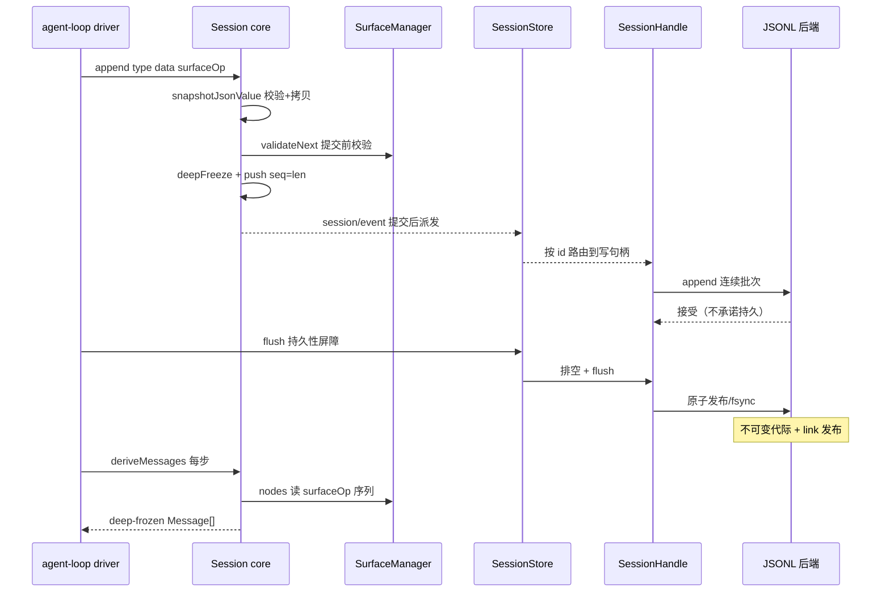
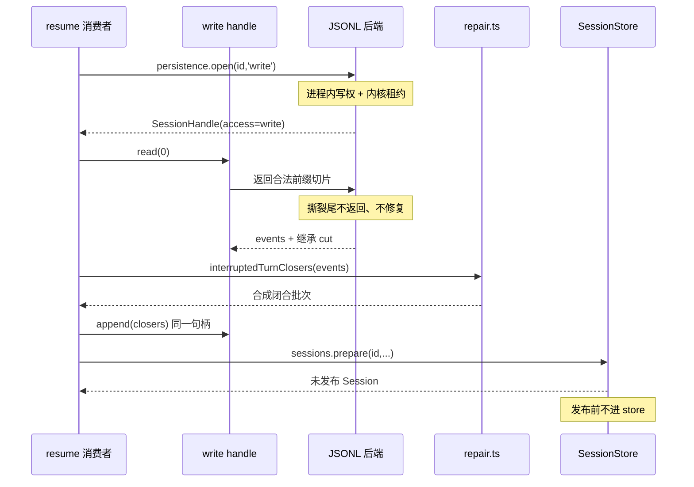
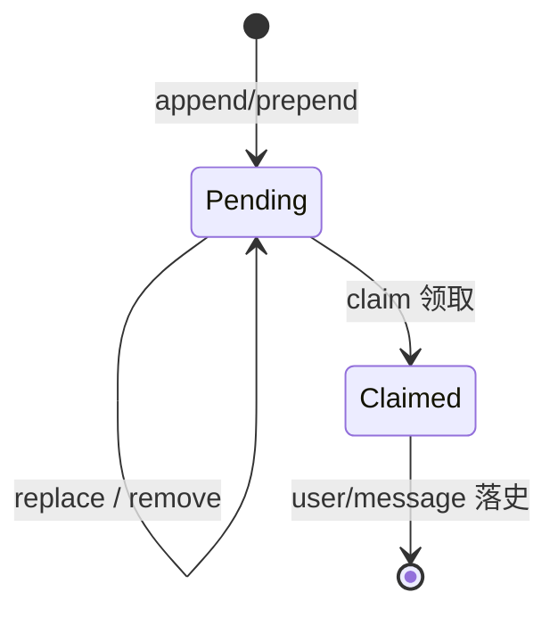

# 会话系统：事件溯源日志作为唯一事实源

> 子文档之一，聚焦 dsh 的数据面——append-only 的 `SessionEvent` 事件日志。覆盖：`packages/core/session`（核心事件模型 + surface 折叠）；格式代际与迁移（`session-format` / `session-format-catalog` / `session-format-v0-to-v1` / `-v1-to-v2` / `-v2-to-v3`）；持久化 seam（`session-persistence` 抽象 + 逐会话 handle 契约 + `session-persistence-jsonl` 唯一 shipped 后端）；`session-projection`；`session-telemetry`。整体哲学见 [README](README.md)；本文上承 [architecture.md](architecture.md)（插件树为运行时地基），下启 [agent-loop-runtime.md](agent-loop-runtime.md)（循环从中 derive 模型历史）。格式代际的完整解构见 [session-format-migration.md](session-format-migration.md)，落盘物理布局见 [data-model.md](data-model.md)，文件/会话的可寻址引用见 [workspace-files.md](workspace-files.md)。

> **本版增量更新说明（dsh-v0.1.5-rc.2，2026-09）**：增量基线 `dsh-v0.1.2-rc.1` → `HEAD`（1490 commits）。四条主线重写了本文多处论断：① **格式代际 V0/V1/V2 → V3**——`SESSION_FORMAT_VERSION` 升到 `3`，`assistant/chunk` 事件被内嵌进 `assistant/message` / `assistant/attempt` 的 `stream`，系统提示词从 `EpochHeader.system` 搬到 surface 第 0 号节点 `system/message`（上游依据：`feat(session)!: add released format migration`、`feat(session)!: embed assistant streams in format v2`、`feat(session): add identity V2-to-V3 migration and writer skeleton`、`refactor(session): represent the system prompt as surface node zero`）；② **持久化 seam 由共享 coordinator 改为逐会话 handle**——`packages/session/session-persistence/src/coordinator.ts` 与 `packages/core/session/src/chunk-rows.ts` 都已删除，写路径由句柄生命周期拥有（`refactor(session-persistence)!: handle-based seam with a lifecycle-owned write path`、`refactor(session): share the canonical log basename and JSON snapshots`）；③ **Inbox 由内存服务改为日志投影**（`refactor(agent): remove inbox service`、`refactor(agent): back Inbox with a durable projection`、`refactor(agent-loop): own inbox projection in loop`）；④ **session-reference 的资源地址化与 session-query 的冷读缓存**。同会话（已落库）消息编辑曾以 `feat(session, agent, web): support same-session message editing` 合入，又在同一区间被 `Revert` 整体撤回——本文据实记录（见「决策 5」）。本文只交代上述变更与事件溯源语义的**接口**，迁移算法本身归 [session-format-migration.md](session-format-migration.md)。**依据上游 git diff / commit，非官方 changelog。**

## 在项目中的角色

会话系统是整个 harness 的数据面**唯一定序事实源**。`Session` 是一个 append-only 的 `SessionEvent` 日志，模型史、标题、telemetry、fork/resume、持久化全部从这个日志**派生**而非存储独立副本。

去掉它系统会怎样（反证其必要性）：

- **模型历史无法重建**：`deriveMessages()` 从日志投影出 `Message[]`，是「模型看到的一切」的来源；无日志则无法向 provider 续传上下文（`[packages/core/session/src/index.ts:825-844]()`）。
<!-- anchor: deriveMessages(): Message[] { … this.derivedNodes = nodes.length -->
- **无法审计 / telemetry 无源**：`session-telemetry` 的 ledger 通道逐条镜像 session 日志事件（`[packages/session/session-telemetry/src/coordinator.ts:177-189]()`），删除日志等于删除观测面。
<!-- anchor: /** Copy, redact, and hand one canonical event to the backend. */ … seq: event.seq, -->
- **无法 fork/resume**：`SessionStore.fork()` 从稳定 log 前缀造子会话（`[packages/core/session/src/index.ts:1196-1208]()`）；resume 已不再走「coordinator 的 `prepare(id)`」——新的路径是 agent 层先用写句柄打开并读取整段日志、用 `interruptedTurnClosers` 合成中断闭合、把完整 seed 交给 `ctx.sessions.prepare()`（`[packages/core/agent-loop/src/index.ts:876-892]()`）。
<!-- anchor: fork(source: SessionForkSource, boundary?: SessionSeq, childSessionId?: Session … isSeeded: true, -->
<!-- anchor: // Taking write ownership FIRST excludes a concurrent resume of the … if (closers.length > 0) await handle.append(closers) -->
  只读消费方则走 `readColdSessionLog()` 的读句柄（`[packages/session-query/session-query/src/cold-read.ts:31-55]()`）。
<!-- anchor: export async function readColdSessionLog( … events: [...events, ...interruptedTurnClosers(events)], -->
- **标题/统计等派生状态无基**：`session-projection` 的每个注册单元是「state + event → state」的纯函数，由注册表订阅一次 `session/event` 后 eager 驱动（`[packages/session/session-projection/src/index.ts:199-221]()`）。
<!-- anchor: export class SessionProjectionRegistry extends Service { … this.drive(session, event) -->

一句话：会话日志是「一切皆插件」反内核主张在**数据面**的投影——没有特权内核并不意味着没有唯一定序的事实源；正是因为内核无 `session.history` 这类特权可变对象，才需要一根 append-only 日志承载模型可见与审计所需的一切，所有消费者各自投影。

### 会话同时是「一个格式代际」

> **演进说明（dsh-v0.1.5-rc.2）**：0.1.2-alpha.1 时代 `SESSION_FORMAT_VERSION` 是 `0`，本文原先把「无兼容承诺」当作紧急出口。该前提已失效：V0 随 alpha 发布成为**已发布格式**，当前写入器版本为 `3`，格式代际与相邻迁移成为会话系统的一等关注面。集中式变更见 [CHANGELOG.md](CHANGELOG.md)，算法与逐版本转换规则见 [session-format-migration.md](session-format-migration.md)。

会话日志不只是「一串事件」，还是**某个不可变格式代际**的物理产物。当前常量是 `SESSION_FORMAT_VERSION = 3`（`[packages/core/session/src/types.ts:66-88]()`）。
<!-- anchor: * Current logical Session format version, stamped into every newly written … export const SESSION_FORMAT_VERSION = 3 -->
它的版本语义写得很克制：版本号是单调整数、无主次版本拆分，**加不加版本只由 WRITER 能写出什么决定，而不是由更新的 reader 能接受什么决定**——只有结构面（header 形状、`SessionEvent` 信封、核心事件语义、surface 机制）才够格 bump，新增一个普通事件类型不算（那种增长交给逐事件的 `ignorable` 逃生阀）。这条规则是对「静默读错比读报错更糟」的工程化：`parses without error` 不等于 `correctness`。

对本文的接口意义只有三条：

1. **每个已发布代际的字节不可变**——迁移只写最终 current target，不移动/覆盖/删除已提交代际，文件名编码代际（v0 用 `session.jsonl`，正代际用 `session.vN.jsonl`，`[packages/session/session-format/src/filename.ts:7-16]()`）。
<!-- anchor: * Name the raw JSONL log of one immutable Session format generation. Version … return generation === 0 ? 'session.jsonl' : `session.v${generation}.jsonl` -->
2. **读历史格式 = 组合一条无缺口的有状态相邻迁移链**，每个 edge 是「immutable declaration + 每次 artifact 独占的 stage」（`[packages/session/session-format/src/types.ts:45-54]()`）；当前代际由 catalog 用已安装的 Session 包复核（`[packages/session/session-format-catalog/src/current.ts:33-35]()`）。
<!-- anchor: export interface SessionFormatMigration { … validateTargetHeader(header: SessionFormatHeader): void -->
<!-- anchor: * Validate current header, event envelopes, messages, surface operations, and s … * @returns nothing after successful validation. -->
3. **投影缓存行必须绑定格式代际**——因为迁移会改变事件基数，一条旧 cache row 不能绕过 fold 直接当现行状态（见「关键数据结构 5」的 `stateVersion` / format-version 口径）。

---

## 解决什么问题 / 根因

**根因：模型交互是「难重放、易撕裂、需审计」的状态，可变会话对象无法同时满足这三者。**

1. **模型上下文必须可重放**：agent loop 每步要构造 `Message[]`。若用可变 `session.messages[]`，则 (a) 无法精确重建某请求时模型看到什么；(b) 模型输出的流式边界与结算事实丢失；(c) fork/resume 需另存快照，多副本必然漂移。事件溯源把「发生了什么」和「当时模型看到什么」解耦——历史是可重放的投影而非存储副本。`SessionEvent` 保证 lossless JSON 且 seq 连续，而模型输出的原始流**内嵌在 assistant 事件里**：「Assistant attempt events embed their exact compact raw streams so persistence stores one durable settlement per attempt」（`[packages/core/session/src/types.ts:264-267]()`）。
<!-- anchor: * The merge-extensible, append-only source of truth for an agent interaction. … * compact raw streams so persistence stores one durable settlement per attempt. -->

   > **演进说明（dsh-v0.1.5-rc.2）**：V2 之前这里引用的是一句「sequence numbers stay contiguous, **including raw chunks**, so persistence can store the canonical log verbatim」，且 `assistant/chunk` 是独立事件类型。V2 起逐 token 的 `assistant/chunk` 不再单独成行事件，改为 `assistant/message.stream` / `assistant/attempt.stream` 内嵌的紧凑 `AssistantStreamRecord[]`——**「流式保真」不变，变的是它的物理载体**：一次 attempt 只结算一条持久事件，而不是几百条 chunk 行。详见「核心模式 4」。

2. **append-only 保证审计完整性**：事件一旦入 log 便 deep-freeze（`[packages/core/session/src/index.ts:725-733]()`），`snapshotEvents()` 返回冻结快照（`[packages/core/session/src/index.ts:633-639]()`）。
<!-- anchor: const event = deepFreeze({ … this.surfaceManager.validateNext(event as SessionEvent) -->
<!-- anchor: snapshotEvents( … return this.eventsSnapshot -->
  持久化后端得到的必是「exact appended events」（`[docs/subsystems/session.md:675-675]()`）。可变状态做不到——它某处必有一份可被改写的历史。
<!-- anchor: What a persistence backend relies on: the durable log persists every event los -->

3. **崩溃安全需要显式边界**：一段 turn 可能极长（多 step + 大 tool 输出），可变状态崩溃会丢整段未 flush 历史。事件溯源下后端只截断物理撕裂的尾记录、**不**修复语义缺口；完整的 open turn 由读者补一条 `turn/end { reason: { kind: 'interrupted' } }` 闭合（`[packages/core/session/src/repair.ts:29-58]()`；`[docs/subsystems/persistence.md:108-112]()`）。**这条职责在本次增量中从持久化层上移到了 agent 层**（见「决策 5」）。
<!-- anchor: export function interruptedTurnClosers(events: readonly SessionEvent[]): Sessio … if (block.type === 'tool-call') pendingCalls.set(block.id, { step: event.data.step }) -->
<!-- anchor: ## Crash recovery preserves an interrupted turn … Repair therefore writes only under write ownership: a live session's write -->

**为什么不用「内存模型 + SQL 快照」替代？** 快照方案的多副本同步、部分写入原子性、以及「崩溃后恢复出一致的模型历史」都退化为分布式一致性问题；事件日志把复杂性收敛到每个后端都能以单事务/单文件 append 实现的 append-only 顺序。详见决策 1。

---

## 设计思路

### 方案：append-only 事件日志 vs 可变会话对象

选了前者，三个支撑：

- **`seq` 是事件身份，`log offset` 是位置（0.1.2-alpha 起的 branded 分离）**：`SessionSeq` 标识**一条已存在事件**（`SessionEvent.seq`、surface replace 端点、`sourceEventSeqs`、owner 载荷），`SessionLogOffset` 标识**间隙/前缀长度/读偏移**（`Session.seq`、`firstLiveSeq`、`inheritedEventCount`、body 读偏移、继承 cut）——`get seq()` 返回 `SessionLogOffset`（`[packages/core/session/src/index.ts:662-662]()`
<!-- anchor: get seq(): SessionLogOffset { -->）。这消除了旧 `number` 单一类型下"offset 被当作事件身份"的迁移风险：编译器在把前缀长度或读切点塞进事件引用时直接报错（`[packages/core/session/src/types.ts:30-64]()`
<!-- anchor: /** Sequence number of one existing event in a Session log. */ … export type OptionalSessionSeq = SessionSeq | null -->）。配套 `SessionHeader` 从存储坐标 `seedLength` 改为 `isSeeded: boolean` + body 侧独立 `inheritedEventCount`，header-only 读者不再需要打开日志体即可知谱系（`[packages/core/session/src/types.ts:107-111]()`）；`isSeeded` 的精确 cut 由构造期约束钉住（`[packages/core/session/src/index.ts:586-602]()`），body 侧数量必须与 header 声明一致，否则直接拒绝构造。这让持久化以「下一个 seq 应等于已存长度」做简单校验，也让 surface/header fold 记住「已消费到哪」做增量投影。
<!-- anchor: * Whether this Session contains a fork-inherited event prefix. The exact prefix … readonly isSeeded: boolean -->
<!-- anchor: if (this.header.isSeeded && seed === undefined) { … this.inheritedEventCount = inheritedEventCount -->

  品牌化在本次增量中还被**用得更狠**：`SurfaceOp` 的 replace 端点从裸 `start`/`end: number` 改成 `startSeq`/`endSeq: SessionSeq`（`[packages/core/session/src/types.ts:434-436]()`），于是「拿一个前缀长度当 surface 索引」在类型层就不可能写出来；surface 折叠另加一条时序校验——端点必须严格早于替换事件自身（`[packages/core/session/src/surface.ts:313-320]()`）。
<!-- anchor: export type SurfaceOp = … | { op: 'replace'; startSeq: SessionSeq; endSeq: SessionSeq } -->
<!-- anchor: export function validateSurfaceMetadata(event: SessionEvent): SurfaceOp | undef … return op -->
- **deep-freeze 使历史不可改写**：append 时 `snapshotJsonValue`（lossless 校验 + 一次性拷贝）再 `deepFreeze`；「一个 stateful getter 不能给校验一个值、给存储另一个值」（`[packages/core/session/src/index.ts:713-731]()`）。
<!-- anchor: const dataSnapshot = snapshotJsonValue(data) … } as unknown as SessionEvent<T>) -->
- **构造期 seed 也过同一校验**：replay/fork 的 seed 在构造时逐条 `snapshotJsonValue` + `validateNext` + `deepFreeze`（`[packages/core/session/src/index.ts:555-602]()`），保证「后端能存的东西」与「live log」永不背离。
<!-- anchor: // Validate the seed to the SAME invariants `append` enforces, so a … this.inheritedEventCount = inheritedEventCount -->
  > 同样的校验也覆盖**已发布历史格式**：V0/V1/V2 的 row 先由各代际 codec 解码、经相邻迁移 stage 变换，再由 catalog 用当前 Session 包复核（`validateInstalledCurrentSessionArtifact`），「能读出来」与「能作为现行会话构造」是两道独立的门（`[packages/session/session-format-catalog/src/current.ts:33-35]()`）。
<!-- anchor: * Validate current header, event envelopes, messages, surface operations, and s … * @returns nothing after successful validation. -->

### 核心模式 1：`SessionEventMap`——类型合并声明的可扩展事件词汇

事件类型是一张**可声明合并的接口表**，而非「自由字符串 + 任意 JSON」：

```ts
export interface SessionEventMap {
  'turn/start': { turn: number }
  // … 其余变体 …
  'session/end-seed': { inherited?: true }
}
export type SessionEventType = keyof SessionEventMap
```
（`[packages/core/session/src/types.ts:269-400]()`）
<!-- anchor: export interface SessionEventMap { … 'session/end-seed': { inherited?: true } -->

插件通过 `declare module … interface SessionEventMap { 'compaction/start': … }` 扩展（`[packages/core/session/src/types.ts:403-404]()`）。关键约束：
<!-- anchor: /** The appendable event-type keys of {@link SessionEventMap}, plugin-merged ex … export type SessionEventType = keyof SessionEventMap -->
- 新增**模型可见**输入 ⇒ 必须新增 session 事件（Model-visible means logged 在类型层的落地）；
- 插件贡献事件**默认是 log-only**（非 `SurfaceEventType`、无 `surfaceOp`、不出现在派生历史），其与 turn 的关系由所属插件的 invariant companion 声明（`[packages/core/session/src/types.ts:483-486]()`）；inbox 就是这类插件事件的实例（见「与其他模块协同」）。
<!-- anchor: } & (K extends SurfaceEventType ? SurfaceIntent<K> : { … sourceEventSeqs?: never -->
- **词汇表随代际变化**：本仓库理解的完整事件集合由生成物 `KNOWN_SESSION_EVENT_TYPES` 固化（`[packages/core/session/src/known-event-types.ts:22-78]()`），持久化读路径据此对未知类型 fail-closed。
<!-- anchor: export const KNOWN_SESSION_EVENT_TYPES: ReadonlySet<string> = new Set([ … 'web/deepseek-search-llm-request', -->

### 核心模式 2：`SurfaceEventType` / `SurfaceOp`——「模型历史从哪里来」的显式声明

**四类**消息事件（`system/message`、`user/message`、`assistant/message`、`tool/result`）**必须**带 `surfaceOp`（append 或 replace），可带 `sourceEventSeqs`（来源 seq）（`[packages/core/session/src/types.ts:406-416]()`）。
<!-- anchor: * The subset of {@link SessionEventType} values whose events produce LLM … | 'tool/result' -->
`surfaceOp` 是 `deriveMessages()` 的**唯一来源**：无标记的原始事件（turn 边界、log-only 插件事件）正确缺席；compaction 的 `replace` 把被遮蔽节点从派生中删除。`deriveMessages()` 的缓存策略也跟着 surface 走——每个节点只投影一次，`replace` 改变 `replaceGeneration` 时整体重建（`[packages/core/session/src/index.ts:825-844]()`）。
<!-- anchor: deriveMessages(): Message[] { … this.derivedNodes = nodes.length -->

这是「投影规则可证」的关键：`Session.append` 的调用点由编译器强制——对 `SurfaceEventType` 事件必传 `SurfaceIntent`，对 log-only 事件拒绝（`[packages/core/session/src/index.ts:703-707]()` 的元组类型 `...opts: T extends SurfaceEventType ? [opts: SurfaceIntent] : []`）。
<!-- anchor: append<T extends SessionEventType>( … ): SessionEvent<T> { -->

> **演进说明（dsh-v0.1.5-rc.2）**：0.1.2-alpha.1 时这里是**三类**消息事件、`SurfaceOp.replace` 用裸数字 `{ start, end }`、`SurfaceEvent` 是三个变体的联合。V3 的两个结构变更都落在这个模式上：① `system/message` 加入 `SurfaceEventType`（系统提示词成为 surface 第 0 号节点）；② replace 端点改用 `SessionSeq`。此外每条 surface 事件替换时还多了一条来源完整性校验：`sourceEventSeqs` 必须**包含每一个被遮蔽的 surface 节点**，缺一个即拒绝（`[packages/core/session/src/surface.ts:328-342]()`）。
<!-- anchor: const startIdx = state.nodes.indexOf(op.startSeq) … shadowedSeqs: state.nodes.slice(startIdx, endIdx + 1), -->

`append` 常规尾部追加；`replace` 遮蔽 `[startSeq,endSeq]`（含端点，必须都是当前 surface 内的**已存在事件**）并原位插入，`replaceGeneration` 单调递增以区分「纯尾部增长」与「surface 重写」（`[packages/core/session/src/surface.ts:431-445]()`）。
<!-- anchor: const surfaceOp = validateSurfaceMetadata(event) … ...range, -->

### 核心模式 3：Model-visible means logged 不变式 + `ignorable` 逃生阀

- **入模型请求的一切都必须能从日志重建**：`EpochHeader` 现在只有 call config、adapter defaults 与工具 schema（`[packages/core/session/src/types.ts:226-238]()`），整体作为 `request/header` 快照落盘，`foldRequestHeader` 选最新快照重建（`[packages/core/session/src/request-header.ts:63-68]()`）。
<!-- anchor: * Logged request state outside derived history: call config and tools. … tools?: ToolSchema[] -->
<!-- anchor: export function foldRequestHeader(events: readonly SessionEvent[], from?: Epoch … return state -->
  每个请求因此是日志的纯函数（`[docs/subsystems/session.md:168-168]()`）。
<!-- anchor: The request envelope — the `EpochHeader` (call config + markers for adapter-sup-->
- **反之**：读者遇不认识的类型，若事件未带 `ignorable: true` 必须拒绝重建而非静默丢弃——未知必需事件可能改变后续日志解读；缺省为 required，宁可误拒也不可静默复活被掏空的会话（`[packages/core/session/src/types.ts:474-483]()`）。
<!-- anchor: * Marks an event a reader may safely skip when it does not recognize … ignorable?: true -->
- **请求头相等性不再需要比 system**：`headerEquals` 只比 config / adapter defaults / tools（`[packages/core/session/src/request-header.ts:43-51]()`），提示词变更改由「surface 第 0 号节点被替换 ⇒ 新 series」这个 surface 信号表达。
<!-- anchor: export function headerEquals(a: EpochHeader, b: EpochHeader): boolean { … return at.length === bt.length && at.every((tool, i) => sameSchema(tool, bt[i] as ToolSchema)) -->

### 核心模式 4：assistant 流内嵌——「一次尝试 = 一条持久结算」

V2 把逐 token 的流从「几百条独立事件」改成「一条事件里的紧凑记录数组」，并把**已结算的可见输出**与**未提交的尝试**拆成两个事件类型：

| 事件 | 何时写 | 载荷要点 |
|---|---|---|
| `assistant/message` | 该 step 定稿（含中途取消但已有可见前缀） | `{turn, step, message, stream, usage?, interrupted?}`；`stream` 是本次 provider 流的精确紧凑记录，**禁止**带 `sourceEventSeqs` |
| `assistant/attempt` | 一次模型尝试结算但**没有**产出 surface 消息（失败 / 重试 / 流错误） | `{turn, step, stream}`；log-only，不进入派生历史 |

（`[packages/core/session/src/types.ts:311-335]()`）
<!-- anchor: * Assembled assistant message for one step (derived history uses this). … 'assistant/attempt': { turn: number; step: number; stream: AssistantStreamRecord-->

- 用 `[packages/core/session/src/types.ts:442-449]()` 把「assistant 消息不许再引用来源事件」写成类型级约束：`sourceEventSeqs?: never`。
<!-- anchor: export type SurfaceIntent<T extends SurfaceEventType = SurfaceEventType> = { … sourceEventSeqs?: SessionSeq[] -->
- `usage` 与消息**同行**，不存在独立的 usage 记录——「模型输出与它的计费一起旅行」。这是对上一版「chunk 逐条落盘 + usage 单独事件」的收敛：审计要的是「这次尝试花了多少、产出了什么」，拆成两条事件就得靠 seq 邻接去猜配对关系。
- **代价**：单条事件体积变大（一个长回答的全部 delta 都在一个 payload 里），且 `replace` 的历史事件不可再细分——想只重放半条流就得在 `stream` 内部解析。收益是一次尝试的持久化是原子的、seq 数量与「模型调用次数」同阶，投影与迁移都少一个数量级的事件。
- 与 `turn/end` 的 `interrupted` 标记分工：`assistant/message.interrupted` 描述**消息级**的中途取消（已交付的文本/推理前缀）；`turn/end.reason.interrupted` 描述**崩溃孤儿 turn** 的事后闭合，且它是唯一「loop 永不 live 发出」的 reason（`[packages/core/session/src/types.ts:214-220]()`）。
<!-- anchor: * A crash-orphaned turn was closed after the fact: agent-loop resume appends … interrupted: { kind: 'interrupted' } -->

### 核心模式 5：系统提示词是 surface 第 0 号节点

> **演进说明（dsh-v0.1.5-rc.2）**：0.1.2-alpha.1 时系统提示词住在 `EpochHeader.system`（仅记日志的 `request/header` 快照里的一个字段），本文原先把「`EpochHeader`（call config + 渲染后 system + 装配后工具 schema）」当作整体快照。该布局已被否决：它让「模型看到的一条消息」拥有两个归属——surface 拥有消息、header 拥有排在它们之前的那一条。

现在系统提示词是一个普通 surface 事件 `system/message`，载荷与 `tool/result` 对称：`{turn, step, message}`，`message` 是 `role: 'system'` 的 `SystemMessage`（`[packages/core/session/src/types.ts:298-310]()`）。
<!-- anchor: * The rendered system prompt on the model-visible surface. The loop appends … 'system/message': { turn: number; step: number; message: SystemMessage } -->
三条操作语义（这是它被设计成 surface 事件的**唯一理由**——让提示词生命周期复用已有的两种 `SurfaceOp`，而不新增机制）：

1. 无存活系统节点 ⇒ `append`（会话首个 step 里它就是第 0 号节点，位于该 step 首条 `user/message` 之前）；
2. 有存活节点且渲染文本不同 ⇒ 对**该节点自身**做 `replace`（`startSeq === endSeq`）；
3. 文本未变 ⇒ 无操作。

配套有一条**头部改写不变量**：第 0 号节点是 `system/message` 时，「范围覆盖第 0 号节点」的替换必须**本身**就是恰好覆盖该节点的 `system/message`；更靠后的系统节点不受保护，compaction 可以遮蔽它们（`[packages/core/session/src/surface.ts:398-418]()`）。
<!-- anchor: * Protect the system prompt at surface node 0. A replacement covering node 0 … throw new Error('surface replace: node 0 holds the system prompt and may be rewritten only by a system/message over exactly that node') -->

**为什么值得讲**：这条不变量的收益是全局的——① 每个想知道「模型看到了什么」的读取方只需折叠 surface，不必再合并 header 与消息列表两个来源；② 提示词变更与工具/config 变更在日志里**可区分**（前者是第 0 号节点的替换 + 随后的 `series` 请求头，后者是 reason 为 `change` 的 `request/header`）；③ 压缩获得一条「第 0 号节点永不被压缩」的硬约束，由 surface 管理器在替换操作本身里强制，而不是靠压缩插件自觉。代价是 `EpochHeader` 少了一个字段——期望 `header.system` 的读者在**编译期**失败，这正是想要的失败方式。

### 被否决的替代方案

- **自由 string 事件 + 无 schema**：无类型合并就没有编译期强制「模型可见输入必有事件」，invariant companion 无法按类型精确校验。
- **只存最终消息不存流**：毁掉 token 级重放保真，而这恰是审计/UI 流式所需。但「保真」不等于「逐条事件」——V2 用 `assistant/message.stream` / `assistant/attempt` 的内嵌 `AssistantStreamRecord[]` 承载同一保真度，同时把事件数从「每个 delta 一条」降到「每次尝试一条」（见核心模式 4）。本轮还否决了另一条：**保留 `header.system` 只为更新新增 `system/message`**——那会保留两个归属和一堆特例（`headerEquals` 需要在存在 surface 系统节点时忽略 `system`），与「单一表示」的目标相抵，故整套搬到 surface（见核心模式 5）。

---

## 关键数据结构

### 1. `SessionEvent<T>`——按 type 判别联合的单条日志项（`[packages/core/session/src/types.ts:465-472]()`）
<!-- anchor: export type SessionEvent<T extends SessionEventType = SessionEventType> = { … data: SessionEventMap[K] -->

`switch (event.type)` 直接收窄 `event.data`，无需 cast。`sourceEventSeqs`/`surfaceOp` 是条件类型：仅 `SurfaceEventType` 变体携带（`… : object` 分支），log-only 事件由编译器排除（`[packages/core/session/src/types.ts:484-486]()`）。
<!-- anchor: } & (K extends SurfaceEventType ? SurfaceIntent<K> : { … sourceEventSeqs?: never -->

> 注意：`SessionEventType = keyof SessionEventMap` 可被插件合并扩展，故 switch 不得用 `assertNever`，处理已知情形后走 `default`（`[docs/subsystems/session.md:273-273]()`）。
<!-- anchor: `SessionEventType = keyof SessionEventMap`. Because `SessionEventMap` is merge--->

### 2. `SessionEventMap` 事件变体（`[packages/core/session/src/types.ts:269-400]()`）
<!-- anchor: export interface SessionEventMap { … 'session/end-seed': { inherited?: true } -->

> **演进说明（dsh-v0.1.5-rc.2）**：本表在 V2→V3 间被结构性改写。相对 0.1.2-alpha.1 的旧表：**删除** `assistant/chunk`（逐 token 重放改为内嵌流）、**新增** `system/message` 与 `assistant/attempt`；`assistant/message` 增加 `stream` / `interrupted`，`session/end-seed` 载荷由 `Record<string,never>` 变为 `{inherited?: true}`；`todo/write` **不再是核心事件**——它现在由 `packages/todo/tool-todo` 以声明合并扩展（`[packages/todo/tool-todo/src/types.ts:28-31]()`）。下表为当前状态。
<!-- anchor: declare module '@deepseek-ai/dsh-session/types' { … 'todo/write': { todos: TodoItem[] } -->

| 事件 | 载荷 | Surface | 角色 |
|---|---|---|---|
| `turn/start` / `turn/end` | `{turn}` / `{turn,reason}` | 否 | turn 生命周期边界 |
| `step/start` / `step/end` | `{turn,step}` | 否 | step 边界（一次模型调用+其工具执行） |
| `system/message` | `{turn,step,message}` | ✅ | 渲染后系统提示词，surface 第 0 号节点 |
| `user/message` | `UserMessage` | ✅ | 人类提示/注入上下文/goal 延续 |
| `assistant/message` | `{turn,step,message,stream,usage?,interrupted?}` | ✅ | 组装后 assistant 消息 + 内嵌 provider 流（派生史用） |
| `assistant/attempt` | `{turn,step,stream}` | 否 | 无 surface 产出的尝试结算（失败/重试） |
| `tool/call` | `{turn,step,callId,name,arguments}` | 否 | 模型请求的工具调用（arguments 原文未解析） |
| `tool/result` | `{turn,step,message,error?,meta?}` | ✅ | 工具结果（error 只在 `isError:true` 时合法） |
| `request/header` | `{header,reason,startsSeries?}` | 否 | 下一请求头快照；`startsSeries` 标记新消息序列 |
| `request/context` | `RequestContext` | 否 | 路由容量元数据，不参与请求重建 |
| `session/end-seed` | `{inherited?: true}` | 否 | 构造期 seed 结束边界（durable `inheritedEventCount`） |

`assistant/message` 与 `assistant/attempt` 的分工见「核心模式 4」；`request/header` 的 `reason` 有 `initial`/`resume`/`change`/`series` 四种，`startsSeries` 是「同一 header 但提示词换过」的表达（`[packages/core/session/src/types.ts:365-370]()`）。
<!-- anchor: 'request/header': { … startsSeries?: true -->

### 3. `SessionHeader`——日志旁的不可变存储元数据（`[packages/core/session/src/types.ts:93-129]()`）
<!-- anchor: export interface SessionHeader { … readonly agentPreset?: string -->

放在事件日志之外：format version、cwd、parent lineage、`isSeeded` 谱系位、delegationDepth、agentPreset 都是存储关注点，不进 `SessionEventMap`、不进 `deriveMessages()`；**精确的继承 cut（`inheritedEventCount`）连 header 都不进**，而是作为「body 侧存储值」与 header 配对传递（`[docs/subsystems/persistence.md:139-139]()`）。
<!-- anchor: Per-session metadata travels **separately** from the event log: the header carries format version, cwd, and the `isSeeded` lineage bit -->

> **演进说明（dsh-v0.1.5-rc.2）**：`delegationDepth` 由必填变为**可选**（缺席即 0），`origin?: 'subagent'` 保留但语义被收窄为「展示元数据，不证明子会话可续」；`agentPreset` 的持久化理由不变：preset 决定会话的工具与提示词，resume 恢复不同组合会重放模型无法再行动的历史（`[packages/core/session/src/types.ts:117-129]()`）。`delegationDepth` 可选化是为了让「顶层会话」不必写一个恒为 0 的字段——序列化端补默认值（`[packages/session/session-persistence-jsonl/src/format.ts:129-132]()`）。
<!-- anchor: * Delegation depth: absent (zero) for a top-level session, parent depth + 1 … readonly agentPreset?: string -->
<!-- anchor: return sessionFormatCatalog.encodeCurrentHeader({ … }, cut) as unknown as HeaderLine -->

### 4. 持久化后端 schema：逐会话 handle + 不可变代际文件

> **演进说明（dsh-v0.1.5-rc.2）**：本节 0.1.2-alpha.1 版本的描述「`session-persistence` 抽象 + **coordinator** + JSONL 后端」已过时。`packages/session/session-persistence/src/coordinator.ts`（旧文引用其 `712-747`、`1301-1322`、`588-625`、`1061-1066`、`344-573`）**已整体删除**；`packages/core/session/src/chunk-rows.ts`（旧文的 `packChunkRuns`/`decodeStorageRecord` 打包行）同样**已删除**。「共享协调器订阅 `session/created`/`session/event`/`session/flush`/`session/disposed` 并接管任何已发布会话」这一形态不再成立。物理布局的完整叙述内链到 [data-model.md](data-model.md)，本节只保留与事件溯源语义相关的接口。

**seam 现在只有五个方法 + 一个逐会话 handle。**`SessionPersistence` 是纯抽象服务：`create(header)` 存新会话并返回**持有写权**的句柄，`open(id, 'read'|'write')` 打开已有会话，`stat(id)`/`list()` 只读元数据快照（`header` + 不透明 `revision`，可选 `eventCount`/`sizeBytes` 提示），服务级 `flush()` 排空后端范围内所有活跃写句柄（`[packages/session/session-persistence/src/index.ts:135-198]()`）。
<!-- anchor: export abstract class SessionPersistence extends Service { … abstract list(options?: SessionPersistenceListOptions): Promise<readonly Session-->

**`SessionHandle` 是唯一一扇门。**`read(offset?, length?)` 返回**合法的前缀切片**——物理撕裂的尾部永不返回、同一句柄的重复读永不倒退；`append` 只接受接着当前逻辑末尾的连续批次，「已接受」不等于「已持久」，只有 `flush()` 解析后才承诺崩溃存活并把会话对其他进程实体化；`close()` 是唯一 teardown（幂等、不可取消）（`[packages/session/session-persistence/src/handle.ts:60-69]()`）。
<!-- anchor: /** The stored session this handle addresses. */ … readonly inheritedEventCount: SessionLogOffset -->

**为什么这个改动值得写**：旧形态里「谁拥有这条日志」是**全局推断**出来的——协调器靠订阅事件猜测哪些会话归它管，乐观的 revision 读-复核-再读循环充当所有权替身，结果是持续的外部写入方可能让读取活锁、且没有任何机制排除第二个写入方。改成 handle 后，所有权是**一条有明确持有者的通道**：跨进程租约因此有了诚实的归宿，语义崩溃修复也能从持久化层移走（见「决策 5」）。代价是插件 HMR/reload 语义变硬——后端重载会让活跃句柄失效，写入**响亮失败**而不是静默重连。

**单写者两道锁**：进程内由后端 tracker 强制（`SessionAlreadyOwnedError`）；跨进程靠 `session.lock` 上的**内核锁**——POSIX 用非阻塞 `flock(2)`，Windows 用由该路径派生的命名内核信号量（**不**用文件锁/句柄，因此读者、搜索、目录删除在持锁期间照常进行）。内核在持有者进程死亡时自动释放，崩溃的持有者不会阻塞后继；反过来，**活得久但卡死的持有者会一直持锁**——故意不做超时过期，因为抢占一个暂停的写者会让它恢复后的 append 撕裂日志（`[packages/session/session-persistence-jsonl/src/lease.ts:2-12]()`）。
<!-- anchor: * Cross-process write-ownership lock for one session's artifact directory, … * expiry that could expropriate a stalled writer whose resumed appends would -->

**物理产物是不可变的代际文件。**新格式代际写成新文件、以 `link()` 独占发布为「当前代际」，已提交代际不移动不覆盖；文件名编码代际（v0 保留 `session.jsonl`，正代际为 `session.vN.jsonl`，压缩后缀另加）（`[packages/session/session-persistence-jsonl/src/format.ts:49-58]()`）。生成与发布归 `generation.ts`：物理编码、精确源身份、不可变代际文件与「独占的当前代际发布」都在这里（`[packages/session/session-persistence-jsonl/src/generation.ts:2-6]()`）。
<!-- anchor: * Return the canonical filename for one immutable Session format generation. … return `${sessionFormatLogFilename(version)}${compressionSuffix(compression)}` -->
<!-- anchor: * Durable whole-generation publication for JSONL Session artifacts. … * current-generation publication for both configured JSONL suffixes. -->

**目录布局与惰性实体化**：`root/--project-key--/<encodeSegment(id)>/`，会话目录内是代际 log 与 `session.lock`；**新建会话在被首次 append/flush 前没有文件系统足迹**，其他进程看不到它，在此之前崩溃等于该会话从未存在（`[packages/session/session-persistence-jsonl/src/index.ts:229-238]()`）。SessionId 是未校验 branded string，必须 `encodeSegment` 转义后才可入路径（防穿越/碰撞）。
<!-- anchor: * The JSONL persistence backend. Load as a plugin; it registers as … compression: JsonlCompressionSchema, -->

**zstd 物理编码**保持「核心扫描 + 双解码器」（扫描拼接帧与 torn 尾，解码优先 Node 私有流式 API、受限环境回退公共 API）（`[packages/session/session-persistence-jsonl/src/zstd.ts:4-12]()`
<!-- anchor:  * without exposing compression mechanics through the persistence seam. … import { NodePrivateZstdFrameDecoder } from './zstd-private-decoder.ts' -->）。与旧文不同的一点：**撕裂的最后一个 zstd frame 被整帧丢弃**，不再尝试抢救其中可解码的记录——「半帧里的完整记录是否可信」不再是读路径的判断项。

### 5. 投影 / 遥测表

- `SessionProjectionMap` / `SessionProjectionStateMap`——客户端视图与 host 折叠态两张声明合并表（值必须是 plain JSON，投影缓存要持久化）（`[packages/session/session-projection/src/types.ts:11-24]()`）。
<!-- anchor: * The merge-extensible client projection table shared by wire blocks, client … export interface SessionProjectionStateMap {} -->
- `ProjectionDefinition<K,S>`——`key` + `stateSchema` + `init(header, inheritedEventCount)` + 纯 `apply` + 可选 `wire.view` + `stateVersion`（`[packages/session/session-projection/src/index.ts:48-92]()`）。
<!-- anchor: export interface ProjectionDefinition< … stateVersion: number -->
- `ProjectionCheckpointRow = (ver, seq, val)`：`checkpoint()` 给每个注册单元产一行，`val` 是 detached `structuredClone`（绝不引用 live cell）；`restoreFloor()` 从累计 watermark 算出「比最低可用 watermark 低一事件」的锚点，用来探测「日志被裁短到 watermark 之下」而不是拿陈旧行当现行（`[packages/session/session-projection/src/index.ts:396-406]()`，`[packages/session/session-projection/src/index.ts:425-440]()`）。
<!-- anchor: checkpoint(session: Session): ProjectionCheckpoint { … return rows -->
<!-- anchor: restoreFloor(checkpoint: ProjectionCheckpoint): SessionLogOffset | undefined { … * `view` of the schema-validated stored state; mismatched, malformed, or absent -->
- `SessionTelemetryRecord`——ledger/ops 双通道：ledger 逐条镜像 session 事件（`captureEvent` 深拷贝 `event.data` 后交给 backend），ops 承载无日志归属信号（`agent-error`/`shutdown`）（`[packages/session/session-telemetry/src/coordinator.ts:177-189]()`）。
<!-- anchor: /** Copy, redact, and hand one canonical event to the backend. */ … seq: event.seq, -->

> **演进说明（0.1.1-rc.1 → dsh-v0.1.5-rc.2）**：rc.1 把投影数据通路重写为「状态 / 客户端视图」两段式——`ProjectionDefinition` 改为声明式纯 fold（`stateSchema` 校验 persisted 状态、可选 `wire` 只负责 state → 客户端视图、`apply` 是纯迁移）。本次增量在该形态上只做了一处收紧：**「全量投影」与「完全跳过」成为唯一两档**（`projectionMode: 'all' | 'none'`），不再允许按 key 子集挑选 host 状态视图。

### 6. Inbox——待发输入从日志投影重建

Inbox 不再是「构造期 replay 到私有内存」的类，而是一个标准投影单元：`key: 'inbox'`、`stateSchema` 校验持久折叠、`apply` 只认 `agent/inbox/spliced`、`stateVersion: 1`（`[packages/core/agent-loop/src/inbox.ts:27-54]()`）。
<!-- anchor: export const inboxProjectionDefinition = { … throw new Error(`invalid persisted inbox splice at session seq ${event.seq}`, { -->
- **持久事件只有一条**：`agent/inbox/spliced`，载荷是**规范化的 splice**（`target`、`start`、`removedCount?`、`inserted`、`outcome?: 'canceled'`），由 `packages/core/agent` 声明合并进 `SessionEventMap`（`[packages/core/agent/src/types.ts:83-92]()`）。
<!-- anchor: * One normalized mutation of an agent's durable pending-message lists. … outcome?: 'canceled' -->
- **两条有序列表** `next-turn` / `next-step`，条目是完整 `UserMessage`、身份用 `MessageId`（它同时是跨两表的唯一性键——`apply` 对重复 id 直接抛错）。host 折叠态与客户端 wire 态分列两张投影表（`[packages/core/agent/src/types.ts:49-56]()`）。
<!-- anchor: declare module '@deepseek-ai/dsh-session-projection/types' { … inbox: InboxWireState -->
- **任何变更都先落日志再改状态**：`mutate` 把变更表达成 splices，`this.session.append('agent/inbox/spliced', splice)`，投影注册表在 `append` 返回前同步折叠（`[packages/core/agent-loop/src/inbox.ts:230-245]()`）。
<!-- anchor: const splice: SessionEventMap['agent/inbox/spliced'] = { … return removed -->
- **编辑 = 一次 splice，不是日志改写**：`replace(messageId, newMessage)` 走同一规范化路径——旧消息被 `removedCount` 移除、新消息 `inserted`，换的是身份而非内容（`[packages/core/agent-loop/src/inbox.ts:142-146]()`）。
<!-- anchor: replace(messageId: MessageId, newMessage: UserMessage): boolean { … return true -->

> **演进说明（dsh-v0.1.5-rc.2）**：本项目此前的 inbox 是内存服务。真实轨迹是两跳：`refactor(agent): back Inbox with a durable projection` 先把自持内存状态改成「投影状态 + cordis `InboxService`」，`refactor(agent): remove inbox service` 再删掉该服务与子路径导出，`refactor(agent-loop): own inbox projection in loop` 把具体实现整体搬进 agent-loop 并只在 agent 作用域注册。**收益**：同一份 fold 同时服务实时更新、历史尾页重连基线与冷进程重启恢复，不再需要「live Agent 内存镜像」；**代价**：注册随 agent 作用域引用计数——最后一个 owning fiber 卸载后 `inbox` 键消失，纯冷读（无 live agent）拿不到它，必须先重建 agent 作用域触发注册再重放日志（`[packages/session/session-projection/src/index.ts:169-173]()`）。
<!-- anchor: interface Registration { … refs: number -->

> **落到「同会话消息编辑」这个具体问题上**：`fix(session): reject empty queue edits` 修的是**队列编辑**——`updateQueue` 只替换 inbox 里尚未派发的条目，空内容被拒（`[packages/api/session-controller/src/types.ts:152-160]()`、`[packages/api/session-controller/src/commands.ts:424-436]()`）。它不重跑、不写替换元数据。而「编辑已落库的历史消息」是另一条路径，见「决策 5」。
<!-- anchor: /** One client-requested mutation of a still-pending queue item. */ … | { readonly kind: 'steer' } -->
<!-- anchor: updateQueue(request: SessionUpdateQueueRequest): SessionUpdateQueueValue { … 'queue edit content must include non-whitespace text', -->

---

## 核心流程

### append → 落日志 → deriveMessages 投影（写路径 + 读路径）

> **演进说明（dsh-v0.1.5-rc.2）**：本图旧版的参与者是 `PersistenceCoordinator` → `SessionWriteBehind` → 后端三段式（`coordinator.ts` / `write-behind.ts`，两者均已删除），且把「追加」写成 fire-and-forget 的队列。现在的写路径是**逐会话写句柄**直接拥有：句柄由 `create`/`open(id,'write')` 返回，`append` 与 `flush` 都是句柄方法，没有中间写缓冲层。



`deriveMessages` 增量语义：每个 surface 节点只在首次见时投影一次（O(新节点)）；`replace` 改变 `replaceGeneration` 时整体重建缓存（`[packages/core/session/src/index.ts:825-844]()`）。
<!-- anchor: deriveMessages(): Message[] { … this.derivedNodes = nodes.length -->
返回**新数组**（后续 append 不让调用者持有的数组长大），内部 `Message` 共享且深冻结，复用已冻结事件数据、无需二次深拷贝。图中的持久性屏障走 `SessionStore.flush(session)`——它是唯一的 flush 入口，由 store 拥有 carrier 并派发 `session/flush`（`[packages/core/session/src/index.ts:1125-1137]()`）。
<!-- anchor: * Dispatch the awaited `session/flush` durability checkpoint for `session`, … async flush(session: Session): Promise<boolean> { -->

> **演进说明（dsh-v0.1.5-rc.2）**：本段旧文说 `deriveMessages` 缓存「surface.nodes 的 element 是消息事件」。现在 `surface.nodes` 存的是 **`SessionSeq` 数组**——surface 只记「哪些 seq 在模型可见序列上、以什么顺序」，消息本身仍从 `event.data` 投影。这个拆分的收益是 `replace` 可以只移动/删除节点身份而无需搬动事件载荷，也让 `sourceEventSeqs` 的「覆盖了哪些节点」校验变成集合运算（`[packages/core/session/src/surface.ts:328-342]()`）。
<!-- anchor: const startIdx = state.nodes.indexOf(op.startSeq) … shadowedSeqs: state.nodes.slice(startIdx, endIdx + 1), -->

**一条被删掉的旧机构**：`adoptLivePrefix`（HMR 热加载已存在 live Session 时复用其前缀、只截断不闭合 open turn）。它属于「协调器持有全局会话」的形态，随 `coordinator.ts` 一并删除；现在 HMR/重载会让活跃句柄失效并响亮失败，写权仍由句柄的持有者独占（`[packages/session/session-persistence/src/handle.ts:60-69]()`）。
<!-- anchor: /** The stored session this handle addresses. */ … readonly inheritedEventCount: SessionLogOffset -->

### 持久化 / 崩溃恢复读路径

> **演进说明（dsh-v0.1.5-rc.2）**：旧图的 `PersistenceCoordinator` + `SessionPreparations`（在途读合并 + 排他预订）已删除。当前路径没有任何持久化侧的 prepared 缓存：**恢复是 agent 层的动作**，而只读观察是 session-query 自己的冷读缓存。



`St`（store）在收到完整 seed 后构造**未发布** Session；`handle.append(closers)` 与后续 live 事件走同一条通道，因此崩溃修复与真实 turn 在日志上完全同形。只读消费方走 `readColdSessionLog()`：开读句柄、读、关，再**只在内存里**追加同样的 closers（`[packages/session-query/session-query/src/cold-read.ts:31-55]()`）。
<!-- anchor: export async function readColdSessionLog( … events: [...events, ...interruptedTurnClosers(events)], -->

**冷读缓存的归属也搬了家**：旧文把 prepared-Session 缓存挂在持久化协调器上（`preparedLease`）。现在它归 session-query，按「persistence 实例 + `stat().revision` 变化令牌」为 key 缓存一个已平衡的冷 Session，仅在令牌变化时重读（`[packages/session-query/session-query/src/observation.ts:202-214]()`）。
<!-- anchor: private cachedEntry( … return cached -->

### 投影驱动流程

`SessionProjectionRegistry` 构造时订阅一次 `session/event`，每个已提交事件 eager 地经过所有已注册单元的 `apply`（`[packages/session/session-projection/src/index.ts:199-221]()`）。
<!-- anchor: export class SessionProjectionRegistry extends Service { … this.drive(session, event) -->
状态引用不变（`Object.is`）表示该单元不关心此事件，零下游工作。`snapshot()` 对已注册但未 materialize 的 cell 先做一次 materialize（`[packages/session/session-projection/src/index.ts:338-344]()`）；`checkpoint()` 返回每单元 `{ver,seq,val}`（`val` 是 detached structured clone，绝不给出 live cell 引用，防破坏每条后续 snapshot，`[packages/session/session-projection/src/index.ts:396-406]()`）。
<!-- anchor: snapshot( … this.materializeCells(session) -->
<!-- anchor: checkpoint(session: Session): ProjectionCheckpoint { … return rows -->
  `restore()` 是「缓存态 + 前向尾重放 + view」的冷读配方（`[packages/session/session-projection/src/index.ts:495-537]()`），`restoreFloor` 的 one-below 锚点让尾部读能证明存储日志的延伸长度、从而检出崩溃修复导致的日志收缩（`[packages/session/session-projection/src/index.ts:425-440]()`）。
<!-- anchor: restore( … snapshot: { asOfSeq: endSeq, values: values }, -->
<!-- anchor: restoreFloor(checkpoint: ProjectionCheckpoint): SessionLogOffset | undefined { … * `view` of the schema-validated stored state; mismatched, malformed, or absent -->

**session-query 的两档投影**：`SessionObservation.read()` 默认 `projectionMode: 'all'`，即投影**全部**注册单元的状态；`'none'` 则完全跳过投影，只给事件流（`[packages/session-query/session-query/src/observation.ts:101-105]()`）。
<!-- anchor: const { signal, projectionMode = 'all' } = options … if (live !== undefined) return this.live(live, projectionMode) -->
live 源的 `events` 是**惰性 materialize** 的——首次读才把 `[0, seq)` 的日志快照出来（`[packages/session-query/session-query/src/observation.ts:274-293]()`）。
<!-- anchor: private live( … return materialized -->

> **演进说明（dsh-v0.1.5-rc.2）**：曾有一版 API 让调用方按 key 挑选投影状态（`projectionStates` / `projectionStateKeys`），随后被 `refactor(subagent): expose catalog through existing projection views` 收回。**当前只有 `'all' | 'none'` 两档**外加整体 `projections?` 快照，选子集不是公开能力。

### 遥测捕获流程

> **演进说明（dsh-v0.1.5-rc.2）**：旧文本的「**chunk 投影**：每个 (turn,step) 只投第一个 `assistant/chunk`（流起始信号）」已随 `assistant/chunk` 事件一起失效。现在没有 chunk 事件可投——**流已经内嵌**在 `assistant/message` / `assistant/attempt` 里，遥测无需再挑「第一个 chunk」来标出流起点。

- **live 捕获**：订阅 `session/created`（adopt）、`session/event`（捕获）、`session/disposed`（写 shutdown 标记）、`agent/error` relay、`session/flush` hint（`[packages/session/session-telemetry/src/coordinator.ts:63-104]()`）。
<!-- anchor: * Live capture registers its own `session/created` / `session/event` / … ctx.on('session/event', (session, event) => { -->
- **捕获口径**：`captureEvent` 只镜像 ledger 关心的类型并深拷贝 `event.data`，随后过 `redact` waterfall 再 `deliver`——**大载荷（内嵌流）在拷贝前就按类型决定是否入 ledger**，这是 V2 把流内嵌后必须显式化的取舍（`[packages/session/session-telemetry/src/coordinator.ts:177-203]()`）。
<!-- anchor: /** Copy, redact, and hand one canonical event to the backend. */ … return this.ctx.waterfall('session-telemetry/record', record, () => record) -->
- **重组（re-adoption）**：日志经 handoff cursor 重放，起点是 `session.firstLiveSeq` 而非 seq 0——构造期 seed 永不发 firehose。cursor 是模块级 ambient state（`handoffCursor` WeakMap），文档承认为「注册即 effect」纪律的狭窄例外，键按 `Session` 对象存活（`[packages/session/session-telemetry/src/coordinator.ts:58-58]()`）。
<!-- anchor: const handoffCursor = new WeakMap<Session, SessionSeqCursor>() -->

### Inbox 待发消息生命周期（本轮新增）

待发消息的**唯一持久表示**是日志里的 `agent/inbox/spliced`；内存里的两条列表只是这份日志的 fold。因此「编辑一条还没派发的消息」不是日志改写，而是再追加一条 splice——**旧身份被移除、新身份被插入**：



- **Pending 的两个子集**：`next-step`（下一步就用）与 `next-turn`（当前 turn 结束后用）。`claim` 在每个拟议 step 前**原子领取整批**——全部 `next-step`，若该 step 同时开启新 turn 再加一条 `next-turn`；首次边界先提交 `turn/start` 以获得持久轮次归属。
- **Claimed 之后**：领取只记一条删除 splice（`outcome` 缺席），并逐条发 `agent/inbox/claimed` 实时事件；被领取的 `UserMessage` 随后作为普通 `user/message` 进入 surface（`[packages/core/agent-loop/src/inbox.ts:111-116]()`）。
<!-- anchor: claim(target: InboxTarget, turn: number): UserMessage[] { … return claimed -->
- **为什么编辑必须发生在 Pending**：一旦消息已作为 `user/message` 落到 surface，它就成了模型史的既有事实——改它要么重写日志（与 append-only 冲突），要么追加一条遮蔽它的 `replace`（见「决策 5」的取舍）。Pending 阶段没有任何历史事实被触碰，编辑的语义因此是干净的「换一个待发身份」。
- **`outcome?: 'canceled'`**：标记领取被取消的那次 splice，让 fold 能区分「正常领取」与「领取后又被撤销」——它是唯一带语义标签的 splice 结果。

---

## 与其他模块协同

- **agent-loop 消费**：loop 通过 `SessionStore` 创建会话，把 `system/message`、`user/message`、`assistant/message`、`assistant/attempt`、`tool/call`、`tool/result`、`turn/*`、`step/*` 事件 append 进日志；每步用 `deriveMessages()` 得模型史。loop 每请求前 append `request/header`，用 `headerEquals` 避免记录未变的头（`[packages/core/session/src/request-header.ts:43-51]()`）。
<!-- anchor: export function headerEquals(a: EpochHeader, b: EpochHeader): boolean { … return at.length === bt.length && at.every((tool, i) => sameSchema(tool, bt[i] a-->
  > **演进说明（dsh-v0.1.5-rc.2）**：旧文此处列的是 `assistant/chunk`（已删除）。另外 `headerEquals` 现在**只比 config / adapter defaults / tools**——不再比 system 文本，因为提示词变更改由「surface 第 0 号节点被替换」表达（函数体只剩 config / adapterDefaults / tools 三段比较）。
- **system-prompt 从日志渲染**：系统提示词现在是 `system/message` 事件（surface 第 0 号节点），不再是 `EpochHeader.system`（`[packages/core/session/src/types.ts:298-310]()`）。即「模型每次请求时的系统提示」仍是可重建的，只是它的归属从 header 换到了 surface。
<!-- anchor: * The rendered system prompt on the model-visible surface. The loop appends … 'system/message': { turn: number; step: number; message: SystemMessage } -->
- **持久化后端可交换（capability seam）**：`ctx.sessionPersistence` 是抽象 seam（`[packages/session/session-persistence/src/index.ts:2-2]()`），把 `create`/`open`/`stat`/`list` 暴露在**既有** `SessionEvent` 之上——没有平行的持久化事件类型——`create`/`open` 返回携带全部日志访问与单写者所有权的逐会话 `SessionHandle`（`[docs/subsystems/persistence.md:7-7]()`）。
<!-- anchor: * Durable session-persistence Service Definition (`ctx.sessionPersistence`). Ba-->
<!-- anchor: The seam is a [capability seam](../../.agents/notes/implemented/architecture/20-->
  0.1.2-alpha.1 起 shipped 后端只有 JSONL 一个，通过共享的持久化契约套件验证（`[docs/subsystems/persistence.md:327-327]()`）。
<!-- anchor: The shipped provider implements the abstract `SessionPersistence` contract (`cr-->
  > **演进说明（dsh-v0.1.5-rc.2）**：旧文此处描述 `PersistenceCoordinator` 作为「所有后端的组合层」，并列出它的最小存储原语集（`loadStored/readStoredRevision/appendBatch/commitRepair/list`）与集中编排的缓冲、串行化、adopt、崩溃修复、dispose quiescence。**`coordinator.ts` 已删除**，这些职责按性质重新分配：缓冲与串行化归 handle、崩溃修复归 agent 层（见「决策 5」）、adopt 概念随之消失（写权必须显式取得）。第三方实现 seam 不再需要「绕过协调器」——现在本来就是直接实现。
- **invariant companion**：`core/session` 的 `invariant.ts` 是唯一有行为的——增量校验 turn/step 编号、执行事件 enclosure、同 step 工具调用/结果配对（`[packages/core/session/src/invariant.ts:55-169]()`）。
<!-- anchor: function validateEvent( … pendingCalls, -->
  它的 switch 里现在多了一个 `case 'system/message'`（系统提示词必须落在 open step 内），且 `default` 分支明确写着「merge-extensible event relations belong to their owning plugin」——插件事件的关系校验归插件自己的 companion。各持久化/投影/遥测包的 invariant companion 曾在 alpha 期间被清理（`cleanup: omit unneeded invariant companions`），不再保留空安装。
- **inbox（agent-loop 拥有投影）**：`packages/core/agent-loop/src/inbox.ts` 的 `ReactLoopInbox` 在构造函数里向 `SessionProjectionRegistry` 注册 `inboxProjectionDefinition`——**agent 作用域注册**，不是插件级全局注册（对照 `turnBoundary` 走插件激活时的全局注册）。具体类与投影定义都不从包索引导出；对外只暴露结构契约 `Agent.inbox: Inbox`，插件只能读两条列表并调用 append/prepend/replace/remove/splice/clear，每次变更都必须落成一条规范化 splice（`[packages/core/agent-loop/src/inbox.ts:74-81]()`）。
<!-- anchor: export class ReactLoopInbox implements InboxContract { … this.projections.register(inboxProjectionDefinition) -->
  读侧消费方有三类：session-controller 从投影变更流派生队列（`[packages/api/session-controller/src/control.ts:34-41]()`）、已消费工作判定把 splice 事件算作已完成工作（`[packages/core/agent/src/consumed-work.ts:82-89]()`）、UI 直接读 splice 事件重建会话流里的 inbox 节点。
<!-- anchor: if (key !== 'inbox') return … items: queueItemsFromInbox(value as InboxState), -->
<!-- anchor: case 'agent/inbox/spliced': { … else if (open !== undefined) claimed.add(open) -->
- **session-query：只读观察面**：`SessionObservation` 支持 live 源与 prepared（冷读）源两种，冷读侧按 `stat().revision` 缓存已平衡的冷 Session，且缓存条目被「钉住」以保证 lease 生命周期内 cut 有效（`[packages/session-query/session-query/src/observation.ts:69-78]()`）。
<!-- anchor: * Builds point observations without a corpus listing preflight. … * cut stays valid for the lease lifetime even after a newer revision lands. -->
- **session-reference：把会话文件当作可寻址资源**：`dsh-resource://file/<scope>/…` 是**资源寻址**方案（`FileAddress` 的 `scope: 'session' | 'absolute'`），与用于提及/导航的 `dsh-session:` 是两套不同的 URI。当前 `fileAddressFor` **总是**产出 session 作用域地址——`absolute` 作用域可被解析但已无生产调用方（`[packages/util/workspace-path/src/index.ts:92-98]()`）。
<!-- anchor: export function fileAddressFor( … return sessionFileAddress(sessionId, normalized) -->
  引用预算是 `max(64 KiB, floor(contextWindow × 4 × referenceContextFraction))`（默认 fraction 0.2），路由在 `system-prompt/assemble` 之后捕获；容量未知或适配器缺失（`NO_ADAPTER`）时退回 64 KiB，超预算的捕获经 spill store 溢出（`[packages/context/session-reference/src/config.ts:7-8]()`，`[packages/context/session-reference/src/index.ts:359-375]()`）。
<!-- anchor: export const DEFAULT_MAX_REFERENCE_BYTES = 65_536 -->
<!-- anchor: private async referenceBudget(agent: Agent, signal: AbortSignal | undefined): Promise<n … return Math.max(DEFAULT_MAX_REFERENCE_BYTES, Math.floor(info.context.contextWindow * 4 * this.config.-->
- **telemetry 与主循环分离**：`emit` 必须是非阻塞队列推送——协调器从 `session/event` 热路径同步调用它，任何比入队更慢的实现都会给 agent loop 或反馈处理加税（`[packages/session/session-telemetry/src/index.ts:96-105]()`）。
<!-- anchor: * Hand one record to the backend's pipeline. MUST be a non-blocking … emit(record: SessionTelemetryRecord): void -->

---

## 关键设计决策

### 决策 1：不可变事件日志 vs 可变会话状态

- **选**：append-only + lossless-JSON + seq 连续 + deep-freeze。
- **收益**：模型史可重放/可审计/可 crash 恢复；派生态全部可重算；持久化唯一事实源。
- **代价/权衡**：存储膨胀。V2 把逐 token 的 chunk 行改为**内嵌的紧凑记录数组**，单条事件变大但**事件条数与「模型调用次数」同阶**（原先每个 delta 一行）；JSONL 侧的压缩仍按 checksummed 拼接 Zstandard 帧或纯文本行二选一（`[docs/subsystems/persistence.md:329-329]()`）。
<!-- anchor: - **[dsh-session-persistence-jsonl](../../packages/session/session-persistence-jsonl)** — an append-only logical JSONL log per -->
- **为什么不可变**：可变 `messages[]` 会让「投影即模型史」退化为「某份可变副本即模型史」，多副本必然漂移，崩溃/审计/派生都在副本一致性上压倒一切。
- **持久化侧的对应承诺也随 V2 改写**：后端现在依赖的是「每个 Assistant attempt 恰好是**一条** `assistant/message` 或 `assistant/attempt`，其内嵌的紧凑流保留原始计时 chunk」（`[docs/subsystems/session.md:675-675]()`）。
<!-- anchor: What a persistence backend relies on: the durable log persists every event losslessly, and every Assistant attempt -->

  > **演进说明（dsh-v0.1.5-rc.2）**：本节旧文写的是「持久化承诺含 `assistant/chunk` 的逐条 lossless，seq 连续故 chunk 不可从 canonical log 过滤」——`assistant/chunk` 已不存在，但**「chunk 级不可过滤」这条结论以新形式继续成立**：流现在内嵌在一次结算事件里，后端更没有理由丢掉它。

### 决策 2：扩展 `SessionEventMap`（类型合并）而非自由字符串事件

- **选**：`SessionEventMap` 可声明合并 + `SurfaceEventType`/`sourceEventSeqs`/`surfaceOp` 类型约束 + compiler 在 `append` 调用点强制。
- **收益**：(a) 编译期保证「新模型可见输入 ⇒ 新事件」（Model-visible means logged 在类型层强制）；(b) invariant companion 按类型精确增量校验；(c) 持久化读路径以 `KNOWN_SESSION_EVENT_TYPES` 拒绝未知**必需**事件（`[packages/core/session/src/known-event-types.ts:22-78]()`，配合 `ignorable` 逃生阀，`[packages/session/session-persistence/src/storage-contract.ts:69-104]()`）。
<!-- anchor: export const KNOWN_SESSION_EVENT_TYPES: ReadonlySet<string> = new Set([ … 'web/deepseek-search-llm-request', -->
<!-- anchor: export function validateStoredEvents( … return events -->
  > **演进说明（dsh-v0.1.5-rc.2）**：旧文此处引的 `session-persistence/src/coordinator.ts:1061-1066`（coordinator 内的未知事件拒绝）已随协调器删除。这条不变式**没有消失，只是搬了家**——现在住在 `storage-contract.ts` 的 `validateStoredEvents`：`!KNOWN_SESSION_EVENT_TYPES.has(event.type) && event.ignorable !== true` 即 `SessionFormatUnsupportedError`（「likely written by a newer harness」），并顺带拒绝一个藏在已知类型下的退役形状：`request/header` 的 `reason: 'fallback'`（旧 delta codec 的全量回退）。这正是「未知必需事件必须拒绝而不是静默丢弃」在迁移时代的具体口径：**一个未来代际写下的 `ignorable: true` 事件可被当前读路径放过**。
- **替代方案代价**：自由字符串事件无编译期保证，未知类型只能运行时猜测，invariant 无从按类型校验，插件事件关系（是否 turn-enclosed）无法以类型表达。

### 决策 3：持久化可插拔 / 为何是「seam + handle + 不可变代际」而非协调器

> **演进说明（dsh-v0.1.5-rc.2）**：0.1.2-alpha.1 时本节的两个前提都已改变。① SQLite 会话后端更早被移除，收敛为「抽象 seam + JSONL 单一 shipped 后端」；② 本次增量又把**共享协调器**也去掉了。旧文写「后端都通过 `PersistenceCoordinator` 组合，它定义最小存储原语集（`loadStored/readStoredRevision/appendBatch/commitRepair/list`）把缓冲、串行化、adopt、崩溃修复、dispose quiescence 集中一处」——`coordinator.ts`、`write-behind.ts`、`preparations.ts` 均已删除。

- **选**：capability seam（抽象 `SessionPersistence`）+ 逐会话 `SessionHandle` + 单一 shipped 后端 JSONL + **不可变代际文件**。
- **为什么把协调器拆掉**：旧形态的所有权是**推**出来的（订阅会话生命周期事件猜哪些会话归自己管 + revision 读-复核循环当所有权替身），因此需要「在途读合并/排他预订」「写缓冲窗口」「adopt 已存活前缀」「dispose quiescence」一整套补偿机制；这些机制彼此耦合，也让「谁是唯一写者」无法从类型或 API 上读出来。拆成 handle 后，所有权变成一条**显式的通道**：`open(id, 'write')` 要么拿到写句柄、要么以 `SessionAlreadyOwnedError` 失败，缓冲与串行化随句柄生命走，`flush` 是唯一持久性屏障。
- **handler 语义的准确口径**：`append` 解析只承诺「已接受、有序、对本后端实例的后续读可见」，**只有解析过的 `flush` 才承诺崩溃存活**（`[docs/subsystems/persistence.md:68-75]()`）。这条区分是设计的一部分：它让「同一进程内继续跑」与「落盘」解耦，避免为了读到自己刚写的东西而强制一次 fsync。
<!-- anchor: * Append a contiguous batch continuing the current logical end. The first … * may buffer or batch physical writes behind append. Rejects with -->
- **不可变代际发布**：新代际写新文件、`link()` 独占发布为当前代际，已提交代际不移动不覆盖。这消除了「原地改写会撕裂」的一整类失败，也让迁移的目标是**写一个新代际**而不是补丁旧文件。JSONL 的压缩/行编码仍是「checksummed 拼接 Zstandard 帧」或纯文本行（`[docs/subsystems/persistence.md:329-329]()`）。
<!-- anchor: - **[dsh-session-persistence-jsonl](../../packages/session/session-persistence-jsonl)** — an append-only logical JSONL log per -->
- **代价**：① JSONL 的 append 断点需显式 rollback/truncate，且**不再有 `commitRepair`**——`append` 失败只在 handle 内回滚到 change 前的 size；② 迁移失败时源代际保持不变、错误升级为 `SessionFormatUnsupportedError`（`[packages/session/session-persistence-jsonl/src/index.ts:667-688]()`）；③ 插件 HMR 语义变硬：后端重载让活跃句柄失效，写入响亮失败。
<!-- anchor: /** Translate generation-layer failures into the persistence seam's error vocabulary. */ … { cause: error }, -->
- **仍然不变量**：事件从 seq 0 起连续、永不改写；撕裂的物理尾永不返回给读者，且在写路径的首次 append 前被截断；读取只验证当前格式记录，遇未知词汇 fail-closed。

### 决策 4：格式代际不可变 + 相邻迁移（只交代接口）

> 逐版本转换规则（V0→V1 的关系/处置、V1→V2 的流内嵌与 inbox-splice 关系修复、V2→V3 的载荷归一与引用校验）与迁移链的编译/校验细节见 [session-format-migration.md](session-format-migration.md)，本节只说事件溯源语义要求它成为什么样。

- **选**：**已发布代际的字节不可变**；读历史格式 = 组合一条无缺口的有状态**相邻** edge 链（每个 edge 是「immutable declaration + 每次 artifact 独占的 stage」）；只写最终 current target。
- **为什么必须相邻且无缺口**：如果允许「V0 直接跳到 V3 的专用路径」，那么每次新增代际都要重写 M 条跨版本路径（M×N 爆炸），而且每条路径都很难被单独测试。相邻链把复杂度压到 N 条 edge，每条 edge 只需保证「相邻两代之间」的正确性——代价是读一个 V0 会话要依次过三个 stage，且**每一代的解码器都必须长期保留**。
- **迁移为什么必须是「关系修复」而非「逐条改写」**：V1→V2 的典型例子就在 inbox 上——V0/V1 里 `agent/inbox/spliced` 的语义与后续 `turn/start` 的关系需要被显式修复，而不是把 event 逐条翻译（`[packages/session/session-format-v1-to-v2/src/migration.ts:395-403]()`）。因为事件溯源的**含义**来自事件之间的关系（谁遮蔽谁、谁属于哪个 turn），逐条翻译会保住字节而丢掉语义。
<!-- anchor: if (event.type !== 'turn/start' || state.openTurn === null || state.openStep !== nul … return undefined -->
- **迁移必须遍历插件事件**：即使某个事件是 log-only 的插件载荷，迁移也要管——V2→V3 的载荷归一显式处理 `agent/inbox/spliced`（校验内嵌 `UserMessage.source`），V0→V1 则为它声明关系/处置白名单（`[packages/session/session-format-v0-to-v1/src/dispositions.ts:37-42]()`，`[packages/session/session-format-v2-to-v3/src/payload.ts:90-93]()`）。这是「merge-extensible 事件表」在迁移时代的真实成本：**每个代际 edge 都要为插件载荷兜底**。
<!-- anchor: export const RELEASED_V0_EVENT_DISPOSITIONS: Readonly<Record<string, ReleasedV0PayloadDispo … ['removedCount', 'outcome'], -->
<!-- anchor: if (event.type === 'agent/inbox/spliced' || event.type === 'session/title-llm-requ … for (const message of messages as readonly SessionFormatJsonObject[]) assertSource(message) -->
- **当前代际状态**：`SESSION_FORMAT_VERSION = 3`，目录侧记录 `latestReleasedVersion: 3` / `evidenceTag: dsh-v0.1.5-alpha.1`（`[docs/session-format-status.zh.md:29-30]()`）。
<!-- anchor: latestReleasedVersion: 3 … evidenceTag: dsh-v0.1.5-alpha.1 -->
- **没有降级承诺**：写入器只写 current target；读到**比当前更新**的代际即使还能读旧代际也拒绝（「A future highest generation refuses even when an older readable generation remains」，`[docs/subsystems/persistence.md:189-189]()`）。
<!-- anchor: A backend refuses a log it cannot faithfully interpret with `SessionFormatUnsupportedError`, distinct from `SessionP -->

### 决策 5：崩溃修复上移到 agent 层；历史消息编辑被整体撤回

> 这两件事放在一起讲，因为它们回答的是同一个问题的两面：**日志之外的动作该由谁做，以及日志之内的既成事实能不能改。**

**(a) 语义崩溃修复不再属于持久化层。** 旧形态里协调器在 `load(id)` 时顺手合成中断闭合事件并落盘（「`commitRepair`」）。现在持久化层只做一件事：返回**物理合法**的连续前缀（撕裂尾丢掉、不修复语义缺口）。修复是**读者**的职责：

- 恢复路径（agent-loop resume）：先取得写权（`open(id,'write')`），用该句柄 `read` 整段日志，算 `interruptedTurnClosers`，再把 closers 通过**同一个句柄**当作一个普通批次 `append`，然后把完整 seed 交给 `SessionStore.prepare()`（`[packages/core/agent-loop/src/index.ts:876-892]()`）。
<!-- anchor: // Taking write ownership FIRST excludes a concurrent resume of the … if (closers.length > 0) await handle.append(closers) -->
- 只读路径（session-query）：开读句柄、读、关，再**只在内存里**追加同样的 closers，不写回（`[packages/session-query/session-query/src/cold-read.ts:31-55]()`）。
<!-- anchor: export async function readColdSessionLog( … events: [...events, ...interruptedTurnClosers(events)], -->

  **为什么必须写权优先**：修复是一次真实写入，只有在写权独占时才安全。旧形态靠「协调器自己是唯一写者」隐式保证；新形态必须**显式**先拿锁——否则两个并发的 resume 会各自算出 closers 并双写。对只读观察者则相反：它们**没有**写权，所以必须在内存里平衡，绝不能有「顺手修一下」的捷径。

**(b) 同会话（已落库）历史消息编辑：曾经合入，随后被整体撤回。**

- 合入：`feat(session, agent, web): support same-session message editing`（PR #3452）。它引入的是一整条新能力面——会话级 edit Remote 端点、`conversationOp` 语义、专门的请求类型。
- 撤回：紧接着的 `Revert` 提交把上述改动**整体**撤销，且该 revert 是 HEAD 的祖先。**HEAD 上不存在** `@Remote('edit')`、不存在 `conversation.ts`、不存在 `conversationOp`、不存在会话编辑请求类型。
- 今天唯一幸存的「编辑」是**队列编辑**：只作用于尚未派发的 inbox 条目，走 `updateQueue` → `agent.inbox.replace(itemId, …)`，且空内容被显式拒绝（`[packages/api/session-controller/src/commands.ts:424-436]()`，`[packages/api/session-controller/src/commands.ts:466-470]()`）。
<!-- anchor: updateQueue(request: SessionUpdateQueueRequest): SessionUpdateQueueValue { … 'queue edit content must include non-whitespace text', -->
<!-- anchor: switch (request.action.kind) { … content: [...request.action.content], -->

  **为什么值得在文档里留下这段**：这是「事件溯源 + 已发布格式」给产品能力划出的真实边界。改一条**已派发**的消息，要么重写日志（与 append-only 直接冲突，且会让已发布格式的字节不再不可变），要么追加一条遮蔽它的 surface `replace`（可行，但等于新增一种「改用户输入」的历史操作，需要独立设计如何让派生史、审计与 UI 都正确解读）。撤回说明上游选择了暂不跨这条线，而不是接受一个半成品。本文因此**不**把同会话编辑记为当前能力。（队列编辑是安全的，因为待发消息不是历史事实，见「Inbox 待发消息生命周期」。）

---

## 亮点与问题

### 亮点

1. **seq 连续性 + seed 同校验**：构造期 seed 走与 live append 完全相同的 lossless-JSON + surface 校验，杜绝「后端存不下但 live log 有」这类静默背离（`[packages/core/session/src/index.ts:555-602]()`）。
<!-- anchor: // Validate the seed to the SAME invariants `append` enforces, so a … this.inheritedEventCount = inheritedEventCount -->
2. **append-only 下的可折叠性**：`session/end-seed` 边界让 seed 历史与 live work 可区分，是 compaction 等「独立开/闭括号」插件判断陈旧括号的关键；本次增量把载荷从 `Record<string,never>` 换成 `{inherited?: true}`，于是「这条边界是 fork 继承来的」第一次成为**日志内可判定**的事实（`[packages/core/session/src/types.ts:379-400]()`）。
<!-- anchor: * Marks the end of a constructor seed. Events before it have smaller seq … 'session/end-seed': { inherited?: true } -->
3. **崩溃恢复精度**：只合成缺失的闭合事件（未记录 start 的工具 → `ToolNotStarted`，已记录但结果未持久化 → `ToolOutcomeUnknown`，打开 step → `step/end`，最后 `turn/end {interrupted}`），不丢失已写入完整 turn；且闭合事件是**确定性**的（时间戳复用最后一条真实事件）（`[packages/core/session/src/repair.ts:29-133]()`）。
<!-- anchor: export function interruptedTurnClosers(events: readonly SessionEvent[]): SessionEvent[] … closers.push({ type: 'turn/end', seq: SessionSeq(seq++), time, data: { turn: openTurn, reason: { kind: 'interrupted' } } }) -->
4. **派生史 deep-frozen + 单次增量投影**：缓存的 `Message` 复用已冻结事件数据，消费方式正确时「通过投影改写历史」不可表达（`[packages/core/session/src/index.ts:825-844]()`）。
<!-- anchor: deriveMessages(): Message[] { … this.derivedNodes = nodes.length -->
5. **Projection 引用相等做 change 门控**：`apply` 未变返回同引用 → `Object.is` 为真 → 零下游通知（`[packages/session/session-projection/src/index.ts:410-419]()` 的 one-below 锚点与引用相等门控一起，让「陈旧缓存行」既不会被误用、也不会触发无谓重折）。
<!-- anchor: * The stored seq a {@link restore} tail read over `checkpoint` must start … * re-read. -->
6. **跨进程写权用内核锁而非超时**：崩溃的持有者由内核释放，卡死的持有者**故意**一直持锁——因为抢占一个暂停的写者会让它恢复后的 append 撕裂日志（`[packages/session/session-persistence-jsonl/src/lease.ts:2-12]()`）。这是一个少见的「宁可卡死也不冒数据损坏风险」的自觉取舍。
<!-- anchor: * Cross-process write-ownership lock for one session's artifact directory, … * expiry that could expropriate a stalled writer whose resumed appends would -->
7. **投影载体统一了三种时态**：同一份 `ProjectionDefinition` fold 同时服务实时更新（`session/event`）、历史尾页重连基线（`checkpoint`）、冷进程重启恢复（`restore` + 缓存行），因此 inbox 这类能力不需要「live Agent 内存镜像」（`[packages/core/agent-loop/src/inbox.ts:27-54]()`）。
<!-- anchor: export const inboxProjectionDefinition = { … throw new Error(`invalid persisted inbox splice at session seq ${event.seq}`, { cause: error }) -->

### 问题 / 权衡点（供主 agent 留意）

1. **运行时自证集中在 core/session**：正确性更多押在 spec/round-trip 测试而非运行时 invariant；alpha 期间曾清理各包的「空 invariant companion」安装（`cleanup: omit unneeded invariant companions`），仅 `core/session` 保留有行为的 invariant——对「无特权内核」叙事而言，越中心的数据层运行时自证仍偏少。本次增量让这个问题更尖锐：**格式迁移的语义正确性现在完全落在各 edge 的测试与 catalog 校验上**，没有运行时 invariant 会告诉你「V1→V2 的 inbox 关系修复漏了一类」。

2. **`handoffCursor` 模块级 ambient 状态**是「注册即 effect」纪律的明确例外，靠注释文档化（`[packages/session/session-telemetry/src/coordinator.ts:58-58]()`），HMR/重复采纳的 at-most-once 语义因此是隐式约定。
<!-- anchor: const handoffCursor = new WeakMap<Session, SessionSeqCursor>() -->

3. **内嵌 assistant 流把「事件大小」变成了新的调优面**：一次 attempt 的全部 delta 现在在一个 payload 里。好处是结算原子、事件数与模型调用同阶；代价是 ① 单条事件可能很大，zstd 帧的收益与「一帧太小/太大」直接相关；② `replace` 的历史事件**不可再细分**，想只重放半条流必须在 `stream` 内部解析；③ 任何「逐条事件做增量处理」的消费者（遥测、UI 流式渲染）都必须改成「一条事件内遍历记录数组」，否则会一次性处理一个巨大的载荷。这是本次增量里**最值得继续观察的物理取舍**。

4. **写租约故意没有过期时间**：正确性上说得通（见亮点 6），但它把「卡死」从数据损坏问题换成了可用性问题——一个 `SIGSTOP` 或被调试器挂起的写者会让该会话的后续 resume **永久**失败，直到进程被杀。当前没有任何「检测到持有者已僵死并接管」的机制，也没有面向用户的诊断路径（错误只是 `SessionAlreadyOwnedError`）。如果产品侧要支持「长跑会话 + 手动干预」，这是必须先补的一块。

5. **格式代际的技术债是单调的**：已发布代际不可变 ⇒ 每一代的解码器都必须保留，且每加一代就多一条需要长期回归的 edge。`latestReleasedVersion: 3` 意味着 4 条代际（V0..V3）、3 条 edge 现在都是**永久**维护面。代际编号本身没有「收回」机制——只有结构面变更才够格 bump 的克制规则是唯一的刹车。

6. **`isSeeded` / `inheritedEventCount` 的分离是正确但繁琐的**：header 里的 `isSeeded: boolean` 与 body 侧的 `inheritedEventCount` 必须在构造期严格配对（`[packages/core/session/src/index.ts:586-602]()`），任何新后端/新读路径都要重复这条校验。收益是 header-only 读者（如 `list()`）不必打开日志体；代价是「同一个事实存在两处、必须同步」的经典风险——当前靠构造期拒绝来兜底。
<!-- anchor: if (this.header.isSeeded && seed === undefined) { … this.inheritedEventCount = inheritedEventCount -->

7. **迁移时代放大了「插件事件表可合并扩展」的成本**：每个新增代际 edge 都要为所有已存在的插件事件兜底（见决策 4），而插件作者通常不会知道 `session-format-vN-to-vN+1` 的存在。当前靠 catalog 的「用已安装 Session 包复核」在**当前**代际兜底，历史 edge 的正确性则由 `RELEASED_V0_EVENT_DISPOSITIONS` 这类白名单静态声明——声明漏了不会有运行时错误。

## 全局关联：日志即「无特权内核」在数据面的投影

会话层的每个设计都回扣整体哲学：「没有特权内核」不意味着没有唯一事实源——正相反，因为内核里没有 `session.history` 这类特权可变对象，才需要一根 append-only 日志承载模型可见与审计所需的一切，让每个消费者（agent-loop 的 `deriveMessages`、标题、telemetry、fork/resume、inbox、session-reference 的引用捕获）各自投影。`Model-visible means logged` 再把「模型看到的一切都必须能从日志重建」变成编译期强制与运行时 invariant，这既是 dsh 可审计、可回放、可崩溃恢复的根基，也是它区别于「可变会话对象」类 agent 框架的本质分水岭。

本次增量把这条主张推得更彻底，也暴露了它的代价：

- **所有权必须是显式的**。把「谁拥有这条日志」从推断（协调器订阅 + revision 复核）改成通道（逐会话 handle + 内核租约），才让「唯一写者」变成可读的类型事实，也让崩溃修复这类写入能安全地移到 agent 层。反内核不等于反所有权——恰恰因为没有特权内核，所有权才必须在每个会话上被显式建立。
- **格式代际是事件溯源的「时间维度」**。只要日志要被持久化和长期读取，「字节即承诺」就要求代际不可变与相邻迁移；`SESSION_FORMAT_VERSION = 3` 是这个承诺累积的结果，而不是一个可以随时改回 0 的开关。代价是解码器与回归测试的维护面只增不减。
- **派生比存储更可扩展，但不更便宜**。inbox 用一份投影替代了内存服务、session-query 用缓存行替代了协调器的在途缓存、surface 第 0 号节点让提示词与消息共享同一套 `replace` 机制——三处都是「用统一 fold 换掉专用机制」。统一 fold 的代价是**每次载荷结构变化（例如流内嵌）都会同时影响所有 fold 消费者**，这也是为什么本轮的物理取舍（问题 3）值得继续盯。
- **`SessionSeq`/`SessionLogOffset` 的品牌化分离**从类型层禁止了「日志的位置」与「事件的身份」混淆；V3 又把这把尺子量到了 `SurfaceOp` 的替换端点上（`startSeq`/`endSeq`），于是「拿一个前缀长度当 surface 索引」在类型层根本写不出来。
