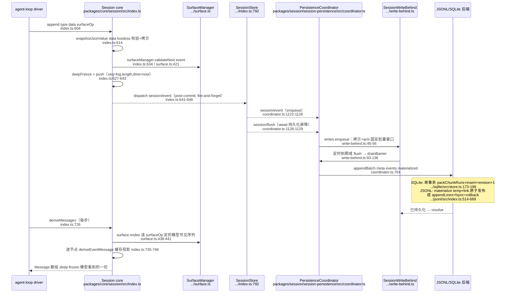
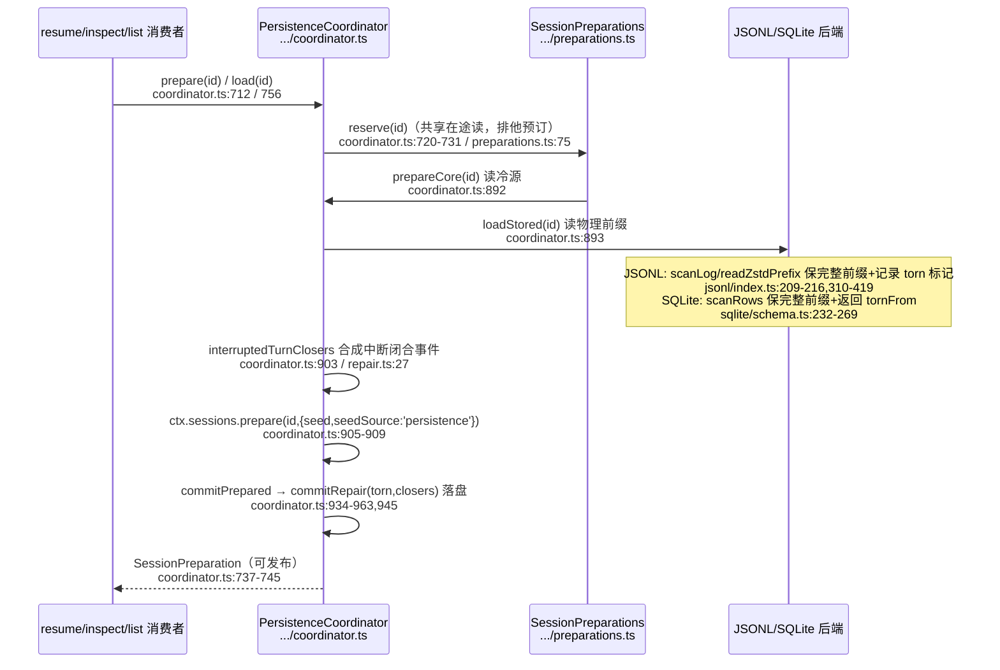

# 会话系统：事件溯源日志作为唯一事实源

> 子文档之一，聚焦 dsh 的数据面——append-only 的 `SessionEvent` 事件日志。覆盖：`packages/core/session`（核心事件模型）+ 持久化 seam（`session-persistence` 抽象 + coordinator + JSONL/SQLite 后端）+ `session-projection` + `session-telemetry`。整体哲学见 [README](README.md)；本文上承 [architecture.md](architecture.md)（插件树为运行时地基），下启 [agent-loop-runtime.md](agent-loop-runtime.md)（循环从中 derive 模型历史）。

## 在项目中的角色

会话系统是整个 harness 的数据面**唯一定序事实源**。`Session` 是一个 append-only 的 `SessionEvent` 日志，模型史、标题、telemetry、fork/resume、持久化全部从这个日志**派生**而非存储独立副本。

去掉它系统会怎样（反证其必要性）：

- **模型历史无法重建**：`deriveMessages()` 从日志投影出 `Message[]`，是「模型看到的一切」的来源；无日志则无法向 provider 续传上下文（`[packages/core/session/src/index.ts:726-747]()`）。
- **无法审计 / telemetry 无源**：`session-telemetry` 的 ledger 通道逐条镜像 session 日志事件（`[packages/session/session-telemetry/src/coordinator.ts:191-202]()`），删除日志等于删除观测面。
- **无法 fork/resume**：`SessionStore.fork()` 从稳定 log 前缀造子会话（`[packages/core/session/src/index.ts:1081-1138]()`）；resume 通过 persistence 的 `prepare(id)` 从已存日志还原未发布 Session（`[packages/session/session-persistence/src/coordinator.ts:712-747]()`）。
- **标题/统计等派生状态无基**：`session-projection` 的每个注册单元是「state + event → state」的纯函数，驱动源是 `session/event`（`[packages/session/session-projection/src/index.ts:181-183]()`）。

一句话：会话日志是「一切皆插件」反内核主张在**数据面**的投影——没有特权内核并不意味着没有唯一定序的事实源；正是因为内核无 `session.history` 这类特权可变对象，才需要一根 append-only 日志承载模型可见与审计所需的一切，所有消费者各自投影。

---

## 解决什么问题 / 根因

**根因：模型交互是「难重放、易撕裂、需审计」的状态，可变会话对象无法同时满足这三者。**

1. **模型上下文必须可重放**：agent loop 每步要构造 `Message[]`。若用可变 `session.messages[]`，则 (a) 无法精确重建某请求时模型看到什么；(b) chunk 级（token 级）细节丢失；(c) fork/resume 需另存快照，多副本必然漂移。事件溯源把「发生了什么」和「当时模型看到什么」解耦——历史是可重放的投影而非存储副本。`SessionEvent` 保证 lossless JSON 且「sequence numbers stay contiguous, including raw chunks, so persistence can store the canonical log verbatim」（`[packages/core/session/src/types.ts:232-234]()`）。

2. **append-only 保证审计完整性**：事件一旦入 log 便 deep-freeze（`[packages/core/session/src/index.ts:627-633]()`），`events` 快照不可变（`[packages/core/session/src/index.ts:559-562]()`），持久化后端得到的必是「exact appended events」（`[docs/subsystems/session.md:603-603]()`）。可变状态做不到——它某处必有一份可被改写的历史。

3. **崩溃安全需要显式边界**：一段 turn 可能极长（多 step + 大 tool 输出），可变状态崩溃会丢整段未 flush 历史。事件溯源下后端只截断撕裂的尾记录，完整的中断 turn 保留并合成 `turn/end { interrupted }` 闭合（`[packages/core/session/src/repair.ts:19-132]()`；`[docs/subsystems/persistence.md:15-17]()`）。

**为什么不用「内存模型 + SQL 快照」替代？** 快照方案的多副本同步、部分写入原子性、以及「崩溃后恢复出一致的模型历史」都退化为分布式一致性问题；事件日志把复杂性收敛到每个后端都能以单事务/单文件 append 实现的 append-only 顺序。详见决策 1。

---

## 设计思路

### 方案：append-only 事件日志 vs 可变会话对象

选了前者，三个支撑：

- **`seq = log.length` 连续性契约**：`seq` 单调、连续、等于日志长度；`get seq()` 即 `log.length`（`[packages/core/session/src/index.ts:564-567]()`）。这让持久化以「下一个 seq 应等于已存长度」做简单校验（`[packages/session/session-persistence/src/coordinator.ts:698-702]()`），也让 surface/header fold 记住「已消费到哪」做增量投影（`[packages/core/session/src/index.ts:670-680]()`）。
- **deep-freeze 使历史不可改写**：append 时 `snapshotJsonValue`（lossless 校验 + 一次性拷贝）再 `deepFreeze`；「一个 stateful getter 不能给校验一个值、给存储另一个值」（`[packages/core/session/src/index.ts:596-603]()`）。
- **构造期 seed 也过同一校验**：replay/fork 的 seed 在构造时逐条 `snapshotJsonValue` + `validateNext` + `deepFreeze`（`[packages/core/session/src/index.ts:508-537]()`），保证「后端能存的东西」与「live log」永不背离。

### 核心模式 1：`SessionEventMap`——类型合并声明的可扩展事件词汇

事件类型是一张**可声明合并的接口表**，而非「自由字符串 + 任意 JSON」：

```ts
export interface SessionEventMap {
  'turn/start': { turn: number }
  // … 其余变体 …
  'session/end-seed': Record<string, never>
}
export type SessionEventType = keyof SessionEventMap
```
（`[packages/core/session/src/types.ts:236-336]()`）

插件通过 `declare module … interface SessionEventMap { 'compaction/start': … }` 扩展（`[docs/subsystems/session.md:11-11](),595`）。关键约束：

- 新增**模型可见**输入 ⇒ 必须新增 session 事件（Model-visible means logged 在类型层的落地）；
- 插件贡献事件**默认是 log-only**（非 `SurfaceEventType`、无 `surfaceOp`、不出现在派生历史），其与 turn 的关系由所属插件的 invariant companion 声明（`[packages/core/session/src/types.ts:345-346]()`；`[docs/subsystems/session.md:595-595]()`）。

### 核心模式 2：`SurfaceEventType` / `SurfaceOp`——「模型历史从哪里来」的显式声明

三类消息事件（`user/message`、`assistant/message`、`tool/result`）**必须**带 `surfaceOp`（append 或 replace），可带 `sourceEventSeqs`（来源 seq）。`surfaceOp` 是 `deriveMessages()` 的**唯一来源**：无标记的原始事件（chunk、turn 边界）正确缺席；compaction 的 `replace` 把被遮蔽节点从派生中删除（`[docs/subsystems/session.md:494-510]()`）。

这是「投影规则可证」的关键：`Session.append` 的调用点由编译器强制——对 `SurfaceEventType` 事件必传 `SurfaceIntent`，对 log-only 事件拒绝（`[packages/core/session/src/index.ts:604-608]()` 的元组类型 `...opts: T extends SurfaceEventType ? [opts: SurfaceIntent] : []`）。`surfaceOp` 语义：

```ts
type SurfaceOp = 'append' | { op: 'replace'; start: number; end: number }
```
（`[packages/core/session/src/types.ts:372-374]()`）

`append` 常规尾部追加；`replace` 遮蔽 `[start,end]`（含端点，必须都在当前 surface 内）并原位插入，`replaceGeneration` 单调递增以区分「纯尾部增长」与「surface 重写」（`[packages/core/session/src/surface.ts:362-379]()`）。

### 核心模式 3：Model-visible means logged 不变式 + `ignorable` 逃生阀

- **入模型请求的一切都必须能从日志重建**：`EpochHeader`（call config + 渲染后 system + 装配后工具 schema）整体作为 `request/header` 快照落盘（`[packages/core/session/src/types.ts:304-304]()`），`foldRequestHeader` 选最新快照重建（`[packages/core/session/src/request-header.ts:65-70]()`）。每个请求因此是日志的纯函数（`[docs/subsystems/session.md:156-156]()`）。
- **反之**：读者遇不认识的类型，若事件未带 `ignorable: true` 必须拒绝重建而非静默丢弃——未知必需事件可能改变后续日志解读；缺省为 required，宁可误拒也不可静默复活被掏空的会话（`[packages/core/session/src/types.ts:421-422]()`）。

### 被否决的替代方案

- **自由 string 事件 + 无 schema**：无类型合并就没有编译期强制「模型可见输入必有事件」，invariant companion 无法按类型精确校验。
- **只存最终消息不存 chunk**：毁掉 token 级重放保真（`assistant/chunk` 是「token-level replay fidelity」，`[packages/core/session/src/types.ts:265-266]()`），而这恰是审计/UI 流式所需。

---

## 关键数据结构

### 1. `SessionEvent<T>`——按 type 判别联合的单条日志项（`[packages/core/session/src/types.ts:404-436]()`）

`switch (event.type)` 直接收窄 `event.data`，无需 cast。`sourceEventSeqs`/`surfaceOp` 是条件类型：仅 `SurfaceEventType` 变体携带（`… : object` 分支），log-only 事件由编译器排除。

> 注意：`SessionEventType = keyof SessionEventMap` 可被插件合并扩展，故 switch 不得用 `assertNever`，处理已知情形后走 `default`（`[docs/subsystems/session.md:247-247]()`）。

### 2. `SessionEventMap` 事件变体（`[packages/core/session/src/types.ts:236-333]()`）

| 事件 | 载荷 | Surface | 角色 |
|---|---|---|---|
| `turn/start` / `turn/end` | `{turn}` / `{turn,reason}` | 否 | turn 生命周期边界 |
| `step/start` / `step/end` | `{turn,step}` | 否 | step 边界（一次模型调用+其工具执行） |
| `user/message` | `UserMessage` | ✅ | 人类提示/注入上下文/ goal 延续 |
| `assistant/chunk` | `{turn,step,chunk}` | 否 | 逐 token 重放 |
| `assistant/message` | `{turn,step,message,usage?}` | ✅ | 组装后 assistant 消息（派生史用） |
| `tool/call` | `{turn,step,callId,name,arguments}` | 否 | 模型请求的工具调用（arguments 原文未解析） |
| `tool/result` | `{turn,step,message,error?,meta?}` | ✅ | 工具结果（meta 工具私有、必须 JSON） |
| `todo/write` | `{todos}` | 否 | 全列表快照 last-wins，log-only UI 态 |
| `request/header` | `{header,reason}` | 否 | 下一请求完整头快照 |
| `request/context` | `RequestContext` | 否 | 路由容量元数据，不参与请求重建 |
| `session/end-seed` | `Record<string,never>` | 否 | 构造期 seed 结束边界（durable `firstLiveSeq`） |

`TodoItem` 刻意最小（content + 三态 status、无 id），因列表整体替换、条目无需稳定身份（`[packages/core/session/src/types.ts:189-194]()`）。`tool/result` 的 `meta` 是 `JsonValue`，`Session.append` 用 `isJsonValue` 运行时拒绝不可序列化数据，保证 durable log 重放得到完全一致的卡（`[packages/core/session/src/types.ts:284-289]()`）。

### 3. `SessionHeader`——日志旁的不可变存储元数据（`[packages/core/session/src/types.ts:61-99]()`）

放在事件日志之外：format version、cwd、parent lineage、seed 边界、delegationDepth、agentPreset 都是存储关注点，不进 `SessionEventMap`、不进 `deriveMessages()`（`[docs/subsystems/persistence.md:43-43]()`）。`agentPreset` 持久化有因：preset 决定会话的工具与提示词，resume 恢复不同组合会重放模型无法再行动的历史（`[packages/core/session/src/types.ts:93-98]()`）。

### 4. 持久化后端 schema

**SQLite**（`packages/session/session-persistence-sqlite/src/schema.ts`）——一行一个 `SessionEvent`，无平行持久化 schema：
- `sessions` 行：out-of-log 元数据 + `incarnation`（物化时分配）+ `revision`（每变更事务自增）（`schema.ts:32-46`）。
- `events` 行：rc.8 起为 Schema 17 **打包物理行**（见 [data-model.md](data-model.md)）——标量事件仍 `(session_id, seq, type, time, data, source_event_seqs, surface_op, ignorable)`，但连续同块 `assistant/chunk` 会被 `packChunkRuns` 压成 `*-chunks` 一行、`source_event_seqs` 以 varint/ZigZag delta 编码为 BLOB、大 payload 以 zstd 压成 BLOB（`…/sqlite/src/codec.ts:32-46`、`…/sqlite/src/compression.ts:31-36`）。
- `persistence_state`：单例行保存随机 `store_id`，作 source-qualified revision 抗碰撞部分（`schema.ts:116-120`；`…/src/index.ts:47-51`）。

**JSONL**（`packages/session/session-persistence-jsonl/src/format.ts`）——每会话一个 append-only 文件：
- 首行是 `type:'session'` 标记的 header line（`format.ts:33-44`）；事件行默认打包成 `text-chunks`/`reasoning-chunks`/`tool-call-chunks` 存储行，或不打包逐条（`format.ts:221-224`）。
- 目录布局 `root/--project-key--/<encodeSegment(id)>/session.jsonl(.zstd)`；SessionId 是未校验 branded string，必须 `encodeSegment` 转义后才可入路径（防穿越/碰撞）（`format.ts:121-136`）。

### 5. 投影 / 遥测表

- `SessionProjectionMap`——全链投影类型表，声明合并扩展（`[packages/session/session-projection/src/types.ts:17-17]()`）；`ProjectionCheckpointRow = (ver, seq, val)` 是持久化投影缓存的折叠捷径（`[packages/session/session-projection/src/index.ts:108-115]()`）。
- `SessionTelemetryRecord`——ledger/ops 双通道：ledger 逐条镜像 session 事件，ops 承载无日志归属信号（`agent-error`/`shutdown`）（`[packages/session/session-telemetry/src/index.ts:64-87]()`）。ledger 镜像 `event.data` 深拷贝（`coordinator.ts:191-202`）。

> **演进说明（0.1.1-rc.1）**：session 投影数据通路在 rc.1 重写为「状态 / 客户端视图」两段式，并引入统一的跨 boot 快照——`ProjectionDefinition` 改为声明式纯 fold：`stateSchema` 校验 persisted 状态、可选的 `wire` 只负责"state → 客户端视图"（view/read-side 投影），`apply` 仍是"前态 + 一条已提交事件 → 后态"的纯迁移（[packages/session/session-projection/src/index.ts:42-82]()）。
<!-- anchor: export interface ProjectionDefinition< …   stateVersion: number -->
>
> 三个关键语义：
> - **host-only 单元**：不提供 `wire` 的定义即"状态不进客户端快照、仍照常 checkpoint"，由 `register()` 的双重载在类型层区分（有 `wire` / 无 `wire` 两条签名，见 [packages/session/session-projection/src/index.ts:211-222]()）。这使"主机私有状态"（如 subagent 的 timing/identity）不再泄漏到 wire 载荷，却仍参与持久化快照。
> - **统一 checkpoint**：`checkpoint()` 给每个注册单元产一行 `{ver, seq, val}`，`val` 是 `structuredClone` 的 DETACHED 副本（绝不直接引用 live cell，防 corruption）；产物即持久化投影缓存的写侧（[packages/session/session-projection/src/index.ts:329-340]()）。
> - **跨 boot 稳定快照**：`restoreFloor()` 从 checkpoint 算出一个"比最低可用 watermark 低一事件"的锚点 seq，失败或版本不符的 key 拉回 `0`（必须重折全量日志）——这个"低一事件"是 load-bearing 的，用来探测"日志被 crash-repair 截短到某行 watermark 之下"而不是拿陈旧行当现行（[packages/session/session-projection/src/index.ts:358-368]()）。
>
> 这是「[关键设计决策](session.md#关键设计决策)」里"日志派生投影"在持久化层的延伸：投影缓存从"任意派生"升级为"**带版本、可复用、崩溃安全**"的折叠捷径——缓存行只是折叠捷径、永不经手真实 cell 引用，`restore` 在版本不符或越界时一律丢弃重折。

---

## 核心流程

### append → 落日志 → deriveMessages 投影（写路径 + 读路径）



`deriveMessages` 增量语义：每个 surface 节点只在首次见时投影一次（O(新节点)）；surface 重写（`replace`，`replaceGeneration` 变化）时重建缓存（`[packages/core/session/src/index.ts:726-747]()`）。返回**新数组**（后续 append 不让调用者持有的数组长大），内部 `Message` 共享且深冻结，复用已冻结事件数据、无需二次深拷贝（`index.ts:705,719-723`）。

### 持久化 / 崩溃恢复读路径



`adoptLivePrefix`（HMR：热加载已存在 live Session）**不** crash-repair 打开 turn——live Session 仍是权威并可能稍后补写真实 step/turn end，只截断不闭合（`[packages/session/session-persistence/src/coordinator.ts:1301-1322]()`）。

### 投影驱动流程

`SessionProjectionRegistry` 构造时订阅一次 `session/event`，每个已提交事件 eager 地经过所有已注册单元的 `apply`（`[packages/session/session-projection/src/index.ts:181-183](),405-425`）。状态引用不变（`Object.is`）表示该单元不关心此事件，零下游工作（`index.ts:58-59,415-417`）。`snapshot()` 全同步（保证 `asOfSeq` 覆盖同一 tick 的读，`index.ts:248-255`）；`checkpoint()` 返回每单元 `{ver,seq,val}`（`val` 是 detached structured clone，绝不给出 live cell 引用，防破坏每条后续 snapshot，`index.ts:271-282`）；`restore()` 是「缓存态 + 前向尾重放 + view」的冷读配方（`index.ts:355-385`），`restoreFloor` 的 one-below 锚点让尾部读能证明存储日志的延伸长度、从而检出崩溃修复导致的日志收缩（`index.ts:300-310`）。

### 遥测捕获流程

- **live 捕获**：订阅 `session/created`（adopt）、`session/event`（捕获）、`session/disposed`（写 shutdown 标记）、`agent/error` relay、`session/flush` hint（`[packages/session/session-telemetry/src/coordinator.ts:79-111]()`）。
- **chunk 投影**：每个 (turn,step) 只投第一个 `assistant/chunk`（流起始信号），内容字节在 assembled `assistant/message` 已完整；丢弃的 chunk 不推进 cursor（`coordinator.ts:180-203`）。
- **重组（re-adoption）**：日志经 handoff cursor 重放，起点是 `session.firstLiveSeq` 而非 seq 0——构造期 seed 永不发 firehose（`coordinator.ts:150-170`）。cursor 是模块级 ambient state（`handoffCursor` WeakMap），文档承认为注册即 effect 纪律的狭窄例外，键按 `Session` 对象存活（`coordinator.ts:34-43`）。

---

## 与其他模块协同

- **agent-loop 消费**：loop 通过 `SessionStore` 创建会话，把 `user/message`、`assistant/chunk`、`assistant/message`、`tool/call`、`tool/result`、`turn/*`、`step/*` 事件 append 进日志；每步用 `deriveMessages()` 得模型史。loop 每请求前 append `request/header`，用 `headerEquals` 避免记录未变的头（`[packages/core/session/src/request-header.ts:44-54]()`）。（跨模块：loop 调用点文件与行号，本切片未引入 agent-loop 源码。）
- **system-prompt 从日志渲染**：`EpochHeader.system` 是已渲染系统提示整体，作为 `request/header` 事件持久化（`[packages/core/session/src/types.ts:207-207](),304`），即「模型每次请求时的系统提示」可重建。（跨模块：system-prompt 渲染发生在 agent-loop/system-prompt 包，本切片只见落日志一侧。）
- **持久化后端可交换（capability seam）**：`ctx.sessionPersistence` 是抽象 seam（`[packages/session/session-persistence/src/index.ts:84-84]()`），JSONL 与 SQLite 实现同一契约并共用 `runPersistenceContract` 测试套（`[docs/subsystems/persistence.md:233-236]()`）。两者都通过 `PersistenceCoordinator` 组合（`[packages/session/session-persistence/src/coordinator.ts:588-625]()`），它定义最小存储原语集（`loadStored/readStoredRevision/appendBatch/commitRepair/list`，`coordinator.ts:127-215`），把缓冲、串行化、adopt、崩溃修复编排、dispose quiescence 集中一处；第三方可绕过 coordinator 直接实现 seam（`coordinator.ts:3-4`）。
- **invariant companion**：`core/session` 的 `invariant.ts` 是唯一有行为的——增量校验 turn/step 编号、执行事件 enclosure、同 step 工具调用/结果配对（`[packages/core/session/src/invariant.ts:55-166]()`）。各持久化/投影/遥测包的 invariant companion 都是空安装（`[packages/session/session-persistence-jsonl/src/invariant.ts:21-21]()` 等）。
- **telemetry 与主循环分离**：capture 侧 ledger 记录是后端流水线的输入，`emit` 必须是非阻塞队列推送（`[packages/session/session-telemetry/src/index.ts:96-104]()`）。

---

## 关键设计决策

### 决策 1：不可变事件日志 vs 可变会话状态

- **选**：append-only + lossless-JSON + seq 连续 + deep-freeze。
- **收益**：模型史可重放/可审计/可 crash 恢复；派生态全部可重算；持久化唯一事实源（`[docs/subsystems/session.md:603-604]()`：持久化承诺含 `assistant/chunk` 的逐条 lossless，seq 连续故 chunk 不可从 canonical log 过滤）。
- **代价/权衡**：存储膨胀（chunk 逐条），靠 JSONL 的 chunk 打包行缓解（约 60% 减小，`[docs/subsystems/persistence.md:72-72]()`）。
- **为什么不可变**：可变 `messages[]` 会让「投影即模型史」退化为「某份可变副本即模型史」，多副本必然漂移，崩溃/审计/派生都在副本一致性上压倒一切。

### 决策 2：扩展 `SessionEventMap`（类型合并）而非自由字符串事件

- **选**：`SessionEventMap` 可声明合并 + `SurfaceEventType`/`sourceEventSeqs`/`surfaceOp` 类型约束 + compiler 在 `append` 调用点强制。
- **收益**：(a) 编译期保证「新模型可见输入 ⇒ 新事件」（Model-visible means logged 在类型层强制）；(b) invariant companion 按类型精确增量校验；(c) 持久化 read path 以 `KNOWN_SESSION_EVENT_TYPES` 拒绝未知必需事件（`[packages/core/session/src/known-event-types.ts:19-63]()`，配合 `ignorable` 逃生阀，`[packages/session/session-persistence/src/coordinator.ts:1061-1066]()`）。
- **替代方案代价**：自由字符串事件无编译期保证，未知类型只能运行时猜测，invariant 无从按类型校验，插件事件关系（是否 turn-enclosed）无法以类型表达。

### 决策 3：持久化可插拔 / JSONL vs SQLite

- **选**：capability seam（抽象 `SessionPersistence` + 两后端）。
- **JSONL 之选**：可读（plaintext 或 zstd 帧）、append-only 文件适配顺序介质、逐字节还原（`readRaw`，`[docs/subsystems/persistence.md:128-129]()`；`[packages/session/session-persistence-jsonl/src/index.ts:252-282]()`）、崩溃修复只需「截断 torn 尾 + append closers」（`index.ts:436-444`），不需要数据库事务。
- **SQLite 之选**：事务原子性天然（materialize+打包 append 单事务，`[packages/session/session-persistence-sqlite/src/store.ts:173-199]()`）、seq 可寻址（`loadStoredFrom` 只读后缀，`index.ts:225-238`）、单文件单库（locate 返回 undefined，`index.ts:173-175`）。rc.8 起在事务内做 `packChunkRuns` 打包（见 [data-model.md](data-model.md)「Schema 17」）。
- **代价**：JSONL 的 append 断点需显式 rollback/truncate（`jsonl/index.ts:651-689`），且 `commitRepair` 不要求跨行原子；SQLite 对「未 flush 尾部」的容忍靠 `scanRows` 的 torn 语义（`sqlite/schema.ts:232-269`）。
- **chunk 打包解码**：`packChunkRuns` 把连续同类 delta chunk 打包成一行，`decodeStorageRecord` 无损展开（`[packages/core/session/src/chunk-rows.ts:192-221](),339-346`）。这是**存储编码词汇而非 session 事件**——不打进 `SessionEventMap`，用无斜杠 tag 防与事件分类混淆；编码器白名单精确形状，不认识即逐条存（丢压缩不丢数据）；解码器先验证再展开、损坏 loud fail（`chunk-rows.ts:9-16,339-345`）。

---

## 亮点与问题

### 亮点

1. **seq 连续性 + seed 同校验**：构造期 seed 走与 live append 完全相同的 lossless-JSON + surface 校验，杜绝「后端存不下但 live log 有」这类静默背离（`[packages/core/session/src/index.ts:508-537]()`）。
2. **append-only 下的可折叠性**：`session/end-seed` 边界让 seed 历史与 live work 可区分，是 compaction 等「独立开/闭括号」插件判断陈旧括号的关键（`[packages/core/session/src/types.ts:325-330]()`；`[docs/subsystems/session.md:589-589]()`）。
3. **崩溃恢复精度**：只合成缺失的闭合事件（未记录 start 的工具 → `ToolNotStarted`，已记录但结果未持久化 → `ToolOutcomeUnknown`，打开 step → `step/end`，最后 `turn/end {interrupted}`），不丢失已写入完整 turn（`[packages/core/session/src/repair.ts:90-131]()`）。
4. **派生史 deep-frozen + 单次增量投影**：缓存的 `Message` 复用已冻结事件数据，消费方式正确时「通过投影改写历史」不可表达（`[packages/core/session/src/index.ts:705-705](),726-747`）。
5. **Projection 引用相等做 change 门控**：`apply` 未变返回同引用 → `Object.is` 为真 → 零下游通知（`[packages/session/session-projection/src/index.ts:415-417]()`）。

### 问题 / 权衡点（供主 agent 留意）

1. **空 invariant companion 泛滥**：持久化/投影/遥测各包 `invariant.ts` 都空安装——正确性押在 spec/round-trip 测试而非运行时 invariant（`[packages/session/session-persistence-jsonl/src/invariant.ts:21-21]()`）。系统有意为之（关系不在 cordis event 上可观测），但对「无特权内核」叙事是软肋：越中心的数据层，运行时自证越少。
2. **`handoffCursor` 模块级 ambient 状态**是「注册即 effect」纪律的明确例外，靠注释文档化（`[packages/session/session-telemetry/src/coordinator.ts:34-43]()`），HMR/重复采纳的 at-most-once 语义因此是隐式约定。
3. **JSONL 非原子 append**：`commitRepair` 显式两步骤、appendLines 失败才回滚到 change 前 size（`[packages/session/session-persistence-jsonl/src/index.ts:651-689]()`）；多进程写同一 id 依赖 `link()` 而非 `rename()` 的 EEXIST 防呆（`index.ts:544-556`），正确但依赖 OS 语义。
4. **legacy 迁移逻辑积聚**：coordinator 有大量 v0→current 迁移（steering/message、turn/start trigger、turn/end reason 扁平化、message identity 化，`[packages/session/session-persistence/src/coordinator.ts:344-573]()`），严谨（malformed 报 corrupt 而非伪装 legacy），但增加未来升级复杂度——与 `SESSION_FORMAT_VERSION=0`「无兼容承诺」并存是合理的紧急出口（`[packages/core/session/src/types.ts:36-56]()`）。

## 全局关联：日志即「无特权内核」在数据面的投影

会话层的每个设计都回扣整体哲学：「没有特权内核」不意味着没有唯一事实源——正相反，因为内核里没有 `session.history` 这类特权可变对象，才需要一根 append-only 日志承载模型可见与审计所需的一切，让每个消费者（agent-loop 的 `deriveMessages`、标题、telemetry、fork/resume）各自投影。`Model-visible means logged` 再把「模型看到的一切都必须能从日志重建」变成编译期强制与运行时 invariant，这既是 dsh 可审计、可回放、可崩溃恢复的根基，也是它区别于「可变会话对象」类 agent 框架的本质分水岭。持久化做成 JSONL/SQLite 双后端可交换，正是第 3 根支柱「Capability Seam」在数据面的又一次落地。
