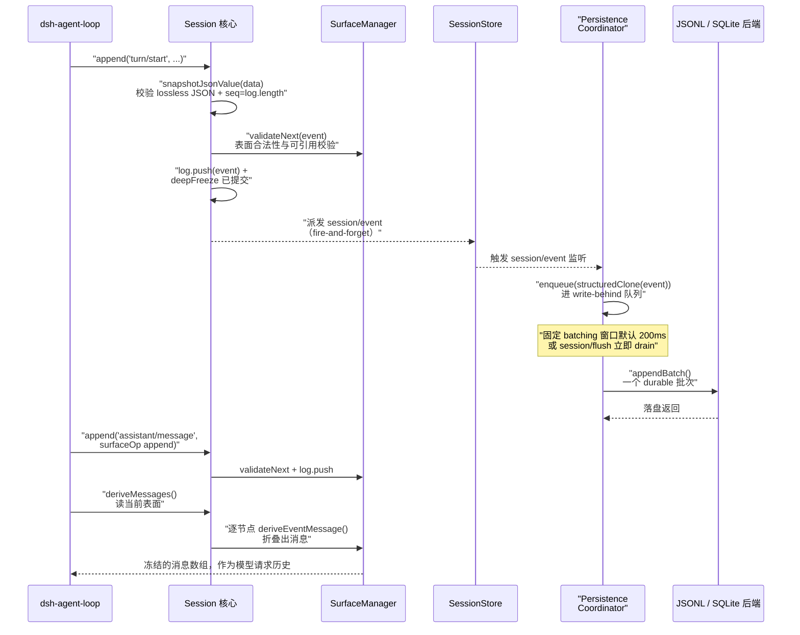

# 会话日志与事件溯源（Session Event Sourcing）

> 对应关注面：append-only `SessionEvent` 日志（单一事实源）、`deriveMessages()` 投影、持久化后端（JSONL/SQLite）、session 查询/标题/投影。相对于 `capability-seams.md`，本文件聚焦「会话日志、持久化与投影」这条贯穿一切的主干。

一句话根因：**模型看到的历史必须能从日志完全重建**（"Model-visible means logged"）。dsh 把一次 agent 交互的「全量事实」记成一条 append-only 的 `SessionEvent` 日志；LLM 的输入消息、会话标题、读模型、UI 状态全部**从该日志派生**，而不是另存一份"当前消息数组"。

- 单一事实源：`Session` 就是一条事件日志，`deriveMessages()` 从它派生出模型历史。
- 持久化是**游标式追赶**，不是整存替换：后端订阅 `session/event` 把每个事件追加进自己的存储，`session/flush` 是显式持久性屏障。
- 两个可互换后端（JSONL / SQLite）实现同一个抽象 `SessionPersistence`，共享一个 `PersistenceCoordinator` 编排。

## 在项目中的角色：去掉它会怎样

dsh 是一个 agent harness，而 `Session` / 事件溯源是**整个交互历史的唯一存储**。去掉它，等于同时失去：模型上下文输入、会话持久化、fork、resume、标题、审计 replay、telemetry 采纳、投影读模型。它是一条贯穿一切的主干，不是某个独立子模块。

下游直接消费 `ctx.sessions` 与 `ctx.sessionPersistence` 的关键方：

- `dsh-agent-loop`：agent 主循环每步 append 事件、读 `deriveMessages()` 作为模型请求历史，用 `session/flush` 做请求前持久化屏障。
- `dsh-session-checkpoint-policy`：在模型请求发出**前**强制 flush，fail-closed。
- `dsh-session-title`：把标题写成 `session/title` 事件，再从日志 fold 回。
- `dsh-session-projection` + `session-projection-cache`：把日志事件 eager fold 成可查询的读模型。
- fork / resume / subagent 都是从这条日志切前缀 / 续写。

「去掉它会怎样」的最短答案：**没有它就没有"可重建"这个不变量**——其余任何依赖历史重建的能力（resume、fork、replay、title、projection）全都失去数据源。

## 解决什么问题、根因

### 根因：历史必须可重建

LLM agent 的每一次对话 / 请求都依赖**精确的重放**。dsh 的核心不变量是 *Model-visible means logged*：模型看到过的一切必须被记入日志，且能从日志**完全重建**。这引出一个直接推论——任何新的 model-visible 输入必须新增一条 session 事件类型（扩展 `SessionEventMap`），否则模型曾经看到但日志没记的东西，resume / fork 后无法重现，会造成历史缺失与语义漂移。

`SessionEventMap` 的注释直接阐明这一点：`The merge-extensible, append-only source of truth for an agent interaction. Message history is derived from this log.`。消息历史**派生**自日志，不另存。
[packages/core/session/src/types.ts:236-236]()
<!-- snippet: export interface SessionEventMap { -->

### 三个次级问题

1. **持久化与内存模型统一**：如果内存里是"消息数组"、磁盘上是"别的存储"，两者会漂移。改成"日志即源"，持久化只是把同一批事件换一种介质存储，无第二套 schema。
2. **崩溃恢复语义**：进程崩溃时最后一条 turn 可能没写完。系统不能简单截断（一个长 turn 可能巨大且已落盘），要能区分「完整已提交」与「撕裂尾部」，在加载时补齐缺失边界。
3. **回放与实时一致**：派生（消息、标题、投影）需要一个统一投影规则，让「实时内存」与「离线重放」产出**完全相同**的结果，避免两处不一致（`deriveEventMessage` 是统一 per-node 投影）。

## 设计思路：方案与权衡

### 核心模式：Map → derived-union + declaration merging

`SessionEventMap` 是一张事件类型表，每个 key 映射到它的 payload 类型；`SessionEvent<T>` 用它构造一个真 discriminated-union（`switch(event.type)` 直接收窄 `event.data`），并可**声明合并**（declaration merging），因此插件能往 map 里加自己的事件类型，core 的类型检查自动覆盖。

两个刻意取舍：

- **不写 `assertNever`**：因为 map 可合并，一个 `default` 分支里的未知类型是合法的插件事件，不是 bug（`default: return null`，注释明说 no assertNever）。
- **`ignorable` 标记**：新版本的未知事件在旧 reader 面前，若带 `ignorable: true` 可安全跳过，否则旧 reader 要**拒绝重建**而非静默丢事件。这是"过度拒绝优于静默错读"的取舍，且与 `SESSION_FORMAT_VERSION = 0`（刻意不迁移、只拒绝）配套：
  [packages/core/session/src/types.ts:56-56]()
  <!-- snippet: export const SESSION_FORMAT_VERSION = 0 -->

### 放弃的替代方案

官方文档明示了一个被放弃的方案：**直接存消息数组**。事件溯源 vs 直接存数组的对比见【决策：为什么选 append-only 事件日志】。要点：事件溯源保住了 chunk 级回放保真、崩溃恢复的边界语义、以及「任意前缀可重放」的派生能力；代价是读路径更复杂、存储更大。

### 派生不做整棵折叠，而是增量 fold

`deriveMessages()` 缓存每个 surface node 的投影结果，只对新增节点投影（O(new nodes)）；一次 `replace`（压缩）会让 `replaceGeneration` 递增，从而失效重建。
[packages/core/session/src/index.ts:726-747]()
<!-- snippet:   deriveMessages(): Message[] {
    const surface = this.surface
    const nodes = surface.nodes
    const generation = surface.replaceGeneration
    if (generation !== this.derivedGeneration) {
      this.derived = []
      this.derivedNodes = 0
      this.derivedGeneration = generation
    }
    for (const seq of nodes.slice(this.derivedNodes)) {
      // Surface sequences are built from this.log — seq is always a valid
      // index by construction. The non-null assertion expresses that invariant.
      // oxlint-disable-next-line typescript/no-non-null-assertion
      const msg = this.deriveEventMessage(this.log[seq]!)
      // A surface node is one of the five message-producing types, but an
      // empty-content assistant/message (a max-tokens step that hosts only
      // usage) derives to null and must not enter the transcript.
      if (msg) this.derived.push(msg)
    }
    this.derivedNodes = nodes.length
    return [...this.derived]
  } -->

## 关键数据结构

### `SessionHeader` — 日志之外的元数据

Header 不进事件日志，因为它不是对话重建的一部分，而是存储关切（版本、cwd、世系、seed 边界）。随 `Session` 用 `session.header` 访问。
[packages/core/session/src/index.ts:443-443]()
<!-- snippet:   readonly header: SessionHeader -->

`seedLength`（从 seed 继承的头部事件数）与 `parentSession`（fork 世系）用于区分父历史与子工作；`delegationDepth` 让子 agent 的递归预算在重启后仍存活；`agentPreset` 因为决定 session 的 tools/prompt，持久化才能保证 resume 时重放的历史仍是当前 agent 能作用的。
[packages/core/session/src/types.ts:61-80]()
<!-- snippet: export interface SessionHeader {
  /**
   * On-disk format version, stamped from {@link SESSION_FORMAT_VERSION} when the
   * session is created. A persistence backend rejects any other version on load
   * (no migration — see the constant).
   */
  readonly version: number
  /** The session's id (mirrors the {@link Session}'s id). */
  readonly id: SessionId
  /** Non-negative safe-integer Unix epoch milliseconds when the session was created. */
  readonly createdAt: number
  /** Absolute working directory the session was created in (if any). */
  readonly cwd?: string
  /** The session this one was forked from (seed lineage), if any. */
  readonly parentSession?: SessionId
  /**
   * How many leading events were inherited through a seed. Persisting this
   * boundary lets resume and replay distinguish parent history from child work.
   */
  readonly seedLength?: number -->

### `SessionEvent` — 一条日志条目

统一的 wrapper，带 `type`/`seq`/`time`/`data`，`seq = log.length`（连续性契约）；`surfaceOp`/`sourceEventSeqs` 仅在三种消息型事件上有条件出现。

### 核心事件变体（`SessionEventMap`）

下表浓缩 `SessionEventMap` 的核心成员，payload 仅列最小签名。

| 事件 | payload（精简） | 分类 | 说明 |
|------|-----------------|------|------|
| `turn/start` | `{ turn: number }` | 日志 | 开启一轮 |
| `turn/end` | `{ turn; reason: TurnEndReason }` | 日志 | 用原因收尾 |
| `step/start` | `{ turn; step }` | 日志 | 一次模型调用 + 其工具执行 |
| `step/end` | `{ turn; step }` | 日志 | 关步 |
| `user/message` | `UserMessage` | 表面 | 用户/注入/目标轮次消息，`content` 逐字投影 |
| `assistant/chunk` | `{ turn; step; chunk: StreamChunk }` | 日志 | 原始流块，token 级回放保真 |
| `assistant/message` | `{ turn; step; message; usage? }` | 表面 | 组装后的 assistant 消息 + token 用量 |
| `tool/call` | `{ turn; step; callId; name; arguments: string }` | 日志 | 模型请求的工具调用，`arguments` 是未解析的原始 JSON 串 |
| `tool/result` | `{ turn; step; message; error?; meta?: JsonValue }` | 表面 | 工具结果消息 + 可选私有 meta |
| `request/context` | `RequestContext` | 日志 | 路由容量元数据 |
| `request/header` | `{ header: EpochHeader; reason }` | 日志 | 下一个请求的完整 header 快照 |
| `todo/write` | `{ todos: TodoItem[] }` | 日志 | 全量 todo 快照，last-write-wins |
| `session/end-seed` | `Record<string, never>` | 日志 | 构造 seed 边界标记 |

> 注：任务清单里写的"十二种变体"与源码并不完全对齐。`SessionEventMap` 实际声明的 core 事件多于十二个，再叠加经声明合并注入的插件事件（`session/title`、`compaction/*`、`hook/*` 等）。**"十二"是文档反复强调的 turn/step/user/assistant/tool/steering/todo/request 这组概念骨架**；`steering/message` 已在 coordinator 迁移到 `user/message`，不再是活事件。本表按源码实际列全。

`TurnEndReasonMap` 是另一个 merge-extensible sum，含 `interrupted`——**唯一 loop 永不自发 emit、只由崩溃恢复合成的 reason**。
[packages/core/session/src/types.ts:155-160]()
<!-- snippet: export interface TurnEndReasonMap {
  completed: { kind: 'completed' }
  /** A cancellation request interrupted the live turn. */
  aborted: { kind: 'aborted'; reason: TurnEndCancelCause }

  blocked: { kind: 'blocked' } -->

### `TodoItem` — 最小化 todo 单元

纯 `content` + 三态 `status`，无 id/priority/activeForm——因为列表每次整体替换（whole-list snapshot），条目无需稳定身份。

### `SurfaceEventType` / `SurfaceOp` — 派生消息的边界

只有 `user/message`/`assistant/message`/`tool/result` 三个类型能上「有序表面」（surface），携带 `surfaceOp`；`SurfaceOp = 'append' | { op:'replace'; start; end }`。`replace` 是压缩用来影藏（shadow）一段旧表面节点的。
[packages/core/session/src/types.ts:343-346]()
<!-- snippet: export type SurfaceEventType =
  | 'user/message'
  | 'assistant/message'
  | 'tool/result' -->

`SurfaceOp` 的两种语义——`append` 追加尾部、`replace` 影藏一段表面范围。
[packages/core/session/src/types.ts:372-374]()
<!-- snippet: export type SurfaceOp =
  | 'append'
  | { op: 'replace'; start: number; end: number } -->

### 投影规则（`deriveEventMessage`）

这是 `deriveMessages` 逐节点应用的核心，规则极简：

- `user/message` → 投影其 `data`（`UserMessage`），`content` 逐字透传，**不加** per-type 框架文本；框架由 producer 自己烘进 `content`（如 agent-instructions 烘 `<system-reminder>`）。
- `assistant/message` → 投影其 `message`，但**空 content 返回 null**（max-tokens 截断 / 只承载 usage 的消息不进入 transcript）。
- `tool/result` → 投影其 `message`。
- 其余（boundary、chunk、log-only 记录）→ `null`，无 assertNever。
  [packages/core/session/src/surface.ts:83-98]()
  <!-- snippet: export function deriveEventMessage(event: SessionEvent): Message | null {
  // Intentionally non-exhaustive: only message-producing events derive
  // history; turn/step boundaries, chunks, usage, and errors are trace/replay
  // data.
  switch (event.type) {
    // Ordinary prompts and injected context project in user role: the event's
    // model-facing content stays verbatim. Do NOT re-add per-type framing
    // (e.g. `<context>`) here: framing is caller-owned — a producer bakes it
    // into `content`, as agent-instructions does with `<system-reminder>` — or,
    // if reintroduced, must be driven by the event `meta` map and a dedicated
    // renderer, keeping this projection a verbatim pass-through. See the
    // deferred design note in
    // ../../../../.agents/notes/implemented/simplification/2026-07-20-unwrap-injected-content-envelopes.md
    case 'user/message': {
      return event.data
    } -->

**关键设计**：派生历史只由表面节点构成；chunk、turn/step 边界、todo、header 都不产出消息。表面由 `SurfaceManager` 增量维护，`derived` 缓存只对新增节点投影。

### `EpochHeader` 与 request 重建

请求的完整快照（call config、system prompt、tools）作为 `request/header` 事件记录；离线用 `foldRequestHeader(events)` 折叠出任一请求的 header。
[packages/core/session/src/request-header.ts:65-71]()
<!-- snippet: export function foldRequestHeader(events: readonly SessionEvent[], from?: EpochHeader): EpochHeader | undefined {
  let state = from
  for (const event of events) {
    if (event.type === 'request/header') state = canonicalHeader(event.data.header)
  }
  return state
} -->

`requestHeader()` 是它的增量在线形式。
[packages/core/session/src/index.ts:670-680]()
<!-- snippet:   requestHeader(): EpochHeader | undefined {
    if (this.headerFoldSeq < this.log.length) {
      // Frozen on update: the fold is session state exposed by reference — a
      // consumer mutating it in place (instead of building a replacement)
      // would desync every later comparison against the log, so mutation
      // throws instead.
      this.headerFold = deepFreeze(foldRequestHeader(this.log.slice(this.headerFoldSeq), this.headerFold))
      this.headerFoldSeq = this.log.length
    }
    return this.headerFold
  } -->

`canonicalHeader` 把空 system/tools 归一为缺省字段，保证 logging、folding、comparison 用同一表示。
[packages/core/session/src/request-header.ts:21-31]()
<!-- snippet: export function canonicalHeader(header: EpochHeader): EpochHeader {
  const adapterDefaults = header.adapterDefaults
  return {
    config: header.config,
    ...adapterDefaults?.reasoningEffort === true || adapterDefaults?.maxTokens === true
      ? { adapterDefaults }
      : {},
    ...header.system !== undefined && header.system.length > 0 ? { system: header.system } : {},
    ...header.tools !== undefined && header.tools.length > 0 ? { tools: header.tools } : {},
  }
} -->

## 核心流程（Mermaid）

`Session` 是事件日志的 live 对象，`SessionStore` 是 live registry，`PersistenceCoordinator` 编排惰性持久化。主链路：append 事件 → 内存提交 → `session/event` 派发 → write-behind 批量落盘。

`append` 全流程（`snapshotJsonValue` + `seq = log.length` + `validateNext` + `deepFreeze`）。
[packages/core/session/src/index.ts:604-618]()
<!-- snippet:   append<T extends SessionEventType>(
    type: T,
    data: SessionEventMap[T],
    ...opts: T extends SurfaceEventType ? [opts: SurfaceIntent] : []
  ): SessionEvent<T> {
    const surfaceOpts: SurfaceIntent | undefined = opts[0]
    const surfaceMetadata = {
      ...surfaceOpts?.sourceEventSeqs === undefined ? {} : { sourceEventSeqs: surfaceOpts.sourceEventSeqs },
      ...surfaceOpts?.surfaceOp === undefined ? {} : { surfaceOp: surfaceOpts.surfaceOp },
    }
    const dataSnapshot = snapshotJsonValue(data)
    if (dataSnapshot === undefined) {
      throw new Error(`session event "${type}" carries non-JSON-serializable data`)
    }
    assertSupportedRequestHeader(type, dataSnapshot, `session event "${type}"`) -->

`session/event` 触发到 write-behind 队列编排。
[packages/session/session-persistence/src/coordinator.ts:1125-1127]()
<!-- snippet:       live.writes.enqueue(event)
    // Callers use flush as the immediate durability barrier for buffered writes.
    ctx.on('session/flush', session => this.flush(session)) -->

## 与其他模块协同

`SessionStore` 是 `ctx.sessions` service 的载体——`class SessionStore extends Service`。
[packages/core/session/src/index.ts:792-792]()
<!-- snippet: export class SessionStore extends Service { -->

- **agent-loop**：主循环是事件生产者（append turn/step/... 事件），也是 `deriveMessages()` 的主要消费者（把派生历史作为模型请求上下文）。`dsh-session-checkpoint-policy` 把 loop 和 persistence 焊在一起：在模型请求/工具执行/边界强制 `ctx.sessions.flush()`。
- **session-title**：把标题事件写回日志，`foldSessionTitle` 与投影注册的 `title` unit 都从日志派生。
- **session-projection**：订阅 `session/event`，把每个事件 eager 喂给各 registered unit 的纯 `apply`。
- **session-projection-cache**：用持久化的 `readFrom(fromSeq)` 恢复 checkpoint 做冷读。
- **fork / resume**：fork 是切前缀、resume 是续写，二者都依赖 `session/end-seed` 分界。

## 关键设计决策

### 为什么选 append-only 事件日志，而不是直接存"消息数组"？

1. **可重放即任意前缀可派生**：事件日志任意位置切一刀都构成合法前缀，可 fork 或 resume；消息数组只能整体读，无法表达"从哪个历史点分支"。
2. **崩溃恢复语义**：日志能区分「完整已提交的 turn」与「撕裂尾部」。直接存数组时，若进程崩溃在写一半，要么整体不可用、要么很难判定已提交边界。
3. **派生与实时一致**：投影（消息、标题、projection）都从同一批事件派生，天然一致，不需要维护第二份同步的"当前状态"副本。
4. **审计 / 回放保真**：原始 chunk、tool 参数、每次请求 header 都被保留，供 UI、telemetry、debug 逐 token 回放。

代价：读路径要从事件 fold 出消息（有缓存缓解）、存储更大（chunk 级压缩缓解）、类型系统更复杂（Map → union）。dsh 权衡后仍选事件溯源，因为 agent harness 的"可重建"不变量比省一点存储更关键。

### 派生为什么不整棵折叠，而是增量 fold？

`deriveMessages` 用 `replaceGeneration` 标记失效：只有一次 `replace`（压缩）才重建整个缓存，平时只投影新增节点（O(new nodes)）。这是"读路径增量"的具体实现，见 index.ts:726-747。

### 为什么会话标题写回日志而非单独存？

标题是历史派生的一部分，随日志可重建；单独存就破坏了"单一事实源"。

## 亮点与问题

### 亮点

1. **单一事实源的纯度**：一条事件日志 + 统一派生规则，消息/标题/投影/audit 全部同源，无第二套待同步的状态。`deriveMessages` 缓存只对新增节点投影，读路径是增量的。
2. **`surfaceOp` 分离「模型可见表面」与「人类可读 transcript」**：`append` vs `replace` 让压缩能影藏历史而**不污染**用户已看到的 transcript。
3. **崩溃恢复的「加法优先于截断」**：保留已落盘的完整中断 turn，只合成缺失边界，绝不重写已提交事件。
4. **coordinator 把复杂编排收敛到后端钩子**：序列化链、write-behind 批量、preparation 池、repair 排序全部共享；两个后端只实现物理原语。
5. **精确的进度信号**：`firstLiveSeq`/`session/end-seed` 精确回答「日志里哪些是本进程写入、哪些是继承的 seed」，是 fork/resume/telemetry 采纳的分界。

### 问题 / 风险

1. **无 upgrader 链，升级路径缺失**：版本 0 + 拒绝策略意味着任何结构变更都可能让旧 harness 无法读新日志（`SESSION_FORMAT_VERSION = 0`）。这在 unreleased 阶段可行，但一旦发布而没有 upgrader，向后兼容成本会很高。
2. **SQLite 后端无法独立核对单会话 artifact**：`supportsRawArtifacts: false`，无法像 JSONL 那样按会话独立存取。
3. **事件类型是字符串，跨包声明合并契约较隐**：插件合并 `SessionEventMap` 靠的只是类型声明，无运行时注册校验；三方插件事件在持久化读路径上可能被拒，除非带 `ignorable`。
4. **`seq = log.length` 连续性契约是强假设**：一切（持久化 contiguity、surface node 即 log 下标、投影缓存）都依赖 seq 严格等于 log index。

## 已知的文档-实现漂移

- **"十二种事件变体"与源码不符**：`SessionEventMap` 实际声明的 core 事件多于 12 个，再叠加插件 merge 的事件；"十二"只是概念骨架（turn/step/user/assistant/tool/steering/todo/request），不是准确计数。本文件按源码实际列全。
- **SQLite abort vs rollback 的崩溃原子性表述**：以 `schema.ts` 的 `scanRows` torn-tail 判别为准（见 session-persistence-sqlite 包文档），而非文档对事务边界的宽泛表述。
