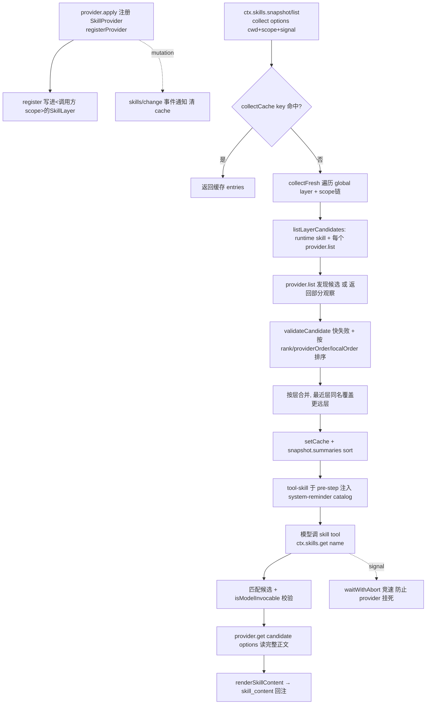
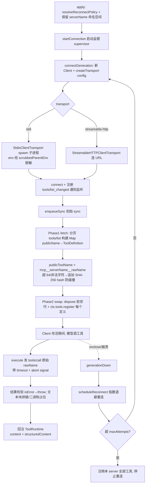

# Skill 技能体系 + MCP 外部能力接入

> 子文档之一，把「外部能力注入」这一个关注面拆成两条互补通道：`packages/skill/*`（技能）与 `packages/mcp/mcp-client/*`（MCP 接入）。整体哲学见 [README](README.md)；本文上承 [subagent.md](subagent.md)（多 agent 委派）、下启 [memory-compaction.md](memory-compaction.md)（上下文管理）。

Skill 与 MCP 共同回答「如何把外部能力变成 agent 可用的东西」——Skill 管低频、按需取回的指令（摘要目录 + 按名加载），MCP 管外部 server 的工具桥接（协议同步 + 连接生命周期）。

## Part A - Skill 技能体系

### 技能体系在系统中的角色

Skill 是「外部指令注入」的通用通道：把可复用的任务指令（本地 `.dsh/skills`、`.agents/skills`、用户目录、打包资源，或任意 provider 提供方）定义为统一的 SkillDefinition，通过一次 token 化的 catalog 注入模型上下文，加上一个模型可调用的 `skill` 加载 tool 按需取回完整正文，从而避免把每份技能的全文常驻在上下文里。它去掉后，就没有机制把项目/用户/宿主复用到的指令清单稳定地送进每个 session（一次性 `agent.inject` 无法复现、无法随工作区/用户目录变化增量替换），也无法让模型在真正需要时才读取技能正文。

根因：agent 的「系统提示」不能无限膨胀，但技能是低频、大体积、按需（名称+描述）路由的指令集合。把它投影成「摘要目录（system-reminder）+ 按名加载（tool）」两段式，是上下文成本与可发现性的最优折中。同时必须「一切皆插件」：技能从哪来（本地目录、远程、打包、宿主内置）不应由内核决定，于是天然演进成一个 Capability Seam 三件套——Service Definition（`ctx.skills` 注册表）、Provider（filesystem/badge/任意）、Consumer（tool-skill）。

这正呼应设计哲学第 1 条「无特权内核」：`ctx.skills` 只是合并/仲裁 provider 目录的中立注册表，技能落地形态由可交换 provider 决定；内核绝不内置任何技能镜像。哲学第 4 条的 Profile/Bundle/Patch 分层也在此体现为注册表的「host + per-scope 分层的层叠寻址」。

### 关键数据结构

**SkillCandidate / SkillSummary / SkillDefinition**（provider→registry→consumer 三段身份）：`SkillCandidate` 是 provider 目录条目，带 `rank`、不透明 `locator`（registry 只存不读，评优后原样交回 provider.get()）、来源 `source`；`SkillSummary` 是调用无关的摘要（只有 name/description/invocation/source/provider）；`SkillDefinition` 是加载后含 `content` 正文的完整形态。[packages/skill/skill/src/index.ts:55-101]()

<!-- anchor: export interface SkillSummary { -->
… 由 registry 合并/加载。三型共享 name/description/invocation/source/provider/resourceBase，差异只在 rank+locator（候选）与 content+path+metadata（定义）<!-- anchor: export interface SkillDefinition extends SkillSummary { -->

**SkillInvocationPolicy**：模型/人类两条调用面独立开合，所有 resolved summary/candidate/definition 都携带，避免把任意 frontmatter 变成领域模型。[packages/skill/skill/src/index.ts:47-53]()

<!-- anchor: export interface SkillInvocationPolicy { -->
**注册表 SkillRegistry**：`SkillLayer` 按 scope 划分，存 provider（NamedEntries，插入序）与 runtime skill（Map），registry 持有 `collectCache`（cwd/scope链/revision 为 key 的已完成目录缓存）、`revision` 计数与 provider 单调序号。[packages/skill/skill/src/index.ts:327-371]()

<!-- anchor: /** One scope's complete skill-registry contribution. */ -->

### 核心流程（发现/加载 → 注入系统提示 → 命中触发执行）

关键坐标：
- `collect` 缓存键含 `scopeChainOf` 与 `revision`，重挂 scope 无需改注册表即可让下次读到新 preset。[packages/skill/skill/src/index.ts:520-550]()
<!-- anchor: private async collect(options: SkillViewOptions): Promise<Col -->
- 层叠合并：先 global 层再 scope 链，同名「最近层直接覆盖更远层有效条目」；rank 只在层内仲裁。[packages/skill/skill/src/index.ts:552-566]()
<!-- anchor: // Global first, then existing chain overlays farthest ancest -->
- get 是「评选定 provider 并传回 locator」的懒加载，定义缓存不由 registry 持有；定义名不匹配候选即失效并触发精确 provider 失效。[packages/skill/skill/src/index.ts:501-518]()
<!-- anchor: async get(name: string, options: SkillViewOptions = {}): Prom -->
- catalog 注入由 tool-skill 在 `agent/pre-step` 完成，只在本插件 tool 精确可见时发；digest 对比后增量替换或全量替换。[packages/skill/tool-skill/src/index.ts:213-251]()
<!-- anchor: ctx.on('agent/pre-step', async ( -->
- 命中触发：**用户直接 `/name` 调用** 走另一条 pre-step 监听，把技能正文作为 `instructions` 注入（仅 `skill-invocation` 源的唯一入口，`disable-model-invocation` 技能只在它可见）；**模型触发** 走 `skill` tool。[packages/skill/tool-skill/src/index.ts:177-204]()
<!-- anchor: ctx.on('agent/pre-step', async ( -->

### 设计决策

1. **发现/加载分层**：注册是同步的（真正远程初始化/auth 放进 `list()`）；候选/选项被只读借用，语义字段被校验，畸形候选快失败。Provider 工厂收到仅作用于自身注册的 `SkillProviderControl`，其 `invalidate()` 只在精确注册存活时清缓存。[packages/skill/skill/src/index.ts:391-429]()
<!-- anchor: registerProvider(create: (control: SkillProviderControl) => S -->
2. **不完整目录的降级**：`SkillProviderObservation.complete` 区分「观察权威」与「有用但不可缓存」；发现重试失败返回最新候选并标记 incomplete、不入缓存，让消费方保留 last-good 并重试。[packages/skill/skill/src/index.ts:552-565]()
<!-- anchor:   private async collectFresh(options: SkillViewOptions): Promise<CollectResult> { -->
3. **注入上下文的方式**：只注入 `name + 转义后 description`（catalog 求和 digest），不注入正文/路径/来源；正文按需经 tool 或 `/name` 手势注入，正文用 `<skill_content>` 规范化封装（tool 结果与手势注入共享同一 render 函数，保证两条路径一次范式）。[packages/skill/skill/src/index.ts:171-184]()
<!-- anchor: export function renderSkillContent(skill: Pick<SkillDefinitio -->
4. **与内置工具/插件关系**：Skill 是「指令摘要+加载」，Tool 是「可执行函数」，二者正交但互相配合（`skill` 是本插件注册到 `ctx.tools` 的一个普通 tool，受工具可见性/作用域遮蔽治理约束，catalog 只在 tool 精确可见时生效）；skill 本身不映射为可执行动作。[packages/skill/tool-skill/src/index.ts:77-161]()
<!-- anchor: export function apply(ctx: Context, config: Config = {}): voi -->
5. **冲突仲裁**：层内同名按 rank→provider 注册序→本地顺序，跨层最近层直接赢；`RUNTIME_RANK=250` 让运行时技能位于 project(100/200) 之后、user(400/500) 之前。[packages/skill/skill/src/index.ts:807-811]()
<!-- anchor: return left.candidate.rank - right.candidate.rank -->
6. 本地发现根扫描按 rank 排序（`.dsh`→`.agents`→custom→用户→bundled），git-root 探测走 fs 服务以免远程/沙盒回落到宿主边界。[packages/skill/skill-filesystem/src/index.ts:241-261]()
<!-- anchor: private async roots(cwd: string | undefined): Promise<SkillRo -->
7. 变更观测：模型 facing `write/edit`（`fs/observed` 事件）同步失效 provider，host 层用 Chokidar 覆盖外部进程变更；`skills/change` 事件不带 diff，消费方自取自己关心的观察。[packages/skill/skill-filesystem/src/index.ts:139-143]()
<!-- anchor: ctx.on('fs/observed', (target, _observation, actor) => { -->

---

## Part B - MCP 接入层

### MCP 接入层在系统中的角色

MCP 子模块是「外部工具注入」的通道：把任意符合 Model Context Protocol 的外部 server（本地子进程或远程 HTTP 服务器）暴露的一组工具，桥接进 harness 的 ToolRuntime（`ctx.tools`），让模型以 native tool 的方式调用外部能力。去掉了它，harness 就失去了一条标准化的外部能力接入途径（MCP 生态的 server/tool 无法复用），只能为每个外部服务手写私有工具桥。

根因：MCP 是社区的生态标准，外部工具以同一协议暴露。接入层要做的是「协议桥」——把 MCP 的 server 工具清单同步成 harness 的 tool 定义、把一次 `tools/call` 映射成一次原生 tool 执行——同时承担连接的生命周期（spawn/connect/断线重连）与网络信任边界的错误治理（超时、非法输出、isError、崩溃恢复）。这正符合无特权内核哲学：MCP server 不过是 `ctx.tools` 的另一个 provider，注册表不看工具「来源是否内置」，只看统一身份契约；而每个 mcp-client 实例连接一个 server、多实例多 server 是 Cordis 组合的自然结果。

注意一个关键取舍：MCP 三元协议（tools/resources/prompts）里本模块**只桥接 tools**。Resources 与 Prompts 没有 harness 消费方，被明确延后——这使命名空间 `packages/mcp/mcp-client/*` 只做工具桥，不做全量 MCP 代理。[packages/mcp/mcp-client/README.md:111-111]()

<!-- anchor: - **Tools are the only bridged MCP capability** — Resources a -->

### 关键数据结构

**Config（拼接 union）**：按 `transport` 判别为 `stdio`（command/args/env/cwd）或 `streamable-http`（url/headers），共享 `serverName`/`toolCallTimeoutMs`/`failOnStartupError`/`reconnect`。`serverName` 限定 `[A-Za-z0-9_-]{1,32}`，作为模型 facing 工具名的稳定命名空间。[packages/mcp/mcp-client/src/index.ts:49-98]()

<!-- anchor: /** Config for connecting to an MCP server via a spawned chil -->
**ReconnectConfig / ResolvedReconnectPolicy**：`resolveReconnectPolicy` 是 config→策略的唯一步，默认 `{enabled:true, initialDelayMs:500, maxDelayMs:30000, maxAttempts:10}`，边界单独复判（程序化构造可绕过 Schemastery）。[packages/mcp/mcp-client/src/connection.ts:27-90]()

<!-- anchor: /** Automatic reconnect policy for one MCP server connection. -->
**ConnectionHandle**：暴露 `ready`（首连 outcome）与 `dispose`（停重连+关当前 client+settle in-flight+注销工具），供 plugin 激活等待与 HMR 拆卸。[packages/mcp/mcp-client/src/connection.ts:98-112]()

<!-- anchor: /** Handle for one plugin instance's supervised connection. * -->
**ToolDisposers**：`Map<publicName, dispose>`，记录本 server 每次 sync 世代当前注册的工具集合，swap/回滚/quiesce 都靠它。[packages/mcp/mcp-client/src/tools.ts:32-33]()

<!-- anchor: /** State for one sync generation: the current set of dispose -->

### 核心流程（工具 schema 注册 → 映射进内部 tool → 经连接执行 → 结果回注）

关键坐标：
- plugin 激活阻塞在首连+首次同步；`failOnStartupError` 决定失败是致命（Cordis 回滚）还是进重连循环。[packages/mcp/mcp-client/src/index.ts:166-180]()
<!-- anchor: const connection = startConnection(ctx, config, reconnect) -->
- 命名空间保留在 `ctx.root` 级（多 app 同进程测试互不可见），重复 serverName 在加载期即报错而非静默遮蔽。[packages/mcp/mcp-client/src/index.ts:145-161]()
<!-- anchor: // Reserve the namespace next: a duplicate -->
- sync 分 fetch/swap 两阶段：fetch 失败保留前世代注册，swap 冲突则整代回滚（零工具，绝不半套），起始严格同步可 `throw`。[packages/mcp/mcp-client/src/tools.ts:134-180]()
<!-- anchor: // Phase 1: fetch and build the next generation without touch -->
- 命名纯函数：`publicToolName` 由 `(serverName, rawName)` 确定，异常字符串替换非法字符并追加 12-hex SHA 避免不同身份坍缩成同名。[packages/mcp/mcp-client/src/tools.ts:96-102]()
<!-- anchor: export function publicToolName(serverName: string, rawName: s -->
- 工具执行：发送原始 rawName（公名绝不发到线上），abort+timeout 透传进 SDK request；MCP 的 `isError` 会 throw 让 ToolRuntime 走 isError 路径。[packages/mcp/mcp-client/src/tools.ts:234-284]()
<!-- anchor: return async (args: unknown, exec: ToolExecution) => { -->
- 重连预算按 outage 算：`maxAttempts` 连续失败后注销并停，`connectedAt` 存活超 `maxDelayMs`（=最大退避间隔）则重置预算，区分「偶发崩溃」与「crash-loop」。[packages/mcp/mcp-client/src/connection.ts:192-225]()
<!-- anchor: function scheduleReconnect(): void { -->

### 设计决策

1. **transport 权衡**：stdio 适合本地子进程 server（command/args/env，env 经 `scrubbedParentEnv` 脱敏身份状与过期 `DSH_*`），streamable-http 适合远程/SSE。重连只在 transport onclose 触发——stdio 崩溃能触发，HTTP 不可达是每请求重试而非 supervisor 重建。[packages/mcp/mcp-client/src/transport.ts:31-50]()
<!-- anchor: export function createTransport(config: Config): Transport { -->
2. **工具映射到内部 tool**：以 server 提供的 description+inputSchema 直接构造 ToolDefinition 的 parameters；output 统一为 `{ content: JsonValue[], structuredContent? }`，支持的广告 outputSchema 校验 structuredContent，不支持的词汇回落到无约束 JsonValue。[packages/mcp/mcp-client/src/tools.ts:199-227]()
<!-- anchor: /** Build the canonical result schema and existing Native tex -->
3. **超时/abort**：默认 60s/tool call，exec.signal 竞速；SDK 的初始化/分页仍用其自身 60s 默认（未另暴露连接超时）——已知局限。[packages/mcp/mcp-client/src/index.ts:33-34]()
<!-- anchor: /** Default timeout for individual MCP tool calls (ms). */ -->
4. **系统性生成切换安全**：`enqueueSync` 串行化所有 sync（首发+通知重同步+跨世代），`isCurrent(generation)` 守卫保证只有当前世代能行动，`dispose` 需 quiesce (await settling+syncChain) 再注销，避免双 dispose/泄漏。[packages/mcp/mcp-client/src/connection.ts:156-172]()
<!-- anchor:   * Serializes every syncTools call — initial syncs and notification re-syncs -->
5. 网络信任边界：读取每个 content block 用的是比 SDK 更松的类型，服务器缺失必填字段（text/mimeType）有回退，而非 panic。[packages/mcp/mcp-client/src/tools.ts:177-197]()
<!-- anchor:  * The shape we read from each MCP content block. Intentionally looser than the -->

---

## 合篇：两个子模块如何共同服务"外部能力注入"

Skill 与 MCP 是同一个关注面（把外部能力变成 agent 可用的东西）的**两条互补通道**，共享同一组设计哲学：

1. **无特权内核**：两者都只是注册表/桥的普通 consumer。Skill 走 `ctx.skills`，MCP 走 `ctx.tools`——内核不认识技能正文也不认识 MCP wire 协议，只消化统一结构（SkillSummary/Definition、ToolDefinition）。
2. **Capability Seam 三件套**：Skill 明确拆出 Service Definition（registry）/Provider（filesystem/badge）/Consumer（tool-skill）；MCP 同样分 transport（stdio/http）、provider（bridge sync）、消费方（`ctx.tools`）三层。可交换后端都成立——技能可来自任何 provider，MCP 可接任何 server。
3. **Context 成本管理**：Skill 用「摘要目录+按名加载」两段式避免正文常驻；MCP 用「catalog 只含名+description」与 re-sync 替换而非累积，两者共同目标都是把低频/数据敏感的外部指令与工具的 token 成本压到最低（KV-cache prefix-stable）。
4. **事件是扩展点**：Skill 变更发 `skills/change`（不带 diff，消费方自取）；MCP 监听 MCP 的 `notifications/tools/list_changed` 触发 re-sync。方向相反但机制同构——都靠事件驱动目录/工具集的增量刷新。
5. **错误的非权威降级**：Skill 缓存 key 含 revision，目录并发变更返回 incomplete 不入缓存、消费方保留 last-good；MCP sync 失败保留前世代、注册冲突整代回滚——在无法保证目录/工具集稳定时，宁可持续服务旧版本也不给半套。

差异侧重点：Skill 的重心在**发现/仲裁/分层的指令寻址**（跨 project/user/bundled、host+scope 层叠、invocation 策略）；MCP 的重心在**外部进程/网络的生命周期治理**（spawn/connect/退避重连/超时/信任边界）。前者管"哪些指令可用"，后者管"哪些远端工具能稳定地存续并被执行"。

## 全局关联：两条外部能力通道共享同一套哲学

Skill 与 MCP 是「外部能力注入」这个关注面的两条互补通道：Skill 管「哪些指令可用」（发现/仲裁/分层的指令寻址 + host+scope 层叠 + invocation 策略），MCP 管「哪些远端工具能稳定地存续并被执行」（spawn/connect/退避重连/信任边界）。它们共享同一组设计哲学——无特权内核（两者都只是注册表/桥的普通 consumer）、Capability Seam 三件套、上下文成本管理（Skill 摘要目录+按名加载、MCP 目录只含名+description）、事件驱动增量刷新（`skills/change` 与 MCP `tools/list_changed` 反向但同构）。需要说明的一点边界：MCP 三元协议中本文只桥接 tools（`[packages/mcp/mcp-client/README.md:111-111]()`），resources/prompts 在本仓库无消费方而刻意延后——这正是「按需取交集」而非全量代理的表征。
