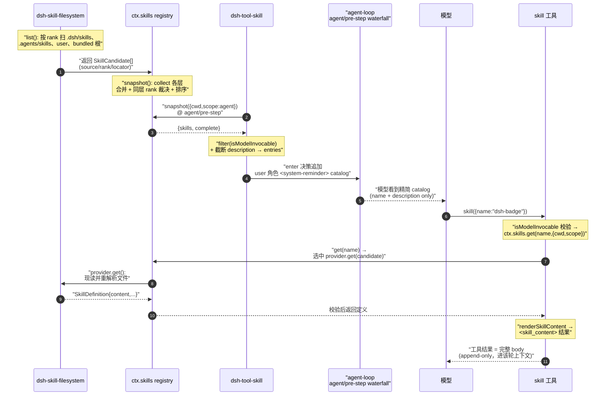

# Skill 技能体系与横向扩展工具（Skill Capability Family）

> 对应关注面：`ctx.skills`（分层 skill provider 注册表 seam）、`dsh-tool-skill`（模型面 catalog 渲染 + `skill` 加载工具 + 用户手势注入）、`dsh-skill-filesystem`（本地文件系统 provider）、`dsh-skill-badge`（可选的打包 badge provider）。

## 在项目中的角色：去掉它会怎样

`ctx.skills` 是 harness 的"可复用指令（skill）"能力 seam，与工具系统、系统提示词、会话共同构成 agent 能力面。去掉整个 skill 能力族意味着：

- **失去"任务特定指令"的注入通道**：dsh 的模型上下文本身是通用 agent 指令；skill 提供按需加载的、任务相关的 Markdown 指令体。去掉后模型只能用"工具 + 通用 system prompt"处理一切，遇到需要长篇领域流程时要 么塞进 system prompt（常驻 token 成本）、要么硬编码进工具。
- **`ctx.skills` 注册表 seam 消失**：`SkillRegistry` 是 provider 中立的分层合并器。它本身不生产任何 skill，只合并多个 provider 的 catalog 并按名解析胜者。去掉它，provider（filesystem、badge、未来 remote）无处挂载，也无法在 scope 层做同名遮蔽（shadowing）。
- **`skill` 工具消失**：模型面 `skill({ name })` 工具消失，模型即使 catalog 里列了 skill 名，也没有加载 body 的门路。
- **catalog 注入消失**：`tool-skill` 在 `agent/pre-step` 注入 `user` 角色的 `<system-reminder>` catalog。去掉后模型根本不知道有哪些 skill 可用。

一句话：**skill 族是"发现 → catalog 提示 → 按需加载 → 注入"四段式能力通道**，`ctx.skills` 是 provider 中立的 seam，`dsh-tool-skill` 是模型面唯一消费者，`filesystem`/`badge` 是生产者。职责边界清晰：registry 不渲染、consumer 不发现。

## 解决什么问题、根因

**根因**：agent harness 需要在"不膨胀固定 system prompt"的前提下，把可复用的、任务特定的长指令按需提供给模型。直接方案（把所有 skill 塞进 system prompt）有两个硬伤：

1. **token 常驻成本**：skill 越多，固定提示词越长，叠加 KV-cache 前缀失效风险；而大多数 skill 与当前任务无关。
2. **发现与加载不分**：没有"先看目录（name+description 的精简 catalog）、选中后再拉 body"的两跳结构，模型无法在没有上下文开销的情况下"知道有什么、再决定读什么"。

**设计目标（docs 原文）**：把 skill 做成"provider 中立的可注入指令"，通过 catalog 前缀 + 按需 load body 解耦"向模型披露技能面"与"加载技能体"两个阶段。同时坚持 skill 是"可选指令 (optional instructions)"而非"会话事件 (session events)"。

## 设计思路

### 方案：provider 注册表 seam + catalog 合并 + 前缀披露 + 按需加载

1. **seam 分层**：`ctx.skills` 是 host+per-scope 分层合并器（形状沿袭 tools registry）。provider 在 `apply()` 阶段同步 `registerProvider()`，真正的异步发现放在 `list()` 里。跨层同名遮蔽：最近的 layer 直接胜出；同层内才按 rank → provider 注册序 → provider 内序。
2. **一行 provider 契约**：`list()` 返回候选 `SkillCandidate[]`（数组=完整发现的简写）或 `{candidates, complete}` 观测对象；`get(candidate)` 返回完整定义。`locator` 是 provider 私有不透明句柄，registry 只存不解读。
3. **两跳消费**：`dsh-tool-skill` 只把 `name + 截断 description` 渲染进 catalog，**不含 body、路径、来源、whenToUse**；模型调 `skill({name})` 时才 `get()` 拉 body。
4. **注入的两种路径共享同一渲染**：`renderSkillContent()` 是 `<skill_content>` 的唯一真相源，`skill` 工具结果与用户手势注入共用同一形状，避免模型看到两种格式。
5. **按需加载 + 不缓存 body**：`get()` 每次现读 provider body，body-only 编辑无需 hash/通知模型。

### 对比常见 agent 的"全部暴注入 system"

| 维度 | dsh（catalog 前缀 + 按需 load） | 常见 agent "全注入 system" |
|---|---|---|
| 固定 token 成本 | 只有精简 catalog（name+desc，默认 500 字截断） | 所有 skill 全文常驻 |
| 发现成本 | 低，一次快照列名 | 无独立目录，全靠提示词 |
| 加载时机 | 模型主动 `skill()` 或用户 `/name` 手势 | 常驻，无需加载 |
| 上下文新鲜度 | body 现读现取 | 常驻即老旧 |
| KV-cache | catalog 前缀稳定，body 只进工具结果（append-only） | 全注入会污染固定前缀 |

**根因收益**：catalog 前缀体积极小且相对稳定（利于 KV 复用），只有被选中的 skill body 才以工具结果/注入形式进入该轮上下文，且是 append-only。

### 放弃的替代方案

- **全部 skill 直接注入 system prompt**：token 常驻 + 前缀失效 + 无发现/加载分界（放弃，见上）。
- **`skill` 工具一次返回多个 skill 或枚举目录**：模型无需枚举，catalog 已披露全部可调用名；一次只选一个按需加载。
- **registry 缓存 body**：会导致 body 变更需要复杂失效协议；改为现读现取，读取失败/重命名自然被下轮发现修正。

## 关键数据结构

### `<skill_content>` 唯一渲染

`renderSkillContent` 是工具结果与手势注入共用的唯一 `<skill_content>` 形状。
[packages/skill/skill/src/index.ts:171-184]()
<!-- snippet: export function renderSkillContent(skill: Pick<SkillDefinition, 'name' | 'provider' | 'resourceBase' | 'content'>): string {
  const resourceHint = renderResourceHint(skill)
  return [
    `<skill_content name="${escapeAttr(skill.name)}">`,
    '<skill_resources>',
    ...resourceHint,
    '</skill_resources>',
    '',
    '<skill_instructions>',
    skill.content,
    '</skill_instructions>',
    '</skill_content>',
  ].join('\n')
} -->

### provider 注册

`registerProvider` 在 apply 阶段同步注册一个 provider，并用 invalidation control 让 provider 能主动失效缓存。
[packages/skill/skill/src/index.ts:391-394]()
<!-- snippet:   registerProvider(create: (control: SkillProviderControl) => SkillProvider): () => void {
    const lifecycle = new AbortController()
    let registration: { layer: SkillLayer; name: string } | undefined
    let provider: SkillProvider -->

### 按需加载 body

`get()` 现读 provider body、校验定义、并校验返回名与候选名一致（否则失效该 entry）。
[packages/skill/skill/src/index.ts:501-518]()
<!-- snippet:   async get(name: string, options: SkillViewOptions = {}): Promise<SkillDefinition | undefined> {
    if (!isSkillName(name)) return undefined
    const collected = await this.collect(options)
    throwIfAborted(options.signal)
    const match = collected.entries.get(name)
    if (match === undefined) return undefined
    const definition = await waitWithAbort(
      match.provider.get(match.candidate, options),
      options.signal,
    )
    if (definition === undefined) return undefined
    validateDefinition(definition)
    if (definition.name !== match.candidate.name) {
      this.invalidateEntry(match)
      return undefined
    }
    return definition
  } -->

### skill 声明 schema（frontmatter）

`<name>/SKILL.md`（目录 bundle）或 `<name>.md`（扁平文件），YAML frontmatter + Markdown body：`name`（必填，kebab-case）+ `description`（必填）+ 可选 `whenToUse` / `metadata` / `disable-model-invocation` / `user-invocable`。

## 核心流程（Mermaid）

### skill 从发现到注入到被模型调用

补充：还有一条与"模型主动 load"正交的注入路径——**用户手势**。用户输入 `/<name>` 且该 skill `user-invocable` 时，`agent/pre-step` 的另一个监听器直接 `get()` 并把 `renderSkillContent` 结果以 `skill-invocation` 源注入为 `user` 角色 instructions。这是 `disable-model-invocation` skill 的唯一入口。

## 与其他模块协同

- **与 system-prompt / 上下文组装**：skill 不是"写进 system-prompt 静态区"，而是通过 `agent/pre-step` waterfall 在每步决策时把 catalog 作为 `user` 角色的 `<system-reminder>` 消息追加进 `enter` 决策的 messages，随后随 prompt 组装进入模型上下文。
- **与工具管道**：`skill({name})` 是注册进 `ctx.tools` 的普通工具，但它同时受 `ctx.skills` 驱动——执行时同步 `list()` 找 summary、`get()` 拉 body。它与其他工具不同点：输出由 `renderSkillContent` 产出 `<skill_content>` 专用结构化文本。
- **与 fs 提供者**：filesystem provider 的发现/读取优先走 `ctx.fs`（`FileSystem` service），无 fs 时回退 Node 原生 I/O。这使远程/沙箱工作区也能发现本地 skill 而不落到 host 文件系统边界。
- **与 scope / 会话**：registry 缓存键含 scope-chain-of，blank-session 重组合重挂 scope 后下次读取即见新 preset；`tool-skill` 把 agent 自身作为 scope 键，preset 内挂载的插件只对那个 agent 的层注册。

## 关键设计决策（Why / 权衡）

### 为什么 catalog 前缀 + 按需 load 而非全注入？

核心权衡：**用"一次精简目录 + 模型按需取 body"换取固定 token 极小 + KV-cache 前缀稳定 + body 现读最新**。代价是：模型必须先读 catalog、再决定调 `skill` 工具，多一跳；若模型漏读某个很相关的 skill，就无法获得其指令——因此 catalog 底部有强引导句。这是一个"少 token 但依赖模型自觉选择"的取舍。

### skill-badge 的作用边界

`dsh-skill-badge` 是一个**最小化、固定、可选**的打包 provider：只贡献 `dsh-badge` 一个候选，rank=600，body 是打包在 assets/ 的 `dsh-badge.md`。它演示了**"部署提供方只需交付一个 `list()`+`get()` 的 provider 即可接入 skill 体系"**。CLI 组合默认 `disabled: true`，是需要"在对外产物上打 dsh badge"这一具体场景的显式 opt-in。它的边界就是"演示 + 具体用例"，不承担通用能力。

### skill provider 如何扩展（fs 之外还有哪些）？

`ctx.skills` 的 provider 契约对来源完全中立。已知消费者：
- `dsh-skill-filesystem`：本地目录（project / user / custom / bundled 六类 root，rank 100-600）。
- `dsh-skill-badge`：打包资源（URL 读取）。
- `register()` 运行时注册的 skill（`provider: "runtime"`，rank 250）——代码内嵌指令。

契约明确把"远程初始化/鉴权/发现"留给 `list()`，意味着 **remote/HTTP 注册表、公司内网 skill 仓库**都可作为未来的 provider 实现。这是 seam 的核心价值：加一种来源 = 写一个 `list()`+`get()` provider，模型面零改动。

### skill 与普通 tool 的分工

- **tool**：可编程、有输入 schema、有副作用、执行由可控管道（approval/guards/sandbox）监管；模型把它当"动作"。
- **skill**：纯指令文本（Markdown），无 schema、无副作用、不经过受控管道；模型把它当"说明/流程"。`skill` 工具本身是一次"读取指令体"的读操作。

类比：**tool 是"手"，skill 是"操作手册"**。模型需要做动作→调 tool；需要知道"怎么做某件未编码成工具的事"→调 `skill` 读手册。

### 诚实评估：skill 体系在同类 agent 中的相对强度

dsh 的 skill 体系**定位是"轻量可复用指令加载"**，它刻意：

- **无 skill 组合/条件元数据**：frontmatter 只支持 name/description/whenToUse/metadata 两个布尔开关，没有依赖声明、无 skill 间引用解析、无版本约束。
- **catalog 只披露 name+description**：`whenToUse` 等路由提示被明确列为"catalog 不渲染"，模型只能凭单个截断描述判断是否相关。
- **body 无大小上限**：provider 可返回超大 body，一方即可耗尽下一轮上下文。
- **资源是"提示"非"附件"**：返回 base 目录/URL 指引，模型需自行按需读取，工具不枚举/不预取。
- **目录替换是全表**：一个名字/描述变化就重发整个 catalog。

相比面向 rich recipe system 的 agent，dsh 的 skill 是"**单层 Markdown 指令 + 精简目录**"的轻量实现。README/skills.md 也**未把 skill 列为头号卖点**（badge provider 默认关闭）。因此判断：**dsh skill 体系的能力强度属于"够用但不过度设计"**——它解决了"指令按需注入"的核心问题，但层深明显低于以复杂 recipe/组合为卖点的 agent。这是务实克制，不是短板吹捧。

## 亮点与问题

### 亮点

- **四段式能力通道干净**：发现（filesystem/badge/remote）→ 目录观测（registry.snapshot）→ 披露（tool-skill catalog）→ 加载（skill tool / 用户手势），每段有明确 owner，模型面契约稳定。
- **`renderSkillContent` 单一真相源**：工具结果与手势注入共用同一 `<skill_content>` 形状，避免模型看到两条不一致的指令格式。
- **两套 invocation 双开关 + fail-closed 原则**：frontmatter 里非法/拼错的调用字段会**丢弃整个 skill** 而非回退宽松默认，防止意外把 skill 暴露在禁用表面。
- **KV-cache 感知设计**：catalog 是 durable 前缀稳定区，实际 body 只以 append-only 工具结果/注入进入上下文，对 KV 复用友好。
- **fs 抽象让远程工作区也能发现本地 skill**：`ctx.fs` 优先、Node 回退，呼应 sandbox/沙箱主模块的设计。

### 问题 / 局限

- **catalog 只给 name+description，模型路由信息单薄**：模型只能靠一句话判断相关性，漏选概率不低。
- **body 无大小上限 + 无流式/部分句柄**：大 body 一次拉取，remote 慢 provider 会卡住该轮。
- **catalog 全表替换**：单点变更整表重发，token 与规模线性。
- **provider 顺序串行**：一个慢 provider 会拖住其后的所有 provider；无并行发现。
- **同层重复 resolution 是 first-wins**：被遮蔽的定义无 API 可查，难以诊断。
- **发现只一层深**：不支持嵌套 `**/SKILL.md`，否认了复杂目录组织。
- **相对 rich recipe agent 层深不足**：无命名依赖、版本约束、结构化元数据 & 命令绑定。

## 已知的文档-实现漂移

- **skill 词汇表归 skill 子系统而非 core**：`SKILL.md` 的 frontmatter（name/description/whenToUse/invocation 双开关）不新增 `SessionEventMap` 事件，skill 是纯粹注入型指令、不经受控工具管道，也不进会话事件流——读者勿误以为它像普通 tool 一样走 approval/guard/sandbox 管道。
- **catalog 注入是"发现→披露"而非"事件"**：`agent/pre-step` 每步决策时把 catalog 作为 `user` 角色 `<system-reminder>` 消息注入，不是持久化事件（skill 的 catalog 以 catalog-form context 记录，见 tool-skill/src/index.ts:catalog 类型），模型看到的是当轮 snapshot 而非累积事件流。
- **`whenToUse` 明确不进 catalog**：是刻意裁剪而非遗漏——勿把它当作 skill schema 的残缺。