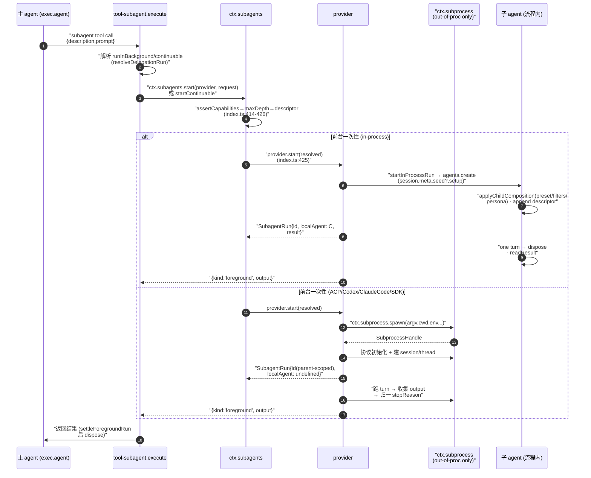
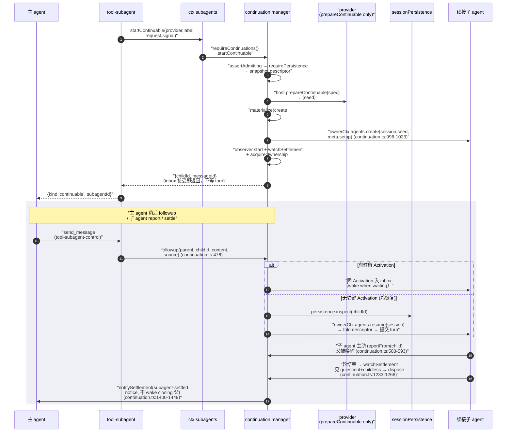

# Subagent 体系：多 provider 委派与续接编排

> 对应关注面：`ctx.subagents` 服务（named-provider registry + capability 校验 + 一次性 start + 续接 startContinuable/followup/interrupt/reportFrom）、`SubagentProvider` transport 抽象、in-process（`spawn`/`fork`）＝ 子 agent、out-of-process（`acp`/`codex`/`claude-code`/`dsh-sdk`）＝ 委派到另一进程产品、model-facing 消费侧（`tool-subagent` 一次性/续接委派、`tool-subagent-control` 的 send_message/interrupt/list_agents、`tool-subagent-report` 的 report）、Activation 续接编排（continuation manager）、durable descriptor + 投影枚举。

## 在项目中的角色（去掉它会怎样）

`ctx.subagents` 是 agent 的「委派能力缝（capability seam）」，与 `ctx.shell`/`ctx.fs` 同级。它与那些缝的关键差异在于：**这里允许多个 provider 按名字共存**（`ctx.subagents` 是注册表），而 bash 每 context 只允许一个 executor。去掉它意味着：

- **主 agent 失去"把活交给独立子 agent"的能力**：模型只能把结果塞回自己的上下文，focused work（研究、独立实现、复核）全部就地完成——上下文被无关中间步骤吞噬。`tool-subagent` 正是靠多 provider 把 work offload 到子 agent 的独立 context。
- **与 bash/shell 一样，"委派"成为能力缝而非 agent-loop 的一部分**：loop 不感知委派——它只看到"工具被调了"。这正是该缝的类型定义放在 `packages/subagent/subagent` 而非 core 的原因（[docs/subsystems/subagent.md:5-5]()）。
  <!-- snippet: The subagent seam lets an agent delegate work to a child agent. -->
- **long-running 委派消失**：continuable（续接）子 agent 是一段"可被中断后冷恢复、可多次 followup"的持久会话，靠 continuation manager + session persistence + `subagent/descriptor` 投影达成。去掉它后"后台跑一个子 agent、主 agent 继续干别的、稍后再交付"这种编排不复存在。
- **跨产品委派消失**：`acp`（Agent Client Protocol）、`codex`、`claude-code`、`dsh-sdk` 让主 harness 能在子进程里驱动另一套独立产品/协议当 child——这是"delegate to another turn inside another product"落地的地方。

一句话：**`ctx.subagents` 是把"委派子 agent"这件事统一成一条 transport seam（registry + capability 校验 + 续接编排），让 in-process 子 agent 与 out-of-process 产品委派用同一套 model-facing 契约。** 它和 fs/shell provider 一样，是同一"能力缝"思想的延伸。

## 解决什么问题、根因

**根因**：agent 要 delegate 时，"子 agent"的实现形态极多样——可以是同一进程里新建的 agent、继承了父历史的 agent、另一个 ACP 协议的进程、另一个产品的 CLI、甚至另一个完整的 Harness 运行时。如果把这些形态各自的接线写死在主 agent 或 loop 里，委派会与具体 transport 强耦合；而如果只保留"最简单那条"（总是 in-process spawn），就丢失了"委派给别的产品/另一完整运行时"的能力。

这个缝要解决四个具体问题：

1. **多 transport 共存且可互换**：一个 context 里多个 provider 按名注册、调用方按名选择，shape 镜像 LLM adapter registry（`llm-streaming`），而非单一 bash executor。这样 `spawn`/`fork`/`acp`/`codex` 等可以并存。官方文档明确"multiple provider implementations coexist"、registry follows the LLM adapter registry（[docs/subsystems/subagent.md:5-5]()）。
   <!-- snippet: it is **one optional capability**, not part of the agent loop, so its types live here rather than in [core.md](core.md) -->
2. **capability 必须在委派前被拒绝**：provider 在 `start` 前声明 `SubagentCapabilities`；调用方请求了 provider 不支持的输出 schema/深度/工具过滤/persona，就必须 loud fail（`UNSUPPORTED_CAPABILITY`），绝不"接受了再忽略"。`SubagentCapabilities` 四个布尔旗标与 `SubagentStartRequest` 选项一一对应（[packages/subagent/subagent/src/types.ts:86-91]()）。
   <!-- snippet: export interface SubagentCapabilities {
  readonly outputSchema: boolean
  readonly depthLimit: boolean
  readonly toolFilter: boolean
  readonly persona: boolean
} -->
3. **one-shot vs long-running（continuable）两种委派语义**：一次性 `start` 拿一个结果；continuable `startContinuable` 建立一持久子会话，可多轮 followup、可冷恢复、可被 interrupt、可让子 agent `reportFrom` 回父——两者在同一个缝里。
4. **out-of-process 子进程必须共享进程 seam 而非法外之地**：ACP/Codex/Claude Code/SDK 的子进程都经 `ctx.subagents` 里的 `ctx.subprocess.spawn`，复用 scrub/env 清理、进程树 teardown、生命周期——而不是各写一个 `child_process.spawn`。

## 设计思路

### transport 抽象

核心是 `SubagentProvider` 接口（[packages/subagent/subagent/src/types.ts:285-289]()，完整接口见同文件 285-324）：一个**同进程可信的命名 transport**，暴露 `name`、`capabilities`、`inheritsParentContext`、`start()` 一次性路径，以及可选的 `prepareContinuable()`（方法存在即 capability）。服务对 provider 做 capability 校验、生成 durable descriptor、然后把 `ResolvedSubagentStartRequest` 交给 provider 的 `start()`。
<!-- snippet: export interface SubagentProvider {
  /** Unique registry name (e.g. `spawn`, `fork`, `acp`). */
  readonly name: string
  /** The start-time features this provider supports (see {@link SubagentCapabilities}). */
  readonly capabilities: SubagentCapabilities -->

关键设计点：

1. **先校验后委派，fail loud**（[packages/subagent/subagent/src/index.ts:414-416]()）：`start()` 里先 `assertCapabilities` → `assertSubagentMaxDepth` → `assertObjectJsonSchema`（若请求了 outputSchema）→ `snapshotSubagentDescriptor`，才交给 provider（`provider.start(resolved)` 在 425，完整流程见同函数 414-426）。请求了不支持的 capability 直接 `UNSUPPORTED_CAPABILITY` 抛错。
   <!-- snippet:   async start(name: string, request: SubagentStartRequest): Promise<SubagentRun> {
    const provider = this.expectProvider(name)
    this.assertCapabilities(provider, request) -->
2. **descriptor 是 durable 身份，由服务快照、provider 落 log**：`src/index.ts` 的 `snapshotSubagentDescriptor` 拆出 `mode`/`provider`/`label`（一次性）或 + `agentProvider/agentModel/persona/toolFilter`（续接）的版本化 JSON，provider 在子 agent 的 initial turn 里 append（[packages/subagent/subagent/src/child-agent.ts:163-175]()）。它不进模型历史、`surfaceOp` 无、可跨 compaction 存活。官方文档明确这三点。
   <!-- snippet: export function applyChildComposition(
  childCtx: Context,
  parent: Agent,
  composition: ChildComposition,
): void {
  childCtx.get('agentPresets')?.composeFrom(childCtx, parent.ctx)
  // Order 120: after the sandbox:policy (110) and approval:policy (115) sentences.
  childCtx.systemPrompt.context({ name: 'subagent:delegation', order: 120, text: SUBAGENT_DELEGATION_CONTEXT })
  if (composition.persona !== undefined) {
    childCtx.systemPrompt.section({ name: 'deployment:persona', order: 0, text: composition.persona })
  }
  if (composition.toolFilter !== undefined) childCtx.tools.restrict(composition.toolFilter)
} -->
3. **provider 是 trusted typed collaborator**：请求/描述符/结果/生命周期 payload 都是借用不可变值；hostile-input 校验放在真实 process/persistence/model 边界（[packages/subagent/subagent/src/index.ts:26-29]()）。续接 child 的三个关键转移点刻意设计成一段不再回传 provider。
   <!-- snippet:  * Same-process providers are trusted typed collaborators. Requests, provider
  * descriptors, results, and lifecycle payloads are borrowed immutable values;
  * serialization and hostile-input validation belong at real process, worker,
  * persistence, and model boundaries. -->
   - Continuable child 成立后，provider 只贡献一次 detached `ContinuableCreateSpec`（目前仅可选 seed），**看不到 child 的 Agent、handle、turn、teardown**（[packages/subagent/subagent/src/types.ts:316-319]()；`prepareContinuable` 完整区块见同文件 308-323）；冷恢复根本不走 provider，由 manager `ctx.agents.resume()`。
     <!-- snippet:    * This is the provider's ONLY participation in a continuable child. The
    * continuation manager owns identity reservation, composition, Agent
    * creation, prompt delivery, cold resume, ownership, and disposal, so a
    * provider never sees the child's Agent, handle, turns, or teardown. -->
   - 结果与 lifecycle 事件观察分开：`result` 归 run handle，`subagent/start·end` 事件由服务封装好的 observer 发布（父子 scope 过滤到该委派）。

### provider 形态的分类

| provider | 形态 | child 是否 in-process | 继承父历史 | 能力 |
|---|---|---|---|---|
| `spawn` | 全新 in-process agent | 是 | 否 | outputSchema/depthLimit/toolFilter/persona 全支持 |
| `fork` | 继承父 completed-turn 前缀的 in-process agent | 是 | 是 | 同上 |
| `acp` | ACP 协议子进程 agent | 否 | 否 | 无（`NO_START_CAPABILITIES`） |
| `codex` | 真实 Codex `app-server --stdio` 子进程 | 否 | 否 | 无 |
| `claude-code` | 官方 Claude Agent SDK 驱动的 CLI 子进程 | 否 | 否 | 无 |
| `dsh-sdk` | 独立 Harness 运行时子进程（stdio JSON-RPC） | 否 | 否 | 无 |

out-of-process provider 的"零能力"是刻意的诚实声明：`NO_START_CAPABILITIES` 把四个旗标全部冻结为 `false`，服务在 `start` 前就拒绝需要任一 option 的请求（[packages/subagent/subagent/src/out-of-process.ts:25-30]()）。
<!-- snippet: export const NO_START_CAPABILITIES: SubagentCapabilities = Object.freeze({
  outputSchema: false,
  depthLimit: false,
  toolFilter: false,
  persona: false,
}) -->

### 放弃的替代方案

- **只用 in-process 单一 transport**：丢失"委派给另一完整产品/运行时"的能力；`codex`/`claude-code`/`dsh-sdk` 的存在证明了多 transport 是实际需求不是过度设计。
- **每个 out-of-process provider 自己 `child_process.spawn`**：会脱离进程 seam 的 scrub/env/树 teardown，测试与安全边界不一致（因此统一走 `ctx.subprocess.spawn`，`out-of-process.ts` 只保留 cwd 决议与 result 归一化）。
- **把 continuation 做成 Task 或 result-bearing wrapper**：会引入第二个"队列/结果载体"，无法复用 agent inbox 作为唯一 turn 队列（因此续接 child 无 Task、无 run，由 manager 直接持 `AgentHandle`，[packages/subagent/subagent/src/continuation.ts:7-13]()）。
  <!-- snippet:  * A continuable child has one durable Session and at most one process-local
  * {@link Activation} — one residency epoch for a reconstructed child Agent. An
  * Activation is not a request, result, cancellation, or Task boundary: it may
  * execute many FIFO turns and stays resident while descendants it created are
  * still running. The Agent inbox is the only turn queue, so this manager owns
  * residency while the Agent loop owns all turn ordering and execution. No
  * continuable path creates a Task or an intermediate result-bearing wrapper. -->
- **followup 由外部 listener 来决定 child 是否 settle**：一个外部 `subagent/end` listener 无法正确判定——payload 不携父、child handle 已 dispose、父的 settlement 触发点已过（[packages/subagent/subagent/src/continuation.ts:15-19]()）。settlement 交付必须是 manager 自己的职责（`notifySettlement`）。
  <!-- snippet:  * Because residency is this manager's alone to end, telling the parent that a
  * child settled is its job too. An external `subagent/end` listener cannot do
  * it correctly: that payload names no parent, the child handle is already
  * disposed by then, and the release that wakes the parent's own settlement
  * watcher has already run. -->

## 关键数据结构（精简）

### `SubagentProvider`（[packages/subagent/subagent/src/types.ts:285-287]()，完整接口 285-324）
<!-- snippet: export interface SubagentProvider {
  /** Unique registry name (e.g. `spawn`, `fork`, `acp`). */
  readonly name: string -->

`start()` 交给一个已发布 run（`SubagentRun`）；可选 `prepareContinuable()` 只贡献 detached seed。`inheritsParentContext` 描述性（仅对话播种，`fork: true`，`spawn`/`acp`: false），供模型-facing wording 使用，不含工具/服务/权限继承断言（[packages/subagent/subagent/src/types.ts:290-295]()）。
<!-- snippet:   /**
   * Whether the child sees the parent's completed-turn prefix. This is descriptive, not a
   * service-validated start capability: the model-facing tool derives truthful wording from it.
   * It says nothing about tool registration, injected services, or authority inheritance.
   */
  readonly inheritsParentContext: boolean -->

### one-shot 委派 `SubagentRun`

一次一次性前台委派、一个结果（[packages/subagent/subagent/src/types.ts:249-253]()，完整接口见同文件 249-275）。本地 run 的 `id`＝发布 child session id，`localAgent` 指向精确 in-process child；远端 provider 返回 parent-scoped id、`localAgent: undefined`。`result` 在 child 级失败时**不 reject**（flat 成 `stopReason: 'error'`，见同接口 262-269 注释），只有不可表征的基础设施故障才 reject；`dispose()` 幂等、必被调用以达 quiescence。续接会话**没有 run**——manager 直接持 `AgentHandle`。
<!-- snippet: export interface SubagentRun {
  /**
   * Parent-scoped run id. For a local run, this MUST equal the published child
   * session id, whose `parentSession` records `request.parent.session.id`; a
   * remote provider mints an id unique in the parent namespace. -->

### 续接委派 `Activation`（[packages/subagent/subagent/src/continuation.ts:191-240]()）

"一个持久子 Session 至多一个 process-local Activation（一段重建 child Agent 的驻留 epoch）"。一个 Activation 可执行多个 FIFO turn、在它创建的 descendants 仍在跑时保持驻留。`AgentHandle`、`parentSession`（结算交付要解析）、`ancestry`（WeakSet 精确活体 lineage）、`ownedChildren: Set<SessionId>`（阻塞 settle）、`disposal` memoized 事务、`announced`。**状态 `running/waiting/settled` 从 Agent quiescence + owned-child set 派生，而非第二套状态机**（[packages/subagent/subagent/src/continuation.ts:159-159]()）。
<!-- snippet: type ActivationState = 'running' | 'waiting' | 'settled' -->

### durable descriptor `SubagentDescriptorData`（[packages/subagent/subagent/src/descriptor.ts:60-88]()）

`mode: 'one-shot' | 'continuable'` + `provider`；续接额外带 resumed 所需的 resolved `agentProvider/agentModel/persona/toolFilter`。刻意快照显式字段而非 merge-extensible `AgentOptions`（无关扩展值不会让续接失败）；省略 `subagentDepth`（冷恢复信 persisted header 的 `delegationDepth` 作单调下限）与 `outputSchema`（一次性 run/Activation 的结果契约，不是 durable 身份，[packages/subagent/subagent/src/descriptor.ts:8-10]()）。`maxTokens` 等 per-activation 预算也刻意不保存——冷恢复用 resumed route 的默认。
<!-- snippet:  * The descriptor deliberately snapshots explicit fields rather than the
  * merge-extensible `AgentOptions` object: an unrelated extension value cannot
  * make continuation fail merely because it is not JSON -->

### 委派类型 one-shot vs continuable（[packages/subagent/tool-subagent/src/index.ts:247-265]()）

`Config.backgroundMode: 'one-shot' | 'continuable'`。one-shot 默认前台（`run_in_background` 默认 false），后台走 `jobs` Task；continuable 默认后台（`run_in_background` 默认 true），走 `startContinuable` 返回 durable `childId`，不 collect 结果。`resolveDelegationRun` 按 background 开关分派到三条路径（前台/one-shot-job/continuable），其中 `runInBackground: request.run_in_background ?? options.continuable`（continuable 无显式声明时默认后台）。
<!-- snippet:   return {
    // Continuable work is independently scheduled unless the caller explicitly
    // needs the result before its next action. One-shot policy keeps its existing
    // foreground default because its background result requires Task collection.
    runInBackground: request.run_in_background ?? options.continuable,
  } -->

## 核心流程（Mermaid）

### 主 agent 委派子 agent（in-process vs out-of-process 两路径）

in-process 路径：`startInProcessRun` 在（[packages/subagent/subagent-in-process-driver/src/index.ts:102-102]()，startInProcessRun 完整实现见同文件 102-148）经 `parent.ctx.agents.create` 建 child、在 child 的 creation window 里调 `applyChildComposition`（index.ts:122）join 父 preset 并装 filters/persona。
<!-- snippet: export async function startInProcessRun( -->
ACP 子进程的 spawn 委托给进程 seam：Connector 把 `spawn: spec => this.ctx.subprocess.spawn(spec)` 注入，而非 provider 直接 `child_process.spawn`（[packages/subagent/subagent-acp/src/index.ts:162-162]()）；teardown 走 `disposeAcpChild` 的 `treeExitsWithin` → `terminate()` → `waitForExit` 协作阶梯（[packages/subagent/subagent-acp/src/run.ts:114-126]()）。
<!-- snippet:      spawn: spec => this.ctx.subprocess.spawn(spec), -->

### 续接（continuable）编排——Activation 生命周期

- `startContinuable` 端到端：materialize 在（[packages/subagent/subagent/src/continuation.ts:436-438]()，materialize/submit 完整区块见同函数 436-456）构造 `seed = seedDescriptorTurn(...)` 后 `agents.create`，`submitMaterialized` 入 inbox，`{ childId, messageId }` 在 456 返回、不等 turn。关键区见 436-456。
  <!-- snippet:     const lineageSeedLength = prepared.seed?.length ?? 0
    const seed = seedDescriptorTurn(childId, prepared.seed, descriptor)
    const messageId = await this.locks.run(childId, async () => { -->
- materialize 建 Agent 的双路径：冷恢复 `agents.resume`（1009-1015），首次创建 `agents.create`（1016-1023），`setup` 里 `applyChildComposition` + append 委派策略（996-1005，[packages/subagent/subagent/src/continuation.ts:1009-1011]()，materialize 建 Agent 完整代码见同文件 996-1023）。
  <!-- snippet:     const handle: AgentHandle = create === undefined
      ? await this.ownerCtx.agents.resume({
        resumeSessionId: childId, -->
- `followup` 分派 alive/absent：`activation === undefined ? this.coldResume(...) : this.submitAdmitted(...)`，且对 disposal 已开的事务等待后冷恢复（lost-race，`v8 ignore` 标注，[packages/subagent/subagent/src/continuation.ts:485-488]()，alive/absent 分派完整逻辑见同函数 476-505）。
  <!-- snippet:         const activation = this.activations.get(childId)
        if (activation === undefined) return this.coldResume(parent, childId, content, options)
        // A delivery that arrives after the disposal transaction began must not
        // reach a handle being torn down; wait for release, then cold-resume. -->
- 子 agent `reportFrom`：`authorizeReporter`（exact live Agent 凭据）→ `resolveReportParent` → `deliverReport`（[packages/subagent/subagent/src/continuation.ts:583-589]()，reportFrom 完整体见 583-593）。
  <!-- snippet:   async reportFrom(
    child: Agent,
    content: ContentBlock[],
    options: SubagentReportOptions,
  ): Promise<MessageId> {
    options.signal.throwIfAborted()
    this.assertAdmitting(child) -->
- 结算：`watchSettlement` 在 child lock 内判 `stateOf === 'settled'` 后 `dispose`（whenIdle 观察，[packages/subagent/subagent/src/continuation.ts:1233-1237]()，完整实现见 1233-1268）。
  <!-- snippet:   private watchSettlement(activation: Activation): void {
    void (async () => {
      while (disposalOf(activation) === undefined) {
        const poked = activation.poke.promise
        await Promise.race([activation.handle.agent.whenIdle(), poked]) -->
- `stateOf` 由 Agent status + accepted set + ownedChildren 派生（[packages/subagent/subagent/src/continuation.ts:870-874]()）。
  <!-- snippet:   private stateOf(activation: Activation): ActivationState {
    if (activation.handle.agent.status === 'running' || activation.accepted.size > 0) return 'running'
    if (activation.ownedChildren.size > 0) return 'waiting'
    return 'settled'
  } -->
- 结算交付：`notifySettlement` 用 `subagent-settled` notice（1400-1414）；父 teardown 已开始则 `parent.inject`（不 wake，避免浪费一次 model request），否则 idle 父 `followup`、busy 父 `steer`（1429-1442，[packages/subagent/subagent/src/continuation.ts:1400-1401]()，notifySettlement 完整逻辑见同函数 1400-1449）。
  <!-- snippet:   private notifySettlement(activation: Activation, terminal: ActivationTerminal): void {
    if (!activation.announced) return -->
- 持久化依赖：冷恢复 `coldResume` 里 `persistence.inspect` + `agents.resume` + fold descriptor（883-932）；`requirePersistence` 缺 `sessionPersistence` 抛 `PERSISTENCE_UNAVAILABLE`（[packages/subagent/subagent/src/continuation.ts:1470-1473]()，完整见 1470-1479）。
  <!-- snippet:   private requirePersistence(): SessionPersistence {
    const persistence = this.ctx.get('sessionPersistence')
    if (persistence === undefined) {
      throw new SubagentError( -->

## 与其他模块协同

- **依赖 `ctx.agents` / agent-loop 的 `agent.ctx` scoped world**：in-process child 与续接 child 都是通过 `parent.ctx.agents.create`/`resume` 在父的 context 树上建子 agent（`child-agent.ts` 的 `applyChildComposition` 在 child 的 creation window 里 join 父 preset、注册 scope-local 项）。`@deepseek-ai/dsh-subagent` 服务靠 `ctx.inject(['agents'],…)` 才挂载 continuation manager，Manager 无 agents 时抛 `CONTINUATION_UNAVAILABLE`（[packages/subagent/subagent/src/index.ts:186-187]()，inject 挂载块见 186-196）。
  <!-- snippet:     ctx.inject(['agents'], (childCtx: Context) => {
      const manager = new SubagentContinuationManager(childCtx, { -->
- **out-of-process 走 `ctx.subprocess` seam**：所有远端 provider `inject: ['subagents','subprocess']`，spawn 统一经 `ctx.subprocess.spawn`（scrub/env/树 teardown），out-of-process.ts 只负责 cwd 决议（override 否则父 session cwd，[packages/subagent/subagent/src/out-of-process.ts:114-115]()，resolveChildCwd 完整见 114-120）与 never-reject 的 result 归一化（[packages/subagent/subagent/src/out-of-process.ts:156-175]()）。
  <!-- snippet: export function resolveChildCwd(prefix: string, configured: string | undefined, parentCwd: string | undefined): string {
  if (configured !== undefined) return configured -->
- **agent-presets 的 `composeFrom`**：`applyChildComposition` 里 `childCtx.get('agentPresets')?.composeFrom(childCtx, parent.ctx)`——子 agent join 父 preset（[packages/subagent/subagent/src/child-agent.ts:168-168]()），否则 child 只见空 tool registry。agent-presets 一篇会细讲，这里聚焦 transport 边界。
  <!-- snippet:   childCtx.get('agentPresets')?.composeFrom(childCtx, parent.ctx) -->
- **session 持久化**：续接 child 依赖 `ctx.sessionPersistence`（cold inspect/resume、final flush），缺则 `PERSISTENCE_UNAVAILABLE`。durable 枚举 `listChildren/listDescendants` 合并 live session store + 可选 persistence（live-preferred，[packages/subagent/subagent/src/list-children.ts:228-232]()，corpus 合并完整见 226-240），模式/label 经注册的 `subagent` 投影单元三档读取（registry watermark → projection cache 的 seq 门 → persist inspect 折叠，[packages/subagent/subagent/src/list-children.ts:243-294]()）。
  <!-- snippet:   const corpus = new Map<SessionId, CorpusRecord>()
  for (const header of persistedHeaders) corpus.set(header.id, { header, live: undefined })
  for (const session of sessions.list()) {
    corpus.set(session.header.id, { header: session.header, live: session })
  } -->
- **代理工具/任务链**：one-shot 后台经 `ctx.jobs` Task（`tool-subagent` 的 `settleStart` 把 `start` 的 promise 折叠成 `JobOutcome` 后注册，jobs.start 在 `tool-subagent/src/index.ts:406` 附近）。

## 关键设计决策

### Why 多 transport 而非统一 in-process？

根本原因是委派的目标形态多样到无法用一个实现覆盖：一个 seam 背后可以是从**全新子 agent**、**继承父历史的子 agent**、到**另一产品内委派的一轮 turn**。in-process provider（spawn/fork）是"capability 最能被父强制"的形态（outputSchema/depthFilter/persona 全支持），而 out-of-process provider 物理上无法 honor 父强制的 start 特性，所以诚实广告 `NO_START_CAPABILITIES`（[packages/subagent/subagent/src/out-of-process.ts:25-30]()），请求需要任一即被拒——不假装能 apply。注册表让这些 provider 并存，调用方（tool-subagent 配置的 `provider`）按名选。这镜像了 LLM adapter 的多 provider 而不是 bash 的单 executor。

### in-process vs fork vs out-of-process 资源/隔离/成本权衡

| 维度 | spawn（in-process） | fork（in-process） | acp/codex/claude-code/dsh-sdk（out-of-process） |
|---|---|---|---|
| 成本 | 最低：复用 `agents.create` 的 quiescent teardown，无进程边界 | 略高于 spawn（多一份 completed-turn seed） | 最高：每 run 一个子进程 + 协议初始化 |
| 上下文继承 | 全新（`inheritsParentContext=false`） | 继承父 completed-turn 前缀（`=true`；fork 取到最后一个 `turn/end`） | 全新（`=false`，不跨进程边界） |
| 隔离 | 同进程共享 Cordis context | 同进程 | 独立进程，自身 model/session/tools |
| 父可强制能力 | outputSchema/depthLimit/toolFilter/persona | 同上 | 无（`NO_START_CAPABILITIES`） |
| 使用场景 | 便宜、独立、频繁 | 需要站在既有对话上下文上 | 委派给一个完整独立产品/运行时 |

### Why out-of-process 也走 `ctx.subprocess`？

子树进程的生命周期（credential scrub、env 白名单、whole-tree teardown/timer）属于进程 seam 的职责，不应让每个产品 provider 各自为政。out-of-process provider 只注入 `subprocess`，spawn 用 `ctx.subprocess.spawn`，并在 `dispose` 里通过 `treeExitsWithin`/`terminate()`/`waitForExit` 的协作 teardown 阶梯到达 whole-tree 退出（[packages/subagent/subagent-acp/src/run.ts:114-126]()）。cwd 决议是唯一"读父 session"的地方，且只读 workspace（[packages/subagent/subagent/src/out-of-process.ts:114-115]()，resolveChildCwd 完整见 114-120）。

### continuation orchestration 的价值（long-running 委派续接而非一次性）

一次性 `start` 是"前台 one turn 一个结果"，主 agent 必须等到结果。续接（`startContinuable`+`followup`）让主 agent **当场拿到 durable childId 就继续自己干活**，稍后再给子 agent 交付新 turn——即"后台跑、多轮对话、可冷恢复"的委派。关键设计：**agent inbox 是唯一 turn 队列**，无第二个 Task/结果载体；每续接消息变一个 FIFO turn，一个观察序，无法重定向进行中的 turn。Activation 驻留/冷恢复统一由 manager 决策（`followup` 的 alive/absent 分派，[packages/subagent/subagent/src/continuation.ts:485-488]()，alive/absent 分派完整逻辑见同函数 476-505），冷恢复走 `ctx.agents.resume()` 而非 re-fork（不会用父的更新历史覆盖子自己的持久转录）。

### tool-subagent 的 one-shot vs continuable 如何影响会话

- **one-shot 前台**：阻塞等结果，`result` 里的 output 回到父模型；无持久子会话，父需在 prompt 里给全上下文。
- **one-shot 后台**：返回 jobId，父可用 `job_output`/`job_kill` 管理；仍是"一次任务拿一个结果"。
- **continuable 后台**：默认后台，返回 durable `subagentId`，父可 `send_message` 续话、`interrupt_agent` 停、`list_agents` 列、子 `report` 主动回报；settle 时 runtime 发 `subagent-settled` 通知父（一键结算含 child 结果/摘要）。这个配置差异直接改变"child 是否持久可续、父能否异步收集"，对 agent 编排方式影响最大。

## 亮点与问题

### 亮点

1. **capability 先声明、先校验的 fail-loud 纪律**：`SubagentCapabilities` 四个旗标（[packages/subagent/subagent/src/types.ts:86-91]()）把 provider 能力静态化，`assertCapabilities` 在 `start` 前拒绝一切不支持的请求（[packages/subagent/subagent/src/index.ts:481-483]()，完整校验逻辑见 481-496）；续接更是用"方法存在即能力"（`prepareContinuable` 存在才算支持）+ TS narrowing 做发现机制。杜绝"接受了再悄悄忽略"。
   <!-- snippet: export interface SubagentCapabilities {
  readonly outputSchema: boolean
  readonly depthLimit: boolean
  readonly toolFilter: boolean
  readonly persona: boolean
} -->
   <!-- snippet:   private assertCapabilities(provider: SubagentProvider, request: SubagentStartRequest): void {
    const needs: { when: boolean; cap: keyof SubagentCapabilities }[] = [ -->
2. **续接编排不搞第二套状态机**：`running/waiting/settled` 从 Agent quiescence + owned-child set 派生（[packages/subagent/subagent/src/continuation.ts:870-874]()），turn 排序完全托付 agent inbox（唯一 FIFO）。冷恢复即新 epoch 新 runId——观察者无需知道它 materialized/woke/resumed。
   <!-- snippet:   private stateOf(activation: Activation): ActivationState {
    if (activation.handle.agent.status === 'running' || activation.accepted.size > 0) return 'running'
    if (activation.ownedChildren.size > 0) return 'waiting'
    return 'settled'
  } -->
3. **settlement 交付的时序正确性**：`notifySettlement` 在父的 lineage 已 closing 时注入而非唤醒（避免浪费一次 model request 在即将 dispose 的父上）——这个边界普通外部 listener 无法做对（[packages/subagent/subagent/src/continuation.ts:1429-1432]()，完整逻辑见 1400-1449）。
   <!-- snippet:       if (this.closingTeardownFor(parent) !== undefined) {
        parent.inject(message)
        return
      } -->
4. **durable descriptor 的克制**：只快照显式字段、版本化（`SUBAGENT_DESCRIPTOR_VERSION`）、不进模型历史、survives compaction，跨 compaction 冷恢复有据可依；`subagentDepth`/`outputSchema` 等 per-activation/非 durable 的刻意省略（[packages/subagent/subagent/src/descriptor.ts:8-10]()）。
5. **durable 枚举无 agent 加载**：`listChildren/listDescendants` 不 load/resume 任何 Agent，投影折叠是唯一分类权威（[packages/subagent/subagent/src/list-children.ts:134-134]()），诊断不泄漏模型-hidden descriptor，缓存只是可选加速。授权以"exact live Agent 身份"为凭据（`authorizeReporter` 只认具体驻留 Activation），杜绝 stale ancestor / self-targeting 探测。

### 问题 / 风险

1. **continuation.ts 复杂度高**（1483 行）：Activation 状态派生、child lock 临界区、dispose/rollback/drain 的边界用大量 `v8 ignore` 标记"只在同步重入时可达"的分支（如 `followup` 的 lost-race 分支、`materializeTracked` 的 rollback 分支）——这些难以被测试确定性触发，若真发生可能隐含时序 bug。
2. **能力不对称收敛到"是否 in-process"**：out-of-process provider 一律零 capability（`NO_START_CAPABILITIES`），意味着模型用 `codex`/`claude-code` 委派时无法用 toolFilter/persona/outputSchema 约束 child——这是物理边界（父无法在子进程强制），但使用者需在 config 层面想清楚。
3. **冷恢复的 token/预算不还原**：descriptor 刻意不保存 per-activation 的 `maxTokens` 等预算，冷恢复用 resumed route 的默认——文档明示这是设计取舍（[packages/subagent/subagent/src/descriptor.ts:15-16]()），但对要"与上次同样的预算继续跑"的用例会造成预算漂移。
   <!-- snippet:  * Per-activation knobs such as `maxTokens` are omitted for the same reason as
  * `outputSchema`: they budget one activation. -->
4. **安全边界依赖进程 seam 做 scrub**：out-of-process env 安全完全押在 `ctx.subprocess.spawn` 的 credential-scrub 上；ACP provider 自己又允许 `env` 配置把 `DEEPSEEK_API_KEY` 显式传给 child（[packages/subagent/subagent-acp/src/index.ts:48-51]()，env 后门完整见 47-56）——这是"显式 opt-in 绕过 scrub"的故意后门，需部署方自觉。
   <!-- snippet:   /**
   * Extra environment variables for the child process — e.g. the child
   * harness's own `DEEPSEEK_API_KEY`. Forwarded on top of a credential-scrubbed
   * copy of the parent env -->

## 已知的文档-实现漂移

- `docs/subsystems/subagent.md` 第 289 行附近对 `listChildren` 的"三档 ladder"描述准确（registry watermark → projection cache 的 own-suffix seq 门 → persistence.inspect 折叠，见 `list-children.ts` 头注释与 `resolveCandidateRows`），与源码一致；唯一需留意的是官方文档措辞把 seq 门称为"checkpoint cache"，源码用的是 `projection-cache` 的 global 注册名（`sessionProjections.register`），二者指向同一机制。
- 本解读对 `subagent-codex`/`subagent-claude-code` 只确认其"经 `ctx.subprocess` 子进程 + 协议驱动"的方式（`run.ts` 的 spawn spec），未逐行贴 wire 协议体；`docs/subsystems/subagent.md` 也未展开 Codex/Claude Code 的 wire 细节，属双方都偏薄的区域。
