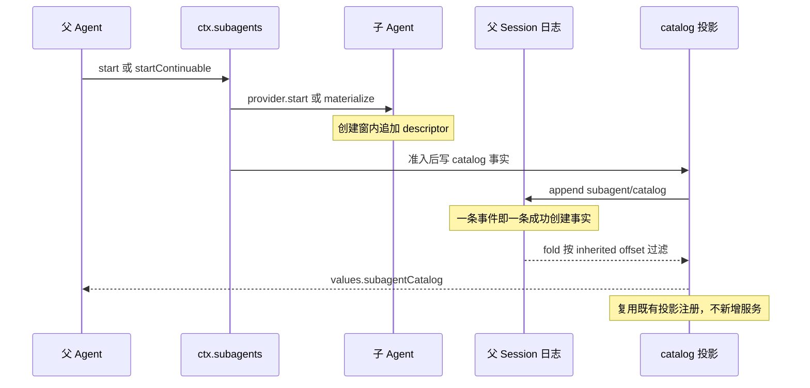
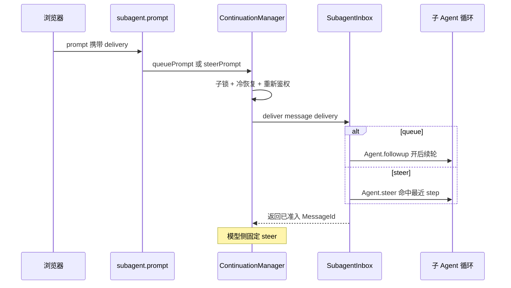
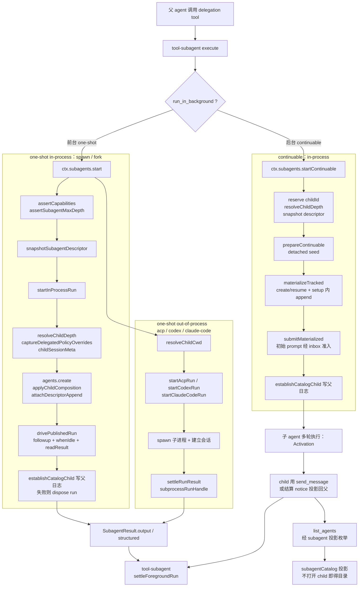

# 多 Agent / Subagent：统一接口下的多 transport 委派

> 子文档之一，聚焦如何在同一个 harness 内委派/嵌套另一个 agent。覆盖 `packages/subagent/*`（服务定义 + spawn / fork / acp / codex / claude-code / dsh-sdk 六个 sibling provider + `tool-subagent` / `tool-subagent-control` 两个 consumer）与 `packages/acp`。整体哲学见 [README](README.md)；本文上承 [sandbox-capability-seams.md](sandbox-capability-seams.md)（同级隔离能力）、衔接 [tools.md](tools.md)（委派由 delegation tool 驱动）。
>
> **本版增量更新（0.1.2-rc.1 → 0.1.5-rc.2 / 2026-09-11）**：依上游 `dsh-v0.1.2-rc.1..HEAD` git diff（1490 commits）与 `verify-references --diff` 预检比对更新。本关注面四条主线：**(1) parent 自有的 child catalog**——`subagent/catalog` 事件 + `subagentCatalog` 投影成为「直接子级发现」的持久权威，且经**既有**投影视图暴露而不新增服务（0.1.5-alpha.2）；**(2) 人类 inbox 控制对齐**——Queue / Steer 经既有 `subagent.prompt` Remote 落到同一个 Agent queue，不再另造第二套队列（0.1.3-alpha.2）；**(3) continuable 编排拆分**——1200+ 行的 `continuation.ts` 拆出 `continuation-activation.ts` / `continuation-messages.ts` / `inbox.ts`，`descriptor-seed.ts` 整体删除、descriptor 改在子创建窗内直接 append；**(4) 运行时对齐**——Codex / Claude Code SDK 版本升级。各版本逐条变更见 [CHANGELOG.md](CHANGELOG.md)。

Subagent 让同一个 harness 能委派/嵌套另一个 agent，且不把「委派」焊死在某种执行方式上——它本身也是一个可交换的 capability seam。

## 项目中的角色

dsh/subagent 让同一个 harness 内能**委派/嵌套另一个 agent**，且不把"委派"焊死在某种执行方式上。

去掉它系统会怎样（反向推演）：
- 复杂任务只能由单一 agent **线性**地自己做完，无法把"研究 X""实现 Y"切成并行的子任务分给子 agent。中大型任务要么耗尽主会话上下文，要么全程串行 —— 这是 Claude Code / Codex 之所以做成 harness 的核心痛点会整体回归。
- 多 transport（in-process 共享内存 / fork 子会话 / ACP 外部协议 / Codex 子进程 / Claude Code 子进程）在启动模型上差异巨大：没有统一的 `SubagentProvider` 接口，每次接一种子 agent 产品就要改 agent 循环本身。`[docs/architecture.md:129]()` 明言 subagent provider 背后是「from a fresh child agent to a delegated turn in another product」的宽变更面。
- 子 agent 的**可观察性**会退化成"全局扫盘"：没有父自有的 child catalog，枚举直接子级就得遍历整个 Session 语料再逐个打开候选子级日志读 descriptor，浏览器刷新成本取决于无关 Session 的数量。

它不存在的核心损格：subagent 也就不是"能力 seam"，而会退化成核心机制 —— 违反"无特权内核、一切皆插件"的总哲学。

## 根因

要回答的根本问题是：**如何把"另一个 agent 执行"抽象成可交换的 seam，同时让子 agent 与宿主共享同一可信执行世界。**

三个张力催生设计：
1. **可交换性 vs 保真度**：子 agent 可以由同进程内新建 agent、父会话 fork、外部 ACP 子进程、Codex / Claude Code 这类商业产品驱动。它们对"子 agent"的资源、上下文、权限、结果的定义各不相同，但消费方（模型调用的 delegation tool）只想要一个统一结果。
2. **委派边界的两面性**：委派既是"隔离"（子 agent 不该污染父会话的执行世界），又是"共享"（子 agent 要与父共享 cwd、lineage、部分策略、甚至完成轮历史）。`[docs/architecture.md:125-129]()` 的三角色 seam（Service Definition / Service Provider / Consumer）是全篇的判据；`sandbox` 处理"同一 agent 内的能力边界"，subagent 处理"跨 agent 的边界"，两者叙事相邻。 <!-- anchor: ## Capability seams … Seams are why one provider swap changes the whole product. Filesystem and subpro -->
3. **child 状态从何而来**：子 agent 是一个独立 Session；它的初始"子状态"必须能从父会话派生，且这种派生必须持久可重放（否则冷恢复只能从零开始，像没委派过一样）。**增量补充**：派生态还要能被"父"反向观察——父必须能在不打开子日志的前提下知道"我有哪些直接子级"，这是 catalog 这条新主线的出发点。

整体设计哲学的落点：subagent 自己也是一个**可交换的 seam** —— 三件套（Service Definition `ctx.subagents` / Service Provider 各 transport 包 / Consumer tool 包）齐全，见 `[docs/subsystems/subagent.md:5-7]()`。于是"委派"不是一个被写进循环的能力，而是和其它能力平行的一块拼图。 <!-- anchor: The subagent seam lets an agent delegate work to a child agent. Like [bash](shel … Service Definition: [dsh-subagent](../../packages/subagent/subagent) (`ctx.subag -->

## 设计思路

### seam 形状：多 provider 注册表而非单 executor

bash seam 是"每 context 一个 executor，二次加载抛错"；subagent **反其道而行** —— 多个 provider 可以在同一 `ctx` 内共存，各自注册一个唯一名字，调用方按名字挑选。形状对齐 LLM adapter 注册表（`LlmRuntime.registerAdapter`），不是单服务 executor `[docs/subsystems/subagent.md:5]()`。`[packages/subagent/subagent/src/index.ts:509-524]()` `registerProvider` 用 Cordis effect 包裹，HMR 安全：注册重复名即抛错，卸载时只撤注册、不撤销已交付 holder 的 run。 <!-- anchor: registerProvider(provider: SubagentProvider): () => void { … }.bind(this), 'subagents.registerProvider()') -->

每个 provider 是 `SubagentProvider`：`name` + `capabilities`（start 期能力位）+ `inheritsParentContext`（模型可读的"是否继承会话历史"描述）+ 可选的静态 `agentRouteDefaults` + `start()`（one-shot）+ 可选 `prepareContinuable()`（continuable 能力，方法存在即能力）`[packages/subagent/subagent/src/types.ts:344-389]()`。 <!-- anchor: export interface SubagentProvider { … prepareContinuable?(request: ContinuableCreateRequest): Promise<ContinuableCreat -->

### boundary：能力位校验先于委派

start 请求若需要某能力而所选 provider 不具备，service 在调 `start` **之前**就抛 `UNSUPPORTED_CAPABILITY` 拒绝，绝不"先接收后忽略"（fail loud）。`[packages/subagent/subagent/src/index.ts:641-653]()` 的 `assertCapabilities` 逐位对账 `agentOptions/outputSchema/depthLimit/toolFilter/persona`。五个位与 `SubagentStartRequest` 选项一一对应（`maxDepth`↔`depthLimit`，其余同名），`[packages/subagent/subagent/src/types.ts:130-135]()` 与 `[packages/subagent/subagent/src/types.ts:145-200]()`。 <!-- anchor: private assertCapabilities(provider: SubagentProvider, request: SubagentStartReq … 'UNSUPPORTED_CAPABILITY', --> <!-- anchor: export interface SubagentCapabilities { … readonly persona: boolean --> <!-- anchor: export interface SubagentStartRequest { … readonly persona?: string -->

#### in-process 位：全能力

`spawn` 与 `fork` 共享 `startInProcessRun`，两者都把 `agentOptions/outputSchema/depthLimit/toolFilter/persona` 全部置 true：
- spawn：`[packages/subagent/subagent-spawn-in-process/src/index.ts:41-47]()` <!-- anchor: class SpawnInProcessProvider implements SubagentProvider { … persona: true, -->
- fork：`[packages/subagent/subagent-fork-in-process/src/index.ts:63-68]()` <!-- anchor: readonly capabilities: SubagentCapabilities = { … persona: true, -->

#### out-of-process 位：零能力

ACP / Codex / Claude Code 子进程无法执行父侧强制的 start 特性，故 `[packages/subagent/subagent/src/out-of-process.ts:52-62]()` 的 `NO_START_CAPABILITIES` 全 false，service 据此在 `start` 前拒绝任何需要它们的请求；ACP 自己再声明一遍零能力 `[packages/subagent/subagent-acp/src/index.ts:146-152]()`；Claude Code 直接复用该常量 `[packages/subagent/subagent-claude-code/src/index.ts:74]()`；Codex 同样 `[packages/subagent/subagent-codex/src/index.ts:64]()`。 <!-- anchor: * The capability advertisement of an out-of-process backend: NONE. A child in … persona: false, --> <!-- anchor: class AcpProvider implements SubagentProvider { … persona: false, -->

### 多 transport 如何映射到同一接口

| Transport | 子 agent 形态 | 上下文 | 能力 | inheritsParentContext | 关键文件 |
|---|---|---|---|---|---|
| spawn（in-process） | 同一 cordis ctx 新建的独立 Agent，零父上下文 | 独立会话/独立 system prompt | 全量 | false | `packages/subagent/subagent-spawn-in-process/src/index.ts:41-64` |
| fork（in-process） | seed 了父会话已完成轮前缀的子 Agent | 继承父已完成轮 | 全量 | true | `packages/subagent/subagent-fork-in-process/src/index.ts:63-91` |
| acp（out-of-process） | 独立进程，跑 Agent Client Protocol | 只读父 cwd | 无 | false | `packages/subagent/subagent-acp/src/index.ts:146-160` |
| codex（out-of-process） | 官方 `@openai/codex` 拉起的真 CLI 进程 | 只读父 cwd | 无 | false | `packages/subagent/subagent-codex/src/index.ts:63-65` |
| claude-code（out-of-process） | 官方 Claude Agent SDK 拉起的真 CLI 进程 | 只读父 cwd | 无 | false | `packages/subagent/subagent-claude-code/src/index.ts:74-75` |

共性落在 `ResolvedSubagentStartRequest` 与 `SubagentRun` 两处：
- `start()` 都要在 publish 前完成子 agent 建立，publish 即所有权转移边界（`[packages/subagent/subagent/src/types.ts:363-373]()`）。 <!-- anchor: * Establish a ONE-SHOT child and return its handle after publication. … start(request: ResolvedSubagentStartRequest): Promise<SubagentRun> -->
- 返回的 `SubagentRun` 统一 `id`/`localAgent`/`result`/`dispose()`。本地 run 的 `localAgent` 是确切内进程子 agent；远程 run 为 `undefined`（`[packages/subagent/subagent/src/types.ts:308-333]()`）。in-process driver 用 `drivePublishedRun` 统一包装 `AgentHandle`（`[packages/subagent/subagent-in-process-driver/src/index.ts:158-206]()`）；out-of-process 用 `subprocessRunHandle` 统一包装（`[packages/subagent/subagent/src/out-of-process.ts:245-256]()`）。 <!-- anchor: export interface SubagentRun { … dispose(): Promise<void> --> <!-- anchor: function drivePublishedRun( … if (disposal.status === 'rejected') throw disposal.reason --> <!-- anchor: export function subprocessRunHandle(parts: SubprocessRunHandleParts): SubagentRu … return disposal -->
- 结果停止原因收敛到 merge-extensible 的 `SubagentStopReason`：`completed/aborted/error/max-tokens/refusal`（`[packages/subagent/subagent/src/types.ts:252-266]()`）。in-process 从 `TurnEndReason` 映射（`[packages/subagent/subagent-in-process-driver/src/index.ts:50-64]()`，把 pre-step `blocked` 映射成 `refusal`），ACP 从 ACP `StopReason` 映射（`[packages/subagent/subagent-acp/src/run.ts:221-248]()`，`max_turn_requests` 这类无对应语义的终止一律降级为 `error`），Claude Code 只认 SDK 严格 success（`[packages/subagent/subagent-claude-code/src/run.ts:206-234]()`）。 <!-- anchor: export interface SubagentStopReasonMap { … export type SubagentStopReason = SubagentStopReasonMap[keyof SubagentStopReasonM --> <!-- anchor: function toStopReason(reason: TurnEndReason | undefined): SubagentStopReason { … default: --> <!-- anchor: export function acpStopReason(reason: StopReason): SubagentStopReason { … * @returns the block's text, or `''` for a non-text block. --> <!-- anchor: export function successfulResult(message: SDKResultMessage): string { … * @returns the completed shared result. -->

#### 运行时版本对齐

`chore(subagent): upgrade Codex and Claude Code runtimes` 把两个"真产品" provider 的 SDK 依赖各升一档：Claude Agent SDK 到 `0.3.263`（`[packages/subagent/subagent-claude-code/package.json:44]()`），`@openai/codex` 到 `0.153.4`（`[packages/subagent/subagent-codex/package.json:47]()`）。这两个 provider 的**契约面未变**——它们是这条 seam 的"抗漂移探测器"：产品 SDK 升级只需跟着改 wire 适配与夹具，能力位、run 句柄、停止原因映射三个公共服务契约一动不动。

### 委派播种（delegation seed）

子状态从父会话派生的机制集中在两处：

**one-shot（in-process）**：`startInProcessRun` 在子 agent 创建窗内做四件事：
1. `[packages/subagent/subagent/src/child-agent.ts:49-57]()` `resolveChildDepth` 从父算深度 +1； <!-- anchor: export function resolveChildDepth(parent: Agent, maxDepth: number | undefined):  … return childDepth -->
2. `[packages/subagent/subagent/src/child-agent.ts:242-245]()` `captureDelegatedPolicyOverrides` 捕获父 sandbox 覆盖 + 将 approval 钉死 `'never'`——子 agent 只在委派时固定的权限范围内行动； <!-- anchor: export function captureDelegatedPolicyOverrides(parent: Agent): DelegatedPolicyO … approvalPolicy: parent.ctx.get('approval') === undefined ? undefined : 'never', -->
3. `[packages/subagent/subagent/src/child-agent.ts:258-266]()` `appendDelegatedPolicyOverrides` 把策略作为 `source:'delegation'` 事件写到子自己的日志； <!-- anchor: export function appendDelegatedPolicyOverrides( … childSession.append('approval/policy', { policy: overrides.approvalPolicy, sourc -->
4. `[packages/subagent/subagent/src/child-agent.ts:138-154]()` `childSessionMeta` 记 cwd/`parentSession`/`origin:'subagent'`/`delegationDepth`/`isSeeded`。 <!-- anchor: export function childSessionMeta( … delegationDepth: childDepth, -->

`[packages/subagent/subagent/src/child-agent.ts:199-217]()` `applyChildComposition` 统一给子 agent 装配：加入父 preset、登记"委托范围已固定"语句、应用 persona/toolFilter 遮蔽。注意 persona 落点是 `deployment:persona-prefix` 段落（不是 `deployment:persona`），这是本周期 system prompt 改成 surface node 后的命名对齐。 <!-- anchor: export function applyChildComposition( … if (composition.toolFilter !== undefined) childCtx.tools.restrict(composition.to -->

**fork 的上下文继承**：fork 把父日志「完成轮前缀」（到最后一个 `turn/end` 为止，跳到未完成轮因为无法作合法子会话 seed）作为 `CreateAgentOptions.seed` 传给子 agent（`[packages/subagent/subagent-fork-in-process/src/index.ts:48-53]()`、`[packages/subagent/subagent-fork-in-process/src/index.ts:84-89]()`）。seed 契约是"从 seq 0 连续、lossless JSON、balanced"（`[packages/subagent/subagent/src/types.ts:239-243]()`）。 <!-- anchor: function completedTurnPrefix(parent: Agent): SessionEvent[] { … return events.slice(0, lastEnd.seq + 1) --> <!-- anchor: prepareContinuable(request: ContinuableCreateRequest): Promise<ContinuableCreate … return Promise.resolve(seed.length > 0 ? { seed } : {}) --> <!-- anchor: * Completed-turn prefix of the parent's log to seed the child session with, … readonly seed?: readonly SessionEvent[] -->

**continuable 的 descriptor 播种**（本次重构点）：
> **演进说明（0.1.5-rc.2）**：旧实现把继承轮与 descriptor 一起经 `descriptor-seed.ts` 的 `seedDescriptorTurn` 用 `Session.create(childId, seed)` 暂存成连续种子；该文件已被 `feat(session)!: embed assistant streams in format v2` 整体删除。

新实现把 descriptor 从"种子构造"降级为"子创建窗内的普通 append"：`continuation.ts` 只把 provider 给的 `prepared.seed` 与快照好的 `descriptor` 一并交给 `materialize`（`[packages/subagent/subagent/src/continuation.ts:159-172]()`），真正落盘发生在 registry 的 `setup` 回调里——`child.session.append('subagent/descriptor', create.descriptor)` 紧随继承前缀，然后才 `agents.create`（`[packages/subagent/subagent/src/continuation-activation.ts:579-605]()`）。这样序列号分配与 lossless-JSON 校验由**子 Session 本身**负责（而不是先暂存再搬），冷恢复路径则完全跳过 append、靠重放已持久事件（`[packages/subagent/subagent/src/continuation-activation.ts:95-103]()` 的 `MaterializeInputs.create` 注释）。 <!-- anchor: const activation = await this.activations.materialize({ … signal: spec.signal, --> <!-- anchor: const setup = (childCtx: Context, child: Agent): void => { … setup, --> <!-- anchor: create?: { … descriptor: SubagentDescriptorData -->

### descriptor：子 agent 的持久身份

`[packages/subagent/subagent/src/descriptor.ts:26-38]()` `subagent/descriptor` 是 model-hidden 的 SessionEvent，标识每个 session-backed 子 agent 并记录 one-shot/continuable 模式。关键设计（`[packages/subagent/subagent/src/descriptor.ts:8-19]()` 注释 + `[packages/subagent/subagent/src/descriptor.ts:48]()`）： <!-- anchor: import type { ReasoningEffortId } from '@deepseek-ai/dsh-llm' … 'subagent/descriptor': SubagentDescriptorData --> <!-- anchor: * The descriptor deliberately snapshots explicit fields rather than the … * the parent's current one; the resumed route's defaults apply instead. -->

- 显式快照字段而非 merge-extensible 的 `AgentOptions`，避免无关扩展值因非 JSON 而破坏 continuation；新增组合输入必须显式升版本。
- 省略 `subagentDepth`（冷恢复信任持久 header 的 `delegationDepth` 作为单调下限）与 `outputSchema`（激活的结果契约，非 durable 身份）；`maxTokens` 同理。
- fold 时第一个 `[packages/subagent/subagent/src/descriptor.ts:317-322]()` `foldSubagentDescriptor` 权威（provider 恰好 append 一次），version 不匹配返回 undefined（无法分类）。 <!-- anchor: export function foldSubagentDescriptor(events: readonly SessionEvent[]): Subagen … return parseSubagentDescriptor(event.data) -->

> **演进说明（0.1.5-rc.2）**：`SUBAGENT_DESCRIPTOR_VERSION` 已是 **3**（旧文本记作 2）。版本号随"新增可续 composition 输入"一路显式抬升——这正是上面"新增组合输入必须显式升版本"规则的执行痕迹；format/identity 双轨都靠这个显式动作防漂移。

### parent 自有的 child catalog：父日志即发现权威

> **演进说明（0.1.5-rc.2）**：0.1.5-alpha.2 之前，"直接子级发现"是从**全局 Session 语料**加每个入选 child 的日志重建的：创建过程明明已经知道直接 parent、child id、mode 与 label，枚举却把这件事实重新推导一遍，浏览器刷新成本还取决于无关 Session 的数量。catalog 就是为终结这次重复推导而引入的。

**为什么由父拥有、写进父日志**：child descriptor 对恢复与 composition 仍然必要，但它不能充当 discovery 来源——读取方必须先"找到并打开 child"才能读到 descriptor，这正是枚举想要避免的动作。只有父自己的日志能在"不打开任何 child"的前提下回答"我有哪些直接子级"。于是父 Session 的 required `subagent/catalog` 事件成为直接 child discovery 的持久权威（`[packages/subagent/subagent/src/catalog.ts:2-4]()`、`[packages/subagent/subagent/src/catalog.ts:20-40]()`）：每个事件就是一条**成功创建事实**，携带 `childId`、`childCreatedAt`、mode 与按 mode 区分的 label。没有本地 Session 的远程 one-shot run 不进入目录。 <!-- anchor: * Parent-owned durable subagent catalog events and their chunked projection. … * @module @deepseek-ai/dsh-subagent/catalog --> <!-- anchor: /** Current payload version for `subagent/catalog` events. */ … 'subagent/catalog': SubagentCatalogEvent -->

**只发布成功事实，不做补偿**：one-shot 在 provider 返回本地 child 之后、run 交给调用方之前追加目录事件；追加失败则 dispose 该 run 并把目录错误抛给调用方（`[packages/subagent/subagent/src/index.ts:567-585]()`）。continuable 先准入初始 prompt，再追加目录事件，最后返回 child id；准入或追加失败即整体失败并释放 activation（`[packages/subagent/subagent/src/continuation.ts:174-182]()`、`[packages/subagent/subagent/src/continuation.ts:456-483]()`）。**没有**补偿目录事件、rollback 协议或第二种 operation——把成功事实推迟到准入完成之后，就删掉了整套配对规则。 <!-- anchor: const run = await provider.start(resolved) … return observeRun(this.emitLifecycle, name, request.parent, run) --> <!-- anchor: const childHeader = activation.handle.agent.session.header … () => { establishCatalogChild(parent.session, childHeader, descriptor) }, --> <!-- anchor: /** Admit a materialized child, commit its creation fact, and release it on fail … throw error -->

**fork 隔离**：projection 初始化时接收精确的 `Session.inheritedEventCount`，fold 忽略该 offset 之前的 `subagent/catalog` 事件（`[packages/subagent/subagent/src/catalog.ts:115-126]()`）。state 保存 inherited offset 而不保存每条 event 的 seq——接受判定已在 fold 时完成，而"从 parent 日志播种出的副本绝不继承原 Session 的 child"这条 fork 语义要求，只能靠这个 offset 表达。 <!-- anchor: /** Parent-owned direct-child catalog projection; invalid own facts reject resto … } satisfies ProjectionDefinition<'subagentCatalog', SubagentCatalogState> -->

**事件顺序保证**：目录值由 `iterateChunkedList` 从旧 chunk 走向新 chunk（`[packages/util/chunked-list/src/index.ts:37-44]()`），因此 materialization 以 **O(D)** 时间保留**父目录事件顺序**；顺序 = 成功 append 的顺序，与 child 时间戳和 id 无关。并发创建按"哪次目录追加先成功"排列，相邻 fact 也可能来自顺序创建，所以相邻关系**不能**证明可交换性——这直接影响快照比对：normalizer 把 `childCreatedAt` 归零（它来自 process clock）但保留事件顺序与来源事件引用（`[packages/test-support/session-snapshot/src/normalize.ts:385-387]()`）。 <!-- anchor: * Visit all values in insertion order, with O(N) time and O(N / 64) scratch spac … for (const chunk of chunks.reverse()) yield* chunk.values --> <!-- anchor: if (record.type === 'subagent/catalog' && record.data !== null && typeof record. … if ('childCreatedAt' in data) data.childCreatedAt = 0 -->

**为什么用 chunked list**：`appendChunkedList` 至多复制一个 64 值 chunk（`[packages/util/chunked-list/src/index.ts:21-32]()`），append 是有界 O(1) 工作；`chunkedListSchema` 在检查点反序列化时校验每个值、chunk 大小上限与未知字段（`[packages/util/chunked-list/src/index.ts:48-57]()`）。无效的自身 fact（含不支持的版本）会让 projection 恢复失败，而不是"静默丢掉一条 required fact 后返回不完整目录"。备选方案（扁平不可变数组 / 每 fact 一个 node 的链表 / 独立 host-state 输出 / 持久 SQLite child index / 补偿失败事件）被逐一否决的理由见上游决策记录：数组 append 是 O(D) 且违反 projection state 所有权，链表会形成 D 层 JSON 嵌套，host-state 输出重复既有观察机制，SQLite index 为父日志里已有顺序的事实增设第二条写路径与 corruption 面。（跨模块：分块布局、chunk 容量常量与检查点校验的存储侧说明见 [data-model.md](data-model.md)） <!-- anchor: * Append without modifying the input, copying at most one 64-value chunk. … ...head.previous === undefined ? {} : { previous: head.previous }, --> <!-- anchor: * Validate nonempty list checkpoints, including every stored value and chunk siz … return schema -->

**经既有投影视图暴露，不新增服务**：`subagentCatalog` 只是个普通投影单元，和 `subagent`/`subagentTiming` 一起在既有 `ctx.inject(['sessionProjections'])` 里注册（`[packages/subagent/subagent/src/index.ts:212-215]()`）；类型面只用 module augmentation 把 key 加进 `SessionProjectionStateMap` 与 `SessionProjectionMap`（`[packages/subagent/subagent/src/catalog.ts:84-86]()`、`[packages/subagent/subagent/src/projection-types.ts:62-77]()`）。读取侧因此零新增 API：观察者读 `observation.projections.values.subagentCatalog`，浏览器快照走同一条投影通道（`[packages/api/session-controller/src/history.ts:197-200]()`）。而且读取方可以只点自己关心的 key——`list-children.ts` 读身份时只传 `['subagent']`（`[packages/subagent/subagent/src/list-children.ts:211-226]()`），无关 wire view 既不算也不校验。这正是"不新增服务"的落点：**事件声明 + 既有注册表 + 既有视图选择**，三件都是既有机制的复用。 <!-- anchor: ctx.inject(['sessionProjections'], (projectionCtx) => { … projectionCtx.sessionProjections.register(subagentIdentityProjectionDefinition) --> <!-- anchor: declare module '@deepseek-ai/dsh-session-projection/types' { … subagentCatalog: SubagentCatalogState --> <!-- anchor: declare module '@deepseek-ai/dsh-session-projection/types' { … subagent: SubagentIdentityProjection | null --> <!-- anchor: projections: source.projections === undefined … ...assistantStream === undefined ? {} : { assistantStream }, --> <!-- anchor: // Read only the identity unit. A live child without an identity yet is the … rows[index] = childRow(childId, identity, 'running', subagentParents.has(childId -->

### 人类 inbox 控制：复用同一 Agent queue

> **演进说明（0.1.3-alpha.2 / 0.1.5-rc.2）**：此前人类投递路径只公开 FIFO 后续轮次——浏览器选了 Queue/Steer，专用 subagent prompt Remote 却把它丢掉，而通用 Session ownership fence 又拒绝 subagent 身份的一切 queue 变更，等于把在线子级 inbox 已支持的控制藏了起来。`feat(subagent): align human inbox controls (#3223)` 及其后续修复对齐了这一面。

决策是"**公开普通的人类 inbox 控制，不新增第二套队列**"：既有 `SubagentPromptRequest` 携带 `delivery: 'queue' | 'steer'`（`[packages/subagent/subagent/src/control-types.ts:80-102]()`），Remote 仍要求确切在线直接父级，随后把一个包内投递操作交给 continuation manager（`[packages/subagent/subagent/src/index.ts:412-461]()`）。Manager 侧 `queuePrompt`/`steerPrompt` 只差一个参数，统一走 `deliverToChild`（`[packages/subagent/subagent/src/continuation.ts:243-285]()`），最终落到 `SubagentInbox.deliver`：`queue` 调 `Agent.followup(message)` 开一个后续轮，`steer` 调 `Agent.steer(message)` 命中最近 step 边界（`[packages/subagent/subagent/src/inbox.ts:42-54]()`）。两条路径共享 child lock、冷恢复、最终父级重新鉴权、调用方 signal 截止、`MessageId` 创建与 dispose 竞态处理——**只多一个交付目的地，不多一套状态**。 <!-- anchor: /** Complete direct-child catalog plus the delivery-time parent availability hin … readonly childSessionId: SessionId --> <!-- anchor: @Remote('prompt') … return rejectPrompt(error, childSessionId, signal) --> <!-- anchor: async queuePrompt( … throw error --> <!-- anchor: * Submit through the Agent only while its Activation remains resident. … else this.agent.followup(message) -->

模型侧调度则保持固定、不由调用方选：`sendMessage()` 与模型可见的 `send_message` 工具始终是相邻 Agent 的 Steer 语义（`[packages/subagent/subagent/src/continuation.ts:202-230]()`）。Host 协议若需要 Queue，另有 symbol-keyed 的包内适配器 `queueHostSubagentPrompt` / `steerHostSubagentPrompt`，保持 Service Definition 不被撑宽（`[packages/subagent/subagent/src/internal.ts:66-80]()`、`[packages/subagent/subagent/src/internal.ts:94-108]()`）。 <!-- anchor: async sendMessage( … delivery: 'steer', --> <!-- anchor: export function queueHostSubagentPrompt( … 'queue', --> <!-- anchor: export function steerHostSubagentPrompt( … 'steer', -->

**Queue 变更留在 Session 域**，只开一道窄的 ownership-fence 例外：`session.updateQueue` 只对"当前投影身份为 continuable 且 descriptor 序号属于 child 自身非 seed suffix"的在线 subagent-owned Agent 放行 Edit/Remove/Steer（`[packages/api/session-controller/src/commands.ts:445-451]()`）。own-suffix 检查（`isOwnSeq`）挡住的是 fork 播种来的祖先 descriptor——没有它，一个仅继承身份的 seed 就能授权变更。one-shot、缺失、未知、损坏与冷子级继续被拒，且 queue 变更**永不冷恢复**子级。 <!-- anchor: if (hasApiSessionSubagentOwner(this.ctx, agent.session, agent)) { … throw apiSessionSubagentOwnershipError(request.sessionId) -->

配套的结算是"保守保留"：自然结算要同时满足 `Agent.whenIdle()`、child inbox 为空、owned child 全部 dispose（`[packages/subagent/subagent/src/continuation-activation.ts:677-742]()`）；最终 child-lock 决策重新校验 Session 序号与同一份驻留事实，再用 `Agent.runMaintenance()` 的**同步任务入口**占用 idle 阶段、在同一个 JavaScript turn 内关闭准入（`[packages/subagent/subagent/src/continuation-activation.ts:694-729]()`）。代价是插件用 `Agent.inject()` 停放的 context 也会让 child 及其在线祖先一直驻留，直到一次唤醒投递、queue removal 或 manager teardown——换来的是不必维护第二套"待处理消息账本"，也不会静默丢失已接受的 steering。 <!-- anchor: /** Follow one Activation to natural settlement. */ … return 'ready' --> <!-- anchor: const finalSeq = activation.handle.agent.session.seq … return -->

> **演进说明（0.1.5-rc.2）**：`fix(subagent): separate message prefix from body` 修掉了相邻 Agent 消息的拼接缺陷——frame 文本末尾补了一个空格，`Agent <id> sent a message: ` 与正文才拼得出可读句子（`[packages/subagent/subagent/src/continuation-messages.ts:62-71]()`）。 <!-- anchor: export function createAgentMessage( … source: agentMessageSource(sender), -->

### 投影：child 状态查询与回读

session projection 现在提供三种纯函数视图，全部经同一注册表：
- `subagent`（身份）：从 `subagent/descriptor` 折叠 mode/label/`seq`，last-wins——fork seed 重放的祖先 descriptor 会被子自己的覆盖；损坏/未知版本 fold 到可序列化的 `null` 哨兵而非抛错（`[packages/subagent/subagent/src/projection.ts:169-182]()`）。 <!-- anchor: export const subagentIdentityProjectionDefinition = { … } satisfies ProjectionDefinition<'subagent', IdentityState> -->
- `subagentTiming`（计时）：折叠 descriptor 之后已结算 turn 的 `settledMs` 与当前活动 turn 区间（`[packages/subagent/subagent/src/projection.ts:63-107]()`）。 <!-- anchor: export const subagentTimingProjectionDefinition = { … } satisfies ProjectionDefinition<'subagentTiming', TimingState> -->
- `subagentCatalog`（父自有目录）：materialize 父日志中的成功创建事实，见上一节。

`[packages/subagent/subagent/src/index.ts:349-369]()` `listChildren/listDescendants` 不加载/不恢复 Agent，直接合并 live session store 与可选持久化，经三级阶梯（watermark snapshot / projection-cache own-suffix seq gate / shared observation）服务每个子 agent 的 mode/label，从 `subagent` 投影单位读取（`[packages/subagent/subagent/src/list-children.ts:83-94]()`、`[packages/subagent/subagent/src/list-children.ts:297-359]()`）。 <!-- anchor: listChildren(parentSessionId: SessionId, signal?: AbortSignal): Promise<Subagent … return listSubagentDescendants(this.ctx, rootSessionId, signal) --> <!-- anchor: export async function listChildren( … return rows.filter((row): row is SubagentListEntry => row !== undefined) --> <!-- anchor: async function resolveColdIdentity( … return childRow(childId, identity, 'inactive', hasChildren) -->

> **演进说明（0.1.5-rc.2）**：阶梯的第二/三级换了底座——旧文本记的是 `ctx.sessions.list()` + `persistence.inspect()`，现在是 `query.listSessions()` 建 live-preferred 语料、`query.observeSession()` 做冷观察（`[packages/subagent/subagent/src/list-children.ts:133-193]()`）；同时身份投影多了 `seq` 字段（own-suffix 证明），`stateVersion` 随之抬到 2。 <!-- anchor: async function prepareListing( … return { projections, query, cache, corpus, subagentParents } -->

**结果投影回父会话**：one-shot 结果经 `[packages/subagent/tool-subagent/src/index.ts:207-245]()` `settleForegroundRun` 收集 `run.result.output` 返回父模型；continuable 侧改用两类消息——相邻 Agent 消息与结算 notice，见下一节的演进说明。 <!-- anchor: async function settleForegroundRun(run: SubagentRun): Promise<ForegroundToolResu … * for a fork. -->

> **演进说明（0.1.2-alpha）**：child-scoped `report` 工具（`packages/subagent/tool-subagent-report`）已在 alpha 期间移除，改为**统一相邻 Agent 消息**：continuable 子 agent 的初始任务被注入"用 `send_message({ agent_id: <parent>, message: "<self-contained result>" })` 向父投递"的指导（`withContinuableReturnGuidance`，[packages/subagent/subagent/src/continuation-messages.ts:81-94]()`），且**只在子确实能看到该工具时**才注入这条指导（`[packages/subagent/subagent/src/continuation.ts:174-182]()`）。子用全局 `send_message` 工具向父投递，父侧以 `source.kind: 'agent-message'`（`form: 'relay'`）的 durable user message 呈现（`[packages/subagent/subagent/src/continuation-messages.ts:48-52]()`；可读 frame 由 `createAgentMessage` 构造，`[packages/subagent/subagent/src/continuation-messages.ts:62-71]()`）。Activation 结算还会发一条 `subagent-settled` notice 给父，其 provenance 与 Agent 消息刻意分成两个 kind，避免把 runtime 的账目算成子说过的话（`[packages/subagent/subagent/src/continuation-messages.ts:135-151]()`、`[docs/subsystems/subagent.md:213]()`）。生命周期对 `subagent/start` / `subagent/end` 仍是按委派父做 scoped dispatch（`[packages/subagent/subagent/src/lifecycle.ts:134-162]()`）。 <!-- anchor: export function withContinuableReturnGuidance( … + 'does not end your turn.', --> <!-- anchor: const childHeader = activation.handle.agent.session.header … () => { establishCatalogChild(parent.session, childHeader, descriptor) }, --> <!-- anchor: function agentMessageSource(sender: Agent): AgentMessageSource { … senderSessionId: sender.id, --> <!-- anchor: export function createAgentMessage( … source: agentMessageSource(sender), --> <!-- anchor: export function createSettlementMessage( … senderSessionId: childId, --> <!-- anchor: export function observeRun( … return run -->

> **演进说明（0.1.5-rc.2）**：旧文本引用的 `continuableInitialPrompt`（`continuation.ts:296-308`）与 `agentMessageSource`（`continuation.ts:276-293`）已随 `continuation.ts` 拆分迁到 `continuation-messages.ts`，并改名为 `withContinuableReturnGuidance`；`agentMessageSource` 仍在同文件但行号已变。

### depth/loop 防护

`[packages/subagent/subagent/src/depth.ts:28-35]()` `delegationDepthOf` 读取确切深度 = `max(header.delegationDepth, runtime.subagentDepth)`，header 持据权威且单调，运行时可加深但不可降低；`[packages/subagent/subagent/src/child-agent.ts:49-57]()` `resolveChildDepth` 计算 `parent+1` 并校验安全整数，超出 `maxDepth` 抛 `SubagentDepthError`。`[packages/subagent/subagent/src/depth.ts:42-49]()` `assertSubagentMaxDepth` 拒绝非法 cap。in-process 与 continuation 的 start 处都调用 `resolveChildDepth`（`[packages/subagent/subagent-in-process-driver/src/index.ts:111]()`、`[packages/subagent/subagent/src/continuation.ts:107-110]()`）。 <!-- anchor: export function delegationDepthOf(agent: Agent): number { … return Math.max(agent.session.header.delegationDepth ?? 0, runtime ?? 0) --> <!-- anchor: export function resolveChildDepth(parent: Agent, maxDepth: number | undefined):  … return childDepth --> <!-- anchor: export function assertSubagentMaxDepth(maxDepth: unknown): void { … throw new TypeError('subagent maxDepth must be a non-negative safe integer') --> <!-- anchor: assertSubagentMaxDepth(request.maxDepth) … const childDepth = resolveChildDepth(parent, request.maxDepth) -->

## 关键数据结构

- `[packages/subagent/subagent/src/types.ts:344-389]()` `SubagentProvider`：注册表里一个具名 transport，`capabilities` 位 + `inheritsParentContext` + `start()` + 可选 `prepareContinuable`（`[packages/subagent/subagent/src/types.ts:375-389]()` 方法存在即能力）。 <!-- anchor: export interface SubagentProvider { … prepareContinuable?(request: ContinuableCreateRequest): Promise<ContinuableCreat --> <!-- anchor: * OPTIONAL (continuable-creation capability): contribute the detached … prepareContinuable?(request: ContinuableCreateRequest): Promise<ContinuableCreat -->
- `[packages/subagent/subagent/src/types.ts:145-200]()` / `[packages/subagent/subagent/src/types.ts:207-209]()` `SubagentStartRequest` / `ResolvedSubagentStartRequest`：one-shot 委派请求；后者在 service 解析描述符后加 `descriptor` 字段传给 provider。 <!-- anchor: export interface SubagentStartRequest { … readonly persona?: string --> <!-- anchor: export interface ResolvedSubagentStartRequest extends SubagentStartRequest { … readonly descriptor: SubagentDescriptorData -->
- `[packages/subagent/subagent/src/types.ts:308-333]()` `SubagentRun`：已发布 one-shot 子的消费句柄（id/localAgent/result/dispose），`dispose` 幂等。 <!-- anchor: export interface SubagentRun { … dispose(): Promise<void> -->
- `[packages/subagent/subagent/src/types.ts:237-243]()` `ContinuableCreateSpec`：provider 对 continuable 子创建的唯一贡献——只是"要不要播种父历史"，不含 Agent/句柄/投递/结果。 <!-- anchor: export interface ContinuableCreateSpec { … readonly seed?: readonly SessionEvent[] -->
- `[packages/subagent/subagent/src/descriptor.ts:60-91]()` `SubagentDescriptorData`：`subagent/descriptor` 事件载荷，mode 判别联合（one-shot 可选 label；continuable 强制 label + agentProvider/agentModel/agentReasoningEffort/persona/toolFilter）。 <!-- anchor: /** A session-backed subagent that cannot be cold-resumed after its run. */ … | ContinuableSubagentDescriptorData -->
- `[packages/subagent/subagent/src/catalog.ts:23-31]()` `SubagentCatalogEvent`：父自有的完整创建事实（version + childId + childCreatedAt + mode + label）。 <!-- anchor: /** One complete parent-owned catalog fact. */ … | { readonly mode: 'continuable'; readonly label: string } -->
- `[packages/subagent/subagent/src/catalog.ts:44-47]()` `SubagentCatalogState`：host fold 状态，只有 inherited offset 与 chunked-list 头。 <!-- anchor: /** Host fold state for one parent catalog. */ … readonly head?: ChunkedList<SubagentCatalogEvent> | undefined -->
- `[packages/subagent/subagent/src/projection-types.ts:9-17]()` `SubagentCatalogEntry`：暴露给观察者的目录行（id/createdAt/mode/label），与事件载荷刻意保持各自格式。 <!-- anchor: /** One current direct-child discovery row materialized from parent facts. */ … | { readonly mode: 'continuable'; readonly label: string } -->
- `[packages/subagent/subagent/src/child-agent.ts:271-279]()` + `[packages/subagent/subagent/src/child-agent.ts:138-154]()` `ChildCreateInputs` + `childSessionMeta`：in-process 子创建的 identity/lineage 输入与持久 meta。 <!-- anchor: export interface ChildCreateInputs { … readonly lineageSeedLength: number --> <!-- anchor: export function childSessionMeta( … delegationDepth: childDepth, -->
- `[packages/subagent/subagent/src/projection-types.ts:39-59]()` / `[packages/subagent/subagent/src/projection-types.ts:20-29]()` 两个投影视图 `SubagentIdentityProjection`（含 `seq`，证明 own-suffix）与 `SubagentTimingProjection`。 <!-- anchor: export type SubagentIdentityProjection = … seq: SessionSeq --> <!-- anchor: /** Durable active-turn timing for one descriptor-backed child session. */ … through: number -->

## 核心流程

下面 Mermaid 描绘**父 agent 经 tool-subagent 委派 → 选 provider → 派生 child 状态 → 执行 → 结果与目录事实投影回父会话**的主干。

各步源码定位：
- D2/B→D：`[packages/subagent/tool-subagent/src/index.ts:369-429]()` <!-- anchor: const providerRouteDefaults = subagentProvider.agentRouteDefaults … output: { -->
- service 校验与 start（含目录 append）：`[packages/subagent/subagent/src/index.ts:556-585]()` <!-- anchor: async start(name: string, request: SubagentStartRequest): Promise<SubagentRun> { … return observeRun(this.emitLifecycle, name, request.parent, run) -->
- one-shot in-process driver：`[packages/subagent/subagent-in-process-driver/src/index.ts:104-150]()`（start）、`[packages/subagent/subagent-in-process-driver/src/index.ts:158-206]()`（drive） <!-- anchor: export async function startInProcessRun( … structured, --> <!-- anchor: function drivePublishedRun( … if (disposal.status === 'rejected') throw disposal.reason -->
- spawn/fork 具体 seed 差异：`[packages/subagent/subagent-fork-in-process/src/index.ts:48-89]()` <!-- anchor: function completedTurnPrefix(parent: Agent): SessionEvent[] { … return Promise.resolve(seed.length > 0 ? { seed } : {}) -->
- acp：`[packages/subagent/subagent-acp/src/run.ts:337-456]()` <!-- anchor: export async function startAcpRun(request: SubagentStartRequest, spec: AcpRunSpe … NodeReadable.toWeb(child.stdout) as ReadableStream<Uint8Array>, -->
- claude-code：`[packages/subagent/subagent-claude-code/src/run.ts:385-471]()` <!-- anchor: export async function startClaudeCodeRun( … thrown(cause), -->
- continuable 入口：`[packages/subagent/subagent/src/continuation.ts:102-188]()`（startContinuable，含 prompt 准入 + 目录提交）、`[packages/subagent/subagent/src/continuation.ts:404-453]()`（coldResume） <!-- anchor: async startContinuable(spec: ContinuableStartSpec): Promise<ContinuableStart> { … throw error --> <!-- anchor: private async coldResume( … return await this.submitMaterialized(activation, content, options, parent) -->
- continuable 物化：`[packages/subagent/subagent/src/continuation-activation.ts:573-636]()`（materializeTracked，内含 `agents.create`/`agents.resume`）、`[packages/subagent/subagent/src/continuation-activation.ts:458-502]()`（materialize + submitAdmitted 的准入 cut） <!-- anchor: private async materializeTracked( … return activation --> <!-- anchor: materialize(inputs: MaterializeInputs): Promise<Activation> { … return message.id -->
- `send_message` 相邻 Agent 消息：`[packages/subagent/tool-subagent-control/src/index.ts:27-76]()` <!-- anchor: export function apply(ctx: Context): void { … ctx.tools.register(defineTool({ -->
- list_agents：`[packages/subagent/tool-subagent-control/src/list-agents.ts:91-128]()` <!-- anchor: export function apply(ctx: Context): void { … depth: { type: 'number' }, -->

`materializeTracked` 在子创建窗内把 descriptor 与 delegation 策略 append 到子日志、再调 `applyChildComposition`，随后 `ownerCtx.agents.resume`/`create`（fresh 创建 vs cold 恢复，`[packages/subagent/subagent/src/continuation-activation.ts:589-605]()`）；`submitMaterialized`（`[packages/subagent/subagent/src/continuation.ts:456-483]()`）把初始/继续 prompt 送入 child inbox，并在同一临界区里原子提交目录事实或整体释放 activation——即"child 状态投影成父可追踪的执行起点"。 <!-- anchor: const handle: AgentHandle = create === undefined … setup, --> <!-- anchor: /** Admit a materialized child, commit its creation fact, and release it on fail … throw error -->

> **演进说明（0.1.5-rc.2）**：旧文本把这几个函数都记在 `continuation.ts`（曾约 1200 行）。本周期拆分为 `continuation.ts`（编排/请求）+ `continuation-activation.ts`（进程内 Activation 与物化）+ `continuation-messages.ts`（模型可见消息）+ `inbox.ts`（准入与关闭 cut）后，冷恢复只折 child 自身的非 seed suffix（`[packages/subagent/subagent/src/continuation.ts:423-424]()`），授权仍是 `authorizeLineage`（`[packages/subagent/subagent/src/continuation.ts:422]()`）。 <!-- anchor: const descriptor = foldSubagentDescriptor( … source.events.slice(source.inheritedEventCount), -->

## 与其他模块协同

- **tools 的 delegation Consumer**：`tool-subagent` 是委派 Consumer，按 provider lifecycle 挂/卸 tool（`[packages/subagent/tool-subagent/src/index.ts:313-335]()`）；`tool-subagent-control` 提供全局 `send_message`/`interrupt_agent`（`[packages/subagent/tool-subagent-control/src/index.ts:27-114]()`）与独立可加载的 `list_agents`（`[packages/subagent/tool-subagent-control/src/list-agents.ts:91-189]()`）；`tool-subagent-report`（child-scoped `report`）已在 0.1.2-alpha 移除，continuable 子改由 `send_message` 相邻 Agent 消息向父投递。 <!-- anchor: export function apply(ctx: Context, config: Config, session?: Session): void { … if (config.agentOptions !== undefined && !subagentProvider.capabilities.agentOpt --> <!-- anchor: export function apply(ctx: Context): void { … return Promise.resolve({ accepted: true }) --> <!-- anchor: export function apply(ctx: Context): void { … return assertNever(request.scope, 'list_agents scope') -->
- **sandbox 同级隔离**：`[packages/subagent/subagent/src/child-agent.ts:242-266]()` `captureDelegatedPolicyOverrides`/`appendDelegatedPolicyOverrides` 把父 sandbox 覆盖继承、approval 钉死 `'never'`；`applyChildComposition` 里组装 `subagent:delegation` 语句、`deployment:persona-prefix` 段落与 `tools.restrict`（`[packages/subagent/subagent/src/child-agent.ts:199-217]()`）。身份即权限边界 —— 子只在委派时固定范围内行动。（跨模块：与 sandbox 模块的深层互操作细节见 [sandbox-capability-seams.md](sandbox-capability-seams.md)） <!-- anchor: export function captureDelegatedPolicyOverrides(parent: Agent): DelegatedPolicyO … childSession.append('approval/policy', { policy: overrides.approvalPolicy, sourc --> <!-- anchor: export function applyChildComposition( … if (composition.toolFilter !== undefined) childCtx.tools.restrict(composition.to -->
- **session 派生子状态**：子 Session 经 `ctx.agents.create`/`resume`、`[packages/subagent/subagent/src/child-agent.ts:138-154]()` `childSessionMeta` 落 `parentSession/delegationDepth/isSeeded/origin`；投影在 `[packages/subagent/subagent/src/index.ts:212-215]()` 一次性注册三个单位（`subagentCatalog`/`subagentTiming`/`subagent`）。（跨模块：session 模块 `Session.create`/`prepare({seed})` 的 seed 契约见 [session.md](session.md)） <!-- anchor: export function childSessionMeta( … delegationDepth: childDepth, --> <!-- anchor: ctx.inject(['sessionProjections'], (projectionCtx) => { … projectionCtx.sessionProjections.register(subagentIdentityProjectionDefinition) -->
- **acp 外部协议**：`[packages/subagent/subagent-acp/src/run.ts:337-456]()` `startAcpRun` 用 `ClientSideConnection`+`ndJsonStream` 驱动独立子进程，经 `ctx.subprocess.spawn` 共享 scrub / 树级 teardown。（跨模块：`dsh-subprocess` 的 spawn/scrub/teardown 契约） <!-- anchor: export async function startAcpRun(request: SubagentStartRequest, spec: AcpRunSpe … NodeReadable.toWeb(child.stdout) as ReadableStream<Uint8Array>, -->
- **agent 核心（所有权/循环/Inbox）**：in-process driver 与 continuation registry 都经 `parent.ctx.agents`/私有 `ownerCtx.agents` 创建/恢复 Agent，`AgentHandle` 是唯一 quiescent 生命周期所有者（`[packages/subagent/subagent-in-process-driver/src/index.ts:134-139]()`、`[packages/subagent/subagent/src/continuation-activation.ts:589-605]()`）。 <!-- anchor: const handle = await parent.ctx.agents.create({ … ...seed === undefined ? {} : { inheritedEventCount: activationBoundary }, --> <!-- anchor: const handle: AgentHandle = create === undefined … setup, -->
  > **演进说明（0.1.5-rc.2）**：**父如何接收子消息**这一句在本周期被上游改写——Inbox 由"内存服务"改成 **durable projection**（`refactor(agent): back Inbox with a durable projection`、`refactor(agent): remove inbox service`），因此子消息送达父不再经过任何 inbox 服务对象，而是 `sendWaking(parent, message, delivery)` → 父 Agent 的 `followup`/`steer`（父已进入 teardown 时退化为 `parent.inject`，`[packages/subagent/subagent/src/continuation-activation.ts:822-837]()`）。细节见 [agent-loop-runtime.md](agent-loop-runtime.md)。 <!-- anchor: /** Tell the durable direct parent how this Activation ended. */ … + errorChain(error), -->
- **jobs 后台任务**：one-shot 后台经 `ctx.jobs.start` 包装，`[packages/subagent/tool-subagent/src/index.ts:143-155]()` `settleStart` 中转 `[packages/subagent/subagent/src/run-settlement.ts:61-74]()` `settleRun`（`[packages/subagent/tool-subagent/src/index.ts:538-556]()`）。（跨模块：jobs seam 的 Task/outcome 语义） <!-- anchor: async function settleStart(start: Promise<SubagentRun>, signal: AbortSignal): Pr … /** A non-`completed` stop reason means the child did not finish cleanly. */ --> <!-- anchor: export async function settleRun(run: SubagentRun): Promise<JobOutcome> { … return outcome --> <!-- anchor: const jobs = runtimeCtx.get('jobs') … // No readOutput: the child session owns intermediate detail. -->

## 关键设计决策

**决策 1：统一单接口、多 transport（spawn/fork/acp/codex/claude-code/dsh-sdk 同一 `SubagentProvider`）**

- Why：把"子 agent 形态"从调用方解耦。只要实现 `SubagentProvider`，任何执行方式都能接入；Consumers（model-facing tool）只依赖 bound → 结果。`[docs/subsystems/subagent.md:5-7]()` 列举一整套 sibling provider 包。 <!-- anchor: The subagent seam lets an agent delegate work to a child agent. Like [bash](shel … Service Definition: [dsh-subagent](../../packages/subagent/subagent) (`ctx.subag -->
- 权衡：接口取交集，能力由 capability 位显式声明，缺失即 fail-loud。代价是每个新 transport 都要重实现 `start`+run 生命周期；共享的 in-process driver 与 out-of-process 工具函数（`NO_START_CAPABILITIES`、`resolveChildCwd`、`settleRunResult`、`subprocessRunHandle`）为同一接口收敛共性（`[packages/subagent/subagent/src/out-of-process.ts:52-62]()`、`[packages/subagent/subagent/src/out-of-process.ts:245-256]()`）。 <!-- anchor: * The capability advertisement of an out-of-process backend: NONE. A child in … persona: false, --> <!-- anchor: export function subprocessRunHandle(parts: SubprocessRunHandleParts): SubagentRu … return disposal -->
- 连回哲学：subagent 是可交换 seam —— provider swap 不触及循环。

**决策 2：in-process 与 out-of-process 的能力/上下文权衡**

- in-process（spawn/fork）：共享同一 cordis ctx，**能**执行 `outputSchema`（child-scoped 结构输出工具 `structured_output`，`[packages/subagent/subagent-in-process-driver/src/structured.ts:19-19]()`）、`depthLimit`（可构造子所以可强推绝对 cap）、`toolFilter`/`persona`（scoped restrict + persona 遮蔽）。优点是能力全 + 真共享执行世界（继承 preset、工具、策略）。 <!-- anchor: export const STRUCTURED_OUTPUT_TOOL = 'structured_output' -->
- out-of-process（acp/codex/claude-code）：独立进程，无法信任父侧强制，于是**零能力位**（`[packages/subagent/subagent/src/out-of-process.ts:52-62]()`），且只读父 `cwd`（去程边界唯一穿越值），上下文不跨进程。优点是真实产品边界隔离、不占用 harness 事件循环，代价是能力与"共享世界"都让位。 <!-- anchor: * The capability advertisement of an out-of-process backend: NONE. A child in … persona: false, -->
- 权衡核心：**fail-loud 而非静默降级**——请求要 `outputSchema` 而选了个远程 provider，service 在 `start` 前就拒绝，绝不"接受后当无事发生"（`[packages/subagent/subagent/src/index.ts:641-653]()`）。 <!-- anchor: private assertCapabilities(provider: SubagentProvider, request: SubagentStartReq … 'UNSUPPORTED_CAPABILITY', -->

**决策 3：child 状态从父日志派发并持久派生（seed + delegation policy 事件 + descriptor）**

- 子 Session 不是凭空建：fork 继承父完成轮前缀（`[packages/subagent/subagent-fork-in-process/src/index.ts:48-53]()`），策略以 `source:'delegation'` 事件写子日志（`[packages/subagent/subagent/src/child-agent.ts:258-266]()`），身份以 `subagent/descriptor` 事件固化（`[packages/subagent/subagent/src/descriptor.ts:26-38]()`），`delegationDepth`/`isSeeded` 记 header（`[packages/subagent/subagent/src/child-agent.ts:138-154]()`）。所有派生态**从子自己的日志可重放** → cold resume 只折 own-suffix（`[packages/subagent/subagent/src/continuation.ts:423-424]()`）。 <!-- anchor: function completedTurnPrefix(parent: Agent): SessionEvent[] { … return events.slice(0, lastEnd.seq + 1) --> <!-- anchor: export function appendDelegatedPolicyOverrides( … childSession.append('approval/policy', { policy: overrides.approvalPolicy, sourc --> <!-- anchor: import type { ReasoningEffortId } from '@deepseek-ai/dsh-llm' … 'subagent/descriptor': SubagentDescriptorData --> <!-- anchor: export function childSessionMeta( … delegationDepth: childDepth, --> <!-- anchor: const descriptor = foldSubagentDescriptor( … source.events.slice(source.inheritedEventCount), -->
- 为什么 logs-only：descriptor 不进 model history、无 `surfaceOp`、经 append-only log 跨 compaction 保留（`[docs/subsystems/subagent.md:265]()`）。这保持"Session 事件日志是唯一事实源"的根哲学——child 身份与策略是事件，不是旁路状态。
- 权衡：手动维护派生一致性表较繁琐，但换来冷恢复与枚举（list_agents）无需加载 Agent 即可精确重建。

**决策 4：depth 单调防护防递归失控**

- `delegationDepthOf = max(header, runtime)`，header 权威、runtime 可加深不可降低（`[packages/subagent/subagent/src/depth.ts:28-35]()`）；每个 start 校验 + 可设绝对 `maxDepth`（default 3，`[packages/subagent/tool-subagent/src/index.ts:129]()`）。冷恢复后 runtime 归零也不至于被当顶层 —— header 兜底单调。 <!-- anchor: export function delegationDepthOf(agent: Agent): number { … return Math.max(agent.session.header.delegationDepth ?? 0, runtime ?? 0) -->
- 为什么 max 而非自身：resume 的子带着 fresh options 到达，若只数 runtime 会从 0 开始冒充顶层无限委派；取 max 使持久 header 成为单调地板（`[packages/subagent/subagent/src/depth.ts:19-26]()` 注释）。 <!-- anchor: * Read an agent's delegation depth, treating absence as top-level depth zero. … * @throws if the runtime `AgentOptions.subagentDepth` is not a non-negative safe -->

**决策 5：直接子级发现归父自有 catalog，descriptor 退回恢复/组合权威**

- Why：discovery 的信息在创建那一刻就已知（直接 parent、child id、mode、label），而"读 child 日志拿 descriptor"必须先找到并打开 child——用被观察对象来枚举观察对象，成本与正确性都差一档。父自有事件把这份事实固定在**不打开任何 child** 就能读的位置。
- 分工边界：child header 与 `subagent/descriptor` 继续拥有**恢复与组合**权威，Activation 与精确 parent 关系继续拥有**授权与投递**权威，`subagent/catalog` 只管**发现**。mode/label 只快照一次，同一份分离值写入两处（`[packages/subagent/subagent/src/catalog.ts:129-154]()`、`[packages/subagent/subagent/src/descriptor.ts:279-302]()`）。 <!-- anchor: * Append a complete direct-child discovery fact to its parent Session. … label: descriptor.label, --> <!-- anchor: export function snapshotSubagentDescriptor(input: SubagentDescriptorInput): Suba … return snapshot -->
- 权衡：视图每次计算是 O(D)，D 次创建累计可达 O(D²)——这是沿用既有 projection 通知机制的代价，换来的是"不新增服务、不新增写路径、不新增 reconciliation 协议"。unknown 该 required event 的 backend 会按既有 Session event 机制直接拒日志，而不是悄悄返回残缺目录（`[packages/core/session/src/known-event-types.ts:58]()`）。
- 反事实：若走"独立 host-state 观察输出"或"持久 SQLite child index"，都会为父日志里**已有顺序**的事实再造一套状态与损坏面——这正是被否决的两条替代路线。

## 全局关联：委派也是可交换 seam 的完整自证

subagent 用「统一单接口 + 多 transport（spawn/fork/acp/codex/claude-code/dsh-sdk 同一 `SubagentProvider`）」把「另一个 agent 如何执行」抽象成可交换能力，能力位相缺则 fail-loud，绝不静默降级；child 状态从父会话派发（fork 继承完成轮、策略以 `source:delegation` 事件写子日志、身份以 `subagent/descriptor` 固定），所有派生态从子自己的日志可重放，故 cold resume 只折 own-suffix。本周期补上的第四块拼图是**发现也归父**：`subagent/catalog` 让"我有哪些直接子级"成为父日志里的成功事实，经**既有**投影注册表与既有视图选择暴露，与 `subagent`/`subagentTiming` 平级——新增能力点却没有新增服务，正是"无特权内核、一切皆插件"的又一次自证。这与 [session.md](session.md) 的「日志即事实源」紧密呼应——child 身份、策略与目录都是事件而非旁路状态；又与 [tools.md](tools.md)（delegation tool 驱动）、[sandbox-capability-seams.md](sandbox-capability-seams.md)（委派边界继承沙箱覆盖）、[agent-loop-runtime.md](agent-loop-runtime.md)（Inbox 已是日志投影，父接收子消息走同一条 Agent 投递面）在「可交换 + 可审计」两条主线上汇合。

> 跨模块契约提示：`subagent` 与 sandbox（覆盖播种）、session（seed 契约与投影注册）、subprocess（scrub）、jobs（后台任务）、agent-loop（Inbox 投影与投递）的边界定义见各自子文档，此处不再复述验证性细节。
