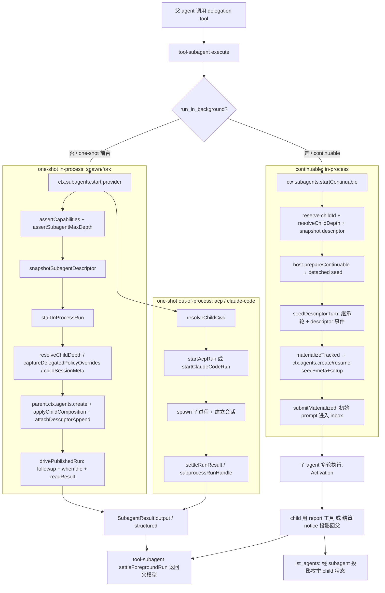

# 多 Agent / Subagent：统一接口下的多 transport 委派

> 子文档之一，聚焦如何在同一个 harness 内委派/嵌套另一个 agent。覆盖 `packages/subagent/*` 与 `packages/acp`。整体哲学见 [README](README.md)；本文上承 [sandbox-capability-seams.md](sandbox-capability-seams.md)（同级隔离能力）、衔接 [tools.md](tools.md)（委派由 delegation tool 驱动）。

Subagent 让同一个 harness 能委派/嵌套另一个 agent，且不把「委派」焊死在某种执行方式上——它本身也是一个可交换的 capability seam。

## 项目中的角色

dsh/subagent 让同一个 harness 内能**委派/嵌套另一个 agent**，且不把"委派"焊死在某种执行方式上。

去掉它系统会怎样（反向推演）：
- 复杂任务只能由单一 agent **线性**地自己做完，无法把"研究 X""实现 Y"切成并行的子任务分给子 agent。中大型任务要么耗尽主会话上下文，要么全程串行 —— 这是 Claude Code / Codex 之所以做成 harness 的核心痛点会整体回归。
- 多 transport（in-process 共享内存 / fork 子会话 / ACP 外部协议 / Claude Code 子进程）在启动模型上差异巨大：没有统一的 `SubagentProvider` 接口，每次接一种子 agent 产品就要改 agent 循环本身。`[docs/architecture.md:102]()` 明言 subagent provider 背后是「from a fresh child agent to a delegated turn in another product」的宽变更面。
<!-- anchor: Subagent providers vary just as widely behind one interface -->

它不存在的核心损格：subagent 也就不是"能力 seam"，而会退化成核心机制 —— 违反"无特权内核、一切皆插件"的总哲学。

## 根因

要回答的根本问题是：**如何把"另一个 agent 执行"抽象成可交换的 seam，同时让子 agent 与宿主共享同一可信执行世界。**

三个张力催生设计：
1. **可交换性 vs 保真度**：子 agent 可以由同进程内新建 agent、父会话 fork、外部 ACP 子进程、甚至另一个商业产品（Claude Code）驱动。它们对"子 agent"的资源、上下文、权限、结果的定义各不相同，但消费方（模型调用的 delegation tool）只想要一个统一结果。
2. **委派边界的两面性**：委派既是"隔离"（子 agent 不该污染父会话的执行世界），又是"共享"（子 agent 要与父共享 cwd、lineage、部分策略、甚至完成轮历史）。`[docs/architecture.md:98-102]()` 的三角色 seam；`sandbox`（同级隔离能力）处理的是"同一 agent 内的能力边界"，而 subagent 处理的是"跨 agent 的边界"，两者叙事相邻。
3. **child 状态从何而来**：子 agent 是一个独立 Session；它的初始"子状态"必须能从父会话派生，且这种派生必须持久可重放（否则冷恢复只能从零开始，像没委派过一样）。

整体设计哲学的落点：subagent 自己也是一个**可交换的 seam** —— 三件套（Service Definition `ctx.subagents` / Service Provider 各 transport 包 / Consumer tool 包）齐全，见 `[docs/subsystems/subagent.md:5-7]()`。于是"委派"不是一个被写进循环的能力，而是和其它能力平行的一块拼图。

## 设计思路

### seam 形状：多 provider 注册表而非单 executor

bash seam 是"每 context 一个 executor，二次加载抛错"；subagent **反其道而行** —— 多个 provider 可以在同一 `ctx` 内共存，各自注册一个唯一名字，调用方按名字挑选。形状对齐 LLM adapter 注册表（`LlmRuntime.registerAdapter`），不是单服务 executor `[docs/subsystems/subagent.md:5]()`。
`[packages/subagent/subagent/src/index.ts:369-385]()` <!-- anchor-base64: NzogICBpZiAodGhpcy5wcm92aWRlcnMuaGFzKG5hbWUpKSB7CjM4NDogIn0sICdzdWJhZ2VudHMucmVnaXN0ZXJQcm92aWRlcigpJyk= --> `registerProvider` 用 Cordis effect 包裹，HMR 安全。

每个 provider 是 `SubagentProvider`：`name` + `capabilities`（start 期能力位）+ `inheritsParentContext`（模型可读的"是否继承会话历史"描述）+ `start()`（one-shot）+ 可选 `prepareContinuable()`（continuable 能力，方法存在即能力）`[packages/subagent/subagent/src/types.ts:285-323]()`。

### boundary：能力位校验先于委派

start 请求若需要某能力而所选 provider 不具备，service 在调 `start` **之前**就抛 `UNSUPPORTED_CAPABILITY` 拒绝，绝不"先接收后忽略"（fail loud）。`[packages/subagent/subagent/src/index.ts:481-496]()` 的 `assertCapabilities` 逐位对账 `outputSchema/depthLimit/toolFilter/persona`。四个位与 `SubagentStartRequest` 选项一一对应（`maxDepth`↔`depthLimit`，其余同名），`[packages/subagent/subagent/src/types.ts:76-91]()` 与 `[packages/subagent/subagent/src/types.ts:100-149]()`。

#### in-process 位：全能力

`spawn` 与 `fork` 共享 `startInProcessRun`，两者都把 `outputSchema/depthLimit/toolFilter/persona` 全部置 true：
- spawn：`[packages/subagent/subagent-spawn-in-process/src/index.ts:41-44]()`
- fork：`[packages/subagent/subagent-fork-in-process/src/index.ts:61-64]()`

#### out-of-process 位：零能力

ACP/Claude Code 子进程无法执行父侧强制的 start 特性，故 `[packages/subagent/subagent/src/out-of-process.ts:25-30]()` 全 false，service 据此在 `start` 前拒绝任何需要它们的请求；ACP 引用 `[packages/subagent/subagent-acp/src/index.ts:146-149]()`；Claude Code 引用 `[packages/subagent/subagent-claude-code/src/index.ts:54]()`。

### 多 transport 如何映射到同一接口

| Transport | 子 agent 形态 | 上下文 | 能力 | inheritsParentContext | 关键文件 |
|---|---|---|---|---|---|
| spawn（in-process） | 同一 cordis ctx 新建的独立 Agent，零父上下文 | 独立会话/独立 system prompt | 全量 | false | `packages/subagent/subagent-spawn-in-process/src/index.ts:41-64` |
| fork（in-process） | seed 了父会话已完成轮前缀的子 Agent | 继承父已完成轮 | 全量 | true | `packages/subagent/subagent-fork-in-process/src/index.ts:61-89` |
| acp（out-of-process） | 独立进程，跑 Agent Client Protocol | 只读父 cwd | 无 | false | `packages/subagent/subagent-acp/src/index.ts:146-170` |
| claude-code（out-of-process） | 官方 Claude Agent SDK 拉起的真 CLI 进程 | 只读父 cwd | 无 | false | `packages/subagent/subagent-claude-code/src/index.ts:52-92` |

共性落在 `ResolvedSubagentStartRequest` 与 `SubagentRun` 两处：
- `start()` 都要在 publish 前完成子 agent 建立，publish 即所有权转移边界（`[packages/subagent/subagent/src/types.ts:297-307]()`）。
- 返回的 `SubagentRun` 统一 `id`/`localAgent`/`result`/`dispose()`。本地 run 的 `localAgent` 是确切内进程子 agent；远程 run 为 `undefined`（`[packages/subagent/subagent/src/types.ts:249-275]()`）。in-process driver 用 `drivePublishedRun` 统一包装 `AgentHandle`（`[packages/subagent/subagent-in-process-driver/src/index.ts:154-205]()`）；out-of-process 用 `subprocessRunHandle` 统一包装（`[packages/subagent/subagent/src/out-of-process.ts:201-215]()`）。
- 结果停止原因收敛到 merge-extensible 的 `SubagentStopReason`：`completed/aborted/error/max-tokens/refusal`（`[packages/subagent/subagent/src/types.ts:200-214]()`）。in-process 从 `TurnEndReason` 映射（`[packages/subagent/subagent-in-process-driver/src/index.ts:48-65]()`），ACP 从 ACP `StopReason` 映射（`[packages/subagent/subagent-acp/src/run.ts:135-157]()`），Claude Code 只认 SDK 严格 success（`[packages/subagent/subagent-claude-code/src/run.ts:92-104]()`）。

### 委派播种（delegation seed）

子状态从父会话派生的机制集中在两处：

**one-shot（in-process）**：`startInProcessRun` 在子 agent 创建窗内做四件事：
1. `[packages/subagent/subagent/src/child-agent.ts:48-57]()` `resolveChildDepth` 从父算深度 +1；
2. `[packages/subagent/subagent/src/child-agent.ts:199-204]()` `captureDelegatedPolicyOverrides` 捕获父 sandbox 覆盖 + 将 approval 钉死 `'never'`——子 agent 只在委派时固定的权限范围内行动；
3. `[packages/subagent/subagent/src/child-agent.ts:215-225]()` `appendDelegatedPolicyOverrides` 把策略作为 `source:'delegation'` 事件写到子自己的日志；
4. `[packages/subagent/subagent/src/child-agent.ts:102-120]()` `childSessionMeta` 记 cwd/`parentSession`/`origin:'subagent'`/`delegationDepth`/`seedLength`。

`[packages/subagent/subagent/src/child-agent.ts:163-175]()` `applyChildComposition` 统一给子 agent 装配：加入父 preset、登记"委托范围已固定"语句、应用 persona/toolFilter 遮蔽。

**fork 的上下文继承**：fork 把父日志 `完成轮前缀`（到最后一个 `turn/end` 为止，跳到未完成轮因为无法作合法子会话 seed）作为 `CreateAgentOptions.seed` 传给子 agent（`[packages/subagent/subagent-fork-in-process/src/index.ts:48-54]()`、`[packages/subagent/subagent-fork-in-process/src/index.ts:68-75]()`）。seedLength 记录注入边界，供后续投影判断"哪些事件属于子自己"（`[packages/subagent/subagent/src/child-agent.ts:112-118]()`）。

**continuable 的 descriptor 播种**：`[packages/subagent/subagent/src/descriptor-seed.ts:23-31]()` `seedDescriptorTurn` 用 `Session.create(childId, seed)` 暂存继承轮，再 append `subagent/descriptor` 事件，拿到连续从 seq 0 起始、lossless-JSON 的完整 seed。`continuation.ts` 在 `[packages/subagent/subagent/src/continuation.ts:403-457]()` `startContinuable` 中据此装配：计算 depth、快照描述符、调用 provider 的 `prepareContinuable` 拿 detached seed，最终 `materialize`。

### descriptor：子 agent 的持久身份

`[packages/subagent/subagent/src/descriptor.ts:28-39]()` `subagent/descriptor` 是 model-hidden 的 SessionEvent，标识每个 session-backed 子 agent 并记录 one-shot/continuable 模式。关键设计（`[packages/subagent/subagent/src/descriptor.ts:8-19]()` 注释 + `[packages/subagent/subagent/src/descriptor.ts:47]()` `SUBAGENT_DESCRIPTOR_VERSION=2`）：
- 显式快照字段而非 merge-extensible 的 `AgentOptions`，避免无关扩展值因非 JSON 而破坏 continuation；新增组合输入必须显式升版本。
- 省略 `subagentDepth`（冷恢复信任持久 header 的 `delegationDepth` 作为单调下限）与 `outputSchema`（激活的结果契约，非 durable 身份）。
- fold 时第一个 `[packages/subagent/subagent/src/descriptor.ts:308-314]()` `foldSubagentDescriptor` 权威，version 不匹配返回 undefined（无法分类）。

### 投影：child 状态查询与回读

session projection 提供两种纯函数视图（`[packages/subagent/subagent/src/projection.ts:44-86]()` 与 `[packages/subagent/subagent/src/projection.ts:142-156]()`）：
- `subagent`（身份）：从 `subagent/descriptor` 折叠 mode/label/seq，last-wins——fork seed 重放的祖先 descriptor 会被子自己的覆盖；损坏/未知版本 fold 到可序列化的 `null` 哨兵而非抛错。
- `subagentTiming`（计时）：折叠 descriptor 之后已结算 turn 的 `settledMs` 与当前活动 turn 区间。

`[packages/subagent/subagent/src/index.ts:311-360]()` `listChildren/listDescendants` 不加载/不恢复 Agent，直接合并 live session store 与可选持久化，经三级阶梯（watermark snapshot / projection-cache own-suffix seq gate / persistence inspect）服务每个子 agent 的 mode/label，从 `subagent` 投影单位读取。

**结果投影回父会话**：one-shot 结果经 `[packages/subagent/tool-subagent/src/index.ts:167-197]()` `settleForegroundRun` 收集 `run.result.output` 返回父模型。

> **演进说明（0.1.2-alpha）**：child-scoped `report` 工具（`packages/subagent/tool-subagent-report`）已在 alpha 期间移除，改为**统一相邻 Agent 消息**：continuable 子 agent 的初始任务被注入"用 `send_message({ agent_id: <parent>, message: "<self-contained result>" })` 向父投递"的指导（`continuableInitialPrompt`，[packages/subagent/subagent/src/continuation.ts:296-308]()
<!-- anchor: function continuableInitialPrompt(parentId: SessionId, prompt: ContentBlock[]): ContentBlock[] { …         + 'does not end your turn.', -->），子用全局 `send_message` 工具向父投递，父侧以 `source.kind: 'agent-message'`（`form: 'relay'`）的 durable user message 呈现（[packages/subagent/subagent/src/continuation.ts:276-293]()
<!-- anchor: function agentMessageSource(sender: Agent): AgentMessageSource { …     source: agentMessageSource(sender), -->）。Activation 结算还会发一条 `subagent-settled` notice 给父（`[docs/subsystems/subagent.md:212]()` 声明）。生命周期对：`subagent/start` / `subagent/end` 按委派父做 scoped dispatch（`[packages/subagent/subagent/src/lifecycle.ts:133-162]()`）。

### depth/loop 防护

`[packages/subagent/subagent/src/depth.ts:28-36]()` `delegationDepthOf` 读取确切深度 = `max(header.delegationDepth, runtime.subagentDepth)`，header 持据权威且单调，运行时可加深但不可降低；`[packages/subagent/subagent/src/child-agent.ts:48-57]()` `resolveChildDepth` 计算 `parent+1` 并校验安全整数，超出 `maxDepth` 抛 `SubagentDepthError`。`[packages/subagent/subagent/src/depth.ts:42-51]()` `assertSubagentMaxDepth` 拒绝非法 cap。in-process 与 continuation 的 start 处都调用 `resolveChildDepth`（`[packages/subagent/subagent-in-process-driver/src/index.ts:109]()`、`[packages/subagent/subagent/src/continuation.ts:410]()`）。

## 关键数据结构

- `[packages/subagent/subagent/src/types.ts:285-323]()` `SubagentProvider`：注册表里一个具名 transport，`capabilities` 位 + `inheritsParentContext` + `start()` + 可选 `prepareContinuable`（`[packages/subagent/subagent/src/types.ts:308-323]()` 方法存在即能力）。
- `[packages/subagent/subagent/src/types.ts:100-149]()` / `[packages/subagent/subagent/src/types.ts:155-158]()` `SubagentStartRequest` / `ResolvedSubagentStartRequest`：one-shot 委派请求；后者在 service 解析描述符后加 `descriptor` 字段传给 provider。
- `[packages/subagent/subagent/src/types.ts:249-275]()` `SubagentRun`：已发布 one-shot 子的消费句柄（id/localAgent/result/dispose），`dispose` 幂等。
- `[packages/subagent/subagent/src/descriptor.ts:60-88]()` `SubagentDescriptorData`：`subagent/descriptor` 事件载荷，mode 判别联合（one-shot 可选 label；continuable 强制 label + agentProvider/agentModel/persona/toolFilter）。
- `[packages/subagent/subagent/src/child-agent.ts:228-236]()` + `[packages/subagent/subagent/src/child-agent.ts:102-120]()` `ChildCreateInputs` + `childSessionMeta`：in-process 子创建的 identity/lineage 输入与持久 meta。
- `[packages/subagent/subagent/src/projection-types.ts:26-47]()` / `[packages/subagent/subagent/src/projection-types.ts:8-18]()` delegations 投影视图 `SubagentIdentityProjection`（含 `seq`，证明 own-suffix）与 `SubagentTimingProjection`。

## 核心流程

下面 Mermaid 描绘**父 agent 经 tool-subagent 委派 → 选 provider → 派生 child 状态 → 执行 → 结果投影回父会话**的主干。

各步源码定位：
- D2/B→D：`[packages/subagent/tool-subagent/src/index.ts:369-429]()`
- service 校验与 start：`[packages/subagent/subagent/src/index.ts:414-426]()`
- one-shot in-process driver：`[packages/subagent/subagent-in-process-driver/src/index.ts:102-148]()`（start）、`[packages/subagent/subagent-in-process-driver/src/index.ts:154-205]()`（drive）
- spawn/fork 具体 seed 差异：`[packages/subagent/subagent-fork-in-process/src/index.ts:48-75]()`
- acp：`[packages/subagent/subagent-acp/src/run.ts:199-318]()`
- claude-code：`[packages/subagent/subagent-claude-code/src/run.ts:203-289]()`
- continuable：`[packages/subagent/subagent/src/continuation.ts:429-504]()`（startContinuable）、`[packages/subagent/subagent/src/continuation.ts:1119-1216]()`（materializeTracked，内含 child resume/create）、`[packages/subagent/subagent/src/continuation.ts:974-1037]()`（coldResume）
- report 工具：**0.1.2-alpha 移除**（`tool-subagent-report`），由 `send_message` 相邻 Agent 消息承载（[packages/subagent/tool-subagent-control/src/index.ts:29-29]()）
- list_agents：`[packages/subagent/tool-subagent-control/src/list-agents.ts:164-190]()`

`materializeTracked`（`[packages/subagent/subagent/src/continuation.ts:986-1023]()`）在子创建窗内调用 `applyChildComposition` + `setupRegistry.apply`（`:996-1004`）、`ctx.agents.resume`/`create`（fresh 创建、cold 恢复，`:1009-1023`），随后 `submitMaterialized`（`[packages/subagent/subagent/src/continuation.ts:943-958]()`）把初始/继续 prompt 送入 inbox——即"child 状态投影成父可追踪的执行起点"。cold resume 路径（`:883-932`）先 `persistence.inspect` 读持久 Session，再 `foldSubagentDescriptor(own-suffix)`（`:905`）、`authorizeLineage`（`:901`），再 materialize + submit——故冷恢复能精确重建 child 状态且不把 fork seed 的祖先 descriptor 当子身份。

## 与其他模块协同

- **tools 的 delegation Consumer**：`tool-subagent` 是委派 Consumer，按 provider lifecycle 挂/卸 tool（`[packages/subagent/tool-subagent/src/index.ts:267-466]()`）；`tool-subagent-control` 提供全局 `send_message`/`interrupt_agent`/`list_agents`（`[packages/subagent/tool-subagent-control/src/index.ts:27-117]()`、`[packages/subagent/tool-subagent-control/src/list-agents.ts:91-191]()`）；`tool-subagent-report`（child-scoped `report`）已在 0.1.2-alpha 移除，continuable 子改由 `send_message` 相邻 Agent 消息向父投递（`[packages/subagent/tool-subagent-control/src/index.ts:29-29]()`）。
- **sandbox 同级隔离**：`[packages/subagent/subagent/src/child-agent.ts:199-225]()` `captureDelegatedPolicyOverrides`/`appendDelegatedPolicyOverrides` 把父 sandbox 覆盖继承、approval 钉死 `'never'`；`applyChildComposition` 里组装 `delegation:persona`、`tools.restrict`。身份即权限边界 —— 子只在委派时固定范围内行动。（跨模块：与 sandbox 模块的深层互操作细节（sandbox 策略覆盖、工具 restrict 的精细语义））
- **session 派生子状态**：子 Session 经 `ctx.agents.create`/`resume`、`[packages/subagent/subagent/src/child-agent.ts:102-120]()` `childSessionMeta` 落 `parentSession/delegationDepth/seedLength/origin`；投影从 `[packages/subagent/subagent/src/index.ts:197-200]()` `sessionProjections` 注册的 `subagent`/`subagentTiming` 单位服务查询。（跨模块：session 模块 `Session.create`/`prepare({seed})` 的 seed 契约，见 docs `core.md#creation-and-ownership`，需引 session 源码）
- **acp 外部协议**：`[packages/subagent/subagent-acp/src/run.ts:199-318]()` `startAcpRun` 用 `ClientSideConnection`+`ndJsonStream` 驱动独立子进程，经 `[packages/subagent/subagent-acp/src/run.ts:209-215]()` `ctx.subprocess.spawn` 共享 scrub / 树级 teardown。（跨模块：`dsh-subprocess` 的 spawn/scrub/teardown 契约）
- **agent 核心（所有权/循环）**：in-process driver 与 continuation manager 都经 `parent.ctx.agents`/私有 `ownerCtx.agents` 创建/恢复 Agent，`AgentHandle` 是唯一 quiescent 生命周期所有者（`[packages/subagent/subagent-in-process-driver/src/index.ts:132-139]()`、`[packages/subagent/subagent/src/continuation.ts:1009-1012]()`）。（跨模块：AgentHandle 所有权、Agent 循环 turn 排序契约）
- **jobs 后台任务**：one-shot 后台经 `ctx.jobs.start` 包装，`[packages/subagent/tool-subagent/src/index.ts:111-120]()` `settleStart` 中转 `[packages/subagent/subagent/src/run-settlement.ts:49-63]()` `settleRun`（`[packages/subagent/tool-subagent/src/index.ts:400-422]()`）。（跨模块：jobs seam 的 Task/outcome 语义）

## 关键设计决策

**决策 1：统一单接口、多 transport（spawn/fork/acp/claude-code 同一 `SubagentProvider`）**

- Why：把"子 agent 形态"从调用方解耦。只要实现 `SubagentProvider`，任何执行方式都能接入；Consumers（model-facing tool）只依赖 bound → 结果。`[docs/subsystems/subagent.md:7]()` 列举一整套 sibling provider 包。
- 权衡：接口取交集，能力由 capability 位显式声明，缺失即 fail-loud。代价是每个新 transport 都要重实现 `start`+run 生命周期；共享的 in-process driver 与 out-of-process 工具函数（`NO_START_CAPABILITIES`、`resolveChildCwd`、`settleRunResult`、`subprocessRunHandle`，见 `[packages/subagent/subagent/src/out-of-process.ts:19-30,101-215]()`）为同一接口收敛共性。
- 连回哲学：subagent 是可交换 seam —— provider swap 不触及循环。

**决策 2：in-process 与 out-of-process 的能力/上下文权衡**

- in-process（spawn/fork）：共享同一 cordis ctx，**能**执行 `outputSchema`（child-scoped 结构输出工具 `structured_output`，`[packages/subagent/subagent-in-process-driver/src/structured.ts:19,99-103]()`）、`depthLimit`（可构造子所以可强推绝对 cap）、`toolFilter`/`persona`（scoped restrict + persona 遮蔽）。优点是能力全 + 真共享执行世界（继承 preset、工具、策略）。
- out-of-process（acp/claude-code）：独立进程，无法信任父侧强制，于是**零能力位**（`[packages/subagent/subagent/src/out-of-process.ts:25-30]()`），且只读父 `cwd`（去程边界唯一穿越值），上下文不跨进程。优点是真实产品边界隔离、不占用 harness 事件循环，代价是能力与"共享世界"都让位。
- 权衡核心：**fail-loud 而非静默降级**——请求要 `outputSchema` 而选了个远程 provider，service 在 `start` 前就拒绝，绝不"接受后当无事发生"（`[packages/subagent/subagent/src/index.ts:481-496]()`）。

**决策 3：child 状态从父日志派发并持久派生（seed + delegation policy 事件 + descriptor）**

- 子 Session 不是凭空建：fork 继承父完成轮前缀（`[packages/subagent/subagent-fork-in-process/src/index.ts:48-54]()`），策略以 `source:'delegation'` 事件写子日志（`[packages/subagent/subagent/src/child-agent.ts:215-225]()`），身份以 `subagent/descriptor` 事件固化（`[packages/subagent/subagent/src/descriptor.ts:28-39]()`），`seedLength`/`delegationDepth` 记 header（`[packages/subagent/subagent/src/child-agent.ts:118]()`）。所有派生态**从子自己的日志可重放** → cold resume 只折 own-suffix（`[packages/subagent/subagent/src/continuation.ts:905]()`）。
- 为什么 logs-only + scheme：descriptor 不进 model history、无 `surfaceOp`、经 append-only log 跨 compaction 保留（`[docs/subsystems/subagent.md:285]()`）。这保持"Session 事件日志是唯一事实源"的根哲学——child 身份与策略是事件，不是旁路状态。
- 权衡：手动维护派生一致性表较繁琐，但换来冷恢复与枚举（list_agents）无需加载 Agent 即可精确重建。

**决策 4：depth 单调防护防递归失控**

- `delegationDepthOf = max(header, runtime)`，header 权威、runtime 可加深不可降低（`[packages/subagent/subagent/src/depth.ts:28-36]()`）；每个 start 校验 + 可设绝对 `maxDepth`（default 3，`[packages/subagent/tool-subagent/src/index.ts:98]()`）。冷恢复后 runtime 归零也不至于被当顶层 —— header 兜底单调。
- 为什么 max 而非自身：resume 的子带着 fresh options 到达，若只数 runtime 会从 0 开始冒充顶层无限委派；取 max 使持久 header 成为单调地板（`[packages/subagent/subagent/src/depth.ts:18-23]()` 注释）。

## 全局关联：委派也是可交换 seam 的完整自证

subagent 用「统一单接口 + 多 transport（spawn/fork/acp/claude-code 同一 `SubagentProvider`）」把「另一个 agent 如何执行」抽象成可交换能力，能力位相缺则 fail-loud，绝不静默降级；child 状态从父会话派发（fork 继承完成轮、策略以 `source:delegation` 事件写子日志、身份以 `subagent/descriptor` 固定），所有派生态从子自己的日志可重放，故 cold resume 只折 own-suffix。这与 [session.md](session.md) 的「日志即事实源」紧密呼应——child 身份与策略是事件而非旁路状态；又与 [tools.md](tools.md)（delegation tool 驱动）、[sandbox-capability-seams.md](sandbox-capability-seams.md)（委派边界继承沙箱覆盖）在「可交换 + 可审计」两条主线上汇合。

> 跨模块契约提示：`subagent` 与 sandbox（覆盖播种）、session（seed 契约）、subprocess（scrub）、jobs（后台任务）的边界定义见各自子文档，此处不再复述验证性细节。
