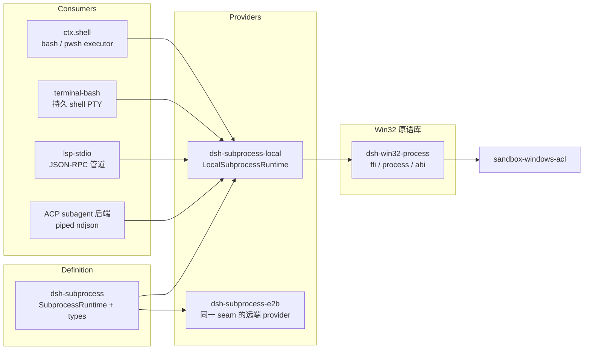
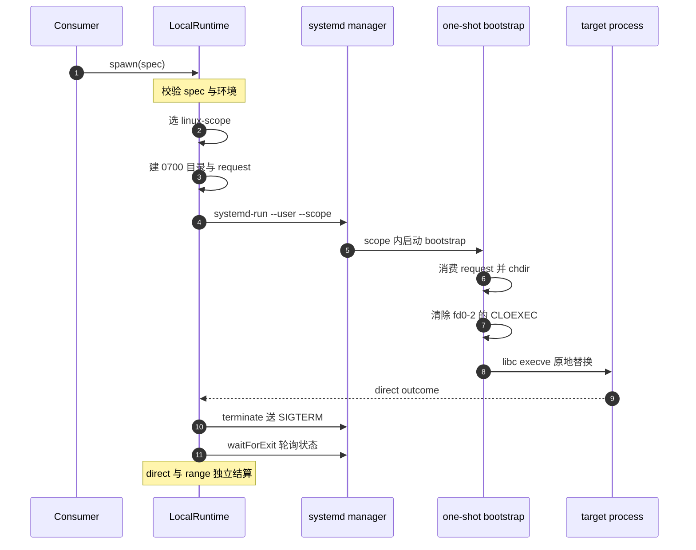
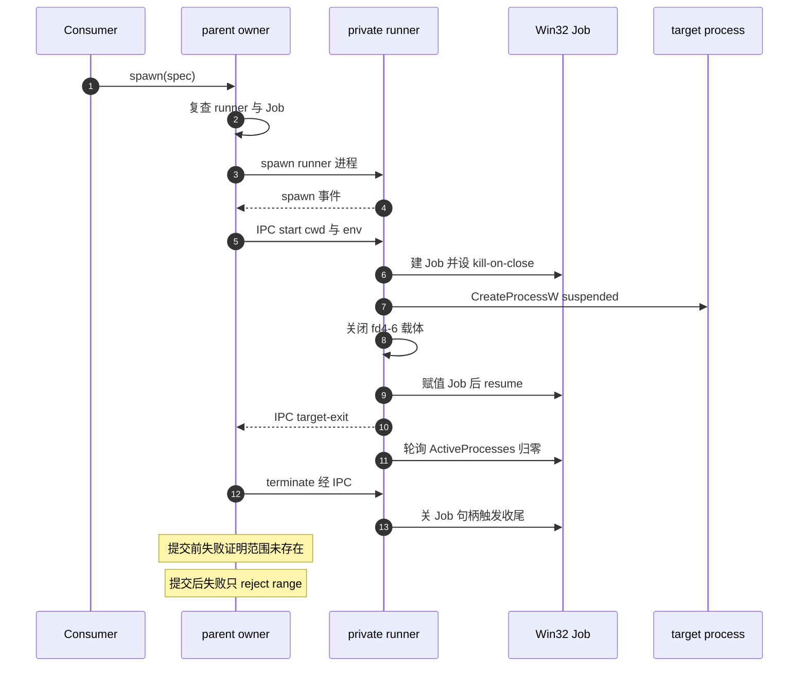
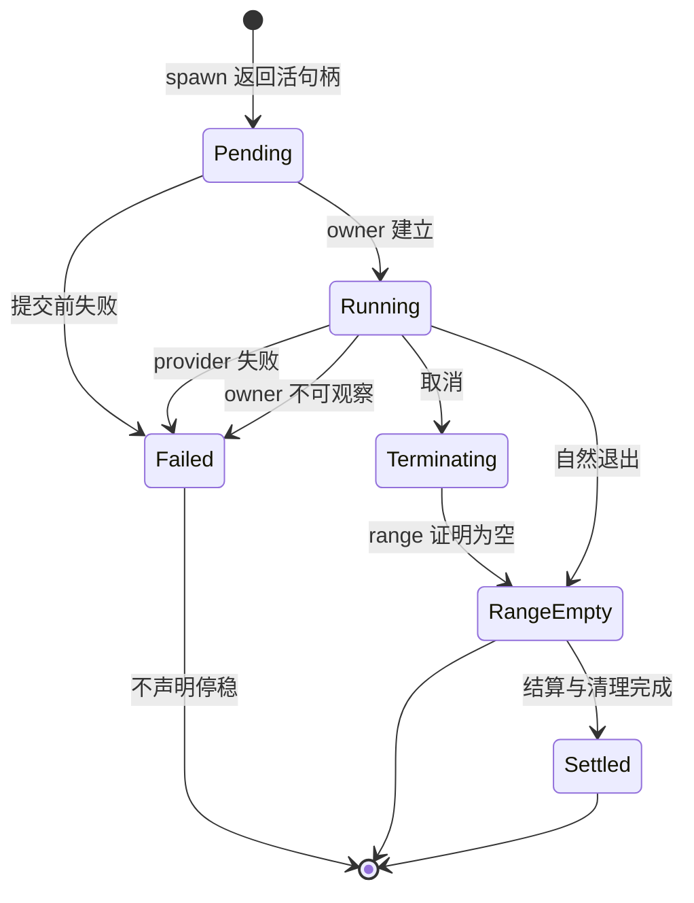

> 子文档之一，聚焦"harness 如何在宿主上起进程、收输出、并且真的杀干净"。上承 [sandbox-capability-seams.md](sandbox-capability-seams.md)（六族 Capability Seam 与沙箱边界，本文是其 `subprocess` 一族的纵深补充）；下接 [agent-loop-runtime.md](agent-loop-runtime.md)（进程外的 subagent 后端消费同一 seam）。整体哲学见 [README.md](README.md)。

## 在项目中的角色：进程坐标与生命周期，而非命令语义

去掉这一层，模型每执行一条 bash 命令、每拉起一个 language server、每开一个持久 shell，都要各自重写一遍"起进程、收输出、取消、清理、清环境"；而"进程是什么"在四个消费方眼里并不相同——bash 关心批量输出与超时分类，LSP 关心裸管道里的 JSON-RPC 帧，PTY 后端关心控制终端与前台进程组，进程外 subagent 后端关心 ndjson 与继承 stderr。上游把这四类需求里**唯一重合的部分**抽成 `ctx.subprocess`，其余全部归还消费方。

上游定位写得很直白：这个 seam 由 Service Definition `dsh-subprocess`、Service Provider `dsh-subprocess-local` 组成，消费方是"其他 capability seam 与进程外后端"，并明确它拥有 `DSH_*` 环境命名空间、共享凭据擦除 `scrubbedParentEnv` 与 `CollectedOutput` 形状（`[docs/subsystems/subprocess.md:5-5]()`）。
<!-- anchor: The subprocess seam is split across a Service Definition ([dsh-subprocess](../.. -->

由此得到一条贯穿全篇的分工线，也是理解整个子系统的根因答案：

| 关注点 | 归属 | 依据 |
|---|---|---|
| 命令是什么（`bash -c` 还是裸 argv）、超时、原因分类、面向模型的输出合并 | `ctx.shell` / `ctx.terminals` 等消费方 | shell 语义：非零退出、超时、abort 都 resolve 成结果，只有基础设施失败才 reject；拆解边界是 `ctx.subprocess` disposal |
| 进程坐标（可执行查找、cwd、stdio 处置、环境）、生命周期（起/停/等空） | `ctx.subprocess` | Service Definition 语义清单 |
| 文件效果边界（read-only / workspace-write / danger-full-access）与 `confine(argv)` 包裹 | `ctx.sandbox` + `ctx.sandboxPolicy` | 见 [sandbox-capability-seams.md](sandbox-capability-seams.md)「隔离必须 fail-closed」一节 |

前两行的原文依据分别是 `ctx.shell` 的 disposal 边界声明（`[packages/shell/shell/src/index.ts:58-62]()`）与 `ctx.subprocess` 的实现语义清单（`[packages/subprocess/subprocess/src/index.ts:92-94]()`）。
<!-- anchor: *   repeat output. Lossy reads report truncation and available spill files. … *   owning composition tears down. With the subprocess seam that -->
<!-- anchor: * Implementations must honor these semantics: … *   filesystem provider. -->

**根因一句话**：进程的**语义**必须留在消费方（否则 seam 会被某一类消费者的默认值污染），但进程的**坐标与生命周期**必须共享（否则"同一执行世界"假设失效、清理策略各写一套）。Service Definition 因此选择"零默认值 + 全显式 spec"：

- 每一次 spawn 的每一个处置方式、上限、目录都必须显式写在 spec 上，seam 不提供任何隐藏默认值，`dsh-shell` 的 request/spec 拆分是这条规则的模板（`[packages/subprocess/subprocess/src/types.ts:69-74]()`）。
<!-- anchor: * A fully-specified spawn request. This seam applies no defaults: every … * not a hidden subprocess-service default — decides them (the `dsh-shell` -->

**`resolveExecutable` 的语义是本子系统与 fs 族共享"执行世界"的关键**。它在 provider 自己的执行世界里解析可执行文件：绝对路径要被验证为可执行文件，裸名要通过 provider 擦除后的 `PATH` 加显式覆盖去查找，而**含分隔符的相对路径直接被拒绝**——因为解析基准未定义，provider 宁可 loud-fail 也不猜（`[packages/subprocess/subprocess/src/index.ts:120-129]()`、`[packages/subprocess/subprocess/src/index.ts:131-135]()`）。
<!-- anchor: * Resolve one configured executable in this provider's execution world. … * @param env - explicit environment entries used for lookup. -->
<!-- anchor: abstract resolveExecutable( … env?: Readonly<Record<string, string>>, -->

这与既有解读一致：subprocess 的可执行路径、cwd、进程与终端会话都与挂载的 filesystem provider 处于同一个路径与进程命名空间（`[docs/subsystems/subprocess.md:11-11]()`）；当执行世界整体切到 E2B 时，fs / subprocess / shell / terminal / lsp 会级联一起移动（见 [sandbox-capability-seams.md](sandbox-capability-seams.md)）。
<!-- anchor: One provider's spawn working directories, executable paths, ordinary processes, -->

本地 provider 的实现同样落在这条语义上：拒绝空命令、拒绝含分隔符的相对路径、先 `stat` 确认是文件再 `access(X_OK)`，全部候选失败后给出**一条稳定错误**（绝对路径失败与 PATH 未命中的文案不同），并且每个候选项之间都复查 abort（`[packages/subprocess/subprocess-local/src/index.ts:122-153]()`）。
<!-- anchor: async resolveExecutable( … ? `subprocess-local: command ${JSON.stringify(command)} is not an executable fil -->

### 核心能力清单

| 能力 | 语义 | 关键类型/入口 |
|---|---|---|
| 可执行查找 | 执行世界内的绝对路径校验 / 裸名 PATH 解析，相对路径 loud-fail | `SubprocessRuntime.resolveExecutable` |
| 全显式 spawn | 无默认值的 argv/cwd/stdio/grace/signal/env | `SubprocessSpawnSpec` |
| 四种 stdio 处置 | `ignore` / `pipe` / `inherit` / 有界 collect（尾部保留 + 可选 spill 全量恢复） | `SubprocessStdinMode`、`SubprocessOutputMode`、`SubprocessCollect` |
| 偏移式收集读取 | 整条流的字节偏移，非消费式，读方互不抢夺；`lossy` 报告截断与 spill 路径 | `SubprocessOutputReader.readFrom` |
| 受管范围终止 | `terminate()` 是唯一终止动词；`waitForExit()` 观察同一范围 | `SubprocessHandle` |
| 终端原语 | 唯一非管道原语：分配控制终端、前台进程组检查/信号、整体停稳 | `spawnTerminal`、`SubprocessTerminalHandle` |
| 环境擦除 | 凭据形状键 + 全部 `DSH_*` 不隐式泄漏；显式 `env` 在擦除之后 merge | `scrubbedParentEnv`、`SENSITIVE_ENV_PATTERN` |

凭据擦除本身值得单看：`KEY|PASSWORD|SECRET|TOKEN` 大小写不敏感匹配 + 全部 `DSH_*` 前缀被丢弃，显式传入的条目因为 merge 在擦除之后而存活；当有代理时还会叠加子进程 Node 需要的代理变量与开关，使 MCP stdio server 或 subagent CLI 继承父进程同样的路由（`[packages/subprocess/subprocess/src/index.ts:64-78]()`）。
<!-- anchor: export function scrubbedParentEnv(): Record<string, string> { … return env -->

**权衡**：擦除是**名字启发式**而非值检测——`*PASSPHRASE*` 这类不匹配的密钥会漏过去，属于已知不足（见「权衡与不足」）。选它以换取"任何 spawn 路径（含无法走 service 的 node-pty / SDK transport）共用同一份定义"，是典型的一致性优于完备性取舍。

## seam 三件套与代码规模

```
packages/subprocess/
├── subprocess/          # Service Definition（抽象，声明 ctx.subprocess）
│   ├── src/index.ts     # SubprocessRuntime + scrubbedParentEnv
│   └── src/types.ts     # spec / handle / outcome / terminal 词汇
├── subprocess-local/    # Service Provider（注册 ctx.subprocess，本地执行）
│   ├── src/index.ts     # 平台选择、live 集合、dispose / host-exit
│   ├── src/spawn.ts     # 共同 stdio/结果生命周期 + fallback 启动
│   ├── src/managed-owner.ts
│   ├── src/linux-scope.ts / linux-execve.ts   # systemd scope + libc execve
│   ├── src/windows-job.ts                     # parent 侧 runner 启动与 Job owner
│   ├── src/spawn-runner.ts / bin.ts           # 私有 runner：Linux bootstrap + Windows Job runner
│   ├── src/runner-launch.ts / runner-protocol.ts
│   ├── src/terminal.ts / process-inspector.ts / windows-inspector.ts
└── win32-process/       # 共享 Win32 原语库（无 ctx key）
    └── src/{ffi,process,abi,errors}.ts
```

| 包 | 角色 | 代码规模（src，未计测试） | ctx key |
|---|---|---|---|
| `dsh-subprocess` | Service Definition | 418 行（`index.ts` 156 + `types.ts` 262） | 声明 `ctx.subprocess` |
| `dsh-subprocess-local` | 本地 Service Provider | 4202 行（另有 6582 行测试） | 注册 `ctx.subprocess` |
| `dsh-win32-process` | 共享 Win32 绑定库 | 1070 行 | 无（纯库） |

本次增量区间里这组包共 52 个文件、+7142/−425 行；其中 `subprocess-local` 30 文件 +6317/−284，`win32-process` 10 文件 +575/−74，Definition 侧 9 文件 +240/−57。这是一个**以 Provider 为主战场**的变更，Definition 只做了语义澄清（把 "managed process trees" 统一改为 provider 视角的 "managed process range"、删掉公共 `pid`）。

架构总览（谁声明、谁实现、谁消费）：



**为什么 Windows 需要一个独立包**（`win32-process` 而不是把这些塞进 `subprocess-local`）：

1. **两个消费者共享同一份 ABI 所有权**。Win32 常量、x64 结构体大小与偏移由 `abi.ts` 统一持有，`kernel32.dll`/`advapi32.dll` 由一个 Koffi 绑定表懒加载；Windows ACL 沙箱（restricted token / `CreateProcessAsUserW`）与普通 Job runner（current token / `CreateProcessW`）**必须看到同一套句柄与继承语义**，否则"沙箱路径继承 stdio"与"普通路径继承 stdio"会分叉。库的定位就是"仓库内唯一的 Koffi 绑定表"，且它不是 Cordis service、不选择策略，也没有公共进程 API。
2. **ABI 证据需要一个独立的验证归属方**。结构体大小与偏移不是靠注释声明，而是由 `verify/abi-probe.cpp` 对着 MinGW 头文件编译运行来固定（含 Job 记账记录大小与 `ActiveProcesses` 偏移，即"停稳判据"本身）；这些常量是跨两个进程路径的**共同前提**，放在消费方任一侧都会让另一侧变成隐式依赖。

| Win32 原语 | 语义 |
|---|---|
| `createKillOnCloseJob` | `CreateJobObjectW` + `JOB_OBJECT_LIMIT_KILL_ON_JOB_CLOSE` |
| `spawnJobProcess` | 建 Job → 临时开继承位 → `CreateProcessW`/`AsUserW` suspended → `AssignProcessToJobObject` → `ResumeThread` |
| `isJobEmpty` | 读 `JobObjectBasicAccountingInformation.ActiveProcesses` 是否为 0 |
| `spawnCurrentTokenJobProcess` | 单独解析 `applicationName` + 完整 UTF-16LE 环境块 + fd 4–6 载体 |

落点集中在两个原语：`createKillOnCloseJob` 建 Job 并设置 kill-on-close 限制（`[packages/subprocess/win32-process/src/process.ts:333-352]()`），`spawnJobProcess` 完成"建 Job → 临时打开继承位 → suspended 创建 → 赋值 Job → resume"这段两路共用的生命周期（`[packages/subprocess/win32-process/src/process.ts:399-440]()`）。
<!-- anchor: function createKillOnCloseJob(api: Win32ProcessBindings): NativePtr { … return job -->
<!-- anchor: function spawnJobProcess( … api.closeHandle(job) -->

其中"创建成功但句柄为空"以及赋值 / resume 失败的处理分支在 `:447-487`（`[packages/subprocess/win32-process/src/process.ts:447-487]()`）；结算侧读 Job 记账的 `ActiveProcesses`（`[packages/subprocess/win32-process/src/process.ts:576-588]()`）。
<!-- anchor: if (created === 0) { … closeBestEffort(api, info.hThread) -->
<!-- anchor: export function isJobEmpty(api: Win32ProcessBindings, job: NativePtr): boolean { … return information.readUInt32LE(abi.JOBOBJECT_BASIC_ACCOUNTING_ACTIVE_PROCESSES_ -->

普通路径的入口 `spawnCurrentTokenJobProcess` 额外要求单独解析的 `applicationName`、完整 UTF-16LE 环境块与 fd 4–6 载体（`[packages/subprocess/win32-process/src/process.ts:521-540]()`）。
<!-- anchor: export function spawnCurrentTokenJobProcess( … processInfo, -->

## 托管范围：原生 owner 为什么不可替代

这是本次增量最大的主题（`fix(subprocess): contain escaped descendants with native owners`）。问题陈述在源码注释与设计笔记里是一致的：detached POSIX 进程组、Windows direct-parent 遍历、PTY 后代扫描，都只能描述"仍可通过某种进程关系观察到的成员"；子进程可以 `setsid`、可以 reparent、可以比 direct parent 活得久，于是杀掉表层进程树之后，工作、端口、文件仍然活着，而 **direct target result 也证明不了后代已经停止**。

`LocalSubprocessRuntime` 的选择是：在 target 执行**之前**选定一个 provider 私有的 managed-range owner——符合条件时用 OS 级 membership（Linux 临时 user-systemd scope / Windows unnamed kill-on-close Job），不支持的宿主退回既有较弱机制并在 provider 生命周期内**只警告一次**。关键不变量是：**一旦选定的 native 路径可能已经执行了 target，绝不重放命令**（歧义失败可能发生在 target 已执行之后，重放等于执行两次）。

| 宿主 / 场景 | managed range owner | 结算证据 | 失败语义 |
|---|---|---|---|
| Linux 普通命令 / PTY，且 user manager 可用 | 临时 `systemd-run --user --scope` | `LoadState`/`ActiveState` 证明 scope 为空 | 选定 native 后失败即报告，不回落 |
| Windows 普通命令，runner 与 Job 可用 | 私有 runner 独占的 unnamed kill-on-close Job | Job `ActiveProcesses == 0` 且 runner clean exit | 提交前失败 = 原样保留 + empty range；提交后基础设施失败 = range settlement reject |
| macOS、旧版/缺失 user-systemd、Windows ConPTY | 既有 PGID / `taskkill /T` / 带身份围栏的 PTY 观察 | 进程组/树/session 可见性 | 明确警告"逃逸后代不保证被终止" |

<details>
<summary>平台选择与一次警告的实现落点</summary>

模式选择在 `selectContainmentMode`：Linux 首次走昂贵的深探（runner 入口 + libc 绑定 + user manager + literal-argv scope 支持），成功即缓存；之后每次符合条件的调用只做一次轻量的 manager 可达性复查；Windows 普通命令每次复查 runner 入口、绑定与 current-token Job 支持（`[packages/subprocess/subprocess-local/src/index.ts:189-208]()`）。
<!-- anchor: private selectContainmentMode( … this.warnFallback(platform, kind, fallbackReason) -->

不可用时走 `warnFallback`，把"为什么更弱"按平台分别说明，并明确后果是"逃离进程组或 direct-parent 树的后代不保证被终止、也不保证延迟 `waitForExit()`"（`[packages/subprocess/subprocess-local/src/index.ts:210-227]()`）。
<!-- anchor: private warnFallback( … `subprocess-local is using weaker process-tree containment because ${reason}; de -->

Linux 的两级探测是"缓存昂贵项、复检易变项"的折中：`probeLinuxBootstrap` 确认本次 runner 入口与 libc `execve`/`fcntl` 绑定真的可用，`probeLinuxNative` 再叠加 scope 支持（`[packages/subprocess/subprocess-local/src/linux-scope.ts:96-105]()`、`[packages/subprocess/subprocess-local/src/linux-scope.ts:147-155]()`）。只缓存第一次成功的深探、之后每次轻量复查 manager，是因为 user manager 的可达性可以在两次 spawn 之间变化——缓存整个结论会漏掉这种变化。
<!-- anchor: export function probeLinuxBootstrap(internals: LinuxScopeInternals = {}): boolea … return false -->
<!-- anchor: * Re-check every Linux native prerequisite for one eligible spawn. … return probeLinuxBootstrap(internals) -->

</details>

**权衡**：native membership 换来的是"能独立查询、持续存在"的容纳力，代价是每次 spawn 都要付一次 Linux manager 检查 + scope/request，或一整套 Windows runner/IPC/Job 生命周期；而且当所选 owner 无法证明停稳时，系统选择**显式失败**而不是假装成功。这与 sandbox 的 fail-closed 是同一哲学的两个投影：sandbox 在"没有可用隔离后端"时禁止静默放行；subprocess 在"无法证明范围为空"时禁止静默声明停稳。

## Linux：一次性 systemd scope 与 one-shot bootstrap

Linux 路径的核心设计是"**bootstrap 会原地变成 target，而不是常驻 supervisor**"。parent 先建一个 0700 私有目录，写入一份完整 0600 的 `launch-request.json`，承载最终 target cwd 与完整环境；私有环境变量 `DSH_SUBPROCESS_RUNNER` 只负责定位这份 request；`systemd-run --user --scope --quiet --collect --expand-environment=no` 先把自身注册进 scope，再由 one-shot bootstrap 消费 request、`chdir` 到 target cwd、恢复完整环境、按 target 自己的 PATH 规则解析裸可执行文件，最后用 libc `execve()` 原地替换（`[packages/subprocess/subprocess-local/src/runner-protocol.ts:96-116]()`、`[packages/subprocess/subprocess-local/src/spawn-runner.ts:175-200]()`）。
<!-- anchor: * Create a private 0700 directory and one complete 0600 launch request. … throw error -->
<!-- anchor: function runLinux( … host.exitCode = 127 -->

`--expand-environment=no` 不是随手加的选项：它保证 argv 里的内容不被 systemd 二次展开，从而**保留 literal argv**——这正是"target 收到什么就是调用方写了什么"的前提。scope 的 argv 结构因此是三段式：scope 选项 → runner invocation → 私有 `--` 分隔符 → target argv（`[packages/subprocess/subprocess-local/src/linux-scope.ts:344-357]()`）。
<!-- anchor: function scopeArgs(unitBase: string, invocation: RunnerInvocation, argv: readonl … ...argv, -->

裸名解析必须复用 target 的 PATH 语义（含相对 PATH 项以 target cwd 为基准），EACCES 要记住但继续尝试后续目录，全部失败后抛出**与 Node 同形状**的 `ENOENT`（见错误保真一节）；`ENOEXEC` 时退回 `/bin/sh <file> <args...>`，与 Node 的 spawn 行为对齐（`[packages/subprocess/subprocess-local/src/spawn-runner.ts:146-173]()`）。
<!-- anchor: function execLinuxTarget( … throw permissionFailure ?? linuxPathNotFoundError(program) -->

stdio 的保住方式是**不复制**：bootstrap 在 execve 之前清除 fd 0–2 上的 `FD_CLOEXEC`，于是 target 直接继承 scope 进程的标准描述符，用户字节从不经过任何中间协议（`[packages/subprocess/subprocess-local/src/linux-execve.ts:56-71]()`）。
<!-- anchor: const flags = nativeFcntl(fd, F_GETFD, 0) … return cachedExecve -->

**scope 何时算建立、何时算为空**，是 Linux 侧最细的语义。request 被消费、或 manager 已报告 loaded unit，任一即可建立 ownership；在这两项事实出现前，只要 direct launcher 还在运行，unit absence 就是**未决**而不是"已空"。`waitForExit()` 轮询 `LoadState` 与 `ActiveState`：loaded 的 `inactive`/`failed`、已建立的 unit 变 `not-found`/`inactive` 或被 collect 卸载，都能证明范围为空；`active`/`activating`/`reloading`/`deactivating` 仍是非终态；**未知或 malformed 的组合会让 `waitForExit()` reject，而不是宣称停稳**（`[packages/subprocess/subprocess-local/src/linux-scope.ts:317-337]()`）。
<!-- anchor: async waitForExit(): Promise<void> { … await this.observation -->

终止则分两级：`SIGTERM` 经 `systemctl --user kill --kill-whom=all` 送到 scope；`terminate()` 会**唤醒正在休眠的 observer** 立即复查，且只有 `SIGKILL` 才把失败记为 `killFailure`（普通 SIGTERM 打在不存在的 unit 上是正常的竞态）；若 scope 尚未建立，还会对 direct launcher 单独补发（`[packages/subprocess/subprocess-local/src/linux-scope.ts:180-202]()`）。
<!-- anchor: signal(signal: 'SIGTERM' | 'SIGKILL'): void { … if (!MISSING_UNIT.test(output)) { -->

PTY 路径复用同一份 request 与同一个 bootstrap，但**不增加常驻 runner**：`node-pty` 的 PID、进程组、session leader、控制终端、前台 `inputWaiting`、`/dev/tty`、readiness 与 direct outcome 全部保留原义，而 scope membership 额外覆盖 `setsid` 与 reparent 后代（`[packages/subprocess/subprocess-local/src/linux-scope.ts:460-502]()`）。
<!-- anchor: export function launchLinuxScope( … direct: directOutcome(child, files), -->

## Windows：私有 runner 独占 Job 句柄

Windows 的难点不是"能不能建 Job"，而是**谁拥有它**。设计笔记里逐条否决了"parent 拥有 / 复制 handle / named Job / `OpenJobObject` / process-handle handoff / completion port"这套方案：那会制造多个 lifecycle owner，却不能改善 direct-result 约定。最终形态是：**私有 runner 是 target process handle 与 unnamed Job handle 的唯一 owner**，parent 只通过一条 IPC channel 指挥，用户字节走 fd 4–6 的普通流，绝不经过 IPC。

parent 侧启动 runner 时才确定 stdio 拓扑：runner 自己的 fd 0–2 被隔离（`ignore`），fd 3 留给 Node IPC，fd 4–6 承载 target stdin/stdout/stderr；stdin 为 `ignore` 时 fd 4 直接继承平台 null-device 描述符（`[packages/subprocess/subprocess-local/src/runner-launch.ts:109-137]()`、`[packages/subprocess/subprocess-local/src/windows-job.ts:124-145]()`）。
<!-- anchor: * Build direct Linux target stdio, or isolated Windows runner stdio with IPC … spec.stdio.stderr === 'inherit' ? 2 : 'pipe', -->
<!-- anchor: export function launchWindowsJob( … } finally { -->

**"先 spawn 事件、后发 start"** 是刻意的时序：parent 等到 Node 的 runner `spawn` 事件才发送恰好一条 start request，于是"runner 根本没起来"与"runner 起来了但 target 起不来"能被区分开来——前者是 direct launch failure（原样保留，同时证明 Job range 从未存在，empty-range wait 成功），后者是不确定状态，会使 range settlement reject（`[packages/subprocess/subprocess-local/src/windows-job.ts:185-223]()`）。
<!-- anchor: child.once('spawn', () => { … failInfrastructure(error) -->

parent 侧还维护一个 **direct-result 锁存**：收到经过严格校验、只含数字 `exitCode` 的 `target-exit` 就立即永久锁存；此后即便 stdout/stderr 的 close 或有界 drain barrier 尚未完成，`.done` 也只需再等这个 stdio barrier，随后返回已锁存的结果。后续的 Job query、range settlement failure、IPC loss 或 runner 异常退出**只能使 `waitForExit()` reject，不能替换 direct result**（`[packages/subprocess/subprocess-local/src/windows-job.ts:148-184]()`）。
<!-- anchor: const direct = Promise.withResolvers<SubprocessOutcome>() … direct.reject(owner.mapStartFailure(deserializeRunnerError(result.error), result -->

runner 侧的状态机（`WindowsJobRunner`）负责：校验 start、把 fd 4–6 映射为 OS handle 后立即关闭自己的载体 fd（绝不改写或销毁 Node 标准流）、`resolveWindowsExecutable` 解析 application name、以 suspended 创建 target、装进 Job 后 resume、以 10ms 轮询"direct 进程退出码"与"Job active process count"，并且**只有 direct result 已经通过 IPC send callback 交付、且 Job 报告零 active process 之后才成功退出**（`[packages/subprocess/subprocess-local/src/spawn-runner.ts:276-330]()`）。
<!-- anchor: private async start(request: WindowsStartRequest): Promise<void> { … await this.runnerFailure(error) -->

异常路径同样显式：disconnect 或 result-send 失败会让 runner 停止协议工作、终止并关闭自己唯一的 Job handle、以非零状态退出；最后一个 Job handle 关闭触发 kill-on-close 终止剩余成员，但**不会把 disconnected 路径改写成"成功的完全停稳证明"**（`[packages/subprocess/subprocess-local/src/spawn-runner.ts:409-423]()`）。
<!-- anchor: private releaseOwnedJob(): void { … this.processHandle = undefined -->

Windows 搜索顺序也是被刻意复刻的细节：`resolveWindowsExecutable` 按 libuv/Node 的 `PATH` 搜索语义（默认 cwd 根、引号处理、`;` 分段、`NODEFAULTCURRENTDIRECTORYINEXEPATH`）解析出 `applicationName`，同时**把调用方原始的 argv[0] 原样保留**在命令行里（`[packages/subprocess/subprocess-local/src/runner-launch.ts:242-272]()`）。区分"解析用的路径"与"命令行首项"是为了让错误归属与 Node 一致。
<!-- anchor: export function resolveWindowsExecutable( … return undefined -->

窗口可见性也被纳入 provider 职责：所有非 terminal spawn 与两处同步 `taskkill` 都设 `windowsHide: true`，`spawnSubprocess` 的 fallback 在 Windows 上同样如此——理由是无控制台的 GUI/服务宿主里，Windows 会为子进程新建可见窗口并抢占焦点，而调用方无法可靠判断宿主有没有控制台（`[packages/subprocess/subprocess-local/src/spawn.ts:640-660]()`、`[packages/subprocess/subprocess-local/src/windows-inspector.ts:148-152]()`）。
<!-- anchor: * Spawn one detached PGID/taskkill fallback and bind the common lifecycle. … detached: platform !== 'win32', -->
<!-- anchor: spawnSync('taskkill', ['/PID', String(pid), '/T', ...(force ? ['/F'] : [])], { … windowsHide: true, -->

## 被 confine 的一次启动：跨模块时序

Linux 与 Windows 两条路径的**共同骨架**是：消费方交出全显式 spec → provider 在 target 执行前选定 native owner → provider 与 owner 分别负责 stdio 与 range → `done` 与 `waitForExit()` 各自独立结算。

Linux 普通命令（scope + 一次性 execve bootstrap）：



图外补叙（图内为写短而省略的精确细节）：scope 的完整 argv 是 `--user --scope --quiet --collect --expand-environment=no --unit=… -- <runner> -- <target argv>`，三段式结构正是"保留 literal argv"的载体（`[packages/subprocess/subprocess-local/src/linux-scope.ts:344-357]()`）。
<!-- anchor: function scopeArgs(unitBase: string, invocation: RunnerInvocation, argv: readonl … ...argv, -->

bootstrap 要先消费并删除 `launch-request.json` 才能 `chdir` 到 target cwd 并恢复完整环境（`[packages/subprocess/subprocess-local/src/runner-protocol.ts:136-145]()`）；`terminate` 实际执行的是 `systemctl --user kill --kill-whom=all --signal=<sig>`（`[packages/subprocess/subprocess-local/src/linux-scope.ts:180-202]()`）。
<!-- anchor: export function consumeLinuxLaunchRequest(requestPath: string): LinuxLaunchReque … return { cwd: value.cwd, env: value.env } -->
<!-- anchor: signal(signal: 'SIGTERM' | 'SIGKILL'): void { … if (!MISSING_UNIT.test(output)) { -->

Windows 普通命令（runner 独占 Job 句柄，句柄所有权贯穿始终）：



图外补叙：runner 的 fd 拓扑是 0–2 隔离、3 为 IPC、4–6 为 target stdin/stdout/stderr，`stdin: 'ignore'` 时 fd 4 继承 null-device 描述符（`[packages/subprocess/subprocess-local/src/runner-launch.ts:109-137]()`）。
<!-- anchor: * Build direct Linux target stdio, or isolated Windows runner stdio with IPC … spec.stdio.stderr === 'inherit' ? 2 : 'pipe', -->

`spawn` 事件之后才发送 start request，是为了把"runner 没起来"与"runner 起来但 target 起不来"区分开（`[packages/subprocess/subprocess-local/src/windows-job.ts:185-223]()`）；target 以 `CREATE_SUSPENDED | CREATE_UNICODE_ENVIRONMENT` 创建、赋值 Job 后才 `ResumeThread`（`[packages/subprocess/win32-process/src/process.ts:521-540]()`）。
<!-- anchor: child.once('spawn', () => { … failInfrastructure(error) -->
<!-- anchor: export function spawnCurrentTokenJobProcess( … processInfo, -->

两条时序里最值得注意的统一设计是**句柄与结算的所有权分离**：目标身份（pid/handle）始终 provider-private，公共 handle 上没有 `pid`；`terminate()` 只负责"对所选范围开始 provider 文档化的过程"，`waitForExit()` 只负责"观察同一范围变空"，而 `done` 只报 direct 退出事实（`[packages/subprocess/subprocess/src/types.ts:167-192]()`）。把这三件事拆开，消费方才能搭自己的 teardown ladder（ACP 后端"先 stdin EOF"的阶梯就是仓库内模板），而不必假设"进程退出 == 全部工作结束"。
<!-- anchor: export interface SubprocessHandle { … waitForExit(signal?: AbortSignal): Promise<boolean> -->

统一的 `BoundProcessOwner` 接口就是这条分离的类型化表达：`signal` / `waitForExit` / `terminateForHostExit` / 可选 `cleanup`；平台差异被收敛在 `ManagedProcessLaunch` 的 `{stdin, stdout, stderr, direct, owner}` 五元组之后（`[packages/subprocess/subprocess-local/src/managed-owner.ts:6-16]()`）。
<!-- anchor: export interface BoundProcessOwner { … cleanup?(): void -->

## 生命周期与结算：取消、出错、清理为何是一等状态

`refactor(subprocess): centralize stream settlement` 与随后一串 `fix(subprocess): harden cancellation settlement` / `preserve clean range after start errors` / `preserve failed teardown state` / `retain failed cleanup ownership`，共同把结算从"各处各自了结"重构为**单一所有权 + 显式状态**。原因很直接：取消、启动失败、清理失败三者交叉时，任何"顺手 resolve 掉"的实现都会把**不确定**伪装成**成功**，而消费者（bash 的 timeout/abort 分类、LSP 的 instance 生命周期、PTY 会话）正是靠这些事实做后续决策的。

`bindManagedProcess` 是共同结算点，关键状态只有几个，但每个都对应一类曾经出错的场景：

- `rangeExitObservation` 记忆化：`observeRangeExit()` 第一次调用启动 owner 等待，成功后置 `rangeExitObserved` 并**取消后续信号升级**（第一个确认的"不存在"是永久的 no-more-signals 边界，防止陈旧身份被再次使用）；失败时**只在 direct 尚未结算且无法安排 cleanup 时才允许重试**——因为一旦 direct 结算允许清理私有证据，移除证据不能把之后的等待变成假成功（`[packages/subprocess/subprocess-local/src/spawn.ts:522-543]()`）。
<!-- anchor: * Start or reuse the handle's managed-range exit observer. A failed read … return rangeExitObservation -->

- `terminationStarted` + `graceTimer`：`terminateWithReason` 幂等，立刻 `SIGTERM` 并挂一个 `graceMs` 后 `SIGKILL` 的定时器；同时**先启动 range observation 并吞掉它的 rejection**，以免只调用 `terminate()` 的调用方制造 unhandled rejection，而 `waitForExit()` 仍能看到同一个失败（`[packages/subprocess/subprocess-local/src/spawn.ts:545-565]()`）。
<!-- anchor: const kill = (sig: 'SIGTERM' | 'SIGKILL', cancellationReason?: unknown): void => … const terminate = (): void => { -->

- **graceTimer 在 direct 结算时故意不清除**：注释写明"强制终止仍必须到达 range 幸存者"；`done` 只清 `pipeDrainTimer`。drain 边界同样区分所有权——只有 harness 自建的 collect 管道会被强制关闭，`pipe` 模式的流属于调用方，随子进程一起关闭（`[packages/subprocess/subprocess-local/src/spawn.ts:582-615]()`、`[packages/subprocess/subprocess-local/src/spawn.ts:503-508]()`）。
<!-- anchor: const done = new Promise<SubprocessOutcome>((resolve, reject) => { … if (pipeDrainTimer !== undefined) clearTimeout(pipeDrainTimer) -->
<!-- anchor: const stopCollectors = (): void => { … stdoutCollector?.seal() -->

- `waitForExit()` 只有在 `rangeExitObserved` 为真时才立即返回 `true`，否则共享同一个 observation；owner 无法再观察时它 reject，而不是返回 `false` 让人误读为"还没退出"（`[packages/subprocess/subprocess-local/src/spawn.ts:617-620]()`）。
<!-- anchor: const waitForExit = async (signal?: AbortSignal): Promise<boolean> => { … if (rangeExitObserved) return true -->

服务级 dispose 也遵守同一纪律：对每个 live handle **同时**启动 `done`（吞错）与 `waitForExit()`，两者都结束才把 handle 移出 live 集合；注释解释了为什么不能只等 direct 结果——"不可读的 owner 不能藏在一个永不结算的结果后面"；若有失败，先做一次同步 host-exit 强制终止，再按 1 个 / 多个分别抛出原始错误或 `AggregateError`（`[packages/subprocess/subprocess-local/src/index.ts:94-120]()`）。
<!-- anchor: private async disposeManagedProcesses(): Promise<void> { … if (failures.length === 1) throw failures[0] -->

spawn 成功后的所有权释放也**不以 direct 结算为界**：`handle.done` resolve 或 reject 都只触发 `release`，而 `release` 等的是 `waitForExit()`——一个设了 TERM 陷阱、活得比 leader 久的 helper 必须继续被拥有，以便 teardown 还能升级信号（`[packages/subprocess/subprocess-local/src/index.ts:164-187]()`）。
<!-- anchor: spawn(spec: SubprocessSpawnSpec): SubprocessHandle { … void handle.done.then(release, release).catch(() => {}) -->

host exit 是唯一的同步例外：`ctx.effect` 注册的 `process.prependListener('exit')` 在 JS 可见的退出阶段调用 `terminateForHostExit()`，**不创建 Promise 或 timer**；单个 target 失败被吞掉以继续处理其余 target，且不改变宿主退出码——它也不声称停稳（`[packages/subprocess/subprocess-local/src/index.ts:67-75]()`）。
<!-- anchor: ctx.effect(() => { … }, 'local subprocess teardown') -->

把上述状态画出来，可以看到"失败"与"停稳"是**两条不同的终态**，而不是同一条路上的两个分支：



**与 sandbox fail-closed 的呼应**：sandbox 的红线是"没有可用隔离后端时禁止静默放行"；subprocess 的红线是"无法证明范围为空时禁止静默成功"。两者都把**不确定性显式化**：前者用 `SANDBOX_UNAVAILABLE` 让"找不到沙箱"与"命令失败"可结构化区分；后者用 `waitForExit()` 的 reject 让"还没停"与"无法观察"可结构化区分。反过来看，fallback 路径虽然保证更弱，却**必须可见地声明**——它是"已知的弱保证"，而不是"无声的强保证"，这正是这一层没有走成全 fail-closed 的原因：进程管理不像隔离那样存在"宁可不跑"的选项，消费方（如 bash）需要命令真的执行。

## 错误契约保真：原生错误的形状与栈为何逐字保留

一串提交把"错误保真"从细节提升为设计约束：`preserve literal spawn error stacks`、`match native spawn error semantics`、`preserve native spawn error shape`、`preserve Windows search miss errors`。理由在于**错误形状是消费方的输入协议**，不是诊断文本：

- bash / pwsh 执行器要区分"spawn 失败"与"非零退出"，并把 timeout 与 abort 分类为不同结果；
- provider 失败要能作为 `done` 的 rejection 被消费方原样保留、按既有错误顺序与 cleanup failure 一起呈现；
- 一旦把原生错误压成 `Error(message)` 或统一成某个自定义类，`code`/`syscall`/`path`/`errno` 这些**机器可判定**的字段就没了，上层只能退回字符串匹配。

跨进程边界的处理因此分成两种截然不同的策略：

**同进程（fallback 路径）逐字保留。** `spawnSubprocess` 直接把 Node `child_process` 的 `error` 事件作为 `done` 的 rejection reason，中间不做序列化、不包一层：`directChildResult` 的 `error` 分支 `reject(error)` 用的是同一个对象，`error.stack` 因此是**字面量**的原始栈（`[packages/subprocess/subprocess-local/src/spawn.ts:380-396]()`、`[packages/subprocess/subprocess-local/src/index.ts:122-153]()`）。
<!-- anchor: function directChildResult(child: ChildProcess): Promise<SubprocessOutcome> { … resolve({ exitCode, signal }) -->
<!-- anchor: async resolveExecutable( … ? `subprocess-local: command ${JSON.stringify(command)} is not an executable fil -->

**跨进程（native runner）有界序列化 + 严格校验。** Linux bootstrap 与 Windows runner 都在子进程里，错误必须过 protocol，于是定义了一个**闭集** `SerializedRunnerError`：只允许 `name`、`message` 与可选 `code`、`syscall`、`path`；解码时用 `hasExactKeys` 拒绝缺失、多余、类型错误或未知字段（`[packages/subprocess/subprocess-local/src/runner-protocol.ts:22-29]()`、`[packages/subprocess/subprocess-local/src/runner-protocol.ts:220-245]()`）。
<!-- anchor: export interface SerializedRunnerError { … syscall?: string -->
<!-- anchor: export function serializeRunnerError(error: unknown): SerializedRunnerError { … ...serialized.path === undefined ? {} : { path: serialized.path }, -->

**为什么"逐字保真"与"有界序列化"能同时成立**：闭集只裁剪**传递面**（哪些字段过 wire），不改变**语义映射**——映射规则本身是被逐条固定、测试覆盖的。Windows 侧把 Win32 错误码映射回 Node 会产生的 errno 形状：`2`/`3`/`267 → ENOENT`、`5 → EPERM`、`193 → EFTYPE`、`740 → EACCES`，其余 → `UNKNOWN`；只有 `EACCES`/`ENOENT` 这两个 Node 会附带 `path` 的码才保留 path，其余按 Node 的样子只给 `spawn <code>`（`[packages/subprocess/subprocess-local/src/spawn-runner.ts:69-113]()`）。
<!-- anchor: const NODE_SPAWN_DETAIL_CODES = new Set(['EACCES', 'ENOENT']) … function windowsPathNotFoundError(program: string): SerializedRunnerError { -->

**literal 到什么程度**：Linux 侧 PATH 全未命中时构造的错误对象刻意带齐 `code`、`errno: -2`、`syscall`、`path` 和 `spawnargs: []`，与 Node 的 `ErrnoException` 形状对齐（`[packages/subprocess/subprocess-local/src/spawn-runner.ts:122-130]()`）；Windows 搜索未命中先给出专用的 `ENOENT` 构造，再经 `asSpawnError` 统一成 `spawn <program> ENOENT` 的 message 形状。
<!-- anchor: function linuxPathNotFoundError(program: string): NodeJS.ErrnoException { … spawnargs: [] as string[], -->

**权衡**：闭集编码意味着**新增一个错误字段要同时改 runner、protocol、parent 三处**，而且要过 "缺失/多余/未知字段一律 fail closed" 的校验——短期看比 JSON 直传麻烦。换来的是：私有跨进程协议不会因为某一侧的版本漂移而静默改变错误语义，且 `Error` 的 `stack` 不会在跨进程时被伪造出一个"看起来像原生栈"的假象（子进程里真实的失败点由 runner 侧捕获并报告，parent 只重建受支持的 Node 字段）。这也是"提交前的取消"能在 parent 侧被**原样恢复成本地 reason**（包括 `null`/`undefined`）的原因：取消 reason 根本不跨 wire，只有一条与启动失败同形状的普通 `error` record 过界，parent 用 `cancellationReasonSet` + sentinel 判定后换回本地保存的 reason（`[packages/subprocess/subprocess-local/src/windows-job.ts:102-106]()`）。
<!-- anchor: mapStartFailure(failure: unknown, serialized: SerializedRunnerError): unknown { … ? this.cancellationReason -->

## 与其他子系统的关系：shell / terminal / lsp 与 sandbox 的分层

`ctx.subprocess` 不做事，只把"进程"这件事做对；其他子系统各自在它上面长语义。四条主要消费关系：

| 消费方 | 注入 | 它拿走什么 | 它自己保留什么 |
|---|---|---|---|
| `bash-local` / `pwsh-local` | `['subprocess']` | 有界输出、spill 文件、受管范围 TERM→KILL 升级、停稳 | 命令默认值、时限与原因分类、面向模型的 stdout/stderr 合并；后台进程跨 executor reload 仍受管理 |
| `terminal-bash` | `['terminals','sandboxPolicy','sessionProjections','subprocess']` | `spawnTerminal` 分配真实控制终端 | 先 `sandboxPolicy.resolve(...)` 解析策略，再 `sandbox.confine(argv)` 得到被包裹的 argv，最后交给 `spawnTerminal`；会话存活期间禁止切换 sandbox mode |
| `lsp-stdio` | `['fs','lsp','subprocess']` | `resolveExecutable` 解析 language server、`spawn` 拿裸管道做 JSON-RPC 帧 | 协议解码、连接状态机；它同时注入 `fs` 与 `subprocess`，正是"共享执行世界"的例证 |
| ACP subagent 后端 | 通过 shell/subprocess 家族 | piped ndjson + 继承 stderr | stdin-EOF-first 的 teardown ladder |

`bash-local` 的边界写在自己的 executor 头注释里：有界输出、spill、范围升级与停稳归 subprocess，时限与原因分类归自己（`[packages/shell/bash-local/src/index.ts:96-104]()`）。
<!-- anchor: * Local bash executor over `ctx.subprocess`. Bounded output, spill files, … export class LocalBashExecutor extends ShellExecutor { -->

`terminal-bash` 则演示了沙箱与 subprocess 的组合顺序：先 `sandbox.confine(argv, policy)` 得到被包裹的 argv（`[packages/terminal/terminal-bash/src/index.ts:100-111]()`），再把它交给 `ctx.subprocess.spawnTerminal`（`[packages/terminal/terminal-bash/src/index.ts:190-200]()`）。
<!-- anchor: function spawnArgv(ctx: Context, config: ResolvedConfig, policy: SandboxExecutio … // TODO(pty-initialize-race-home): Fold this outer abort race into -->
<!-- anchor: async spawn(spec: TerminalBackendSpawnSpec): Promise<LocalPtySession> { … cwd: spec.cwd ?? policy.workspaceRoot, -->

`lsp-stdio` 同时注入 `fs` 与 `subprocess`，并用 `resolveExecutable` 解析 server 可执行文件后再 `spawn`（`[packages/lsp/lsp-stdio/src/index.ts:44-48]()`、`[packages/lsp/lsp-stdio/src/index.ts:146-158]()`）。
<!-- anchor: export const name = 'lsp-stdio' … export const inject = ['fs', 'lsp', 'subprocess'] -->
<!-- anchor: const executable = await ctx.subprocess.resolveExecutable( … executable, -->

**与 `ctx.sandbox` 的分层**是本篇最需要说清的一条边界，因为两者都涉及"子进程"，但负责的维度正交：

| 维度 | `ctx.sandbox` | `ctx.subprocess` |
|---|---|---|
| 回答的问题 | 这个进程**能碰什么**（文件效果、提权、网络边界） | 这个进程**是什么、在哪、怎么停** |
| 施加方式 | `confine(argv, policy)` 返回被包裹后的 argv，在 spawn **之前** | 接收已经决定好的 argv，负责执行与生命周期 |
| 失败模式 | fail-closed：无可用后端即抛 `SANDBOX_UNAVAILABLE`，禁止静默放行 | 无法证明范围为空即 reject；无 native owner 时**降级但显式警告** |
| 作用对象 | 文件效果与隔离边界 | 进程树 / scope / Job 的**容纳与结算** |

两者在 `terminal-bash` 里的组合顺序是这条分层的直接体现：先 resolve 策略、再 confine argv、最后才 spawnTerminal。也就是说，**沙箱决定"包成什么命令"，subprocess 决定"这个命令怎么活着、怎么被观察、怎么被收干净"**；同一个 subprocess provider 可以服务被 Landlock 包裹的 argv，也可以服务裸 argv（`danger-full-access` 直接返回原 argv）。

**shell 与 subprocess 的分工**再补一句：`ctx.shell` 明确说自己的 dispose 边界就是 `ctx.subprocess` 的 disposal——所以后台进程能活过 executor 的 reload，但活不过整个 composition 的拆除（`[packages/shell/shell/src/index.ts:58-62]()`）。这是"生命周期归 seam、语义归消费方"在一个可观测行为上的落地。
<!-- anchor: *   repeat output. Lossy reads report truncation and available spill files. … *   owning composition tears down. With the subprocess seam that -->

## 权衡与不足

**平台分叉成本：两套原生 runner 是真实的维护面积。** Linux 侧要维护 systemd scope 建立状态机（request 消费 / LoadState / ActiveState / 退避轮询 / 唤醒）、`execve` + `fcntl` 的 Koffi 绑定与 PATH 语义；Windows 侧要维护 IPC 协议、fd→OS handle 映射、Job 记账轮询与句柄清理。两边几乎不共享逻辑，只共享 `BoundProcessOwner`/`ManagedProcessLaunch` 抽象与共同的结算层。这个分叉由 OS 语义决定（POSIX 有进程组与 systemd scope，Windows 有 Job Object），不是实现选择；但它是"新增平台要写一整套"的现实成本。

**native 代码与打包负担。** Windows 路径依赖 Koffi FFI 与 ABI 常量，靠 `verify/abi-probe.cpp` 对齐 MinGW 头文件；一旦换了指针宽度或 ABI，probe 必须先更新才能声称支持。私有 runner 还要在**三种运行时形态**下都能起来：源码态用 `tsx` 加载 `bin.ts`、构建态解析 `@deepseek-ai/dsh-subprocess-local/runner` export、打包态（SEA/pkg）从运行时打包的 bootstrap 进入（`[packages/subprocess/subprocess-local/src/runner-launch.ts:27-40]()`、`[packages/subprocess/subprocess-local/src/bin.ts:1-25]()`）。`move SEA bootstrap to runtime packaging` 与 `keep runner worker-loadable` 这两次修正说明这条链路对打包形态非常敏感：前者把 SEA 引导从 CLI 移到运行时打包（公共 `dsh` 参数解析器里**没有隐藏 runner mode**，也不额外发布第二个 Node 可执行程序），后者把顶层 `await` 改成 `void`，让 runner 入口在 worker 里也能被加载。
<!-- anchor: export function spawnRunnerInvocation(): RunnerInvocation { … fileURLToPath(new URL('./bin.ts', import.meta.url)), -->
<!-- anchor: import { consumeRunnerSelection } from './runner-launch.ts' … void runSelectedSubprocessRunner(selection) -->

**每次 spawn 的固定开销。** Linux 首次要跑昂贵的深探（runner 入口、libc 绑定、manager、literal-argv scope 支持），之后每次符合条件的调用仍要复查 manager；每次启动都要建私有 request 目录，未决建立期 50ms 轮询、建立后指数退避到 5s 上限。Windows 每个普通 spawn 都要复查 runner/绑定/Job 支持，并常驻一个 runner + IPC channel 直到 Job 归零。所有探测都在用户命令执行之前完成，child 进程探测有 5s 超时。

**明确未完成的边界**（来自 provider 的 known limitations 与设计笔记的 Consequences）：

- **macOS 没有受支持的持久进程范围 owner**，普通命令只能走 PGID fallback；设计笔记明确把 macOS native containment 列为不属于该决策。
- **Windows ConPTY 仍不在 Job containment 内**（终端路径在 Windows 上走 fallback），所以终端后代的保证弱于普通命令。
- **breakaway 后代**：Windows Job 默认继承，但显式 breakaway 的进程在保证之外。
- **create-to-assignment 窗口**：target 以 suspended 创建、赋值 Job 后才 resume，但在"创建成功、赋值之前"这段窄窗口里从外部终止 runner，可能留下一个 suspended target。
- **JS 无法执行的终止路径**：`SIGKILL`、致命 OOM、native crash、断电，以及默认处置下未经 handler 的 `SIGTERM`/`SIGINT`/`SIGHUP`，都逃出 `exit` listener 的保证，需要外部 supervisor 或容器 init。
- **凭据擦除只认名字**：`*KEY*`/`*PASSWORD*`/`*SECRET*`/`*TOKEN*`，`*PASSPHRASE*` 之类会漏过；完成的 spill 文件也不会自动删除，靠外部清理。
- **fallback 的观察仍是采样**：macOS / 无 user-systemd 的 Linux 上，若子进程在任何前台快照之前就 reparent 或离开所属终端 session，仍会逃出扫描——provider 不新增持续进程表监视器。

## 可借鉴的设计

1. **把"谁是进程范围的 owner"从"进程本身"里拆出来，并且不做静默降级**。`BoundProcessOwner` 只要求 `signal`/`waitForExit`/`terminateForHostExit`，平台把 systemd scope、Win32 Job、PGID 三种完全不同的机制塞进同一个抽象；无 owner 时**降级 + 一次性显式警告**，而不是假装强保证。任何需要"清理外部资源 + 保留可观察性"的系统都能迁移这个形状。
2. **公共句柄不带原生身份，direct 结果与范围结算分开结算**。删掉 `SubprocessHandle.pid`、把 `done` 与 `waitForExit()` 分成两条互不替换的线，是让"异步建立身份的 provider"（scope/Job 都是异步建立）不再暴露半成品事实的关键。消费者因此无法从 `pid` 或"进程退出"错误推断"范围已空"。
3. **跨进程私有协议用闭集 + 严格校验，错误字段逐条映射而非直传**。`SerializedRunnerError` 只允许 5 个字段、拒绝多余/未知字段，配合显式的 platform→errno 映射表，把"错误语义"变成可测试的契约，而不是依赖 JSON 序列化的偶然行为。
4. **取消/失败/清理是三种状态，不是一个 `try/finally`**。`terminationStarted`、`rangeExitObserved`、`rangeExitObservation` 的记忆化与"失败时是否允许重试"的条件、以及 `graceTimer` 在 direct 结算时故意不清除，都是把"不确定性"建模成显式状态的产物——它的价值不在于代码优雅，而在于**不会把不确定报告成成功**。
5. **引导进程"原地变成目标"而不是当常驻 supervisor**。Linux 用 `execve` 让 bootstrap 自己成为 target，从而零中间层地保住 stdio 与 PID 语义；Windows 则反过来让 runner 常驻、但以 fd 隔离 + IPC 把控制面与用户字节分开。两种做法都指向同一原则：**中间层不能出现在用户字节的路径上**。

---

> 引用核验：本篇所有 `文件:行号` 引用均已由 `scripts/verify-references.mjs` 用首末行双锚点重定位验证通过；Mermaid 图已由 `scripts/check-mermaid.mjs` 真解析通过。
