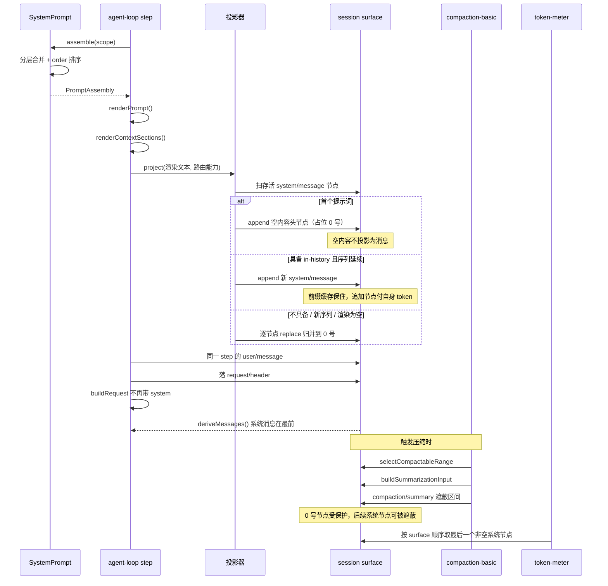
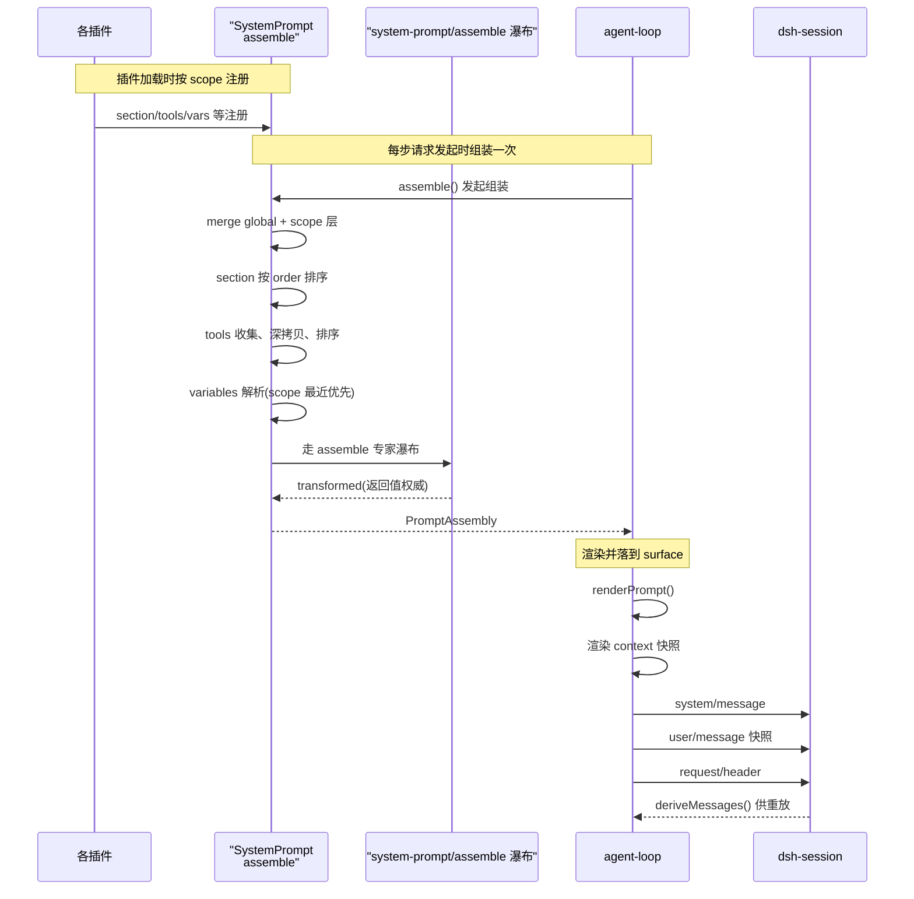

# 系统提示词与工具 Schema 组装

> 子文档之一，聚焦 `@deepseek-ai/dsh-system-prompt`——模型请求的「提示词拼装中枢」。整体哲学见 [README](README.md)；本文上承 [agent-loop-runtime.md](agent-loop-runtime.md)（每 step 发起 `assemble()`）、衔接 [session.md](session.md) 与 [session-format-migration.md](session-format-migration.md)（组装并渲染后的提示词作为 `system/message` surface 第 0 号节点落日志，兑现 Model-visible means logged）。

`system-prompt` 把各插件注册的 section、tool-schema 与 prompt-variable，在每次模型请求前组装成一个有序、可被事件改写的系统提示。去掉它，系统将无统一 system prompt——提示词片段本身就是插件注册的数据（无特权内核），这个拼装职责必须由一个独立模块承担。

## 项目中的角色

`@deepseek-ai/dsh-system-prompt` 是模型请求的「提示词拼装中枢」：它把分散在各插件里注册的 prompt-section、动态 runtime-context、tool-schema 与 prompt-variable，在每次模型请求前组装成一个有序、可被事件改写的 `PromptAssembly`，进而渲染成模型最终看到的 system prompt 与工具清单。

去掉它会怎样：系统将无统一的 system prompt — 要么完全没有提示词，要么每个插件各写各的、顺序混乱、相互覆盖、无法被会话日志统一持久化。因为「无特权内核」要求**提示词片段本身也是插件注册的数据**（设计哲学第 1 条），系统里实际没有一个权威的「总提示词」在启动时写好存某处 — 它是被实时拼出来的，拼装这件事必须由这个模块负责。模块整体很小（`src/` 仅 `index.ts` 630 行 + `invariant.ts` 60 行），但它是所有插件的提示词出口，属于典型的「小而无可替代」部件。

## 根因

插件化框架里「assemble 最终 system prompt」的根本问题有两个：

1. **谁来拼、以什么顺序拼？** 每个插件都只知道自己贡献的那一句提示词（工具说明、执行模式、persona、plan 策略……），互相不知道彼此。需要一个共享注册表 + 一个稳定的排序语义，让「运行时可插拔」和「顺序可控」同时成立。
2. **拼完如何变成可对账、可记录的事实？** session 事件日志是唯一事实源（设计哲学第 2 条，Model-visible means logged），prompt 也必须作为日志事件的一部分被持久化，否则对话重放/恢复时模型看不到曾经说过什么。

`assemble()` 在注册表上做全局 + scope 分层合并、解析、排序，然后放行 `system-prompt/assemble` 专家瀑布（waterfall），把结果交给 agent-loop 渲染并落日志——这样「拼装过程本身也成为一个扩展点」（设计哲学第 5 条）。

## 设计思路

### 分层作用域注册（全局 vs scope）

注册不只是一个扁平 map。`SystemPrompt` 持有 `ScopedLayers`，global 层 + 若干 scope 层（每个 agent 一个 scope）。注册接口 `section()/context()/variables()/tools()` 都带 scope 语义：通过 agent 的 `agent.ctx`（`Agent.ctx`）调用的注册单独落在该 agent 的层，作用域同名的 section 会 shadow（遮蔽）全局同名 section。这是设计哲学「Profile/Bundle/Patch 分层启动」在提示词层面的落地——全局 persona 由部署配置，单 agent 的 persona 由 preset/子代理覆盖。

作用域合并 + 变更广播（`system-prompt/change`）由 `ScopedLayers` 编排：

[packages/core/system-prompt/src/index.ts:415-417]()
<!-- anchor: private readonly layers = new ScopedLayers( … () => { this.ctx.emit('system-prompt/change') }, -->

作用域同名遮蔽（scoped section shadows global）在 `section()` 注册时通过 `layers.effect` 落到对应 scope 层，重复注册在该层内抛错：

[packages/core/system-prompt/src/index.ts:454-461]()
<!-- anchor: section(section: PromptSection): () => void { … { label: 'systemPrompt.section()' }, -->

`ScopedLayers`/`NamedEntries`/`AnonymousEntries` 是 `@deepseek-ai/dsh-scope` 提供的通用分层容器，这里直接复用，不自己造轮子。

### 以 `order` 决定顺序（而非注册/拼接顺序）

`PromptSection` 的核心排序字段是显式的数字 `order`，从小到大拼接；具体数值不再散落在各处，而是由中心分配表 `SECTION_ORDERS` 具名登记（`HARNESS_IDENTITY=-1000`、`DEPLOYMENT_PERSONA_PREFIX=0`，`500–9900` 是第一方可复用指令，本地环境事实被推到 `10000` 之后，见下文「环境事实后置」）。贡献方只写 `getSectionOrder('TOOL_BASH')` 这类语义名，不写魔法数字。这种「具名槽位 + 中心分配」的模式，允许多个无关插件各自选一个相对位置插入，互不依赖注册时间顺序，也避免了范围约定被口头维护而漂移。

[packages/core/system-prompt/src/index.ts:125-159]()
<!-- anchor: const SECTION_ORDERS = { … } as const -->

注册入参本身的排序字段定义：

[packages/core/system-prompt/src/index.ts:52-75]()
<!-- anchor: /** One contributed section of the system prompt (registry input). */ … readonly complete?: boolean -->

排序在 `assemble()` 里对合并后的 section 显式按 order 排序（同序再按 section 名字典序，保证跨机器确定）：

[packages/core/system-prompt/src/index.ts:596-596]()
<!-- anchor: const sectionDefinitions = [...sectionByName.values()].sort(comparePromptSection -->

### persona 槽位是「同一名字、可替换」的约定

> **演进说明（0.1.3-alpha.2）**：旧版只有一个 `PERSONA_SECTION = 'deployment:persona'`（`PERSONA_ORDER = 0`）槽位。`fix(system-prompt): keep model persona prefix and place cwd in suffix` 把它拆成前缀与后缀两个槽位：模型名称介绍留在前缀（`0`），`Your working directory is {{cwd}}.` 一类随工作区而变的环境事实后移到后缀（`10200`）。

`PERSONA_PREFIX_SECTION = 'deployment:persona-prefix'` 与 `PERSONA_SUFFIX_SECTION = 'deployment:persona-suffix'` 是两个导出常量，供 composition 分别替换这两个槽位。agent preset 用自己的 persona 注册同名 section，靠「同名遮蔽」实现替换而非追加重复：

[packages/core/system-prompt/src/index.ts:174-182]()
<!-- anchor: * The deployment persona prefix's section name. Exported because a … export const PERSONA_SUFFIX_SECTION = 'deployment:persona-suffix' -->

注册表自身在构造时无条件注册这两个槽位，全局配置项也随之从单一 `persona` 变成 `personaPrefix` / `personaSuffix`（均默认空）：

[packages/core/system-prompt/src/index.ts:432-441]()
<!-- anchor: this.section({ … text: config.personaSuffix ?? '', -->

`preset/persona` 插件直接 import 这两个常量来注册自己的 persona：`prefix` 必填、`suffix` 默认空——省略或为空的作用域 `suffix` 会遮蔽掉全局后缀，而不是回落到它：

[packages/preset/persona/src/index.ts:62-73]()
<!-- anchor: export function apply(ctx: Context, config: Config): void { … }), 'persona.suffix()') -->

### 环境事实后置：可复用指令在前、环境后缀在后

> **演进说明（0.1.3-alpha.2）**：`fix(system-prompt): place environment facts after reusable instructions`。旧版把 `HARNESS_SOURCE=-900`、`WEB_SURFACE=-800` 排在 persona 与全部工具引导之前；本次把它们整体移到可复用指令之后。

这是一处**纯为提示缓存前缀命中服务**的排序调整，也是最值得跨项目迁移的一条经验。本地 Web URL、harness checkout 路径与会话 cwd 都因用户与机器而异；把它们放在提示词前部，会让「其余内容完全相同」的提示词在开头附近就出现字节差异，从而缩短可供同模型复用的前缀。因此第一方位置策略是：固定 harness 身份（`-1000`）与携带模型名称介绍的 persona 前缀（`0`）留在最前——同模型之间这两段一致，不破坏复用；截至 `STRUCTURED_OUTPUT=9900` 的都是可复用指令；只有真正每会话／每机器变化的三段被推到末尾：

[packages/core/system-prompt/src/index.ts:155-158]()
<!-- anchor: // Local paths and endpoints follow reusable instructions. … DEPLOYMENT_PERSONA_SUFFIX: 10200, -->

交付组合已经按这条策略重排：web/headless/SDK/ACP bundle 与 standard/PTC/Cordis preset 都只把 `Your working directory is {{cwd}}.` 放进 `personaSuffix` / `suffix`，而把「模型名称介绍」留在前缀（`{{model}}` 由 `dsh-agent-loop` 注册的 prompt 变量解析）：

[packages/bundle/web-app/cordis.patch.yml:16-20]()
<!-- anchor: - id: system-prompt … personaPrefix: >- -->

[packages/bundle/web-app/presets/standard.patch.yml:14-15]()
<!-- anchor: suffix: Your working directory is {{cwd}}. … prefix: You are a coding agent powered by the {{model}} model. -->

> **演进说明（0.1.7-rc.2）**：独立的 `dsh-agent-presets` 包与 `presets/standard/agent.cordis.yml` 已下线，preset 声明改为随 bundle 下发（web 面的 standard/PTC/Cordis 分别是 `packages/bundle/web-app/presets/{standard,ptc,cordis}.patch.yml`）；「cwd 进 suffix、模型名称介绍留 prefix」这条策略不变。

两个环境事实段的贡献方也各自取用具名槽位。harness 源码段把 checkout 路径与「当前工作目录」显式区分开（避免模型用源码路径推断 cwd）：

[packages/boot/app-boot/src/index.ts:1059-1063]()
<!-- anchor: const systemPrompt = ctx.get('systemPrompt') … order: systemPrompt.getSectionOrder('HARNESS_SOURCE'), -->

Web 表层段则按当前监听地址渲染本地 URL：

[packages/bundle/web-app/src/index.ts:236-239]()
<!-- anchor: promptCtx.systemPrompt.section({ … text: () => webSurfacePrompt(localWebUrl(promptCtx)), -->

**权衡与边界**：这是「第一方位置策略」，不是通用稳定前缀保证——任意插件仍可按自己的 `order` 插入、组装监听器仍可改写瀑布输出。上游也明确**不测量、不承诺**提供方共享缓存或命中率提升；能确定的只是「同模型、同 persona 前缀、同工具与前置指令时，不同源码路径、本地 URL 或 cwd 不再改变可复用的第一方前缀」。被否决的替代方案同样有信息量：把**整个** persona 后移会把模型名称介绍也移出前部，对「同模型复用」毫无帮助；只移动源码路径与 Web URL 则不够，因为 cwd 仍嵌在靠前的 persona 文本里，会继续打断前缀；把环境事实改成 runtime-context 消息则改变了消息角色与持久化位置。

### `complete` 标记：某个 section 独占整条 prompt

`PromptSection.complete` 允许一个 section 声明自己是「完整 prompt」：assembly 仍会跑合作瀑布让 tools/contexts/variables 解析完成，但最终只保留这一个 section 作为唯一 prompt section。多个有效 complete section 会直接 fail assembly（拒绝歧义）。这是一个「声明式短路」——用于特殊 persona（如隐藏所有默认指令）时，不需要先禁用所有其他插件。拆出前后缀后，`complete` 只保留**前缀**，后缀与其他所有段落一并被抑制。

单 section 的 `complete?: boolean` 定义：

[packages/core/system-prompt/src/index.ts:70-75]()
<!-- anchor: * Treat this contribution as the complete system prompt. Assembly still … readonly complete?: boolean -->

多个 complete 时报错、以及事后恢复唯一 section 的决策：

[packages/core/system-prompt/src/index.ts:597-609]()
<!-- anchor: const completeSections = sectionDefinitions.filter(section => section.complete = … if (section.complete === true) completeSection = { ...assembled } -->

### tool-schema 如何并入：provider + 显式排序 + 参数深拷贝

工具不全走 section，走独立的 `tools(provider)` 通道，provider 每次 assembly 都会求值。返回值是 `ToolProviderResult`：`schemas`（本 assembly 对模型可见的 schema）+ `knownNames`（限制前的名字全集，用于区分「配置名字笔误」和「该 scope 中故意隐藏的已知工具」）。这样做是因为工具 schema 是强结构（JSON Schema 参数），不宜作为纯文本 section 拼接，也不需要每次渲染重拼文本，只须收集并排序。

[packages/core/system-prompt/src/index.ts:106-111]()
<!-- anchor: /** Tool schemas visible in one assembly and their pre-restriction name set. */ … readonly knownNames?: readonly string[] -->

工具最终顺序由 `toolOrder` 配置显式控制：配置按序列出模型可见的工具名，未穷举的工具在 `<unlisted-tools>` 占位符处按字典序插入；`toolOrder` 必须恰好含一次 rest 占位符，未注册的名字在 assembly 时失败：

[packages/core/system-prompt/src/index.ts:191-207]()
<!-- anchor: export const TOOL_ORDER_REST = '<unlisted-tools>' … return toolOrder -->

工具 schema 在收集时用 `structuredClone(parameters)` 深拷贝——把 parameters 从 provider 生命周期里 detach 出来，避免 assembly 结果持有 provider 内部的可变引用。排序发生在 detach 之后：

[packages/core/system-prompt/src/index.ts:584-594]()
<!-- anchor: for (const provider of providers) { … for (const name of acceptedKnownNames) knownNames.add(name) -->

orderTools 执行配置序、未知名失败、rest 处字典序补尾：

[packages/core/system-prompt/src/index.ts:215-227]()
<!-- anchor: function orderTools(tools: ToolSchema[], toolOrder: string[] | undefined, knownN … return toolOrder.flatMap(name => -->

工具提供者由谁注册：`dsh-tools` 服务构造函数里注册 `tools` provider，并在部署默认呈现模式不是 `native` 时注册配套的 collapse/SDK section（`presentAs()` 还会为单个 scope 补注册同一对 section），让 tools 包的接入方通过 system-prompt 模块统一对模型可见：

[packages/core/tools/src/index.ts:854-857]()
<!-- anchor: ctx.systemPrompt.tools(context => this.wireSchemas(context.scope)) … ctx.systemPrompt.section(this.sdkSection()) -->

各类工具自己贡献 prompt section，命名 `tool:*`，并统一经 `getSectionOrder()` 取用中心分配的具名槽位（bash `TOOL_BASH=1000`、lsp `TOOL_LSP=2200`、cordis `TOOL_CORDIS=2500`）。代码 executor 的「collapse」规则取 `PTC_ONLY=800`（先于全部工具引导，否则模型会读到一份只有 `run_code` 可用的工具目录却仍发原生调用），生成的 SDK section 取 `TOOLS_SDK=5000`：

[packages/core/tools/src/index.ts:879-879]()
<!-- anchor: order: this.ctx.systemPrompt.getSectionOrder('PTC_ONLY'), -->

[packages/core/tools/src/index.ts:899-899]()
<!-- anchor: order: this.ctx.systemPrompt.getSectionOrder('TOOLS_SDK'), -->

> **演进说明（0.1.7-rc.2）**：`TOOL_CORDIS=2500` 槽位与 tool-cordis 的提示词 section 已下线——`SECTION_ORDERS` 里不再有该名字，`packages/extensions/tool-cordis` 也不再调用 `systemPrompt.section()`；原位置前后改为给 `TOOL_COMPUTER_USE`、`MCP_SERVERS` 等新槽位让位：

[packages/core/system-prompt/src/index.ts:149-151]()
<!-- anchor: TOOL_REPORT: 2900, … MCP_SERVERS: 3100, -->

### prompt 与 session 日志的关系（Model-visible means logged）

> **演进说明（0.1.5-alpha.1）**：旧版把渲染后的 prompt 存进 `EpochHeader.system`（session 的 request header 快照），动态 runtime-context 走 plugin snapshot `user/message`。`refactor(session): represent the system prompt as surface node zero` 之后 prompt 改为普通 surface 事件 `system/message`；`feat(session-format): migrate V2 prompts into V3 system surfaces` 让 V3 格式把 V2 的 `header.system` 迁移进 system surface（细节见 [session-format-migration.md](session-format-migration.md)）。本文关注的组装逻辑也随之从「渲染进 header」变成「投影到 surface」。

现在模型看到的一切都在 surface 上：`system/message`、`user/message`、`assistant/message`、`tool/result` 四类事件按 seq 折叠即协议消息序列，系统消息在最前。`EpochHeader` 因此收缩为 `{ config, adapterDefaults?, tools? }`——**不再有 `system` 字段**，期望该字段的读取方会在编译期失败：

[packages/core/session/src/types.ts:235-246]()
<!-- anchor: * Logged request state outside derived history: call config and tools. The … tools?: ToolSchema[] -->

`system/message` 的载荷与 `tool/result` 对称（`{ turn, step, message }`），`message` 是 role 为 `system` 的文本消息，source 标为受控的 `{ kind: 'system-prompt' }`。空 `content` 记录「没有系统提示词」：节点保住 surface 位置，但派生消息为 `null`、不贡献协议消息：

[packages/core/session/src/types.ts:330-330]()
<!-- anchor: 'system/message': { turn: number; step: number; message: SystemMessage } -->

0.1.7-rc.2 的会话格式版本 4 取消了旧的 catch-all `plugin` kind（旧的 `{ kind: 'plugin', plugin: '@deepseek-ai/dsh-system-prompt' }` 写进日志会被拒收）：生产者改为各自在 merge-extensible 的 `MessageSourceMap` 里声明 `kind`，system-prompt 插件按消息角色分派为 `system-prompt`（提示词）与 `runtime-context`（动态上下文快照）：

[packages/llm/llm/src/message.ts:105-115]()
<!-- anchor: * vocabulary. Merge-extensible sum type — each producer declares its own … 'system-prompt': SystemPromptMessageSource -->

[packages/core/agent-loop/src/runtime-context.ts:13-19]()
<!-- anchor: declare module '@deepseek-ai/dsh-llm' { … const SOURCE = 'runtime-context' -->

[packages/core/session/src/types.ts:89-89]()
<!-- anchor: export const SESSION_FORMAT_VERSION = 4 -->

第 0 号节点受 surface 管理器保护——当它持有系统提示词时，只有「恰好覆盖该节点的 `system/message` 替换」能改写它，压缩区间无法遮蔽它（更靠后的系统节点没有这层保护）：

[packages/core/session/src/surface.ts:499-510]()
<!-- anchor: function assertSystemHeadRewrite( … if (event.type !== 'system/message' || shadowedSeqs.length !== 1) { -->

`request/header` 仍在，但语义收窄为 config 与 tools 的快照，并靠 `startsSeries` 标记「头部改写之后开启新消息序列」，从而在不再比较 `system` 字段的前提下让循环识别提示词变更：

[packages/core/session/src/types.ts:391-394]()
<!-- anchor: header: EpochHeader … startsSeries?: true -->

### 一次请求的系统提示词：组装 → surface 落地 → 压缩后重放

`SystemPromptProjection` 与 `RuntimeContextProjection` 并列，都由 `dsh-agent-loop` 拥有（`packages/core/agent-loop/src/runtime-context.ts`）；两者的差别在于观察 surface 的方式：runtime-context 跟随 `session/event` 观察自己拥有的 user 角色快照且只做追加，系统提示词则在每次投影时重扫当前 surface 上的系统节点，因为它的决定取决于「有多少节点存活」，并按路由选择追加或替换。

### 历史内替换：capable route 上追加、其余路由上归并

> **演进说明（0.1.5-alpha.1）**：`feat(agent-loop): append system prompt changes on capable routes`，以及随后的 `fix(agent-loop): admit prompts under the prepared route`、`fix(agent-loop): reserve the initial empty system head`、`fix(agent-loop): reconcile prompts after retry compaction`、`fix(agent-loop): clear every retained system instruction`、`fix(agent-loop): clear noncanonical retained system content` 共同收紧这套准入/协调规则。

提示词变更过去必然重写消息 0，于是提供方前缀缓存从第一个 token 起失效；而 agent 会话里 plan 片段进出、skill／工具引导完成注册、作用域 persona 遮蔽、`{{model}}` 变量变化都会触发变更，长会话反复为此付费。`dsh-llm` 为此引入逐路由能力标记 `SystemPromptUpdate = 'in-history'`——声明它的模型会把对话任意位置的最新 `system` 消息当作完整有效提示词：

[packages/llm/llm/src/types.ts:390-418]()
<!-- anchor: * How a model applies a system prompt that changes mid-conversation. … systemPromptUpdate?: SystemPromptUpdate -->

[packages/llm/llm-deepseek/src/models.ts:8-13]()
<!-- anchor: id: 'deepseek-flash', … toolUpdate: 'addition-only', -->

同一条 catalog 条目还声明 `toolUpdate: 'addition-only'`：工具声明的新增走同一套历史内机制，跟在缓存历史之后，而不是重写整份声明列表。

准入是**按已准备好的调用**决定的（`PreparedLlmCall.systemPromptUpdate`），不是按上一次请求的快照——因此首次请求、恢复的会话、路由切换与同路由能力变化都用真正服务该调用的适配器能力；模式同时被记进 `request/context`。投影器 `project()` 每次调用都重扫当前 surface 上存活的 `system/message` 节点（因此同一步骤内更早运行的压缩已被反映），按路由能力与序列事实返回有序的逐节点提交：

[packages/core/agent-loop/src/runtime-context.ts:88-103]()
<!-- anchor: project(rendered: string, input: SystemPromptDecisionInput): SystemPromptCommit[] … return [{ message: createSystemMessage(rendered), intent: { surfaceOp: 'append' } }] -->

规则可归纳为四条：

- 没有存活系统节点时，**即使渲染文本为空也预留头节点**——否则首个被接纳的 user 消息会占住 0 号位，之后的非空提示词只能追加在用户历史之后，不具备历史内能力的适配器会把它降级成 user 内容；
- 具备能力**且**请求序列延续时**追加**新节点，前缀缓存因此在序列内保持热态；
- 不具备能力、新序列开始（pre-step 声明、surface 替换代数前移、工具 schema 变化）或渲染为空时**归并**到 0 号节点（先逐个清空后续生效节点，再按需重写头部）；
- **清空意味着清空所有生效版本**——只清新的节点会让更早的指令复活（包括已被适配器降级成 user 文本的旧指令）；空节点保持休眠，既不提供有效文本、也不需要重复替换。

循环在 `agent/request` + `prepareCall()` 之后、提交任何输入之前完成协调与落库，重试不重复组装、不重复接纳用户消息，并在重试压缩后把提示词重新协调到当前 surface：

[packages/core/agent-loop/src/agent.ts:392-408]()
<!-- anchor: const startsRequestSeries = firstAttempt && decision.startsRequestSeries === true … const request = this.buildRequest(config, preparedCall, assembly.tools, { turn, step }, startsRequestSeries, signal) -->

代价与边界：追加的节点在该序列的每个请求上都要付出自身 token，直到压缩遮蔽它；因此「提示词几乎每步都变」的部署更适合把那个事实移进 runtime-context 快照。另一面收获是日志可区分性——prompt 变更表现为对 0 号节点的 `system/message` 替换（其后跟随 `series` reason 的 header），工具/config 变更则表现为 reason 为 `change` 的 `request/header`。

### 压缩与 token-meter：派生的 system head 如何被重放与归类

压缩不把系统提示词当独立字段搬运，而是**复用 surface 派生**：范围选择锚定在首个非系统节点上，0 号节点因此永不落入压缩区间（更靠后的系统节点按设计可被遮蔽）；摘要输入把派生的头节点消息前置到 `messages`，再按 surface 顺序加入被遮蔽节点的派生消息——摘要调用于是仍是对话的真实前缀，能继续复用提供方 KV 缓存。`refactor(compaction): replay the derived system head as a message` 之前这里还传一个单独的 `SummarizationInput.system` 字符串、由适配器再拼回同一条 wire 消息；现在这条值由 session 派生一次、直接作为消息重放（空内容头节点派生为 `null`，不贡献消息但节点仍受保护）：

[packages/compaction/compaction-basic/src/region.ts:117-131]()
<!-- anchor: export function selectCompactableRange( … const firstIdx = systemHead(session, surfaceNodes[0]!) === undefined ? 0 : 1 -->

[packages/compaction/compaction-basic/src/region.ts:544-561]()
<!-- anchor: function buildSummarizationInput( … messages: system === null ? regionMessages : [system, ...regionMessages], -->

token-meter 侧是同一条原则的延伸。`fix(token-meter): classify surviving prompts in surface order` 之前用标量「影子价」记账：压缩移除最新系统节点时无法把更早的有效提示词恢复出来，从 messages 桶里减去该价会让已发布计数永久为负。现在改为按 **surface 顺序**取最后一个非空存活系统节点计入 `systemTokens`，其余可见节点（含被取代的 prompt）计入 `messageTokens`；代价是把 O(1) 的标量检查点换成 O(当前保留 surface) 的紧凑条目（state 版本 4），换来任意替换/压缩之后分类都可重算：

[packages/llm/token-meter/src/breakdown-projection.ts:63-75]()
<!-- anchor: if (!isSurfaceEvent(event)) return state … return { nodes, breakdown } -->

## 关键数据结构

- `PromptSection`（注册输入）[packages/core/system-prompt/src/index.ts:52-75]()：`name` + `order` + `text`（静态串或 provider 函数）+ 可选 `complete`。
<!-- anchor: /** One contributed section of the system prompt (registry input). */ … readonly complete?: boolean -->
- `PromptContext`（[packages/core/system-prompt/src/index.ts:78-85]()）：与 section 同结构的动态上下文贡献，但独立注册、渲染成 user-role snapshot。
<!-- anchor: /** Dynamic model context materialized as a durable user-role snapshot. */ … readonly text: string | ((context: AssembleContext) => string) -->
- `PromptAssembly`（组装结果，[packages/core/system-prompt/src/index.ts:115-122]()）：`sections[]` + `contexts[]` + `tools[]` + `variables`，是瀑布的输入/输出与 agent-loop 的消费对象。
<!-- anchor: * Merge-extensible assembled model input. Sections and contexts remain … variables: Record<string, string | undefined> -->
- `AssembledSection/AssembledContext`（[packages/core/system-prompt/src/index.ts:88-102]()）：已解析但未插值的文本。
<!-- anchor: /** One section of an assembly: {@link PromptSection} with its text resolved. */ … /** The resolved text before variable interpolation. */ -->
- `ToolProviderResult`（[packages/core/system-prompt/src/index.ts:106-111]()）：本 assembly 可见 schema + 限制前名字全集。
<!-- anchor: /** Tool schemas visible in one assembly and their pre-restriction name set. */ … readonly knownNames?: readonly string[] -->
- `PromptLayer`（[packages/core/system-prompt/src/index.ts:370-400]()）：一个 global/scope 层内全部注册。
<!-- anchor: /** All prompt registrations owned by one global or scoped layer. */ … && this.variables.isEmpty() -->
- `AssembleContext`（[packages/core/system-prompt/src/index.ts:41-50]()）：一次 assembly 的 `{ scope?, signal? }`，merge-extensible（agent 包扩展出其 `Agent` 字段）。
<!-- anchor: /** Merge-extensible context for one prompt assembly. */ … /** Explicit control signal for the turn that requested this assembly, when any. -->

## 核心流程

流程中带行号的标注：

- agent-loop 在提出 step 前立即调用 `assemble()`，并把动态上下文投影为同一步的保留用户消息：

[packages/core/agent-loop/src/agent.ts:272-275]()
<!-- anchor: const assembly = await this.loopCtx.systemPrompt.assemble(assembleContextFor(thi … const context = this.runtimeContext.project(joinContextSections(sections), secti -->

- 渲染提示词并投影为 `system/message` surface 节点（同一 step 的 user 消息之前提交，因此日志顺序即协议顺序）：

[packages/core/agent-loop/src/agent.ts:388-400]()
<!-- anchor: const renderedPrompt = renderPrompt(assembly) … this.session.append('system/message', { turn, step, message }, intent) -->

- config + 工具 schema 落 `request/header`（不再含 `system`），并按 initial/resume/change/series 四种 reason 区分：

[packages/core/agent-loop/src/agent.ts:592-616]()
<!-- anchor: const header = canonicalHeader({ … this.session.append('request/header', { header, reason: 'series' }) -->

- `assembleContextFor` 把 agent + scope 一起放进上下文，保证 agent 级贡献不被静默遗漏：

[packages/core/agent/src/dispatch.ts:167-176]()
<!-- anchor: * Build the prompt assembly context with agent and scope set together, so … export function assembleContextFor(agent: Agent, signal?: AbortSignal): Assemble -->

- `agent` 字段经模块合并扩展进 `AssembleContext`（declare module）——assembly 期间可读到是哪个 agent：

[packages/core/agent/src/runtime-types.ts:18-23]()
<!-- anchor: declare module '@deepseek-ai/dsh-system-prompt' { … agent?: Agent -->

## 与其他模块协同

- **agent-loop（发起方/消费方）**：`agent.ts` 每 step 调 `assemble()`，消费返回的 `PromptAssembly`（sections→渲染后的 system 文本、contexts→snapshot、tools→请求 tools）；渲染结果经 `SystemPromptProjection` 投影为 `system/message` surface 节点，config/tools 写入 `request/header` 事件（0.1.5-alpha.1 起请求本身不再携带 `system` 字段）。
- **dsh-scope（分层作用域）**：整个注册机制建立在 `ScopedLayers`/`NamedEntries` 上，遮蔽/合并由它负责（（跨模块边界：另见相应子文档）`ScopedLayers.merge`/`chainLayers` 的具体语义在 `packages/core/scope`）。
- **dsh-session（持久化事实源）**：`system/message`（surface 第 0 号节点）与 plugin snapshot `user/message` 由 system-prompt 产出、session 负责 append 与头部保护；`EpochHeader` 只保留 config/tools/adapterDefaults；`deriveMessages()` 从同一 surface 重放出历史（系统消息在最前），供下一次 request。
- **dsh-llm（schema 类型 + context snapshot 类型 + 路由能力）**：`ToolSchema`、`ContextSnapshotSection`、`SystemPromptUpdate` 类型来自 llm 包（import 于 [index.ts:11]()）。（跨模块边界：另见相应子文档）`Model-visible means logged` 在 llm streaming/历史推导侧的消费细节见 data-model 模块。
- **model-selection（assembly 时快照可变选择）**：`installModelSelection` 监听 `system-prompt/assemble` 瀑布，把 provider/model/effort 快照写回 `assembly.variables`，实现「prompt 变量随路由选择」：

[packages/core/agent/src/model-selection.ts:82-90]()
<!-- anchor: const disposeAssembly = agentCtx.on('system-prompt/assemble', async (_assembly, … ...assembled.variables, -->

- **invariant（配套校验）**：`invariant.ts` 以 prepend 的全局瀑布监听器校验瀑布输出的 assembly 完整性（无重复 name、无空 name、variable 名合法），把「合作拼装结果必须自洽」变成运行时不变量：

[packages/core/system-prompt/src/invariant.ts:46-52]()
<!-- anchor: const install: InvariantInstaller = (ctx, fail) => { … }, { global: true, prepend: true }) -->

## 关键设计决策

### 决策一：为什么用显式 `order` 而非「注册/拼接顺序」

若依赖注册顺序，后果有二：顺序被插件加载时间隐式决定（插件加载顺序是启动编排的副产物，非提示词语义）；且任一插件晚注册都会把后注册的 section 排到更后，无法表达「我想插在最前」。显式数字 `order` 让每个 section 自描述它在提示词中的相对位置，且数值由 `SECTION_ORDERS` 中心分配成具名槽位（`HARNESS_IDENTITY=-1000`、`DEPLOYMENT_PERSONA_PREFIX=0`、工具引导 `1000–2900`、环境后缀 `10000+`），贡献方只写 `getSectionOrder('TOOL_BASH')`，无需任何插件知道其他插件。代价是新增位置要在中心表登记一次（比随手写数字多一步），换来的是数值范围不再靠口头约定维持、也不再有「range 漂移」；同序冲突则以 section 名字典序确定性排定。

### 决策二：tools 不走 section、独立通道，为何不冲突

工具若当普通 section 拼，就得把它列进 sections 的顺序里，而工具的 JSON Schema 本身不适合当文本、且数量不定、需要与「模型 request.tools」同构。把它独立成 `tools(provider)`，最后与 sections 一起进 `PromptAssembly`（并在 `request/header` 持久化），则「提示词顺序」和「工具可见性/顺序」解耦：tools 有自己的 `toolOrder` 配置 + rest 字典序，不挤占 prompt 的文序槽位。冲突由「两套顺序各管一维」避免。tradeoff：`assemble()` 因此要同时维护 sections 和 tools 两套排序逻辑（`comparePromptSections` 与 `orderTools()`），复杂度略升，但换来语义清晰。

### 决策三：模块这么小（~600 行）为何自成一包

因为它不是一段代码，而是一个「被所有插件依赖的注册面 + 一个被 agent-loop 依赖的组装契约」。独立成包（`@deepseek-ai/dsh-system-prompt`）意味着：a) `dsh-agent`/`dsh-agent-loop` 通过模块合并扩展其 `AssembleContext`，b) 大量工具/预设包能 import 它导出的 `PERSONA_PREFIX_SECTION`/`PERSONA_SUFFIX_SECTION`（人设槽位契约），而无需反向依赖 agent 包——避免环依赖；c) 它的配套 invariant 能独立挂载。这是「capability seam」的又一实例：用独立包把「拼装提示词」这个能力切成可单独演化、可被多家插件共同持有的接口。小包反而承载最大扇出依赖。

## 全局关联：小包的「扇出依赖」是哲学落点

system-prompt 虽只 ~600 行却自成一包，因为它不是一段代码，而是一个「被所有插件依赖的注册面 + 一个被 agent-loop 依赖的组装契约」——小包反而承载最大扇出依赖。`SECTION_ORDERS` 具名槽位 + `tools(provider)` 独立通道让「提示词顺序」与「工具可见性顺序」两套语义各管一维，互不挤占；再经 `system/message` surface 第 0 号节点（以及 runtime-context 的 plugin snapshot `user/message`）落日志，兑现 `Model-visible means logged`（与 [session.md](session.md) 呼应）。它是「整体哲学第 5 条：事件扩展点」在提示词面的体现——`system-prompt/assemble` 专家瀑布和 invariant 前置监听让拼装过程本身也可被插件改写；而「环境事实后置 + capable route 追加」这组位置策略则说明：即便在完全可插拔的注册表里，第一方仍可以用**位置约定**为缓存这类跨模块利益服务，而不必把策略写进内核。
