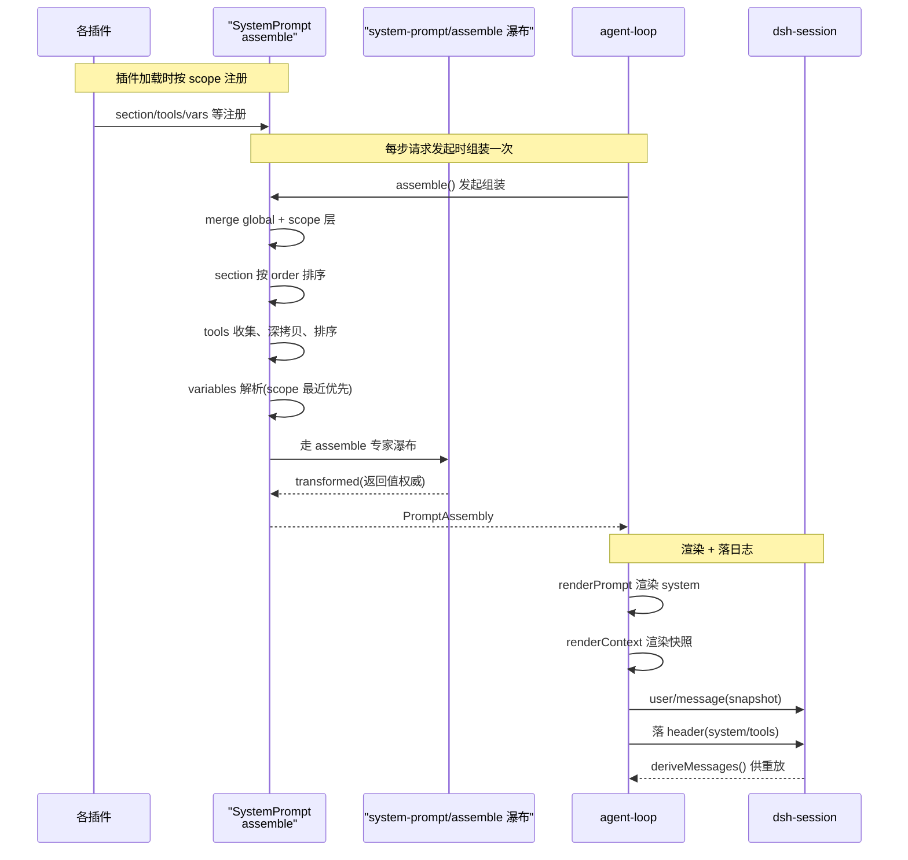

# 系统提示词与工具 Schema 组装

> 子文档之一，聚焦 `@deepseek-ai/dsh-system-prompt`——模型请求的「提示词拼装中枢」。整体哲学见 [README](README.md)；本文上承 [agent-loop-runtime.md](agent-loop-runtime.md)（每 step 发起 `assemble()`）、衔接 [session.md](session.md)（组装结果经 `request/header` 落日志，兑现 Model-visible means logged）。

`system-prompt` 把各插件注册的 section、tool-schema 与 prompt-variable，在每次模型请求前组装成一个有序、可被事件改写的系统提示。去掉它，系统将无统一 system prompt——提示词片段本身就是插件注册的数据（无特权内核），这个拼装职责必须由一个独立模块承担。

## 项目中的角色

`@deepseek-ai/dsh-system-prompt` 是模型请求的「提示词拼装中枢」：它把分散在各插件里注册的 prompt-section、动态 runtime-context、tool-schema 与 prompt-variable，在每次模型请求前组装成一个有序、可被事件改写的 `PromptAssembly`，进而渲染成模型最终看到的 system prompt 与工具清单。

去掉它会怎样：系统将无统一的 system prompt — 要么完全没有提示词，要么每个插件各写各的、顺序混乱、相互覆盖、无法被会话日志统一持久化。因为「无特权内核」要求**提示词片段本身也是插件注册的数据**（设计哲学第 1 条），系统里实际没有一个权威的「总提示词」在启动时写好存某处 — 它是被实时拼出来的，拼装这件事必须由这个模块负责。模块整体很小（`src/` 仅 `index.ts` 545 行 + `invariant.ts` 60 行），但它是所有插件的提示词出口，属于典型的「小而无可替代」部件。

## 根因

插件化框架里「assemble 最终 system prompt」的根本问题有两个：

1. **谁来拼、以什么顺序拼？** 每个插件都只知道自己贡献的那一句提示词（工具说明、执行模式、persona、plan 策略……），互相不知道彼此。需要一个共享注册表 + 一个稳定的排序语义，让「运行时可插拔」和「顺序可控」同时成立。
2. **拼完如何变成可对账、可记录的事实？** session 事件日志是唯一事实源（设计哲学第 2 条，Model-visible means logged），prompt 也必须作为日志事件的一部分被持久化，否则对话重放/恢复时模型看不到曾经说过什么。

`assemble()` 在注册表上做全局 + scope 分层合并、解析、排序，然后放行 `system-prompt/assemble` 专家瀑布（waterfall），把结果交给 agent-loop 渲染并落日志——这样「拼装过程本身也成为一个扩展点」（设计哲学第 5 条）。

## 设计思路

### 分层作用域注册（全局 vs scope）

注册不只是一个扁平 map。`SystemPrompt` 持有 `ScopedLayers`，global 层 + 若干 scope 层（每个 agent 一个 scope）。注册接口 `section()/context()/variables()/tools()` 都带 scope 语义：通过 agent 的 `agent.ctx`（`Agent.ctx`）调用的注册单独落在该 agent 的层，作用域同名的 section 会 shadow（遮蔽）全局同名 section。这是设计哲学「Profile/Bundle/Patch 分层启动」在提示词层面的落地——全局 persona 由部署配置，单 agent 的 persona 由 preset/子代理覆盖。

作用域合并 + 变更广播（`system-prompt/change`）由 `ScopedLayers` 编排：

[packages/core/system-prompt/src/index.ts:398-402]()
<!-- anchor:  private readonly layers = new ScopedLayers(
    scope => new PromptLayer(scope),
    () => { this.ctx.emit('system-prompt/change') },
  ) -->

作用域同名遮蔽（scoped section shadows global）在 `section()` 注册时通过 `layers.effect` 落到对应 scope 层，重复注册在该层内抛错：

[packages/core/system-prompt/src/index.ts:432-449]()
<!-- anchor:  section(section: PromptSection): () => void {
    if (!Number.isFinite(section.order)) {
      throw new TypeError(`prompt section "${section.name}" order must be a finite number`)
    }
    return this.layers.effect(
      this.ctx,
      layer => layer.sections.insert(section.name, section),
      { label: 'systemPrompt.section()' },
    )
  } -->

`ScopedLayers`/`NamedEntries`/`AnonymousEntries` 是 `@deepseek-ai/dsh-scope` 提供的通用分层容器，这里直接复用，不自己造轮子。

### 以 `order` 决定顺序（而非注册/拼接顺序）

`PromptSection` 的核心排序字段是显式的数字 `order`，从小到大拼接。约定 `-100` 是 harness identity、`0` 是 deployment persona、tool guidance 用 `100–199`、其他负数也渲染在 persona 之前。这种「语义槽位 + 数字微调」的模式，允许多个无关插件各自选一个相对位置插入，互不依赖注册时间顺序。

[packages/core/system-prompt/src/index.ts:52-75]()
<!-- anchor:  /** One contributed section of the system prompt (registry input). */
export interface PromptSection {
  /** Unique name — a duplicate registration throws (see {@link SystemPrompt.section}). */
  readonly name: string
  /**
   * Sections are concatenated in ascending order. Convention: `-100` is the
   * harness identity, `0` the deployment persona -->

排序在 `assemble()` 里对合并后的 section 显式按 order 排序：

[packages/core/system-prompt/src/index.ts:504]()
<!-- anchor:    const sectionDefinitions = [...sectionByName.values()].sort((a, b) => a.order - b.order) -->

### persona 槽位是「同一名字、可替换」的约定

`PERSONA_SECTION = 'deployment:persona'` 与 `PERSONA_ORDER = 0` 是导出常量，供 composition 替换这一个槽位。agent preset 用自己的 persona 注册同名 section，靠「同名遮蔽」实现替换而非追加重复：

[packages/core/system-prompt/src/index.ts:172-181]()
<!-- anchor:  export const PERSONA_SECTION = 'deployment:persona'
/** Prompt order of the persona slot; the first section a model reads. -->
  export const PERSONA_ORDER = 0 -->

`preset/persona` 插件直接 import 这两个常量来注册自己的 persona，保证「名同」才屏蔽「槽同」：

[packages/preset/persona/src/index.ts:56-63]()
<!-- anchor: export function apply(ctx: Context, config: Config): void {
  ctx.effect(() => ctx.systemPrompt.section({
    name: PERSONA_SECTION,
    order: PERSONA_ORDER,
    text: config.text,
    ...(config.complete ? { complete: true } : {}),
  }), 'persona.section()')
  if (!(config.includeRuntimeContext ?? true)) ctx.systemPrompt.suppressRuntimeContext()
} -->

### `complete` 标记：某个 section 独占整条 prompt

`PromptSection.complete` 允许一个 section 声明自己是「完整 prompt」：assembly 仍会跑合作瀑布让 tools/contexts/variables 解析完成，但最终只保留这一个 section 作为唯一 prompt section。多个有效 complete section 会直接 fail assembly（拒绝歧义）。这是一个「声明式短路」——用于特殊 persona（如隐藏所有默认指令）时，不需要先禁用所有其他插件。

单 section 的 `complete?: boolean` 定义：

[packages/core/system-prompt/src/index.ts:68-74]()
<!-- anchor:   /**
   * Treat this contribution as the complete system prompt. Assembly still
   * runs the cooperative waterfall so tools, contexts, and variables can be
   * resolved, then restores this exact section as the sole prompt section.
   * More than one effective complete section makes assembly fail.
   */
  readonly complete?: boolean -->

多个 complete 时报错、以及事后恢复唯一 section 的决策：

[packages/core/system-prompt/src/index.ts:574-587]()
<!-- anchor:    const completeSections = sectionDefinitions.filter(section => section.complete === true)
    if (completeSections.length > 1) {
      throw new Error(`multiple complete prompt sections are active: ${completeSections.map(section => JSON.stringify(section.name)).join(', ')}`)
    }
    let completeSection: AssembledSection | undefined
    const sections = sectionDefinitions
      .map((section) => {
        const assembled = {
          name: section.name,
          text: typeof section.text === 'function' ? section.text(context) : section.text,
        }
        if (section.complete === true) completeSection = { ...assembled } -->

### tool-schema 如何并入：provider + 显式排序 + 参数深拷贝

工具不全走 section，走独立的 `tools(provider)` 通道，provider 每次 assembly 都会求值。返回值是 `ToolProviderResult`：`schemas`（本 assembly 对模型可见的 schema）+ `knownNames`（限制前的名字全集，用于区分「配置名字笔误」和「该 scope 中故意隐藏的已知工具」）。这样做是因为工具 schema 是强结构（JSON Schema 参数），不宜作为纯文本 section 拼接，也不需要每次渲染重拼文本，只须收集并排序。

[packages/core/system-prompt/src/index.ts:102-108]()
<!-- anchor: /** Tool schemas visible in one assembly and their pre-restriction name set. */
export interface ToolProviderResult {
  /** The schemas this provider contributes to THIS assembly. */
  readonly schemas: readonly ToolSchema[] -->

工具最终顺序由 `toolOrder` 配置显式控制：配置按序列出模型可见的工具名，未穷举的工具在 `<unlisted-tools>` 占位符处按字典序插入；`toolOrder` 必须恰好含一次 rest 占位符，未注册的名字在 assembly 时失败：

[packages/core/system-prompt/src/index.ts:180-197]()
<!-- anchor: /** Reserved {@link Config.toolOrder} marker for unlisted tools. -->
export const TOOL_ORDER_REST = '<unlisted-tools>'
/**
 * Validate duplicate names and the required {@link TOOL_ORDER_REST} marker.
 * Registered names are checked later because plugins have not loaded yet.
 */
function validateToolOrder(toolOrder: string[] | undefined): string[] | undefined {
  if (toolOrder === undefined) return undefined
  const seen = new Set&lt;string>()
  for (const name of toolOrder) {
    if (seen.has(name)) throw new Error(`toolOrder lists "${name}" more than once`)
    seen.add(name)
  }
  if (!seen.has(TOOL_ORDER_REST)) {
    throw new Error(`toolOrder must contain the "${TOOL_ORDER_REST}" rest entry (where unlisted tools are inserted)`)
  }
  return toolOrder
} -->

工具 schema 在收集时用 `structuredClone(parameters)` 深拷贝——把 parameters 从 provider 生命周期里 detach 出来，避免 assembly 结果持有 provider 内部的可变引用。排序发生在 detach 之后：

[packages/core/system-prompt/src/index.ts:562-574]()
<!-- anchor:    for (const provider of providers) {
      const result = provider(context)
      const schemas = result.schemas.map(({ name, description, parameters }): ToolSchema => ({
        name,
        description,
        parameters: structuredClone(parameters),
      }))
      const acceptedKnownNames = result.knownNames ?? schemas.map(tool => tool.name)
      collected.push(...schemas)
      for (const name of acceptedKnownNames) knownNames.add(name)
    } -->

orderTools 执行配置序、未知名失败、rest 处字典序补尾：

[packages/core/system-prompt/src/index.ts:205-219]()
<!-- anchor: function orderTools(tools: ToolSchema[], toolOrder: string[] | undefined, knownNames: ReadonlySet<string>): ToolSchema[] {
  const reserved = tools.find(tool => tool.name === TOOL_ORDER_REST)
  if (reserved !== undefined) {
    throw new Error(`tool provider returned reserved tool name "${TOOL_ORDER_REST}" (reserved for toolOrder's rest entry)`)
  }
  if (toolOrder === undefined) return tools.sort(compareToolNames)
  const unknown = toolOrder.filter(name => name !== TOOL_ORDER_REST &amp;&amp; !knownNames.has(name))
  if (unknown.length > 0) {
    throw new Error(`toolOrder lists unregistered tool${unknown.length > 1 ? 's' : ''} ${unknown.map(name => `"${name}"`).join(', ')}; known tools: ${[...knownNames].sort().join(', ') || '(none)'}`)
  }
  const listed = new Set(toolOrder)
  const rest = tools.filter(tool => !listed.has(tool.name)).sort(compareToolNames)
  return toolOrder.flatMap(name =>
    name === TOOL_ORDER_REST ? rest : tools.filter(tool => tool.name === name))
} -->

工具提供者由谁注册：`dsh-tools` 服务构造函数里注册 `tools` 与配套 section，让 tools 包的接入方通过 system-prompt 模块统一对模型可见：

[packages/core/tools/src/index.ts:825-829]()
<!-- anchor:    ctx.systemPrompt.tools(context => this.wireSchemas(context.scope))
    if (this.defaultMode !== 'native') {
      ctx.systemPrompt.section(this.collapseSection())
      ctx.systemPrompt.section(this.sdkSection())
    } -->

各类工具自己贡献 prompt section，命名 `tool:*` 且落在 100–199 档（bash `order:105`、lsp `order:112`、cordis `order:115`）；代码 executor 的「collapse」规则用 `order:99`（先于 SDK），SDK section 用 `SDK_SECTION_ORDER = 150`：

[packages/core/tools/src/code-mode.ts:23]()
<!-- anchor: export const SDK_SECTION_ORDER = 150 -->

### prompt 与 session 日志的关系（Model-visible means logged）

拼好的 system prompt 与 tools 通过 `request/header` 事件持久化到 session 日志：`EpochHeader.system` 存渲染后的 prompt 文本、`EpochHeader.tools` 存组装后的 schema。动态 runtime-context 则走另一个通道——作为 `user/message`（source 标记为 `@deepseek-ai/dsh-system-prompt` 的 plugin snapshot）落日志。这样 model 看到的一切都能从日志重放重建，模型可见 == 已记录。

session 侧的 EpochHeader：`system?` 与 `tools?` 都是「渲染/组装后的结果」：

[packages/core/session/src/types.ts:196-210]()
<!-- anchor: /**
 * Logged request state outside derived history: call config, system prompt, and
 * tools. The latest full `request/header` snapshot reconstructs it; canonical
 * empty optional fields are absent.
 */
export interface EpochHeader {
  /** The conversation's call configuration (provider, model, reasoning effort, and sampling scalars). */
  config: LlmCallConfig
  /** Rendered system prompt text; absent for a system-less request. */
  system?: string -->

## 关键数据结构

- `PromptSection`（注册输入）[packages/core/system-prompt/src/index.ts:53-75]()：`name` + `order` + `text`（静态串或 provider 函数）+ 可选 `complete`。
- `PromptContext`（[packages/core/system-prompt/src/index.ts:78-85]()）：与 section 同结构的动态上下文贡献，但独立注册、渲染成 user-role snapshot。
- `PromptAssembly`（组装结果，[packages/core/system-prompt/src/index.ts:115-120]()）：`sections[]` + `contexts[]` + `tools[]` + `variables`，是瀑布的输入/输出与 agent-loop 的消费对象。
- `AssembledSection/AssembledContext`（[packages/core/system-prompt/src/index.ts:88-101]()）：已解析但未插值的文本。
- `ToolProviderResult`（[packages/core/system-prompt/src/index.ts:104-109]()）：本 assembly 可见 schema + 限制前名字全集。
- `PromptLayer`（[packages/core/system-prompt/src/index.ts:304-335]()）：一个 global/scope 层内全部注册。
- `AssembleContext`（[packages/core/system-prompt/src/index.ts:42-50]()）：一次 assembly 的 `{ scope?, signal? }`，merge-extensible（agent 包扩展出其 `Agent` 字段）。

## 核心流程

流程中带行号的标注：

- agent-loop 在提出 step 前立即调用 `assemble()`，并把动态上下文投影为同一步的保留用户消息：

[packages/core/agent-loop/src/agent.ts:239-243]()
<!-- anchor:    const assembly = await this.loopCtx.systemPrompt.assemble(assembleContextFor(this, signal))
    signal.throwIfAborted()
    const sections = renderContextSections(assembly)
    const context = this.runtimeContext.project(joinContextSections(sections), sections) -->

- 渲染 system 文本进请求，并带上有序工具：

[packages/core/agent-loop/src/agent.ts:346-351]()
<!-- anchor:    const system = renderPrompt(assembly)

    while (true) {
      const { request, preparedCall } = await this.buildRequest(
        turn, step, assembly.tools, system, this.session.deriveMessages(), signal,
      ) -->

- system + tools 落 session header，供下次派生消息/重放：

[packages/core/agent-loop/src/agent.ts:498-510]()
<!-- anchor:    const header = canonicalHeader({
      config,
      ...preparedCall === undefined ? {} : { adapterDefaults: preparedCall.adapterDefaults },
      ...system ? { system } : {},
      ...tools.length > 0 ? { tools } : {},
    })
    const baseline = this.session.requestHeader()
    if (!this.requestHeaderLogged) {
      this.session.append('request/header', { header, reason: baseline === undefined ? 'initial' : 'resume' })
      this.requestHeaderLogged = true
    } else if (baseline === undefined || !headerEquals(baseline, header)) {
      this.session.append('request/header', { header, reason: 'change' })
    } -->

- `assembleContextFor` 把 agent + scope 一起放进上下文，保证 agent 级贡献不被静默遗漏：

[packages/core/agent/src/dispatch.ts:167-176]()
<!-- anchor: /**
 * Build the prompt assembly context with agent and scope set together, so
 * agent-scoped prompt and tool contributions cannot be silently omitted.
 * @param agent - the agent the assembly is for.
 * @param signal - the current turn's explicit control signal, when assembly belongs to a turn.
 * @returns the context to pass to `assemble()`.
 */
export function assembleContextFor(agent: Agent, signal?: AbortSignal): AssembleContext {
  return { agent, scope: agent, ...signal === undefined ? {} : { signal } }
} -->

- `agent` 字段经模块合并扩展进 `AssembleContext`（declare module）——assembly 期间可读到是哪个 agent：

[packages/core/agent/src/runtime-types.ts:15-21]()
<!-- anchor: declare module '@deepseek-ai/dsh-system-prompt' {
  interface AssembleContext {
    /** Agent for this assembly; absent on diagnostics. When present, `scope` must identify the same agent. */
    agent?: Agent
  } -->

## 与其他模块协同

- **agent-loop（发起方/消费方）**：`agent.ts` 每 step 调 `assemble()`，消费返回的 `PromptAssembly`（sections→system 文本、contexts→snapshot、tools→请求 tools），并把 system/tools 写入 `request/header` 事件。
- **dsh-scope（分层作用域）**：整个注册机制建立在 `ScopedLayers`/`NamedEntries` 上，遮蔽/合并由它负责（（跨模块边界：另见相应子文档）`ScopedLayers.merge`/`chainLayers` 的具体语义在 `packages/core/scope`）。
- **dsh-session（持久化事实源）**：`EpochHeader.system/tools` 与 plugin snapshot `user/message` 由 system-prompt 产出、session 负责 append；`deriveMessages()` 从同一日志重放出历史，供下一次 request。
- **dsh-llm（schema 类型 + context snapshot 类型）**：`ToolSchema`、`ContextSnapshotSection` 类型来自 llm 包（import 于 [index.ts:11]()）。（跨模块边界：另见相应子文档）`Model-visible means logged` 在 llm streaming/历史推导侧的消费细节见 data-model 模块。
- **model-selection（assembly 时快照可变选择）**：`installModelSelection` 监听 `system-prompt/assemble` 瀑布，把 provider/model/effort 快照写回 `assembly.variables`，实现「prompt 变量随路由选择」：

[packages/core/agent/src/model-selection.ts:40-48]()
<!-- anchor:   const disposeAssembly = agentCtx.on('system-prompt/assemble', async (_assembly, _context, next) => {
    const assembled = await next()
    selection.assembled = selected
    if (selected === undefined) return assembled
    return {
      ...assembled,
      variables: {
        ...assembled.variables, ...selected, -->

- **invariant（配套校验）**：`invariant.ts` 以 prepend 的全局瀑布监听器校验瀑布输出的 assembly 完整性（无重复 name、无空 name、variable 名合法），把「合作拼装结果必须自洽」变成运行时不变量：

[packages/core/system-prompt/src/invariant.ts:46-52]()
<!-- anchor: const install: InvariantInstaller = (ctx, fail) => {
  ctx.on('system-prompt/assemble', async (_assembly, _context, next) => {
    const assembled = await next()
    validateAssembly(assembled, fail)
    return assembled
  }, { global: true, prepend: true })
} -->

## 关键设计决策

### 决策一：为什么用显式 `order` 而非「注册/拼接顺序」

若依赖注册顺序，后果有二：顺序被插件加载时间隐式决定（插件加载顺序是启动编排的副产物，非提示词语义）；且任一插件晚注册都会把后注册的 section 排到更后，无法表达「我想插在最前」。显式数字 `order` 让每个 section 自描述它在提示词中的相对位置，语义化槽位（identity=−100、persona=0、tools=100–199）+ 数字微调（bash=105、lsp=112），无需任何插件知道其他插件。代价是「槽位分配」是口头约定而非强约束——需靠社区遵守范围，系统不强制，冲突时以显式数值排定。

### 决策二：tools 不走 section、独立通道，为何不冲突

工具若当普通 section 拼，就得把它列进 sections 的顺序里，而工具的 JSON Schema 本身不适合当文本、且数量不定、需要与「模型 request.tools」同构。把它独立成 `tools(provider)`，最后与 sections 一起进 `PromptAssembly`（并在 `EpochHeader.tools` 持久化），则「提示词顺序」和「工具可见性/顺序」解耦：tools 有自己的 `toolOrder` 配置 + rest 字典序，不挤占 prompt 的文序槽位。冲突由「两套顺序各管一维」避免。tradeoff：`assemble()` 因此要同时维护 sections 和 tools 两套排序逻辑（`sort(order)` 与 `orderTools()`），复杂度略升，但换来语义清晰。

### 决策三：模块这么小（~600 行）为何自成一包

因为它不是一段代码，而是一个「被所有插件依赖的注册面 + 一个被 agent-loop 依赖的组装契约」。独立成包（`@deepseek-ai/dsh-system-prompt`）意味着：a) `dsh-agent`/`dsh-agent-loop` 通过模块合并扩展其 `AssembleContext`，b) 大量工具/预设包能 import 它导出的 `PERSONA_SECTION`/`PERSONA_ORDER`（人设槽位契约），而无需反向依赖 agent 包——避免环依赖；c) 它的配套 invariant 能独立挂载。这是「capability seam」的又一实例：用独立包把「拼装提示词」这个能力切成可单独演化、可被多家插件共同持有的接口。小包反而承载最大扇出依赖。

## 全局关联：小包的「扇出依赖」是哲学落点

system-prompt 虽只 ~600 行却自成一包，因为它不是一段代码，而是一个「被所有插件依赖的注册面 + 被 agent-loop 依赖的组装契约」——小包反而承载最大扇出依赖。`order` 排序 + `tools(provider)` 独立通道让「提示词顺序」与「工具可见性顺序」两套语义各管一维，互不挤占；再经 `request/header` 与 plugin snapshot `user/message` 落日志，兑现 `Model-visible means logged`（与 [session.md](session.md) 呼应）。它是「整体哲学第 5 条：事件扩展点」在提示词面的体现——`system-prompt/assemble` 专家瀑布和 invariant 前置监听让拼装过程本身也可被插件改写。
