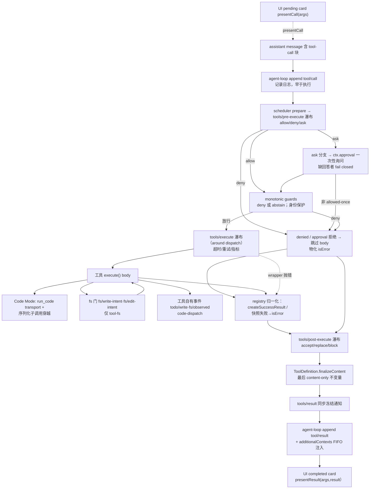
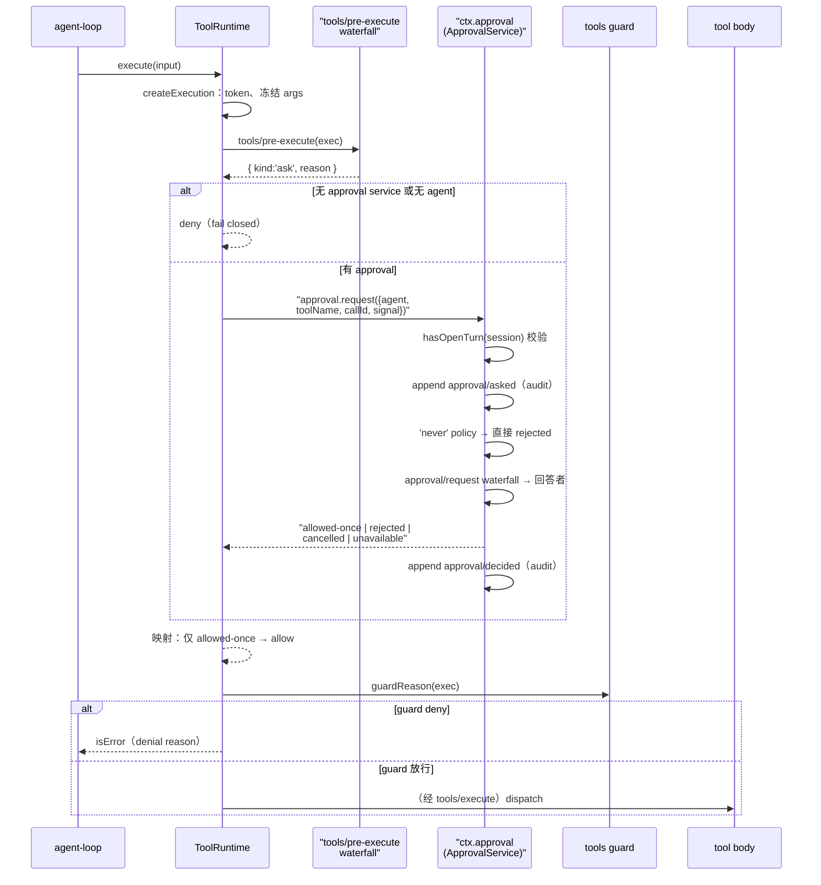

# 工具系统与受控执行管道（Tool System & Guarded Execution Pipeline）

> 对应关注面：`ctx.tools`（scoped tool registry + 受控执行管道）、`ToolDefinition`/`defineTool` DSL、`tools/pre-execute·execute·post-execute` 三瀑布、monotonic guards、`ctx.approval`、结果归一化/`finalizeContent`、Code Mode。

## 在项目中的角色：去掉它会怎样

`ctx.tools` 是整个 agent 的能力出口：agent-loop 拿到模型产出的 tool-call 后，唯一的执行通道就是它。去掉它意味着：

- **agent-loop 失去唯一执行入口**：`tool-calls.ts` 通过 `ctx.tools.executionMode()` 分派调度模式、通过私有符号 `ctx.tools[TOOL_RUNTIME_SCHEDULER]` 的 `prepare/dispatch/finalize/finish` 四阶段驱动调用。没有它，loop 必须自己实现策略编排、并发调度、结果归一化——loop 与策略强耦合。
- **所有"策略插入点"消失**：hooks、权限、沙箱、approval、超时、结果改写、UI 渲染全部以 `tools/*` 瀑布/事件挂在管道上。去掉后这些只能硬编码进工具本体或 loop。
- **模型看到的工具面消失**：`ctx.tools.schemas(scope)` 通过 `ctx.systemPrompt.tools()` 提供模型可见 schema。`ctx.systemPrompt` 只是装配器，真正的 schema 来源是工具注册表。
- **代码执行能力消失**：Code Mode 的 `run_code` transport 是注册表保留的，子调用要"穿越"同一管道。

一句话：**`ctx.tools` 是"策略中立、管道统一"的执行中枢。** 它把"工具能做什么"（注册表）与"工具被允许/如何被调用"（受控管道）解耦，让 loop 只关心"按顺序跑"，而把策略交给插件。

## 解决什么问题、根因

**根因**：agent harness 的工具调用生命周期极为复杂且横切关注点多——一个调用要经过**权限判断、人机确认、沙箱、超时、重试、指标、结果改写、内容归一化、UI 展示、结果审计**，外加同一个进程里还可能有**代码模式（程序内串行调用多个工具）**。如果这些逻辑都写死在 loop 或工具里：

1. **改任何一种策略都要改 loop** → 核心循环不稳定、插件无法独立演进。
2. **工具与策略耦合** → 一个工具要想支持超时/沙箱就必须硬编码，无法复用。
3. **结果流向不可控** → loop 不知道最终内容（finalizeContent、spill 溢出）时，模型看到的内容可能与工具返回的不一致，或超大结果撑爆上下文。

**设计目标（docs 原文）**：让工具执行管道**无需改 loop** 即可插入策略、hooks、沙箱、文件监护、结果改写、最终结果观察与 UI 渲染。

## 设计思路

### 方案：分层瀑布 + 不可重排的单调 guard + 冻结的最终结果

1. **三阶段瀑布（pre/execute/post）**，每阶段都是一个可转换调用链（waterfall）。`tools/pre-execute` 管"能不能跑"（allow/deny/ask），`tools/execute` 管"怎么跑"（around-dispatch，超时/重试包裹），`tools/post-execute` 管"结果怎么呈现"（accept/replace/block）。三阶段顺序固定但**监听器顺序可变**。
2. **monotonic guards 与瀑布分离**：guard 只可能 deny，没有 allow 结果（返回 `undefined` 只是"维持现状"），因此"一旦被 deny 就无法被后注册的监听器撤销"。这是身份保护/owner 策略的家。
3. **approval 是"一次性询问"**：`pre-execute` 返回 `ask` 后，在进入 guard 前用 `ctx.approval.request()` 问一次，`allowed-once` 才继续。缺回答者 fail closed 到 deny。
4. **结果归一化 + finalizeContent**：体返回后，registry `createSuccessResult` 先快照/校验/渲染出成功结果；`tools/execute` 的 wrapper 结果会被 `normalizeDispatchResult` 归属到定义的 output 契约；失败的快照变成含错误信息的规范化结果。最后 `ToolDefinition.finalizeContent` 是"最后一个 content-only 不变量"，然后 `materializeFinalResult` 冻结成最终结果。
5. **tools/result 是同步冻结通知**：最终结果冻结后通过 emit 广播给观察者，观察者不能改写它，错误被 contain。
6. **结果溢出（spill）** 挂在 `tools/post-execute` 与 `tools/code-dispatch-log`：把超大纯文本结果存到 `ctx.spillStore`，用 preview + locator 替换模型面内容。
7. **Code Mode 保留专用 `run_code` transport**：程序内每个子调用通过 `parent` token 标记，走同一管道，但主调用只能命名 `run_code`。

### 放弃的替代方案

- **把策略直接注册进 execute() 本体**：会让工具与特定策略强耦合、不可复用（放弃）。
- **把 guards 做成可 allow 的瀑布**：一旦允许可被撤销，owner 策略无法信任（因此 guard 刻意无 allow 结果）。
- **让 `tools/result` 也是可改写瀑布**：最终权威结果若可被改写，审计/回放与 UI 会看到不一致（因此它是只读 emit）。
- **Code Mode 直接调用工具而绕过管道**：会丢失所有策略/监护（因此子调用必须穿越同一管道，只额外附 parent token）。

## 关键数据结构

### `ToolDefinition` — 注册的工具

[packages/core/tools/src/index.ts:222-223]()
<!-- snippet: export interface ToolDefinition extends ToolSchema {
  /** Mandatory canonical output declaration. -->
  readonly output: ToolOutputDefinition -->
[packages/core/tools/src/index.ts:235-242]()
<!-- snippet:   execute(args: unknown, exec: ToolRunContext): Promise<unknown>
  /**
   * Synchronous last-mile transform for model-facing content. The registry
   * snapshots this callback when execution starts and invokes it exactly once
   * for every normalized outcome, including pipeline failures that bypass
   * `tools/post-execute`, immediately before lossless materialization.
   * Returning `undefined` preserves the content; every other result field
   * remains registry-owned. The callback must be total and must not throw. -->
  [packages/core/tools/src/index.ts:279-286]()
  <!-- snippet:   presentCall?(args: unknown): ToolCallView | undefined
  /**
   * Optional: how to present the COMPLETED state, given the same `args` and the
   * durable result projection (`content`, failure state, and optional `meta`). Returns a
   * {@link ToolResultView}, or `undefined` (or omit the method) to keep the
   * pending title and render the raw result content. Pure and side-effect-free
   * for the same replay reason.
   */ -->

`schemas()` 只有名字/描述/参数投影泄露给模型，`output/execute/finalizeContent/timeoutMs/isConcurrencySafe/presentCall/presentResult` 全部不泄漏。
[packages/core/tools/src/index.ts:1234-1236]()
<!-- snippet:   schemas(scope?: ScopeKey): ToolSchema[] {
    return [...this.view(scope).visible.values()].map(definition => this.schemaOf(definition, true))
  } -->

### `defineTool` DSL — 类型安全的工具作者接口

[packages/core/tools/src/schema.ts:545-547]()
<!-- snippet: export function defineTool<const S extends ParameterSchemaSpec, const O extends ValueSchemaSpec>(
  options: DefineToolOptions<S, O>,
): ToolDefinition { -->

- `execute` 先 `validate(args)`，统一 value-schema DSL 编译到受约束的 raw JSON Schema 子集。
- `presentCall/presentResult/isConcurrencySafe` 在复用时"软校验"：参数不匹配则 fallback 到 `undefined`/`false`，避免回放历史日志时抛错。

### 瀑布类型

[packages/core/tools/src/index.ts:588-591]()
<!-- snippet: export type PreToolDecision =
  | { kind: 'allow' }
  | { kind: 'deny'; reason: string }
  | { kind: 'ask'; reason?: string } -->
[packages/core/tools/src/index.ts:597-600]()
<!-- snippet: export type PostToolDecision =
  | { kind: 'accept'; content?: ContentBlock[]; value?: never; additionalContexts?: UserMessage[] }
  | { kind: 'accept'; value: JsonValue; content?: never; additionalContexts?: UserMessage[] }
  | { kind: 'block'; feedback: ContentBlock[]; additionalContexts?: UserMessage[] } -->

`ToolExecutionResult` 是关于成功/失败的判别联合。
[packages/core/tools/src/index.ts:556-558]()
<!-- snippet: export interface ToolExecutionSuccess {
  readonly isError: false
  /** Execution-local canonical value; deliberately omitted from durable events. -->
  readonly value: JsonValue -->

`ToolGuard` — 返回 `undefined`（放行）或 denial reason，**无 allow 结果**。
[packages/core/tools/src/index.ts:711-711]()
<!-- snippet: export type ToolGuard = (execution: Readonly<ToolExecution>) => string | undefined -->

### 执行身份

- `ToolExecutionInput`：`{callId, rootCallId?, name, arguments, agent?, parent?, signal}`（caller 提供）。
- `ToolExecution`：加 `{token, rootCallId}`（registry 分配 token，arguments 深冻结）。
- `ToolExecutionToken`：`Symbol`，**只用于同一性比较**，嵌套调用只共享其作为 `parent` 的 opaque token。

## 核心流程（Mermaid）

### 工具调用完整管道

### Approval 一次性询问时序

关键时序：`tools/pre-execute` 返回 `ask` →（进入 guard **之前**）→ `ctx.approval.request()` 一次性询问 → `allowed-once` 再进 guard。

## 与其他模块协同

- **agent-loop 消费 `ctx.tools`**：用 `executionMode()` 分派（exclusive 屏障 + 并行滚动池），用 `ctx.tools[TOOL_RUNTIME_SCHEDULER]` 的 `prepare→dispatch→finalize/finish` 分阶段驱动，dispatch 可重叠、commit 按模型顺序；`additionalContexts` 注入 `agent.inbox` 的 next-step。
  [packages/core/tools/src/index.ts:466-466]()
  <!-- snippet: export const TOOL_RUNTIME_SCHEDULER: unique symbol = Symbol('@deepseek-ai/dsh-tools.scheduler') -->
- **`ctx.systemPrompt` 消费 `ctx.tools.schemas()`**：把 model-facing schema 注入系统提示；Code Mode 还注册 `tools:code-only` 与 `tools:sdk` section。
- **approval 是可选 seam**：`serviceAsk` 用 `ctx.get('approval')` 机会性获取，无则 degrade 为 deny；approval 用自己的 `approval/asked`+`approval/decided` 审计对。
- **spill 在 `tools/post-execute` 消费**：spill-policy 以 `{prepend:true}` 注册，把超大 plain-text 结果替换为 preview+locator；存储走 `ctx.spillStore`。
- **fs 门在工具栈之下的 `fs/*` 事件**：tool-fs 的 write/edit 在 `execute` 体内调用 `ctx.waterfall('fs/write-intent'/'fs/edit-intent', …)`。
- **Code Mode 与 code-runtime**：`run_code` 通过 `ctx.codeRuntime.run()`，工具类型经 worker 线程隔离执行。

## 关键设计决策（为什么）

### 为什么 pre/execute/post 三瀑布顺序固定，但监听器可重排？

因为三者的**关注点本质不同且有强依赖序**：必须先决定能跑（pre），才能跑（execute），才能呈现结果（post）。但同一个关注点内部的多个策略可以任意排序。关键限制：**arguments 不可在 pre 改写**，因为 history, audit, UI, and execution must agree。

### 为什么 monotonic guards 与瀑布分开（不可重排）？

瀑布是"可转换调用链"、监听器顺序可变，而 **owner 策略需要"某层某规则一旦 deny 就绝不能被后注册者允许回来"**。guard 返回类型刻意**没有 allow 结果**——`undefined` 只是"维持现状"。owner 策略是安全边界，不可被插件的坑误伤。

### 为什么 `tools/result` 是同步冻结通知，而 `post-execute` 可再改写？

- `tools/post-execute` 在**物化前**工作，可 accept/replace/block，是"策略改写"点。
- `tools/result` 在**最终结果被 `materializeFinalResult` 深冻结后**以只读 emit 广播。因为权威结果必须**不可变**——loop 持久化、UI、回放、审计都需要同一份快照；若 observation 还能改写，各方看到不一致。观察者失败被 contain，不会影响工具已成功的结果。

### 为什么 `finalizeContent` 是最后的 content-only 不变量？

它恰好在**每个归一化结果**（含绕过 `tools/post-execute` 的管道失败）前被调用一次。为什么 content-only：它只可能在 `...result.content` 上替换，**不能**动 `value/isError/error/meta/additionalContexts`——这些是 registry-owned 权威字段。快照时机是**执行开始时**捕获回调（在参数物化前，防 getter 替换回调）。

### 为什么 approval 一次询问缺回答者 fail closed to unable/unavailable？

因为 approval 是安全能力：**没有可回答的人时，默许"放行"是严重的安全漏洞**（AI 可能自导自演）。所以 `ApprovalOutcome` 是闭式集合，`'allowed-once'` 是唯一放行；缺 answerer、answerer 抛出、answerer 返回非词汇值全部归一到 `'unavailable'`（fail closed）；`tools` 侧把 `unavailable` 映射为 deny。

### why Code Mode 要保留 `run_code` 专用 transport？

程序内调工具要复用同一套受控管道（权限/沙箱/超时/监护），**不能直接调用 native 工具而绕过策略**。`run_code` 是注册表保留名字，全局/scope 层不可注册或 shadow；子调用带 `parent: exec.token` 标记——有 parent 可调用任意可见 native 工具，直接调用原生工具在 `mode:code` 下被 collapse 成 `UNKNOWN_TOOL`。

## 亮点与问题

### 亮点

1. **"无 allow 结果"的单调 guard** 是极简又安全的设计：一句返回去掉了整个"撤销类"安全面，从类型层面杜绝 owner 策略被插件污染。
2. **分阶段 scheduler（prepare/dispatch/finalize/finish）** 让 dispatch 可以重叠执行而策略/commit 严格按模型顺序——"并行工具 + 强顺序语义"兼得。
3. **三层统一 value-schema DSL + 类型推断**：工具作者只写一个 vocabulary，参数/输出/渲染/展示全部类型推导。
4. **结果"先物化再观察"** 的冻结纪律贯穿始终，审计/回放/UI 永远看到同一权威快照。
5. **spill 双层 arm**（post-execute 管模型面 + code-dispatch-log 管日志副本）对 read 采用不对称处理，精确区分"模型上下文"与"可靠日志"。

### 问题/注意点

1. **`finalizeContent` 的"调用 exactly once"在异常路径上的保证依赖 `contentFinalizers` WeakMap 与 `materializeFinalResult` 的 try/catch 嵌套**，结构较隐晦，新增旁路时容易漏掉调用。
2. **`tools/result` 是同步 `emit`**，observers 返回 Promise 只 `void` 再 record failure——观察者的异步工作无法被等待，可能造成部分竞态。
3. **Code Mode 的手写调度器**（`drive/commitQueue/inFlight/logWork`）相当复杂，维护成本不低。
4. **approval 与 tools 之间通过 `ctx.get('approval')` 机会性耦合**：`ctx.approval` 未装载时静默降级为 deny，排障时可能让 AI 误以为是被拒绝而非"未配置"。

## 已知的文档-实现漂移

- **`tools` 的 `execute` 钩子归属**：草稿描述的 guard 位于 `packages/core/tools/src/index.ts:711`（`ToolGuard`），身份保护/owner 策略注册在 `guard()`（index.ts:1110）；文档图把 guards 画在 waterfall 之后、与 approval 同层，实际 flow 是 pre-execute(ask → approval) → guard → execute。
- **Code Mode 的调用入口**：`run_code` transport 保留名与 `UNKNOWN_TOOL` collapse 语义所在行（index.ts:1324 附近），文档若与实现行号有出入以代码为准。
EOF
echo done