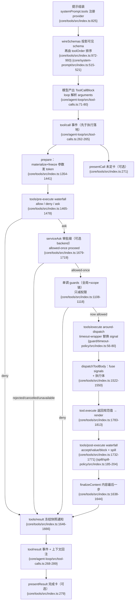

# 工具调用管道：scoped 注册 + 受控执行

> 子文档之一，聚焦模型如何按 schema 调用受控工具。覆盖 `packages/core/tools`（管道主体与呈现契约类型）与作为模型面向工具实例的 `packages/deliverables/tool-present`。整体哲学见 [README](README.md)；本文上承 [agent-loop-runtime.md](agent-loop-runtime.md)（循环驱动工具调用）、下启 [sandbox-capability-seams.md](sandbox-capability-seams.md)（工具运行的环境与隔离）；交付链路的端到端细节见 [workspace-files.md](workspace-files.md)，客户端卡片渲染见 [web-client.md](web-client.md)。
>
> **本版增量更新（0.1.2-rc.1 → 0.1.5-rc.2 / 2026-09-11）**：依 `dsh-v0.1.2-rc.1..HEAD` git diff 与 `verify-references.mjs --diff` 预检清单比对更新。本次落在工具面的变化有四：
> **(1) `str_replace_editor` 退出随附 profile**——base 默认工具集、SDK 应用与两份极简组合各自摘掉这个与 `read`/`write`/`edit` 重叠的编辑接口；注意上游「代码面删除」当日即被 revert，**工具包本身仍在发行物与 `docs/tool-catalog.md` 中**，只是不再被任何随附组合装配。
> **(2) 新增 `tool-present`**——`present` 是普通的模型面向工具，复用整条管道，只在 `tools/result` 上追加交付声明；本文讲它在管道中的位置，交付链路的端到端细节内链 [workspace-files.md](workspace-files.md)。
> **(3) 工具结果呈现契约成型**——`read_image` 结果在客户端渲染成图片卡片（含 `run_code` 嵌套调用），工具卡片改为从原始 session event 派生、并移除 `ToolDetails`；本文只讲「呈现契约」这一面，细节内链 [web-client.md](web-client.md)。
> **(4) scoped 裁剪回灌 guidance**——文件系统 / 搜索 / Web 工具插件改用 `ctx.tools.get(name, scope)`，在提示词组装期按作用域可见性决定是否输出自己的指导段。

工具管道是模型以受控方式触达任意宿主动作的**唯一受信通道**——所有会造真实副作用的能力（读写文件、shell、HTTP、跑代码）都挂在某个已注册工具的执行体之后。

## 在项目中的角色

去掉「受控工具管道」，agent 会退化为纯聊天程序：模型即便产生了 `tool_calls`，也没有一个既能在调用前拦截/审批、在调用中加超时/重试/追踪、在调用后可改写回注上下文的安全执行面。系统里所有"能造成真实副作用"的动作（读写文件、跑 shell、发 HTTP、跑代码）都挂在某个已注册工具的执行体之后；管道正是这些动作的唯一闸门。

`core/tools` 提供：
- 统一的 schema DSL（作者向 `ValueSchemaSpec`）→ 编译成受约束的 raw JSON Schema 子集，参与系统提示组装；
- 分层（Scope）工具注册表：每个 agent 有独立的可见工具集，scoped 注册可遮蔽全局、可 restrict 全局工具；
- pre‑execute → guard → execute → post‑execute → finalizeContent → result 的多段管道，以及围绕它的 `tools/*` 事件族。

权威文档 `docs/tool-execution-pipeline.md` 的 Mermaid 图完整描绘了这条流水线（`[docs/tool-execution-pipeline.md:9-60]()`）。
<!-- anchor-base64:Zmxvd2NoYXJ0IFREIOKApiBhbGxSZXN1bHRzIC0tPiBjb250ZXh0 -->

关键：管道是被插件运行时（vendored Cordis）架起的一个 `Service`，工具注册是「可逆副作用」（dispose 即注销）——这正呼应"工具也是可替换插件"的整体哲学（`[packages/core/tools/src/index.ts:807-808]()`）。
<!-- anchor: export class ToolRuntime extends Service { … static inject = ['systemPrompt'] -->

## 解决什么问题 / 根因

在"无特权内核、一切皆插件"的架构里，最大的张力是：**可扩展性要求任何插件都能挂到工具调用上，安全性又要求这些钩子必须可把关、可排序、不可被后到者撤销。** 根因有三：

1. **模型输入不可信**：`arguments` 由模型生成，必须先做 lossless-JSON 物化、深冻结，否则执行体面对的是污染/带 getter 的攻击面（`[packages/core/tools/src/index.ts:1441-1445]()`，`snapshotJsonValue` 物化失败直接落 `TypeError`，成功则 `deepFreeze` 后才交给执行体）。
   <!-- anchor: const detached = snapshotJsonValue(exec.arguments) … const execution: MutableToolRunContext = { ...base, arguments: deepFreeze(detached) } -->
2. **副作用必须可审计可拦截**：会话日志是唯一事实源（Model-visible means logged），因此工具的每次调用都要留下 `tool/call` 与 `tool/result` 事件对，且 result 必须引用其 call 的 seq（`SurfaceOp.append` 的 `sourceEventSeqs`）（`[packages/core/agent-loop/src/tool-calls.ts:262-289]()`）。
   <!-- anchor: /** Append a started call and return the event seq that its result must cite. */ … }, { surfaceOp: 'append', sourceEventSeqs: [callSeq] }) -->
3. **策略必须是"只减不增"**：多个策略插件对同一个调用可以有各自立场，但后注册的策略绝不能把前一个已经 deny 的调用"放行"——这就是 guard 设计成单调（monotonic）的原因。

文档把这一分工作为明示契约：`[docs/subsystems/tools.md:325-325]()`（"a returned reason can only reduce permission"）、`[docs/subsystems/tools.md:428-428]()`（"arguments cannot be rewritten because history, audit, UI, and execution must agree"）。
<!-- anchor: A `ToolGuard` is scope-aware final pre-dispatch policy. Its return type delibera -->
<!-- anchor: Call `next()` for the default or return a decision to short-circuit. Pre-policy -->

## 设计思路

### 方案与替代方案

| 问题 | 方案 | 替代方案（被弃） | 取舍 |
|---|---|---|---|
| 工具可见性 | **Scoped 分层注册**（全局层 + 每 agent 链上的作用域层，`NamedEntries` 遮蔽） | 单一全局表 | 全局表无法隔离 agent，无法做 per-child 能力裁剪。Scope 方案让"一个 preset 下的所有 agent"共享一套工具，又能被 child restrict |
| 执行把关 | **单调 Guard + 多段 waterfall**（pre/guard/execute/post） | 全部放进 pre-execute 一个事件 | waterfall 各司其职：pre 可 allow/deny/ask（可扩展审批），guard 只减不减（不可被顺序翻转），execute 做 around-dispatch（超时/重试），post 做结果改写 |
| 后端可换 | `ctx.codeRuntime` 可选后端（Capability Seam 三件套之一） | 硬编码执行器 | code mode 需要语言运行时；缺失时 loud-fail 组装（`requireCodeRuntime`） |
| 超时实现 | 协作式：工具声明 `timeoutMs` 并承诺遵守 `exec.signal` | 硬杀线程/进程 | 同进程无法硬杀。协作式由 `tools/execute` wrapper（`dsh-tool-call-timeout-policy`）加 deadline，工具协作到达 quiescence |

### 核心模式

1. **`next()` 委托的 waterfall**（与 `agent/*` 事件同构）：每个监听器收到 `(exec, next)`，调用 `next()` 获得默认/下游决策，返回一个 `Decision` 可短路。pre 返回 `PreToolDecision`（allow/deny/ask），post 返回 `PostToolDecision`（accept/block）。派发经过 `tools/*` 事件由 Cordis 的 scope-filtered dispatch 路由。
2. **执行上下文的不可变边界**：`ToolExecutionToken` 为不透明 Symbol，供嵌套调用经 `parent` 关联；`ToolExecution` 在到达 `tools/result` 前被 `Object.freeze`。执行结果区分 `value`（执行局部、不持久）与 `content`/`error`/`meta`（可持久投影）。
3. **Code Mode 保留传输（`run_code`）**：作为 presentation transport 在 filterable 注册层之外，为 code presentation mode 的 agent 注入 `run_code` + SDK 提示，让所有工具从程序内 `await tools.<name>()` 可及，且每个子调度仍走完整管道并记录。
4. **spill（溢出）**：`tools/post-execute` 的一个结果改写——过大纯文本结果从不进模型上下文，改存 spill store，模型看到 preview + locator。

---

## 关键数据结构

### `ToolDefinition` — 一个已注册工具
`schema`（模型可见 name/description/parameters）+ 强制 `output`（规范输出契约：`schema` + 纯 `render` + 可选 `presentationMeta`）+ `execute` 执行体 + 可选 `finalizeContent`/`timeoutMs`/`isConcurrencySafe`/`presentCall`/`presentResult`。
- 定义：`[packages/core/tools/src/index.ts:223-298]()`（自 `export interface ToolDefinition extends ToolSchema` 到 `presentResult` 声明收尾）
- 关键点：`output` 强制（`index.ts:216`）、`execute` 承诺转发 `exec.signal` 并 settle 到 quiescence（`index.ts:217-227`）、`isConcurrencySafe` 只以精确 `true` 加入并行组（`index.ts:248-261`）。
<!-- anchor: export interface ToolDefinition extends ToolSchema { … presentResult?(args: unknown, result: ToolResult): ToolResultView | undefined -->

### `ToolExecution` / `ToolExecutionInput` / `ToolRunContext`
调用标识（callId/name/arguments/agent）+ 关联（rootCallId/parent token）+ 协作取消（signal）。`ToolRunContext` 额外给 `deferContext` 与 `concludeTurn`。
- `[packages/core/tools/src/index.ts:326-434]()`：输入 326 起、执行对象 393 起（补 `rootCallId` 与 `token`）、运行上下文 418 起（补 `deferContext`/`concludeTurn`）。
  <!-- anchor: export interface ToolExecutionInput { …   concludeTurn(): void -->
- 运行上下文由执行对象派生，是执行体收到的视图；其中 `deferContext` 把上下文挂到本执行结果上（复合工具的嵌套转发通道）。around-dispatch 包装器看到的是另一个视图 `ToolDispatchExecution`——只许替换 `signal`、不许删除（`index.ts:384-387`）。

### `ToolExecutionResult`（判别联合）
`ToolExecutionSuccess`（`isError: false`，带 `value`）与 `ToolExecutionFailure`（`isError: true`，带 `error`）互斥。`concludesTurn` 只在成功态出现。
- `[packages/core/tools/src/index.ts:572-596]()`。
<!-- anchor: export interface ToolExecutionSuccess { … export type ToolExecutionResult = ToolExecutionSuccess | ToolExecutionFailure -->

### `ToolLayer` / `ToolView` — 分层注册与派生视图
- `ToolLayer implements ScopeLayer`：持有 `tools`/`restrictions`/`guards`/`mode`，`admits` 做 restrict-names 判断、`guardReason` 取首个单调拒绝（`index.ts:707-745`）。
- `ToolView`：一次 layer 遍历派生的 `visible` map + `knownNames`（提示顺序校验用）+ `restrictableNames`（restrict 可用名），`index.ts:714-721`。
- `view()` 是可见性核心：继承面 = 全局层 + 祖先链，restriction 取交集；own 层注册禁 filter；末尾插入保留传输（非 native 才插 `run_code`）（`[packages/core/tools/src/index.ts:734-772]()`、`[packages/core/tools/src/index.ts:1178-1218]()`）。
  <!-- anchor: class ToolLayer implements ScopeLayer { … return undefined -->
  <!-- anchor: private view(scope?: ScopeKey): ToolView { … return { visible, knownNames, restrictableNames } -->
  - 其中 own 层的"禁 filter"在源码里有一行**目的性注释**：这一层是唯一「scope 拥有而非继承」的贡献，故故意对链不敏感（`index.ts:1181-1183`）。
- `ToolGuard` 类型只有"给理由"一条出口（`index.ts:704`），这正是单调性在类型层面的表达。

### `JsonSchemaNode` — 受约束 raw JSON Schema 子集
仅支持 type/oneOf/properties/required/additionalProperties/items/enum/const + 注解；不支持的关键字直接 reject，不静默接受。
- `[packages/core/tools/src/json-schema.ts:31-56]()`。
  <!-- anchor: export interface JsonSchemaNode { …   examples?: JsonValue -->
- 校验全函数式、处处容错、stack-safe（显式帧栈避免递归爆栈），`json-schema.ts:227-376`（`checkSchemaNode`）、`json-schema.ts:487-644`（`checkValue`）。

---

## 核心流程（Mermaid）

工具调用完整管道：schema 注册/组装入 prompt → `tool/call`* → `tools/pre-execute` → monotonic guards → approval → `tools/execute`(around + 后端) → `tools/post-execute` → `finalizeContent` → `tool/result`* → 结果回注上下文。链路两端的 `presentCall` / `presentResult` 是 UI 呈现的可选观察点，只读、不改变执行语义。

图中标注均以上一节源码为据。审批（approval）与超时（timeout）是两条**可选**横向插件，不组合时 degrade：
- 无 approval service → `ask` 降级为 deny（`index.ts:1683-1689`）；
- 无 `timeoutMs` 声明 → timeout wrapper 直接 `next()`（`guard/timeout-policy/src/index.ts:57-59`）。

### 呈现契约：工具结果由谁决定怎么显示

管道在**不改执行语义**的前提下留了两个纯函数观察点：`presentCall(args)` 描述"未定卡"，`presentResult(args, result)` 描述"完成卡"，两者返回的都是 provider 中立的 `card` 标签判别联合，而不是任何客户端协议对象（`[packages/core/tools/src/presentation.ts:140-140]()`）。
<!-- anchor: export type ToolResultView = GenericResultView | TerminalResultView | DiffResult -->

这条契约有两个容易踩空的地方，恰是 `read_image` 图片卡片实现时暴露出来的：

- **宿主呈现层与客户端卡片是两条路，且客户端那条不看宿主的值。** 结构化卡片直接从第一方**原始 session event 字段**派生；Host 的 `presentCall` / `presentResult` 返回值不会进入 Client（`[packages/client/ui-tool/README.zh.md:52-52]()`）。
  <!-- anchor: 本包拥有 generic fallback，以及 shell/pwsh、read、read_image、write/edit、运行中的 `str_replace -->
- **因此"给结果加一种新外观"不该扩封闭联合。** `ToolResultView` 是封闭联合且没有 `image` 成员，第一版给 `read_image` 加 `card: 'image'` 分支 + `presentResult` 的实现被弃用——那个分支没有任何消费方。
- **图片卡片的材料一分为二**：路径来自工具自己声明的 `output.presentationMeta`，且**只有 path 一项**（`[packages/fs/tool-fs/src/read-image.ts:234-234]()`）；附件引用则一律从已结算结果的 image block 里取，因为 `tools/post-execute` 合法改写结果时被替换的正是那个 block，在 `meta` 里再存一份就会在内容变化后变成过期副本。
  <!-- anchor: presentationMeta: (_args, value) => ({ path: value.path }), -->
- 客户端 `imageCardModel` 对每条原始字段做防御式窄化，任何形状不符就退化成 generic 卡片而不是抛错或渲染半个图库（`[packages/client/ui-tool/src/client/tool/models/image-card-model.ts:224-233]()`）；顶层调用用持久化的 `meta.path`，`run_code` 内部派发的嵌套调用没有 `meta`，回退到调用自身的 `file_path` 参数。
  <!-- anchor: const metaPath = imageMeta(block.meta)?.path … if (refs === null) return null -->
- 这次改造同时把卡片装配收敛成"按 key 注册的 toolview + 工具自有的 `tool.call.images` 子槽"，并**删除了 `ToolDetails`**——不再存在"选中调用的第二个全高展示面"（`[packages/client/ui-tool/README.zh.md:76-76]()`）。
<!-- anchor: 每张卡片都直接在调用树中查看；选中调用后不会再显示第二个全高视图。行 renderer 为 terminal、read、diff、search 和 web 卡片 -->

> Why 值得单独讲：这套安排的代价是**客户端必须复刻宿主的窄化逻辑**（`imageCardModel` 里手写了一份 `ImageMediaType` 镜像，并在注释里承认新增成员忘记同步会静默退化成 generic 卡），换来的是客户端不依赖宿主呈现值、旧会话日志仍可按同一条降级路径重放。图片卡片的完整客户端细节（槽位声明、loader 下传、空槽位降级）见 [web-client.md](web-client.md)。

## 与其他模块协同

| 协作方 | 管道如何参与 | 标注 |
|---|---|---|
| **agent-loop**（`core/agent-loop/src/tool-calls.ts`） | 解析 `tool_calls`→构造 `ToolExecutionInput`→逐组经 `pre-execute`/guard→dispatch（可并行池）→`tools/result` 后按模型序 commit 并回注 | ✅ 已直接读源码验证（tool-calls.ts 全文） |
| **system-prompt**（`core/system-prompt`） | `ctx.systemPrompt.tools(provider)` 收集 provider 结果，`wireSchemas` 把可见 schema 投影为 `ToolSchema[]`，再由 `orderTools` 按 toolOrder 排序；code mode 额外注入 collapse 声明 + SDK 段落 | ✅ `index.ts:825` 调 `ctx.systemPrompt.tools`、`index.ts:972-993` 是 `wireSchemas`；`tools()` 见 `system-prompt/src/index.ts:515-521`、`orderTools` 见 `system-prompt/src/index.ts:210` |
| **sandbox / seam**（工具执行后端） | `ctx.codeRuntime` 作为可选后端被 `requireCodeRuntime` 解析；run_code 的 `runtime.run` 才是真正的执行环境 | （跨模块边界：另见相应子文档）sandbox 如何拦截任一本机工具的执行体、`RuntimePreStepDecision` 等 seam 细节在本切片未深入 |
| **session**（记录结果） | 结果只在 `tool/result` 前物化/深冻结，value 执行局部不持久，`content`/`meta`/`error` 持久化；`tool/ptc-dispatch` 记录子调度 | ✅ index.ts 内部已证；`tool-calls.ts:281-288` 持久化 |
| **user-approval**（可选） | 提供 `approval/request` waterfall；`serviceAsk` 以 `ctx.get('approval')` 机会式消费 | 🔶 已看（interaction/user-approval/src/index.ts 前半） |
| **tool-present**（交付声明工具，0.1.5 新增） | 不新增管道阶段：`ctx.tools.register(defineTool(...))` 注册为普通 scoped 工具，于是 pre/guard/execute/post/spill 全部照常适用；它只额外在 `tools/result` 观察点上把成功结果翻成 `deliverables/presented` 事件 | ✅ 见下文「决策 4」；交付链路细节见 [workspace-files.md](workspace-files.md) |
| **ui-tool / ui-deliverables**（客户端呈现） | 不经管道：客户端卡片从第一方原始 session event 派生，Host 的 `presentCall`/`presentResult` 返回值不进入 Client | ✅ 见上文「呈现契约」；细节见 [web-client.md](web-client.md) |

### 工具名单的权威来源：生成式 `tool-catalog`

上表与本文件其余章节提到的每一个工具名，都可以 1:1 对到 `docs/tool-catalog.md`——它不是手写清单，而是由 `scripts/gen-tool-catalog.ts` 从 **boot manifest** 收集生成的，并由 `package.json` 的两个脚本负责产出与校验（`[package.json:159-162]()`）。
<!-- anchor-base64:Imdlbi10b29sLWNhdGFsb2ciOiAidHN4IHNjcmlwdHMvZ2VuLXRvb2wtY2F0YWxvZy50cyIsIOKApiAidmVyaWZ5LXRvb2wtY2F0YWxvZyI6ICJ0c3ggc2NyaXB0cy9nZW4tdG9vbC1jYXRhbG9nLnRzIC0tY2hlY2siLA== -->

这份名单还被一条**单元测试**钉住：`packages/core/tools/tests/gen-tool-catalog.spec.ts` 用一张扁平的名字数组断言整个收割结果，测试名里的 "team catalog" 就是这个 roster（`[packages/core/tools/tests/gen-tool-catalog.spec.ts:28-42]()`）。
<!-- anchor: expect(names).toEqual([ … 'update_goal', 'wait_agent', 'web_fetch', 'web_search', 'workflow', 'write', -->

本轮增量恰好动过这张名单：`test(tools): update team catalog expectation` 把 `followup_task` 从中删掉（HEAD 上目录里已无此名）。同一次快照里 `present` 与 `str_replace_editor` **都仍在名单内**——这与 [决策 5](#决策-5str_replace_editor-退出随附-profile删的是重叠接口不是工具包) 的结论互为佐证：退出的是默认组合，不是工具本身。**给后来者的实证配方**：任何"某工具被删除/新增"的说法，先跑一次 `pnpm run verify-tool-catalog`（或直接看这张数组）再下笔——本窗口已有两条"合入后又被 revert"的改动（`str_replace_editor` 与 same-session message editing），仅凭 commit message 会写出错结论。

---

## 关键设计决策

### 决策 1：为什么 scoped 注册而非全局注册
每个 agent 有自己作用域链上的 `ToolLayer`；scoped 注册**遮蔽**全局同名工具，restrictions 只裁剪「继承面」而**豁免** own 层（`index.ts:1142-1183` 的 `view()` 明确：filter "a scope owns rather than inherits"）。为什么必要：delegation 运行时把 child 的汇报/结构化输出工具注册进 child own 层，若 restriction 也能裁掉它，child 就没有"通过其应答的机械"。全局单表无法表达这种 per-child 能力差异。既有陷阱注释（`index.ts:1145-1147`）坦白：这一层故意对链不敏感，因为它正是"scope 拥有而非继承"的那一份贡献——把"豁免集"误当全局层读取，就会让 child filter 静默失效，这是选型为 chain-aware 遍历的直接佐证。

### 决策 2：为什么 pre/execute/post 多段 waterfall
把「把关」从「执行」从「改写」拆开，每个阶段有不同语义与安全属性：
- **pre-execute**：可扩展的策略闸门，能 allow/deny/ask（`index.ts:1465-1478`）。但它是 `waterfall`，后到监听器理论上能翻转前者的 allow/deny——因此单独留出 **guard**。
- **guard/execute/post** 补充 pre 的不足：guard 单调只减不放（`index.ts:704` 类型、`index.ts:1108-1118` 全局+链求值），execute 只许改 `signal`（`index.ts:384-387` 的 `ToolDispatchExecution` 只放宽 `signal` 一个字段，且注册表会把替换与调用方信号 fuse 回去）做 at-most-once around 包装（timeout/retry/metrics），post 才允许改结果（accept/value/block，`index.ts:1732-1771`）。

这种拆分保证：**approval 在 guard 前**（ask→allowed-once→仍可被 guard deny），owner policy 以 guard 形式注册不会被 pre 顺序翻转；结果改写被隔离到 post，不会污染执行身份。

### 决策 3：guards / approval / spill 分工与权衡
- **guards（`ctx.tools.guard()`）**：同步、单调、owner-policy；适用范围全局或单 agent。权衡：因为只减不放，表达能力受限——它不能改结果，只能一票否决。
- **approval（`ctx.serviceAsk`）**：一次性 `ask`→`allowed-once`；agentless 或无 approval service 时 fail-closed 降级 deny（`index.ts:1683-1689`）。权衡：它拦在 guard 之前，且只对"本调用"授予——不是持久权限，故无状态授权风险低。
- **spill（`tools/post-execute` 改写）**：不做安全拦截，是上下文卫生（防止 recall 膨胀）。权衡：为保 best-effort（`spill-policy/src/index.ts:33-35`"a spill failure must NEVER turn a successful tool call into an isError"），可能产生孤儿 spill 文件（`spill/spill-policy/src/index.ts:171-181` 注释承认：替换超不出上限时保留内联内容，已写出的 spill 文件成为无害孤儿、清理延期）。

三者分工一句话：**guard 决定"能不能"（只减）、approval 决定"要不要问人"（fail-closed）、spill 决定"模型该看多少"（只影响内容投影，不动 value/log）**，分别对应安全、授权、上下文卫生三个正交维度。

### 决策 4：`present` 为什么不值得一条自己的管道

0.1.5 新增的 `present`（交付声明）看起来像一个"特殊通道"，但它在管道里的位置完全普通：`packages/deliverables/tool-present` 只 `inject` 三个服务（`tools` / `fs` / `sessionProjections`）（`[packages/deliverables/tool-present/src/index.ts:26-26]()`），然后用 `ctx.tools.register(defineTool(...))` 注册——和 `read`/`bash` 走的是同一个入口（`[packages/deliverables/tool-present/src/index.ts:38-40]()`）。
<!-- anchor: export const inject = ['tools', 'fs', 'sessionProjections'] -->
<!-- anchor: ctx.tools.register(defineTool({ … description: 'Declare existing files as final deliverables for the user. ' -->

由此得到的**免费属性**是三件：guard 能拦它、approval 能让它停下来问人、spill 能掐它的结果体积——都不需要 `present` 作者写一行适配。它的执行体也自觉遵守普通契约：要求存在 agent 与**开着的 turn**、`maxFiles` 有硬上限（默认 8）、逐个文件用组合的 `ctx.fs` 做 `lstat`/`resolve`/`stat` 三重确认（`[packages/deliverables/tool-present/src/index.ts:77-93]()`），且 `exec.signal` 在收下声明前被检查一次。
<!-- anchor: if (exec.agent === undefined) throw new Error('present requires an agent Session') … files.push({ ...file }) -->

真正"额外"的只有一步，而且落在**管道之后**：它在 `tools/result` 观察点上查本次执行的 pending 声明，只有结果**不是错误**时才 `session.append('deliverables/presented', ...)`（`[packages/deliverables/tool-present/src/index.ts:100-106]()`）。生成式工具目录对它的事件列也写着同样的口径："`deliverables/presented after a successful final result`"（`[docs/tool-catalog.md:25-25]()`）。
<!-- anchor: ctx.on('tools/result', (exec, result) => { … turn, callId: exec.callId, files, -->
<!-- anchor: | `@deepseek-ai/dsh-tool-present` | `present` | `ctx.tools`, `ctx.fs`, `ctx.sess -->

**Why 这样切？** 三个替代方案都被否掉：把声明写进工具自身的 `content` 文本里，会被 `post-execute` 或 spill 改写，"以文本作持久索引"不可靠；把声明塞进附件存储需要内容复制与保留策略；而新增一条专用事件通道又等于绕过 guard/approval。挂在 `tools/result` 上则天然继承"先执行、后落日志、只认成功结果"的语义——嵌套调用、父程序后续失败、被 block 的结果都不会误发交付声明（事件类型见 `[packages/deliverables/tool-present/src/types.ts:15-15]()`，注释明确覆盖 nested calls）。
<!-- anchor: 'deliverables/presented': { turn: number; callId: ToolCallId; files: PresentedFi -->

代价也说清楚：`present` 只声明**元数据**（路径 + 可选说明），不读内容、不复制，因此"交付"依赖源文件仍然存在——删除或移动文件即让声明失效。这是刻意的：用户要编辑的是**当前工作区源文件**，不是一份快照。完整交付链路（双面文件 API、`/api/file` 区间读取、Host 打开路径校验、下载卡片）见 [workspace-files.md](workspace-files.md)。

### 决策 5：`str_replace_editor` 退出随附 profile——删的是"重叠接口"，不是工具包

本次增量最容易误读的一条：上游确实出现过 `refactor: remove str_replace_editor`（79b3d7a594，2026-09-03 17:02），但它**四小时后就被 `Revert "refactor: remove str_replace_editor"`（8d06ebb5ac，2026-09-03 21:05）回滚**，两条 commit 同在 `dsh-v0.1.5-alpha.2` 之前合入——所以"代码面删除"是一次**未遂变更**，不要按"能力被删除"来写。实证方式：`git ls-tree -r HEAD -- packages/fs/tool-str-replace-editor` 仍列出 7 个文件（`src/index.ts`、`package.json`、tests 齐全），`git grep -l str_replace_editor HEAD` 也仍在 `docs/tool-catalog.md` 与包内命中。工具目录里它的包条目与工具条目都还在（`[docs/tool-catalog.md:30-30]()`、`[docs/tool-catalog.md:840-840]()`）。
<!-- anchor: | `@deepseek-ai/dsh-tool-str-replace-editor` | `str_replace_editor` | `ctx.tools` -->
<!-- anchor: ## `@deepseek-ai/dsh-tool-str-replace-editor` -->

真正落地的是**「从默认组合退出、降级为显式 opt-in」的三步**，口径各不相同：

| 组合 | 变更 | 首个发布 tag | 现状口径 |
|---|---|---|---|
| **共享 base** | `feat(base): remove str_replace_editor from default tools` 从 `cordis.patch.yml` 删掉插入行 | `dsh-v0.1.3-alpha.2` | 默认文件编辑是 `read`/`write`/`edit`；`str_replace_editor` 仍可**显式加回** |
| **SDK 应用**（`sdk-app`） | `feat(sdk): disable str_replace_editor by default` 先加了 `disabled: true`，随后在 base 决策里**连同该行一起删掉**——base 已不插入，覆盖变成多余 | `dsh-v0.1.3-alpha.2` | 不装配，靠继承 base 得到缺失 |
| **极简组合**（Web `minimal` preset + 独立 `sdk-minimal`） | `feat(minimal): remove str_replace_editor from minimal profiles` 更彻底：连支撑 editor 的 `fs-local` 也一并移除 | `dsh-v0.1.5-alpha.2` | 模型侧只剩**一个**按平台选择的持久 shell（POSIX `bash` / Windows `pwsh`），组合里不存在任何文件系统服务 |

"显式加回"的**作用域**也需要说清：opt-in patch 可以写在 profile、home 或逐次调用三层中的任一层，但**必须是 `insert` 而不是 `disabled: false`**——`disabled` 只能切换已存在的配置项，无法凭空创建一项（这是 base 决策明确记录的后果）。base 的 README 直接给出配方原文（`[packages/bundle/base/README.zh.md:52-52]()`）。
<!-- anchor: 默认文件编辑使用 `read`、`write` 和 `edit`。`str_replace_editor` 工具仍可显式启用。要将它加入基于 base 的 pr -->

另外两个口径也有各自依据：极简 preset 现在由 bundle 里的 patch **声明**而不是自带一份 composition 文件——patch 头注释写的是 "Agent preset minimal: one `@deepseek-ai/dsh-agent-preset` declaration inserted after the web patch"，正文只剩 persona + 持久 shell 一组（`[packages/bundle/web-app/presets/minimal.patch.yml:1-8]()`）。
<!-- anchor: # Agent preset minimal: one `@deepseek-ai/dsh-agent-preset` declaration inserted … id: minimal -->
> **演进说明(0.1.7-rc.2)**：这份极简 preset 原先是一份自带交付说明的 `packages/preset/agent-presets/presets/minimal/agent.cordis.yml`（头注释自称 "single-tool coding-agent composition"）；本轮 preset 目录整体收敛为 `packages/preset/{agent-preset,agent-preset-registry,persona}`，具体 preset 改为由 bundle 的 patch 插入一条 `@deepseek-ai/dsh-agent-preset` 声明（`config.id: minimal`、`order: 3`），头注释随之改写。

`sdk-minimal` 的 README 则把"唯一公布的工具"写成按平台选择的持久 shell（`[packages/bundle/sdk-minimal/README.zh.md:39-39]()`）。
<!-- anchor: 该 profile 只挂载一套持久 shell：Linux 和 macOS 使用 Bash，Windows 使用 PowerShell。两套配置都使用 300 -->

**Why 退出默认集？** base 同时给了 `read`/`write`/`edit` 与 `str_replace_editor`，后者提供 `view`/`create`/唯一字面替换/行插入这一套**重叠**的文件编辑接口，却要为每个请求多背一份完整 schema（[Issue #3599](https://github.com/deepseek-harness/deepseek-harness/issues/3599) 要求基于 base 的 profile 默认只用一套接口）。**Why 不删包（且最终确实没删）？** 显式自定义组合仍是有效消费方，base 的默认选择不该约束别人；那次未遂的 `refactor` 正撞在这条否决理由上——这也再次印证"一切皆插件"：默认集是组合决策，能力本身仍可被插入。

**Why 极简组合要更狠？** 持久 shell 本就能检查与修改文件，editor 是第二种修改接口 + 一个只有它用的 `fs-local` 服务。上游明确否决了"保留配置项、只靠呈现层隐藏 schema"的做法，理由是**呈现/限制层隐藏不等于能力缺席**，配置一变它就会重新出现；而挂在组合层面（不插入行）才是真的缺席。

一句权衡收束：这次收敛把"模型每个请求要背多少工具 schema"当成了组合层的显式选择——base 选择最小重叠集，极简组合选择最小绝对集，而工具包保持完整可用、按需装配。

### 决策 6：scoped 裁剪必须回灌 guidance，否则提示词会撒谎

scoped 注册能隐藏 schema，但**独立注册的系统提示词段落不在 `ToolRuntime` 里**——这是本次增量修掉的一处不一致：`fix: respect scoped tools in filesystem and web guidance` 让文件系统、搜索与 Web 工具改用已有的 `PromptSection.text({ scope })` 回调 + `ctx.tools.get(name, scope)`，在**组装期**按作用域可见性决定是否输出自己的指导段，并选择适用的跨工具文案。

`read` 是模板：指导段注册为 scope-aware（`[packages/fs/tool-fs/src/read.ts:64-72]()`）。
<!-- anchor: * Register the `read` tool and its scope-aware system-prompt guidance. … text: ({ scope }) => ctx.tools.get('read', scope) === undefined -->

更重要的是**跨工具句子**也跟着可见性伸缩。`write` 的指导只在 `edit` 可见时才追加"并优先用 `edit` 做定向修改"（`[packages/fs/tool-fs/src/write.ts:65-68]()`）。
<!-- anchor: text: ({ scope }) => ctx.tools.get('write', scope) === undefined … + (ctx.tools.get('edit', scope) === undefined ? '' : ' and prefer edit for targeted change -->

`grep` 只在 `read` 可见时才补"用 `read` 看上下文"（`[packages/fs/tool-fs-search/src/grep.ts:278-281]()`）。
<!-- anchor: text: ({ scope }) => ctx.tools.get('grep', scope) === undefined … + (ctx.tools.get('read', scope) === undefined ? '' : ' Use read on a matched file when you -->

`web_search` 只在 `web_fetch` 可见时才提"比如 web_search 的结果可以交给它抓"（`[packages/web/tool-web/src/search.ts:318-320]()`）。
<!-- anchor: text: ({ scope }) => ctx.tools.get('web_search', scope) === undefined … : fetchEnabled && ctx.tools.get('web_fetch', scope) !== undefined -->

**Why 值得单独讲？** 因为这是 `restrict()` 语义的边界：它只作用于**能力可见性与可执行查找**这条实时全局视图，**不会自动改写其他静态文字**。所以"隐藏一个工具"与"提示词里不再提它"是两件必须各自兑现的事——上游没有引入段落归属元数据或第二条组装 pass，而是让每个插件用已有的 scope 回调自己负责，代价是每个工具作者都要记住这条规矩（忘记的插件会让被裁剪的 child 收到指向不存在工具的指导）。同处受影响的还有 KV cache：指导成本现在跟随可见工具集合变化，`restrict()` 会从首个变化的段落开始使前缀复用失效。

## 全局关联：三分工如何兑现「一切皆插件」

tools 管道把「把关、授权、上下文卫生」三个正交维度拆给了 guard（只减权限）、approval（fail-closed 问人）、spill（只影响内容投影），而它们全部以插件形式挂在 `tools/` 事件与 `ctx.tools` 服务上——不更改内核即可增删任一策略。这正是 dsh 通用哲学在安全面的落点：执行面本身没有特权，`guard`/`approval`/`spill` 与 [sandbox-capability-seams.md](sandbox-capability-seams.md) 里的沙箱策略、[system-prompt.md](system-prompt.md) 里的可见工具排序，都是在同一棵可交换插件树上为「受控」二字补上的一环。本次增量把同一条哲学推到了两个新边界：

- **能力面**：`present` 没有自己的管道阶段，也没有自己的事件通道。一个需要"交付给用户"的语义，被拆成"普通工具 + 一个 `tools/result` 观察点 + 一条 `deliverables/presented` 事件"，于是 guard/approval/spill 自动适用于它，交付链路由客户端插件（`ui-deliverables`）与文件 API 各自认领——新增能力靠**组合既有扩展点**，而不是往内核加分支。
- **呈现面**：`presentCall`/`presentResult` 是封闭联合、且宿主值不进客户端；客户端卡片从原始 event 派生。这条看似绕远的路径，换来的是"UI 是可替换插件"在呈现层同样成立：回放旧日志的卡片与新会话无异，换一个客户端不必问宿主"你打算怎么显示"。

而这两条边界都建立在同一个前提上：**schema、指导段、呈现都从同一份可见性事实派生**。`view()` 是那个唯一事实源——它同时喂给协议 schema、查找、执行与 PTC SDK 生成；guidance 与卡片虽在 `ToolRuntime` 之外，却被要求用 `ctx.tools.get(name, scope)` 回到同一份事实。一处派生、多处消费，正是"没有特权内核"能持续成立的原因：没有任何一个消费者可以自己发明一份"我认为可见的工具"。
