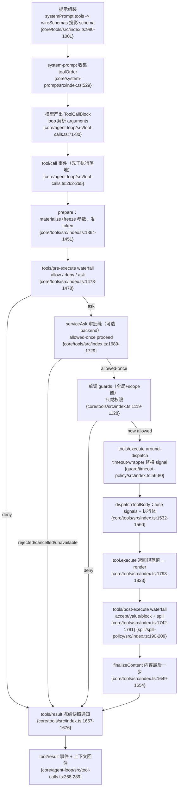

# 工具调用管道：scoped 注册 + 受控执行

> 子文档之一，聚焦模型如何按 schema 调用受控工具。覆盖 `packages/core/tools`。整体哲学见 [README](README.md)；本文上承 [agent-loop-runtime.md](agent-loop-runtime.md)（循环驱动工具调用）、下启 [sandbox-capability-seams.md](sandbox-capability-seams.md)（工具运行的环境与隔离）。

工具管道是模型以受控方式触达任意宿主动作的**唯一受信通道**——所有会造真实副作用的能力（读写文件、shell、HTTP、跑代码）都挂在某个已注册工具的执行体之后。

## 在项目中的角色

去掉「受控工具管道」，agent 会退化为纯聊天程序：模型即便产生了 `tool_calls`，也没有一个既能在调用前拦截/审批、在调用中加超时/重试/追踪、在调用后可改写回注上下文的安全执行面。系统里所有"能造成真实副作用"的动作（读写文件、跑 shell、发 HTTP、跑代码）都挂在某个已注册工具的执行体之后；管道正是这些动作的唯一闸门。

`core/tools` 提供：
- 统一的 schema DSL（作者向 `ValueSchemaSpec`）→ 编译成受约束的 raw JSON Schema 子集，参与系统提示组装；
- 分层（Scope）工具注册表：每个 agent 有独立的可见工具集，scoped 注册可遮蔽全局、可 restrict 全局工具；
- pre‑execute → guard → execute → post‑execute → finalizeContent → result 的多段管道，以及围绕它的 `tools/*` 事件族。

权威文档 `docs/tool-execution-pipeline.md` 的 Mermaid 图完整描绘了这条流水线（`[docs/tool-execution-pipeline.md:8-58]()`）。

```
<!-- anchor: flowchart TD -->
<!-- anchor: allResults --> context -->
```

关键：管道是被插件运行时（vendored Cordis）架起的一个 `Service`，工具注册是「可逆副作用」（dispose 即注销）——这正呼应"工具也是可替换插件"的整体哲学（`[packages/core/tools/src/index.ts:787-788]()`）。

```
<!-- anchor: export class ToolRuntime extends Service { -->
<!-- anchor:   static inject = ['systemPrompt'] -->
```

## 解决什么问题 / 根因

在"无特权内核、一切皆插件"的架构里，最大的张力是：**可扩展性要求任何插件都能挂到工具调用上，安全性又要求这些钩子必须可把关、可排序、不可被后到者撤销。** 根因有三：

1. **模型输入不可信**：`arguments` 由模型生成，必须先做 lossless-JSON 物化、校验、深冻结，否则执行体面对的是污染/带 getter 的攻击面（`[packages/core/tools/src/index.ts:1411-1416]()`，在 `snapshotJsonValue` 后 `deepFreeze`）。
2. **副作用必须可审计可拦截**：会话日志是唯一事实源（Model-visible means logged），因此工具的每次调用都要留下 `tool/call` 与 `tool/result` 事件对，且结果必须回注上下文（由 agent-loop 在工具调用后 append，见 `[packages/core/agent-loop/src/tool-calls.ts:262-289]()`）。
3. **策略必须是"只减不增"**：多个策略插件对同一个调用可以有各自立场，但后注册的策略绝不能把前一个已经 deny 的调用"放行"——这就是 guard 设计成单调（monotonic）的原因。

文档把这一分工作为明示契约：`[docs/subsystems/tools.md:313-313]()`（"a returned reason can only reduce permission"）、`[docs/subsystems/tools.md:402-402]()`（"arguments cannot be rewritten because history, audit, UI, and execution must agree"）。

```
<!-- anchor: A `ToolGuard` is scope-aware final pre-dispatch policy. Its return type deliberately has no allow result: `undefined` preserves the waterfall decision, while a returned reason can only reduce permission, so a later listener cannot undo it. -->
<!-- anchor: Call `next()` for the default or return a decision to short-circuit. Pre-policy may deny or ask; only `allowed-once` proceeds, while a non-grant, missing approval channel or service, or agent-less request becomes a denial. Guards may still impose a final denial. Arguments cannot be rewritten because history, audit, UI, and execution must agree. -->
```

## 设计思路

### 方案与替代方案

| 问题 | 方案 | 替代方案（被弃） | 取舍 |
|---|---|---|---|
| 工具可见性 | **Scoped 分层注册**（全局层 + 每 agent 链上的作用域层，`NamedEntries` 遮蔽） | 单一全局表 | 全局表无法隔离 agent，无法做 per-child 能力裁剪。Scope 方案让"一个 preset 下的所有 agent"共享一套工具，又能被 child restrict |
| 执行把关 | **单调 Guard + 多段 waterfall**（pre/guard/execute/post） | 全部放进 pre-execute 一个事件 | waterfall 各司其职：pre 可 allow/deny/ask（可扩展审批），guard 只减不减（不可被顺序翻转），execute 做 around-dispatch（超时/重试），post 做结果改写 |
| 后端可换 | `ctx.codeRuntime` 可选后端（Capability Seam 三件套之一） | 硬编码执行器 | code mode 需要语言运行时；缺失时 loud-fail 组装（`requireCodeRuntime`） |
| 超时实现 | 协作式：工具声明 `timeoutMs` 并承诺遵守 `exec.signal` | 硬杀线程/进程 | 同进程无法硬杀。协作式由 `tools/execute` wrapper（`dsh-tool-call-timeout-policy`）加 deadline，工具协作到达 quiescence |

### 核心模式

1. **`next()` 委托的 waterfall**（与 `agent/*` 事件同构）：每个监听器收到 `(exec, next)`，调用 `next()` 获得默认/下游决策，返回一个 `Decision` 可短路。pre 返回 `PreToolDecision`（allow/deny/ask），post 返回 `PostToolDecision`（accept/block）。派发经过 `tools/*` 事件由 Cordis 的 scope-filtered dispatch 路由。
2. **执行上下文的不可变边界**：`ToolExecutionToken` 为不透明 Symbol，供嵌套调用经 `parent` 关联；`ToolExecution` 在到达 `tools/result` 前被 `Object.freeze`。执行结果区分 `value`（执行局部、不持久）与 `content`/`error`/`meta`（可持久投影）。
3. **Code Mode 保留传输（`run_code`）**：作为 presentation transport 在 filterable 注册层之外，为 code presentation mode 的 agent 注入 `run_code` + SDK 提示，让所有工具从程序内 `await tools.<name>()` 可及，且每个子调度仍走完整管道并记录。
4. **spill（溢出）**：`tools/post-execute` 的一个结果改写——过大纯文本结果从不进模型上下文，改存 spill store，模型看到 preview + locator。

---

## 关键数据结构

### `ToolDefinition` — 一个已注册工具
`schema`（模型可见 name/description/parameters）+ 强制 `output`（规范输出契约：`schema` + 纯 `render` + 可选 `presentationMeta`）+ `execute` 执行体 + 可选 `finalizeContent`/`timeoutMs`/`isConcurrencySafe`/`presentCall`/`presentResult`。
- 定义：`[packages/core/tools/src/index.ts:222-288]()`（`export interface ToolDefinition extends ToolSchema`）
- 关键点：`output` 强制（`index.ts:224`）、`execute` 承诺转发 `exec.signal`（`index.ts:250-254`）、`isConcurrencySafe` 只以精确 `true` 加入并行组（`index.ts:256-269`）。

```
<!-- anchor: export interface ToolDefinition extends ToolSchema { -->
<!-- anchor:   readonly output: ToolOutputDefinition -->
```

### `ToolExecution` / `ToolExecutionInput` / `ToolRunContext`
调用标识（callId/name/arguments/agent）+ 关联（rootCallId/parent token）+ 协作取消（signal）。`ToolRunContext` 额外给 `deferContext` 与 `concludeTurn`。
- 输入：`index.ts:314-338`；执行对象：`index.ts:379-384`；运行上下文：`index.ts:404-421`。
- 运行上下文由执行对象派生，是执行体收到的视图；其中 `deferContext` 把上下文挂到本执行结果上（复合工具的嵌套转发通道）。

```
<!-- anchor: export interface ToolExecutionInput { -->
<!-- anchor: export interface ToolExecution extends ToolExecutionInput { -->
<!-- anchor: export interface ToolRunContext extends ToolExecution { -->
```

### `ToolExecutionResult`（判别联合）
`ToolExecutionSuccess`（`isError: false`，带 `value`）与 `ToolExecutionFailure`（`isError: true`，带 `error`）互斥。`concludesTurn` 只在成功态出现。
- `index.ts:556-580`。

```
<!-- anchor: export interface ToolExecutionSuccess { -->
<!-- anchor: export type ToolExecutionResult = ToolExecutionSuccess | ToolExecutionFailure -->
```

### `ToolLayer` / `ToolView` — 分层注册与派生视图
- `ToolLayer implements ScopeLayer`：持有 `tools`/`restrictions`/`guards`/`mode`（`index.ts:714-754`），`admits` 做 restrict-names 判断、`guardReason` 取首个单调拒绝。
- `ToolView`：一次 layer 遍历派生的 `visible` map + `knownNames`（提示顺序校验用）+ `restrictableNames`（restrict 可用名），`index.ts:694-701`。
- `view()` 是可见性核心：继承面 = 全局层 + 祖先链，restriction 取交集；own 层注册禁 filter；末尾插入保留传输（非 native 才插 `run_code`），`index.ts:1152-1193`。

```
<!-- anchor: class ToolLayer implements ScopeLayer { -->
<!-- anchor:     return this.tools.isEmpty() && this.restrictions.isEmpty() && this.guards.isEmpty() -->
<!-- anchor: interface ToolView { -->
<!-- anchor:   private view(scope?: ScopeKey): ToolView { -->
```

### `JsonSchemaNode` — 受约束 raw JSON Schema 子集
仅支持 type/oneOf/properties/required/additionalProperties/items/enum/const + 注解；不支持的关键字直接 reject，不静默接受。
- `[packages/core/tools/src/json-schema.ts:31-56]()`。
- 校验全函数式、处处容错、stack-safe（显式帧栈避免递归爆栈），`json-schema.ts:227-376`（`checkSchemaNode`）、`json-schema.ts:487-644`（`checkValue`）。

```
<!-- anchor: export interface JsonSchemaNode { -->
```

---

## 核心流程（Mermaid）

工具调用完整管道：schema 注册/组装入 prompt → `tool/call`* → `tools/pre-execute` → monotonic guards → approval → `tools/execute`(around + 后端) → `tools/post-execute` → `finalizeContent` → `tool/result`* → 结果回注上下文。



图中标注均以上一节源码为据。审批（approval）与超时（timeout）是两条**可选**横向插件，不组合时 degrade：
- 无 approval service → `ask` 降级为 deny（`index.ts:1694-1698`）；
- 无 `timeoutMs` 声明 → timeout wrapper 直接 `next()`（`guard/timeout-policy/src/index.ts:57-59`）。

## 与其他模块协同

| 协作方 | 管道如何参与 | 标注 |
|---|---|---|
| **agent-loop**（`core/agent-loop/src/tool-calls.ts`） | 解析 `tool_calls`→构造 `ToolExecutionInput`→逐组经 `pre-execute`/guard→dispatch（可并行池）→`tools/result` 后按模型序 commit 并回注 | ✅ 已直接读源码验证（tool-calls.ts 全文） |
| **system-prompt**（`core/system-prompt`） | `wireSchemas` 把可见 schema 投影为 `ToolSchema[]`，经 `systemPrompt.tools()` 收集，toolOrder 排序；code mode 额外注入 collapse 声明 + SDK 段落 | ✅ `index.ts:832` 调 `ctx.systemPrompt.tools`；`orderTools` 见 `system-prompt/src/index.ts:164-177` |
| **sandbox / seam**（工具执行后端） | `ctx.codeRuntime` 作为可选后端被 `requireCodeRuntime` 解析；run_code 的 `runtime.run` 才是真正的执行环境 | （跨模块边界：另见相应子文档）sandbox 如何拦截任一本机工具的执行体、`RuntimePreStepDecision` 等 seam 细节在本切片未深入 |
| **session**（记录结果） | 结果只在 `tool/result` 前物化/深冻结，value 执行局部不持久，`content`/`meta`/`error` 持久化；`tool/code-dispatch` 记录子调度 | ✅ index.ts 内部已证；`tool-calls.ts:281-288` 持久化 |
| **user-approval**（可选） | 提供 `approval/request` waterfall；`serviceAsk` 以 `ctx.get('approval')` 机会式消费 | 🔶 已看（interaction/user-approval/src/index.ts 前半） |

---

## 关键设计决策

### 决策 1：为什么 scoped 注册而非全局注册
每个 agent 有自己作用域链上的 `ToolLayer`；scoped 注册**遮蔽**全局同名工具，restrictions 只裁剪「继承面」而**豁免** own 层（`index.ts:1152-1193` 的 `view()` 明确：filter "a scope owns rather than inherits"）。为什么必要：delegation 运行时把 child 的汇报/结构化输出工具注册进 child own 层，若 restriction 也能裁掉它，child 就没有"通过其应答的机械"。全局单表无法表达这种 per-child 能力差异。既有陷阱注释（`index.ts:1144-1148`）坦白：某次把工具移到 agent 平面上后，把"豁免集"误当全局层读取，导致 child filter 静默失效——这是选型为 chain-aware 遍历的直接佐证。

### 决策 2：为什么 pre/execute/post 多段 waterfall
把「把关」从「执行」从「改写」拆开，每个阶段有不同语义与安全属性：
- **pre-execute**：可扩展的策略闸门，能 allow/deny/ask（`index.ts:1473-1478`）。但它是 `waterfall`，后到监听器理论上能翻转前者的 allow/deny——因此单独留出 **guard**。
- **guard/execute/post** 补充 pre 的不足：guard 单调只减不放（`index.ts:711` 类型、`index.ts:1119-1128` 全局+链求值），execute 只许改 `signal`（`index.ts:163`、`ToolDispatchExecution`）做 at-most-once around 包装（timeout/retry/metrics），post 才允许改结果（accept/value/block，`index.ts:1742-1781`）。

这种拆分保证：**approval 在 guard 前**（ask→allowed-once→仍可被 guard deny），owner policy 以 guard 形式注册不会被 pre 顺序翻转；结果改写被隔离到 post，不会污染执行身份。

### 决策 3：guards / approval / spill 分工与权衡
- **guards（`ctx.tools.guard()`）**：同步、单调、owner-policy；适用范围全局或单 agent。权衡：因为只减不放，表达能力受限——它不能改结果，只能一票否决。
- **approval（`ctx.serviceAsk`）**：一次性 `ask`→`allowed-once`；agentless 或无 approval service 时 fail-closed 降级 deny（`index.ts:1694-1704`）。权衡：它拦在 guard 之前，且只对"本调用"授予——不是持久权限，故无状态授权风险低。
- **spill（`tools/post-execute` 改写）**：不做安全拦截，是上下文卫生（防止 recall 膨胀）。权衡：为保 best-effort（`spill-policy/src/index.ts:33-35`"a spill failure must NEVER turn a successful tool call into an isError"），可能产生孤儿 spill 文件（`index.ts:183-186` 注释承认）。

三者分工一句话：**guard 决定"能不能"（只减）、approval 决定"要不要问人"（fail-closed）、spill 决定"模型该看多少"（只影响内容投影，不动 value/log）**，分别对应安全、授权、上下文卫生三个正交维度。

## 全局关联：三分工如何兑现「一切皆插件」

tools 管道把「把关、授权、上下文卫生」三个正交维度拆给了 guard（只减权限）、approval（fail-closed 问人）、spill（只影响内容投影），而它们全部以插件形式挂在 `tools/` 事件与 `ctx.tools` 服务上——不更改内核即可增删任一策略。这正是 dsh 通用哲学在安全面的落点：执行面本身没有特权，`guard`/`approval`/`spill` 与 [sandbox-capability-seams.md](sandbox-capability-seams.md) 里的沙箱策略、[system-prompt.md](system-prompt.md) 里的可见工具排序，都是在同一棵可交换插件树上为「受控」二字补上的一环。
