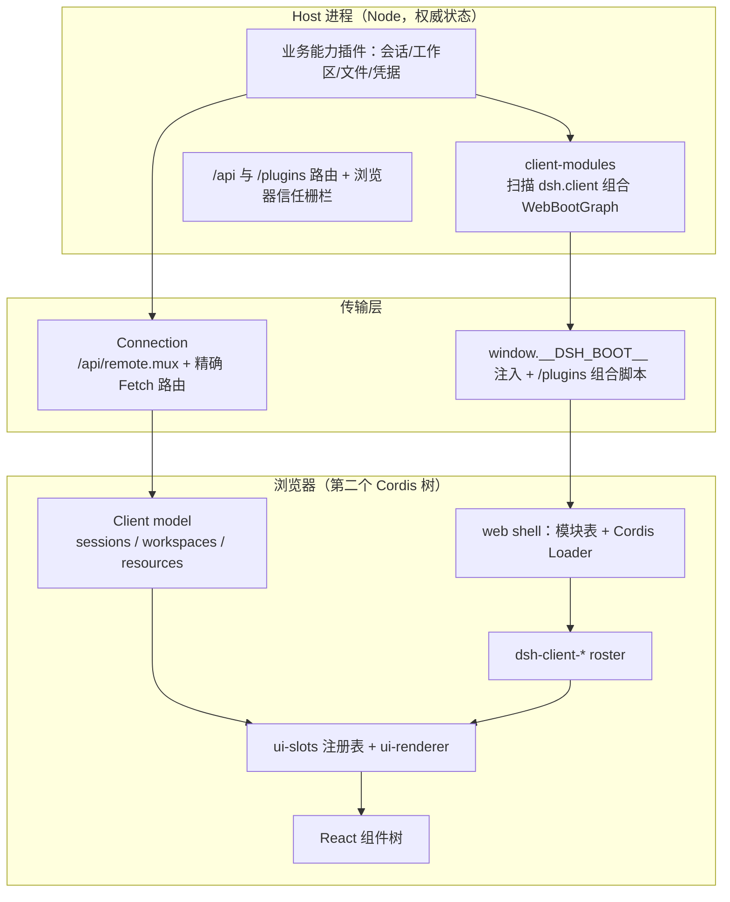
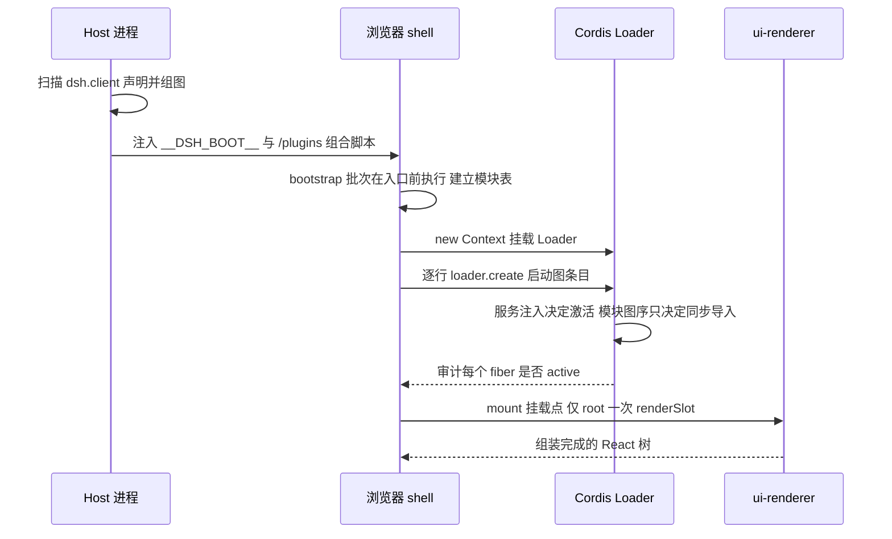
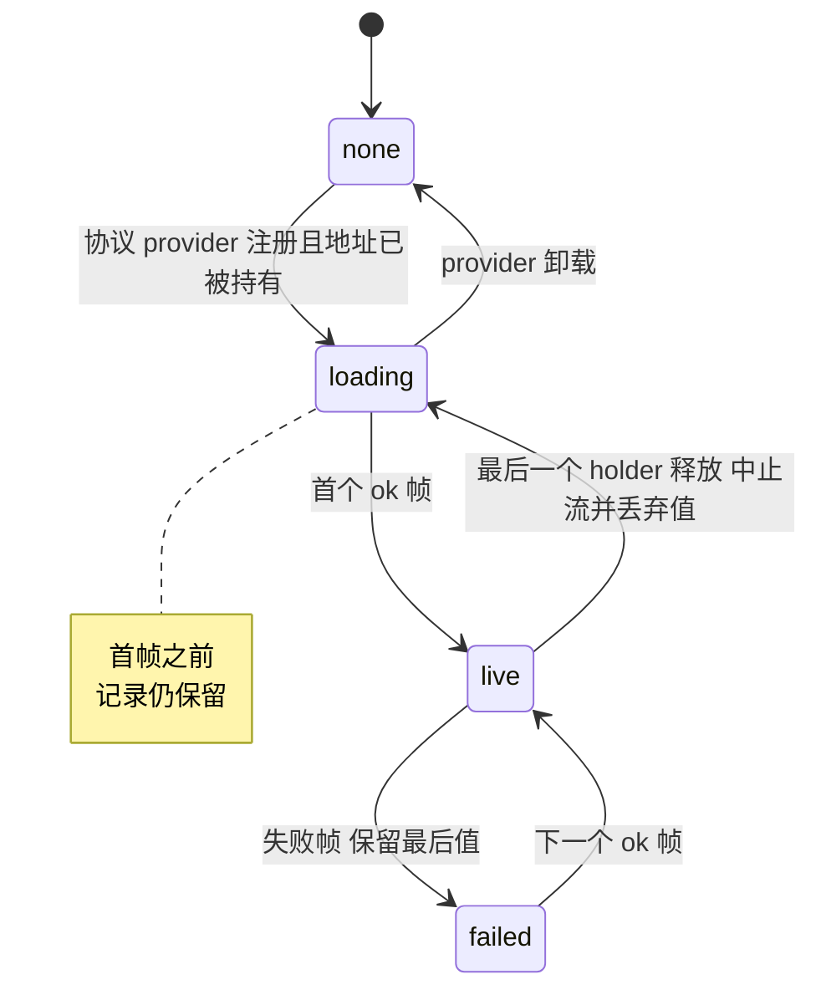
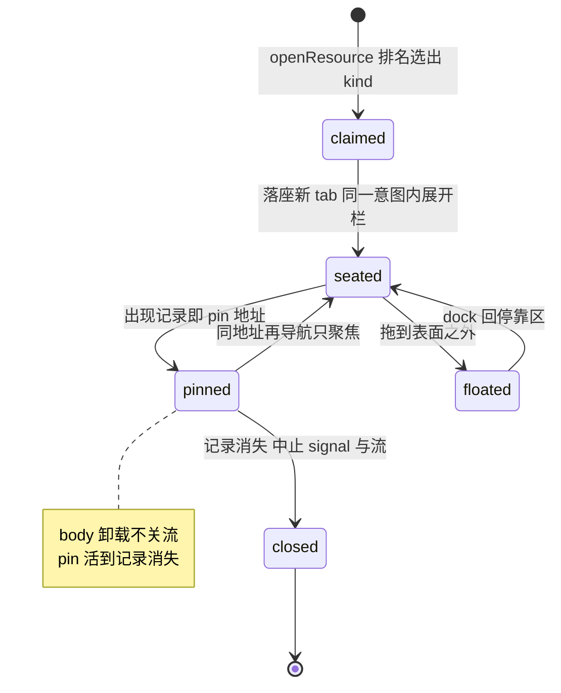
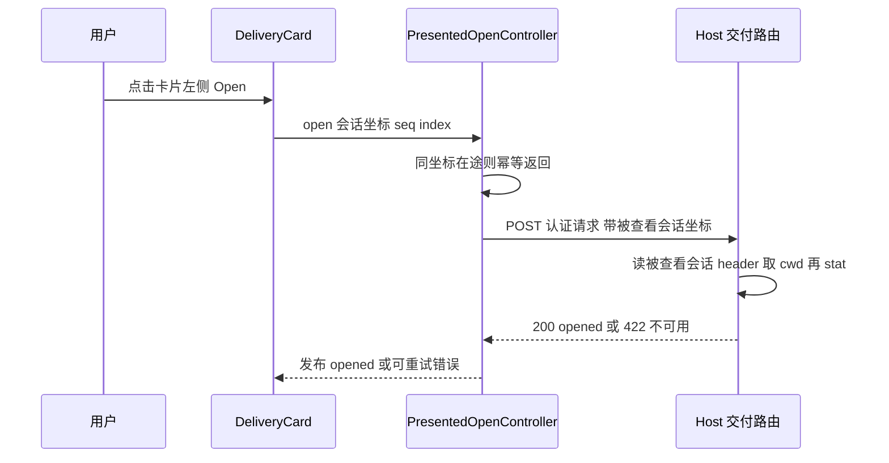

# 浏览器客户端：权威在 Host，界面在浏览器，两侧共用一套插件范式

> 子文档之一，聚焦 dsh 0.1.5 的浏览器端（`packages/client/*`、`apps/web`）——本次增量里代码面最大的领域之一（`git diff --stat dsh-v0.1.2-rc.1..HEAD -- packages/client apps/web` 为 937 个文件、+54936/−9815 行）。在既有解读中，Web 客户端只在 README 的「启动流程」与 [webworker.md](webworker.md)（浏览器里跑整棵 harness 插件树）里被顺带提及，是唯一没有独立子文档的主体；本文补齐这一空白关注面。整体哲学见 [README](README.md)；Host 侧的文件能力与 `tool-present` 交付语义见 [workspace-files.md](workspace-files.md)，Host↔浏览器的方法/流契约见 [remote-controllers.md](remote-controllers.md)，附件字节的持久化见 [attachments.md](attachments.md)。
>
> **本文依据代码快照比对 + 上游 tag 间 git diff 产出，非官方 changelog。** 基线 `dsh-v0.1.2-rc.1`，止于 `HEAD`（`dsh-v0.1.5-rc.2`）。窗口内 `packages/client` 从 44 个包增到 51 个，新增 `resources` / `file-upload` / `ui-dockkit` / `ui-open-in-app` / `ui-sidebar-right` / `ui-sidebar-files` / `ui-sidebar-documentpreview`（后者由窗口内先建的 `ui-sidebar-textpreview` 改名而来）。

## 根因：为什么浏览器端要另起一棵 Cordis 树，而不是复用 Host 那棵

dsh 的核心主张是**一切皆插件**：Host 侧把主循环、工具注册表、会话日志、沙箱都做成可热卸载的 Cordis 插件（见 [architecture.md](architecture.md)、[agent-loop-runtime.md](agent-loop-runtime.md)）。浏览器端面对的第一个设计问题是：**UI 要不要沿用同一个插件树？**

答案是「同一个范式，第二棵树」。浏览器里跑的确实是货真价实的 Cordis：`AppWebEntry` 新建一个 `Context`、挂载同一个 `@deepseek-ai/cordis-plugin-loader`、再对启动图里的每个条目调 `loader.create({ name })`，最后等 `loader.await()` 并审计每个 fiber 是否 `active`——不 active 就整体报错（[packages/client/web/src/boot.ts:112-134]()
<!-- anchor: /** Mount the Loader, create all graph entries, await quiescence, and audit acti … this.assertEntriesActive(ctx) -->）。差别只在**条目从哪来**：不是读 `cordis.yml`，而是 Host 启动时扫描已加载的 Loader 条目、把声明了 `dsh.client` 且 `platform: 'web'` 的包组合成一份 `WebBootGraph`，经结构化 index-injection 写成 `window.__DSH_BOOT__`（[packages/client/modules/src/index.ts:756-767]()
<!-- anchor: const dsh = pkg.dsh … if (clientRel === undefined) { -->）。也就是说，`dsh-client-*` 不是一个新插件系统，而是**同一套 Cordis 在另一侧、由 Host 组合出的第二份 roster**。

为什么不干脆复用 Host 那棵树？三道边界各自独立地把答案固定下来：

- **进程/执行环境边界**：Host 树跑在 Node 里，握着文件系统、子进程、凭据文件、Landlock；浏览器没有这些能力，Host 的包也大多不能在浏览器里求值。两棵树共享的是**数据与协议**，不是对象。
- **网络/信任边界**：浏览器经 `/api` 与 WebSocket 说话，每个 RPC 与流都要一个浏览器会话 cookie；Host 先做 Host/Origin 检查（拒 DNS rebinding 与跨站请求），再做 cookie 鉴权，两者都不建立身份，只建立「这次请求可信」（[packages/client/connection/src/client/connection.ts:1-20]()
<!-- anchor: /** Connection generation readiness, cancellation, and continuous recovery. */ … const MANUAL_RECONNECT = new Error('connection: manual reconnect requested') -->，策略细节见 [remote-controllers.md](remote-controllers.md)）。
- **权限/权威边界**：Host 拥有权威状态、持久化、变更顺序与访问策略；浏览器侧的 Client model 只是**身份稳定的本地投影**，编码「延迟响应与替换基线如何合并」，不是第二事实源（[docs/subsystems/web-client.md:36-52]()
<!-- anchor: Each API controller package owns a paired Host and Client face. The Host side ow … This pairing is not a second source of business truth. Host controllers decide d -->）。这条边界直接决定了 UI 包不得自己重造传输状态。

反向（用户动作）走另一条路：组件回调 → slot 的 inject 闭包或 owner → `ctx.sessions`/`ctx.workspaces`/生成的 scoped Remote → Host controller → 权威更新 → 流/事件投影回浏览器。**组件永远拿不到 Cordis `ctx`、传输对象，或另一个功能插件的实现**——这条纪律是「两棵树」能保持清晰的前提。

## 概览：roster、四层职责与技术栈

- **是什么**：dsh Web GUI 的浏览器半边。`npx @deepseek-ai/dsh web` 起 Host（默认 `http://127.0.0.1:3080`），Host 组装 51 个 client 包中的一部分作为浏览器 roster，浏览器侧再起一棵 Cordis 树把 UI 拼起来。
- **痛点**：传统 Web GUI 把「会话视图 / 工具卡片 / 设置页 / 侧边栏」写死在应用壳里，第三方想加一个 tab 类型或换一个消息视图就得改核心；而 agent 的 UI 恰恰是变化最快的一层。
- **适用场景**：需要在不 fork 核心的前提下扩展对话视图、侧栏 tab、设置区块、工具卡片；需要 UI 严格跟随 Host 权威状态；需要在同一页面里混入多种内容预览（文本/代码/PDF/HTML/图片）。
- **核心能力清单**：

| 能力 | 说明 | 主要落点 |
|------|------|----------|
| 第二棵 Cordis 树 | 浏览器内挂载 Loader，按启动图创建全部 client 条目并审计激活 | `packages/client/web`、`packages/client/modules` |
| 可扩展 slot 体系 | 类型化 React 组合：声明式扩展点 + 四类基数/三种作用域 | `packages/client/ui-slots`、`ui-renderer` |
| 地址即资源 | `dsh-resource://<protocol>/…` + 每协议一个 provider + 保留订阅 | `packages/client/resources` |
| 可逆停靠引擎 | 纯函数 `applyOp` 返回逆操作 + 每意图一条历史的 `Sequencer` | `packages/client/ui-dockkit` |
| 右侧栏 tab 体系 | 按地址 rank 认领 tab 类型、导航服务、可拆分/浮动/全屏 | `packages/client/ui-sidebar-right` |
| 文档预览管线 | 按扩展名 rank 选渲染器；PDF 连续滚动、HTML 沙箱、图片 | `packages/client/ui-sidebar-documentpreview` |
| 文件交付呈现 | 从工具结果折出 produced-files 行 + 不可变交付卡片 + 原生打开 | `packages/client/ui-deliverables` |
| 会话交互面 | Lexical composer、usage/time pills、连接恢复指示器 | `packages/client/ui-conversation`、`ui-chat`、`ui-primitives` |

- **技术栈**：TypeScript + React 18 + vendored Cordis + Lexical（composer）+ picomatch（地址 glob）+ tsdown 静态链接 + Vite/Vitest/Playwright（`apps/web`）。

**四层职责与依赖方向**（Host 状态 → Remote 传输 → Client model → UI adapter → Conversation/呈现 → Slots → React）：

| 层 | 主要归属 | 职责 |
|----|----------|------|
| Host 应用 | `packages/api/*-controller` 的 Host 面 | 权威状态、持久化、变更顺序、访问策略、流生产 |
| 传输/API 装配 | `client/connection`、`api/gateway`、`api/remotes` | 建立 Connection generation、暴露 `ctx.remote.*`、转发白名单事件、承载取消 |
| Client model | `api/*-controller/client` | React-free 的 Host 状态镜像、流/单次竞态、对象身份与订阅 |
| 组合与渲染 | `ui-slots`、`ui-renderer`、各 `ui-*` | 声明扩展点、派生组件 props、绑定 observable、挂载最终树 |

## 浏览器启动链路：从扫描到 root slot

启动分成 Host 组合与浏览器执行两段。Host 段只做「谁进 roster」；浏览器段做「谁先激活」。

Host 侧扫描是**增量**的：每次 Cordis `internal/plugin` 发射（fiber 构造或销毁）把条目名标脏，微任务 flush 时对活着的 Loader 条目重新对账；激活那一趟把当前条目全量播种进同一个脏集合并同步 flush，因此首扫与稳态共用一份实现——但失败姿态相反：激活期声明畸形或缺 bundle 会聚合成一个 `AggregateError` 让 fiber 直接 FAILED，稳态期只记警告、不许污染别人（[docs/subsystems/client-modules.md:75-81]()
<!-- anchor: ## The scan … Package metadata — including the negative "not a client package" verdict — is ca -->）。

浏览器段的核心约束是**两层调度**：`bootstrap` 批次是解析器阻塞的、在 graph 全局与 Vite 入口之前执行；`application` 批次是 preload 的。每个 URL 的资源列表按「更长的 map 形式」贪心切分并保证 ≤3 KiB，未知/改动的资源列表或过期 revision 一律 404（不返回 SPA fallback 的 HTML 冒充 JS）。这条设计把「插件图 = 单一事实源」和「缓存不可变」同时钉住。

`packages/client/web/src/boot.ts` 的 `runPluginBoot` 是这条链路的落点：先 `ctx.plugin(Loader)`，把浏览器模块系统塞进 `loader.internal`，为增量 `immediately` 条目预取，然后对启动图每一行 `loader.create`，最后 `await loader.await()` 并逐个断言激活（前面已引）。**注意 `prefetchImmediateTier` 只负责提前开始传输，失败不在这里报**——真正的 bundle 失败由 Loader import 重试并上报，这是「预取是优化、不是正确性」的取舍。

模块表里「共享什么」有一个显式白名单：`PLATFORM_MODULES` 是 shell 冻结进模块表的单例词（react、cordis、store、ui-slots、ui-primitives，本次增量新增 **ui-dockkit**），其余 client 包都是按需拉取的懒 CJS 条目（[packages/client/web/src/platform.ts:8-14]()
<!-- anchor: export const PLATFORM_MODULES = [ … ] as const -->）。把 dockkit 放进这份白名单而不是让它做普通插件行，是下面「停靠引擎为什么独立」的关键一半。

## Client Resource Registry：地址是一等公民，保留订阅撑住 tab

本次增量新增的 `packages/client/resources` 解决一个非常具体的抽象缺口：**一个组件只知道自己要显示的数据的「地址」，而数据的拥有者是另一个 client 包**——右侧栏的 tab 记录、对话里的文件链接、@ 提及，都是这种形态。资源地址是 `dsh-resource://<type>/…`，host 段即协议名（`ResourceProtocolMap` 的键），路径归协议自己；模型只解释 scheme 与 host，其他 scheme（如侧栏自己的 `sidebar://guide`）一律读作 `none`（[docs/subsystems/client-resources.md:11-19]()
<!-- anchor: A resource address is a `dsh-resource://<type>/…` URL. The host names the protoc … | `/home/me/notes.md` | — | `none`: not a URL | -->）。

注册是**协议所有权**而不是数据源集合：每个协议的拥有者在自己的 `ctx.effect` 里注册恰好一个 provider，第二个注册直接抛错；`register` 内部就包在 `ctx.effect` 里，所以「协议活多久 = 插件活多久」，provider 到达时已经被持有的地址立刻开流、provider 卸载时这些地址回到 `none`（[packages/client/resources/src/client/resources.ts:82-90]()
<!-- anchor: register
(provider: ResourceProvider
): () => void … for (const record of this.recordsOf(protocol)) this.attach(record) -->）。provider 的 `open(address, { signal })` 返回的是 **`RemoteResult` 帧流**：首帧是当前值、之后每帧一次变化，失败也是帧（`ok: false`）而不是抛异常——流内部的 throw 被显式定义为编程错误、不捕获（[packages/client/resources/src/client/contract.ts:60-62]()
<!-- anchor: export type UseResource = 
( … ) => ResourceSnapshot<ResourceProtocolMap[P]> -->）。把失败建模成帧而不是异常，换来的是「失败时仍保留最后一个好值」的能力，UI 可以显示陈旧内容加一条提示，而不是变白屏。

真正的机制在**保留订阅（retained subscription）**：一条地址对应一个 `ResourceRecord`，记录里只有 `holders` 计数、快照 store、以及运行中流的 `AbortController`。`source(address)` 返回的 observable 在 `subscribe` 时 `hold`、在取消订阅时 `release`；第一个 holder 开流、后续 holder 共享并立刻读到最新值、最后一个 holder 释放时 abort 流并把快照打回 idle（[packages/client/resources/src/client/resources.ts:130-140]()
<!-- anchor: source: { … this.release(record) -->）。流被 abort 之后 provider 仍可能吐出一帧，消费循环在每次迭代开头检查 `signal.aborted` 并 break，因此「释放后到达的帧不属于任何人」（[packages/client/resources/src/client/resources.ts:200-208]()
<!-- anchor: private async consume(record: ResourceRecord, provider: RuntimeProvider, signal: … : { status: 'failed', value: record.store.getSnapshot().value, failure: frame.er -->）。

**Why 记录不随最后一个 holder 消失？** 源码注释给的理由是 React 的 render-then-subscribe 窗口与 StrictMode remount：如果最后一个 holder 释放就删掉记录，`source()` 的身份会在重挂时变化，于是每次渲染都重新订阅、重启整条流（[packages/client/resources/src/client/resources.ts:2-9]()
<!-- anchor: * `ctx.resources`: the provider registry and the per-address states behind … * recreated record would make every render resubscribe and restart the stream. -->）。**代价**同样明确：内存随「历史上被读过的不同地址数」增长，而不是随并发读取数；一个忽略 `signal` 的 provider 会一直跑到下一帧才发现自己早该停（[packages/client/resources/README.md:90-95]()
<!-- anchor: ## Known Limitations and Deferred Work … - **Providers own abort compliance** — the registry drops what a released stream -->）。这是一个刻意用小泄漏换订阅稳定性的取舍，只有在「地址数量级有限」的假设下才成立。

`useResource` 通过 `ctx.slots.provideRoot({ keyedHooks: { resource } })` 挂成**全局标准 hook**，因此每个 slot 组件无论什么 scope 都能拿到它——消费方不需要 import 拥有者的运行时（[packages/client/resources/src/client/index.ts:30-40]()
<!-- anchor: export function apply(ctx: ClientContext): void { … } satisfies RootStandardSourceContribution) -->）。

**与 tab 生命周期的咬合**：右侧栏为每个打开 tab 记录的地址做一次 `pin(address, signal)`，pin 的生命周期就是 tab 记录的命；切换 tab 会卸载 body，但流不关、内容不丢，切回来立刻是最新值（见下节）。

## Slot 体系：UI 的唯一横向拼接面

如果 Client model 解决了「数据怎么到浏览器」，slot 解决「界面怎么被拆开给别人拼」。`ui-slots` 定义的是 **React-free 的注册表与类型代数**；`ui-renderer` 是唯一把 observable 经 `useSyncExternalStore` 绑到 React、并渲染根树的包。

扩展点用**声明合并**写进 `SlotMap`。一条声明固定两个正交轴：基数（`single` / `list` / `keyed` / `chain`）与作用域（`root` / `session-maybe` / `session`）（[packages/client/ui-slots/src/index.ts:98-101]()
<!-- anchor: export type SlotKind = 'single' | 'list' | 'keyed' | 'chain' … export type SlotScope = 'root' | 'session-maybe' | 'session' -->）。声明还带 owner props、keyed props，以及可选的 slot 级 inject 面（[packages/client/ui-slots/src/index.ts:110-119]()
<!-- anchor: export interface SlotEntryDef { … keyProps?: Record<string, object> -->）。声明一个子 slot 有三个后果：让这个 key 变活、授权父条目调 `renderSlot`/`renderSlotChain`、登记运行时 dispatch 规格；往未声明的 slot 注册、或声明一个已被别处拥有的子 slot，都会在**插件激活期**失败。`root` 是唯一内建声明、也是唯一经 Cordis 服务渲染的 key——`ui-renderer` 调 `ctx.slots.renderSlot('root', {})`，其后所有层级都经父条目的 `renderSlot` prop 渲染。

`conversation.composer` 是一个很好的 `chain` 例子：每个候选提供纯函数 `select(owner)`，按 `priority` + 注册序取第一个非空结果渲染，并把该结果作为 `matched` 传给组件；默认 composer 始终留在下面，业务包只在自己的请求挂起期间装入一个接管条目（[packages/client/ui-conversation/src/client/contract/slots.ts:119-158]()
<!-- anchor: interface SlotMap { … 'conversation.composer': { kind: 'chain'; scope: 'session'; owner: ComposerChainProps } -->、[docs/subsystems/slots.md:56-58]()
<!-- anchor: | scope | `session` | Requires a resolved Session binding and receives definite  … `priority` is a shadowing rank for `single`, `list`, and `keyed` cells and an el -->）。

组件的输入被拆成**四份互不混淆的共享**——owner 值、框架标准 props、注册者自己的 inject、声明的 store；加一个可选 locale 命名空间。设计上刻意让功能包**只以 `import type` 引用别的功能包**，运行时值一律经注入的 Cordis 服务或 slot 传递（[docs/subsystems/slots.md:60-75]()
<!-- anchor: ## Component inputs … Components never receive `ctx`. Parent-owned point-in-time values enter through  -->）。这条纪律的价值在它能被程序检查：`pnpm run gen-client-catalog` 从 `SlotMap` 声明与 `slots.register()` 调用点生成完整契约，运行中的动态包可以用 `cordis_inspect what:"client"` 查询活树和任意 key。**换来的代价**是间接层数：一个组件想拿「当前渲染的是哪个 turn」不能直接读父组件，得由 slot owner 的 inject 面提供受限 hook（如 `useTurnData(key)`）。

## 右侧栏与可逆停靠引擎：为什么 dock 引擎要独立成包

右侧栏是本次增量最大的单体（`ui-sidebar-right` +6152、`ui-dockkit` +8484、`ui-sidebar-documentpreview` +7663、`ui-sidebar-files` +2012）。它被切成三个包，切法本身就是设计决策：

- `ui-dockkit` 是**纯逻辑 + 通用组件**：没有 UI 框架概念之外的宿主知识，没有 Cordis 服务，没有 React context。「Harness Web client 是它的第一个嵌入者，但这里没有任何东西知道这一点。」它之所以被发布，是因为 Sidebar 静态链接了它，而**不是**把它当稳定 API（[packages/client/ui-dockkit/README.md:14-14]()
  <!-- anchor: > **Internal engine.** This package is published because the Sidebar links it st -->）。
- `ui-sidebar-right` 是**Cordis 侧的嵌入者**：持有每会话一个停靠面、tab 类型注册表、导航服务。
- `ui-sidebar-documentpreview` / `ui-sidebar-files` 是**具体 tab 类型**，只通过公开路径接入：definition 进 `ctx.sidebarRightTabs`，body 进 keyed slot `sidebar.right.pane.tab`，标题进 `sidebar.right.pane.tab.title`。

**引擎的第一原则是「可逆」：`applyOp(state, op)` 返回下一个状态 *和撤销它的操作***。逆操作在操作执行时捕获（因为到 undo 时操作前状态已经没了），每个操作把自己创建的 id 一起带上，因此 `replay(initial, ops)` 可复现同一棵树、引擎不读时钟也不读随机源（[packages/client/ui-dockkit/src/engine/operations.ts:423-437]()
<!-- anchor: export function applyOp(state: LayoutState, op: LayoutOp): ApplyResult { … case 'unfloat': return applyUnfloat(state, op) -->，逆快照见同文件 `focusSnapshot`）。**Why 用逆操作而不是快照整个布局？** 快照最省事，但撤销/重放要整份序列化布局，且「撤销」会丢掉撤销点之后才产生的、与布局无关的事实（比如某个 tab 的滚动位置或资源订阅）；逆操作只回滚被这次意图触碰的部分，代价是每个新操作都必须自己写对逆操作——这是引擎规模可控（一个文件、一个 switch）时才划算的交换。

第二原则是**每意图一条历史**：`Sequencer` 把一次手势或命令产生的多个操作合成一个 `HistoryEntry`，连续多个「只改焦点」的条目合并成一步，回退后再记录新条目会丢弃 redo 分支（[packages/client/ui-dockkit/src/engine/sequence.ts:21-31]()
<!-- anchor: export interface HistoryEntry { … readonly cursor: number -->）。组件层只报告**已结算的意图**、绝不报告拖拽中间帧，所以嵌入者能精确地一条手势记一条历史。

第三原则是这条产品规则（不是引擎的）：**一个意图不能在展开的栏里留下空 pane**。`planSettle` 把被清空的 side pane merge 掉，空掉的 root pane 用嵌入者的 factory 重新播种；嵌入者不想播种就不传 factory（[packages/client/ui-dockkit/src/engine/planner.ts:382-391]()
<!-- anchor: export function planSettle(state: LayoutState, mint: Mint, makeTab?: TabFactory) … current = applyOp(current, merge).state -->）。`ui-sidebar-right` 的 store 把「计划 → 结算 → 记一条历史」串成一个 `advance`，并且**在栏折叠时故意不播种**——空折叠栏保持为空，等到真正展开它的那一步再播种（[packages/client/ui-sidebar-right/src/client/stores.ts:186-198]()
<!-- anchor: function advance(surface: SurfaceState, plan: SurfacePlan, seed: () => SidebarRi … return { layout: stepped.state, history: stepped.history, minted: counter.used() -->）。

**last-tab 关闭规则**由此自然导出：关闭一个 pane 里唯一且停靠的 tab 时，不只是关它，而是同时 `planSetMode(...,'push')` 退出全屏、并 `planSetExpanded(...,false)` 折叠整栏——因为重新展开的栏只会显示重新播种的默认页，那一页不配占满整个窗口（[packages/client/ui-sidebar-right/src/client/stores.ts:351-357]()
<!-- anchor: closeTab: (d, sessionId: string, tabId: TabId) => { … return [{ type: 'closeTab', tabId }, ...planSetMode(state, 'push'), ...planSetExpanded(state, false)] -->）。这条规则解决的是「用户关掉最后一个 tab 后停留在空白大栏」的体验断点。

tab 类型注册的第二原则是**地址认领是排名制**，直接借了 VS Code 的 editor resolver 模型：glob 先收窄候选，可选 `canOpen` 一票否决，幸存者按优先级带（`extension` > `builtin` > `fallback`）、再按最长匹配模式长度、再按注册序排名（[packages/client/ui-sidebar-right/src/client/tab-registry.ts:337-348]()
<!-- anchor: candidates(address: string): readonly SidebarRightTabDefinition[] { … ranked.sort((left, right) => -->）；`claim` 无 `kind` 时取第一名，有 `kind` 时跳过 glob 但**仍跑 `canOpen`**——「点名类型本身就是决定」（[packages/client/ui-sidebar-right/src/client/tab-registry.ts:366-381]()
<!-- anchor: claim(address: string, kind?: string): SidebarRightTabClaim { … return { kind: chosen.kind, contentId: address, title: chosen.title(address) } -->）。tab 身份是 `(kind, address)` 对，地址原样作为记录的 `contentId`，所以同地址经两个类型打开是两个 tab、经同一类型打开是聚焦已有 tab。

导航控制器把「认领 → 聚焦已有 → 落座新 tab → 展开栏」四步合成**一个 store 意图 + 一条导航记录**（[packages/client/ui-sidebar-right/src/client/service.ts:327-341]()
<!-- anchor: private place( … ...placement.revealIfOpened === undefined ? {} : { revealIfOpened: placement.rev -->）。**Why 合并成一个意图？** 因为用户的一次「打开文件」在观感上必须是一步——如果展开栏和落座 tab 各记一条历史，撤销会先折叠栏、再关 tab，像两次误操作。`revealIfOpened` 默认 `true`（同地址同类型聚焦并递 `params`），这正是「读工具行点行号 → 跳到已打开预览的对应行」的路径。

Tab domain 负责布局之外的每记录状态：一个 `TabOccurrence` 持有 record 生命期的 `AbortSignal`、最新导航（`revision` 每次导航自增，body 可以只对「又被导航了一次」反应）、以及绑定到该 tab 所在会话的 actions；`sync` 在每次提交后对账——新出现的记录被 pin 住地址，消失的记录 abort 并丢弃（[packages/client/ui-sidebar-right/src/client/tab-domain.ts:85-98]()
<!-- anchor: sync(sessionId: SessionId, layout: LayoutState): void { … this.pin(occurrence.navigation.getSnapshot().address, occurrence.signal) -->）。这就是资源模型与停靠引擎的接缝：**布局负责「谁是可见的」，Tab domain 负责「谁还活着」。**

布局约束是产品选择而非引擎能力：本产品**最多两个 pane**（`split` 在 `dockPaneIds(layout).length >= 2` 时直接返回 `undefined` 且不记录），最小 pane 比例 0.2，`hideSplitWhenBlocked` 让没空间的 split 控件隐藏而不是禁用（[packages/client/ui-sidebar-right/src/client/service.ts:394-401]()
<!-- anchor: split(paneId?: PaneId): PaneId | undefined { … if (!canSplit(layout) || dockPaneIds(layout).length >= 2 || !canSplitPane(target -->、[packages/client/ui-sidebar-right/src/client/shell/SidebarRight.tsx:306-311]()
<!-- anchor: <DockSurface … minPaneFraction={0.2} -->）。引擎本身保留通用树与其他分割方向——把「能拆多细」留给嵌入者，正是引擎能同时服务「两栏限定」和未来其它嵌入者的原因。

## 预览管线：内容读在客户端，能力留在边界外

预览管线的入口也是注册表，但排名维度换成**文件扩展名**：`DocumentPreviewDefinition` 记录唯一 `id`、后缀列表、`builtin`/`extension` 带、本地化标题、以及内容投递模式 `text-pages` 或 `bytes-complete`；选择顺序是外部带优先、再最长后缀、再注册序，**所有实现都保持可用**（工具栏可以列出备选并记住每 tab 的选择），未知扩展名回落纯文本（[packages/client/ui-sidebar-documentpreview/src/client/document/registry.ts:29-45]()
<!-- anchor: export function matchingDocumentPreviews( … .map(candidate => candidate.definition) -->）。本次增量落地的渲染器有六个：文本、Markdown、HTML、图片、PDF、代码（[packages/client/ui-sidebar-documentpreview/src/client/index.ts:112-117]()
<!-- anchor: registerText(ctx) … registerCode(ctx) -->），图片支持 `png/jpg/jpeg/gif/webp/bmp/ico/svg`（[packages/client/ui-sidebar-documentpreview/src/client/image/index.ts:11-12]()
<!-- anchor: /** File suffixes rendered by the builtin image body. */ … export const IMAGE_EXTENSIONS = ['png', 'jpg', 'jpeg', 'gif', 'webp', 'bmp', 'ic -->）。

**PDF 的连续滚动**不是一次性渲染整份文档，而是把 `numPages` 个 `<PdfPage>` 全部挂进一个滚动 `<section>`，每页只有 canvas 与占位，真正的栅格化由 `IntersectionObserver`（`rootMargin: '100% 0px'`，即提前一屏）触发，第一页无条件先渲染（[packages/client/ui-sidebar-documentpreview/src/client/pdf/PdfBody.tsx:74-77]()
<!-- anchor: return <section className={css.body} data-pdf-preview> … requested={index === 0 || view.page === index + 1} onVisible={pageVisible} signa -->、[packages/client/ui-sidebar-documentpreview/src/client/pdf/PdfBody.tsx:95-107]()
<!-- anchor: useEffect(() => { … }, { rootMargin: '100% 0px' }) -->）。**Why 连续滚动而不是分页？** 分页要自己实现页码、跳转、缩放与「回到上次位置」，而 PDF 阅读的心智模型是滚动；把渲染切成可见性驱动，则总渲染成本与滚动过的页数成正比、与文档总页数无关。代价是 DOM 节点数与总页数成正比——不适用于数千页文档，这是当前实现的已知边界。

**HTML 预览的边界是本文最值得看的一处**。它不用 DOMPurify 那条路，而是把整份 HTML 装进一个 `sandbox="allow-scripts"` 的 iframe——注意**没有** `allow-same-origin`，因此是 opaque origin，脚本能跑但拿不到父页任何东西（[packages/client/ui-sidebar-documentpreview/src/client/html/HtmlBody.tsx:52-55]()
<!-- anchor: return <LoadingIndicator className={css.status} label={t('loading')} /> … return <iframe key={frame.url} className={css.frame} src={frame.url} sandbox="al -->）。为了让「本地相对引用的 .js/.css」也能工作，父页在 **iframe 之外**、用原始文档所在会话的权限把静态依赖读成字节，再把它们转成 blob URL 注入 iframe 文档；打包是有限集：只收直接 `.js` classic script 与 `.css` link，单资源 4 MiB、总量 32 MiB、最多 64 个，任何超限直接拒绝（[packages/client/ui-sidebar-documentpreview/src/client/html/pack.ts:14-16]()
<!-- anchor: const MAX_ASSET_BYTES = 4 * 1024 * 1024 … const MAX_ASSETS = 64 -->）。**关键是权限没有越界**：读取用的是「原文档的会话与目录」这条普通文件权限，iframe 自己从不发请求，也就没有把宿主权限暴露给不可信内容的通道；而 `base[href]` 一出现就整体放弃打包（交给浏览器解析），避免把相对 URL 解析到宿主应用页。

**主题适配：除 HTML 外的预览都吃应用的设计令牌。** 文本/代码/Markdown/PDF 外壳/图片预览都是应用树里的普通 DOM，样式只读 `--dsw-*` 令牌（背景、边框、文字层级、滚动条），因此切换 light/dark 或 12–17px 内容字号时自动跟随；这些令牌在主题注册表里被标记为 `requiresLightAndDark`，即每个别名都必须在两套调色板里同时给出值（[packages/client/ui-theme/src/client/index.ts:132-134]()
<!-- anchor-base64:eyBuYW1lOiAnLS1kc3ctYWxpYXMtYmctYmFzZScsIGRlc2NyaXB0aW9uOiAnQXBwbGljYXRpb24gYmFzZSBiYWNrZ3JvdW5kLicsIHZhbHUg4oCmIHsgbmFtZTogJy0tZHN3LWFsaWFzLWJnLWxheWVyLTInLCBkZXNjcmlwdGlvbjogJ1NlY29uZGFyeSBuZXN0ZWQgc3VyZmFjZSBiYWNrZ3Jv -->）。首屏一致性由一段**插件激活之前**就执行的行内脚本保证：Host 把已持久化的偏好（只解析 `system`）嵌进索引响应，脚本在 shell 挂载前写好 `color-scheme`、`body[data-ds-dark-theme]` 与 `--dsh-content-font-size`，之后由 ui-layout 的 presenter 接手同一组 DOM 字段（[packages/client/ui-theme/src/boot-theme.ts:14-17]()
<!-- anchor: const preference = ${JSON.stringify(preference)} … && matchMedia('(prefers-color-scheme: dark)').matches -->），所以预览不会先以错误配色闪一帧。唯一例外是 HTML 预览：它在 opaque origin 的独立文档里被 `document.write` 重建，父页的令牌与样式表都进不去，外观由文档自己的 CSS 决定（[packages/client/ui-sidebar-documentpreview/src/client/html/bootstrap.ts:24-29]()
<!-- anchor: export function createHtmlDocument(bundle: HtmlBundle): string { … return `<!doctype html><meta charset="utf-8"><script>(()=>{ -->）。这是**有意的**——自包含的 HTML 交付物应当按它自己的样式渲染，而不是被宿主主题染色；代价是深色应用里打开一份白色 HTML 会显得刺眼。

**为什么这些预览必须走客户端而不是 Host？** 三个理由层层递进：(1) 内容是**不可信的**（模型产出、仓库文件），任何在 Host 上求值的渲染都是把不可信输入放进有文件系统与凭据的进程；(2) 渲染是**纯展示**，不需要 Host 能力，把它放在浏览器可以把「读字节」和「解释字节」分离——Host 只做有界读取与路径解析；(3) 用户可见的延迟必须发生在用户所在的进程，PDF 栅格化与 HTML 布局都不该占用 agent 主循环。

**必须交代的一次完整回滚。** 窗口内上游曾合入一条更激进的预览特性：让共享 Markdown 渲染器把 settled 的 `mermaid` / `graphviz` / `dot` / `svg` / `html` 代码栅栏直接渲染成图（PR #3710，含 `SourcePreview` 组件、懒加载 mermaid、`@viz-js/viz` WASM、DOMPurify + 空 sandbox iframe、图尺寸按内容、以及一整套第三方许可声明）。它在 2026-09-09 被 PR #3901 `Revert "feat(web): preview Mermaid, Graphviz, SVG, and HTML code fences"` **完整回滚**（净删约 2346 行，含两个 Agent Note、e2e 用例、`THIRD_PARTY_PREVIEW_NOTICES.txt` 与依赖）。因此在 `HEAD` 上：代码栅栏只做语法高亮，没有图预览（[packages/client/ui-primitives/src/markdown/CodeBlock.tsx:12-16]()
<!-- anchor: export interface CodeBlockProps { … lang?: string | undefined -->），`packages/client/ui-primitives/package.json` 也不再有 `mermaid`/`@viz-js/viz`/`dompurify`。从回滚 diff 触碰的文件（第三方许可清单、`tsconfig.host.json`、`vite.config.ts`、workspace 约束脚本、依赖锁）看，最可能的原因是**编译产物的许可与打包约束**——Mermaid/Graphviz 的 npm 元数据许可并不覆盖其内嵌编译组件——而非渲染方案本身不可行；这是推断，不是源码确证。这条历史值得写进解读，因为它恰好说明了「客户端预览」的成本结构：**能力很容易写，难的是让它可分发、可审计、可合法打包。**

## 文件交付呈现：从工具结果到可点卡片

Host 侧的 `present` 工具与工作区文件 API 由 [workspace-files.md](workspace-files.md) 覆盖；这里只看浏览器侧怎么把它变成「可点的东西」。

呈现的**词汇来源被刻意钉死在工具调用上**，不来自结语散文：`deliverablesDefinition` 把每个 Turn 里**成功的第一方变更调用**（`write`、`edit`、变更型 `str_replace_editor`）折成 `DeliverablesTurnData`，读取、删除、不支持的工具、畸形调用、失败结果一律不贡献；新增一个变更工具必须显式加一条客户端贡献（[packages/client/ui-deliverables/src/client/turn-deliverables.ts:2-6]()
<!-- anchor: * Turn-scoped produced-file Definition and readers. Client-only and … import { isAppendSurfaceEvent } from '@deepseek-ai/dsh-session/surface' -->）。**Why 不解析结语？** 因为「模型忘了提」不该让文件消失，「模型提了一个没被修改的文件」也不该产生幽灵条目——可靠性来自工具结果而不是自然语言。显式交付（`present` 声明的文件）走同一个 Turn data 的第二个字段，于是两种来源共用一套卡片与一个行渲染。

卡片与结语的链接共用一套 vocab：`ui-deliverables` 把行注册进 `conversation.chat.turnTail` 链、把 `present` 工具行注册进 `tool.call.toolview` 的 keyed `present`，并 `ctx.provide('chatFileMentions')` 给 chat 视图查结语里的 inline-code 提及；三个面共享同一个「有没有词汇」的判据，所以把插件从 `cordis.yml` 摘掉，行、提及、提示词三者一起消失、聊天视图退化为空链与惰性散文、零成本（[packages/client/ui-deliverables/src/client/index.ts:44-56]()
<!-- anchor: ctx.effect(() => () => opener.dispose()) … reloadPresentedHost: () => opener.loadHost(), -->、[docs/subsystems/web-client.md:84-88]()
<!-- anchor: ## Package boundaries … Shared runtime values need a narrow static owner with no feature lifecycle, such -->）。

**原生打开**（默认应用 / 文件管理器）是全篇最典型的「呈现与权限分离」：浏览器不知道服务端是哪台机器、装了什么应用。卡片点击走一条**用被查看会话坐标寻址**的认证 POST：`presentedFileUrl(sessionId, seq, index)` 把「哪个会话、哪个交付事件、事件里第几个文件」编进 URL（[packages/client/ui-deliverables/src/presented.ts:54-55]()
<!-- anchor: export function presentedFileUrl(sessionId: SessionId, seq: number, index: numbe … return `${PRESENT_OPEN_PATH}?${new URLSearchParams({ sessionId, seq: String(seq) -->）。这里的 `sessionId` 是修复 `fix(web): open delivered files using the viewed session scope` 的核心：**用它正在被查看的那个会话（包括 fork 后的自身身份）**，Host 再读该会话 header 里的 cwd（缺席时退回部署 workspace root）去 `workspaceFiles.stat`，而不是猜当前选中会话。这避免了「从子会话/fork 打开交付文件却按父会话 cwd 解析」的错位。

客户端侧的状态机同样值得看：`PresentedOpenController` 用「文件动作 URL」当 key 共享状态，同一坐标的重复点击在请求挂起期间是幂等的；它把桌面元数据（`/api/present.host`）与打开动作分开，**连接被替换时 `resetHost` 让旧连接返回的元数据不能发布**；失败留在卡片上可重试，`dispose` 会 abort 生命期并等待所有在途请求，保证「插件卸载后不再有请求能发布状态」（[packages/client/ui-deliverables/src/client/present-open.ts:29-39]()
<!-- anchor: async open(sessionId: SessionId, seq: number, index: number, action: PresentedAc … this.pending.delete(task) -->）。`422` 专门表示「该 provider 无法把 Host 路径映射回进程路径」，卡片据此引导用户改用侧栏预览——**不创建文件副本、不产生附件**，交付只是对同一份文件的一次寻址。

## 对话区交互：三处真正承载设计的选择

对话区（`ui-conversation` +2998/−1127、`ui-chat` +2698/−1808）改动量大，但多数是可预期的界面细节。挑三处真正承载设计的：

**composer 是一个壳拥有的词法编辑器，而不是受控 textarea。** 0.1.2 起 composer 从 textarea 栈换成 Lexical：`ComposerContentEditable` 把一个 shell 拥有的 editor 绑到常驻 div，`editor` 为 null 时渲染同一个 div 但 inert——因此「无会话的 workspace 触发态」与「有会话的编辑态」之间切换**不换元素树**；可编辑性只有一个写者（该组件把 `editable` prop 反映到 editor 上，别处不许调 `setEditable`）（[packages/client/ui-conversation/src/client/input/editor/ComposerContentEditable.tsx:2-7]()
<!-- anchor: * The composer's contenteditable host: binds one shell-owned Lexical editor … * calls setEditable. -->）。**Why 值得换？** 因为引用 chip 必须是原子 decorator 节点（带拥有者的序列化身份，提交时经 owner codec 展开），斜杠命令是保留样式的 leading text——这些都是富文本结构，用 textarea 加一堆 offset 映射去模拟，正是过去 bug 的来源。

**usage/time 双 pill 读的是 durable 投影，不是屏幕上的节点。** `StatsPills` 从 `useProjection('sessionStats')` 与 `useProjection('tokenUsage')` 取值；只有在没有投影值供应的装配里，才回落到「窗口内节点折叠」（字段名故意与投影一致，便于整体互换）。两个 pill 共用一个排他 dialog 槽：开一个就关另一个；没有任何计时数据的窗口让 gauge pill 退化为纯读数而不是打开空对话框（[packages/client/ui-chat/src/client/chat/StatsPills.tsx:317-331]()
<!-- anchor: export const StatsPills = memo(function StatsPills({ useChat, useProjection, t } … && (billedInputTokens(usage) > 0 || usage.outputTokens > 0) -->）。**Why 不直接数屏幕节点？** 因为窗口是分页的、压缩会重写它——「总数」必须来自整份日志的投影才能稳定；节点折叠只是没有投影时的 best-effort。

**连接恢复被建模成显式的三态，而不是一个 spinner。** `ConnectionIndicatorState` 是 `disconnected` / `connecting` / `recovered`（[packages/client/ui-primitives/src/ConnectionIndicator.tsx:5-8]()
<!-- anchor: export type ConnectionIndicatorState = … | 'recovered' -->）。它背后是 Connection 的 generation 语义：只有收到 `$events` 流的 `ready` 帧才算 generation 建立、才 `onConnected`；ended/error/非 ready 首帧/畸形事件都会作废当前 generation；重试是 50%–100% 抖动、上限 500ms→1s→2s→4s→8s→10s 后停在末档；浏览器 `offline` 中止在途工作并挂起自动重试，`online` 从 500ms 档重来（[packages/client/connection/README.md:41-50]()
<!-- anchor:  … Set the Host Connection row's `config.recovery` to override retry caps, the grow -->）。**「已恢复」是一等状态而不是回到静默**——因为断线期间用户可能已经看到过错误，给出一次确认比无声消失更可信。

另外两处按同一模式补齐，不展开：`ui-attachment` 把图片与通用文件放进**同一条按 pick 顺序的混合草稿轨**（图片 64px 方、文件 240×64 卡），上传中替换字形为 spinner 并显示字节进度；`ui-message-feedback` 让 Like 与 Dislike **都打开同一个对话框**（分类 chip + 可选描述），因此每条助手消息只有一个反馈面、每会话只有一个 dialog 控制器；`ui-goal` 把 goal 条注册进 `conversation.input.dock`，与 Todo、Queue 一起构成 composer 上方的卡片栈（[packages/client/ui-goal/src/client/index.ts:83-88]()
<!-- anchor: ctx.slots.inject('conversation.input.dock', () => ctx.slots.register({ … inject: (sessionId): GoalBarInjected => { -->）。

## 权衡与不足

- **包数量的维护面本身成了成本。** 51 个 client 包、窗口内净增 7 个，每个都有自己的 `package.json`（含 `dsh.client` 声明）、Node 半 `src/index.ts` 与浏览器半 `src/client/index.ts`、双语 README、tsconfig、tsdown 配置。好处是「摘掉一行 cordis.yml 就整体消失」，代价是跨包契约的变更需要同步多处，`docs/module-graph.md` 这类生成物一旦漏刷就会误导。`ui-sidebar-documentpreview` 在窗口内先建立再改名（`textpreview` → `documentpreview`）就是这种膨胀期的典型痕迹。
- **Host/Client 的重复投影是长期张力。** 有些「Host 已经知道的事实」在客户端被再推导一遍：最典型的是系统提示词——`ui-conversation` 在客户端用 `inspectSystemPrompt` 重放 system 事件与位置替换，算出「当前生效的 prompt」，只保留存活节点与替换位置（[packages/client/ui-conversation/src/client/contract/system-prompt.ts:27-38]()
  <!-- anchor: /** Pure interpretation supplied to target-owned Definitions through uiConversat … export function inspectSystemPrompt(previous: SystemPromptState | undefined, eve -->）。这么做是为了让分页历史与重连后无需额外 RPC 就能正确渲染，但同一套语义现在有 Host 与 Client 两个实现，任何 surface 规则的改动都得两边对齐，否则会出现「日志对、界面不对」的静默偏差。
- **预览的安全与「自包含」约束互相拉扯。** 当前 HTML 预览用 opaque origin + 有限打包换来了强隔离，但代价是**本地 CSS 的 `url()`/`@import`、ES module、动态构造 URL 一律不支持**；PDF 用连续滚动换来了渲染成本随滚动页数增长。而代码栅栏预览的完整回滚说明另一面：即使隔离方案正确（Mermaid strict + 禁 HTML label、SVG 当图片、HTML 空 sandbox + CSP），**第三方编译产物的许可与打包**仍可能让整个特性不可分发。评估「能不能做」时，分发约束比渲染能力更容易被低估。
- **浏览器依赖不能进生产安装。** client 包把 react、picomatch 等放 `devDependencies`，Host 侧只发 `lib/index.js` 与 `lib/client.js`（`files` 白名单）；`dsh.client.platform` / `exports["./client"]` 的存在让 Host 的 Loader 扫描可以跳过不相关包。代价是构建链更长：`dockkit` 这类静态链接包要进 shell 的 `PLATFORM_MODULES` 与 `apps/web` 依赖，`apps/web` 的 tsconfig 还需逐个 exclude e2e 用例——新增一个客户端能力往往意味着同时改包、构建配置与 e2e 清单。
- **布局状态不持久化。** 右侧栏布局是纯内存：重载后每个会话回到折叠默认，且没有会话间可见的 tab（[docs/subsystems/sidebar-right.md:137-148]()
<!-- anchor:  … - A user-facing undo, a content navigation stack, and tab icons ([deferred](../. -->）。这是有意的范围收敛（`ctx.sidebarRight` 只暴露操作、不暴露布局快照或订阅），但用户会感知为「刷新后布局丢了」。
- **可访问性仍是欠账。** dockkit 自陈没有 divider 的 `separator` 角色、没有键盘路径去 split / move / float；触摸交互也只是「不与滚动容器打架」，未做专门调优（[packages/client/ui-dockkit/README.md:88-95]()
<!-- anchor: ## Known Limitations and Deferred Work … - **No published stylesheet contract.** Consumers get hashed module class names; -->）。

## 可借鉴的设计

1. **第二棵树 + 组合期 roster**：不要在客户端重造插件协议，而是让权威侧扫描声明、把「谁进 roster」编成一份一次性启动图注入页面，客户端用同一个运行时挂载。适合任何「Host 拥有状态、浏览器只是终端」的系统。
2. **地址即资源 + 保留订阅**：把「跨包的数据依赖」从 import 改成 URL 地址 + 协议 provider，配合 holders 计数与 pin，就能让「组件卸载」与「内容存活」解耦。这是 tab/预览/提及这类多消费面场景的通用解法。
3. **可逆操作日志而不是布局快照**：每个操作携带自己的逆操作、每个意图合成一条历史，让 undo/redo 语义精确到「用户停下的地方」；把「空 pane 怎么处理」做成可选的 settle planner，引擎就能服务多种产品规则。
4. **排名制地址认领（借 editor resolver）**：glob 收窄 + veto 谓词 + 三档优先级 + 最长匹配，让第三方类型天然压过内建实现，而内建在第三方卸载后自动复位——比「注册表 + 手写 if/else」更可预测。
5. **把「已恢复」当一等状态**：连接恢复不是回到静默，而是显式发布 `recovered` 并在用户再次操作前保持可见；配合「只有 ready 帧才算建立 generation」，可以让基线获取永远不会跑到增量观察前面。

## 总结：回扣根因

浏览器客户端是 dsh「一切皆插件」主张在 UI 层的**同一句话的第二半**。Host 侧把 agent 的执行环节做成可替换插件，浏览器侧则把「人看到什么」做成可替换插件——两者共用 Cordis，但被进程、网络信任与权威三条边界分开，只经一份组合好的启动图与一条认证过的 Remote 通道相连。本次增量把这条边界从「能用」推进到「可扩展」：`dsh-client-resources` 让跨包数据依赖有了地址与生命周期，`ui-slots` 让 UI 拼接有类型契约，`ui-dockkit` 让侧栏有了可逆的纯逻辑引擎，`ui-sidebar-*` 把「地址 → tab → 预览」串成一条可被第三方接管的管线，而交付卡片把 Host 的工具结果翻译成浏览器里可点、可下载、可在本机应用里打开的实体。它的代价——包数量、双份投影、分发约束——恰好也是这套设计最真实的部分：**能力容易写，难的是让它在边界两侧都可审计、可卸载、可分发。**
