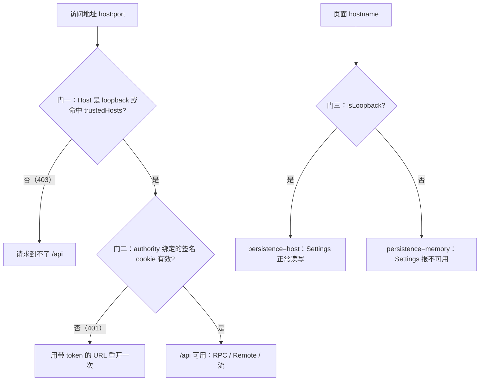
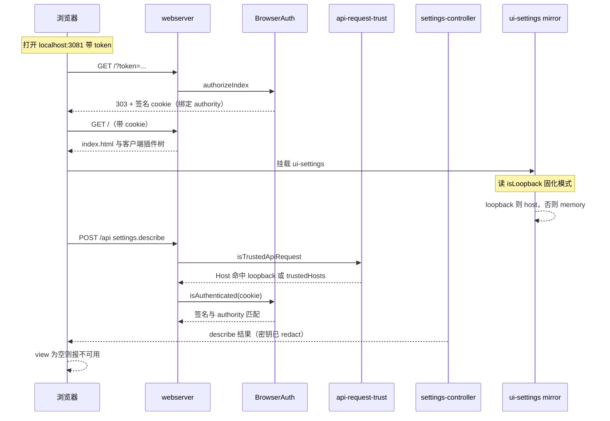

# 远程访问自托管的 dsh Web：SSH 隧道接入、会话登录与 Settings 配置

> 子文档之一，聚焦**远程访问**这条使用路径：dsh 跑在公网云主机上，我从本地随时用它。**主线是一份可复现的操作记录**：终局形态 → 服务器启动 → 本地隧道 → 浏览器登录 → 在 Settings 里配好模型 → 过程中踩过的坑与解法；机制层面的解释（为什么非 loopback 页面用不了 Settings、启动令牌与签名 cookie 怎么工作）收在文末[「原理与代码依据」](#原理与代码依据)，不挡操作路径。整体哲学见 [README](README.md)；浏览器 UI 那一半见 [web-client.md](web-client.md)，web 形态的启动组合见 [deployment.md](deployment.md)，settings/credentials 的 Remote 契约见 [remote-controllers.md](remote-controllers.md)，密钥文件本身见 [credentials.md](credentials.md)。
>
> 占位约定：`<server>` 服务器地址；`<ssh-key>` 本地私钥路径；`<token>` **当前进程**的启动令牌；`$DSH_HOME` 默认 `~/.dsh`；`3080` 服务器监听端口；`3081` 本地隧道端口（任意空闲端口）。所有代码引用按基线 `dsh-v0.1.7-rc.2` 源码程序化重定位。

## 目标：终局形态与取舍

一句话：**服务器只监听回环，访问靠 SSH 隧道，Settings 照常可用。**

```
本地浏览器 http://localhost:3081/  ──SSH 隧道──▶  服务器 127.0.0.1:3080（dsh web）
```

| 项 | 终局形态 | 为什么这样定 |
|---|---|---|
| 服务器监听 | `webserver.host: '127.0.0.1'`、`port: 3080` | 不把带 RCE 能力的 Web 面暴露到公网 |
| 公网暴露 | 无（对外只有 SSH 端口） | 与上一行互为因果 |
| 本地访问 | 常驻隧道 `127.0.0.1:3081 → <server>:127.0.0.1:3080` | 让浏览器眼里的 hostname 是 loopback |
| `trustedHosts` | 不需要，留空 | 隧道转发的请求 `Host` 就是 `localhost:3081`，本身就过信任栅栏 |
| Settings | 完全可用（可填密钥、可 Apply） | 页面 hostname 是 loopback，客户端不降级 |
| 配置落盘 | 服务器 `$DSH_HOME/settings.yaml` + `$DSH_HOME/.credentials.yaml` | 与本地隧道开关无关，重启不丢 |
| 每次重启要做的 | 服务器起进程 → 抄本次 token → 本地用 token 登录一次 | 启动令牌每进程随机 |

**为什么不做公网直连**（三条都有源码依据，也是本文后半那些坑的来源）：

- CLI 层面就拒绝 `--host 0.0.0.0`，理由是会向网络暴露远程代码执行（[packages/bundle/web-app/src/startup.ts:75-75]()
<!-- anchor-base64:cHJvZ3JhbS5lcnJvcignZXJyb3I6IC0taG9zdCAwLjAuMC4wIGlzIGludGVudGlvbmFsbHkgbm90IHN1cHBvcnRlZCB5ZXQgZm9yIHNhZmU= -->）。
- 会话 cookie 刻意不带 `Secure`（随附载体假定 loopback HTTP），明文公网直连时 bearer cookie 可在传输中泄露（[packages/client/connection/README.zh.md:75-75]()
<!-- anchor: - **浏览器 cookie 不带 `Secure`**：当前随产品提供的传输方式是 loopback HTTP； -->）。
- 就算绕道 profile patch 打开 `0.0.0.0` 并声明 `trustedHosts`，`/api` 全通了，**Settings 依然打不开**——因为那是客户端按页面 hostname 主动降级的，跟栅栏无关（机制见[附录](#门三客户端的持久化降级settings-报错就发生在这里)）。上游对网络部署的态度也很明确：认证不等于支持网络部署、TLS、转发头解释或代理配置（[.agents/notes/implemented/architecture/2026-08-24-browser-token-authentication.zh.md:23-23]()
<!-- anchor-base64:6ZqP6ZmEIENMSSDnu6fnu63mi5Lnu50gYC0taG9zdCAwLjAuMC4wYOOAguiupOivgeS4jeS7o+ihqOaUr+aMgee9kee7nOmDqOe9suOAgVRMU+OAgei9rOWPkSBoZWFkZXIg6Kej6YeK5oiW5Luj55CG6YWN572u44CC -->）。

隧道方案一次性满足三件事：**外网可达**（本地随时能连）、**Settings 可用**（浏览器看到 loopback）、**不新增暴露面**（服务器仍只监听回环）。

## 前置条件

| 项 | 示例 / 说明 |
|---|---|
| 服务器 | 公网可达、能 SSH 登录的 Linux 主机；dsh 已安装（如 fnm 全局安装） |
| 服务器进程 | `dsh web`，监听 `127.0.0.1:3080` |
| `web-runtime` 配置 | `printUrl: true`（打印带 token 的 URL）、`openBrowser: false`（服务器无桌面） |
| 本地 | macOS / Linux 均可；有 `ssh`、`lsof`（macOS）或 `ss`（Linux）、一个浏览器 |
| 本地私钥 | 能匹配服务器 `authorized_keys`，且**本地权限合规**（见下文那个最常见的坑） |

## 服务器：让 dsh Web 只跑在回环地址上

### 在 profile patch 里写死监听面

dsh 的 webserver 默认就绑 `127.0.0.1`，端口默认 `3080`（[packages/bundle/web-app/cordis.patch.yml:167-167]()
<!-- anchor: host: !!js ctx.webStartup.host ?? '127.0.0.1' -->），所以本方案**不需要**任何「开放公网」的配置。把这两行显式写进 profile 的用户 patch 层（`$DSH_HOME/profiles/<name>/cordis.patch.yml`，profile 目录形状与「用户 patch 最后应用」的顺序见 [packages/boot/app-boot/src/profile.ts:5-11]()
<!-- anchor: * A profile is a directory under `$DSH_HOME/profiles/<name>` holding a … * ordered list of files); the tree is composed by applying each bundle's patch -->），是为了防止将来被 `--host` 参数或别的 patch 层改掉：

```yaml
- id: webserver
  config:
    host: '127.0.0.1'    # 只监听回环：公网完全不可达
    port: 3080

- id: web-runtime
  config:
    openBrowser: false   # 服务器没有桌面
    printUrl: true       # 需要它把带 token 的 URL 打进日志
    surfaceContext: true
```

这两行正是 `web-app` bundle 的 patch 层字段（[packages/bundle/web-app/cordis.patch.yml:163-168]()
<!-- anchor: - id: webserver … port: !!js ctx.webStartup.port ?? 3080 -->）。回环绑定下，启动输出不会带 LAN 地址（LAN 字面量只在 `0.0.0.0` 绑定时才推导，[packages/bundle/web-app/src/index.ts:126-131]()
<!-- anchor: const lanAddresses = bindHost === ALL_INTERFACES_HOST … return { lanAddresses, trustedHosts: [...lanAddresses, ...extra] } -->），这也说明 `trustedHosts` 留空是正常状态。

### 启动并抄下本次 token

启动令牌每进程随机、只存内存、**不落盘**（[packages/client/connection/src/browser-auth.ts:52-56]()
<!-- anchor: function processLaunchToken(owner: object): string { … PROCESS_LAUNCH_TOKENS.set(owner, created) -->），所以只能从启动输出里拿。推荐 tmux（可随时回看日志与 token）：

```bash
tmux new -s dshweb
dsh web 2>&1 | tee -a /tmp/dshweb-current.log
# 记下这一行里的 token，本次进程有效：
#   dsh web: http://127.0.0.1:3080/?token=<token>
# 脱离但保持运行：按 Ctrl-b，再按 d
```

纯后台写法：

```bash
nohup setsid dsh web >>/tmp/dshweb-current.log 2>&1 </dev/null &
sleep 3
grep -o 'token=[^ )]*' /tmp/dshweb-current.log | tail -1
```

### 确认监听

```bash
pgrep -af "dsh web"                  # 进程在不在
ss -ltnp | grep 3080                 # 期望只看到 127.0.0.1:3080，而不是 0.0.0.0:3080
```

`ss` 的输出值得多看一眼：出现 `0.0.0.0:3080` 说明监听面被别的 patch 层放开过，那就不只是「多余暴露」，还会让 `trustedHosts` 变成必须维护的东西。

### （可选）开机自启

用 systemd 时需写 fnm 安装路径下的稳定绝对路径，并把 stdout/stderr 落到同一个日志文件（token 从那里取）：

```ini
[Service]
ExecStart=/root/.local/share/fnm/node-versions/<ver>/installation/bin/dsh web
Restart=on-failure
StandardOutput=append:/tmp/dshweb-current.log
StandardError=append:/tmp/dshweb-current.log
```

升级 node 后 fnm 路径会变，需同步改 `ExecStart`。

## 本地：免密 SSH 与隧道

### 先修免密：权限是最常见的原因

先核对本地私钥指纹是否匹配服务器 `authorized_keys`：

```bash
ls -la ~/.ssh
for f in ~/.ssh/*.pub; do ssh-keygen -lf "$f"; done
# 没有 .pub 时对私钥求指纹：
ssh-keygen -y -f <ssh-key> | ssh-keygen -lf -
```

**本次配置过程中真正卡住的一步就在这里**：`~/.ssh` 目录权限是 `755`，ssh 因此拒绝使用私钥、静默回落到密码认证。修好即可免密：

```bash
chmod 700 ~/.ssh
chmod 600 <ssh-key>
ssh -i <ssh-key> -o IdentitiesOnly=yes root@<server>   # 期望免密登录
```

> 排查手法：`ssh -vvv root@<server>`。若出现 `Server accepts key` 却仍索要密码，问题通常在本地的目录权限或私钥选择上，而不在服务器配置。次常见原因：私钥路径非默认、未加 `-i`、私钥带口令（`eval $(ssh-agent) && ssh-add <ssh-key>`）、登录用户不匹配。

没有可用密钥时，生成一把专用的（后续可只让它转发端口）：

```bash
ssh-keygen -t ed25519 -f ~/.ssh/dsh_ed25519 -C dsh-tunnel
ssh-copy-id -i ~/.ssh/dsh_ed25519.pub root@<server>     # 仅此次输入密码
```

### 建隧道

```bash
ssh -f -N -L 3081:127.0.0.1:3080 \
    -i <ssh-key> -o IdentitiesOnly=yes \
    root@<server>
```

含义：本地 `127.0.0.1:3081` ──隧道──▶ 服务器 `127.0.0.1:3080`。右侧必须是服务器的**回环**地址（本方案里 Host 也只绑了回环，正好对齐）。`-L` 默认就把本地监听绑在回环上，不会被同机其他用户访问；想让笔记本休眠后更稳，可加 keepalive 并在转发失败时直接退出：

```bash
ssh -f -N -L 3081:127.0.0.1:3080 \
    -o ServerAliveInterval=30 -o ServerAliveCountMax=3 -o ExitOnForwardFailure=yes \
    -i <ssh-key> -o IdentitiesOnly=yes \
    root@<server>
```

### 确认隧道

```bash
lsof -nP -iTCP:3081 -sTCP:LISTEN     # macOS：期望看到 ssh 在 3081 上 LISTEN
ss -ltn | grep 3081                  # Linux
```

## 浏览器：用一次性 token 换取会话

### 首次登录

```
http://localhost:3081/?token=<token>
```

首次请求带 token → 服务器返回 `303` 并把登录 cookie 写入 `localhost:3081` 这个 authority，随后跳转 `/`。**务必**：地址 host 必须是 `localhost` 或 `127.0.0.1`，绝不能写成服务器 IP 或域名（原因见[附录](#门三客户端的持久化降级settings-报错就发生在这里)）；端口无所谓，只要求 hostname 是 loopback。

### 之后直接访问

```
http://localhost:3081/
```

cookie 是 host-only、`Path=/`、`HttpOnly`、`SameSite=Strict`，寿命默认 30 天（[packages/client/connection/src/index.ts:105-113]()
<!-- anchor: cookieMaxAgeDays?: number … cookieMaxAgeDays: z.natural().min(1).default(30), -->）。在 30 天有效期内、且 authority 不变时，不需要再带 token——**服务器重启也不用重新登录**。

### cookie 绑定 authority 的后果

cookie 名与签名 payload 都绑定规范化 `hostname:port`（[packages/client/connection/src/browser-auth.ts:244-259]()
<!-- anchor: if (req.method === 'GET' && url.pathname === '/' && tokens.length === 1 … cookieName(authority), value, expiresAt, Math.floor(this.maxAgeMilliseconds / 10 -->）。换来两个可以预期的行为：**换本地端口**（`3081` → `18080`）或**换写法**（`localhost` ↔ `127.0.0.1`）都要用 token 重新交换一次；好处是同一个服务器 home 在多个端口并行时互不串号。

## 在 Settings 里配置模型

1. 进入 `Settings → Models`，此时应能正常加载提供方目录（不再报「加载提供方目录失败」）；
2. 选择或新增提供方（官方路由或自定义 provider）；
3. 在编辑卡片填入 **API 密钥**（页面只写不回显）；
4. 需要时展开自定义设置调整 `baseURL`、模型列表、显示名、API 协议等；
5. 点 **Apply** 保存。

落盘位置（都在服务器上，与本地隧道是否连着无关）：

| 内容 | 位置 | 说明 |
|---|---|---|
| 用户设置（提供方/模型，不含密钥明文） | `$DSH_HOME/settings.yaml` | 文件后端；显式 `path` 优先，否则 `<harness home>/settings.yaml` |
| 凭据（API key、cookie 签名密钥） | `$DSH_HOME/.credentials.yaml` | 版本化文档 + 0600 + 跨进程写锁 |
| profile 用户 patch（上面的 `webserver` / `web-runtime` 覆盖处） | `$DSH_HOME/profiles/<name>/cordis.patch.yml` | 用户自有 patch 层，最后应用 |
| Web 进程日志（token 来源） | `/tmp/dshweb-current.log` | 由启动方式决定 |

`$DSH_HOME` 未设置时回落 `~/.dsh`（[packages/util/home-paths/src/index.ts:87-90]()
<!-- anchor: export function resolveDshHome(configured?: string, env: Record<string, string | … return resolve(expandHomePath(selected)) -->）；设置文档的默认路径现在就是当前 profile 的 Cordis patch（[packages/settings/settings/src/index.ts:292-296]()
<!-- anchor: get documentPath(): string { return this.ownerContext.configEditor.documentPath } … prepareDocument(): Promise<string> { return Promise.resolve(this.documentPath) } -->、[packages/boot/config-editor/src/index.ts:34-34]()
<!-- anchor: get documentPath(): string { return this.ownerContext.profileContext.patchPath } -->）；cookie 签名密钥本身是 `.credentials.yaml` 里的一条 `grant` 记录（[packages/credentials/credentials-local/src/index.ts:84-84]()
<!-- anchor: * otherwise the document lives at `<harness home>/.credentials.yaml`. -->）——**删掉它并重启进程 = 一次性吊销全部浏览器会话**。

> **演进说明(0.1.7-rc.2)**：上表「用户设置落盘 `$DSH_HOME/settings.yaml`」的文件后端（`dsh-settings-file` 与它的 `resolveSpec`）已整体下线，那一行的落盘位置随之作废，设置表单的写入改由 `config-editor` 落到当前 profile 的 Cordis patch；旧版遗留在 harness home 里的 `settings.yaml` 会在 Loader 就绪后被导入当前 profile 一次，并在首次写入前改名为 `settings.yaml.imported`（[packages/settings/settings/src/index.ts:238-243]()
<!-- anchor: /** Move the sections of the removed `settings.yaml` into the active profile … const path = join(profile.home, 'settings.yaml') -->）。

## 踩坑与解法

下面每一条都是配置路上真实出现过的现象；按「现象 → 怎么确认 → 原因 → 解法」记录。

### `Settings → Models` 报 settings are unavailable in this browser

- **现象**：用服务器 IP 打开 Web UI，`Settings → Models` 报「加载提供方目录失败: settings are unavailable in this browser」；服务端无报错，同一个 Host 换成 `http://localhost:3081/` 就一切正常。
- **怎么确认**：看浏览器地址栏的 hostname 是不是 `localhost` / `127.0.0.1`；再看 `/api` 是否其实是通的（能加载会话、能发消息）——**`/api` 通而 Settings 不通，就是这一条**。
- **原因**：客户端按页面 hostname 决定「要不要让 Host 持久化设置」，非 loopback 页面一律降级为 `memory` 模式，设置从不跨线路；上游把这条明写为已知限制（[packages/client/ui-settings/README.zh.md:106-106]()
<!-- anchor: - **非 loopback 页面没有持久化设置**：本 Client 在那里禁用 Host 持久化，因此 表单以 `unavailable` 起步且从不跨线路 -->）。
- **解法**：让浏览器看到 loopback——走本文的 SSH 隧道，或直接在服务器本机开浏览器。
- **容易走错的路**：把服务器 IP/域名加进 `trustedHosts`。它只扩展 `/api` 的 Host/Origin 信任（[.agents/notes/implemented/architecture/2026-07-28-api-browser-trust-boundary.zh.md:29-29]()
<!-- anchor: - 自定义非 loopback 组合必须信任其服务 authority，否则请求会被拒绝 -->），**完全不改变**上面这条客户端判定，所以 Settings 依旧报同一句话。

### SSH 有公钥仍被要求输入密码

- **现象**：`authorized_keys` 里明明有对应公钥，登录仍要密码。
- **怎么确认**：`ssh -vvv root@<server>`，看到 `Server accepts key` 之后又要密码。
- **原因**：本地 `~/.ssh` 目录权限过宽（本次是 `755`，要求 `700`），ssh 拒绝使用私钥。
- **解法**：`chmod 700 ~/.ssh && chmod 600 <ssh-key>`；命令里带 `-i <ssh-key> -o IdentitiesOnly=yes`。

### 401：token 或 cookie 失效

- **现象**：页面返回 `dsh web authentication required; reopen the URL printed by dsh web.`
- **怎么确认**：`curl -i http://localhost:3081/` 看状态码。
- **原因**：token 过期/抄错、cookie 丢失（清了站点数据、换了浏览器），或换了端口/写法导致 cookie 的 authority 不匹配（[packages/client/connection/src/browser-auth.ts:302-309]()
<!-- anchor: private writeUnauthorized(req: ConnectionIndexRequest, res: ConnectionIndexRespo … : 'dsh web authentication required; reopen the URL printed by dsh web.\n') -->）。
- **解法**：用**当前进程**的 token 打开一次 `http://localhost:3081/?token=<token>`，让服务器换出新 cookie。

### 403：Host 不在信任列表内

- **现象**：`/api` 返回 403。
- **怎么确认**：请求的 `Host` 头是什么——不是 loopback、也不在 `trustedHosts` 里就会 403（[packages/client/connection/src/api-request-trust.ts:103-103]()
<!-- anchor: if (!isLoopbackHostname(hostUrl.hostname) && !isTrustedAuthority(hostUrl, truste -->）。
- **原因**：这条**只在尝试公网直连时才会遇到**（纯隧道方案里 `Host` 恒为 `localhost:3081`，天然通过）。
- **解法**：放弃公网直连，回到隧道；确要暴露时用 `--trusted-host <authority>` 或 patch 里的 `trustedHosts`，且条目必须是裸 `host[:port]`，写错会让插件加载直接失败。

### 服务器重启后 token 失效

- **现象**：之前保存的 `?token=...` 链接失效。
- **原因**：令牌每进程随机、不落盘，重启即换新（[packages/client/connection/src/browser-auth.ts:52-56]()
<!-- anchor: function processLaunchToken(owner: object): string { … PROCESS_LAUNCH_TOKENS.set(owner, created) -->）。
- **解法**：从日志重取当前进程的 token：`grep -o 'token=[^ )]*' /tmp/dshweb-current.log | tail -1`。注意**已换到的 cookie 不受影响**，多数情况下直接访问 `/` 即可。

### 换端口或 localhost ↔ 127.0.0.1 后又要重新登录

- **原因**：cookie 绑定 authority，两者被视为不同站点。
- **解法**：用新 token 重新交换一次；或者固定使用同一种写法与端口，避免反复登录。

### 隧道断开或笔记本休眠

- **现象**：浏览器转圈 / 连接被拒。
- **怎么确认**：`lsof -nP -iTCP:3081 -sTCP:LISTEN` 没有输出。
- **解法**：重跑建隧道命令（可用一个「没有就建」的一行式）：

```bash
lsof -nP -iTCP:3081 -sTCP:LISTEN >/dev/null 2>&1 || \
  ssh -f -N -L 3081:127.0.0.1:3080 \
      -o ServerAliveInterval=30 -o ServerAliveCountMax=3 -o ExitOnForwardFailure=yes \
      -i <ssh-key> -o IdentitiesOnly=yes root@<server>
```

### 本地端口被占用

- **现象**：`bind: Address already in use`，隧道进程立刻退出。
- **解法**：换一个空闲本地端口，如 `-L 18080:127.0.0.1:3080`，URL 同步改成 `http://localhost:18080/`（并重新交换 token）。

### 排障速查

| 现象 | 先看哪里 | 处理 |
|---|---|---|
| Settings 报 settings are unavailable | 地址 host 是不是 loopback | 改走隧道；不要指望 `trustedHosts` |
| 页面 401 | token / cookie | 用当前进程 token 重开一次 |
| `/api` 返回 403 | `Host` 头 | 回到隧道；或补 `trustedHost-`/`trustedHosts` 条目 |
| 服务器重启后链接失效 | 日志里的新 token | `grep -o 'token=[^ )]*' … \| tail -1` |
| 换端口/写法后要重新登录 | authority 变了 | 预期行为，重新交换一次 |
| SSH 又要密码 | 本地权限 | `~/.ssh` 700、私钥 600 |
| 隧道不通 | 本地 3081 是否 LISTEN | 重跑隧道命令 |
| 起不来 | `ss -ltnp \| grep 3080` | 端口冲突或旧进程残留：`pkill -f "dsh web"` 后重启 |

## 验证清单

服务器侧（模拟浏览器经隧道看到的视角，`Host` 伪装成隧道的 authority）：

```bash
curl -sS -i -H "Host: localhost:3081" \
  "http://127.0.0.1:3080/?token=<token>"
# 期望：303 See Other + set-cookie（cookie 的 authority 为 localhost:3081）
```

本地侧三段验证：

- 无 token `GET /` → **401**；
- 带 token `GET /?token=...` → **303** + cookie；
- 带 cookie `GET /` → **200**。

配置侧：

- `$DSH_HOME/settings.yaml` 出现且含刚配置的提供方；
- API 密钥只出现在 `$DSH_HOME/.credentials.yaml`，页面不会回显；
- `Settings → Models` 再次打开时能读到已保存的配置。

> **演进说明(0.1.7-rc.2)**：上面第一条要核对的文件已经换了——设置现在写进当前 profile 的 `$DSH_HOME/profiles/<name>/cordis.patch.yml`；`$DSH_HOME/settings.yaml` 只在作为旧版遗留文件被导入时短暂出现，导入后即改名 `settings.yaml.imported`（[packages/settings/settings/src/index.ts:238-243]()
<!-- anchor: /** Move the sections of the removed `settings.yaml` into the active profile … const path = join(profile.home, 'settings.yaml') -->）。

## 日常运维

配置只需做一次，`settings.yaml` 与凭据都持久化在服务器，**两端重启都不会丢配置**。日常只有两件事：服务器把 `dsh web` 跑起来（并拿到本次 token）→ 本地确保隧道在跑并访问。

### 服务器侧

```bash
pgrep -af "dsh web"                                          # 在不在跑
tmux attach -t dshweb                                        # 在跑：进去看日志与 token
grep -o 'token=[^ )]*' /tmp/dshweb-current.log | tail -1      # 只看 token
pkill -f "dsh web"                                           # 停止（之后重新启动并记新 token）
```

### 本地侧

```bash
lsof -nP -iTCP:3081 -sTCP:LISTEN      # 隧道在不在；不在就重跑建隧道命令
```

浏览器：服务器**没有重启**时直接开 `http://localhost:3081/`；服务器**重启过**就用新 token 打开一次 `http://localhost:3081/?token=<新 token>`，跳转后照常访问。

### 场景速查

| 场景 | 操作 |
|---|---|
| 服务器重启/重新登录后 | `tmux attach -t dshweb` 看是否在跑；没跑就启动并记 token |
| 换了新 token | 本地浏览器用 `http://localhost:3081/?token=<新 token>` 打开一次 |
| 本地重启 / 休眠 / 断网 | 重建隧道，再访问 `http://localhost:3081/` |
| 端口冲突 | 换端口，URL 同步改（并重新交换 token） |
| 想免 SSH 常驻 | 把隧道交给 `autossh` 或用 SSH 的 `LocalForward` 写进 `~/.ssh/config` |
| 想彻底不碰隧道 | 在服务器本机开浏览器访问 `http://127.0.0.1:3080/?token=<token>`（同样满足 loopback） |

一句话日常：**服务器** `tmux attach -t dshweb` → 没在跑就 `dsh web` 启动 → 记下 `token=...`；**本地** 确认隧道在跑 → 浏览器开 `http://localhost:3081/`。

## 原理与代码依据

### 三层判定：可达性 / 请求可信 / 身份 / 能力

dsh 的 Web 面由三层彼此独立、互不代偿的判定把守，理解它就能解释本文所有坑：

| 层 | 判定什么 | 判定依据 | 不通过的后果 |
|---|---|---|---|
| 门一 · 载体级信任栅栏 | 这个请求是不是「发给我的」 | `Host` 是 loopback 或命中 `trustedHosts`；若带 `Origin` 必须等于该 authority；`sec-fetch-site: cross-site` 一律拒绝 | 403 |
| 门二 · 浏览器会话认证 | 这个请求有没有一个有效会话 | `?token=` 单次交换来的、绑定 authority 的 HMAC 签名 cookie | 401 |
| 门三 · 客户端持久化能力 | 这个页面**值不值得**让 Host 持久化设置 | 页面 hostname 是否 loopback，或该页面自持 Host（`ownsHost`） | 页面以 `memory` 模式起步，设置从不跨线路 |



注意图中两条链是**并行**的：门一/门二决定「请求能不能到」（本文方案的 Host 恒为 loopback，所以两道门都轻松通过），门三决定「页面愿不愿意用」（这才是隧道方案真正要解决的问题）。

### 一次 `settings.describe` 的完整链路



对照本文方案：隧道让前两步的 `Host` 就是 `localhost`，门一与门二轻松通过；而 `M` 那一跳看到的 hostname 也是 `localhost`，因此走的是 `host` 分支，`Settings` 正常。

### 门一：载体级 Host/Origin 栅栏（防混淆代理人，不建立身份）

每个 `/api` 请求先过 `isTrustedApiRequest`，判定核心只有一行：`Host` 既不是 loopback、又不在 `trustedHosts` 里就直接拒绝（[packages/client/connection/src/api-request-trust.ts:103-103]()
<!-- anchor: if (!isLoopbackHostname(hostUrl.hostname) && !isTrustedAuthority(hostUrl, truste -->）。loopback 的判定范围很窄：字面 `localhost`、IPv6 的 `[::1]`、任意 `127.0.0.0/8` 点分四段地址（[packages/client/connection/src/loopback-hostname.ts:12-17]()
<!-- anchor: export function isLoopbackHostname(hostname: string): boolean { … && parts.every(part => /^\d{1,3}$/.test(part) && Number(part) <= 255) -->）；`trustedHosts` 则支持带端口的精确匹配与不带端口的任意端口匹配（[packages/client/connection/README.zh.md:43-43]()
<!-- anchor: 认证之前，每个请求仍经过 `src/api-request-trust.ts`。其 `Host` 必须是 loopback -->）。这道栅栏防的是 DNS rebinding 与跨站「简单请求」两类混淆代理人路径，成功只说明请求发给了本服务，**不建立身份**——`--trusted-host`「只扩展 Host/Origin 栅栏，绝不授予身份」（[.agents/notes/implemented/architecture/2026-07-28-api-browser-trust-boundary.zh.md:29-29]()
<!-- anchor: - 自定义非 loopback 组合必须信任其服务 authority，否则请求会被拒绝 -->）。

### 门二：每进程启动令牌与签名 cookie

身份由紧随其后的浏览器会话建立：**每个 Host 方法、每个 Remote 调用、每条 WebSocket 流都要求同一个会话，不存在按方法区分的 loopback 层**（[packages/client/connection/README.zh.md:39-39]()
<!-- anchor: 每个 Host RPC 方法和 WebSocket 流都要求一个浏览器会话，不存在按方法区分的 loopback 层。 -->）。启动令牌是 `randomBytes(32)` 的进程内随机量，按应用根 context 存在 `WeakMap` 里、不落盘（[packages/client/connection/src/browser-auth.ts:52-56]()
<!-- anchor: function processLaunchToken(owner: object): string { … PROCESS_LAUNCH_TOKENS.set(owner, created) -->）；交换只发生在 `GET /` 且恰好带一个正确 `token` 时，回 `303` + `Set-Cookie` 再跳转到干净的 `/`（[packages/client/connection/src/browser-auth.ts:244-259]()
<!-- anchor: if (req.method === 'GET' && url.pathname === '/' && tokens.length === 1 … cookieName(authority), value, expiresAt, Math.floor(this.maxAgeMilliseconds / 10 -->）；cookie 校验在每次请求上同步完成，并要求 payload 的 authority 与请求 authority 一致（[packages/client/connection/src/browser-auth.ts:287-299]()
<!-- anchor: isAuthenticated(request: ConnectionTrustRequest): boolean { … && payload.expiresAt - payload.issuedAt <= this.maxAgeMilliseconds -->）。签名密钥是一条持久化的 `grant` 记录（落在 `$DSH_HOME/.credentials.yaml`），所以**令牌每次重启都换，cookie 却能跨重启继续有效**；想一次性吊销全部浏览器会话，删掉那条记录并重启进程即可。

### 门三：客户端的持久化降级（Settings 报错就发生在这里）

真正的「不可用」不来自 Host，而是浏览器侧自己降的级：

- 客户端把 Host 事实投影成 `RemoteHostFacts { home, isLoopback }`，且 `isLoopback` **在页面生命周期内固定**——只在 reference 变化时重建，不会因为认证成功而翻转（[packages/api/gateway/src/client/index.ts:195-197]()
<!-- anchor: const home = this.connection.generation.getSnapshot()?.host.home … this.hostFacts = { home, isLoopback: this.connection.isLoopback } -->）。
- `isLoopback` 是三项或运算：transport 声明自持 Host、非浏览器环境、或页面 hostname 命中 loopback（[packages/client/connection/src/client/index.ts:248-248]()
<!-- anchor: isLoopback: transport?.ownsHost === true || pageLocation === undefined || isLoop -->）。
- ui-settings 在应用期把它固化成持久化模式：loopback 页面用 `host`，其余一律 `memory`（[packages/client/ui-settings/src/client/index.ts:39-39]()
<!-- anchor: const persistence = ctx.remote.$host.isLoopback ? 'host' : 'memory' -->）。
- `memory` 模式下镜像初始快照是 `status: 'unavailable'`、`view: undefined`、`error: null`（[packages/client/ui-settings/src/client/settings-mirror.ts:86-90]()
<!-- anchor: private readonly persistence: 'host' | 'memory' = 'host', … view: undefined, -->），`load()` 与 `ensure()` 双双直接 `Promise.resolve()` 短路（[packages/client/ui-settings/src/client/settings-mirror.ts:115-115]()
<!-- anchor: if (this.persistence === 'memory') return Promise.resolve() -->、[packages/client/ui-settings/src/client/settings-mirror.ts:133-133]()
<!-- anchor: if (this.persistence === 'memory') return Promise.resolve() -->）——`view` 永远填不上。
- 到页面层就成了 Models 页的兜底文案（[packages/client/ui-settings-models/src/client/store.ts:195-196]()
<!-- anchor: if (mirrored.view === undefined) { … this.failLoad(generation, mirrored.error ?? 'settings are unavailable in this br -->）；Models 客户端刻意不自己再判一次 `isLoopback`，完全依赖 scope 的 memory 模式（[packages/client/ui-settings-models/src/client/index.ts:107-108]()
<!-- anchor: // The scope's own memory mode is what keeps a remote browser process-local, … // so the store needs no isLoopback branch of its own. -->）。

同一个 `isLoopback` 还关掉了「在本地编辑器里打开设置文件」这个入口（[packages/client/ui-settings-general/src/client/index.ts:102-103]()
<!-- anchor: const documentController = ctx.remote.$host.isLoopback … ? new SettingsDocumentStore(ctx, ctx.configForms.describe()) -->）。

### 为什么门三是有意为之：服务端已经不拿 loopback 当权限了

dsh 曾经有「按方法维护的 loopback 特权列表」，被明确否决——HTTP 客户端可以自己声明 `Host: localhost`，于是「能到达服务器的调用者可以声明 loopback、进入配置方法，再利用 Host 侧操作披露存储的凭据」；同样被否决的还有「从 TCP 对端地址判定特权调用者」（[.agents/notes/implemented/architecture/2026-08-24-browser-token-authentication.zh.md:31-31]()
<!-- anchor: **从 TCP 对端地址判定特权调用者。** 直接对端地址仍可能只识别本地转发进程，而非浏览器用户；它会在 API 的命令执行能力旁保留第二套 authorit -->）。结论是：**服务端用「一个应用凭据覆盖全部方法」取代了 loopback 特权名单**，loopback 从此在服务端只是栅栏的一个通过条件，而客户端仍用它回答「这台 Host 是不是就跑在自己机器上」。

值得说清的是：**门三并不是安全边界**——Host 侧没有按 loopback 收窄 settings 写入，`settings.describe` 只回报 provider 自身的可写性（[packages/api/settings-controller/src/index.ts:98-103]()
<!-- anchor: describe(): SettingsDescribeValue { … namespaces: settings.describe({ redactSecrets: true }).map(namespaceView), -->、[packages/settings/settings/src/types.ts:57-63]()
<!-- anchor: export interface SettingsDescribeValue { … namespaces: SettingsNamespaceView[] -->）。所以一个已认证的远端页面「本可以」写设置，是客户端主动放弃了这个能力——这是产品策略而非强制边界，也是它无法被 `trustedHosts` 打开的原因。

### 例外：`ownsHost` —— 自持 Host 的页面

门三判据里的第一项 `transport?.ownsHost === true` 优先于 hostname：Host 跑在这个页面 spawn 的 worker 里、别的进程够不着它，「『操作者本机』这个 loopback 替身就变得没有意义」，于是 `isLoopback` 直接为真（[packages/client/connection/src/client/index.ts:248-248]()
<!-- anchor: isLoopback: transport?.ownsHost === true || pageLocation === undefined || isLoop -->）。Electron 桌面壳正是这么用的：注入的传输脚本第一行就声明 `ownsHost:true`。所以「桌面端 Settings 正常、浏览器远端不正常」不是两套逻辑，而是同一个判据的两个分支；WebWorker 预览同理（见 [webworker.md](webworker.md)）。

> **演进说明(0.1.7-rc.2)**：上面那份「注入的传输脚本」已下线——0.1.7 起桌面宿主不再注入 `__DSH_TRANSPORT__` 脚本，而是直接以 Web 形态跑起 Desktop profile（[apps/desktop-host/src/index.ts:25-27]()
<!-- anchor: const application = runProfile({ … profile: 'desktop', -->），`ownsHost: true` 改由渲染页在 `dshDesktopBoot.ready()` 兑现后自行声明（[apps/web/src/main.ts:25-26]()
<!-- anchor: const transport = globalThis as { __DSH_TRANSPORT__?: { ownsHost: boolean; … transport.__DSH_TRANSPORT__ = { ownsHost: true, streamBaseUrl } -->）。

## 与其他模块协同

- 与 [web-client.md](web-client.md)：门三发生在客户端插件树挂载期，正是那篇描述的 roster 里 `ui-settings*` 几个包的启动行为；「客户端只是身份稳定的本地投影、不是第二事实源」这条边界也解释了为什么降级在客户端做。
- 与 [deployment.md](deployment.md)：`webserver` / `web-runtime` / `connection` 三行属于 `web-app` bundle 的 patch 层，profile 的用户 patch 最后应用——所以「CLI 拒绝 `0.0.0.0`」并不等于「组合树不可能监听 `0.0.0.0`」，`ss` 输出值得核对。
- 与 [remote-controllers.md](remote-controllers.md)：门二保护整条 `/api` 通道，所有 Remote 控制器（含 `settings`/`credentials`）都在其后；控制器只负责投影与拒绝分类，不重复做地址判定。
- 与 [credentials.md](credentials.md)：cookie 签名密钥就是一条 `client-connection/browser-session` 的持久 `grant` 记录，和 API 密钥共享同一个 `.credentials.yaml`（版本化文档 + 0600 + 跨进程写锁）。
- 与 [networking-proxy.md](networking-proxy.md)：那是**出站**代理的「默认不代本机」，与本文**入站**的 loopback 判定互为镜像，但机制完全无关（前者是 `http-proxy` 策略，后者是页面 hostname 判定）。
- 与 [desktop-app.md](desktop-app.md)、[webworker.md](webworker.md)：`ownsHost` 让自持 Host 的壳与 worker 预览绕过门三，是这条判定唯一的合法旁路。

## 可借鉴的设计

- **把「可达性 / 请求可信 / 身份 / 能力」拆成互不代偿的四件事**：绑定配置决定可达性，Host/Origin 栅栏决定请求可信，会话 cookie 决定身份，客户端按页面来源决定能力。前三者各自有明确失败码（403 / 401 / 页面级 `unavailable`），排障时能一步定位——把「谁能连上」和「谁能做什么」混在一处，是本地 HTTP API 最经典的自我欺骗。
- **每进程随机启动令牌 + 持久签名密钥的组合**：令牌不落盘、每启动轮换，把「拥有启动 URL」限定在一个进程生命周期；签名密钥持久化，使已登录浏览器能跨普通重启继续工作。**撤销面 = 删除一条记录的代价**，不需要 logout 端点、TLS 代理配置或转发头解释。
- **cookie 绑定 authority 而不是绑定进程**：cookie 名与签名载荷都含规范化 `hostname:port`，同一个 Harness home 可以在多个端口并存而不串号；代价是换地址要重新交换一次，属于可接受的显式性。
- **能力降级优于直接报错**：非 loopback 页面不是被拒绝服务，而是以 `memory` 模式运行——设置界面仍可用（临时改动留在页面内），只是不跨线路。把「不可用」实现成一个持久化策略而不是散落的权限判断，是这套设计里最容易复用的模式。
- **拒绝也是一种产品声明**：CLI 宁可报错也不接受 `--host 0.0.0.0`，把「Web 面等于 RCE」摆在最前面；需要暴露的部署必须显式改 patch。默认安全、例外显式，比默认开放、再写文档警告更省事——本文的隧道方案正是顺着这个默认走的。
- **客户端自我约束也要写进文档**：上游把「非 loopback 页面没有持久化设置」明文列为已知限制，并说明「认证覆盖 API」与「这些行无效」并不矛盾。凡是「不是安全边界、但故意不做」的行为都值得显式记账，否则使用者会不断把它当 bug 报。

## 权衡与不足

- **门三是客户端自我约束，不是 Host 强制**：一个已认证的远端页面在协议层「本可以」写设置。若真要把「只有本机能改配置」变成安全性质，必须在 Host 侧补强制，而不是依赖页面自证。
- **全有全无**：非 loopback 页面不止写不了设置，连**只读**的设置视图也拿不到（scope 起点即 `unavailable`），`Settings` 页直接报错而不是以只读模式呈现。
- **隧道方案需要每次重建**：本地休眠、断网、服务器重启都会断开；没有内置的「常驻连接」概念，得靠 `autossh` / `~/.ssh/config` 的 `LocalForward` / keepalive 自己兜。
- **token 只能从 stdout 取**：没有独立的「查询当前 token」命令，也没有把 token 写到受保护文件的选项；容器/无 tmux 环境下要靠日志留存，重启后必须重新抄一次。
- **纯隧道模式的 `trustedHosts` 认知成本**：正因为隧道让 `Host` 变成 loopback，这个配置项在本方案里根本不需要——但网上流传的「公网访问 dsh」教程多半会让你去配它，两条路径的症状（403 vs Settings 不可用）又容易混淆。
- **`ownsHost` 让「loopback」这个命名有点名不副实**：它真正的语义是「这个页面自持 Host 且无人能旁路到达」。桌面壳与 WebWorker 预览都命中它，读代码时容易把 `isLoopback` 误解成纯粹的地址判断。
- **无 logout 与转发头支持**：上游明确把 logout、TLS 代理、转发 header 解释列为「没有当前 consumer 就不定义」的延后项。本方案不依赖这些；若改用反向代理暴露，需自行承担 authority 归一化是否成立的风险。

## 总结

这份记录的操作结论很朴素：**服务器只监听回环，本地用 SSH 隧道把回环端口映射出来，浏览器始终以 `localhost` 访问**。它同时解决了三件事——从公网侧随时可用、Settings 完全可用、且不新增任何暴露面。

而它之所以必须这么绕，是因为 dsh 把网络边界上的四件事拆得很干净：可达性归绑定配置、请求可信归 Host/Origin 栅栏、身份归每进程令牌换取的应用凭据、**「能不能改这台 Host 的配置」归客户端对页面来源的判断**。前三层可以用配置换来换去，最后一层只认浏览器眼里的 hostname——所以 `trustedHosts` 打通了 `/api` 却永远打不开 `Settings`，这正是配置路上最主要的一个坑。
