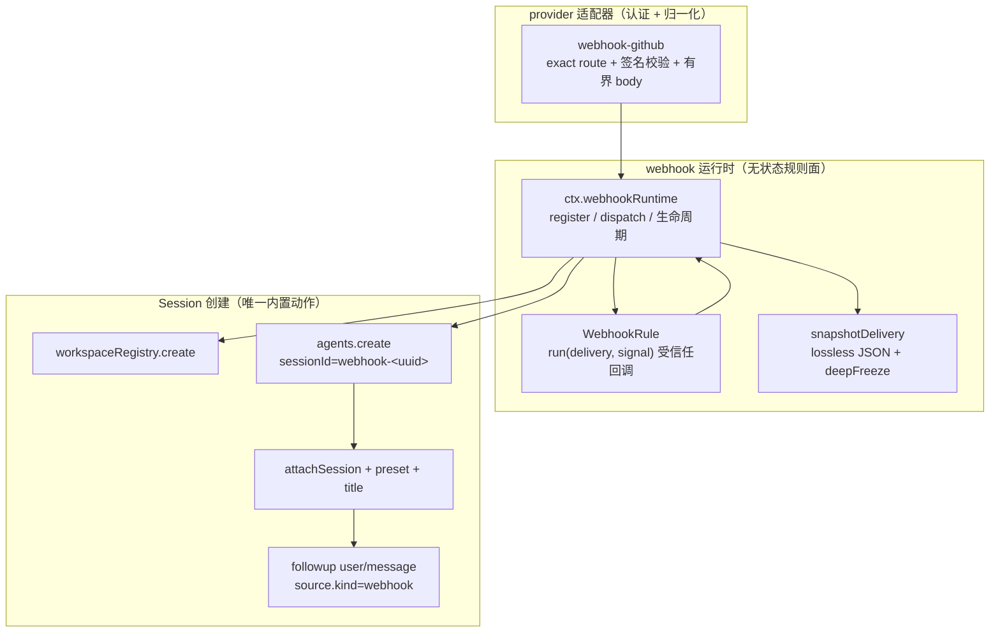
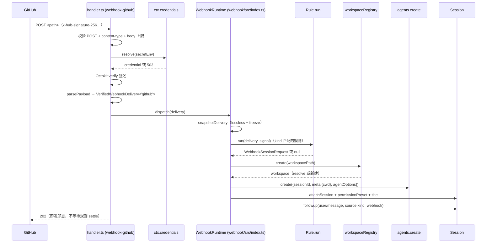
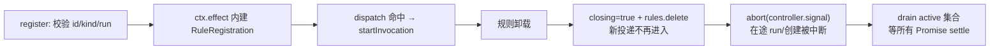

# Webhook 子系统：把外部事件投递成普通 root Session

> 子文档之一，聚焦 dsh 0.1.2-alpha 新增的 `webhook` 能力面。覆盖 `packages/webhook/webhook`（provider 中立的运行时）与 `packages/webhook/webhook-github`（GitHub 适配器）。整体哲学见 [README](README.md)；本文衔接 [session.md](session.md)（投递最终落成一条普通 `user/message` 事件）、[credentials.md](credentials.md)（secret 凭据解析）、[deployment.md](deployment.md)（独立 WebServer 挂载）。按 ai-agent ⊗ framework 类规格产出。

根因与一句定位：**dsh 需要一个「把认证过的外部事件变成一次自主 agent 行动」的入口，但又不希望它变成第二个特权内核**——于是做成「无状态、可卸载、即发即忘」的规则运行时：对外部世界说"收到（202）"立刻返回，内部是否真的创建 Session、创建几个，全由规则决定且不留任何投递/完成状态。

## 概览：是什么 / 痛点 / 适用场景

- **是什么**：一个 fire-and-forget 的 webhook 规则运行时（`ctx.webhookRuntime`）+ 一个 GitHub 签名 HTTP 适配器。它把 GitHub webhook 之类的外部投递（delivery）交给受信任的程序化规则，规则返回一个 `WebhookSessionRequest`（绝对工作区路径 + 标题 + 提示词 + agent/permission 预设 + 可选模型），运行时据此创建一条**普通 root Session**——与人工交互创建的 Session 无本质区别。
- **痛点**：给 agent harness 加"外部事件入口"时，最常见的诱惑是把队列、重试、去重、执行状态、完成回调全做进运行时——那等于再造一个特权内核，且与 dsh「一切皆插件、日志即事实源」的哲学冲突。dsh 的反方向是：**运行时不做任何状态，把"要不要干活、怎么干"完全委托给可卸载的规则**。
- **适用场景**：GitHub review（PR/issue 事件触发一次自动 review）、CI 事件驱动的批处理、任何"外部系统 → 一次自主 agent 会话"的桥。
- **核心能力清单**：

| 能力 | 说明 |
|------|------|
| 规则注册与生命周期 | `register(rule)` 返回 effect 装饰器，卸载时先隐藏再 abort 并 drain 在途调用 |
| 即发即忘分发 | `dispatch(delivery)` 快照后同步返回，逐规则独立调度、异常按规则包含 |
| 无状态承诺 | 无队列/重试/去重/执行状态/崩溃重放/完成回调；重复投递可产生重复 Session |
| Workspace 支撑的 Session 创建 | resolve/create 规范 Workspace → 创建 Agent → attach → title → followup（失败回滚） |
| 投递身份溯源 | `VerifiedWebhookDelivery` 经 lossless-JSON 校验 + deepFreeze 后才共享给多规则；followup 携带 provider/source/delivery/rule 溯源 |
| GitHub 适配器 | exact route + Octokit 签名校验 + 有界 body 读 + `202` 即回 |

- **技术栈**：TypeScript + Cordis（`Service`/`ctx.effect`）+ `@octokit/webhooks`（签名校验）+ schemastery（配置校验）+ WebServer exact route。

## 架构：三层职责如何隔离

职责切分（源码与官方子系统文档都这样声明）：provider 适配器拥有**认证与通用 JSON 摄入**；受信任程序化规则拥有**条件与外部调用**；`ctx.webhookRuntime` 拥有**回调生命周期 + Workspace 支撑的 Session 创建**[[docs/subsystems/webhook.md:5-5]()]()
<!-- anchor: The Webhook subsystem turns authenticated external deliveries into optional ordinary root -->

这套三层分工正是「无特权内核」的延续：运行时不知道"GitHub 是什么"（它只消费 provider 中立的数据），规则不知道"HTTP 认证怎么做"（它只拿到已验证的 delivery），外部世界不接触内核。每个 provider 的适配器是独立包，`WebhookEventMap` 可按 provider kind 声明合并、未知事件以通用 lossless JSON 兜底，out-of-tree 适配器无需改运行时[[docs/subsystems/webhook.md:11-11]()]()
<!-- anchor: `WebhookEventMap` is merge-extensible by provider kind. `WebhookEventOf<K>` -->

## 核心链路：一次 GitHub 投递的完整时序

`dispatch()` 的核心契约是**同步返回、逐规则包含**：它先 `snapshotDelivery` 把 delivery 变成 lossless-JSON + deepFreeze 的不可变快照，再遍历 kind 匹配的规则各自独立调度，自己立刻返回；任何规则的 throw/reject 都被该规则的 `startInvocation` 包含、记日志，不传染其他规则[[packages/webhook/webhook/src/index.ts:122-130]()]()
<!-- anchor:    * Start every currently matching rule and return before any callback settles. …       if (registration.closing || registration.rule.kind !== snapshot.kind) continue -->。

## 深挖一：为什么"即发即忘、无状态"是正确设计

这是整个子系统最值得借鉴的决策。官方 design note 明确记录：**运行时保留零投递/完成状态**——没有队列、重试、去重、执行状态、崩溃重放、Agent 状态监听、完成结果；重复投递可以产生重复 Session[[docs/subsystems/webhook.md:23-23]()]()
<!-- anchor: The runtime has no queue, retry, deduplication, execution status, crash replay, -->

Why 它是对的：

1. **状态属于日志，不属于运行时**：dsh 的"事实源"是 append-only 的 SessionEvent 日志。投递一旦变成 Session，其生命周期、完成与否全由日志承载——运行时再存一份"投递状态"就是旁路可变状态，违背整座架构的哲学（对比 [session.md](session.md) 的 `Model-visible means logged`）。
2. **交付语义外包给上游**：GitHub webhook 本身就有自己的投递重试语义（未 2xx 会重试）。运行时若再做一次幂等/去重，是重复造轮子且语义无法对齐（`deliveryId` 只是 provenance，运行时既不存储也不去重[[docs/subsystems/webhook.md:9-9]()]()
<!-- anchor: `WebhookRuleId`, `WebhookSourceId`, and `WebhookDeliveryId` are opaque strings. -->）。去重的决定权被明确推给**规则**（规则可自行判断是否接受投递）。
3. **崩溃恢复 = 日志重放**：进程崩溃后，已创建的 Session 照常从日志恢复；未创建的投递，GitHub 侧会因非 2xx 重试——无状态意味着没有"恢复队列"需要修复。

实现上，唯一的"状态"是每个注册的私有 `RuleRegistration`（`controller` + `active` 集合 + `closing` 标记），且它"随进程消失"，只为生命周期正确性（卸载时 abort + drain）服务[[packages/webhook/webhook/src/index.ts:29-30]()]()
<!-- anchor: /** One effect-owned rule registration and the invocations that currently use it. */ … interface RuleRegistration { -->

代价与边界（写进「不足」）：无去重 → 上游重试与并发投递可能产生重复 Session；无完成语义 → 规则/消费方无法得知"这次投递最终执行了没有"。这是「确定性地交付给日志」与「给调用方完成回调」之间二选一——dsh 明确选了前者。

## 深挖二：规则生命周期——卸载时"先隐藏再宰"

`register(rule)` 返回一个 awaitable effect 装饰器。注册在 Cordis effect 内创建 `RuleRegistration`（每个规则一个 AbortController + active 集合），卸载时执行 `disposeRegistration`：**先标记 closing 并从 rules 表移除（隐藏——新投递不再进入这段代码），再 abort 在途调用的 signal，最后 drain 所有在途 Promise**[[packages/webhook/webhook/src/index.ts:89-118]()]()
<!-- anchor:   register<K extends string>(rule: WebhookRule<K>): () => Promise<void> { …       return () => this.disposeRegistration(registration) -->。

`startInvocation` 的细节很关键：它把「rule.run → createWebhookSession」包进一个 tracked Promise，`.catch` 区分"卸载中止"（debug 日志）与"真失败"（warn 日志），`.finally` 从 active 集合移除[[packages/webhook/webhook/src/index.ts:136-161]()]()
<!-- anchor:   private startInvocation(registration: RuleRegistration, delivery: VerifiedWebhookDelivery): void { …     registration.active.add(tracked) -->。信号贯穿 rule.run、workspace create、agent create、发布全程，卸载的规则不会让后续投递进入正在卸载的代码。

## 深挖三：Session 创建——一次"可回滚的创建事务"

`createWebhookSession` 把"规则返回请求"变成"一条持久化的普通 Session"，是运行时唯一的内置动作。顺序与回滚点：

1. `resolveRequest` 同步快照并校验规则结果（workspacePath 必须绝对路径、title/prompt/agentPreset/permissionPreset 非空；可选 model 若缺席则**快照当前部署的完整模型选择**，包括 reasoning effort）[[packages/webhook/webhook/src/session.ts:42-83]()]()
<!-- anchor: /** Snapshot and validate a same-process rule result before crossing awaits. */ …   return { workspacePath, title, prompt, agentPreset, permissionPreset, modelSelection, agentOptions } -->；
2. 解析 permission/agent preset → `workspaceRegistry.create`（resolve 或创建规范 Workspace）→ `agents.create`（`sessionId = webhook-<uuid>`、`meta.cwd = workspace.path`、agentOptions）[[packages/webhook/webhook/src/session.ts:120-141]()]()
<!-- anchor: export async function createWebhookSession( …     setup: async (agentCtx) => { -->；
3. `workspace.attachSession`（durable attach）→ 设 permissionPreset → `sessionTitle.rename` → `followup(createUserMessage({ source: { kind: 'webhook', …provenance } }))`[[packages/webhook/webhook/src/session.ts:150-163]()]()
<!-- anchor:     await workspace.attachSession(sessionId) …         ruleId, -->。

Followup 是一条**普通** durable `user/message`，`source.kind: 'webhook'` + provider/source/delivery/rule 溯源；其 inbox 被接受即提交 webhook 操作，此后不特判 flush/等待 turn——普通 Session 持久化与 Agent 生命周期接管[[docs/subsystems/webhook.md:29-29]()]()
<!-- anchor: The follow-up is a normal durable user-role message with -->

回滚纪律：attach 前失败 → dispose 新建 Agent；attach 后失败 → 先 `workspace.detachSession` 再 `handle.dispose()`，且回滚失败只记 warn、不覆盖原始错误[[packages/webhook/webhook/src/session.ts:167-181]()]()
<!-- anchor:   } catch (error: unknown) { …     throw error -->。唯一的"遗留"是 preflight 中自动创建的 Workspace 目录——它保留，因为并发调用方可能已在使用[[docs/subsystems/webhook.md:31-31]()]()
<!-- anchor: Failed attachment disposes the new Agent before a prompt exists. -->。这也是一种务实取舍：**清理的是 Session 与 Agent 这类"活的资源"，保留的是目录这类"可复用资源"**。

## 深挖四：GitHub 适配器——认证是适配器的责任

`webhook-github` 是一个独立的 Cordis function 插件：`apply` 校验配置（source/path/secretEnv/maxBodyBytes，path 必须绝对非根路径无尾部斜杠）后在注入的 WebServer 上注册 exact route[[packages/webhook/webhook-github/src/index.ts:47-59]()]()
<!-- anchor: export function apply(ctx: Context, config: Config): void { …     () => ctx.webServer.register(route), -->。handler 每次请求：

- 校验 POST + `application/json` content-type（最多一个 UTF-8 charset 参数）→ `readBoundedUtf8Body` 有界读 body[[packages/webhook/webhook-github/src/handler.ts:84-91]()]()
<!-- anchor:       if (request.method !== 'POST') { …       const body = await readBoundedUtf8Body(request, config.maxBodyBytes) -->；
- 必读 `x-hub-signature-256` / `x-github-delivery` / `x-github-event` 三个头部；secret 经 `ctx.credentials.resolve` 解析（缺失 → 503）[[packages/webhook/webhook-github/src/handler.ts:91-105]()]()
<!-- anchor:       const body = await readBoundedUtf8Body(request, config.maxBodyBytes) …       if (!verified) throw new WebhookHttpError(401, 'invalid webhook signature') -->；
- Octokit `verify` 校验 HMAC 签名 → `parsePayload` 归一化为签名 lossless-JSON 对象 → 构造 `VerifiedWebhookDelivery<'github'>` → `dispatch` → **立即 respond 202**[[packages/webhook/webhook-github/src/handler.ts:115-120]()]()
<!-- anchor:         ctx.webhookRuntime.dispatch(delivery) …       respond(response, 202) -->。

注意安全细节：**响应永远先于规则 settle**（202 在 dispatch 之后立即返回，handler 注释明说 "answers after in-memory dispatch, never rule settlement"），这让 GitHub 不会因 agent 干活慢而重试；`readBoundedUtf8Body` 以字节上限防超大 body 撑爆内存；签名校验失败返回 401 而非详情（避免向 sender 泄漏可被利用信息）。官方 guide 还建议把该 route 挂到**独立的第二个 WebServer**，让 webhook 入口不暴露浏览器 API[[docs/subsystems/webhook.md:37-37]()]()
<!-- anchor: The [GitHub review guide](../user/guide/github-review.md) -->

## 全局关联

webhook 是 dsh 哲学在"系统边界"上的最后一块拼图：它证明**"外部事件进入 agent"也无需特权内核**——认证归适配器（可换）、决策归规则（可卸载）、执行归 Session 日志（可回放）。它和 [session.md](session.md) 的关系最深：投递最终落成一条带 `source.kind: webhook` 溯源的普通事件，让"webhook 触发了 agent 干什么"进入与人类交互完全相同的可审计日志；和 [credentials.md](credentials.md) 的关系次之：secret 走统一凭据面而非环境变量直读；和 [deployment.md](deployment.md) 的关系是"多一个挂载点"：exact route 是 WebServer 的普通能力。从无状态运行时、可卸载规则到可回滚的 Session 创建，每一层都在回答同一个问题：**怎么让外部世界和 agent 世界对话，却不在中间引入任何旁路可变状态。**

## 不足 / 风险

- **无去重 → 重复 Session**：上游重试/并发投递会产生重复 Session，靠规则自行去重；官方文档明示这是有意的[[docs/subsystems/webhook.md:23-23]()]()
<!-- anchor: The runtime has no queue, retry, deduplication, execution status, crash replay, -->。
- **无完成回调**：发起方无法知道投递最终是否执行、结果如何——完成语义被彻底推给 Session 日志的消费者。
- **信任模型陡峭**：规则可执行任意受信任代码（`WebhookRule.run` "may execute arbitrary trusted code"），配置错误等于把外部输入交给任意逻辑。
- **实验期接口**：0.1.2-alpha 起步，`WebhookEventMap`/`WebhookSessionRequest` 仍随 pre-release 演进。
