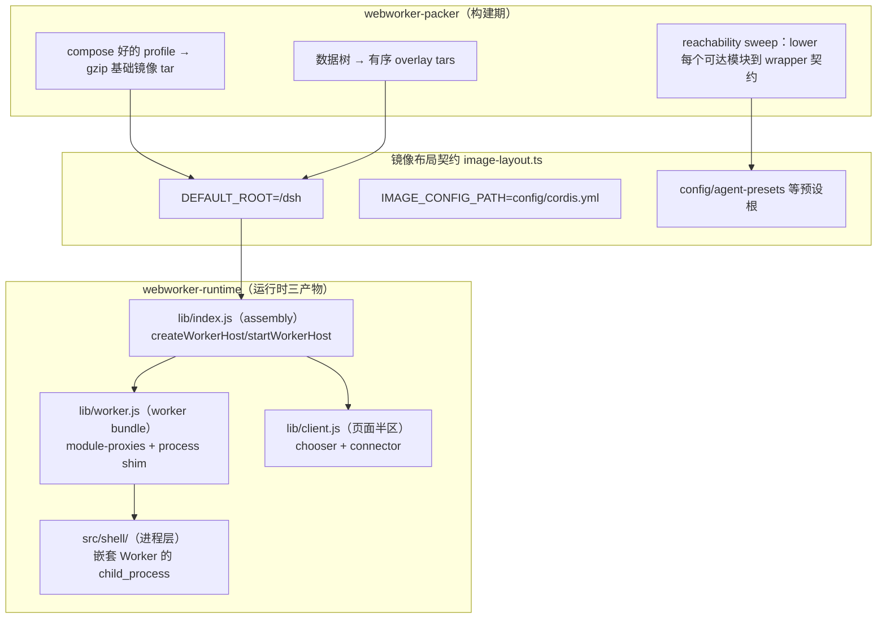
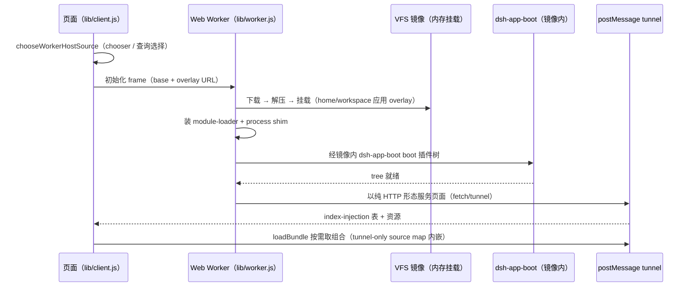

# WebWorker：在浏览器 Worker 里跑整棵 harness 插件树

> 子文档之一，聚焦 dsh 0.1.2-alpha 新增的 experimental `webworker` 能力面（`packages/experimental/webworker-runtime` + `webworker-packer`，均 private 维护工具）。整体哲学见 [README](README.md)；本文与 [deployment.md](deployment.md)（profile 组合）互为表里。按 ai-agent ⊗ framework 类规格产出。

根因与一句定位：**dsh 的 web 形态依赖一个 Node host 进程，但 preview 部署想要「在没有 Node host 的地方也跑起来」**——于是把整棵 harness 插件树塞进一个专用的浏览器 Web Worker：worker 解压并内存挂载打包好的 VFS 镜像、经 CommonJS wrapper 加载模块、用一条说纯 HTTP 的 postMessage tunnel 服务页面[[packages/experimental/webworker-runtime/README.md:12-12]()]()
<!-- anchor: The browser worker host: the whole harness plugin tree runs inside one dedicated Web Worker, for preview deployments and packaging regressions -->

## 概览：是什么 / 痛点 / 适用场景

- **是什么**：一对 experimental 包——**packer** 把「一次 compose 好的 profile」打成 gzip 压缩的 VFS 基础镜像 tar + 有序 overlay tar；**runtime** 在浏览器 worker 里挂载镜像、装模块加载器与 `process` shim、boot 插件树、用 postMessage tunnel 以普通 HTTP 服务页面。
- **痛点**：preview/演示部署不该要求每台机器都有 Node host；但"把 agent 运行时搬进浏览器"最容易踩的坑是从源码二次编译、或引入与生产不一致的执行环境。
- **适用场景**：无 Node host 的 preview 部署、打包回归测试（`apps/web/tests/preview-boot.e2e.ts` 在 headless Chromium 里驱动 chooser + Worker 激活）、调试"served deployment 到底发了什么"。
- **核心能力清单**：

| 能力 | 说明 |
|------|------|
| 整树进 Worker | 完整 harness 插件树在一个 Web Worker 内 boot（`dsh-app-boot` 走镜像自己的 boot） |
| 不打编译 | packer 直接打包仓库真实构建产物；worker 无编译器，未 lowering 的镜像挂载即拒 |
| VFS 内存挂载 | gzip tar → 内存文件系统；overlay 只能替换 `home/` 与 `workspace/` 下文件 |
| node:* 兼容层 | `module-proxies` 是唯一平台分叉：内建映射到 VFS/tunnel/browser 原语、结构性 stub 控制台 fail loud |
| 子进程 | `node:child_process` 不是 stub 而是实现——`spawn` 起一个同 bundle 的 Web Worker 当 shell 进程 |
| 页面侧引导 | `chooseWorkerHostSource`/`connectWorkerHost` 两段启动 + 结构化 index-injection 表 |

- **技术栈**：TypeScript + Web Worker + postMessage tunnel + CommonJS wrapper loader + `@yarnpkg/parsers`（shell 语法）+ gzip/ustar（镜像容器）。

## 架构：三产物 + 一条镜像布局契约

关键架构决策：**一条镜像布局契约、packer 与 worker host 两个消费方**——虚拟根、config/manifest 路径、空目录、`lowered` wrapper 契约门都定义在 `image-layout.ts` 一个文件里，packer 按它写、worker 按它挂，杜绝两侧漂移[[packages/experimental/webworker-runtime/src/image-layout.ts:2-5]()]()
<!-- anchor:  * Image layout contract shared by the packer and the worker host: the virtual …  * consumers — the packer writes this layout, the worker host mounts it. -->。**nothing is compiled from source**——基础镜像带的是仓库真实构建产物，所以 preview 调试的就是 served deployment 实际要发的东西[[packages/experimental/webworker-packer/README.md:12-12]()]()
<!-- anchor: The VFS image packer: turns one composed profile into the gzip-compressed base tar the browser worker mounts as its filesystem, and opaque data trees into ordered overlay tars -->

## 核心链路：一次 preview 的启动

启动分成独立的两阶段：`chooseWorkerHostSource({ image?, fixtureManifest? })` 可选地拥有 boot 屏障与 fixture manifest（无 `preview-fixture` 时在 source chooser 等待，有效查询直接选定，两条路径都返回有序 overlays）；`connectWorkerHost(worker, { image?, overlays? })` 是公开的基础连接器，`apps/web` 两个都调用并提供静态捆绑的 Worker[[packages/experimental/webworker-runtime/README.md:31-31]()]()
<!-- anchor: - **`lib/client.js` (page half)** — startup has two independent stages. -->。boot 补丁把部署形状固定：前端 serve 关、JSONL session 日志走明文路径、预设根指向镜像内的 `config/agent-presets`。

## 深挖一：不解析 JavaScript 的模块加载器——lowering 是 packer 的活

Worker 里没有编译器，这是它的立身之本。模块加载器（`module-system/module-loader.ts`）填充 Cordis 每个入口 import 的 `loader.internal` seam，并支撑 `node:module` 的 `createRequire` proxy（typert-loader、client-modules、插件清单都经它解析包元数据）[[packages/experimental/webworker-runtime/src/module-system/module-loader.ts:2-11]()]()
<!-- anchor:  * CommonJS module loader over the worker VFS. It fills the `loader.internal` …  * @module @deepseek-ai/dsh-experimental-webworker-runtime/src/module-system/module-loader -->

解析是**收窄的 Node `require` 算法**：`exports` walk 用固定条件序（`['browser','require','import','default']`——刻意不放 `node`）、扩展名探测、按解析出的绝对路径做单一 cache。模块体按镜像原样包装：lowering 是 packer 的活，运行时不碰任何 JS 解析。代价与风险被明确推到打包期：packer 的 reachability sweep 从 workspace 各 export 面 + worker assembly 种子出发，把每个可达模块 lower 到 wrapper 契约；自己代码里不可解析的请求直接让 pack 失败，第三方包容忍到 require 时报错[[packages/experimental/webworker-packer/README.md:30-30]()]()
<!-- anchor: 3. **Reachability sweep** — the runtime loader's own resolution -->

## 深挖二：`child_process` 不是 stub，是嵌套 Worker 的实现

浏览器 worker 无法 fork，所以 `node:child_process` 被实现而非打桩：`spawn` 把命令起在**它自己的 Web Worker 里**——同一个 bundle，由它的第一帧告知"我是 shell 进程"——并通过 subprocess 服务消费的 `ChildProcess` 表面汇报。命令跑在 host 线程之外，`SIGKILL` 无论它在干什么都能终止，它只能经消息触达 VFS（host 服务这些 frame）[[packages/experimental/webworker-runtime/README.md:30-30]()]()
<!-- anchor: - **`src/shell/` (the worker's own process layer)** — a browser worker cannot fork, -->

这个取舍值得注意：**复用同一 bundle 当子进程**意味着子进程与宿主共享所有能力面（能读 VFS、能跑 coreutils 命令表），同时避免在浏览器里造一个不真实的进程模型。语法用 `@yarnpkg/parsers` 的 `parseShell`；`execSync`/`fork` 仍拒绝——它们需要真实进程。Worker 平台可执行文件保留 Landlock 等原生协议而不替换其 JS 包、也不把它们耦合到 `node:child_process`。

## 深挖三：进程 shim 与平台分叉的单一来源

`module-proxies.ts` 是唯一的平台分叉点：`node:*` 内建映射到 VFS/tunnel/browser 原语；结构性 stub 对浏览器做不了的事在 console 上 fail loud；原生/二进制包有替换实现。全局 `process` shim 携带 Node 检测字段（含 `title`），防止 Worker 执行误入 DOM-only 分支。VFS 变更驱动 `node:fs` 回调/轮询/promise 三类 watcher；打开的描述符在 rename/replace/unlink 后保留文件身份与访问模式；`readable-stream` 提供 Chokidar/readdirp 等未改包需要的流状态机；AsyncLocalStorage 经 lowering 注入的 snapshot/restore 面在 `await` 间携带同步栈因果[[packages/experimental/webworker-runtime/README.md:29-29]()]()
<!-- anchor: - **`lib/worker.js` (worker bundle)** — the assembly plus this package's -->

一句话：**worker 是「浏览器里最接近 Node 的执行环境」，但每个"不真实"的地方都有明确的分叉点与 fail-loud 策略**，而不是静默降级。

## 全局关联

webworker 是「部署即组成插件树」（[deployment.md](deployment.md)）在浏览器域的激进延伸：packer 打包的是 compose 好的 profile（profile/bundle/patch 那套组合语义照旧），worker host 只负责"怎么把它跑起来"。它和 [inspector.md](inspector.md) 一脉相承——都是 experimental/private 的维护工具，都证明 dsh 的架构核心（插件树、镜像、boot）可以脱离 Node 存在，只要有人愿意在平台边界处补上真实的兼容实现。与 [data-model.md](data-model.md) 的关联在存储：preview 用明文 JSONL session 路径（无 zstd 压缩，避免浏览器解码依赖），`vfs-example` overlay 提供冷 Workspace/Session 发现所需的普通文件与明文持久化产物。

## 不足 / 风险

- **纯维护工具定位**：两包都 `private: true`，不进发行版；接口随 pre-release 演进。
- **打包 = 构建时间依赖**：packer 假设 `lib/` 产物是当前的——它从不编译，stale build 就打包 stale bytes（README 明令"先跑仓库构建"）[[packages/experimental/webworker-packer/README.md:54-54]()]()
<!-- anchor: - **The packer assumes built `lib/` artifacts are current**: it never compiles, so a stale workspace build packs stale bytes. Run the repository build first. -->。
- **平台边界复杂**：嵌套 Worker 的进程模型、`execSync`/`fork` 拒绝、浏览器 CSP 可能拦动态求值，限制了部分 Node 语义。
- **reachability 误判有成本**：第三方包中未被 sweep 到的 `createRequire` 调用会到 require 时才 loud fail，诊断需要打包期上下文。
