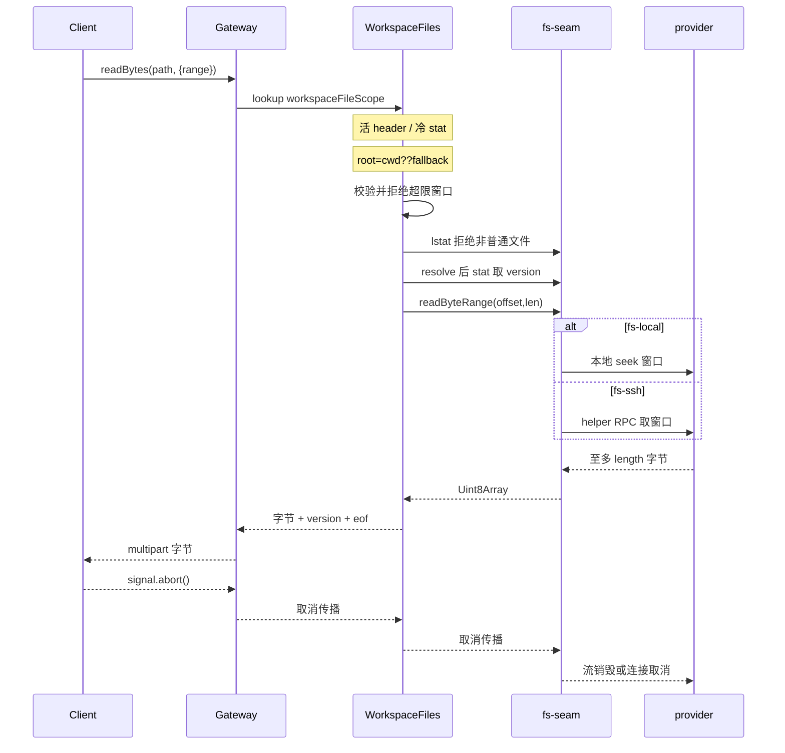

# 工作区文件能力面：寻址、双面 API、有界读取、交付与本地打开

> 子文档之一，聚焦「模型的产物如何从磁盘字节变成用户能点开、能下载、能在本地应用里打开的东西」。覆盖 `packages/api/workspace-files`（Host/Client 双面包）、`packages/util/workspace-path`（地址语法）、`packages/fs/fs` 上新增的 `readByteRange` seam 及其 `fs-local`/`fs-ssh` 实现、`packages/api/session-controller` 的 `/api/file` 路由、`packages/deliverables/tool-present` 与 `packages/client/ui-deliverables` 的交付链路、`packages/host/open-in-app` 的本地打开。整体哲学见 [README](README.md)；与 [attachments.md](attachments.md)（内容寻址附件对象库）、[sandbox-capability-seams.md](sandbox-capability-seams.md)（fs 等六族能力缝）、[remote-controllers.md](remote-controllers.md)（Typert Remote 控制器与双面产物）互相咬合；客户端渲染细节见 [web-client.md](web-client.md)，桌面壳与 open-in-app 概览见 [desktop-app.md](desktop-app.md)。
>
> **增量说明**：本文为新增关注面，依据上游 `dsh-v0.1.2-rc.1 → HEAD` 的 git diff 与源码核对生成；对应新增 `packages/api/workspace-files`、`packages/fs/tool-present`（现已迁至 `packages/deliverables/tool-present`），以及在 fs / api / e2b 三处落地的「有界字节区间读取」。本轮按最新基线 `dsh-v0.1.7-rc.2` @ `477b4f4205`（上一版基线 `dsh-v0.1.5-rc.2` @ `fb2c4b9e69`）重锚：`readAll`/`readRelated` 已并入 `readBytes`，二进制结果改走 multipart，E2B 提供者族整体移除，`changes` 升级为按目标 `fs.watch`。

## 根因：产物是执行世界里的字节，用户要的是「能打开的东西」

模型写出一个 HTML 图表、一张图片、一段代码或一份文档时，产物落在某个**执行世界**（execution world）的文件系统里——可能是本机 `fs-local`，可能是被沙箱栅栏的 `fs-sandbox`，也可能是远端 E2B 沙箱（[sandbox-capability-seams.md](sandbox-capability-seams.md) 的「同执行世界」级联）。而用户面对的是一个**可能不在 Host 上的浏览器**。两者之间隔着四道缺口，缺一道产物就只是「磁盘上的字节」：

1. **命名**：浏览器凭什么指认一个文件？它不知道 Host 的工作区根、也不该信任客户端传来的根。需要一个两端共识的地址。
2. **读取**：产物可能是 1 GiB 日志、也可能是二进制图片。整文件读会把 Host 内存和浏览器一起拖垮。
3. **交付**：哪些文件是「最终产物」而非中间过程？模型必须显式声明，用户才知道该点开哪个。
4. **落地**：把「打开」这个副作用放到 Host 的桌面应用上，而不是让浏览器下载。

dsh 的解法不是给会话控制器再挂一个「文件下载」接口，而是把它立成一个独立关注面。源码注释把这条边界写得很直白：workspace-files **刻意不仿照** `session.openWorkspacePath`——后者把路径交给本机打开器、把效果留在这台机器上，前者把文件内容送过线路，是**不同的暴露面**（[packages/api/workspace-files/src/index.ts:17-19]()）。
<!-- anchor: * This is NOT modelled on `session.openWorkspacePath`. That endpoint hands a … * file content across the wire, which is a different level of exposure. -->

这也解释了为什么早期的结论是「把工作区文件用 HTTP 伺服出去」不在范围内：HTTP 伺服要处理 origin 问题，而资源模型给浏览器送的是**值**（元数据、文本、原生字节）与地址，不铸造可同源打开的文档 URL，从根上没有这个面（边界记录见 `.agents/notes/implemented/feature/2026-07-31-web-workspace-file-links.md`）。本次增量把预览能力扩展到了不在 Host 上的浏览器，但搬的仍是「窗口字节」而不是「一个被伺服的文档」。

## 寻址：`dsh-resource://file/…` 的 session 作用域与 absolute 作用域

统一寻址是这条链路的第 0 步。`packages/util/workspace-path` 定义了一份**不触碰文件系统**的地址语法，把「文件」拆成两种作用域（[packages/util/workspace-path/src/file-address.ts:27-38]()）：
<!-- anchor: export type FileAddress = … readonly path: string -->

- `dsh-resource://file/session/<sessionId>/<path>`：携带**授权它的 Session**，path 可以是绝对路径，也可以是相对该 Session 工作区根的路径。
- `dsh-resource://file/absolute/<path>`：只带绝对路径，**不携带 Session**。

需要区分一个易混的名字：`packages/context/session-reference` 解决的是「会话引用会话」——把 `@label` 变成跨会话的只读上下文快照，与文件寻址无关；文件地址里的 session 作用域指的是「用 Session 身份为文件授权并确定工作区根」，两者只是共用 Session 这一概念（[packages/context/session-reference/README.md:12-12]()）。
<!-- anchor: `dsh-session-reference` lets a conversation reference other sessions: a host tur -->

**Why 需要两种作用域，而不是只用绝对路径？** 因为浏览器手里没有、也不该有权威的 Host 路径。session 作用域把「哪个工作区根」的判断交还给 Host：客户端只送 Session id 和路径，Host 用它自己持有的 Session header 解析。`fileAddressFor` 甚至进一步——只有当绝对路径确实落在该 Session 工作区根内时才折算成相对路径，否则保留绝对路径继续挂在这个 session 作用域下（[packages/util/workspace-path/src/index.ts:92-98]()）：
<!-- anchor: export function fileAddressFor(sessionId: string, cwd: string | undefined, path: … return sessionFileAddress(sessionId, normalized) -->

地址构造与解析都要经组件编码，否则文件名里的 `#`、`?`、空格会在一轮往返里丢失；`:` 保持字面量以便 Windows 盘符原样可读（[packages/util/workspace-path/src/file-address.ts:65-67]()、[packages/util/workspace-path/src/file-address.ts:89-110]()）。
<!-- anchor: export function sessionFileAddress(sessionId: string, path: string): string { … return `${FILE_ADDRESS_PREFIX}session/${encodeSegment(sessionId)}/${encodePath(n -->
<!-- anchor: export function parseFileAddress(address: string): FileAddress | undefined { … return undefined -->

Host 侧的授权落在一个 Typert lookup 上。每条 Remote 调用的第一个参数都是 `WorkspaceFileScope`（[packages/api/workspace-files/src/index.ts:55-59]()），由 Gateway 依线路上的 Session 身份解析出来（[packages/api/workspace-files/src/index.ts:63-65]()）：
<!-- anchor: export interface WorkspaceFileScope { … readonly workspaceRoot: string -->
<!-- anchor: interface TypertLookupMap { … workspaceFileScope: TypertLookup<WorkspaceFileScope, SessionId> -->

解析只读 Session header——活的 Session 直接取，冷 Session 走 `sessionPersistence.stat` 的 header-only 读——**绝不激活 Agent、不读事件体、不借用父 Session 的根**，所以 subagent 的冷 Session 也能自己解析相对路径（[packages/api/workspace-files/src/index.ts:209-217]()）：
<!-- anchor: const live = scope.sessions.get(sessionId)?.header … workspaceRoot: header.cwd ?? scope.sandboxPolicy.workspaceRoot, -->

**权衡（本次最重要的口径变化）**：session 作用域**不是读隔离栅栏**。`read` / `readBytes` / `stat` 继承**所寻址 Session 的 filesystem 后端**的读权限：工作区根只是相对路径的基准，不是读边界；只要后端允许，工作区外的绝对路径与 `..` 相对路径都可读，`readBytes` 的 `baseFile` 也据此能从基文件目录解析出工作区外的关联文件（[.agents/notes/implemented/architecture/2026-09-09-workspace-file-read-authority.md:13-13]()）。只有 `list` 与 `changes` 保持工作区约束，因为它们暴露的是「工作区导航」而非「一个具名文件的读取」（[.agents/notes/implemented/architecture/2026-09-09-workspace-file-read-authority.md:15-15]()）——`changes` 的约束只落在**目录**目标上，文件目标沿用读权限：
<!-- anchor: `read`, `readBytes`, and `stat` inherit the addressed Session -->
<!-- anchor: `list` and `changes` remain workspace-scoped because they expose workspace navig -->

这个选择的代价被明确记录：任何持有合法 Session 文件地址的调用者，都能拿到该 Session 后端允许它读的**每一个**普通文件的字节，包括工作区外的文件（[.agents/notes/implemented/architecture/2026-09-09-workspace-file-read-authority.md:29-29]()）。
<!-- anchor: Any caller holding a valid Session file address can receive bytes from every reg -->
之所以敢这样，是因为沙箱后端栅栏的是**写**而不是读（[packages/api/workspace-files/README.md:95-95]()）；而 `absolute` 作用域没有 Session 可授权，被刻意保留为「可解析但必然失败」，避免退化成匿名读盘（[packages/api/workspace-files/src/client/provider.ts:119-127]()）。
<!-- anchor: Reads through `ctx.fs` use the backend's read authority; the sandboxing backend  -->
<!-- anchor: function resolve(address: string): RemoteResult<HostFile> { … return { ok: false, error: unknownWorkspace(address) } -->

## 双面 API：一个包、两个编译面

`@deepseek-ai/dsh-api-workspace-files` 的所谓 **dual-face**，指的既不是「两个包」也不是「前端/后端两套代码」，而是**一个包同时拥有 Host 运行时入口与浏览器插件入口，并且两者在 TypeScript 编译图上是两片独立的叶子**：`./client` 导出真正的 resource provider 插件、`dsh.client` 声明浏览器插件，`./typert` 与 `./remote` 是构建期生成的双契约（[packages/api/workspace-files/package.json:25-35]()、[packages/api/workspace-files/package.json:40-47]()）。
<!-- anchor: "./client": { … "default": "./lib/typert.remote-client.js" -->
<!-- anchor: "dsh": { … "platform": "web" -->

**Why 合回一个包？** 早期为了绕开 TypeScript 项目引用环（`remotes → workspace-files → resources → remotes`）曾拆成两个包，代价是「一个文件能力的 Host 与 Client 归属被切开」；把结果类型直接从协议包取、把 Sidebar 参数声明交给文本预览包之后，环消失了，就可以像其他 API 控制器一样合回双面包（[.agents/notes/implemented/architecture/2026-09-07-workspace-files-dual-face-package.md:13-13]()）。一个 web-app row 同时加载两面，浏览器侧因此**没有独立配置**。
<!-- anchor: `packages/api/workspace-files` owns both implementations. Its Host and Client le -->

### Host 面：五个 Remote 方法与一个只读契约

Host 面是 `ctx.workspaceFiles` 服务 + `workspaceFiles` Remote 命名空间，方法全部只读，没有一个 mutation：

| 方法 | 返回 | 用途 |
|---|---|---|
| `stat(path)` | `WorkspaceFileStat { absolutePath, version, bytes? }` | 身份、新鲜度令牌与大小，不含内容 |
| `read(path, { offset?, limit? })` | `WorkspaceFileText` = stat + `{ offset, text, lines, eof }` | 按**行**分页的 UTF-8 文本窗口 |
| `readBytes(path, { range?, baseFile? })` | `WorkspaceFileBytes` = stat + `{ offset, data, eof }` | 按**字节**的原始窗口或整文件；`data` 是原生 `Uint8Array`，不再 base64 |
| `list(path)` | `WorkspaceDirectoryListing` | 工作区内某目录的直接子项 |
| `changes(path)` | `WorkspaceFileWatchFrame` 流 | 先 `ready`，再推送一个文件或一个目录直接子项的失效通知 |

> **演进说明(0.1.7-rc.2)**：`readAll(path)` 与 `readRelated(path, relativePath)` 两个独立 Remote 方法已下线，现由 `readBytes` 的必填 options 对象一次性承担：不给 `range` 就是整文件（受 `maxFileBytes` 约束，超限失败而非截断），给 `baseFile` 就从该文件目录解析相对目标；正交的「是否分窗」与「从哪解析」不再各占一个方法名（[packages/api/workspace-files/src/index.ts:256-280]()）。
<!-- anchor: async readBytes( … return { ...this.statOf(target, info), offset: 0, data, eof: true } -->

`version` 是不透明令牌、只可比较不可解析；`offset` 在 `read` 里是行号、在 `readBytes` 里是字节号，两个单位从不混用——`statOf` 是唯一把目标转成 wire 值的地方（[packages/api/workspace-files/src/index.ts:435-439]()）。
<!-- anchor: private statOf(target: FsTarget, info: FsInfo): WorkspaceFileStat { … ...info.size === undefined ? {} : { bytes: info.size }, -->

按行分页是本关注面最精巧的一处。`read` 并不「先读全文再切片」，而是从 `streamText` 里**现切**：窗口前的行只计数不保留，窗口内的片段在缓冲前先按 `maxBytes` 准入，遇到窗口后第一个字符立刻返回——所以文件再大，一页也只花一页内存（[packages/api/workspace-files/src/index.ts:113-159]()）：
<!-- anchor: async function cutPage( … return { text: lines.join('\n'), lines: lines.length, eof: true } -->

`read` 与 `readBytes` 的返回体都只带 stat 的 `version` 与 `bytes`（[packages/api/workspace-files/src/index.ts:233-245]()、[packages/api/workspace-files/src/index.ts:257-270]()）。`readBytes` 的 `data` 直接是原生字节，由 Connection 的 multipart 响应承载，客户端不再解码 base64（[packages/api/workspace-files/README.md:50-50]()）。**Why 页面也带 version？** 因为「结果元数据来自读之前的 stat、内容来自之后的读」，并发写会让二者错位；显式携带 version 才能让消费者分辨「这页是新鲜的吗」——这是刻意的弱一致性契约，而不是缺陷掩盖。
<!-- anchor: async read( … return { ...this.statOf(target, info), offset, text: page.text, lines: page.line -->
<!-- anchor: async readBytes( … return { ...this.statOf(target, info), offset, data, eof } --><!-- anchor: Pass the required options object as `{}` for a complete file under `maxFileBytes` -->

`list` 是唯一带工作区包含性检查的文件操作，且它上报的是**工作区相对路径**而不是 `absolutePath`，因为它的消费者是一棵以工作区根为根的树（[packages/api/workspace-files/src/index.ts:303-326]()）：
<!-- anchor: async list(workspaceFileScope: WorkspaceFileScope, path: string, signal: AbortSi … truncated: children.length > this.config.maxEntries, -->

`changes` 是一路 `stream` Remote，现在**必须带一个目标 `path`**：先注册观测队列、解析工作区根与目标、对目录目标套用包含性谓词、启动 `fs.watch`，再以 `{ kind: 'ready' }` 确认（[packages/api/workspace-files/src/index.ts:339-341]()）。它的数据源因此有两条：`fs/observed`（被插桩的 filesystem 操作所报告的观测）与后端自己的 watcher（本地 provider 由 Chokidar 支撑），**不再只是被插桩的写入**（[packages/api/workspace-files/src/changes.ts:22-29]()）：
<!-- anchor: @Remote({ mode: 'stream' }) … return this.feed.follow(workspaceFileScope.workspaceRoot, path, signal) -->
<!-- anchor: ctx.on('fs/observed', (target, observation) => { … }, 'workspace-files.changes') -->

> **演进说明(0.1.7-rc.2)**：早期 `changes` 只中继 `fs/observed`，所以用户用编辑器、shell 或子进程改文件**不会**产生变更帧，只有 Agent 自己通过工具读写才会。这一限制已下线：现在每个 generation 会在解析出的目标上启动 `fs.watch`，本地 provider 由 Chokidar 支撑，外部进程的改动同样会成帧（[packages/api/workspace-files/README.md:58-58]()）。
<!-- anchor: `changes` is a `stream` Remote accepting only a target path. -->

`changes` 依旧把「工作区导航」与「任意路径读」两类语义分开：目录目标要过后端的包含性谓词（[packages/api/workspace-files/src/changes.ts:71-73]()），观测本身则只按 `fs.watch` 的目标键过滤（[packages/api/workspace-files/src/changes.ts:93-94]()）。
<!-- anchor: throw new RemoteError('workspace-file/outside-workspace', 'Directory is outside the workspace', { path }) -->
<!-- anchor: for await (const [observed] of follower.read()) { … if (observed.targetKey !== target.targetKey) continue -->

### Client 面：只推元数据的 `file` resource provider

浏览器侧注册一个 `ResourceProvider<'file'>`，并声明 `ResourceProtocolMap.file` 的值是 `WorkspaceFileStat`（[packages/api/workspace-files/src/client/index.ts:24-34]()、[packages/api/workspace-files/src/client/types.ts:10-16]()）：
<!-- anchor: const changes = new ChangeFeed(ctx.remote) … }, 'workspace-files: file resource provider') -->
<!-- anchor: declare module '@deepseek-ai/dsh-client-ui-slots' { … file: WorkspaceFileStat -->

资源流**只推变化、不推内容**：首帧是 `stat` 或其失败帧；Host 上报的写入版本与当前值相同则丢弃、不同则只更新 `version`（保留上次字节数）；报「消失」就重新 stat（[packages/api/workspace-files/src/client/provider.ts:52-108]()）。内容由消费者自己按需 `read`/`readBytes`。
<!-- anchor: async *open(address, { signal }): AsyncIterable<RemoteResult<WorkspaceFileStat>> … notices.dispose() -->

**Why 内容不上流？** 内容可以任意大，而流的用途是「推送变化」而非「承载负载」；把新鲜度与刷新责任留给每个消费者，共享观测就只需维护一份轻量元数据。代价是消费者要自己拼页、自己判断陈旧——这是把成本从 Host 内存挪到了消费者逻辑，对一个「浏览器可能不在 Host 上」的场景是划算的。

`version` 的定义让语义自洽：`fs-local` 由 device、inode、size、纳秒级 mtime 与 ctime 派生（[packages/fs/fs-local/src/fsio.ts:73-76]()），所以「内容相同但被重写」也会换 version——这正是一个**新鲜度**令牌该有的行为，而不是内容哈希。
<!-- anchor: /** Opaque version token from high-resolution identity and freshness metadata. * … return FsVersion(`${info.dev}:${info.ino}:${info.size}:${info.mtimeNs}:${info.ct -->

失败也用类型表达：`workspace-file/not-found`、`outside-workspace`（`list` 与**目录** watch）、`watch-unsupported`（后端无法初始化 watch）、`too-large`、`not-text`、`not-regular-file`、`not-directory`（[packages/api/workspace-files/src/types.ts:154-173]()），加上 Client 侧铸造的两个地址错误 `unsupported-address` 与 `unknown-workspace`（[packages/api/workspace-files/src/client/types.ts:26-42]()）。调用方按 code 分支、绝不按消息文本分支。
<!-- anchor: interface RemoteErrorDetailsMap { … readonly kind: 'file' | 'symlink' | 'other' -->
<!-- anchor: interface RemoteErrorDetailsMap { … 'workspace-file/unknown-workspace': { readonly address: string } -->

## 有界字节区间读取：seam 上的窗口，而不是「整读后切片」

### 为什么必须是窗口

`dsh-fs` 原本只有一个原始字节读：`readBytes(target, signal, maxBytes)`，它以**整个文件**为界，凡是超过 cap 的文件一律拒绝（[packages/fs/fs/src/index.ts:219-228]()）。这对「模型要整张吞下的图片」是正确的，但对「大文件里的一小段」毫无用处。于是本次新增第二个原始字节原语（[packages/fs/fs/src/index.ts:231-243]()）：
<!-- anchor: * Read the whole regular file as raw bytes with no decoding or binary … abstract readBytes(target: FsTarget, signal: AbortSignal | undefined, maxBytes:  -->
<!-- anchor: * Read one byte window of the regular file as raw bytes with no decoding or … abstract readByteRange(target: FsTarget, range: { offset: number; length: number -->

**有界窗口的关键在于「界在哪」**：不再是「整个文件不超过 cap」，而是「传输量不超过窗口」。后端最多在跳过前缀之后多传 `length` 字节，绝不缓冲整个文件，所以守卫变成调用方对 `length` 的 cap，与 `readBytes` 的界**并列而非取代**（[packages/fs/fs/README.md:55-55]()）。
<!-- anchor: - **Bounds live at this seam.** `readBytes` requires `maxBytes` and fails with ` -->

那为什么不直接「读整个文件返回切片」？上游设计记录里给了一个决定性的反例：曾经的中期实现用 `readBytes(target, signal, offset + length)` 读到窗口末尾再切片，结果**永远无法读取比该末端更长的文件**——seam 会以 too-large 拒绝它，于是窗口永远无法返回 `eof: false`，恰好否定了这个方法存在的理由（[.agents/notes/implemented/architecture/2026-09-05-workspace-files-service.md:122-122]()）。同理，base class 也不提供基于 `readBytes` 的默认实现，因为那只能是「读到窗口末尾」或「传一个无界 cap」，两者都退回被否掉的行为（[.agents/notes/implemented/architecture/2026-09-05-workspace-files-service.md:126-126]()）：
<!-- anchor: **Whole-file read and slice for the byte window.** The interim form of `readByte -->
<!-- anchor: **A default `readByteRange` in the `FileSystem` base class.** A non-abstract def -->

### 一次 range 请求的完整链路

Remote 方法在**线路边界**上做校验：`resolveWindow` 拒绝非安全整数、拒绝 `offset + length` 溢出、拒绝超过 `maxBytes` 的窗口——而且是拒绝而非截短，因为「静默截短的窗口会被读成完整窗口」（[packages/api/workspace-files/src/index.ts:366-379]()）。随后 `inspect` 用 `lstat` 检查路径本身（拒绝缺失与符号链接），`locateFile` 再 `resolve` 并 `stat` 一次确认类型与 version——两次检查之间文件可能消失或换类（[packages/api/workspace-files/src/index.ts:385-399]()、[packages/api/workspace-files/src/index.ts:415-432]()）：
<!-- anchor: private resolveWindow(range: WorkspaceByteRange, path: string): { offset: number … return { offset, length } -->
<!-- anchor: private async inspect( … return { root, workspaceRoot, entry } --><!-- anchor: private async locateFile( … return { target, info } -->

### 各 provider 的实现矩阵

| Provider | 窗口实现 | 代价 |
|---|---|---|
| `fs-local` | `createReadStream(targetKey, { start, end })`，依赖 stat 前置检查；`length` 为 0 时直接返回空数组、不开流 | 内核级 seek，无额外传输 |
| `fs-sandbox` | 继承 `LocalFileSystem`，不覆写 | 与 fs-local 相同 |
| `fs-ssh` | 把窗口转成 helper 的 `fs.readRange` RPC，helper 端再落到它自己的 `ctx.fs.readByteRange`；helper 解析 `length` 时以 `MAX_TEXT_BYTES` 封顶 | 一次远端往返 + base64 编解码，但传输仍以窗口为界 |
| `fs-e2b` | SDK 只能从文件头流式读：skip 到 `offset`、拷满 `length` 后立刻 `cancel()`，不越过窗口继续传 | **传输整个前缀**，但内存仍有界 |
| 测试替身 | 抽象方法，每个替身都必须实现 | 换来「没有任何后端能用无界 cap 蒙混」 |

> **演进说明(0.1.7-rc.2)**：`fs-e2b` 连同整个 E2B 执行提供者族已从仓库移除（[.agents/notes/implemented/simplification/2026-09-11-remove-e2b-providers.md:17-17]()），表中这一行只作为历史成本模型保留；接替「远端文件系统 provider」位置的是 POSIX SSH 提供者，它的窗口实现走 helper 的 `fs.readRange`（[packages/ssh/fs-ssh/src/index.ts:74-76]()）。
<!-- anchor: The repository excludes the E2B sandbox owner, filesystem provider -->
<!-- anchor: override async readByteRange(target: FsTarget, range: { offset: number; … return Buffer.from(await this.call('fs.readRange', { target, ...range }, z.base64 -->

各行的实现落点分别是：`fs-local` 只是把 target 转交给窗口读函数（[packages/fs/fs-local/src/index.ts:187-188]()），真正的 seek 语义在 `readByteWindow`（[packages/fs/fs-local/src/fsio.ts:456-481]()）。
<!-- anchor: override async readByteRange(target: FsTarget, range: { offset: number; length:  … return readByteWindow({ displayPath: target.displayPath, targetKey: target.targe -->
<!-- anchor: export async function readByteWindow( … return Buffer.concat(chunks, bytes) -->
`fs-sandbox` 不覆写、直接继承（[packages/fs/fs-sandbox/src/index.ts:55-55]()）；`fs-e2b` 的 skip+cancel 策略曾写在注释里，该注释已随包删除。
<!-- anchor: export class SandboxedFileSystem extends LocalFileSystem { -->

> **演进说明(0.1.7-rc.2)**：`packages/e2b/fs-e2b` 整个包已随该提供者族删除，上述 skip+cancel 注释与 `openReadStream`（曾用来绕开「空文件返回字符串而非 ReadableStream」的 pinned SDK 谎言）都不再存在；同一结论——**同一个 seam，不同 provider 的成本模型不同**——现在的实例是 SSH：窗口读要走 helper 的 `fs.readBytes` / `fs.readRange` 分支并为传输做一次 base64 编解码（[packages/ssh/ssh/src/helper.ts:207-219]()）。接口统一了语义与内存上界，但没有、也不该假装统一 I/O 成本。
<!-- anchor: if (method === 'fs.readBytes' || method === 'fs.readRange') { … return Buffer.from(bytes).toString('base64') -->

### 与「未读变更诊断」的同一条纪律

本次增量还顺手把**读**与**写**两侧的一处不对称收敛了。写侧：`fs-observation-policy` 对「没有先读过就编辑」抛 `FS_NOT_OBSERVED`（[packages/fs/fs-observation-policy/src/index.ts:78-87]()），而 `tool-fs` 把策略与 provider 两种来源统一成一条面向模型的诊断 `cannot modify "<path>": file has not been read — read the file, then retry`，保留错误码与原始 cause（[packages/fs/tool-fs/src/error.ts:23-31]()）：
<!-- anchor: editIntent(target: FsTarget, actor: object | undefined): { version: FsVersion }  … return { version: prior.version } -->
<!-- anchor: if (error.code === 'FS_NOT_OBSERVED') { … return new FsError(`${error.message} — re-read the file, then retry`, error.code -->

读侧：`readByteRange` 与 `readBytes` 被并列保留，正是拒绝让「一个窗口」冒充「整个文件」。两条纪律同构——**未经完整观测的东西不能冒充授权**。一个具体的推论是：插桩观测 `fs/observed` 由模型面向的工具在读成功后发出（[packages/fs/tool-fs/src/read.ts:163-163]()），workspace-files 的预览读并不会替用户「解锁」某个文件的写权限；UI 预览与模型工具的观测是两条互不相通的路径。
<!-- anchor: ctx.emit('fs/observed', target, { kind: 'present', version: info.version }, exec -->

## `/api/file`：HTTP 服务面的收敛史与它防住的东西

`/api/file` 是另一条独立通路，服务的不是「资源打开」而是**会话散文里内嵌的本地媒体**（截图等）：浏览器读不了 Host 文件，所以散文里的本地媒体目标被重写成这一个同源路由。它的当前形态极简：认证后的 GET/HEAD，路径必须是一个不含 NUL 的绝对路径，MIME 由扩展名查表（查不到用 `application/octet-stream`），GET 走 `ctx.fs.readBytes`、HEAD 只取 metadata，超限即 413（[packages/api/session-controller/src/media-references.ts:25-58]()、[packages/api/session-controller/src/media-references.ts:36-43]()）：
<!-- anchor: const path = new URL(request.url).searchParams.get('path') … return fail(statuses[error.code] ?? 500, error.code) -->
<!-- anchor: const info = await fs.stat(target, request.signal) … return new Response(null, { headers }) -->

字节上限复用附件包的 `imageLimits.maxImageBytes`（通常 20 MiB），而不是另造一个旋钮（[packages/api/session-controller/src/media-references.ts:66-74]()）；**Range 被忽略、也不宣告支持**（[.agents/notes/implemented/feature/2026-09-08-file-display-through-filesystem.md:17-17]()）：
<!-- anchor: export const SessionMediaReferences = { … fetch: request => serveFile(request, ctx.fs, maxBytes), -->
<!-- anchor: All files use the resolved `ctx.attachments.imageLimits.maxImageBytes` limit, no -->

这段代码之所以值得单列，是因为它在本次增量里经历了一次完整的「加固 → 推翻」。按时间顺序，中间形态曾逐条加上过这些约束，每一条都对应一个具体威胁：

| 约束 | 防的是什么 | 最终归宿 |
|---|---|---|
| 只解析 `bytes=` 单位的 Range；非法/未知单位/多段 Range 一律忽略、返回完整 200 | `range-parser` 从不校验单位；多段 Range 会造成响应放大与错标 206 | **整体删除**：最终版本不解析 Range、不宣告 Range，攻击面归零 |
| 扩展名 allowlist（image/video/audio，排除 `image/svg+xml`） | 从认证 origin 伺服任意类型导致的内容类型混淆与 SVG 脚本执行 | 由 `mime.lookup` + CSP `sandbox; default-src 'none'` 接管 |
| open 之前先 `isFile()` 拒绝非普通文件 | 命名管道/设备节点会让 open 阻塞（DoS）或读出无界数据 | 由 `ctx.fs` 的 regular-file 前置检查继承 |
| 全量流按 stat 的 size 封顶；HEAD 错误响应不带 body | 并发 append 越过已声明的 `Content-Length` | 由 `readBytes` 的「stat 预检 + 流式中增长检测」继承 |
| 工作区包含性 + 媒体类别 allowlist | 限制可读字节范围 | **推翻**：认证 + 组合 provider 的读策略即访问控制，否则截图与远端文件都不可达（[.agents/notes/implemented/feature/2026-09-08-file-display-through-filesystem.md:21-21]()） |

<!-- anchor: **Workspace and media allowlists.** They limit which authenticated bytes can be  -->

最终收敛的理由很干脆：新增一个「文件系统字节流」接口需要每个 provider 都实现、含远端 range 处理，而当前「完整有界读」已经够用（[.agents/notes/implemented/feature/2026-09-08-file-display-through-filesystem.md:23-23]()）。
<!-- anchor: **A new filesystem byte-stream API.** Efficient large-file delivery and audio/vi -->

服务面剩下的两道自保：所有响应带 `Cache-Control: private, no-store` 与 `X-Content-Type-Options: nosniff`，并加 `Content-Security-Policy: sandbox; default-src 'none'`——因为 HTML 与 SVG 可能被直接在认证 API origin 上打开（[packages/api/session-controller/src/media-references.ts:15-19]()）。代价是显式的：**每个 GET 都会把完整文件缓冲进 Host 内存**，音视频只能整段传输、不保证可 seek。
<!-- anchor: const BASE_HEADERS = { … 'Content-Security-Policy': "sandbox; default-src 'none'", -->

## 交付：`present` 声明源文件，而不是冻结快照

### Host 侧契约

`present` 是模型面向的交付工具。它的工具描述把语义咬得很死：声明**已存在**、可通过 Session 文件系统访问的文件为最终交付物；文件必须先存在；用户打开的是**当前源文件**，内容**不被复制或保存**（[packages/deliverables/tool-present/src/index.ts:40-42]()）：
<!-- anchor: description: 'Declare existing files as final deliverables for the user. ' … + 'prefer your final response when that suffices. The user opens the current -->

执行体只做 `lstat` + `resolve` + `stat` 三重确认，**完全不读内容**，并在确认路径是普通文件后才收下声明（[packages/deliverables/tool-present/src/index.ts:87-93]()）。它要求一个开着的 turn 和一个已声明的 Session 工作目录，把声明绑定到 `boundary.lastTurn`，并按 `maxFiles`（默认 8）限制单次声明数量（[packages/deliverables/tool-present/src/index.ts:77-82]()）：
<!-- anchor: const entry = await ctx.fs.lstat(file.path, { cwd }, exec.signal) … files.push({ ...file }) -->
<!-- anchor: if (exec.agent === undefined) throw new Error('present requires an agent Session') … if (cwd === undefined) throw new Error('present requires a workspace') -->

真正写入会话日志的时机是**成功的最终 `tools/result` 之后**：`ctx.on('tools/result')` 里取出本次执行的 pending 声明，若结果不是错误就 `session.append('deliverables/presented', { turn, callId, files })`（[packages/deliverables/tool-present/src/index.ts:100-106]()）。这条「先执行、后落日志、且只认最终成功结果」的规则，保证了嵌套调用、父程序后续失败、被拦截的结果都不会误发交付声明。
<!-- anchor: const delivery = pending.get(exec) … turn, callId: exec.callId, files, -->

交付事件本身只带路径与可选描述，不带 Session id（[packages/deliverables/tool-present/src/types.ts:5-9]()、[packages/deliverables/tool-present/src/types.ts:13-15]()）。
<!-- anchor: export interface PresentedFile { … description?: string -->
<!-- anchor: interface SessionEventMap { … 'deliverables/presented': { turn: number; callId: ToolCallId; files: PresentedFi -->
**Why 不带 Session id？** 因为 fork 出来的历史必须相对**被查看的** Session 工作区解析相对路径，而不是相对产出它的原 Session（[.agents/notes/implemented/feature/2026-09-08-present-workspace-source-files.md:37-37]()）。
<!-- anchor: The Session log persists declarations but no attachment references or file conte -->

### 「不可变交付」的语义，以及它为什么被推翻

在本次增量覆盖的时间窗内，`present` 曾是**快照式**的：它 `readBytes` 读出字节，经 `ctx.attachments.saveFile` 存成内容寻址的不可变对象，事件里记录 `attachmentId` 与 `bytes`，UI 渲染带下载按钮的卡片。当时被归档的设计笔记把语义写得非常完整：交付事件是**授权索引**而非纯展示元数据，因此 required-on-read；下载与原生打开按「被查看 Session + 事件 seq + 文件 index」授权；每次手势都开一份**新的私有副本**，以免应用写入污染不可变对象或影响后续打开（[.agents/notes/archived/feature/2026-09-08-web-explicit-file-delivery.md:14-14]()、[.agents/notes/archived/feature/2026-09-08-web-explicit-file-delivery.md:18-18]()）：
<!-- anchor: The [present tool](../../../../packages/fs/tool-present/README.md) owns executio -->
<!-- anchor: Card and closing-mention gestures open a verified private copy with the existing -->

**「不可变」的价值是**：产物被编辑或删除后，交付仍然可下载、可打开；代价是内容存储、副本校验、临时文件保留，以及一个**第二编辑目的地**（用户编辑私有副本，与工作区源文件分叉）。随后 `refactor(present): declare and open workspace source files` 把它整体反转：`present` 只声明源文件，字节不进附件库，下载端点与回退副本一并移除（[.agents/notes/implemented/feature/2026-09-08-present-workspace-source-files.md:13-13]()）。推翻的判据是产品需求而非实现难度——用户真正要的是「打开并继续编辑工作区里那个文件」，而独立交付版本会制造分叉（[.agents/notes/implemented/feature/2026-09-08-present-workspace-source-files.md:25-25]()）：
<!-- anchor: The [present tool](../../../../packages/deliverables/tool-present/README.md) declares exis -->
<!-- anchor: **Immutable attachment snapshots and editable temporary copies** preserve delive -->

于是产生一个**明确的张力**：交付物不再「不可变」，编辑会改变下次打开的内容，删除或移动会让声明失效；Session ZIP 导出只含声明不含内容（[.agents/notes/implemented/feature/2026-09-08-present-workspace-source-files.md:37-37]()）。
<!-- anchor: The Session log persists declarations but no attachment references or file conte -->
这不是回归，而是把「交付 = 指向源文件的声明」讲清楚后的必然结果；内容持久化被显式 defer 到将来由某个持久化设计拥有。

### 交付物如何绑定到 Session 作用域

`present` 的可见范围跟随**组合后的 `ctx.fs`**：没有工作区包含性检查，也没有 `/tmp` 白名单；相对路径相对 Session 工作目录解析，`/tmp`、Downloads、另一个项目里的文件一视同仁；缺失文件、目录、末尾符号链接与 provider 失败都会拒绝（[.agents/notes/implemented/feature/2026-09-09-present-filesystem-access.md:13-13]()）。这与前面 workspace-files 的读权限口径是同一条。
<!-- anchor: `present` accepts existing regular files accessible through its composed `ctx.fs -->

原生打开时，Host 用随声明返回的**被查看 Session header** 构造 `workspaceFiles.stat` 的 scope（cwd，缺省时用部署工作区根），再要求解析出的规范进程路径能经该 filesystem **从 Host 路径映射回去且完全一致**，否则 422——同名本地文件绝不替代一个无法映射的 provider 文件（[.agents/notes/implemented/feature/2026-09-09-present-filesystem-access.md:15-15]()）：
<!-- anchor: Native actions use the viewed Session header returned with the declaration to fo -->

客户端把交付物编成 `?sessionId&seq&index` 坐标（[packages/client/ui-deliverables/src/presented.ts:63-64]()）；Host 路由只接受这三个坐标、**从不接受浏览器提供的替换路径**，按 seq 取回事件、校验 index 处的文件声明（[packages/client/ui-deliverables/src/present-open.ts:104-117]()）。
<!-- anchor: export function presentedFileUrl(sessionId: SessionId, seq: number, index: numbe … return `${PRESENT_OPEN_ROUTE}?${new URLSearchParams({ sessionId, seq -->
<!-- anchor: async function handlePresentOpen(ctx: Context, request: Request) … if (!isPresentedFile(file)) return new Response('Presented file not found in thi -->
再走上述 stat 与回映射（[packages/client/ui-deliverables/src/present-open.ts:87-92]()）。卡片的 Open 段预览源文件、chevron 菜单做原生打开（[packages/client/ui-deliverables/src/client/Deliverables.tsx:108-118]()）——渲染细节归 [web-client.md](web-client.md)。
<!-- anchor: async function openVerified(ctx: Context, request: Request, path: string … return new Response('Path has no verified Host path.', { status: 422 }) -->
<!-- anchor: {presented.map(file => <PresentedFileCard key={`${file.seq}:${file.index}`} file … onAction: (action, application) => openPresented(sessionId, file.seq, file.index -->

## 本地应用打开：两条不同的路

「在本地应用里打开」在本关注面里其实是**两条互不相同的路**，不共用寻址：

- **打开一个文件**（交付链路）：走 `/api/present.open` → `sessionController.openWorkspacePath`，由 Session Controller 交给 Host 的原生打开器/文件管理器（[packages/api/session-controller/src/index.ts:339-349]()）。这条路的授权完全建立在「保存的交付声明坐标 + workspace-files stat + Host 路径回映射」上，客户端无法指定任意路径；Host 路径回映射集中在 `verifyDesktopPath`（[packages/api/session-controller/src/index.ts:384-395]()）。
  <!-- anchor: @Remote('openWorkspacePath') … return { opened: true } -->
  <!-- anchor: private async verifyDesktopPath(path: string, signal: AbortSignal): Promise<string> { … return hostPath -->
- **打开工作区目录**（编辑器集成）：走 `packages/host/open-in-app` 的三条路由，把探测到的已安装应用目录（VS Code、Cursor 等）作为启动目录打开；请求体被限制为 64 KiB 的 `application/json`（[packages/host/open-in-app/src/index.ts:107-120]()），`app` 必须在已解析的可用目录里（[packages/host/open-in-app/src/index.ts:252-255]()）。
  <!-- anchor: async function readBoundedBody(req: IncomingMessage): Promise<string | null> { … return Buffer.concat(chunks, size).toString('utf8') -->
  <!-- anchor: const essence = String(req.headers['content-type']).split(';', 1)[0]?.trim().toL … return -->
  而 `path` 必须是存在的绝对目录（[packages/host/open-in-app/src/index.ts:280-293]()）。
  <!-- anchor: if (parsed.path === '' || !isAbsolute(parsed.path)) { … return -->

两条路都先过 `connection.requestRejection` 这道 Host/Origin 信任栅栏（防 DNS rebinding 与跨站调用）与浏览器认证（[packages/host/open-in-app/src/index.ts:185-190]()）。
<!-- anchor: const rejected = (req: IncomingMessage, res: ServerResponse): boolean => { … return true -->
工作区目录来源于 Session 摘要的 `cwd`（[packages/client/ui-open-in-app/src/client/OpenInAppAction.tsx:37-37]()），而 `props.launch` 最终由控制器 POST 到 `/open-in-app/open`（[packages/client/ui-open-in-app/src/client/controller.ts:77-84]()）——它**不经过** `dsh-resource://file` 地址，因为作用对象是目录、不是文件。桌面壳、SSH 下隐藏这些动作等细节见 [desktop-app.md](desktop-app.md)。
<!-- anchor: const cwd = useSessions(state => state.byId[sessionId]?.cwd) -->
<!-- anchor: async launch(appId: string, path: string): Promise<void> { … const response = await this.fetcher(OPEN_IN_APP_OPEN_ROUTE, { -->

## 权衡与不足

- **读权限被有意放大。** session 作用域是授权身份，不是读栅栏；持有一个合法 Session 文件地址的客户端可读该 Session 后端允许它读的一切，包括工作区外文件。安全边界因此完全落在「Session 身份 + filesystem provider 的读策略 + 沙箱只栅栏写」三者之上（[.agents/notes/implemented/architecture/2026-09-09-workspace-file-read-authority.md:29-29]()）。对本地浏览器用户这是便利，对多租户共享 Host 的场景则是一个需要部署者理解的暴露面。
  <!-- anchor: Any caller holding a valid Session file address can receive bytes from every reg -->
- **provider 成本矩阵不可消除。** `readByteRange` 统一了语义与内存上界，但 `fs-e2b` 的 SDK 不能 seek，只能 skip 前缀——窗口越靠后，传输成本越高（该提供者已随 E2B 提供者族移除，[.agents/notes/implemented/simplification/2026-09-11-remove-e2b-providers.md:17-17]()）。可交换抽象能藏住语义差异，藏不住物理成本：0.1.7-rc.2 里这条账单的实例换成了 SSH，窗口读要走 helper RPC 并为传输做一次 base64 编解码（[packages/ssh/ssh/src/helper.ts:207-219]()）。
  <!-- anchor: The repository excludes the E2B sandbox owner, filesystem provider -->
  <!-- anchor: if (method === 'fs.readBytes' || method === 'fs.readRange') { … return Buffer.from(bytes).toString('base64') -->
- **「不可变交付」与「活源文件」的张力仍在。** 当前选择了活源文件；编辑改变打开结果、删除/移动使声明失效、ZIP 导出只带声明。内容保留与 copy-on-write 被 defer，将来无论哪种方案都要重新回答「编辑分叉」与「保留策略」。
- **`changes` 的覆盖与队列。** 早期它只覆盖被插桩的写入：用户编辑器、shell、子进程的改动不产生帧。现在本地 provider 改用 Chokidar 观察真实文件系统，外部改动同样成帧，不支持 watch 的后端（如 SSH）报 `watch-unsupported`（[packages/api/workspace-files/README.md:141-141]()）；但一路 generation 的队列仍无界，消费停滞会持续增长 Host 内存（[packages/api/workspace-files/README.md:147-147]()）。
  <!-- anchor: - **Provider watch support** — unsupported backends, including SSH, report `watch-unsupported` -->
  <!-- anchor: - **Unbounded generation queue** — a `changes` generation buffers operation observations -->
- **分页按行，不按字节。** 单行超过 `maxBytes` 的文件在任何包含该行的窗口都失败，因为页是逐行切的（[packages/api/workspace-files/README.md:145-145]()）；`list` 的 `maxEntries` 只截断**答案**，不减少 Host 为列目录付出的工作量（[packages/api/workspace-files/README.md:148-148]()）。
  <!-- anchor: - **One giant line has no page** — a single line above `maxBytes` fails `too-lar -->
  <!-- anchor: - **`maxEntries` bounds the answer, not the listing** — `list` asks `ctx.fs.list -->
- **结果非事务。** 页的 `version` 来自内容读出之前的 stat，并发写会让报告的 version 与返回内容不一致（[packages/api/workspace-files/README.md:146-146]()）。
  <!-- anchor: - **Reads are not transactional** — result metadata comes from stat before conte -->
- **未完成项。** `readBytes` 现在既是二进制窗口也是整文件读的唯一入口，文档预览已改为 `readBytes(file, path, {})` 整读、`readBytes(..., { baseFile })` 读关联文件（[packages/client/ui-sidebar-documentpreview/src/client/index.ts:99-99]()、[packages/client/ui-sidebar-documentpreview/src/client/html/index.ts:36-38]()），侧边栏文件树仍走 `list`；`baseFile` 允许 `..` 读工作区外脚本/样式，HTML 预览用 `sandbox="allow-scripts"` 的 iframe 兜住父应用但**不承诺网络隔离**；文件地址只实现了 `session` 一个作用域。
  <!-- anchor: (file, signal) => ctx.remote.workspaceFiles.readBytes(file.sessionId, file.path, {}, signal), -->
  <!-- anchor: readRelated: (address, relativePath, signal) => { … return ctx.remote.workspaceFiles.readBytes(file.sessionId, relativePath, { baseFile: file.path }, signal) -->

## 未验证引用汇总

无。本文全部 95 条 `文件:行号` 引用均经 `verify-references.mjs` 程序校验通过，最终一行结果为 `OK=95 WEAK=0 MISMATCH=0 UNVERIFIED=0 TRAVERSAL=0`，`check-mermaid.mjs` 亦全部通过。
