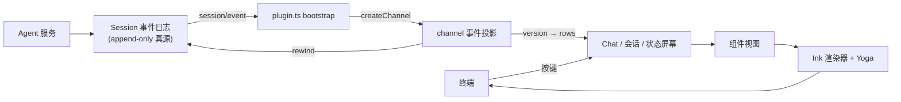

# dsh-TUI — 为 DeepSeek Harness 定制的 Claude Code 风格终端界面

> 本解读按 **前端 / UI 库 主类型 × ai-agent 生态** 判定产出。判定依据：README 自述「Claude Code 风格 TUI / 纯插件挂载 / 移植 Ink core」+ 顶层 `src/ink/`、`src/components/`、`src/screens/` 组件树特征。值得强调的边界：**dsh-TUI 不是 Agent 本体**，它作为 DeepSeek Harness 生态的终端前端，只做交互与呈现，Agent 引擎能力（主循环/工具/记忆/会话）由 DSH 服务拥有；本解读不重复 `ai-agent/deepseek-harness/` 已覆盖的内容。

## 根因

dsh-TUI 解决的根本问题是：**DeepSeek Harness 这个强大的 agent 引擎，缺一个让人舒服地使用它的终端交互前门**。它选择了一条极致的路子——**零核心改动、纯插件挂载**：不安插进 DSH 的核心，而是作为 `cordis.patch.yml` 定义的 profile 插件，贴到 DSH 之上，把会话事件流投影成 Claude Code 式的高密度终端 UI。用户可随时卸载而不留核心补丁。

一句话：**它是一个"只做投放与呈现、不碰引擎"的终端前端**——把引擎的能力翻译成人类可读、可交互、可回溯、可搜索的界面，同时保持与 DSH 之间"UI 是投影、日志是真源"的干净边界。

## 概览

- **是什么**：`@deepseek-harness-tui/dsh-tui`，DeepSeek Harness 生态的 Claude Code 风格 TUI 插件（npm 包），配有像素鲸鱼顶栏、双流光大字、实时工作状态行、思考流式展开、双击 Esc 时间回溯、蓝白上下文进度条 + TPS 仪表，以及一套从 Claude Code 移植来的 Ink/Yoga 渲染器。被 DeepSeek Harness 官方公众号收录为"内测用户精选插件"。
- **痛点**：DSH 本身是引擎（插件运行时/Session 日志/工具管道），缺一个像 Claude Code 一样"好看又趁手"的终端界面；其它终端 UI 往往侵入核心，难以加入/卸载。
- **适用场景**：喜欢 Claude Code 式终端体验、又想要 DeepSeek 系列模型 harness 能力的用户；需要长时间会话、时间回溯、高密度状态可视化的极客用户。

### 核心能力清单表

| 能力 | 说明 | 子文档 |
|------|------|--------|
| 终端原生交互 | 流式 Markdown、结构化工具卡、`@` 文件引用、命令/文件补全、历史搜索、inline/fullscreen 双渲染模式、`/lang` 中英切换 | [interactions.md](interactions.md) |
| 可观察的 Agent 状态 | 实时工作状态、上下文分段进度、TPS、缓存命中率、推理等级、token 与 Git/会话信息 | [channel-projection.md](channel-projection.md) |
| 完整会话工作流 | `/resume`、`/new`、`/compact`、`/export`、`/btw` 侧问、模型切换、双击 Esc 时间回溯/rewind/fork | [trajectory.md](trajectory.md) |
| 移植的 Ink/Yoga 渲染器 | 差分输出、cell 泳池、纯 JS Yoga、终端协议 | [renderer.md](renderer.md) |
| 为长会话设计 | 回放合并、transcript 折叠、消息虚拟化、有界缓存 | [rendering-performance.md](rendering-performance.md) |
| DSH 官方能力接入 | Agent preset、Skills、MCP、Goals、Todos、子代理、`ask_user_question` 问卷经现有服务/注册表连接 | [architecture.md](architecture.md) |

### 技术栈一览表

| 层面 | 技术 |
|------|------|
| 语言 | TypeScript（React 19 + react-reconciler 0.33 命令式宿主） |
| 渲染器 | 移植的 Ink core（`src/ink/*`）+ 纯 JS/Yoga 布局（`src/native-ts/yoga-layout/`） |
| 宿主 | vendored Cordis 插件运行时 + `cordis.patch.yml` profile |
| 依赖引擎 | DeepSeek Harness（`@deepseek-ai/*` peerDeps：dsh-agent/session/llm/skill 等） |
| 分发 | pnpm workspace + npm（全局 bin `dsh-tui`） |
| 协议 | MIT |

## 同类定位对比

| 项目 | 形态 | 与 dsh-TUI 的差异 |
|------|------|-------------------|
| Claude Code | 商业 TUI 编码 Agent | dsh-TUI 是其**开源的致敬/移植**：同一套 Ink 渲染器风格、三态投递、时间回溯，但前端后端是 DeepSeek |
| OpenCode | 开源 AI 编码 Agent（`opencode`） | dsh-TUI 是**前端壳**，不拥有 Agent 主循环/路由/工具；OpenCode 是完整服务化 Agent |
| DeepSeek Harness Web UI | DSH 官方 Web 前端 | dsh-TUI 是**终端前端**，复用同一 session 真源但渲染路径与交互完全不同 |
| OpenHands | Agent 控制中心前端 | dsh-TUI 更接近"Agent 本身的屏幕"而非多 Agent 协作中心 |

共同点是都提供 AI Agent 的交互界面，差异在于 dsh-TUI 固守"纯插件前端、不越引擎边界"的定位。

## 架构：一套投影链，而非应用堆叠

dsh-TUI 的架构不是许多独立功能的拼凑，而是**一条单向数据投影链**——从 DSH 事件真源出发，层层投影到终端 cell。核心分层（详见 [architecture.md](architecture.md)）：

## 核心模块导读

| 模块 | 关注面子文档 |
|------|------|
| 架构总览与边界 | [architecture.md](architecture.md) |
| 移植的 Ink/Yoga 渲染器 + 终端协议 | [renderer.md](renderer.md) |
| Channel 事件投影（Session 真源 → transcript） | [channel-projection.md](channel-projection.md) |
| Trajectory 时间回溯与轨迹账本 | [trajectory.md](trajectory.md) |
| 交互编排（三态投递/快捷键/双模式） | [interactions.md](interactions.md) |
| 长会话渲染性能（回放合并/折叠/有界缓存） | [rendering-performance.md](rendering-performance.md) |

## 子文档索引

- [`architecture.md`](architecture.md) — 运行链路、模块边界、Session-真源设计哲学、退出漏斗
- [`renderer.md`](renderer.md) — 移植 Ink/Yoga 渲染器、LegacyRoot 选择、差分输出、cell 泳池
- [`channel-projection.md`](channel-projection.md) — Channel 事件投影、三态投递、transcript 有界折叠
- [`trajectory.md`](trajectory.md) — 时间回溯、轨迹账本、增量投影、wave 波带
- [`interactions.md`](interactions.md) — Chat 交互编排、三态投递、Ctrl+C 状态机、双渲染模式
- [`rendering-performance.md`](rendering-performance.md) — 回放合并、折叠、虚拟化、有界缓存

## 设计哲学贯穿线

六篇文档共享同一条主线：**UI 只是对事件真源的投影，可以安全地丢弃、重建、增量派生**。

- [architecture.md](architecture.md) 确立了"Session 是真源"的基石；
- [channel-projection.md](channel-projection.md) 把它落成"回放 + 增量"的投影；
- [trajectory.md](trajectory.md) 展示投影可以派生出 rewind/wave/hotspot 三种视图；
- [rendering-performance.md](rendering-performance.md) 论证"投影可丢弃"让有界内存与数据完整两全；
- [renderer.md](renderer.md) 与 [interactions.md](interactions.md) 是这条投影链在人机两端的出口（画出与输入）。

## 不足与风险

- **投影复杂度集中**：`channel.ts`（5460 行）与 `Chat.tsx`（2496 行）承担了几乎所有投影与交互编排逻辑，是改动风险最集中、回归面最大的地方。
- **深度依赖 DSH 版本**：peerDeps 锁定 `@deepseek-ai/*` rc 版本，上游变更会冲击 profile 组合（源码里专门有 `contract.ts` 做 upstream drift 检测）。
- **无真实模型凭证的自动化全流程测试**：CI 用 headless renderer + 假服务，真实模型集成仍需目标终端手动验证（架构文档自述）。
- **配置/状态散落在多个 JSON**（`~/.dsh-tui/*.json`）：项目自述承认"偏好文件是可选状态：损坏或缺失时回退，不应阻止 TUI 启动"，但多文件的偏好状态管理仍偏手工。

## 值得借鉴的设计

- **纯插件挂载 + 可逆卸载**：零核心改动加入一个引擎生态，靠 profile/patch 分层实现（见 [architecture.md](architecture.md)）；
- **投影可丢弃 + 真源恢复**：UI 只持投影，丢弃细节也不丢数据，让"有界内存"与"数据完整"兼得（[rendering-performance.md](rendering-performance.md)）；
- **增量投影靠 object identity**：用对象身份而非 seq 判纯追加，天然正确处理 fork 时间回卷（[trajectory.md](trajectory.md)）；
- **回放剥离密封增量**：用"密封消息已带全文"这一事实把回放量降两个数量级（[rendering-performance.md](rendering-performance.md)）；
- **同步渲染优先（LegacyRoot）**：交互帧需要即时性，明确拒绝并发调度带来的跨根泄漏（[renderer.md](renderer.md)）。

## 总结

dsh-TUI 用一套"投影链"的架构，把一个庞大的 agent 引擎（DSH）变成了一个舒服的终端界面。它不发明引擎，而是把引擎的事件流投影成六种可感知、可交互、可回溯、可搜索、内存可回收的 UI。**它最好的地方藏在最不起眼的取舍里**：愿意承担移植整个 Ink/Yoga 渲染器 + 纯 JS Yoga 的成本，只为让"呈现"这一件事做到极致；愿意让 UI 永远只是投影、绝不当真相，才换来了长会话自由翻滚的能力。这既是它的技术成就，也是所有"Agent 前端"项目值得参照的边界纪律。
