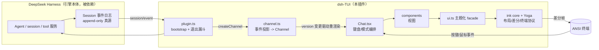
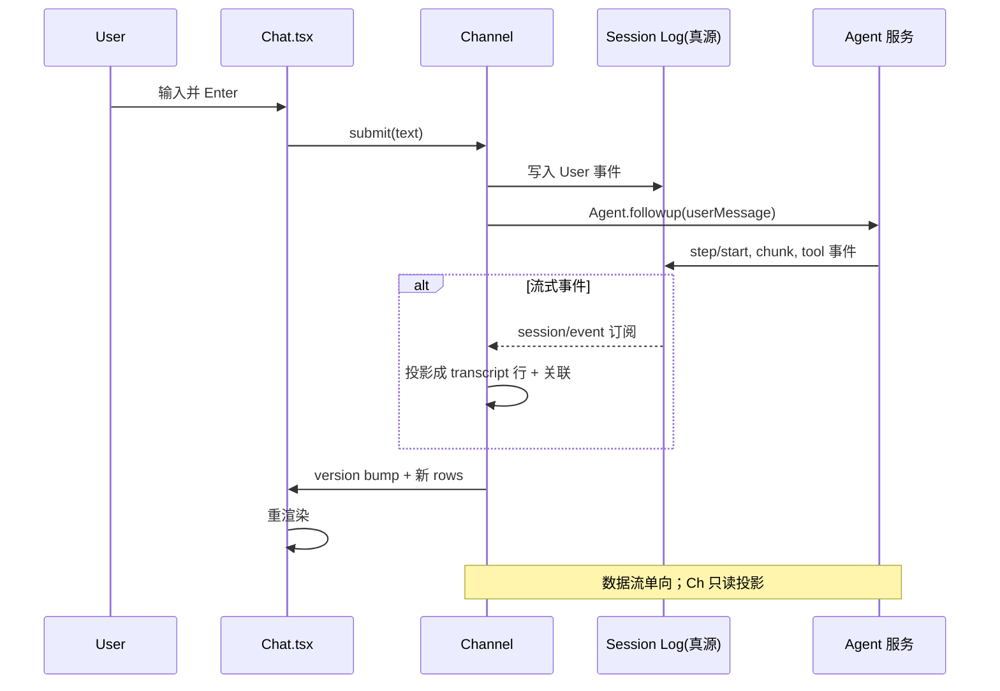

# 架构：零核心改动的终端前端插件

> 本解读按 **前端 / UI 库 主类型 × ai-agent 生态** 判定产出（dsh-TUI 的核心价值在渲染与呈现层，Agent 引擎能力由 DeepSeek Harness 本体拥有；本系列各篇见 [README](README.md)）。本文是架构总览：运行链路、模块边界、设计哲学与关键约束。

## 一句话根因

dsh-TUI 只解决一个问题：**为 DeepSeek Harness agent 提供一个 Claude Code 风格的、高密度的终端交互前门**——它把自己定位成「纯插件挂载的客户端驱动器」，像 `dsh-jsonrpc` 一样贴到 DSH 之上，**只做交互与呈现，不碰引擎**。会话真源、模型调用、工具执行、记忆压缩、fork/resume 这些能力全部仍归 DSH 服务拥有，dsh-TUI 通过一个 `Channel` 把它们投影成可滚动的 transcript，再经一套移植来的 Ink/Yoga 渲染器画到终端上。

## 运行链路

```text
Cordis profile
  -> src/dsh-adapter/index.ts（Cordis 插件契约与 Schema）
  -> src/dsh-adapter/plugin.ts（服务装载、Agent 创建/恢复、React 挂载、退出漏斗）
  -> DSH Agent / session / tool 服务
  -> src/dsh-adapter/channel.ts（session/event 事件投影 -> Channel）
  -> src/screens/Chat.tsx（键盘与模式编排）
  -> src/components/*（视图）
  -> src/ui.ts（主题化 renderer facade）
  -> src/ink/* + yoga（布局、终端协议、差分输出）
  -> ANSI terminal
```

链路的核心特征：**数据是单向流**。DSH 会话日志是唯一事实源，`Channel` 只持有"适合当前 TUI 的投影"，React 视图消费 `Channel.version` 的变更来重渲染，最后渲染器做差分输出。这条单向数据流贯穿整个设计。



## 模块职责与边界

| 模块 | 职责 | 所有权关键词 |
|---|---|---|
| `src/dsh-adapter/index.ts` | Cordis 插件名、inject 声明、配置接口与 Schema；入口保持轻量，`apply` 经动态 import 委托给 `plugin.ts` | 插件契约层 |
| `src/dsh-adapter/plugin.ts` | TTY 检查、问卷/Skills 注册、Agent 创建-恢复-重放、React 挂载、统一退出漏斗 | bootstrap 编排 |
| `src/dsh-adapter/channel.ts` | 把 DSH 持久化事件投影为 transcript；提供 submit/steer/resume/rewind/model 切换等动作 | 事件投影 + 动作面 |
| `src/dsh-adapter/trajectory/` | 把会话事件折叠成轨迹账本（turn/step/工具括号配对、wave 波带、hotspot） | 时间回溯数据面 |
| `src/screens/Chat.tsx` | modal 优先级、全局按键、滚动/搜索/选择状态、slash command 分发 | 交互编排 |
| `src/components/` | 用户界面与 design-system；**不直接拥有 Agent 或 session 真相** | 展示层 |
| `src/ui.ts` | 主题化 `Box`/`Text`、render、选择、滚动等公共 facade | 渲染门面 |
| `src/ink/` | 移植的 Ink renderer、终端协议、事件、选择与 Yoga 桥接；敏感底层设施 | 渲染内核 |

**边界铁律**（`docs/architecture.md` 明示）：不要在组件中复制 DSH Agent、session 或 tool 服务；需要新能力优先通过已有 service、registry 或 channel seam 接入 `screens/Chat.tsx:26-30`。工作区扩展遵守**单向依赖**——TUI 只发布结构化 provider 接口，协议解析与外部连接全部属于插件，删除插件后本地路径不应出现缺失占位或降级分支。

## 设计哲学：Session 是真源，TUI 不拥有对话真相

这是整个项目最核心的取舍。`channel.ts` 的 `ChatRow` 注释把话说死：**"DSH session log is the source of truth"**，行由 `session/event` 记录推导而来，绝不经乐观的本地状态 [src/dsh-adapter/channel.ts:257-259]()。Channel 绝不用 React 本地数组当对话真相，而是：

<!-- anchor:  * One rendered transcript row. The DSH session log is the source of truth: …  * `agent.session.events` replay), never from optimistic local state. -->

- 初始历史回放 + 增量流式事件（`session/event`）；
- assistant/reasoning/tool 行按 sequence anchor 关联，工具结果按 `callId` 关联而非数组位置猜测；
- rewind 的 turn 边界、resume/export/compact/fork 后的重建，全部依赖事件日志。

收益：长会话、`/resume`、`/rewind`、`/model` fork 后，UI 能**无状态重建**——因为真相在日志里，不在进程内存里。代价：所有视图必须理解事件语义做投影，不能简单 push 数组；投影复杂度被集中到 `channel.ts` 一个文件（5460 行）。

深度展开见 [channel-projection.md](channel-projection.md)。



## 出口确定性：单一退出漏斗 vs teardown

dsh-TUI 处理「退出」有一个极重要的细节：**用户退出与 cordis 上下文 teardown 必须严格区分**（issue #12）。DSH launcher 在启动时会做 boot-time recompose，dispose 每个 entry 一次；如果把那次 teardown 当成用户退出，进程会在重组 tree 之前被杀掉——这就是作者描述的 "flash back to bash with no error" 症状。

解法是 `createExitFunnel`（实现见 [src/dsh-adapter/plugin.ts:984-998]()，`markTeardown` 必须在 settle exit promise 的 unmount 之前跑，靠同一 tick 的 flag 保证）：

<!-- anchor: export function createExitFunnel(deps: { onUserExit: (error?: unknown) => void }): { …       deps.onUserExit(error) -->

- **teardown**（`markTeardown`）→ 仅 `instance.unmount()`，进程保持存活，重组后的 tree 重新 mount TUI；
- **用户退出**（`/exit` 或双击 Ctrl+C）→ 完整 leave 序列：写 resume marker、恢复终端（cursor/raw mode/mouse tracking）、打印 resume hint / update handoff。

<!-- anchor: 内部状态：funnel.handExited = true —— markTeardown 到 -->
<!-- anchor: 不可误触发 -->

这个设计让「Ctrl+C 退出」和「cordis 热重载」在行为上彻底分离，是嵌在宿主插件运行时里做前端所特有的难点。

## 权限与安全边界

dsh-TUI **不提供独立沙箱**——实际能力由 `cordis.patch.yml` 挂载的 DSH 服务决定。审批走 `ctx.approval` seam：策略为 `ask` 时 TUI 以 CC 式审批面板作为 answerer，**协议只允许"一次/拒绝"两种决定**，没有"总是允许"与反馈通道。

- 非 Windows 默认 `DSH_PERMISSION_MODE=workspace-write`，审批通常 `ask`；
- Windows 无本地 sandbox 链，组合 `danger-full-access` + `never`；
- `DEEPSEEK_API_KEY` 只应来自环境或受控注入，状态命令只显示是否设置或脱敏；
- 审计要点：**检查实际 profile patch，而不是只看 TUI 的视觉界面**（MCP/Shell/文件工具与自定义 preset 都是同一权限域内的代码执行入口）。

## 与 DeepSeek Harness 的边界（差异化定位）

知识库已有一份 dsh 本体的解读（`ai-agent/deepseek-harness/`），覆盖了插件运行时、会话事件溯源、主循环、工具管道、沙箱等。本文档系列**不重复**那些能力，只讲 dsh-TUI 自有的前端价值：

- `channel.ts` 的事件投影做的是"读取/投影/呈现"，不是"产生事件"——这会话日志还是 dsh 的，但如何把它变成可滚动、可搜索、可回溯的 UI 是 dsh-TUI 的独创；
- `trajectory/` 的时间回溯是**纯前端数据面**——从既有事件推导 turn/step/工具括号，不修改日志；
- `ink/` 渲染器是移植 Claude Code 的，不是 dsh 的一部分。

## 核心模块导读

| 模块 | 关注面子文档 |
|---|---|
| 移植的 Ink/Yoga 渲染器 + 终端协议 | [renderer.md](renderer.md) |
| Channel 事件投影（Session 真源 → transcript） | [channel-projection.md](channel-projection.md) |
| Trajectory 时间回溯 | [trajectory.md](trajectory.md) |
| Chat 交互编排（三态投递/快捷键/双模式） | [interactions.md](interactions.md) |
| 长会话渲染性能（虚拟化/差分/有界缓存） | [rendering-performance.md](rendering-performance.md) |
