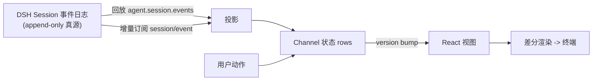

# Channel：事件投影与动作面

> 这是 dsh-TUI 的**心脏**：一个 5460 行的文件（`src/dsh-adapter/channel.ts`）把 DSH 的 append-only 会话事件流投影成可渲染、可搜索、可回溯的 transcript，同时暴露 submit/steer/interrupt/rewind/model 切换等全部交互动作。理解它，就理解了 dsh-TUI 如何做到"Session 是真源"。

## 真源与投影的分离

`channel.ts` 从哲学层面回答了一个问题：**UI 该不该把对话存在自己的内存里？** 答案是"不"。`ChatRow` 的注释定了基调（见 [architecture.md](architecture.md)）：

> 行由 `session/event` 记录推导，绝不经乐观的本地状态 [src/dsh-adapter/channel.ts:257-259]()。

<!-- anchor:  * One rendered transcript row. The DSH session log is the source of truth: …  * `agent.session.events` replay), never from optimistic local state. -->

由此落地两条规则：

1. **回放**：boot /resume /rewind 时，把持久化历史从事件流重放成 transcript，不回放本地数组；
2. **增量**：运行中订阅 `session/event` 增量事件，只追加/更新受影响的行。

这带来一个显著收益：**UI 无状态、可重建**。`/model` 切换走 session fork，`/rewind` 回到旧日志分支，`/resume` 恢复——所有这些都能从一个干净状态重放出来，因为真相在 DSH，不在进程。

## Channel 接口：一份"只读投影 + 动作"的合同

`Channel` 接口明确定义了两类成员 [src/dsh-adapter/channel.ts:418-418]()：

<!-- anchor: export interface Channel { -->

- **只读投影**：`rows`、`status`、`tokens`、`working`、`spinnerMode`、`activeToolCount`、`lastUserText`、`notifications`、`gate/todos/loadedContext/pending` 等快照，加一个单调递增的 `version`；
- **动作**：`submit`/`steer`/`interruptAndDeliver`/`resume`/rewind/model 切换 等。

`version` 是订阅的关键——每次 mutation 都 bump 它 [src/dsh-adapter/channel.ts:419-419]()，screens 订阅它来重渲染。这本质是"命令式投影 + 响应式订阅"的混合：投影在 channel 内是命令式的（性能佳），暴露给 React 是响应式的（version 驱动）。

<!-- anchor:   readonly version: number -->

## 三种投递：submit / steer / interrupt

模型工作期间的三态投递是 Claude Code 的标志之一（详见 [interactions.md](interactions.md) 的交互视角），在 channel 这里是**同一个 `deliverUserText` 函数**，用一个 `placement: 'steer' | 'followup'` 参数区分两个底层调用 [src/dsh-adapter/channel.ts:1391-1391]()：

<!-- anchor: const deliverUserText = (text: string, placement: PendingMessage['placement']): void => { -->

- `placement==='steer'` → 走 `agent.steer(message)`：注入下一步边界，不中断 [src/dsh-adapter/channel.ts:1409-1409]()；其余（'followup'）→ `agent.followup(message)`：排到当前回合之后。
<!-- anchor:         if (placement === 'steer') agent.steer(message) -->

`interruptAndDeliver` 则先 abort 再立刻按 followup 重新投递（`src/dsh-adapter/channel.ts:2097`）。

设计上有三个值得注意的取舍：

**（1）`trackPending` 在 agent 调用前执行。** 注释说得直白：一起步先登记 pending 再调 agent，这样同步失败能撤销、成功时由 inbox 事件标定完成（`src/dsh-adapter/channel.ts:1407`）。

**（2）`sendChain` FIFO 保证投递顺序。** 因为 `@` 文件展开是异步的（issue #15），若直接并发投递可能乱序。用一条 promise 链把所有投递串成 FIFO [src/dsh-adapter/channel.ts:1378-1392]()。

<!-- anchor:   let sendChain: Promise<void> = Promise.resolve() …     sendChain = sendChain.then(async () => { -->

**（3）失败不中断链。** `.catch` 只记录 + 通知，然后继续下一条排队投递，一个失败的消息不会阻塞后续（`src/dsh-adapter/channel.ts:1424`）。

## 有界内存：transcript 折叠

transcript 窗口有上限 `MAX_ROWS = 600` [src/dsh-adapter/channel.ts:974-974]()。超出后 `foldRows` 把最老行的**全文本字段**（assistant/reasoning 文本、工具 args/results）丢弃，只留预览、kind、id、seq——这样长 merge/deploy 回合不会让 RAM 无界增长。完整内容仍在 session log，`/export` 和 `loadOlder()` 从日志恢复（详见 [rendering-performance.md](rendering-performance.md) 的系统展开）。

<!-- anchor: const MAX_ROWS = 600 -->

这是"UI 持有投影、日志持有真源"哲学的必然推论：投影可以安全地丢弃细节，因为随时能从真源恢复。

## 回扣设计哲学

channel 是 dsh-TUI 设计哲学的集中体现：**前端的一切状态都是对后端事实源的投影**。这种依赖倒置让 TUI 既轻（不持有真相、可丢弃重建）又可靠（任何路径进来都能重放到一致状态），代价是投影逻辑高度集中、单个文件大而复杂（5460 行是项目最大的非 ink 文件，也是改动风险最集中的地方）。

## 与相邻文档的关系

- 投影的具体算法（turn/step/工具箱折叠、sequence anchor 关联）在 [trajectory.md](trajectory.md) 展开；
- `version` 驱动的重渲染在实际交互中的表现见 [interactions.md](interactions.md)；
- 折叠/回放合并/有界缓存的长会话性能视角见 [rendering-performance.md](rendering-performance.md)。
