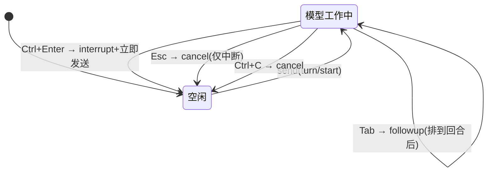

# 交互编排：三态投递、快捷键与双渲染模式

> dsh-TUI 的体验核心是 Chat 屏幕（`src/screens/Chat.tsx`，2496 行）——它把底层"事件投影 + version 订阅"的机制翻译成人可感知的交互语言：模型工作时的三态投递、一套庞大的快捷键矩阵、键盘扩展选区与鼠标选区、inline/fullscreen 双模式。本文从交互编排角度拆解这些设计。

## 三态投递：Enter / Tab / Ctrl+Enter

Claude Code 的标志性交互是"模型工作时你能做什么"。dsh-TUI 复刻为三态：`Enter`=steer（注入下一步边界，不中断）、`Tab`=follow-up（排入当前回合之后）、`Ctrl+Enter`=interrupt（打断并立即发送）。交互层的三态在 [channel-projection.md](channel-projection.md) 里落成同一个 `deliverUserText` + `placement` 参数：

- `placement='steer'` → `agent.steer(message)`；
- `placement='followup'` → `agent.followup(message)` [src/dsh-adapter/channel.ts:1409-1410]()。

<!-- anchor:         if (placement === 'steer') agent.steer(message) …         else agent.followup(message) -->

`Esc` 在模型工作时是 cancel：若有 pending 消息，`interruptAndDeliver` 把它们立即按 followup 投出去（Codex 行为）；否则 `channel.cancel()` 纯中断 [src/screens/Chat.tsx:1917-1930]()。

<!-- anchor:     } else if (key.escape && channel.working) { …       event.stopImmediatePropagation() -->

这里的关键权衡是**"中断模式下的投递语义"**：普通中断只是"停"，但排队了消息时中断+立即投递能更快推进——作者把它做成显式行为并 notify 用户，而不是让用户困惑于"为什么消息没发出去"。

## 退出路径：Ctrl+C 的两段式

`Ctrl+C` 的状态机很细致 [src/screens/Chat.tsx:1956-1969]()：

<!-- anchor:     } else if (key.ctrl && (input === 'c' || input === 'd')) { …         requestExit() -->

- **模型工作中** → `channel.cancel()`（中断回合）；
- **空闲且有输入** → 清空输入，绝不直接退出；
- **空闲且输入为空** → 才 arm 双击退出（`Ctrl+D` 走纯时间窗双击退出，不看输入）。

这是对"误触退出"的防御：让 Ctrl+C 的语义随上下文动态切换，用户肌肉记忆不会意外杀掉会话。真正的退出还要经过 renderer 层的 exit funnel（见 [architecture.md](architecture.md) 的退出漏斗），在 cordis teardown 与用户退出之间严格区分。

## 键盘与鼠标：两套选区体系

dsh-TUI 同时支持**键盘扩展选区**（`Shift+←/→/↑/↓` 跨行环绕）和**鼠标选区**（inline 模式由终端原生处理，fullscreen 模式由渲染器自建）：

- 键盘选区是 `selection.ts` + `hit-test.ts` 的能力（见 [renderer.md](renderer.md)）；
- 鼠标在 fullscreen 走 `useCopyOnSelect`——选中即复制（OSC 52 + `wl-copy`/`xclip`/`xsel` 原生兜底；tmux 内走 `load-buffer -w`）。

## 双渲染模式：inline 与 fullscreen

`config.fullscreen` 决定是否用 `AlternateScreen`（DEC 1049 + SGR 鼠标追踪）[src/dsh-adapter/plugin.ts:819-826]()：

<!-- anchor:  // fullscreen: wrap the tree in …     config.fullscreen ? React.createElement(AlternateScreen, null, chat) : chat, -->

- **Inline（默认）**：留在主屏，终端模拟器管理 scrollback 与原生选区；
- **Fullscreen**：切备用屏，TUI 自己管理滚动、鼠标选区、OSC 52 复制和退出时的屏幕恢复。

这个设计有个细腻之处：**键盘无状态复用**（两模式共享 Channel 与 React 视图），只有**终端协议路径**不同；凡涉及输入/滚动/鼠标/光标/resize/清理的改动都必须分别验证，尤其要覆盖窄终端与 Windows ConPTY（`docs/architecture.md` 明示）。

## `/lang` 中英切换

ui 语言通过等级链解析：`DSH_TUI_LANG` 环境变量 > settings.yaml `dsh-tui.lang` 用户层 > cordis.yml `lang` > 持久化 `/lang` 选择 > `zh` 默认 [src/dsh-adapter/plugin.ts:89-90]()。语言必须首次渲染前落定，这样每个模块解析字符串结果一致。

<!-- anchor:   const envLang = process.env.DSH_TUI_LANG …   setLang(isLang(envLang) ? envLang : isLang(config.lang) ? config.lang : resolveStartupLang()) -->

## 回扣设计哲学

交互层是"事件投影"哲学的人机接口：三态投递、中断、双模式、语言切换——全部收敛成对 `Channel` 的**动作调用**，通过 `version` 触发重渲染。交互编排从不直接触碰 DSH agent 状态，只调用 channel 暴露的高层动作，因此任何交互路径都能保持"动作即命令、状态可重建"的一致性。

## 值得借鉴

- **上下文感知的 Ctrl+C 状态机**：中断/清空/退出的三级语义让快捷键既高效又不误伤；
- **中断 + 立即投递的组合**：把用户的排队意图在打断瞬间兑现，减少困惑；
- **键盘/鼠标选区的双体系共存**：尊重两种用户习惯，靠渲染层差分输出统一呈现。
