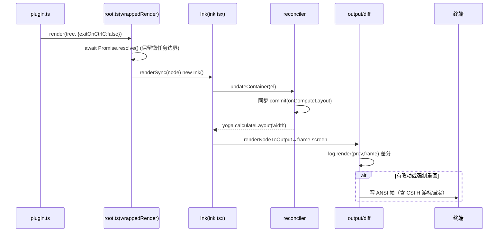

# 渲染器：移植的 Ink/Yoga 与终端协议

> dsh-TUI 的核心是**一套从 Claude Code 移植来的 Ink 渲染器**。它把 React 组件树渲染到终端 ANSI，是"Claude Code 风格"体验的根本来源。本文拆解：如何把 React 虚拟 DOM 变成终端 cell，如何处理 ANSI 宽度/组合字符/emoji，如何做差分输出，以及为什么用 `LegacyRoot` 而非 `ConcurrentRoot`。

## 渲染器在系统中的位置

```
src/ui.ts（主题化 facade）
  -> src/ink/root.ts（render/createRoot 入口）
    -> src/ink/ink.tsx（Ink 类：渲染循环 + 差分 + 帧管理）
      -> src/ink/reconciler.ts（react-reconciler 宿主配置）
      -> src/ink/render-node-to-output.ts（DOM 树 -> Output 队列）
      -> src/ink/screen.ts（cell 泳池 Screen 缓冲）
      -> src/native-ts/yoga-layout（纯 JS/TS 布局，WASM 移植）
```

`src/ui.ts` 是门面：它导出主题化的 `Box`/`Text`/`ScrollBox`/`useInput` 等，使移植的 CC 组件能用 `color="subtle"` 这类主题键而无需改动 [src/ui.ts:1-9]()。

<!-- anchor:  * Public surface of the ported Ink core, themed for dsh-tui. … export { default as render, renderSync, createRoot } from './ink/root.js' -->

## 三个关键设计决策

### 决策一：LegacyRoot 而非 ConcurrentRoot

`render-to-screen.ts` 文件头有一段注释直接暴露了移植时的权衡 [src/ink/render-to-screen.ts:34-38]()：**"LegacyRoot: all work sync, no scheduling — ConcurrentRoot's scheduler backlog leaks across roots via flushSyncWork"**。

<!-- anchor: // Shared across calls. Pools accumulate style/char interns — reusing them … let root: DOMElement | undefined -->

对这个场景，选择是清醒的：搜索单条消息时要反复 unmount/mount，ConcurrentRoot 的跨根泄漏会在高频调用的模式下积累成内存/延迟问题。**同步渲染 > 时间分片**，因为 TUI 的每一次帧都发生在用户按键的紧邻时刻，需要"立即"而非"可中断"。

### 决策二：Cell 泳池（Style/Char/Hyperlink）跨帧复用

终端渲染的昂贵之处在字符串→cell 的转换。`render-to-screen.ts` 维护模块级 `stylePool`/`charPool`/`hyperlinkPool`，跨调用复用 [src/ink/render-to-screen.ts:38-42]()。收益写得直白：**pools 累积 intern 后，后续调用命中缓存更多**（同文件 34 行）。

<!-- anchor: let root: DOMElement | undefined … let hyperlinkPool: HyperlinkPool | undefined -->

但泳池不是无限增长的——`ink.tsx` 每 5 分钟 reset 一次，用 `O(cells)` 迁移成本换长会话的内存收敛 [src/ink/ink.tsx:678-683]()。

<!-- anchor:     // Periodically reset char/hyperlink pools to prevent unbounded growth …       this.lastPoolResetTime = renderStart; -->

### 决策三：差分输出 + 全量兜底回退

`ink.tsx` 渲染循环的核心是 `this.log.render(prevFrame, frame, altScreenActive, isDecstbmSafe())`——一个 diff 引擎，每帧对比前后两个 frame 只写变化的 cell [src/ink/ink.tsx:664-665]()。

<!-- anchor:     const tDiff = performance.now(); …     const diff = this.log.render(prevFrame, frame, this.altScreenActive, -->

最具洞察的细节是**全量损坏回退（full-damage backstop）** [src/ink/ink.tsx:633-638]()：单靠 per-node 的 damage 追踪，在布局位移（spinner 出现、状态行改变行高）时会在兄弟边界留下陈旧 cell。所以当 `didLayoutShift()` 或选区/搜索高亮激活时，直接把整屏标记为损坏重画。这是一个"精确 diff + 兜底全量"的混合策略——弥合纯增量 diff 在布局震荡时的漏 cell。

<!-- anchor:     // Full-damage backstop: applies on BOTH alt-screen and main-screen. …     if (didLayoutShift() || selActive || hlActive || this.prevFrameContaminated) { -->

## 测量与差分输出的正确性

TUI 渲染里最大的坑是**显示宽度 ≠ 字符串长度**。ANSI、组合字符、emoji、东亚宽字符都必须按 terminal cell width 计算，不能用 JS 的 `string.length`。`src/ink/` 里有完整的一套宽度工具：`stringWidth.ts`、`wrap-text.ts`、`truncateToWidth.ts`、`wrapAnsi.ts`、`measure-text.ts`、`line-width-cache.ts`。

`line-width-cache.ts` 的存在说明：宽度计算也是热路径，值得缓存。这与长会话性能（见 [rendering-performance.md](rendering-performance.md)）直接呼应。

## Yoga 布局：纯 JS 移植

`src/native-ts/yoga-layout/` 是 Yoga 的纯 JS/TS 实现（架构文档明示"纯 JS/TS 布局实现"，[docs/architecture.md:32]()）。这是为了避免 WASM 异步加载的初始化时序问题——`root.ts` 里 `wrappedRender` 保有一个微任务边界，以"保留 `await loadYoga()` 曾经提供的微任务边界" [src/ink/root.ts:121-134]()。

<!-- anchor: const wrappedRender = async ( …   return instance -->

也就是说：**移植时把 WASM 版 Yoga 换成了纯 JS 实现，从而消除异步依赖**，让首次渲染可以尽可能同步且可预测地发生（异步入口保留一个 `await Promise.resolve()` 微任务边界，避免首帧在异步启动工作落定前抢先写出覆盖 scrollback）。

## 启动渲染链路（Mermaid）



## 回扣设计哲学

移植 Ink 并全部重写终端协议层，不是"抄 Claude Code"，而是**把渲染正确性和性能当成 dsh-TUI 的第一性原则**：作为交互前端，一切体验（流式、搜索高亮、选区、闪烁动画）最终都在这条渲染管线上落地。愿意承担移植 + 纯 JS Yoga 的成本，换取对终端输出的完全掌控——这与 [architecture.md](architecture.md) 的"只做呈现、不碰引擎"纪律完全一致：呈现这件事要做到极致。

## 值得借鉴

- **Diff 引擎 + 全量回退兜底**：精确 diff 省字节，`didLayoutShift` 兜底防漏，这是"性能与正确性可在渲染层兼得"的范式；
- **根级对象复用 + 周期 reset**：泳池共享提速、定时重置防泄漏，平衡了性能和内存两个方向；
- **同步渲染优先（LegacyRoot）**：交互帧需要即时性，明确拒绝 React 并发调度带来的跨根泄漏。
