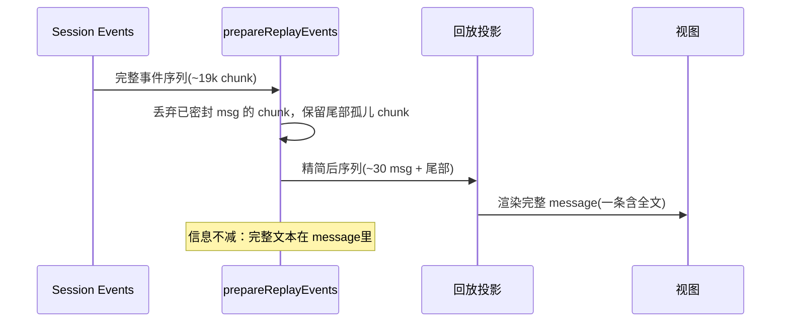

# 长会话渲染性能：回放合并、折叠与有界缓存

> dsh-TUI 的隐性卖点是**为长会话设计**：`diff` 差分输出、消息虚拟化、回放合并与有界缓存，都是为了"渲染成本和内存不随会话无限增长"。本文把这些机制串成一个系统，讲清每一层防住的是什么。

## 性能问题的来源

一个交互式 TUI 面对长会话有四重成本：

1. **回放成本**：`/resume`、`/rewind`、`/model` fork 时要把整个历史重放进 transcript；
2. **内存成本**：模型输出、工具参数会线性堆积；
3. **渲染成本**：每帧重画多少 cell；
4. **增量折叠成本**：trajectory 每帧要重扫多少事件（已见 [trajectory.md](trajectory.md)）。

四者各自有不同的解法，本文逐一拆解。

## 回放合并：丢掉已密封的 chunk 增量

回放是最贵的路径之一。`prepareReplayEvents` 在重放前**剥离已密封的 `assistant/chunk` 增量** [src/dsh-adapter/channel.ts:1150-1162]()：

<!-- anchor:  * Prepare durable events for REPLAY (resume / rewind / model-switch fork): …  * own usage). Live events never go through this. -->

理由来自一个很具体的量：**一个 4.5MB 的 session 约有 19k 个 chunk，却只有 ~30 条完整 message**。`assistant/message` 事件里已经带了完整文本与 reasoning 块，逐 token 的 chunk 在重放里毫无信息增量，却要付一次 per-chunk 的 renderEvent pass。所以只保留**尾部未收尾 step 的 chunk**（崩坏的孤儿 turn 仍需显示其部分内容），其余全部丢弃。

这里有个反向的细致判断：**为什么不把 chunk 全丢**？因为崩溃遗留的未完成 turn 没有密封 message，它的 chunk 就是唯一内容来源——全丢会丢失部分输出。取舍是"数据完整优先，但冗余归零"。

## 有界 cache：transcript 折叠

内存端的天花板是 transcript 窗口。`MAX_ROWS = 600`，超出后 `foldRows` 丢弃超限最老行的全文本字段（只留预览、kind、id、seq）[src/dsh-adapter/channel.ts:967-974]()。关键点：**这只折叠 UI 内存，不动 session log**——`/export` 读日志、`loadOlder()` 从日志恢复，所以细节永不丢失，只是不在内存驻留。

<!-- anchor:  * In-memory transcript window cap. Older rows beyond this count are FOLDED: … const MAX_ROWS = 600 -->

`foldRows` 还有一处对性能的精细处理 [src/dsh-adapter/channel.ts:1001-1009]()：**增量扫描**。流式期间每帧都会触发折叠，若每次全量重扫 600 行窗口会成为 `O(rows)` per-frame 项；它用 cursor 记录上次扫描位置，只扫光标之后的新增行。这也直接呼应 trajectory 的增量哲学——**长会话里"每帧只做增量"是普适法则**。

<!-- anchor:   // Incremental pass: rows only ever append past the fold line and the …   if (excess <= from) return 0 -->

## 渲染侧：差分输出 + 泳池复用

渲染层的两个机制（详见 [renderer.md](renderer.md)）本质也是性能设计：

- **差分输出**（`log.render(prevFrame, frame)`）：每帧只写变化的 cell，流式长文本不会整屏重画；
- **泳池复用 + 5 分钟 reset**：char/style/hyperlink intern 跨帧复用提速，周期 reset 防长会话无界增长。

它们和上面的"回放合并、折叠"形成一套完整的分层防御：**回放控制入口量，折叠控制内存驻留量，差分控制每帧写屏量，泳池控制 intern 增长量**。

## 虚拟化：屏幕外行的固定高度占位

`components/listWindow.ts` 提供的虚拟化（架构文档 `docs/architecture.md:59`）让屏幕外行用上一次测量的固定高度占位，不参与完整子树布局——这样滚动长列表不会对每个 off-screen item 都跑 Yoga 布局。

## 设计权衡总结

| 成本 | 机制 | 防住什么 | 代价 |
|---|---|---|---|
| 回放 | 剥离密封 chunk | 重放 O(19k)→O(30) | 丢失 chunk 级 tps 采样（由 message 自身 usage 兜底） |
| 内存 | transcript 折叠 | 驻留文本无界增长 | 折叠行需 loadOlder 恢复细节 |
| 渲染 | 差分输出 + 泳池 reset | 每帧写屏量、intern 增长量 | 布局位移漏 cell 需全量兜底 |
| 增量 | trajectory object-identity / fold cursor | 每帧 O(n) 扫描 | 折叠判定复杂度 |

## 回扣设计哲学

所有这些机制有一个共同前提：**UI 只是投影，真源在 DSH 日志**。正因为 UI 不持有真相，才可以毫无负担地丢弃内存里的细节（foldRows、chunk 剥离）、按需恢复（loadOlder）——若 UI 是真相，这些"有界"操作都会破坏数据。**"投影可丢弃"赋予了性能优化的合法性**，这是 dsh-TUI 性能设计的根本依托。

## 值得借鉴

- **回放前清理冗余增量**：用"密封消息已带全文"这一信息论事实，把回放量降几个数量级；
- **增量折叠 + cursor**：流式高频场景下每帧只做增量，是通用的长列表性能范式；
- **投影可丢弃 + 真源恢复**：让"有界内存"与"数据完整"两全，前提是真相被放在别处。
