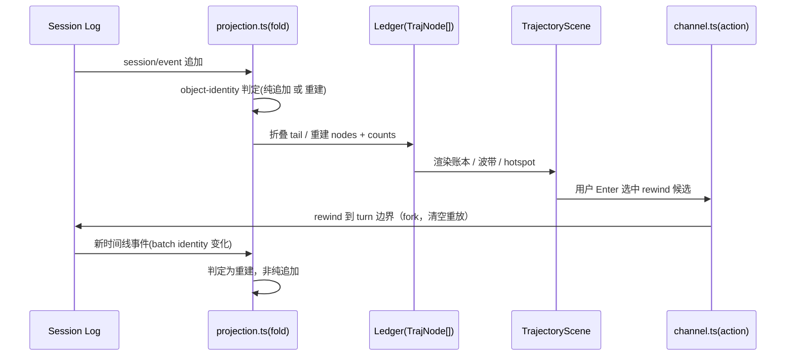

# Trajectory：时间回溯与轨迹账本

> dsh-TUI 的招牌功能之一是**时间回溯**（双击 Esc / `/rewind` / `/trace`）——把会话翻回任一 turn 边界重新分叉。支撑它的是一套独立的数据面：`trajectory/` 把 DSH 会话事件折叠成"轨迹账本"（trajectory ledger），既能驱动真正的 rewind，也能在状态栏画一条"wave 波带"、提供 hotspot 成本分析。本文拆解其投影算法与设计权衡。

## 什么是轨迹投影

DSH 会话日志是 append-only 的约 44 种事件流。`trajectory/projection.ts` 把它折叠成一个**扁平、带 turn 标注的节点列表**，并做括号配对（`tool/call` ↔ `tool/result`、`step/start` ↔ `step/end`、`llm/retry` ↔ `llm/retry-started`、`approval/asked` ↔ `approval/decided`、`compaction/start` ↔ `compaction/end`），让每一行能显示自己的 wall-clock 时长与 outcome [src/dsh-adapter/trajectory/projection.ts:6-12]()。

<!-- anchor:  * The DSH session log is an append-only stream of ~44 event types. …  * row can show its own wall-clock duration and outcome. -->

它的产出物叫 `TrajNode`——一条轨迹账本行 [src/dsh-adapter/trajectory/types.ts:91-98]()。

<!-- anchor: export interface TrajNode { …   readonly turn: number -->
## 设计哲学一：Node 只持引用，不持副本

`types.ts` 的头注释是整个模块的灵魂（issue #80 演进），两条规则直指一个约束——**投影喂给的是"按一次键就重画一次"的终端**：

1. **Node 的 `detail` 是事件日志里原始字符串的引用**。JS 字符串不可变可共享，持一个引用只花一个指针；若在折叠时就 flatten/truncate，等于给会话里**每个**工具参数都分配第二份拷贝，还提前烤死了一个终端还没定下来的宽度。所以视图只在要画的 ~15 行上调用 `previewText`，其余全都原样不动 [src/dsh-adapter/trajectory/types.ts:8-8]()。

<!-- anchor:  * 1. **Nodes carry references, never derived copies.** A node's `detail` is -->

2. **完整内容任何时候都不驻留**。`seq`/`endSeq` 定位拥有事件的编号，inspector 按需从会话自身的不可变快照**重读**。**"投影是索引，不是镜像"** [src/dsh-adapter/trajectory/types.ts:15-15]()。

<!-- anchor:  * 2. **Full content is never held at all.** `seq`/`endSeq` address the -->

## 设计哲学二：增量投影靠 object identity，而非 seq 算术

增量是长会话的性能命脉。注释说得极清楚 [src/dsh-adapter/trajectory/projection.ts:16-20]()：

<!-- anchor:  * `agent.session.events` is an immutable snapshot whose element objects are …  * index, never by `seq` arithmetic, which a fork can rewind — only the new -->

> **"when the incoming snapshot prefix-extends the one the previous build consumed — proven by *object identity* at the previous last index, never by `seq` arithmetic, which a fork can rewind"**

这里藏着一个微妙但关键的选择：**为什么用 object identity，不用 seq？**

- 每帧若重扫整个事件流是 `O(n)`，长会话逐字符流式时会退化；
- 但判断"这是不是纯追加"，`seq` 算术不可靠——**因为 fork（rewind）可以把 seq 回卷**，一个回卷后的快照看似"前缀相同"实则是另一条时间线；
- 用"前一个快照的最后一个元素对象在本次快照里是否仍然是同一个对象引用"来判定纯追加，则 fork 天然失效（fork 的新事件数组不再是同一批对象身份），退化为整树重建。

于是 `extendTrajectory` 只在纯追加时折叠新 tail，其余情况（`/resume`、`/rewind`、`/new` 引发的 agent 换）从零重建 [src/dsh-adapter/trajectory/projection.ts:20-22]()。

<!-- anchor:  * index, never by `seq` arithmetic, which a fork can rewind — only the new …  * `/new`) rebuilds from scratch. A long session therefore never pays an O(n) -->

成本账本（counts）也随之保持 `O(1)` per event：状态栏徽章每帧都要"多少行、多少失败"，若用扫描推导，空闲对话每次重画都要付 `O(session)`——这正是增量折叠要消灭的代价 [src/dsh-adapter/trajectory/projection.ts:86-89]()。

<!-- anchor:  * The status-line badge needs "how many rows, how many failed" on every …  * exists to avoid. -->

## 括号配对：工具调用折叠与 retry

`FoldState` 是增量折叠期间的可变记账：跟踪打开的 tools/subtools/steps/turns/retries/approvals/hooks 括号，compaction 因无 id，用**栈按嵌套配对** [src/dsh-adapter/trajectory/projection.ts:106-116]()。

<!-- anchor: /** Mutable fold bookkeeping carried between incremental appends. …  /** Compaction brackets carry no observed id — a stack pairs them by nesting. -->

一个巧妙细节是 **burst 折叠**：连续同名调用（如一串 `read_file`）会折叠成一条合成节点承载这个 burst，`members` 仍持有原始节点、括号闭合映射照常修改它们；总数在读取时派生而非增量维护，所以**折叠后再闭合的成员无需额外记账**，也避免了 head/member 自引用绊倒遍历器 [src/dsh-adapter/trajectory/types.ts:51-51]()。

<!-- anchor:  * The fold replaces the run with a *synthetic* node that carries this burst; -->

## wave 波带：把时间线压进状态栏

除了 rewind，trajectory 还驱动状态栏边缘的**动态迷你轨迹条（wave band）**。它把节点映射到 N 列，产生 `WaveBucket` 数组（input/model/tool 三通道权重 + peak/floor 归一化）[src/dsh-adapter/trajectory/types.ts:172-172]()。

<!-- anchor: export interface WaveBand { -->

峰值的选取很讲究：**用 95 分位数而非最大值**，否则一个尖峰会把其它列全部压成矮条；`floor` 取最低非空桶，让 glyph 在不从零开始归一——因为正常桶已接近 `log1p(peak)` 的一半，若从零刻度化下半列始终闲置、读起来像一条平糊 [src/dsh-adapter/trajectory/types.ts:175-175]()。

<!-- anchor:  * Weight that maps to the tallest glyph — the 95th percentile -->

投影方式有三种（`sequence`/`time`/`compressed` 可 `m` 键循环）：按索引等分、按墙钟成比例（含空闲间隙）、按墙钟但压缩掉空闲 [src/dsh-adapter/trajectory/types.ts:190-197]()。

<!-- anchor: /** How the wave band maps nodes onto columns. …   | 'compressed' -->

## 数据流：从事件到 rewind 决策

## 回扣设计哲学

trajectory 完美体现了 dsh-TUI 的整体纪律：**一切展示数据都派生自 DSH 事件真源，绝不复制宿主逻辑**。它不修改日志（rewind 是 fork 出新分支，不是就地回滚），只从既有事件"解读"出 turn/step/工具的层次与人本可读的概览。这让轨迹、波带、hotspot 三种看似无关的视图，全部由同一份投影派生，保持一致性。

## 值得借鉴

- **投影是索引而非镜像**：持有引用 + 按需重读，是"高密度视图 + 大数据源"场景的内存最佳实践；
- **fork 语义下的增量失效**：用 object identity 而非自增 seq 判纯追加，天然正确处理时间回卷；
- **95 分位归一化**：可视化的微妙细节——用分位而非极值做峰值锚点，避免长尾破坏可读性。
