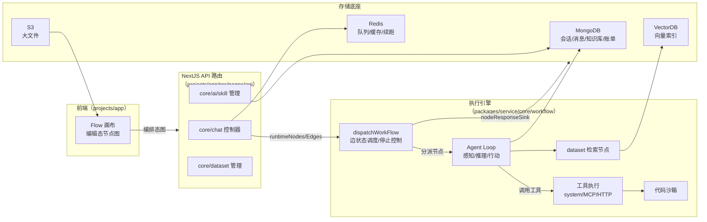

# FastGPT：把大模型、知识库、工具编排成复杂业务 Agent 应用的可视化工作流平台

> 本解读按 **ai-agent ⊗ framework 类规格**产出，叠加**可部署服务**关注面。
>
> FastGPT 是一个 **AI Agent 构建平台**（NextJS + TypeScript monorepo，MongoDB/Mongoose + Redis + 多 VectorDB）。与 Dify / Coze / RAGFlow 等同属「低代码 Agent 应用开发平台」赛道，但它的差异化主张是：「**一次 LLM 对话 = 一张可编排、可暂停、可并发、可循环的工作流运行时**」——把数据、模型、工具、用户交互组织成一张可视化 Flow 图，由后端引擎把它执行成一次真实对话。
>
> 仓库主页：[labring/FastGPT](https://github.com/labring/FastGPT)　版本：4.16.x　协议：FastGPT Open Source License（可商用但禁止对外提供 SaaS）。

## 子文档索引

- [`workflow-engine.md`](workflow-engine.md) — 工作流编排执行引擎：边状态调度、callbackMap 执行器分派、停止控制与交互续跑
- [`agent-chat.md`](agent-chat.md) — Agent 主循环与会话/请求链路：一次对话的完整生命周期、断点续跑与持久化
- [`skill-system.md`](skill-system.md) — Skill 体系：把「做事方式」打包成可复用、可治理、可注入会话的能力单元
- [`knowledge-base.md`](knowledge-base.md) — 知识库（RAG/Dataset）：文档摄取、分块向量化、混合检索与重排
- [`tool-mcp-sandbox.md`](tool-mcp-sandbox.md) — 工具调用 · 双向 MCP · 代码沙箱：Agent 的动作边界
- [`data-model.md`](data-model.md) — 数据模型与存储：文档事实库 + 检索向量库 + 对象存储 + Redis 旁路的分层底座

## 概览

### 它解决什么根本问题

LLM 是强大的「推理内核」，但企业要用它做真实业务，需要把**私有数据**（知识库）、**既有系统**（工具/API）、**复杂流程**（分支/循环/审批/计费）组织起来，并让**业务人员**能参与编排。FastGPT 的答案是把这一切收敛进一张**可视化 Flow 工作流图**：前端画布拖拽节点，后端把图画翻译成可执行运行时，一次性处理分支汇聚、循环、并行、用户交互、流式返回与断点续跑——同时把计费、鉴权、团队配额、可观测性内置进运行时。

### 核心能力清单

| 能力 | 一句话说明 | 深入阅读 |
|------|-----------|---------|
| Flow 可视化编排 | 节点图 → 可执行 DAG，支持分支/循环/并行/子流程 | [`workflow-engine.md`](workflow-engine.md) |
| Agent 循环 | 感知→推理→规划→行动，ask_user 可暂停换人续跑 | [`agent-chat.md`](agent-chat.md) |
| Agent Skill 编排 | 可打包、版本化、可治理的技能单元 | [`skill-system.md`](skill-system.md) |
| 知识库 / RAG | 多源文档摄取、混合检索 + 重排、多向量库适配 | [`knowledge-base.md`](knowledge-base.md) |
| 工具与双向 MCP | 系统/HTTP/MCP 工具 + 客户端/服务端双向接入 | [`tool-mcp-sandbox.md`](tool-mcp-sandbox.md) |
| 代码沙箱 | 受限执行 JS/Python，隔离多租户动作边界 | [`tool-mcp-sandbox.md`](tool-mcp-sandbox.md) |
| 统一数据底座 | MongoDB 事实 + VectorDB 检索 + S3 大文件 + Redis 异步 | [`data-model.md`](data-model.md) |

### 技术栈一览

| 层 | 选型 |
|----|------|
| 前端 | NextJS + React + ChakraUI（`projects/app`） |
| 后端 | NodeJS/TypeScript + NextJS API 路由（`packages/service`） |
| 主存储 | MongoDB / Mongoose（约 54 个 schema） |
| 向量库 | PostgreSQL(pgvector) / Milvus / OceanBase / SeekDB / OpenGauss（抽象切换） |
| 缓存/队列 | Redis（BullMQ 异步 + 缓存 + stream 断点续跑） |
| 对象存储 | 私有 S3（正从 GridFS 迁移） |
| 代码沙箱 | projects/code-sandbox（Bun + Hono，JS 进程池 + Python one-shot 隔离） |
| 包管理/构建 | pnpm workspaces monorepo + NextJS + tsx worker |

## 架构总览

一次对话请求的完整链路，贯穿各核心模块：

## 核心模块导读

| 模块 | 位置 | 设计要点 | 深入阅读 |
|------|------|---------|---------|
| 工作流执行引擎 | `packages/service/core/workflow/dispatch` | 边三态 + 迭代队列调度、`callbackMap` 分派表、软中断停止、交互快照续跑 | [`workflow-engine.md`](workflow-engine.md) |
| 会话与会话链路 | `packages/service/core/chat` | 生成态状态机、预创建占位 + 事后补全、Redis stream 断点续跑 | [`agent-chat.md`](agent-chat.md) |
| Skill 体系 | `packages/service/core/ai/skill` | 目录树同表、不可变 ZIP 版本包、沙箱注入与 `SKILL.md` 进上下文 | [`skill-system.md`](skill-system.md) |
| 知识库 RAG | `packages/service/core/dataset` + `common/vectorDB` | 多源摄取管道、Mongo 元数据 + 向量库双写、多路召回 + RRF + 重排 | [`knowledge-base.md`](knowledge-base.md) |
| 工具/MCP/沙箱 | `packages/service/core/plugin` + `projects/mcp_server` + `projects/code-sandbox` | 三类工具后端、双向 MCP、one-shot + native 隔离沙箱 | [`tool-mcp-sandbox.md`](tool-mcp-sandbox.md) |
| 数据模型 | 全部 `packages/**/schema.ts` | 文档模型承接半结构化、安全补建索引、JSON blob 渐进硬化 | [`data-model.md`](data-model.md) |

## 总结

FastGPT 的工程核心是**一次对话的可编排运行时**：它不是把「回答一个问题」当做一个 LLM 调用，而是把用户的提问变成沿一张图流动的、可暂停、可并发、可循环、可观测、可计费的执行过程。这套架构的价值与代价并存：

- **价值**：把 Agent 循环**节点化**（agent/parallel/loop/tool 都是节点），业务编排者能以拖拽的方式组装复杂应用；把数据/工具/技能三类能力统一成可编排节点；把多租户治理（计费、配额、权限、沙箱隔离）内置进运行时。
- **代价**：核心 `dispatchWorkFlow` 是 1700+ 行的厚入口、节点间用宽 union 契约传参（类型安全靠约定）、断点续跑依赖一片 Redis 镜像状态——这套复杂度是「编排自由」的必然反面。

作为解读落脚点：若你在选 Agent 应用开发平台，FastGPT 适合「把既有知识库与工具编排成生产级 Agent 应用」的场景；其**值得借鉴的工程模式**是——用图模型统一编排语义、用扁平执行器分派表换取扩展性、用「快照续跑」支撑长交互、用「任务即 Mongo 文档」做可观测异步队列。

## 部署与运维要点

- **快速启动**：一键脚本拉取配置 + `docker compose up -d`，默认访问 `http://localhost:3000`，初始账号 `root/1234`（`deploy/`）。
- **可拔插存储**：`getVectorObj()` 按环境变量优先级选向量库实现（`SEEKDB > OCEANBASE > PG > MILVUS > OPENGAUSS`），私部署可只依赖 MongoDB + Postgres(pgvector)。
- **数据演进治理**：索引采用「安全补建 + 显式废弃登记」，避免私有化重启误删客户自建索引；大文件正从 GridFS 迁到私有 S3。
- **运维代价**：断点续跑依赖 Redis stream，出站 MCP 每次调用都会落一条内部对话，高 QPS 集成下需关注聊天表与 usage 增长。
