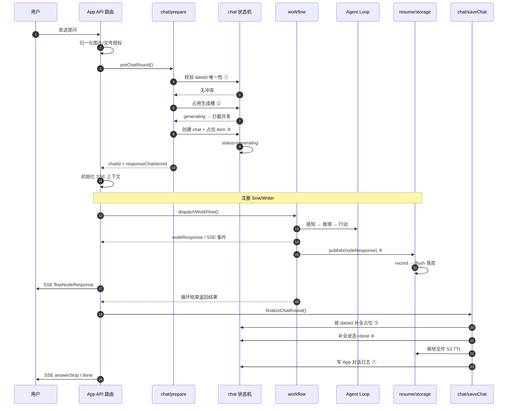

# Agent 主循环与会话 / 请求链路

> 定位：上一篇（[`workflow-engine.md`](workflow-engine.md)）讲了工作流如何执行节点；本篇讲完**一次对话的完整生命周期**——session / 上下文 / Agent 循环如何运转、如何流式返回并持久化，为下一篇（[`skill-system.md`](skill-system.md)）铺垫"Skill 是如何被拉进会话执行的"。
> 仓库根：`/Users/morehao/Documents/study/ai-agent/FastGPT`（下文所有引用均相对此根）。
> 全局叙事主线：一次对话请求如何从 API 进入 → workflow 编排 → LLM/工具/知识库 → 流式返回并持久化。

---

## 在项目中的角色

FastGPT 把"一次 LLM 对话"定义为**一张可编排的工作流运行时**。这个模块（`packages/service/core/chat/**`）处于 chat 请求链路的**中间管理层**：它既不是最上层的 NextJS API 路由（那是 `projects/app/src/pages/api/**`），也不是最下层的节点执行引擎（那是 workflow `dispatchWorkFlow`，下一篇会延伸到），而是**会话上下文组装 + 生命周期编排 + 持久化契约**的枢纽。

一句话定位：**它是把"HTTP 请求 → 会话状态 → Agent 循环 → 流式 SSE → 落库"这条主线串起来的传输层与状态机。**

模块内部职责可拆成五块对照：

| 职责 | 代表文件 | 输入→输出 |
|---|---|---|
| 生成态状态机 | `chatGenerateStatus.ts`、`cleanStaleGeneratingChats.ts`、`utils/prepare.ts` | 会话是否在"生成中 / 完成 / 出错"，能否再发起一轮 |
| 会话准备与落库 | `saveChat.ts`、`utils/prepare.ts` | 预创建 Human/AI 占位 → 工作流跑完 → 补全最终内容 |
| 核心数据模型 | `chatSchema.ts`、`chatItemSchema.ts`、`chatItemResponseSchema.ts` | 三张 Mongo 表：会话 / 消息 / 节点响应详情 |
| 流式返回与断点续跑 | `resume.ts`、`nodeResponseStorage.ts` | Redis stream 镜像；节点响应详情持久化与回放 |
| 上下文与内容治理 | `completionMessage.ts`、`fileContext.ts`、`postTextCensor.ts`、`fileStoreValue.ts`、`title.ts` | 图片上传规范化、read 文件、内容审核、标题生成 |

`packages/service/core/app/provider` 是本模块相邻的"app 提供方"——它负责把第三方模型 provider 加载进全局缓存，为用户/标题等模型调用提供模型清单。

## 解决什么问题、根因

设计的真正起点不是"怎么存对话"，而是三个原生矛盾：

**1. 一次对话有"开始-进行-终止"三个状态，但 workflot 是异步、可中断、可崩溃的。** 用户点了发送，Agent 可能在 LLM 返回前被关停、被刷新、甚至进程崩溃。如果不在"运行前"就把会话标记为 `generating`，侧栏和输入框就不知道什么时候能再发消息；如果不在运行结束后正确落到 `done/error`，会话会**永久卡在"生成中"**。所以设计了一个贯穿前后端的生成态状态机，并配套一个"僵尸会话清扫器"（`cleanStaleGeneratingChats.ts`）。

**2. Agent 循环本身不是一次性函数：它会被用户"暂停/继续"打断。** Agent 循环可能输出一问（`ask`）等待用户回答，也可能在一个交互卡片后 `paused` 等待子工具结果。这要求：流式输出必须**能在断点重放**，会话的中间状态必须**能持久化**。由此引出 Redis stream 镜像（`resume.ts`）和可追踪的 `dataId` 唯一性约束。

**3. 一个 App 的资源（消息、响应详情、变量、文件）散落在多张表和对象存储，需要统一归属。** 会话消息存在 `chats/chatitems`，节点执行的详细 trace 存在 `chat_item_responses`（已从 `chatitems` 内嵌字段迁移出来），上传文件在私有 S3。它们靠 `sourceType + sourceId + chatId + dataId` 这个四元组对齐（见 `source.ts`）。这个归属设计让"App 会话 / Skill 调试会话 / ChatAgentHelper"能复用同一套 CRUD 链路而不串数据【待复核】。

## 设计思路

### 为什么要对 chat config / 上下文做持久化

对话不是"问一句答一句"，Agent 的下一次决策依赖上一次的**会话变量（`variables`）、`chatConfig`（含欢迎语/变量定义/插件输入）、`memories`（记忆）**。这些必须在 chat 表里随会话落库：

- `chatSchema` 里存了 `variableList`、`variables`、`welcomeText`、`pluginInputs`、`metadata`。根因是：刷新页面、换设备、断点续跑时，要能从服务端重建这次对话的运行上下文，而不能只靠前端内存。
- `memories` 挂在 `chatItemSchema`（`chatItemSchema.ts:69-72`），是 Field memory——本轮从历史抽出的记忆字段随 AI 消息落库，供下一轮拼上下文。

换句话说：**"上下文"是分布式系统中需要被序列化成状态的中间产物**，必须持久化才能支撑"对话到底、可暂停、可复盘"。

### Agent 循环如何体现（感知→推理→规划→行动）

这篇承接的 Agent 循环的真正执行器在下游  `packages/service/core/workflow/dispatch/ai/agentLoopCore`，但**会话层为它准备了循环所需的一切"输入形态"**：

- **感知 context**：`prepareWorkflowFileContext`（`dispatch/index.ts:220-231`）把本轮 query 和历史文件做授权解析、把 base64 图片上传到私有桶（`completionMessage.ts` 的 `normalizeCompletionMessages`）；`fileContext.ts` 负责把 Human 消息里的普通文档读取成文本上下文（`rewriteChatMessagesWithFileContext`）。没有这一层，Agent 的"感知"是空的。
- **推理 model call**：Agent Loop 在 `agentLoopCore` 内部发起模型请求，用量通过统一 `usagePush` 上报；会话层只关心结果的 `assistantResponses` 等是否落库（`chatTest.ts:287-293` 汇总）。
- **行动 dataset/tool/plugin**：工作流节点（知识库检索、工具调用、Skill/插件）执行的详细 trace 作为 `nodeResponse` 流式发布并持久化到 `chat_item_responses`（见 `nodeResponseStorage.ts` 的 `WorkflowNodeResponseWriter` / `nodeResponseSink.ts`）。会话层是这些"行动记录"的落库边界。
- **停止与断点续跑**：见下文权衡。

### 停止 / 断点续跑的权衡

- **停止**（设计文档 `stop.md`）用的是 **Redis 停止标志 + 内存轮询**：v2 用 `setInterval` 每 100ms 轮询 Redis key `agent_runtime_stopping:...`，把结果刷进内存变量 `stopping`，节点执行前 `checkIsStopping()` 检查；v1 则退回检查 `res.closed/res.errored`【待复核】。权衡：**用 100ms 的定时器换"不阻塞、优雅停止"，代价是停止不是瞬时生效**——LLM 流式可立即断，HTTP 请求节点可能跑到底。Redis key 设 60s TTL 防泄漏；Redis 失败时 `shouldWorkflowStop` 降级返回 false（继续跑），宁可多跑不可误停。这是一次典型的"可用性 > 强一致性"取舍。
- **断点续跑**（`resume.ts`）用 **Redis stream 镜像 + 阻塞读（XREAD）+ 内存压力熔断**：工作流输出的每个 SSE chunk 同步 `enqueueRaw` 进 Redis stream；刷新/恢复连接的请求先 `catchUpAllHistoryItems` 重放历史，再 `_resume` 用 XREAD 阻塞读实时 tail。这是把"HTTP 连接是短命、可断"的现实与"Agent 循环是长跑"的矛盾，用**冗余镜像**来弥合。引入三个保护：`STREAM_RESUME_REDIS_MAXMEMORY_RATIO`（内存警戒线≥阈值停止新建镜像）、`STREAM_RESUME_BLOCK_MS=30s`（一次阻塞读最多 30s 就回来检查 socket 是否已关）、`STREAM_RESUME_INACTIVE_MS=2min`（供僵尸清扫判断活跃）。

### 内容审核在哪层插入

`postTextCensor.ts` 是最后的"出口旁路"：它包了一个全局 `textCensorHandler`，不面向具体节点，而是**在模块最外层对最终文本做一次统一把关**。`code===5000` 视为硬拒绝（reject），其他错误吞掉只返回空串（不阻断主流程）。位置选在"生成结果返回前"而不是"模型请求前"，权衡是：**宁可让少量不合规内容在末端被拦，也不要在每个模型请求环节都引入同步审核导致的性能与强耦合**。真正插入点是上层在回写/返回前调用【待复核】。

## 关键数据结构（chat 与 chat_item 的结构设计意图）

### chat 表（一次会话/一个会话窗口），`chatSchema.ts`

```ts
{
  chatId, teamId, tmbId,                // 归属
  sourceType, appId(=sourceId),         // 资源归属（App/Skill/Helper）
  appVersionId,                          // 会话绑定的 App 版本（断点续跑构图依据）
  title, customTitle, top,              // 会话展示
  source, sourceName, shareId, outLinkUid, // 入口来源 + 免登录分享归属
  variableList, welcomeText, variables, pluginInputs, metadata, // 运行上下文/配置快照
  hasGoodFeedback, hasBadFeedback, ... // 反馈统计的冗余布尔字段（性能）
  errorCount,                           // 冗余错误计数（性能）
  searchKey, deleteTime,
  chatGenerateStatus, hasBeenRead,      // 生成态状态机
}
```

设计意图三条：

1. **一行 = 一个会话生命周期汇总表**：`chatGenerateStatus` 标记会话进行到哪一步；`updateTime` 驱动僵尸清扫和"最近会话"排序；索引设计全围绕"按 appId/teamId 查历史、按 generating+updateTime 清扫"（`chatSchema.ts:136-257`）。
2. **运行上下文快照冗余存储**（`variables/variableList/welcomeText/pluginInputs/metadata`）：断点续跑、复盘、权限都靠这一行直接重建，不必每次重算。
3. **统计字段冗余**：`hasGoodFeedback/errorCount` 是聚合后的反范式字段，换查询快、代价是 write 时要做条件聚合（见 `controller.ts:updateChatFeedbackCount` 与 `saveChat.ts`）。这是典型的**读优化牺牲写**。

### chat_item 表（一条消息 / 一轮 Human+AI），`chatItemSchema.ts`

```ts
{
  teamId, tmbId, userId, chatId,
  sourceType, appId(=sourceId),
  dataId,              // 唯一业务 key：客户端/服务端对齐、断点续跑定位
  obj,                 // ChatRoleEnum Human | AI
  value,               // 消息内容数组（text/file/tools/interactive/plan...）
  memories,            // Field memory
  errorMsg, durationSeconds, citeCollectionIds,
  userGoodFeedback, userBadFeedback, customFeedbacks, adminFeedback,
  [nodeResponse]: []   // @deprecated，已迁到 chat_item_responses
}
```

关键设计点是 `dataId` 与 `obj`：

- **`dataId` 是断点续跑和合并的锚点**。设计文档 `stream-resume-dataid-validation` 明确约束：新轮次的 `dataId` 在进入工作流前必须先做唯一性校验（`utils/dataIdValidation.ts`），避免流恢复时 `appId+chatId+obj+dataId` 定位错乱。Human/AI 这个版本**不共用 dataId**（`prepareChatRound` 里 Human 与 AI 都用 `responseChatItemId`？需核对——见 `utils/prepare.ts:131,151-155`，两处 dataId 都赋了 `responseChatItemId`，而 design 文档说"本 PR 不采用 human 和 AI 共用同一个 dataId"【待复核】）。
- **`value` 是贴合的语义数组**，而不是纯字符串。它同时承载 `text/file/tools/interactive/plan`，使"一条 AI 消息 = 本轮所有可见产物"成为可能，前端据此渲染富交互（`utils.ts` 里 `addPreviewUrlToChatItems` 会给其中的 file 追加可访问 URL）。

### chat_item_responses 表（节点执行的详细 trace），`chatItemResponseSchema.ts`

```ts
{ teamId, sourceType, appId(=sourceId), chatId, chatItemDataId, data }
```

这一张是新拆出来的表，专门存**每个节点运行一次的详细响应**（引用来源、token、错误、子节点）。`data` 内含 `id`/`parentId`，读取时按 `id+parentId` 折叠回 `childrenResponses` 树（`composeNodeResponseDetail`）。设计意图：把"详情"和"消息主体"解耦，避免一条 AI 消息因为几十个节点的 trace 而膨胀；清洗失败可只丢详情、保住摘要（`NodeResponseWriteSummary`）。

## 核心流程 —— 一次对话的完整生命周期

下面 Mermaid 展示的是 **一次普通（非交互 resume）App 对话**，从 API 进入直到落库。仓库相对路径与行号附后。



行号锚点（关键实现位置，仓库根相对路径）：

- ② 占用生成槽：[packages/service/core/chat/chatGenerateStatus.ts:72-99]()——`tryStartGenerateChat` 用「条件匹配 + upsert + 唯一索引」无副作用抢占生成槽，避免并发双发。
<!-- anchor: export const tryStartGenerateChat = async (params -->
- ① dataId 校验：[packages/service/core/chat/utils/dataIdValidation.ts:95-118]()——新轮次 dataId 在进入工作流前做唯一性校验。
<!-- anchor: export const validateChatRoundDataIds = async ({ -->
- ③ 预创建占位：`packages/service/core/chat/utils/prepare.ts` 的 `prepareChatRound`/`preChatRound` 先落库 Human/AI 占位。
- ④ 节点响应落库：`packages/service/core/workflow/dispatch/nodeResponseSink.ts:59-85` 的 `publish` 把 nodeResponse 平铺写入 `chat_item_responses`。
- ⑤ 补全占位：[packages/service/core/chat/saveChat.ts:234-341]()——`finalizeChatRound` 在事务会话内按 `dataId` 补全两条占位 chat_item。
<!-- anchor: export const finalizeChatRound = async (props: Props) => { -->
- ⑥ done/变量/统计：`saveChat.ts` 在补全同时更新 `chat.variables/metadata`、`chatGenerateStatus=done`。
- ⑦ 应用日志：`saveChat.ts` 末尾按 `sourceType` 写 App 对话日志（失败不影响主流程）。

> 注：`projects/app/src/pages/api/core/chat/chatTest.ts:201-331` 展示了从 `preChatRound → dispatchWorkFlow → finalizeChatRound → flushResume` 的完整编排；真正对外的 v1/v2 completions 走同样管线，仅入口鉴权/输入解析不同【待复核】。
- 文件读取/解析依赖 `core/workflow/dispatch` 注入的 `FileReadContext`（`fileContext.ts:42-62`），其中 read 能力与 worker 子系统（`worker/readFile`）联动——SSRF/域名/大小校验放在会话层。
- Skills/插件工具的"拉进会话执行"细节（下一篇主题）由 workflow 工具节点完成，本模块只负责其执行结果落库；`chatId` 下的 `sourceType=skillEdit` 会话复用同一持久化链路【待复核】。

## 关键设计决策（权衡与代价）

**决策一：以"预创建占位 + 事后补全"取代"跑完再写"。**

新链路 `preChatRound` 先创建 chat 行 + 本轮 Human/AI 两条占位 `chat_item`（存 `dataId`、`chatGenerateStatus=generating`），工作流跑完 `finalizeChatRound` 用 `findOneAndUpdate` 按 `dataId` 补全（`saveChat.ts:315-341`）。

- **换来**：用户点发送后**服务端立刻就有这条会话**，刷新/断点续跑可以马上对账；交互 resume 能"追加进最后一条 AI 消息"而不错位；`dispatch` 期间的任何失败都能落到明确的 error 态。
- **代价**：运行前必须先写库，增加了"启动路径"的写放大（每轮 2 条 chat_item + 1 条 chat）。且必须配套 dataId 前置唯一性校验（`dataIdValidation.ts`），否则补全会写穿已有记录。
- **取舍边界**：`shouldPersistChatRound=false`（`NO_RECORD_HISTORIES`）时完全跳过落库，这是个可开关的"不计历史"模式。

**决策二：节点详情与消息主体拆表（chat_item_responses），且"详情可丢、摘要必保"。**

`WorkflowNodeResponseWriter` 把 nodeResponse 平铺落库，失败时先重试 3 次→瘦身（slim rows）→仍失败则丢弃详情只留内存摘要（`nodeResponseStorage.ts:633-693`）。

- **换来**：一条 AI 消息不再携带几十个节点的完整 trace，读取、扩容、详情定向查询都更方便；写库的一次性失败不会把主对话拖死。
- **代价**：详情写入与消息保存解耦，极端情况下（Mongo 抖动）会**永久丢失部分节点 trace**，只能通过摘要得知"有错/有引用"。这是"运维健壮性"与"审计完备性"的取舍，向健壮性倾斜。
- **工程细节**：writer 用 promise 队列串行化并发 record（`enqueue`），确保父子 workflow/parallel 分支的写入顺序 = 展示顺序；`recordWithParent` 为缺 parentId 的子根补父级，保住树形关系。

**决策三：流式停止用"Redis 标志 + 内存轮询"，断点续跑用"Redis stream 镜像"。**

- **换来**：停止不依赖 HTTP keep-alive（v2 可在连接断开后仍优雅停止），持续生成等长流程也能被用户主动打断；刷新页面能重放完整流。
- **代价**：这是一整套**多了一层状态同步**的复杂度——镜像双写、阻塞读、内存压力熔断、活跃心跳、2 分钟不活跃判死。任何一处 Redis 问题都要有降级路径（`resume.ts` 在内存压力时停建镜像；`cleanStaleGeneratingChats` 在 Redis 异常时退回 30 分钟 updateTime 兜底）。本质上是用"一片冗余状态"换取"用户无感续跑"。

## 亮点与问题

### 亮点

1. **生成态状态机 + 僵尸清扫闭环**（`chatGenerateStatus` + `cleanStaleGeneratingChats`）。用 `tryStartGenerateChat` 的"条件匹配+upsert+唯一索引"实现无副作用抢占，并发两次发送只有一个能进；用 Redis activity 2 分钟、Mongo 30 分钟双阈值兜底，把"崩溃残留的 generating"自动修正回 done。这是对话系统的"心跳与看门狗"，务实且自洽。
2. **摘要与详情分离的容错记账**。`NodeResponseWriteSummary` 把"必须保真"的引用/错误/费用从"可丢弃"的详情里剥离开，是分层容错的好样板。
3. **source-aware 三表统一查询**（`source.ts`）。用 `type + helper` 而非裸字段，让 App/Skill/Helper 三类会话共享 CRUD 而不串，并兼容历史缺字段数据。这是演进中保持兼容的正面案例。
4. **文件生命周期管理细致**：上传先写 TTL、落库成功再 `removeS3TTL`（`saveChat.ts:85-170` `persistChatFiles`），避免"只传不发"的文件永久滞留；`fileStoreValue` 白名单清洗防止把前端预览态/渲染字段写进变量。

### 问题 / 待观察【待复核】

1. **dataId 双轨语义存疑**：`utils/prepare.ts:131,151-155` 里 Human 与 AI 占位的 `dataId` 都被赋为 `responseChatItemId`（两轮共享同一 id），而设计文档 `stream-resume-dataid-validation.md` 明确写"本 PR 不采用 human 和 AI 共用同一个 dataId"。二者可能冲突，也可能因 `obj` 字段仍能区分定位而自洽——需对照最新代码确认设计文档是否已过时。

2. **两套落库路径并存**：`finalizeChatRound`（新，补全占位）与 `pushChatRecords`（旧，直接 create）同时存在（`saveChat.ts:234-503`），未接 prepare 的旧兼容路径会持续存在，是临时遗留还是长期双轨，待确认。

3. **content censor 触发点**：`postTextCensor.ts` 只是能力函数，真正在何处/何时对哪部分文本调用，未在本模块直接可见。

4. **SSE 明细裁剪口径**：`nodeResponseSink.publish` 里"完整响应必写库、对外事件再裁剪"，意味着写库的 trace 比前端看到的多，这个差异是否有意的隐私/体积权衡，值得在后续核对中明示。