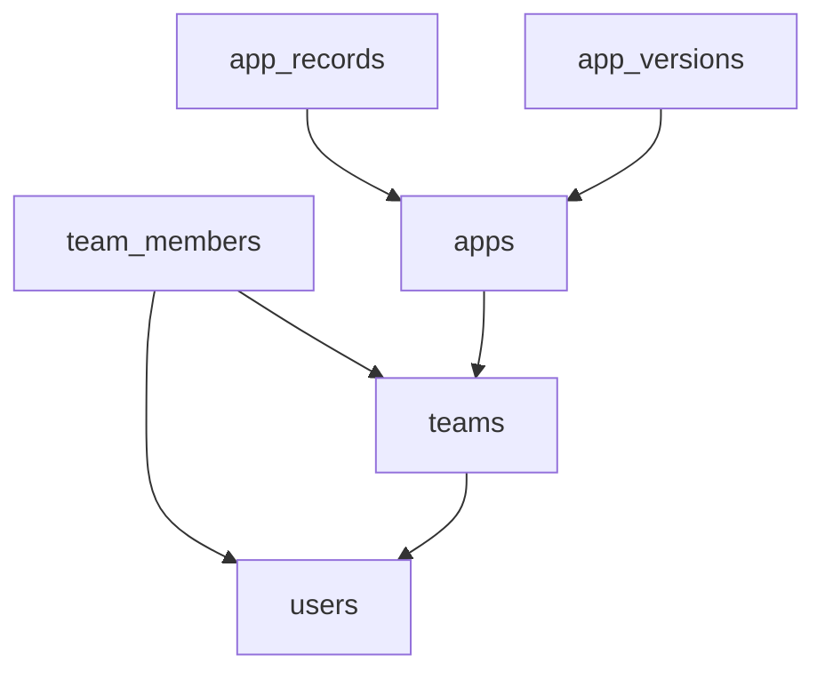
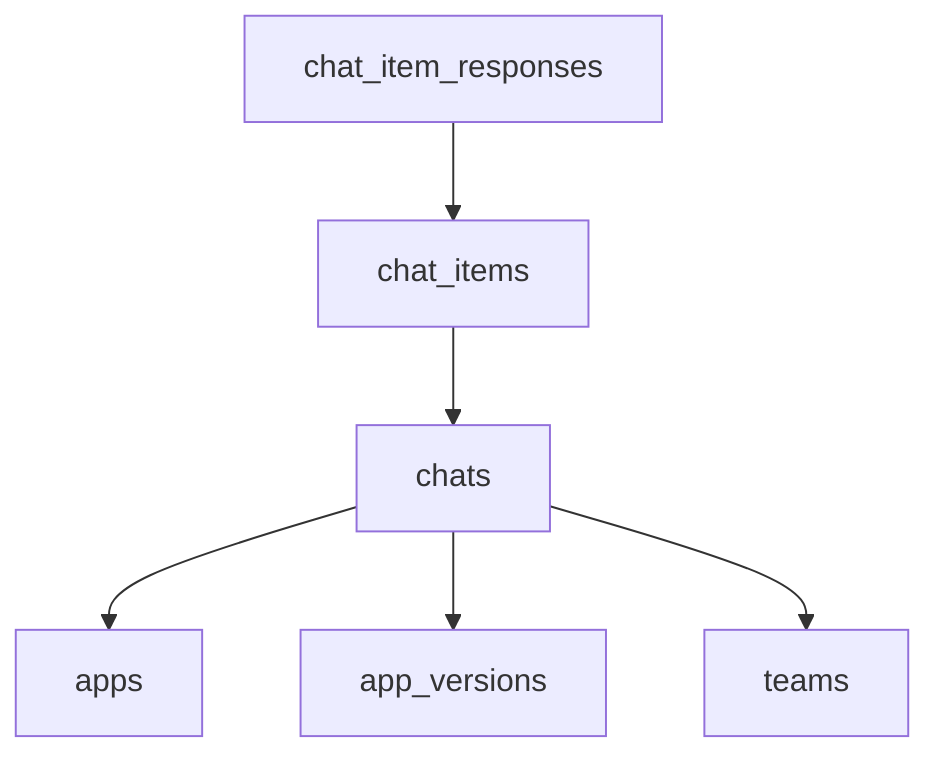
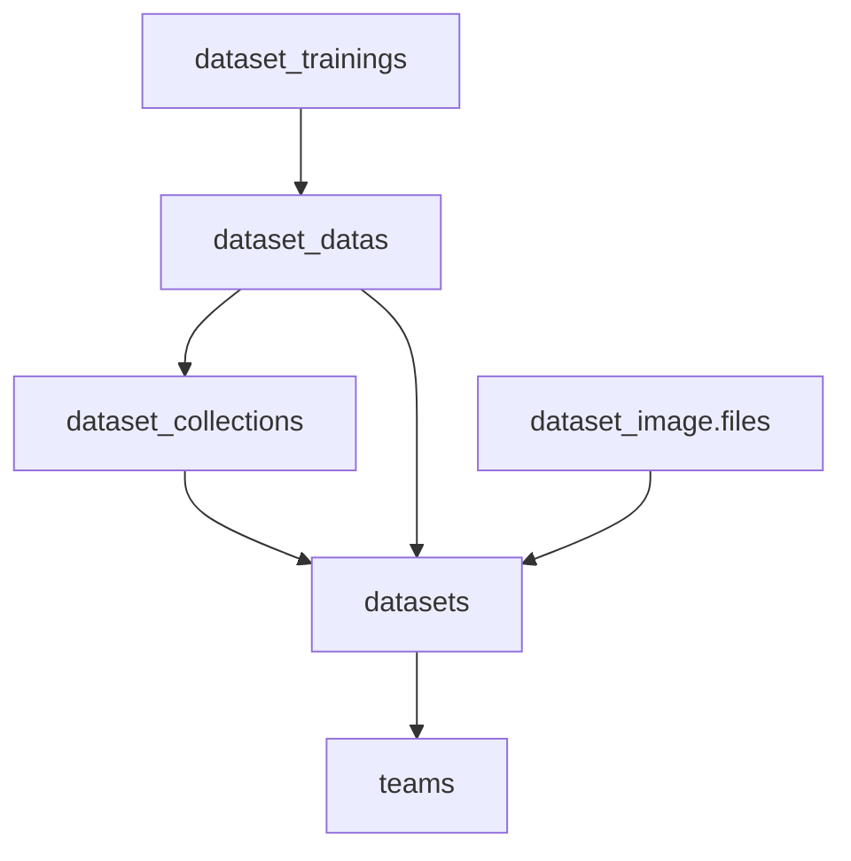
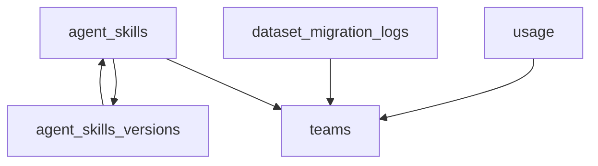
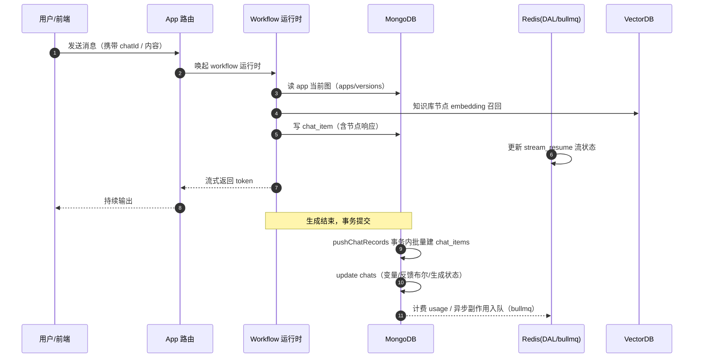
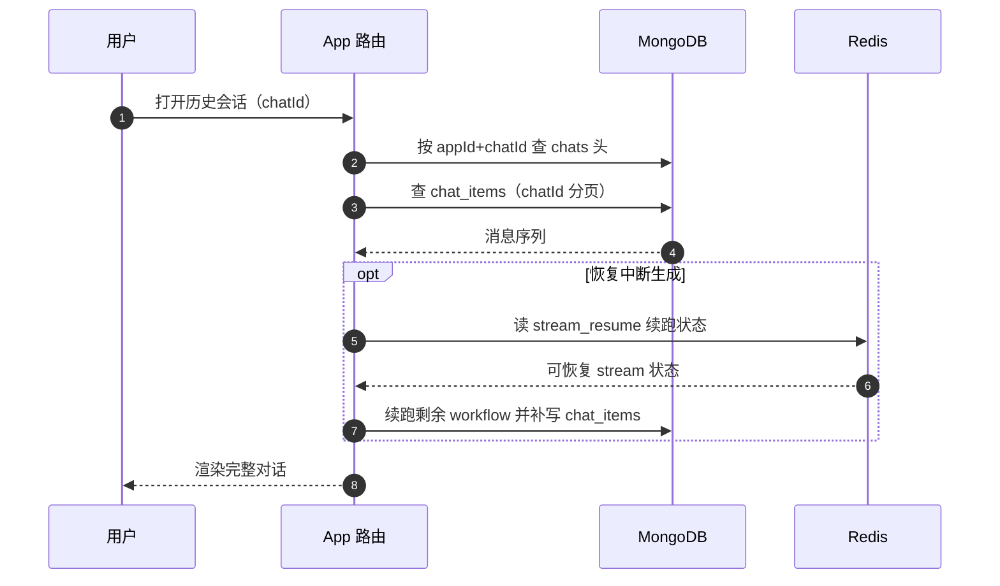
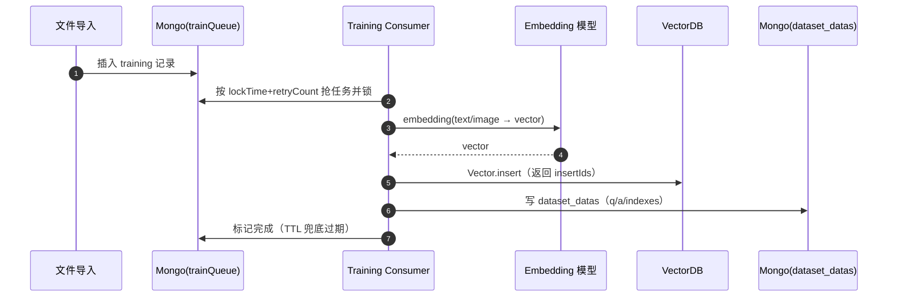

# 数据模型与存储：一套「文档事实库 + 检索向量库 + 对象存储 + Redis 旁路」的分层底座

> 定位：整套解读的收尾篇，提供「存储底座」视角。前几篇讲了 workflow / chat / skill / knowledge / tool 各功能模块，读者带着「这些模块的数据到底落在哪、如何组织、如何演进」的收尾疑问进入本篇。本篇回答三个根问题：**为什么用这一套存储、数据怎么演进、读写路径怎么走**。
>
> 仓库根：`/Users/morehao/Documents/study/ai-agent/FastGPT`。

## 数据模型在项目中的角色

FastGPT 把「大模型、知识库、工具」编排成可视化 Agent 应用的卖点，全部建立在数据模型之上。数据层不是独立的存储层，而是四类存储各司其职、互为对方的「落盘」：

- **MongoDB（Mongoose）** 承载全部业务实体：应用、会话、消息、知识库、权限、账单、队列副作用等约 54 个 schema。它的文档模型天然匹配 workflow 的类型复杂、chat_item 的半结构化、以及「字段可渐进新增」的演进诉求。
- **Redis（bullmq + 缓存）** 承载队列（异步副作用）、会话/限流/幂等缓存、流式中断恢复，属于「加速层与异步层」而非主事实源。DAL 已把 Redis 的 key/TTL/codec/合同迁入 `@fastgpt/dal`。
- **VectorDB（多实现抽象）** 承载知识库的 embedding 向量，用一行环境变量即可在 pg / milvus / oceanbase / seekdb / opengauss 之间切换。
- **对象存储（S3 / GridFS）** 承载大文件：知识库原始文件、Skill 版本包、对话历史 JSON blob、模型上下文文件。正从 GridFS 向 S3 迁移。

角色定位一句话：**MongoDB 是全事实源（Single Source of Truth），Redis 是异步与加速旁路，VectorDB 是检索专用引擎，S3 是大文件离线存储**。四者的职责边界在 `.agents/design/common/dal/data-access-layer.md` 有清晰的"业务进入 DAL"判定（`packages/dal` 只承接持久化语义，不承接 HTTP/权限/领域副作用）。

## 数据模型主动探测结果

按「数据模型主动探测」程序化扫描，命中以下核心信号：

- **S schema 实体密集**：glob `packages/**/*schema*.ts` 命中 54 个 schema 文件，全部集中于 `packages/service/core/**`、`packages/service/support/**`、`packages/service/common/**`。数据层即 Mongoose 层，无 ORM 建表 SQL、无 `.prisma`、无 `alembic/versions`。
- **无 SQL 建表脚本**：全仓库无 `.sql` 文件（除 VectorDB 驱动的内嵌 SQL），Mongo/Mongoose 是主持久化；PostgreSQL（pgvector）仅作为 VectorDB 一种实现存在。
- **Schema 演进目录命中**：`packages/service/core/dataset/migration/schema.ts`（GridFS→S3 文件迁移日志表）、`packages/service/core/ai/sandbox/interface/migration/`（沙箱遗留数据迁移）、`projects/app/scripts/migration/authCodeToTmpData.ts`。
- **DAL / Redis 抽象层命中**：`packages/dal/redis/**`（runtime / adapter / caches / bullmq），对应 `data-access-layer.md` 设计文档契约。
- **索引同步基础设施命中**：`packages/service/common/mongo/schemaIndexes.ts`（`defineIndex` 统一声明）、`indexManager.ts`（`MongoIndexManager` 安全同步），对应 `mongo-index-sync-strategy.md`。
- **对象存储演进命中**：`dataset/image/schema.ts`（GridFS `桶.files` 形态）、`dataset/migration/schema.ts`、`common/s3/**`，对应 `s3-storage-refactor.md`。

### 命中信号小结

| 信号类别 | 命中文件 | 结论 |
| --- | --- | --- |
| ORM/Mongoose schema | `packages/**/*schema*.ts`（54 个） | 文档型为主的持久化 |
| 建表 SQL | 无 `.sql` 文件 | 纯 Mongoose，无独立 DDL 层 |
| 迁移目录 | `dataset/migration`、`sandbox/interface/migration`、`scripts/migration` | 有分层迁移机制 |
| DAL 抽象 | `packages/dal/redis/**` | Redis 已抽象为独立 workspace |
| 索引同步 | `common/mongo/schemaIndexes.ts`、`indexManager.ts` | 索引由程序安全同步 |
| 向量库 | `common/vectorDB/controller.ts` | 多实现抽象，非单一绑定 |

数据模型关注面**命中且深度足够**，按数据模型五要素成文。

## 实体关系总览

MongoDB 是文档型，实体间的关联通过 `ObjectId` 引用 + Mongoose `virtual` 表述（非外键约束），因此实体关系图用 `graph` 而非 `erDiagram`（erDiagram 强调主外键、SQL 定长字段，不贴合文档 schema 的动态字段形态）。图外补叙权衡。

实体关系图二：会话与消息（`chats` → `chat_items` → `chat_item_responses`），与`apps`、`app_versions`关联：

实体关系图三：知识库四级（`datasets` → `dataset_collections` → `dataset_datas`，`dataset_trainings` 为异步 embedding 队列，`dataset_image.files` 走 GridFS）：

实体关系图四：Skill 与计费/迁移（`agent_skills` 持有当前版本指针，`agent_skills_versions` 记录版本包存储 key；`usage` 计费、`dataset_migration_logs` 记录 GridFS→S3 迁移）：

> 说明：目录树/文件夹类的自引用边（`apps.parentId → apps`、`agent_skills.parentId → agent_skills`）在节点名/补叙里注解，避免画自环。**本环境 dagre 布局引擎对「带 label 的 flowchart 边」存在渲染 bug（`Could not find a suitable point`），故所有 flowchart 边均不标 label，关联语义见「关系与权衡补叙」文字**；实体图业务域较多，拆成四张主题子图，各图经重复出现的 `teams`/`apps` 实体衔接。

### 关系与权衡补叙

- **自引用树**：`apps.parentId`、`datasets.parentId`、`dataset_collections.parentId`、`agent_skills.parentId` 都表达「目录树」层级。Skill 与 Folder **共用一张表**，靠 `type` 字段区分节点类型——这是文档模型的典型妥协：不拆表、用枚举 + 软删除 + 树遍历查询。应用是目录树（`apps.schema.ts:28`），知识库也是目录树（`dataset/schema.ts:60`）。
- **虚引用而非外键**：所有关联都是 `Schema.Types.ObjectId` + `ref`，配合 Mongoose `virtual`（如 collection→dataset、training→data）延迟 join。这意味着**没有数据库级外键约束，删除需要应用层级联删除**——FastGPT 用大量 Delete 队列（`AppDeleteMQService`、`DatasetDeleteMQService`、`TeamDeleteMQService`、`SkillDeleteMQService`，见 `packages/dal/redis/bullmq/names.ts`）做异步级联清理。
- **软删除标记**：`apps`、`datasets`、`chat_items`、`agent_skills` 都有 `deleteTime` 字段（null=未删）。软删除能避免误删、支持恢复，代价是**每个查询都要带 deleteTime 条件**，索引设计必须把 `deleteTime` 放进复合索引前缀（如 `app: { teamId:1, deleteTime:1, 'resourceRefs.skillIds':1 }`）。
- **冗余字段为性能**：`chats` 有 `hasGoodFeedback` / `errorCount` 等反规范化布尔量（`chatSchema.ts:99-109`），避免联表统计；这体现了「读多写少场景用冗余换查询速度」的权衡。

锚点指纹（节选，完整见各字段表）：

- `apps` 自引用 + 软删除定位：[packages/service/core/app/schema.ts:28-131]()

<!-- anchor-base64:ICAgIHBhcmVudElkOiB7CiAgICB9CiAgfSwK -->

实体关系图外的逐一锚点并入下文「核心集合字段表」各节。真正设计纵深在「存储选型」「Schema 演进」「读写路径」三节。

## 存储选型与理由

### 为什么是 MongoDB：文档模型适配半结构化编排

FastGPT 的核心数据——工作流——是高度变长的嵌套结构：`apps.modules`（节点数组）和 `apps.edges`（连线数组）每个节点字段各异，`apps.chatConfig` 是一组旁路配置的集合（`packages/service/core/app/schema.ts:72-82`）。这类「同一 collection 里每条文档结构都不同」的数据，正是文档数据库的舒适区：**不需要预定义列，schema 演进就是"往 Schema 里加字段"，存量文档无需 ALTER TABLE**。

`chat_items` 是半结构化的又一个典型案例：一条 AI 消息的 `value` 是变长数组（文本块/卡片/图片的混合）、`memories` 是任意对象、`citeCollectionIds` 是可选数组（`packages/service/core/chat/chatItemSchema.ts:62-72`）。若用关系型表达，需要把「答案内容」「引用」「记忆」拆成多张子表再 join，读一条对话历史要数次 join。文档模型把一次对话的历史读成一次集合扫描。

### 权衡：关系型不选的理由

不用关系型（PostgreSQL 做主库）的代价换来的是：

- **放弃跨实体 ACID 事务一致性**（改用 Mongoose 事务会话 + 队列补偿）。
- **放弃强约束**（外键/CHECK/枚举由应用层维护，靠 `enum` + 代码兜底）。
- 但换取**演进速度**：插入新节点类型、新配置字段无需改表。

FastGPT 的选择是**混合**：PostgreSQL 不作为业务主库，而是**作为 VectorDB（pgvector）的一种实现**参与（`packages/service/common/vectorDB/controller.ts:22-30`）。业务事实全部在 Mongo，向量检索专用引擎化。这是「事务性文档 + 检索性向量」分离的典型架构。

### Redis：不是主事实源，是异步与加速旁路

Redis 在 FastGPT 里的三个角色（`.agents/design/common/dal/data-access-layer.md`）：

1. **BullMQ 队列**：异步副作用（数据集同步、S3 文件删除、各类删除队列、collection 更新），`packages/dal/redis/bullmq/names.ts` 维护稳定队列名。作用是**把慢副作用从请求路径剥离**，失败可重试。
2. **缓存**：会话 hash（7 天）、团队点数（60 秒回源 Mongo）、团队 QPM/限流计数、Daily Active 去重等，合同全部在 `data-access-layer.md` 的 Shared Cache 表。
3. **流式中断恢复**：`stream_resume`（Redis Stream）承载对话生成中断后的续跑状态，`packages/dal/redis/caches/streamResume.ts:11-19`。

关键设计点：**Redis 不做权威数据**，多数缓存故障可回源 Mongo（`fail-open`）或 fail-closed；写入 Redis 失败不阻塞主业务。Redis 的错误语义分成 `read` / `idempotent-write` / `uncertain-write` 三档（`data-access-layer.md` 5.4）。

### VectorDB：多实现抽象

向量不是直接塞进 Mongo，而是由 `VectorControllerType` 统一接口抽象（`packages/service/common/vectorDB/type.ts`），运行期按环境变量优先级选实现：`seekdb → oceanbase → pg → milvus → opengauss`，默认回退 pg（[packages/service/common/vectorDB/controller.ts:22-30]()）。背书这种抽象的理由：

<!-- anchor: const getVectorObj = (): VectorControllerType => { …   return new PgVectorCtrl(); -->

- **向量类型/插入/删除/召回接口统一**，上层（embedding 写入、检索）不关心底层库。
- **私部署可拔插**：有现成 milvus/pg 就用，无额外依赖时退回 pg。
- 代价是**只能用最低公共能力**，pgvector 强项（HNSW）之外的库特性被抹平。

向量写入后还在 Redis 里放 `TeamVectorCountCache`（1800 秒）缓存团队向量计数，避免每次查库（`controller.ts:33-35,102-116`）。

### S3 与 GridFS：大文件为什么放对象存储

知识库原始文件（PDF/docx）、Skill 版本包、对话 JSON blob、模型上下文文件体积大、冷访问，不适合塞进 Mongo 文档（16MB BSON 上限）。FastGPT 演进路径：**从 GridFS（Mongo 自带）迁向 S3**（`dataset/migration/schema.ts` 专门记录这批迁移）。原因是 S3 性价比/生态/CDN 分布式读取优于 GridFS 的 mongod 驱动 IO。`s3-storage-refactor.md` 进一步把「文件访问凭证」重构为短链，Mongo 只存对象映射与 HMAC hash，不暴露大文件直读。

### 组合选型的最终视角

四种存储不是并列而是分层：**事实主库（Mongo）→ 索引/向量（vectorDB）→ 大文件（S3）→ 加速/异步（Redis）**。Mongo 是「谁能查到这条记录」（元数据 + 事实），vectorDB 是「语义上最相关的记录」，S3 是「记录实体内容」，Redis 是「让读快一点 / 让慢副作用别阻塞」。任何单一存储都扛不动这四个诉求，这是多存储组合的根因。

## 核心集合字段设计

以下每张核心表配一个字段表（`字段 | 类型 | 约束/索引 | 说明`），表头前一句叙述职责并指向真实 schema。字段不整段复制源码，读者可点开 schema 复核；任一条字段的索引约束来自 `defineIndex`（`packages/service/common/mongo/schemaIndexes.ts:29-69`）统一声明。

### apps：应用（Agent 实例）

职责：一份「可发布运行的 Agent 编排」。它持有 workflow 图（`modules`/`edges`）、陪聊配置（`chatConfig`）、发布指针（`version`）、软删除标记。`apps.schema.ts:26-160` 定义了全貌，字段表择要。

| 字段 | 类型 | 约束/索引 | 说明 |
| --- | --- | --- | --- |
| `parentId` | ObjectId | 自引用，默认 null | 目录树层级（工具/子应用挂父节点下） |
| `teamId` / `tmbId` | ObjectId | required，ref team/team_member | 租户归属与创建者，所有权限/隔离查询的第一前缀 |
| `type` | String | enum `AppTypeEnum`，索引 `{teamId,type}` | 应用类型（workflow/simple/plugin/http/extract…） |
| `version` | String | enum `['v1','v2']` | 当前运行版本标记，配合版本集合演进 |
| `modules` / `edges` | Array | default `[]` | 工作流**图本身**——文档模型核心载荷，随节点类型新增无需改表 |
| `chatConfig` | Object | subSchema `chatConfigType` | 陪聊配置聚合（welcome/variables/tts/whisper 等），半结构化 |
| `scheduledTriggerConfig` / `scheduledTriggerNextTime` | Object / Date | 部分索引 `{scheduledTriggerConfig, scheduledTriggerNextTime}` | 定时任务调度，部分索引只覆盖有配置的文档 |
| `resourceRefs.skillIds` | [String] | 索引 `{teamId,deleteTime,'resourceRefs.skillIds'}` | 应用引用的 Skill，用于引用计数与删除联动 |
| `deleteTime` | Date | 默认 null；索引 `{deleteTime}` | 软删除标记：null=未删，有值=删除时间 |

索引设计贯穿两个权衡：**所有查询先从 teamId 切租户**（租户隔离是第一优先级），**deleteTime 放进复合索引前缀**减少软删除扫描。引用：`packages/service/core/app/schema.ts:138-142`。

<!-- anchor: defineIndex(AppSchema, { key: { teamId: 1, updateTime: -1 } }); …   key: { teamId: 1, deleteTime: 1, 'resourceRefs.skillIds': 1 } --> 

### app_versions：应用版本

职责：保存每个发布/自动保存快照的完整 workflow 图（`nodes`/`edges`/`chatConfig`），支持发布管理、版本回溯、灰度比对。它是「当前运行态」之外的「历史快照」集合——与 `apps` 当前图分离，`apps.version` 只给版本名，快照明细在版本表。引用：[packages/service/core/app/version/schema.ts:9-33]()

<!-- anchor: const AppVersionSchema = new Schema( …  chatConfig: { -->

| 字段 | 类型 | 约束/索引 | 说明 |
| --- | --- | --- | --- |
| `appId` | ObjectId | required，ref apps，索引 `{appId,time:-1}` | 归属应用，appId 查询即取历史列表 |
| `nodes` / `edges` | Array | 保留当时图 | 快照主体（复制自 app），避免编辑污染已发布版本 |
| `chatConfig` | Object | subSchema `chatConfigType` | 与模块同步的快照 |
| `isPublish` / `isAutoSave` | Boolean | — | 发布标记 / 自动保存标记，区分「发布版本」与「编辑草稿」 |
| `versionName` | String | — | 用户可读版本名 |

关键权衡：**版本快照把 app 的「当前态」与「历史态」分开**，使应用编辑不破坏已发布版本（可回滚）、支持发布一致性；代价是每次发布复制整张图产生冗余，用「版本表只存真实存在的版本」控制（skill 版本同理）。

### chats / chat_items / chat_item_responses：会话与消息

三个集合构成一次对话的写读主链路（详见「读写路径」一节）：

**chats（会话头）** 保存会话元信息、全局变量、反馈统计、软删除：[packages/service/core/chat/chatSchema.ts:16-45]()

<!-- anchor: const ChatSchema = new Schema({ …  createTime: { -->

| 字段 | 类型 | 约束/索引 | 说明 |
| --- | --- | --- | --- |
| `chatId` | String | required，唯一 `{sourceType,appId,chatId}` | **业务主键**（非 _id），用 nanoid，是前端恢复对话的句柄 |
| `appId` | ObjectId | required（注：业务语义为 sourceId，App 场景才是真 appId） | 来源标识，兼容旧物理字段名 |
| `sourceType` / `source` | String | enum，复合索引前缀 | 来源类型（app/api/skill/wechat/outlink…）与来源渠道 |
| `variables` | Object | default `{}` | 会话级全局变量值（随 workflow 节点动态变化） |
| `metadata` | Object | default `{}` | 特化存储（如安全政策数据） |
| `hasFeedback` / `errorCount` 等 | Boolean/Number | 部分索引 `{appId,hasX,updateTime:-1}` | **反规范化**反馈/错误布尔量，供统计与列表过滤 |
| `shareId` / `outLinkUid` | String | 部分索引 | 对外分享/外部链接标识 |
| `deleteTime` | Date | 默认 null，`select:false` | 软删除，select:false 默认不返回 |

**chat_items（每条消息）** 保存单条 human/AI 消息内容与反馈：[packages/service/core/chat/chatItemSchema.ts:14-62]()

<!-- anchor: const ChatItemSchema = new Schema({ …  value: { -->

| 字段 | 类型 | 约束/索引 | 说明 |
| --- | --- | --- | --- |
| `chatId` | String | required，复合索引 `{appId,chatId,dataId}` | 挂在会话下 |
| `dataId` | String | required，default nanoid，唯一定位 | 消息条目主键，配合复合索引构成唯一查询 |
| `obj` | String | enum `ChatRoleMap`，索引含 `{obj,_id}` | 角色（Human/AI/System…），查「最后一条 AI 消息」用 |
| `value` | Array | default `[]` | 消息内容块数组（**半结构化核心**：文本/图片/卡片混合） |
| `memories` | Object | — | Field memory：会话记忆提取结果 |
| `citeCollectionIds` | [String] | — | 引用的知识库 collection，用于溯源 |
| `userGoodFeedback` / `userBadFeedback` / `customFeedbacks` | String/[String] | — | 用户反馈与自定义反馈 |
| `deleteTime` | Date | 默认 null，索引含 `{deleteTime}` | 软删除 |
| `nodeResponse` | Array | `@deprecated` 默认 undefined | **已迁移字段**：节点响应已拆到 chat_item_responses，保留仅防历史数据误清理 |

**chat_item_responses（节点响应）** 是 `nodeResponse` 从 chat_item 剥离出来的集合，保存每个 workflow 节点的详细运行结果（token 消耗、中间输出、tool 调用等）：[packages/service/core/chat/chatItemResponseSchema.ts:8-37]()

<!-- anchor: const ChatItemResponseSchema = new Schema({ …  time: { -->

| 字段 | 类型 | 约束/索引 | 说明 |
| --- | --- | --- | --- |
| `chatId` / `chatItemDataId` | String | required，复合索引含 `{_id}` | 定位到具体消息条目的节点响应 |
| `data` | Object | default `{}` | 节点响应明细（大 JSON blob） |
| `time` | Date | 索引 `{teamId,time:-1}` | 过期清理依据 |

**演进点睛**：把 `nodeResponse` 从 chat_item 拆出成独立集合，是「**大 JSON blob 从主文档提列**」的典型演进（见「Schema 演进策略」）。动机是 chat_item 的 `value`（消息内容）是高频读、nodeResponse（节点详细结果）是低频读且体积大——拆开后**读历史对话不必拖回大节点明细**，也避免了更新一个节点响应就重写整条 chat_item。引用：`packages/service/core/chat/chatItemSchema.ts:93-97`。

<!-- anchor:   /** @deprecated nodeResponses 已迁移到 chat_item_responses；保留 schema path 仅避免历史数据被误清理。 */ -->

### datasets / dataset_collections / dataset_datas：知识库四段式

知识库从「实体文件」到「可检索向量条目」是四级分解。前文 knowledge 模块讲业务，这里讲落盘：

**datasets（知识库根）** 保存知识库配置（切分参数、模型选择、软删除）：[packages/service/core/dataset/schema.ts:59-98]()

<!-- anchor: const DatasetSchema = new Schema({ …  vectorModel: { -->

| 字段 | 类型 | 约束/索引 | 说明 |
| --- | --- | --- | --- |
| `parentId` | ObjectId | 自引用，默认 null | 知识库目录树 |
| `teamId` / `tmbId` | ObjectId | required，索引 `{teamId}` | 租户归属 |
| `type` | String | enum `DatasetTypeMap` | 知识库/datasets/外部 API 等，`{type}` 用于 Admin 计数 |
| `vectorModel` / `agentModel` / `vlmModel` | String | required，默认 `text-embedding-3-small` | **向量化与回复所用模型**，决定检索维度 |
| `chunkSettings` | Object | subSchema `ChunkSettings` | **切分策略聚合**（chunkSize/splitter/trainingType 等约 20 字段） |
| `deleteTime` | Date | 默认 null，索引 `{deleteTime}` | 软删除 |

`ChunkSettings` 子 schema 是「配置下沉」的代表：把大段切分配置收进一个嵌套对象，避免散列成十几个顶层字段（`dataset/schema.ts:20-57`）。代价是查询/更新需 `chunkSettings.x` 路径。

**dataset_collections（数据集/一次导入）** 一个「文件/链接」对应一个 collection：[packages/service/core/dataset/collection/schema.ts:13-86]()

<!-- anchor: const DatasetCollectionSchema = new Schema({ …  ...ChunkSettings -->

| 字段 | 类型 | 约束/索引 | 说明 |
| --- | --- | --- | --- |
| `datasetId` | ObjectId | required，ref datasets，索引 `{teamId,datasetId,parentId,updateTime}` | 归属知识库 |
| `type` | String | enum `DatasetCollectionTypeMap` | 文件/链接/API/外部等导入类型 |
| `fileId` | String | 索引 `{teamId,fileId}` | 关联文件：**既支持 GridFS ObjectId 也支持 S3 key**（格式无关） |
| `rawTextLength` / `hashRawText` | Number/String | — | 去重与变更检测 |
| `metadata` | Object | default `{}`，部分索引 `{'metadata.relatedImgId'}` | 关联图片清理 |
| `...ChunkSettings` | — | — | 可覆盖知识库级切分（SPREAD 展开） |
| `virtual('dataset')` | — | — | Mongoose virtual 聚合，延迟 join 取知识库 |

**dataset_datas（向量条目）** 每个切分块一条，`q`(问题)/`a`(答案)、`indexes`（多向量文本：默认/自定义）、重建标记：[packages/service/core/dataset/data/schema.ts:14-78]()

<!-- anchor: const DatasetDataSchema = new Schema({ …  updateTime: { -->

| 字段 | 类型 | 约束/索引 | 说明 |
| --- | --- | --- | --- |
| `datasetId` / `collectionId` | ObjectId | required，索引 `{teamId,datasetId,collectionId,chunkIndex}` | 四级归属 |
| `q` / `a` | String | — | QA 配对块 |
| `imageId` / `imageDescMap` | String/Object | — | 图片向量（图来自 GridFS/S3） |
| `indexes` | Array<{type,dataId,text}> | 索引 `{'indexes.dataId'}` | **多索引文本**：默认索引 + 自定义索引，对应一次数据多条向量 |
| `rebuilding` | Boolean | 索引 `{rebuilding,teamId,datasetId}` | 重建标记（重 embedding） |
| `history` | Array | — | QA 手工编辑历史 |
| `fullTextToken` 等 | — | `@deprecated` | old 全文索引废弃字段 |

**演进洞察**：dataset_datas 的 `indexes.dataId` 是**数据库行与向量库条目的关联键**——Mongo 存文本元数据，实际向量在 VectorDB，两者通过 `dataId` 对齐。删除/重建数据时按 teamId 查 Mongo 得 dataId 列表，再调 VectorDB 批量删除（`packages/service/common/vectorDB/controller.ts:93-97`）。这是一次「关系编排数据（Mongo）与语义检索数据（VectorDB）双写解耦」的架构点。

### dataset_trainings：异步切分/向量化队列的 Mongo 侧

职责：**把「需要异步 embedding 的候选块」排队**。切分文件/文档后不是立即写向量，而是先写 `dataset_trainings` 待处理记录，由 Worker 消费后生成向量并回写 `dataset_datas`。它是「异步训练管线」在数据库层的落点：[packages/service/core/dataset/training/schema.ts:17-103]()

<!-- anchor: const TrainingDataSchema = new Schema({ …  errorMsg: String -->

| 字段 | 类型 | 约束/索引 | 说明 |
| --- | --- | --- | --- |
| `datasetId` / `collectionId` / `dataId` | ObjectId | required，索引 `{teamId,datasetId,collectionId}` | 关联知识库/文件/目标数据条目 |
| `mode` | String | enum `TrainingModeEnum`，索引 `{mode,retryCount,lockTime,weight}` | 训练模式（QA 拆分/embedding/索引等） |
| `billId` | String | required | 关联计费（异步任务也要扣费） |
| `expireAt` | Date | **TTL 索引** `{expireAt}` 自动过期 | 7 天超时自动删除 |
| `lockTime` / `retryCount` | Date/Number | default 5 | **抢任务**：Worker 取任务时锁 lockTime 防止并发重复处理 |
| `q` / `a` / `weight` | String / Number | — | 训练输入与权重 |
| `indexes` | Array | — | 目标向量文本 |
| `virtual` dataset/collection/data | — | — | 延迟 join |

**演进点**：`dataset_trainings` 用 `lockTime + retryCount + weight` 排序取任务 + 锁时间，是「**数据库作为任务队列**」的轻量方案（未引入独立 job 队列），配合 TTL 索引兜底清理。这与 Redis bullmq 的异步队列互补：**文件解析重任务走 Redis 队列，embedding 切分片段级任务走 Mongo 表**。

### agent_skills / agent_skills_versions：Skill（Folder 同表 + 版本存储记录）

Skill 主表把「文件夹 + Skill 实体」合一张表，`type` 区分；版本明细走 S3 存储记录：[packages/service/core/ai/skill/model/schema.ts:44-51]()

<!-- anchor: const AgentSkillsSchema = new Schema({ …  type: { -->

| 字段 | 类型 | 约束/索引 | 说明 |
| --- | --- | --- | --- |
| `parentId` | ObjectId | 自引用，索引 `{teamId,parentId,deleteTime}` | 目录树层级，`findSkillAndAllChildren` 逐层查 |
| `type` | String | enum `AgentSkillTypeEnum` | skill/folder 区分 |
| `source` | String | required，enum | 市场/本地/团队等来源，索引含 `{source,teamId,deleteTime,createTime}` |
| `name` / `description` / `category` | String/[String] | text 索引 `{teamId,name,description}` | 列表页搜索 |
| `currentVersionId` | ObjectId | ref 版本表 | **当前版本指针**，历史版本走版本表 |
| `currentRuntimeSkills` | [RuntimeSkillMetadata] | — | 当前版本内子 Skill 元数据缓存，免解包对象存储 |
| `creationStatus` / `creationError` | String | enum | 异步创建状态 |

版本表：[packages/service/core/ai/skill/version/schema.ts:18-34]()

<!-- anchor: const AgentSkillsVersionSchema = new Schema({ …  storageKey: { -->

| 字段 | 类型 | 约束/索引 | 说明 |
| --- | --- | --- | --- |
| `skillId` | ObjectId | required，索引 `{skillId,createdAt:-1,_id}` | 归属 skill |
| `storageKey` | String | required | **版本包在 S3 的 key**——版本内容本身放对象存储，Mongo 只存指针 |
| `runtimeSkills` | [RuntimeSkillMetadata] | — | 版本包内子 Skill 元数据 |
| `versionName` | String | — | 版本名 |

**演进洞察**：Skill 采用「**指针式版本管理**」——当前版本指针在 `agent_skills.currentVersionId`，历史版本明细（含大体积版本包）在版本表 + S3。创建 Skill 先入 `agentSkillCreate` 队列异步构建版本包并落 S3，完成后才更新 `creationStatus` 与 `currentVersionId`（`packages/dal/redis/bullmq/names.ts:8` 有 `agentSkillCreate` 队列）。这是「大文件编排 + Mongo 元数据」第三次出现的场景（知识库文件、Skill 包、对话 blob），形成「对象存储承载实体内容、Mongo 承载指针与元数据」的统一范式。

## Schema 演进策略

数据不随版本僵死。FastGPT 处理演进的三条主线：**分层迁移机制、程序化索引安全同步、JSON blob + 提升列渐进加字段**。

### 分层迁移机制

没有单一全局迁移框架，而是按「迁移对象」分三类：

1. **文件存储迁移（GridFS → S3）**，`dataset_migration_logs` 集合记录批次/状态/校验/回滚：[packages/service/core/dataset/migration/schema.ts:223-231]()

<!-- anchor: defineIndex(DatasetMigrationLogSchema, { key: { batchId: 1 } }); … defineIndex(DatasetMigrationLogSchema, { key: { batchId: 1, status: 1 } }); -->

核心设计是**幂等 + 可重试 + 可校验 + 可回滚**：
   - `batchId` 唯一（`{batchId,resourceType,resourceId}` 唯一索引）保证同批同资源只迁一次。
   - `status` 从 `pending → processing → completed/failed/rollback/verified` 状态机。
   - `attemptCount/maxAttempts/error.phase` 支持失败重试与阶段定位（下载/上传/校验/更新库）。
   - 迁移完成后再 `verified` 校验数据一致性。
   
   这是「**存储换新而不丢服务**」的工程样板：迁移日志本身就是可审计的 Schema，迁移前源（GridFS）、迁移后目标（S3）都在日志里留档。

2. **业务数据迁移（脚本）**，`projects/app/scripts/migration/authCodeToTmpData.ts`：把旧的授权码数据迁到 `tmp_data`（一次性脚本，人工在维护窗口执行）。这类迁移不常触发、一次成型，故走手工脚本而非常驻迁移框架。

3. **沙箱遗留数据迁移**，`packages/service/core/ai/sandbox/interface/migration/index.ts`：把 Legacy 沙箱迁移到用户级（`migrateLegacySandboxesToUserLevel`），同样是按需脚本化。

**通用原则**：文档模型的「加字段迁移」多数不需要重写整个集合（见下），因此真正的迁移集中在**存储迁移（文件）**和**一次性业务修正**上，它不需要像关系型那样为每个加列写 ALTER。

### 程序化索引同步：从 `syncIndexes()` 到安全补建

索引是 Mongo 演进中最易出事故的部分。原实现用 Mongoose `model.syncIndexes()`——它会**删除 Schema 里不存在的索引**，导致私有化客户用 `mongosh` 自建的索引在重启时被误删（`mongo-index-sync-strategy.md` 记录的根因）。最终方案：

- 统一入口 `defineIndex(schema, { key, options, deprecated })`（[packages/service/common/mongo/schemaIndexes.ts:29-31]()），**禁止字段级 `index:true/unique:true` 隐式声明**，全部走这一处。

<!-- anchor: export const defineIndex = ( …   { key, options, deprecated }: DefineMongoIndexOptions -->
- `deprecated:true` 只在 Schema 上登记清理元数据、不写入 Mongoose（否则启动会重建它），废弃索引用私有 Symbol 挂在 Schema 实例上，与当前索引在同一业务文件 review。
- 启动同步 `MongoIndexManager.syncModelIndexes`（[packages/service/common/mongo/indexManager.ts:126-161]()）：**只补建当前 Schema 缺失索引，不删除任何未声明索引**（`toDrop` 仅告警）；`createIndexes({background:true})`；废弃索引仅当 **name + key 精确匹配**才 `dropIndex`，text 索引用 weights 集合匹配（因为 Mongo 会把 text key 改写为 `_fts/_ftsx`）。

<!-- anchor:   private static async syncModelIndexesInner({ …   return result; -->
- 单 Model 并发复用同一任务、删索引前必须先建索引成功、多实例重复清理靠 `IndexNotFound` 幂等跳过（`indexManager.ts:108-161,223-248`）。

这套机制的真正 Why：**在「客户自建索引受保护」和「版本演进能补新索引」之间取得平衡**。全量 `syncIndexes` 太暴力（误删客户索引）、`SYNC_INDEX=false` 太保守（补不了新索引），安全补建 + 显式废弃登记是折中。`common/mongo/index.ts:156-176` 的 `syncMongoIndex` 会在 getMongoLogModel/getMongoModel 时触发（生产非测试环境）。

### JSON blob + 提升列：渐进加字段

文档模型的类型压力比关系型小，FastGPT 的加字段策略分为两档：

- **直接加列（最常见）**：Mongoose Schema 加一个字段，存量文档自动缺省，无需 ALTER。典型如 `apps.chatConfig` 各子配置、`resourceRefs` 的新增引用。这是「**JSON blob 提升为列**」的渐进式——先以 `Object/Array` 松散收数据，等它成为稳定查询条件时再提为具名字段 / 索引。
- **大 JSON blob 拆集合**：`nodeResponse` 从 chat_item 拆到 `chat_item_responses`，是「**blob 表独立化**」——高频小文档与低频大体量拆开，是读路径优化的演进。

### 向后兼容与读写双写

演进必须兼容旧数据：

- **read 兼容**：新代码读到旧文档缺字段时靠 Mongoose default / optional 兜底；`@deprecated` 字段（如 chat_item.nodeResponse、dataset_datas.fullTextToken、teamMember.role）保留 path 避免历史数据被误清理，但新代码不再依赖。
- **写双写/灰度**：S3 短链改造中「历史 JWT 路由和新路由在兼容期并存，新写入统一用新 key」（`s3-storage-refactor.md` §11），旧链接在兼容期仍可读。DAL 迁移遵循「不双写原则，临时 facade 有明确删除边界，physical key/codec/TTL 不变时回滚无需批量迁移数据」（`data-access-layer.md` §10）。
- **软删除兼容权限继承**：`inheritPermission` 布尔标志控制 skill/dataset/app 是否沿目录树向上继承权限，演进新权限模型时旧资源靠该字段兼容。

## 读写路径：数据如何流动

### 对话写路径（谁写、何时写、经什么中间层）

一次对话的核心写发生在 `pushChatRecords`（[packages/service/core/chat/saveChat.ts:505-577]()）：流式生成完毕后，在一个 **MongoDB 事务会话（`mongoSessionRun`）** 内批量创建 human + AI 两条 chat_item，并更新 chat 头（变量/反馈统计/生成状态），写关注度 `writePrimary`（`common/mongo/utils.ts:10-14` 定义，写主副本、`w:1` 不等多数，换取低延迟）。异常时并行标记 `chatGenerateStatus: error`。

<!-- anchor: export const pushChatRecords = async (props: Props) => { …         { session, ordered: true, ...writePrimary } -->

### 对话读路径与恢复

读历史 = 按 `(sourceType, appId, chatId)` 读 chat 头 + 按 `(appId, chatId, dataId)` 读 chat_items；节点详细结果独立读 `chat_item_responses`（已拆集合）。恢复中断生成时经 Redis `stream_resume`（StreamResumeCache）取续跑状态。

### 知识库向量写读路径：Mongo 元数据与 VectorDB 双写解耦

向量写入异步化：文件导入先写 `dataset_trainings` 排队 → Worker 抢任务 → embedding → 写 VectorDB → 写 `dataset_datas` 元数据。`indexes.dataId` 是 Mongo 行与向量库条目的关联键。

### 读写路径的设计要点

- **写路径分阶段、可重放**：training → embedding → vectorDB → dataset_datas，每阶段可断点续传，`indexes.dataId` 承担 Mongo/VectorDB 关联，删除时按 Mongo 数据行回查向量库批量删（`packages/service/common/vectorDB/controller.ts:93-97`）。
- **计数走缓存**：`getVectorCountByTeamId` 先查 Redis `TeamVectorCountCache`（1800 秒）再回源 VectorDB（`controller.ts:102-116`），避免频繁聚合。
- **写关注度 tradeoff**：`w:1` 用「读副本可能读到旧值」换低延迟，聊天场景可接受；关键导入走队列保证最终一致。慢查询监控（>500ms/>2s）由 `common/mongo/index.ts:43-127` 的 middleware 统一埋点。
- **日志库隔离**：`llm_request_records` 走独立 `connectionLogMongo` + `getMongoLogModel`（[packages/service/core/ai/record/schema.ts:9-33]()），请求日志不污染主库，用 `{teamId,requestId}` 唯一索引做重放去重 + TTL 字段自动过期（`LLM_REQUEST_TRACKING_RETENTION_HOURS`）。

<!-- anchor: const LLMRequestRecordSchema = new Schema({ … defineIndex(LLMRequestRecordSchema, { -->

## 亮点与可借鉴

### 亮点

- **多存储按职责分层而非堆砌**：Mongo 主事实、VectorDB 检索、S3 大文件、Redis 加速/异步，四者边界清晰，`data-access-layer.md` 对「哪些语义进 DAL」有明确的合同判定，避免了「啥都塞 Mongo」的失控；这份设计文档本身就是很好的架构资产。
- **索引同步从「删除式」改为「安全补建」**：`syncIndexes()` 误删客户自建索引 → 改为 `MongoIndexManager` 只补不删 + 显式废弃登记 + name/key 匹配才 drop（`mongo-index-sync-strategy.md`）。这是私有化产品面对「客户改库」的现实主义解法。
- **大 JSON 的集合化演进**：`nodeResponse` 拆 `chat_item_responses`、`dataset_datas.indexes` 与 VectorDB 双写解耦，体现了「高频小文档/低频大体量分离」和「元数据与向量解耦」两个可复用范式。
- **迁移可审计、可重试、可回滚**：`dataset_migration_logs` 用 batchId 幂等 + 状态机 + verified 校验 + 回滚字段，是存储迁移的工程样板。
- **异步侧的一致性取舍明确**：training 用 `lockTime+retryCount` 抢任务、TTL 兜底；Redis 错误分 `read/idempotent-write/uncertain-write` 三档语义，把「未知结果」显式交给上层处理（`data-access-layer.md` §5.4）——这是异步系统一致性设计里最容易被忽略的一环。

### 问题 / 风险

- **无数据库级外键**：全靠应用级联删除，一旦某个 Delete 队列漏处理会产生孤儿数据（`dataset_datas`/`chat_items`）。项目已用一堆 DeleteMQ 缓解，但仍依赖「每个删除入口都记得入队」。
- **冗余反规范化字段的同步**：`chats` 的 `hasGoodFeedback`/`errorCount` 等布尔量靠应用维护，若某条写入没同步会失真，需要定期对账。
- **VectorDB 抽象只到「最低公共能力」**：切换到 pg/milvus 会抹平各自强项（HNSW 参数、分布式），极端规模下可能不如专用选型。
- **`llm_request_records` 的旧 `requestId_1` 全局唯一索引**仍是「已知暂不处理的历史索引」（`mongo-index-sync-strategy.md`），可能对全团队施加不必要的唯一约束，后续需迁移。
- **写关注度 `w:1`**：副本延迟下极端场景可能读到旧值，对强一致诉求（如计费结算）需依赖上层队列补偿，不能依赖写后即读。

## 可迁移的设计（≥3 条，供其他项目借鉴）

- **「安全补建 + 显式废弃」的索引同步**：任何私有化部署的数据库产品都适用——保护运维自定义索引、同时保证应用能补新索引，把破坏性同步改为可审计的 diff。
- **大 JSON blob 提列的三段式**：先用 `Object/Array` 松散收数据 → 稳定查询条件后提为具名字段 → 高频/低频分离时拆独立集合（`nodeResponse` 案例）。这套「渐进硬化」比一开始就设计超宽表更抗演进。
- **迁移日志即 Schema**：`dataset_migration_logs` 证明「迁移本身作为可查询、可重试、可校验、可回滚的一等数据」是迁移工程的最高形态。
- **异步任务的二段式消费**：Mongo 表（轻量、事务友好）+ Redis 队列（重任务）合并使用，而非一刀切——按任务重量选队列。
- **`@deprecated` 字段保留 path 而非物理删除**：旧数据不误清理、新代码不依赖，用「schema 上的语义标记」管理迁移过渡期（chat_item.nodeResponse、dataset_datas.fullTextToken 案例）。

## 总结回扣根因

本模块回答了整套解读的收尾之问：**FastGPT 的数据不是「存在 Mongo 里的一张张表」，而是一套「文档事实库 + 检索向量库 + 对象存储 + Redis 旁路」的分层存储底座**。Mongo 的文档模型承接了 workflow 图、半结构化 chat_item、自引用目录树这类「结构多变」的事实；VectorDB 用抽象把检索能力从事实库剥离；S3 让大文件不挤占 BSON 预算；Redis（已经 DAL 化管理）让异步副作用和加速不阻塞主链路，其错误语义合同让「未知结果」不再被静默吞掉。Schema 演进靠「安全补建索引 + 分层迁移 + JSON 渐进硬化」三条线兜底，写读路径则靠着「事务会话 + 队列 + 缓存 + 独立日志库」清晰分层。这套存储底座既服务了前几篇所述的功能模块，也给出了「Agent 平台怎么组织数据才扛得住编排复杂度和私有化演进」的标准答案——这是整套解读能算作闭环的落点。

## 数据模型主动探测与覆盖率

### 探测命中再确认

| 信号 | 结论 |
| --- | --- |
| `packages/**/*schema*.ts` | 命中 54 个，Mongo/Mongoose 为主持久化 |
| `*.sql` | 全仓无（VectorDB 驱动内嵌 SQL 除外） |
| `migrations/` 目录 | `dataset/migration`、`sandbox/interface/migration`、`scripts/migration` |
| DAL / Redis 抽象 | `packages/dal/redis/**`（runtime/adapter/caches/bullmq） |
| 索引同步 | `common/mongo/schemaIndexes.ts`、`indexManager.ts` |
| 向量库 | `common/vectorDB/controller.ts` + `type.ts` |

### 深度模式覆盖率表（本次精读文件）

| 文件 | 总行数 | 已读行数 | 覆盖率% | 未读原因 |
| --- | --- | ---: | ---: | --- |
| `packages/service/core/app/schema.ts` | 160 | 160 | 100% | —（全文精读） |
| `packages/service/core/app/version/schema.ts` | 56 | 56 | 100% | — |
| `packages/service/core/app/record/schema.ts` | 48 | 48 | 100% | — |
| `packages/service/core/chat/chatSchema.ts` | 259 | 259 | 100% | — |
| `packages/service/core/chat/chatItemSchema.ts` | 129 | 129 | 100% | — |
| `packages/service/core/chat/chatItemResponseSchema.ts` | 63 | 63 | 100% | — |
| `packages/service/core/chat/setting/schema.ts` | 61 | 61 | 100% | — |
| `packages/service/core/chat/saveChat.ts` | 1069 | ~130（460-589） | 12% | 仅精读写路径核心区段，非本篇主题全部 |
| `packages/service/core/dataset/schema.ts` | 158 | 158 | 100% | — |
| `packages/service/core/dataset/collection/schema.ts` | 140 | 140 | 100% | — |
| `packages/service/core/dataset/data/schema.ts` | 119 | 119 | 100% | — |
| `packages/service/core/dataset/training/schema.ts` | 146 | 146 | 100% | — |
| `packages/service/core/dataset/image/schema.ts` | 40 | 40 | 100% | — |
| `packages/service/core/dataset/migration/schema.ts` | 259 | 259 | 100% | — |
| `packages/service/core/ai/skill/model/schema.ts` | 139 | 139 | 100% | — |
| `packages/service/core/ai/skill/version/schema.ts` | 62 | 62 | 100% | — |
| `packages/service/core/ai/record/schema.ts` | 41 | 41 | 100% | — |
| `packages/service/support/user/schema.ts` | 75 | 75 | 100% | — |
| `packages/service/support/user/team/teamSchema.ts` | 62 | 62 | 100% | — |
| `packages/service/support/user/team/teamMemberSchema.ts` | 85 | 85 | 100% | — |
| `packages/service/support/wallet/usage/schema.ts` | 87 | 87 | 100% | — |
| `packages/service/common/mongo/index.ts` | 196 | 196 | 100% | — |
| `packages/service/common/mongo/schemaIndexes.ts` | 75 | 75 | 100% | — |
| `packages/service/common/mongo/indexManager.ts` | 484 | 484 | 100% | — |
| `packages/service/common/mongo/init.ts` | 75 | 75 | 100% | — |
| `packages/service/common/mongo/utils.ts` | 15 | 15 | 100% | — |
| `packages/service/common/vectorDB/controller.ts` | 117 | 117 | 100% | — |
| `packages/dal/redis/runtime/config.ts` | 150 | 150 | 100% | — |
| `packages/dal/redis/bullmq/names.ts` | 21 | 21 | 100% | — |
| `packages/dal/redis/caches/streamResume.ts` | 283 | 40（1-40） | 14% | 仅确认协议头与 key 结构，非全契约 |
| `packages/service/core/ai/sandbox/interface/migration/index.ts` | 10 | 10 | 100% | — |
| 设计文档（3 份 md） | 622 | 622 | 100% | — |

**汇总（计入实体 schema 与基础设施，剔除`saveChat`/`streamResume` 非主题区段）**：命中的 26 个 schema/管理文件全部全文精读，设计文档全文精读，核心写入口 `saveChat` 与缓存契约按需精读关键区段。

末行达标标准：核心 schema 文件覆盖率 100%（全精读）、数据模型五要素齐全、Mermaid 经程序校验 —— ✅

