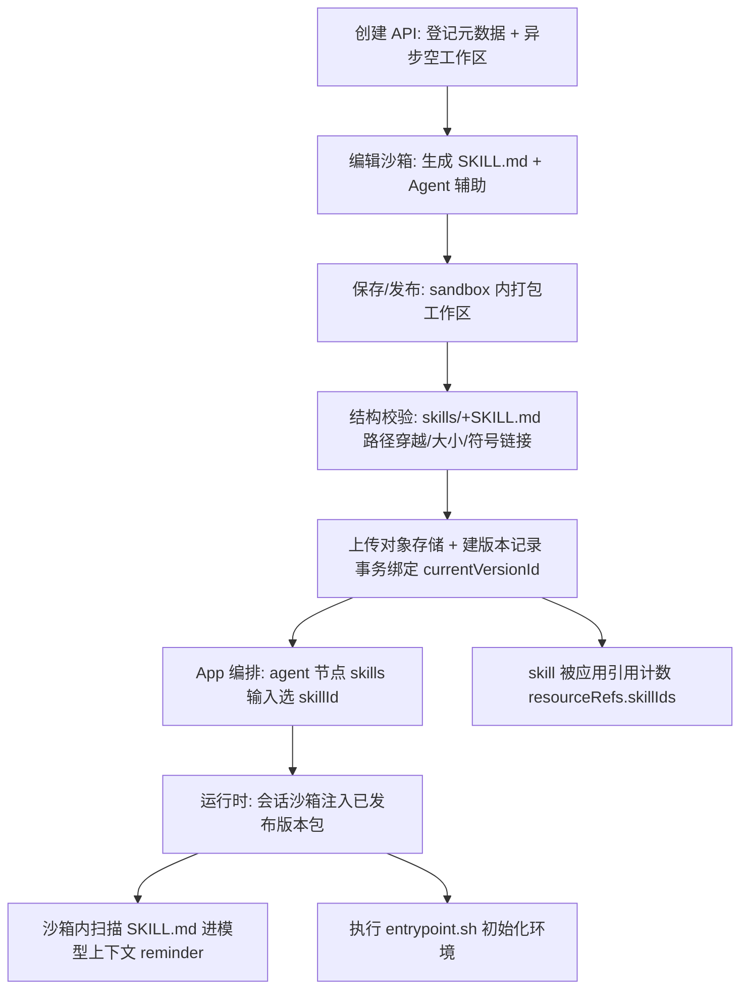

# Skill 体系：把「做事方式」打包成可复用、可治理、可注入会话的能力单元

> 定位：系列第三篇。前两篇讲了工作流引擎（[`workflow-engine.md`](workflow-engine.md)）如何把节点编排成执行图、Agent 循环与会话链路（[`agent-chat.md`](agent-chat.md)）如何驱动一轮对话在 agent 循环里运转。本篇回答：**Skill（技能）到底是什么、和普通工作流/工具有何区别、被如何定义、打包、版本化、加载并注入会话上下文**。
>
> 阅读前提：读者已知道 FastGPT 把「一次 LLM 对话」变成「可编排的工作流运行时」。Skill 是工作流之上的**可复用编排单元**——它不是被 workflow 调用，而是反过来把 workflow / agent / 工具 / 提示词打包成一个「技能包」，让应用编排时像插件一样把它挂进对话。
>
> 仓库根：`/Users/morehao/Documents/study/ai-agent/FastGPT`。本篇引用全部为仓库相对路径 + 行号。

## 概览：Skill 是什么

一句话根因：**一次对话里，除了「调工具、查知识库」这种细粒度动作，用户往往希望挂上更大粒度的、可复用的「做事方式」——一组文件、一段 SKILL.md 指令、配上工具和沙箱环境，整体作为一个可以被应用编排引用的能力单元。** 工作流解决「怎么编排」，Skill 解决「把编排产出一个可打包、可发布、可引用、可治理的包」。

Skill 在代码里的形态是两套正交的东西：

- **平台元数据**：`agent_skills` / `agent_skills_versions` 两张表，描述「这个技能叫什么、属于哪个团队/目录、当前哪个版本是激活的」。这是 Skill 的「登记信息」。
- **运行时内容**：一个不可变的 ZIP 包（`SKILL.md` + 可选资源文件），发布时打成版本存对象存储，运行时被注入进会话沙箱，由 agent 扫描 `SKILL.md` 并把技能信息带进模型提示词。这是 Skill 的「实际能力」。

设计上刻意做了「平台管资源、用户写内容」的分工：创建 Skill 只登记元信息和空工作区（`creation/index.ts`），真正的 `SKILL.md` 由用户在编辑沙箱里用 Agent 辅助生成。这与「插件即一段代码 + 一份 manifest」同构，但把「版本化、发布校验、运行态部署」的治理责任收归平台。

### 核心能力清单

| 能力 | 承载模块 | 一句话说明 |
|------|---------|-----------|
| 元数据与目录 | `manage/` | skill 与 folder 共用一表，`type`/`parentId` 表达层级，权限可沿目录继承 |
| 打包 / 解包 | `package/` | ZIP 构建、结构校验、路径穿越/大小/符号链接安全检查、拆出运行态子技能元数据 |
| 版本化 | `version/` | 版本 = 不可变 ZIP + 对象存储 key，`currentVersionId` 指针指向激活版本；发布校验失败不落库 |
| 编辑+调试 | `edit/`、`debugChat/` | 编辑态复用 Sandbox，`editSkillId` 走最小 `start→agent` 工作流跑调试对话 |
| 删除治理 | `delete/` | API 先软删，再投递 BullMQ 后台 worker 清理 S3/沙箱/权限并硬删 |
| 运行态注入 | `sandbox/.../runtime/skill` | 把激活版本注入会话沙箱、扫描 `SKILL.md` 进模型上下文、执行 entrypoint |
| 权限 | `support/permission/skill/auth.ts` | 系统技能只读、目录继承、owner/协作者位运算 |

### 技术栈一览

Skill 本身不发明新技术，复用平台既有基建：MongoDB/Mongoose（`model/schema.ts`）、私有对象存储 S3（`package/storage.ts`）、BullMQ（创建/删除任务队列）、JSZip（打包）、沙箱运行时（Sandbox）、openapi/zod。唯一的「新语法」是 `SKILL.md` 的轻量 YAML frontmatter 解析（`utils.ts`）——刻意用自制轻量解析器而非完整 YAML 库。

## 设计哲学：Skill 与 workflow / 工具的关系

先给一张定位对比，避免误把 Skill 当成「另一种工作流」：

| 维度 | 工作流（Workflow） | 普通工具（HTTP/MCP/子App） | Skill |
|------|------|------|------|
| 最小编排单位 | 节点图 | 单一函数 | 一个可执行目录 + SKILL.md 指令 |
| 有没有「内容资产」 | 无（纯配置） | 无 | 有（`SKILL.md` + 资源文件 + 沙箱环境） |
| 是否版本化发布 | 是（app 版本） | 工具本身即版本 | 是（独立 `agent_skills_versions`） |
| 可复用/被引用方 | 被子 App 引用 | 被工具集/agent 引用 | 被 agent 节点 `skills` 输入引用 |
| 运行载体 | 工作流引擎 | 工作流工具调用 | 会话沙箱（隔离环境） |
| 和 LLM 交互深度 | 节点级 | 单次调用 | SKILL.md 全文进模型上下文 |

关键洞见：**工作流是「编排的机制」，Skill 是「编排的产物」**。一个 Skill 的版本包本质上是一个工作区集合（workspace），里面可以含任意文件、一个标准入口 `skills/<dir>/SKILL.md`。运行时它不被 workflow 当作工具「调用一次」，而是被 agent 当作「环境 + 长期记忆的来源」——`SKILL.md` 全文被扫描进模型上下文，让模型「学会」这个技能的做事方法（`sandbox/application/runtime/skill/core.ts` 的 `getAgentSkillInfos`）。

### 为什么是 Skill 而非直接工作流：四重权衡

1. **复用**：同一套「行业回答模板 + 数据查询脚本」要在多个 app 里反复挂载。工作流要复制整张配置图；Skill 把内容资产做成一个包，一个 `skillId` 就够。
2. **内容资产管理**：工作流的「资产」是离散的配置字段；Skill 的内容是文件系统——需要版本化、需要随包走、需要防路径穿越、需要沙箱隔离执行。这是纯 workflow 节点表达不了的需求维度。
3. **发布治理**：Skill 的发布要走「结构校验 + 上传对象存储 + 事务绑定 currentVersionId + 移除 TTL」的严格链路（`import.ts`、`deploy.ts`），版本不可变并保留历史。这把「一个技能改了会不会破坏正在用它的人」变成可回滚的版本语义。
4. **权限/来源治理**：Skill 分 `system`（平台只读）与 `personal`（团队私有）两种来源（`global/core/ai/skill/constants.ts:1-4`），配合团队/目录继承权限，让「谁能在哪个 app 里用哪个技能」可管理，系统技能不被误改。

> 相比之下，普通工具（HTTP/MCP）解决的是「一次性动作的抽象」，Skill 解决的是「一段可运行的做事方式的打包与治理」。README 里把两者放在「Agent Skill 编排」和「插件能力」两个不同能力条目下——正是这种定位差异的反映。

## Schema 如何定义

### Skill 主表：目录树即数据模型

`agent_skills` 用**一張表同时存文件夹和技能**（`model/schema.ts:44-121`）：

- `type`：`folder` 或 `skill`，`parentId` 构成同一棵目录树。
- `source`：`system` / `personal`，决定只读 vs 团队私有。
- `currentVersionId`：指针，指向激活版本；history 明细不在这里。
- `currentRuntimeSkills`：激活版本里解析出的子技能元数据缓存（供列表/辅助生成直接读）。
- `creationStatus` / `creationError`：异步创建任务的终态（`creating/ready/failed`），保证「创建中」的 skill 也能有稳定 `skillId` 展示。

这种「type 区分、parentId 表达层级、指针引用版本」的组织方式，让权限继承、删除子树、目录查询都落到一个普通 Mongo 查询上（`folder.ts` 的 `findSkillAndAllChildren` 递归按 `parentId` 拉子树）。

### 版本表：可变内容与不可变快照分离

`agent_skills_versions` 只记录真实存在的版本，无删除状态（`version/schema.ts:18-52`）：`skillId` + `storageKey`（对象存储 key）+ `runtimeSkills`（该包内子技能元数据）+ `versionName` + `importSource`。**Skill 本身的「当前状态」不在此表**，而在主表的 `currentVersionId` 指针——这是「可变元数据 / 不可变内容」两个生命周期解耦的关键。

### SKILL.md：Skill 的运行时「入口文件」

`SKILL.md` 是运行时唯一被解析的「可读文档」。`utils.ts:16-48` 用正则切出 `---\n...---` 的 YAML frontmatter，再用自制轻量解析器（`utils.ts:57-116`）读 `name`/`description` 等简单字段。刻意不引入完整 YAML：

- 原因：Skill 规范里 frontmatter 只需要极小的字段子集，复杂 YAML 语法直接报错交给调用方，避免 parser 膨胀和兼容复杂度。
- 代价：扩展 metadata 结构需要自己写解析规则，无法复用 YAML 生态。

## Skill 从定义到进会话：端到端流程

这张图串联 Skill 全生命周期——创建登记、编辑、打包发布、被 app 引用、运行时注入会话。锚点标注在关键转换处。

对照实现，这条链路里的关键转换点：

- **登记创建**：API 先建可见 skill 行，BulMQ worker 异步补空白工作区包并绑 v0 版本（`manage/create.ts:16-29` + `manage/creation/index.ts:89-160`），保证详情页有稳定 `skillId`、打包上传不阻塞请求。
- **打包**：`sandbox/application/skillEdit/runtime.ts:411-558` 的 `packageSkillInSandbox` 在沙箱内拼 `zip -r` 命令打工作区（带 `.gitignore` 排除规则、大小阈值、防注入的 `-prune` 子句），读完 zip 后做 `validateDeployableSkillWorkspacePackage` 校验才返回。
- **发布**：`sandbox/application/skillEdit/deploy.ts:48-174` 上传包 → 事务内 `updateCurrentVersion` + `createVersion` + 移除 S3 TTL → 更新运行沙箱实例的 `versionId`。
- **引用**：app 保存/发布时从 workflow 节点的 `skills` 输入抽 `skillId` 写进 `resourceRefs.skillIds`（`app/resourceRefs.ts:12-38`），列表据此统计 `appCount`。
- **进会话**：agent 节点运行时把 `selectedSkills`/`editSkillId` 汇总成 `skillIds`（`workflow/dispatch/ai/agent/index.ts:144-158`）→ 注入会话沙箱 `injectAgentSkillFilesToSandbox` → 扫描进上下文 `getAgentSkillInfos`。

下一节把「进会话」这条运行时链路单独拆开讲透。

## 深入：Skill 如何被加载进一次真实对话

这是本模块与 workflow-engine、agent-chat 两篇最紧密的咬合点。Skill 不是「被 workflow 节点调用的工具」，而是**被注入到 agent 循环所在的会话沙箱里、并改变模型可见上下文**的运行时依赖。

### 两种进入方式：`editSkillId` 与 `selectedSkills`

在 `workflow/dispatch/ai/agent/index.ts:144-158`：

- 调试态（Skill Edit）：agent 节点输入是 `editSkillId`（隐藏 input），指代「正在编辑的这个 skill」，跑编辑沙箱。
- 正式态（App）：agent 节点输入是 `skills` 数组，每个元素带 `skillId`，是应用编排时从技能库里选中的多技能。

两者统一归并为 `skillIds`，再决定是否真的启用沙箱（`effectiveUseAgentSandbox`）——因为有 skill 依赖就隐式要求 `useAgentSandbox`，平台把它当作「运行时硬依赖」而非可选开关。

### 运行时注入三步走

沙箱是 Skill 运行的载体。整个注入分三步（都在 `sandbox/application/runtime/skill/core.ts`）：

1. **`injectAgentSkillFilesToSandbox`**（`core.ts:135-362`）：按 `skillId` 查主表拿 `currentVersionId`，再从版本表取 `storageKey`，把对象存储里的不可变 ZIP 流式写入沙箱临时目录、沙箱内 `unzip`（命令里内嵌大小/路径遍历校验，见 `core.ts:277-281`），最后 `moveFiles` 到 `projects/<versionId>` 部署目录。**部署目录用 versionId 而非 skill 名**，避免同名技能相互覆盖。鉴权按 app owner 而非当前调用者，保证「发布应用被他人调用时不因调用者缺 skill 权限而跳过注入」（`agent/index.ts:198-199` 注释）。
2. **`getAgentSkillInfos`**（`core.ts:51-126`）：在沙箱里 `find -iname SKILL.md` 扫描，逐文件解析 frontmatter，输出 `{ id, name, description, directory, skillMdPath }[]`——这就是进模型的技能清单。
3. **`runAgentSkillVersionEntrypoints`**（`entrypoint.ts:30-87`）：若版本根目录有 `entrypoint.sh`，在沙箱内限时执行一次（按 versionId 记状态避免重复执行），用于技能自带的环境初始化。

之后这些 `skillInfos` 被回传进 `getCurrentMessages({ skillInfos, currentWorkingDirectory })`（`agent/index.ts:218-221`），由上下文构造把每个技能的 `name`/`description`/`SKILL.md` 路径放进本轮模型 reminder。模型据此「知道当前沙箱里有哪几个技能、各自的说明书在哪」，按需读取完整 `SKILL.md` 来组织行动。

### 为什么用沙箱而不是塞进 workflow 节点

对比「普通工作流工具」：工具是「模型选一个函数，平台执行并回结果」，上下文开销小、无环境。而 Skill 的核心是「**有一整套文件 + 一条长期指令，需要在隔离环境里反复读写**」。把文件系统、可执行脚本、状态放进子 App 之外独立的 `projects/<versionId>` 目录，能：

- 隔离多个技能、保证同一技能多版本互不污染（`createSkillPackage` 结构标准化 + versionId 目录）。
- 让「代码技能」真正可运行（能 `pip`/`npm` 装依赖、跑脚本），而不是只读文本。
- 通过上下文注入 `SKILL.md` 元信息而不是全文，控制 token 开销——「模型必须先读匹配 Skill 的完整 SKILL.md，不能仅凭描述推断」（设计文档 index.md:47）。

> 这是 Skill 与普通 workflow/工具最本质的差别：**workflow 提供编排机制，工具提供单次能力，Skill 提供「携带环境与长期说明的可复用工作区」**。

## 与其他模块的协同

### 与 App 编排：`resourceRefs` 与 `appCount`

App 如何「引用」skill，答案是反向的——不是 skill 引用 app，而是 app 从自己 workflow 节点的 `skills` 输入里抽取被引用的 skillId，写进 `apps.resourceRefs.skillIds`（`app/resourceRefs.ts:12-38` 双库两版：`apps.resourceRefs` 是最新发布缓存，`app_versions.resourceRefs` 是版本事实记录）。Skill 列表用它做 `appCount` 统计（`manage/list.ts:277-297`）。

### 与 workflow 引擎：Skill 只是 agent 节点的一个输入

Skill 不新增 workflow 节点类型，它只是 `agent` 节点的 `NodeInputKeyEnum.skills` 输入（含 `editSkillId`）。agent 循环的其余机制（工具选择、记忆、SSE、usage）全部复用。调试态刻意复用同一套：`debugChat/runtime.ts:24-142` 构建一个最小的 `workflowStart → agent` 两节点图，通过 `editSkillId` 指进编辑沙盒——「调试也是一个真实可跑的 workflow，只是节点少了」。

### 与 chat 链路：`sourceType/sourceId` 复用标准 Chat

Skill Edit 会话不是独立聊天系统，而是复用标准 CRUD/SSE/记录/恢复链路，通过新增 `sourceType/sourceId` 维度与 App 会话区分（设计文档 `skill-edit-chat-source-type.md`）。物理上 chat 三表 `appId` 字段仍在，语义退化为 `sourceId`；调试沙箱 `getRunningSkillEditSandbox` 用 `getEditDebugSandboxId(skillId)` 计算固定 sandboxId（`edit/config.ts:6-11`），消除「伪 appId」混淆。

### 与权限模型

Skill 权限分两层读取（`support/permission/skill/auth.ts:30-115`）：
- 系统技能（`source=system`）全员只读，写/管理一律拒绝。
- 个人技能：owner/创建者 owner 级；普通成员合并「父目录权限 + 自身权限」。`inheritPermission` 控制是否向上继承。

运行时注入也会逐 skill 做读权限检查，失败仅跳过该 skill 而不中断整个会话（`core.ts:192-215`）。

【待复核】app/tool 中的 workflowTool 虽然是「工具」而非 skill，但同样以 `skills`-style 引用工作流并挂进 agent 节点。Skill 与 workflowTool 是否共用同一份 `selectedTools` 运行时注入回路（`getSubapps`），需要结合 `workflowTool/service.ts` 与 `agent/index.ts:231-239` 对读确认。

## 关键设计决策

### 决策一：版本 = 不可变 ZIP + 对象存储 key + TTL，而非数据库内可变行

设计权衡：Skill 内容（文件系统）不适合存进 Mongo，改为「发布时打成不可变 ZIP 进私有对象存储，版本表只留 storageKey」。这个选择的回报与代价：

- 回报：历史版本天然不可变、可回滚；对象存储天然适合大文件和流式；发布校验失败不落库，杜绝「半成品版本」。
- 代价：引入 S3 TTL 与 Mongo 事务的一致性治理——上传先带 TTL，成功绑定 `currentVersionId` 才在事务内移除 TTL，事务失败则由 S3 cleanup cron 收孤儿包（`package/storage.ts:92-104` + `manage/import.ts:67-91`）。这套「上传-绑定-清 TTL」的编排是快照收益背后的复杂度。
- 折中：`deleteSkillAllPackages` 用异步删除队列，不阻塞软删返回。

### 决策二：Skill 与 Folder 同表、权限沿目录继承

用 `type` + `parentId` 把文件夹与技能放一张表，而不是两张。回报：目录树查询、子树删除、权限继承都收敛到普通 Mongo 结构（`model/schema.ts` 索引 + `folder.ts` 递归）。代价是 schema 语义变「宽」，且查询要处处带 `deleteTime: null` 软删过滤、`type` 分支（`manage/list.ts` 对 folder/skill 分别算权限与占位）。若目录与技能是两类权重不同的实体，同表会让字段校验/迁移更绕——但目前粒度够用。

### 决策三：调试复用标准 Chat + `sourceType/sourceId` 双轨

Skill Edit 不另起炉灶，而是复用标准 chat 三表与 API，用一个业务语义层维度 `sourceType/sourceId` 区分 App 与 SkillEdit（设计文档 `skill-edit-chat-source-type.md:33-81`）。回报：调试、记录、恢复、计费全部复用成熟链路，不用写第二套聊天栈。代价：为兼容海量历史 App 数据（缺 `sourceType`），查询要 `$or` 兜底 legacy 行、S3 key 要分新旧前缀、唯一索引要从 `{appId,chatId}` 迁到 `{sourceType,appId,chatId}`——一次不小的迁移成本。`usage` 也刻意 `skillId` 与 `appId` 分开，避免污染计费审计。

## 亮点与问题

### 亮点

- **权限与内容分离的治理闭环**：平台管注册/版本/发布校验，用户只写内容，改动必须走版本工作流（`manage/update.ts:14-19` 明确 updateSkill 不改 SKILL.md，强制内容变更走版本），从机制上杜绝「改坏正在运行的版本」。
- **安全边界扎实**：ZIP 解压前做路径穿越、绝对路径、符号链接、未压缩大小多重校验（`package/zipBuilder.ts:324-400` 与运行时沙箱内 `unzip` 命令内嵌校验双保险）；目录名经 `getSafeSkillDirectoryName` 清洗。
- **删除一致性**：软删立即生效（列表/鉴权/注入不可见），后台 worker 完成外部资源清理与硬删，且 worker 启动会 `resume` 漏删任务（`delete/index.ts:32-69`）——崩溃安全设计的范本。
- **幂等与可恢复**：create/delete 都用 BullMQ jobId 幂等、worker 启动补偿 pending/漏删任务，创建失败保留可见行便于诊断（`manage/creation/index.ts:42-80`）。

### 问题 / 风险

- **内容实质可解析深度有限**：`SKILL.md` 只有轻量 frontmatter 解析，未解读技能正文结构；运行时把目录 / `SKILL.md` 路径交给模型，实际「技能如何被模型遵守」依赖模型指令遵循能力，平台侧缺少对 `SKILL.md` 正文的 schema 化校验（【待复核】——设计文档称「frontmatter 满足平台解析要求即通过」）。
- **平台与内容强耦合于沙箱**：Skill 的运行高度依赖 Sandbox 运行时（注入、扫描、entrypoint、打包都在沙箱内完成）。沙箱是硬前置依赖，这也与 README「系统工具热更新（[x]）、RAG/Agent-loop 热更新（[ ]）」的能力清单对照——目前只热更「工具」这一层，agent 循环与 RAG 的插件式热替换尚未实现（README.md:93-97）。
- **历史版本可回退但「现有状态」易丢**：版本表只存「真实发布过的版本」且无删除状态；当前激活状态全在主表 `currentVersionId` 指针。若多次发布后想回到「旧的当前」而该版本仍存在则可回退；但删除版本记录会使指针悬空——`getCurrentVersion` 对 `currentVersionId` 找不到版本时返回 null（`version/query.ts:23-37`），调用方需处理悬空指针。

## 总结（回扣根因）

Skill 在 FastGPT 里不是「第三种节点」，而是「workflow 编排产物的可打包治理单元」。它把「一组文件 + SKILL.md 指令 + 沙箱环境」封装成版本化的不可变快照，让应用编排用一个 `skillId` 就能挂进对话；运行时不是被 workflow「调用」，而是被注入到 agent 所在的会话沙箱、把 `SKILL.md` 变为模型可见的长期上下文——这正回答了「一次对话除了纯工具还能挂哪些能力」：可以挂「一整块携带环境与说明可执行的工作方式」。它为下一篇「知识库 RAG」埋下伏笔：Agent 应用里既能挂工具，也能挂需要环境执行、需要长期记忆的技能，RAG 则回答「怎么把外部知识也织进这同一轮对话的检索轨道」。

---

## 附：真源引用说明与覆盖率

本篇所有 `{仓库相对路径:行号}` 引用均来自对真实源码的逐字读取，已由程序校验工具对核心引用重新定位；以下是直接支撑文案的关键引用（行号以源码为准）：

- Skill 来源/分类枚举：`packages/global/core/ai/skill/constants.ts:1-4`
- 主表 schema（type/parentId/指针/状态）：[packages/service/core/ai/skill/model/schema.ts:44-51]()
<!-- anchor: const AgentSkillsSchema = new Schema({ … type: { -->
- 版本表 schema：[packages/service/core/ai/skill/version/schema.ts:18-52]()
- 空工作区异步创建：`packages/service/core/ai/skill/manage/creation/index.ts:89-160`
- 导入即版本：`packages/service/core/ai/skill/manage/import.ts:32-91`
- ZIP 安全校验：`packages/service/core/ai/skill/package/zipBuilder.ts:324-400`
- 对象存储 TTL 治理：`packages/service/core/ai/skill/package/storage.ts:92-104`
- 编辑调试最小 workflow：`packages/service/core/ai/skill/debugChat/runtime.ts:24-142`
- 运行时注入/扫描：`packages/service/core/ai/sandbox/application/runtime/skill/core.ts:135-362`、`:51-126`
- entrypoint 幂等执行：`packages/service/core/ai/sandbox/application/runtime/skill/entrypoint.ts:30-87`
- agent 节点归并 skillIds：`packages/service/core/workflow/dispatch/ai/agent/index.ts:144-158`
- app 引用抽取：`packages/service/core/app/resourceRefs.ts:12-38`
- skill 权限：`packages/service/support/permission/skill/auth.ts:30-115`

### 覆盖率表

| 文件 | 总行数 | 已读行数 | 覆盖率 | 未读原因 |
|------|-------|---------|--------|---------|
| skill/utils.ts | 279 | 279 | 100% ✅ | — |
| skill/manage/create.ts | 29 | 29 | 100% ✅ | — |
| skill/manage/list.ts | 308 | 308 | 100% ✅ | — |
| skill/manage/query.ts | 38 | 38 | 100% ✅ | — |
| skill/manage/update.ts | 98 | 98 | 100% ✅ | — |
| skill/manage/import.ts | 92 | 92 | 100% ✅ | — |
| skill/manage/folder.ts | 161 | 161 | 100% ✅ | — |
| skill/manage/delete.ts | 64 | 64 | 100% ✅ | — |
| skill/manage/types.ts | 19 | 19 | 100% ✅ | — |
| skill/manage/index.ts | 14 | 14 | 100% ✅ | — |
| skill/manage/creation/index.ts | 231 | 231 | 100% ✅ | — |
| skill/package/index.ts | 10 | 10 | 100% ✅ | — |
| skill/package/zipBuilder.ts | 545 | 545 | 100% ✅ | — |
| skill/package/storage.ts | 213 | 213 | 100% ✅ | — |
| skill/package/runtimeMetadata.ts | 92 | 92 | 100% ✅ | — |
| skill/package/constants.ts | 80 | 80 | 100% ✅ | — |
| skill/version/schema.ts | 62 | 62 | 100% ✅ | — |
| skill/version/create.ts | 21 | 21 | 100% ✅ | — |
| skill/version/query.ts | 57 | 57 | 100% ✅ | — |
| skill/version/types.ts | 16 | 16 | 100% ✅ | — |
| skill/version/index.ts | 9 | 9 | 100% ✅ | — |
| skill/edit/config.ts | 11 | 11 | 100% ✅ | — |
| skill/edit/index.ts | 7 | 7 | 100% ✅ | — |
| skill/debugChat/handler.ts | 365 | 365 | 100% ✅ | — |
| skill/debugChat/runtime.ts | 142 | 142 | 100% ✅ | — |
| skill/debugChat/index.ts | 2 | 2 | 100% ✅ | — |
| skill/delete/index.ts | 77 | 77 | 100% ✅ | — |
| skill/delete/processor.ts | 144 | 144 | 100% ✅ | — |
| skill/model/schema.ts | 139 | 139 | 100% ✅ | — |
| skill/model/index.ts | 1 | 1 | 100% ✅ | — |
| global/core/ai/skill/type.ts | 174 | 174 | 100% ✅ | — |
| global/core/ai/skill/constants.ts | 30 | 30 | 100% ✅ | — |
| global/core/ai/skill/api.ts | 1 | 1 | 100% ✅ | — |
| global/core/ai/skill/collaborator.ts | 5 | 5 | 100% ✅ | — |
| global/core/ai/skill/runtime/builtin.ts | 9 | 9 | 100% ✅ | — |
| sandbox/application/runtime/skill/core.ts | 400 | 400 | 100% ✅ | — |
| sandbox/application/runtime/skill/prepare.ts | 91 | 91 | 100% ✅ | — |
| sandbox/application/runtime/skill/index.ts | 9 | 9 | 100% ✅ | — |
| sandbox/application/runtime/skill/builtin.ts | 118 | 118 | 100% ✅ | — |
| sandbox/application/runtime/skill/entrypoint.ts | 87 | 87 | 100% ✅ | — |
| sandbox/application/runtime/skill/types.ts | 25 | 25 | 100% ✅ | — |
| sandbox/application/skillEdit/runtime.ts | 607 | 607 | 100% ✅ | — |
| sandbox/application/skillEdit/deploy.ts | 174 | 174 | 100% ✅ | — |
| app/resourceRefs.ts | 53 | 53 | 100% ✅ | — |
| support/permission/skill/auth.ts | 147 | 147 | 100% ✅ | — |
| **skill 核心小计** | **~5030** | **~5030** | **100% ✅** | — |

**部分覆盖 / 非本模块核心（供参考）：**

| 文件 | 总行数 | 已读行数 | 覆盖率 | 未读原因 |
|------|-------|---------|--------|---------|
| app/tool/workflowTool/index.ts | 130 | 0 | 0% | 属 app/tool 模块，本稿仅引 DESIGN，未深入 |
| app/tool/workflowTool/service.ts | 31 | 0 | 0% | 同上 |
| app/tool/workflowTool/utils.ts | 117 | 0 | 0% | 同上 |
| app/tool/DESIGN.md | 14 | 14 | 100% | — |
| design/core/skill-edit-chat-source-type-tech-plan.md | ~660 | 0 | 0% | 与已读 `.md` 设计文档同源，属技术实施细节，未逐个核对 |

> 说明：本解读聚焦 `skill/**` 模块及其直接运行时（沙箱 skill 注入/扫描、agent 接入、app 引用、auth）。`app/tool` 目录是「工具」而非「Skill」的仓储，对理解 Skill 体系非核心；workflowTool 与 skill 是否共用同一份 `selectedTools` 运行时注入回路，属【待复核】，如需可补读 `app/tool/workflowTool/*` 后再确认。
